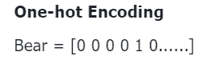
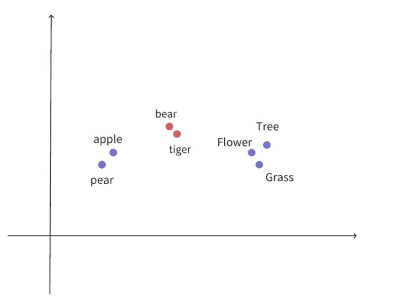
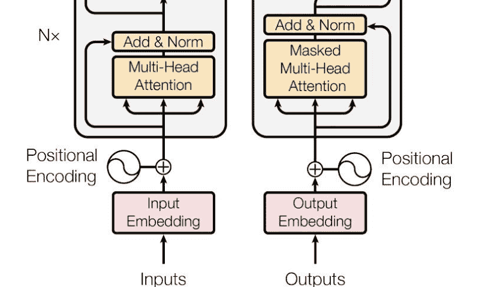
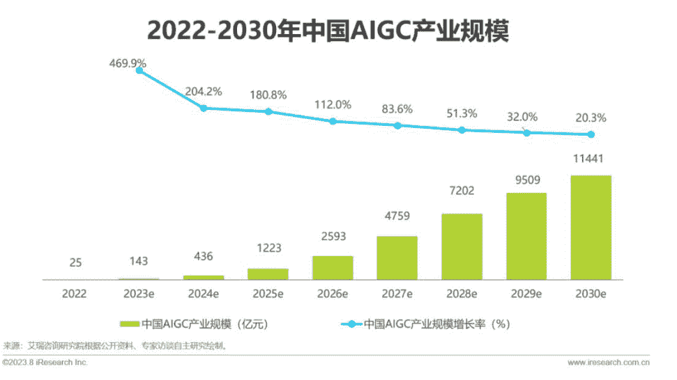
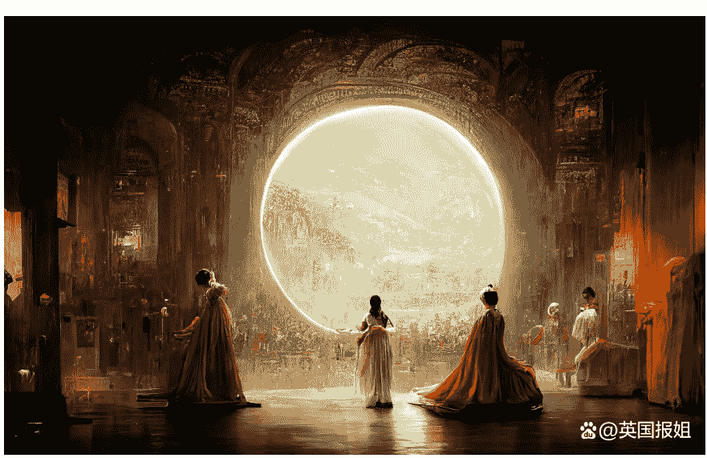

# 1.2 AIGC_陈睿

> 来源：[https://datawhaler.feishu.cn/docx/KnbLdpXfVoOEAHxNhy0cQufvnhd](https://datawhaler.feishu.cn/docx/KnbLdpXfVoOEAHxNhy0cQufvnhd)

| 版本信息 | **内容版本号** | V1.0 |  |
| --- | --- | --- | --- |
|  | **最近更新时间** | 2024.11.24 |  |
|  | **历史更新** | 2024.11.24：V1.0内容发布 |  |
|  | **内容信息** | +   **所属版本**：**AI通识课-零基础版 ** |  |
| 贡献详情 | **最近贡献** |  |  |
|  | **内容贡献** | 陈睿 |  |
|  | **内测反馈** | 左俊威 |  |
|  | 更多贡献详情见：[致谢AI通识课贡献者们](https://datawhaler.feishu.cn/wiki/HnMiwEzpdiLvWRkfbvFcaJFLnSg) |  |  |

“在人工智能技术的飞速发展下，AIGC已经成为一个备受瞩目的领域。从绘画、写作到音乐创作，AI正以前所未有的速度和创造力，改变着内容生产的传统模式。本文将带您深入了解AIGC的魅力所在，探讨其如何颠覆行业格局，为人类带来无限可能。让我们一起揭开这场内容革命的面纱，探索AI在创意领域的无限潜能。”

## 1.AIGC的过去：曾不可逾越的天堑

AIGC（Artificial Intelligence Generated Content），又称人工智能生成内容，即所生成的文章、音频等均由AI创作完成，如文本生成图像、文本生成文本、文本生成音乐、文本生成视频等。这一概念出现于19世纪中期，当时的AI尚处于萌芽阶段，人们通过机器学习理论制造出了简单的“人工智能”并用于乐曲创作。1957年，美国作曲家Lejaren Hiller基于马尔可夫模型完成了《伊莉亚克组曲》，这是第一支大量使用计算机完成的音乐。这对当时的人们来说无疑是十分新颖的技术，不过受限于设备算力的限制以及理论的缺失，并没有将AI的发展推向高峰。

传统机器学习模型通常以线性问题为解决目标，难以实现对于复杂问题的计算；神经网络通过模拟人类神经元的方式，虽然可以实现强大的计算能力，但是对算力有着极大的要求；而缺乏对大量文本的处理形式，导致数据库始终无法获得良好的扩充。这一项项技术的欠缺，成为了压倒AI这只“骆驼”最后的稻草。

直到20世纪末，CPU与GPU的随着材料与结构的不断升级，算力逐渐提高，这使得人们重新拾起了曾被遗忘的神经网络，各种模型与框架如雨后春笋般冒出：CNN的出现、代表着文生图领域的diffusion模型、轰动一时的Transformer架构......它们以恐怖的速度推动着AI的发展。也就是在这时，AIGC正式宣布进入倒计时，成为继PGC（专业生成内容）、UGC（用户生成内容）、PUGC（专业用户生成内容）之后新的内容创作形式。

## 2.AIGC的现在

2024年的今天，AIGC已经充斥着我们的生活。也许你还没感觉到，哈哈，不妨移回开头再仔细看看，这篇文章的开头引号部分的文本正是由AI生成的，对于这类可以生成图片、视频等内容的人工智能，我们将其称为生成式AI（GAI, Generative Artificial Intelligence）。而说到到生成式AI，就不得不提到两个耳熟能详的词：“大模型”与“ChatGPT”。

### 2.1ChatGPT：“一夜爆火的明星”

说到ChatGPT大家可能都不陌生，但聊到它为什么能够拥有如此神奇的能力未免也要愣上一愣。别急，马上就讲给你听。“Chat”一词表示“聊天”，而GPT则是Generative Pre-train Transformer，其中“Generative”表示生成式，而“Pre-train”则是“预训练”的意思。就如同一场大型演出前经过不断彩排的演员们，只有在彩排中达到了优异的效果，才能登上舞台进行演出。

Transformer与Encoding

至于Transformer，放在最后出场就已经代表了它的地位，在前文中也大致讲述了Transformer的整体架构。作为chatgpt的核心部分，Transformer强大的自注意力机制（self-attention）能够实现对于文本的编码与转化。例如，“This is a bear”（这是一只熊）与"when the misery is more than I can bear "（当我无法忍受痛苦的时候）中的“bear”明显不是同一个意思。前文中的“bear”指代熊，而后文中的“bear”则是忍受的意思。对于人类来说，通过前后语义的理解可以揣摩出两句话中bear一词不同的含义；但是机器并不能像人类一样思考，不知道这么一长串英语单词究竟代表着什么，其中有着怎么样的关联。

我们把对于语言的理解可以看为编码。通俗易懂的说，就是将“bear”一词转化为了我们所认识的拼音“xiong”或者“renshou”。而解码就是按照汉语拼音表把这两个拼音转化为“熊”与“忍受”。通过这种编码转换为机器认识的语言再解码的形式，就可以使得机器“理解”内容。而在编码（Encoding)中，最为我们所熟知的编码形式就是One-hot encoding（独热编码），将单词转化为一个一维数据，用0和1记录单词的特征。

独热编码是传统计算机数据库的产物，而在人工智能领域中，词嵌入（Word Embedding）成为了取代One-hot encoding的编码形式。不同于独热编码的一维数据形式，词嵌入将语义接近的词汇映射在相近的空间。需要注意的是，此处的词嵌入只是一个简单的二维空间表现形式，真实的维度非常高

除了词嵌入，在encoding中还有另外一个更有趣的部分：位置编码（position encoding）。让我们再举一个例子吧，“你欠我一百万”和“我欠你一百万”这两句话，你肯定不希望是“你”欠我一百万；但对于Transformer来说，它会将所有的时序全都丢掉丢掉。科学家们为了避免“自己欠别人一百万”的这种尴尬事情发生，于是在词嵌入时加入了位置编码层，用于记录每一个数据所在的对应位置，再与嵌入进行叠加后输入模型进行运算。

总的来说，Transformer是一个凝聚了科学家们无数心血的产物，它的神秘之处也远远不止于此；通过无数个Transformer网络叠加，塑造了ChatGPT等多个生成式大模型的核心基础。自模型发布以来，又有无数的科研人员投入其中，研究出了许多Transformer的变种：在CV领域大放光彩的Vision Transformer，降低了大模型训练成本的Reformer等等......当然，作为一篇导论，我们对于这个“庞然大物”也只能是究其冰山一角。欢迎大家随着本课程继续深入学习，逐渐探索属于AI的无限魅力。

## 3.AIGC的未来：避无可避的AI时代

说了这么多，生成式AI与AIGC想必已经很吸引你的眼球了吧。截止2023年，AIGC产业规模已达143亿元，随着设备设施的完善与概念普及，接下来的发展将会稳步提升。根据相关预测，在2024年将会达到1223亿元；在2030年的未来，产业规模有望突破万亿元，达到11441亿元。可以说AI，未来已来。

凭借GAI强大的能力，AIGC已经在潜移默化的改变着我们的生活

在将来，生成式AI将会进入到许多行业，如文学行业、绘画行业、视频行业等。成为他们密不可分的创意来源之一。文学工作者借助生成式AI进行学习，能够更快的了解历史上许多文豪的笔风，提高创作水平；而绘画工作者们可以使用AI进行绘制基本的草图，在进行塑造和完善；在2022年的美国科多罗拉州博览会的艺术比赛中，第一名由一幅《太空歌剧院》摘下。而这幅画正是由MidJourny生成的，这在当时引起了不小的震动。

**·生成式AI进军游戏圈：**2023年4月，随着一款小游戏《病娇AI猫娘女友模拟器》的出现，让“游戏大模型”的概念开始被更多的玩家所知晓；早在18年索尼推出的PC神作《底特律人》时，就想打开更加自由的故事线，但当时受限于AI技术并不成熟，所以并没有做到。而游戏大模型的接入，会让角色有着更加独立的思考能力而不是依靠既定的算法，可以让每一个玩家都有着独一无二的游戏体验。

**·传媒行业：**AI可以通过语音识别技术，将语音转化为文字，减少了前期需要通过录音才能撰写稿件的麻烦；除此之外，还可以通过AIGC进行内容性的创作。在2022年的冬奥会期间，央视频就曾用过AI剪辑智能生成有关冰雪项目的集锦，帮助全世界的朋友们更方便的观看到冬奥会。

**·娱乐行业：**通过AIGC的图像生成功能，可以研究出许多好玩的小游戏。抖音中就有很多好玩的换脸、滤镜以及视频互动的游戏；此外，得益于这项技术，虚拟主播以及许多虚拟形象开始爆火。他们借助AIGC塑造出可爱的角色，吸引了无数男女老少的眼球。

AIGC的应用远远不止于此。随着AI技术的不断突破，这项技术会走进更多的行业，为我们的生产工作带来极大的便利。

### 3.1AIGC的安全：敢问路在何方

身处AIGC的浪潮中的我们，需要想的更多。deep-fake（深度伪造技术）等技术的出现让我们不得不对AI这个“潘多拉魔盒”审慎起来。Deep-fake被不怀好意的人用来“换脸”，以达到歪曲事实、污蔑他人的不法行径。而错误信息的传播和凭空捏造的信息一经谣传，将会在这个互联网发达的时代引发一片又一片的震动。

2024年8月，随着一条🧣的出现，“N号房2.0事件”彻底炸开了锅，受到Deep-fake波及的受害者超过22万人。起因是有人使用相关技术将身边女性的照片进行非法合成，以达到威胁勒索目的。这一行为虽然被迅速打压，但是相关的技术却被全面铺开，到最后甚至只要一张照片就可以进行deep-fake。有些受害者回忆道，走在路上都有可能被偷拍，人人都可能是“恶魔”。她们不得不变成“降临派”，像其他国家的人伸出援手。同年9月，来自中科院的一支团队开源了一款AI模型 “DeepfakeDenfenders”。这款AI模型可以执行分类任务，即识别哪些图片或视频是经过深度伪造的，以此保护那些受到deep-fake伤害的女性们。他们还表示，这款AI模型将会被免费开放，并且后续会制作成应用，降低使用的门槛。

也许技术无错，所以伦理安全的问题才更需要重视。我相信在并不那么遥远的一天，更加完善的生成式AI产品会带给我们更安全、更舒心的体验。

## 参考文献

[1]https://zhuanlan.zhihu.com/p/51285106

[2]https://www.36kr.com/p/2399958967312512

[3]https://github.com/VisionRush/DeepFakeDefenders

[4]https://arxiv.org/abs/1706.03762

[5]https://zhuanlan.zhihu.com/p/607822576

[6][h](https://baijiahao.baidu.com/s?id=1743926649610112013&wfr=spider&for=pc)ttps://baijiahao.baidu.com/s?id=1743926649610112013&wfr=spider&for=pc

[7]AIGC发展研究资料2.0-清华大学-2024.1-211页

[8]《涌现：AI大模型赋能千行百业》赵永新