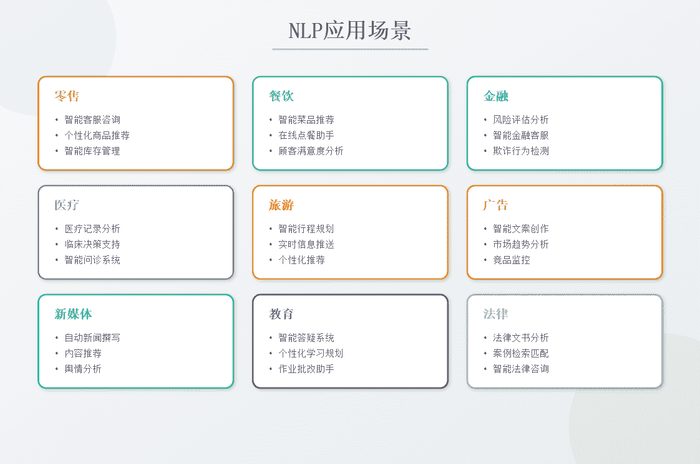

# 1.2 NLP_秀宝

> 来源：[https://datawhaler.feishu.cn/docx/ZyY2dSfi1o2xi2xsg4dcZ7OXnzg](https://datawhaler.feishu.cn/docx/ZyY2dSfi1o2xi2xsg4dcZ7OXnzg)

| 版本信息 | **内容版本号** | V1.0 |  |
| --- | --- | --- | --- |
|  | **最近更新时间** | 2024.11.24 |  |
|  | **历史更新** | 2024.11.24：V1.0内容发布 |  |
|  | **内容信息** | +   **所属版本**：**AI通识课-零基础版 ** |  |
| 贡献详情 | **最近贡献** |  |  |
|  | **内容贡献** | 王星辰 |  |
|  | **内测反馈** |  |  |
|  | 更多贡献详情见：[致谢AI通识课贡献者们](https://datawhaler.feishu.cn/wiki/HnMiwEzpdiLvWRkfbvFcaJFLnSg) |  |  |

# 人工智能在自然语言处理领域的应用

# 一、什么是自然语言处理

语言是界定人类与其他生物的本质特征，它不仅是人类独有的交流工具，还深刻关联着人类的多种智能发展。在浩瀚的生物界中，唯有人类掌握了复杂的语言能力，这种能力不仅构成了人类逻辑思维的基本形式，也是绝大部分知识得以传承与积累的关键载体。因此，在探索人工智能的广阔领域中，语言处理成为了不可或缺且核心的一环。

自然语言，指的是诸如汉语、英语、德语和法语等人类日常使用的语言，它们通过听、说、读、写等多种方式被广泛应用。人类语言之所以被冠以“自然”之名，是因为它是自然演化的结果，伴随着人类社会在生产生活实践中的需求变化而逐渐发展形成。相比之下，计算机编程语言则是人类为了与计算机进行精确、无误的指令交流而精心设计的符号与规则体系，它完全出自人类的创造，旨在确保指令能够完整且精确地传达给计算机执行。

自然语言处理（Natural Language Processing, NLP）专注于利用先进的计算机技术深入分析、精准理解和高效处理自然语言信息。这是一门跨学科的科学，巧妙融合了语言学、计算机科学以及数学的精髓，旨在将计算机转变为语言研究的强大引擎，通过量化分析语言信息，促进人机间以自然语言为媒介的有效通信。

实现人机自然语言通信的愿景，要求计算机既能深刻领悟自然语言文本的内涵，又能以自然语言流畅表达预设的意图与思想。这一过程分解为两大核心任务：①自然语言理解（NLU），即让计算机解读并领悟文本含义；②自然语言生成（NLG），即让计算机能够创造符合语境的自然语言输出。

随着科技进步，特定应用场景下具备一定自然语言处理能力的实用系统已逐步成为现实，这些系统不仅提升了效率，更在某些领域实现了商业化乃至产业化发展。以下是一些典型的自然语言处理应用实例：

# 二、自然语言处理的处理难点

自然语言处理技术极为复杂且深奥，也因此被誉为“人工智能皇冠上的明珠”。这一美誉不仅凸显了其在人工智能领域中的核心地位，还深刻揭示了其面临的巨大挑战。其挑战性主要体现在以下几个方面：

## 2.1 歧义性

自然语言在各个层面都广泛存在着多种多样的歧义性。从形式上看，自然语言文本是由字符（涵盖中文汉字、英文字母及各种符号）构成的字符串。这些字符能够组合成词，词又能进一步组成词组，词组再构成句子，句子再汇聚成段落，最终构成完整的篇章。无论是在哪个语言单元粒度上，还是在从一个层级向更高层级转变的过程中，都不可避免地会出现歧义和多义的现象。举几个例子：

+   **切分歧义**：采用不同的句子切分方式，产生不同的分词结果

> 句子：这份报告，我写不好

> 切分方式1：这份报告，我写 | 不好

> 切分方式2：这份报告，我 | 写不好

切分方式1强调”这份报告不该我来写“，切分方式2强调”我个人能力不够，写不好这份报告“

+   **词义歧义**：通常指一词多义产生的歧义

> 原句：人要是行，干一行，行一行。一行行，行行行；要是不行，干一行，不行一行。一行不行，行行不行

> 发音：人要是行，干一航，行一航。一航行，航航行；要是不行，干一航，不行一航。一航不行，航航不行

”行“读”xing“时，表示能力；读”hang“时，表示行业

+   **指代歧义**：指代词（如我，你，他）和代词词组（如“那件事”，“这一点”）所指的事件可能存在歧义

> 句子：山上的水宝贵，我们把它留给晚上来的人喝

“晚上来的人”既可以指“夜晚上山来”的人，也可以指“比我们后来一步”的人

+   **语用歧义**：指由于上下文、说话人属性、场景等语用方面的原因造成的歧义

> 领导：你这是什么意思？

> 小王：没什么意思，意思意思

> 领导：你这就不够意思了

> 小王：小意思，小意思

> 领导：你这人真有意思

> 小王：其实我也没有别的意思

> 领导：那我就不好意思了

> 小王：是我不好意思

汉语文化真是博大精深！

## 2.2 容错性

当人们阅读一段文字时，大脑会优先处理整体结构，而不是逐字逐句地解析。这种整体性知觉使得大脑能够快速识别熟悉的句子结构，并在潜意识中对颠倒的词语进行自动纠正。例如，“研表究明，汉字的序顺并不定一能影阅响读”这句话，尽管词语顺序被打乱，但大脑会根据记忆中的正确顺序自动纠正，使得阅读变得通顺。

另外，即便是在经过严格筛选与多重校对的书籍中，文字也难以做到百分之百的准确无误。这不仅仅是因为人力的局限性和可能的疏忽，更在于语言的复杂性和多样性。而对于网络上浩如烟海的网文而言，其发布的随意性和即时性更是加剧了错别字、病句等语言不规范现象的出现。然而，尽管这些错误时有发生，但它们往往并不会对文章的整体意思造成根本性的影响。

自然语言的容错性和读者的理解能力共同展现了其独特的魅力，但同时也对计算机的处理能力提出了严峻的要求。计算机缺乏人类所拥有的语言感知能力和理解力，它们无法像人类一样灵活地解读和纠正文本中的错误。因此，当面对含有错别字、病句等不规范现象的文本时，计算机往往难以准确地进行语义分析和理解，这无疑对其处理能力造成了极大的考验。

## 2.3 易变性

自然语言，尽管在漫长的发展历程中逐步确立了一套相对稳定的语法规则和词汇体系，但其本质上是一种动态演变的语言现象。在自然语言的框架内，每位语言使用者都拥有相当的自由度和创造性，能够基于实际需求、文化变迁及个人表达的需要，自由地创造新词、推广新用法，并持续地为既有词汇注入新的语义内涵。这一过程不仅促进了语言的丰富性和多样性，也导致了古代词语与现代词语之间存在显著的差异。

随着科技的进步和社会的发展，大量新兴词汇应运而生。例如，“互联网”、“云计算”、“区块链”等术语，都是近年来随着信息技术的发展而被广泛接受的新词汇。与此同时，中西方文化的交流融合也为语言注入了新的活力。在这一过程中，“Long time no see”这样的中式英语表达，凭借其简洁明了、易于理解的特点，逐渐被英语国家的人们所接受，甚至被正式收录进英语词典。

此外，语言使用者还不断为既有词汇赋予新的含义。以“萌”为例，该词原指植物发芽或事物开始发生，但在网络语境下，它被赋予了“可爱、有趣”的新含义，并广泛应用于描述动漫角色、宠物等。这种词汇意义的拓展和演变，既体现了语言的社会性和时代性，也展示了语言在适应社会发展过程中的灵活性和创造力。

# 三、自然语言处理的任务层次

语言虽然表示成一连串文字符号，但内部其实是一个层次化的结构，从语言的构成中就可以清楚地看出这种层次性。按照处理对象的颗粒度，自然语言处理大致可以分为下图所示的几个层次，每个层次也会延伸出不同的任务。

## 3.1 文本数据

自然语言处理系统的核心处理对象是文本，这些文本可以源自多样化的媒介，诸如音频、视频及图像等，通过相应的转换工具处理后得以生成。一旦这些原始信息被转化为文本格式，便能顺利推进后续的自然语言处理任务。因此，文本处理环节在整个流程中占据着举足轻重的地位，是不可或缺的关键所在。

## 3.2 词法分析

词法分析主要关注于词汇级别的语言学处理，是对句子中的单词或词汇进行识别、分类和标注的过程，目的是揭示词汇在句子中的语法角色和语义特征。词法分析通常包括分词、词性标注和命名实体识别三个部分，以下是关于这三个部分的详细解释：

+   **分词**

词作为语言的基本构成单元，是能够独立运用并承载特定意义的最小语言成分。在英文语境中，单词之间以空格作为自然的分隔标志，这种明确的界限使得英文的分词处理相对直观且简便。每个英文单词被空格清晰地界定，从而便于计算机程序进行自动识别和分割。

相比之下，汉语则是以字作为书写的基本单位，字与字之间紧密相连，共同构成词语，词语之间并没有像英文空格那样的明确分隔标记，这导致中文的分词处理变得相对复杂。由于词语边界的模糊性，计算机程序难以直接准确地识别出词语的起始和结束位置。因此，中文词语分析成为了中文分词处理的基础与核心环节。

> 中文句子：“我喜欢阅读古典文学。”

> 分词结果：“我/喜欢/阅读/古典文学”

在这个例子中，句子被正确地分割成了四个独立的词语。

+   **词性标注**

词性标注是在分词的基础上，为每个词汇单元分配一个或多个词性标签的过程。这些词性标签（如名词、动词、形容词、副词、代词、介词、连词、冠词、感叹词等）反映了词汇在句子中的语法功能和语义特性，为后续的句法分析和语义理解提供了关键信息。

> 分词后的句子：“我/喜欢/阅读/古典文学”

> 词性标注结果：“我/r（代词）/喜欢/v（动词）/阅读/vn（名动词）/古典文学/n（名词）”

在这个例子中，每个单词都被赋予了相应的词性标签，如“我”是代词，“喜欢”是动词，“阅读”在这里作为名动词使用（表示一种行为或活动），“古典文学”是名词。

+   **命名实体识别**

命名实体识别的目标是从文本中识别出具有特定意义的实体，并将这些实体分类为预定义的类别。这些实体通常包括人名、地名、组织机构名、时间、日期、货币、百分比等。这一步骤对于信息抽取、文本理解和知识图谱构建等任务具有重要意义，因为它能够帮助系统理解和处理文本中的关键信息实体。

> 中文句子：“张三昨天在北京参观了故宫博物院，并品尝了北京烤鸭。”

> 经过命名实体识别后，句子中的实体可能会被标注如下：

+   张三/PER（人名）

+   昨天/TIME（时间）

+   北京/LOC（地名）

+   故宫博物院/ORG（组织机构名）

+   北京烤鸭/MISC（其他，这里可以视为特定名词或菜品名，具体分类可能依赖于所用的标注集）

词法分析通过分词、词性标注、命名实体识别等步骤，为文本分类任务和文本聚类任务提供有意义的文本特征信息，从而提高分类和聚类的准确性和效率。

### 3.2.1 词法分析在文本分类中的作用

> 假设有一个新闻文本分类任务，需要将新闻文本分为“体育”、“科技”、“娱乐”等类别。

> 通过词法分析，可以提取出文本中的关键词汇，如“篮球”、“比赛”可能属于“体育”类别，“人工智能”、“技术”可能属于“科技”类别，“明星”、“电影”可能属于“娱乐”类别。

> 然后，可以使用这些特征训练分类器，对新的新闻文本进行分类。

### 3.2.2 词法分析在文本聚类中的作用

> 假设有一组关于不同主题的文本，需要将它们聚类为几个不同的类别。

> 通过词法分析，可以提取出文本中的关键词汇和短语，如“机器学习”、“深度学习”可能属于同一类别，“篮球”、“足球”可能属于另一类别。

> 然后，可以使用这些特征进行聚类，将相似的文本聚集在一起。

## 3.3 句法分析

句法分析的基础性任务在于精确识别并界定句子的语法构造，这涵盖了两个主要方面：一是确立并遵循特定语言的语法体系，以明确何种句子结构是符合该语法规则的；二是通过深入探究语言单位（如词汇、短语等）内部各组成成分之间的依存关系，进而推导并构建出句子的句法结构。这一过程不仅要求理解句子中各元素间的语法联系，还需把握整体语法框架，以确保句法分析的准确性和完整性。句法分析通常以句法树来表示句法分析的结果，在信息抽取（包括关系抽取和事件抽取）以及机器翻译等任务中发挥着重要作用。

### 3.3.1 句法分析在信息抽取中的作用

1.  **关系抽取**：句法分析能够揭示句子中各个成分之间的结构关系，这对于识别实体间的语义关系至关重要。例如，在句子“苹果公司发布了新款iPhone”中，句法分析可以识别出“苹果公司”是主语，“发布了”是谓语，“新款iPhone”是宾语，从而抽取出“发布-产品”这一关系。

1.  **事件抽取**：句法分析有助于识别句子中的事件触发词和论元。事件触发词通常是动词或名词短语，而论元则是与触发词相关的名词短语或代词。通过分析句子结构，可以确定哪些成分是事件的参与者，以及它们之间的角色关系。例如，在句子“昨天，华为公司在北京发布了最新款智能手机Mate 60”中，可以获取以下关键信息：

+   **事件类型**：产品发布

+   **触发词**：发布

+   **事件论元**：

+   **主体**：华为公司

+   **客体**：最新款智能手机Mate 60

+   **时间**：昨天

+   **地点**：北京

在这个例子中，事件抽取技术准确地从文本中提取出了华为公司在北京发布新款智能手机的事件信息，并以结构化的方式呈现出来。

### 3.3.2 句法分析在机器翻译中的作用

+   **提高翻译准确性**：句法分析能够揭示源语言句子的结构，帮助翻译系统更准确地理解句子的含义。通过分析句子成分和语法关系，翻译系统可以生成更符合目标语言语法规则的译文。例如，在翻译“我来晚了”这句话时，句法分析可以识别出“我”是主语，“来”是谓语，“晚了”是补语，从而生成更符合目标语言习惯的译文。

+   **提升翻译连贯性**：通过分析句子之间的结构关系，翻译系统可以确定哪些句子是并列关系、哪些是从属关系等，从而生成更加连贯的译文。例如，在翻译包含多个从句的复杂句子时，句法分析可以帮助翻译系统准确识别出各个从句之间的语法关系，从而生成结构清晰、逻辑连贯的译文。

## 3.4 语义分析

语义分析指的是机器如何解释和理解人类语言的含义，从而使机器能够以更加自然和直观的方式与人类互动。具体来说，语义分析在情感分析任务和对话系统中的作用如下：

### 3.4.1 语义分析在情感分析任务中的作用

首先，语义分析能够深入理解文本的情感倾向。在情感分析过程中，计算机系统需要准确判断文本所表达的情感是主观还是客观，是积极还是消极，是喜欢还是讨厌等。语义分析通过解析文本中的词汇、短语以及句子结构，能够捕捉到文本中的情感色彩和细微差别，从而实现对文本情感倾向的精准挖掘和分析。

其次，语义分析有助于提升情感分析的准确性和可靠性。在情感分析任务中，计算机系统需要处理大量的用户评论和反馈信息。通过语义分析，系统能够更准确地理解用户评论中的真实意图和情感表达，避免由于字面意思的误解或歧义而导致的分析错误。同时，语义分析还能够识别并过滤掉无关信息，提高情感分析的效率和准确性。

此外，语义分析在情感分析任务中还具有广泛的应用价值。以电商平台为例，商家可以通过情感分析系统对用户评论进行自动处理，将反映积极情绪的用户评论置顶展示，吸引更多用户的关注和购买意愿。同时，商家还可以通过分析用户发布的信息了解用户喜好和偏好，实现精准营销和个性化推荐。在这一过程中，语义分析为商家提供了有力的技术支持和决策依据。

### 3.4.2 语义分析在对话系统中的作用

在对话系统中，语义分析同样扮演着至关重要的角色。它使得对话系统能够理解用户输入的真正含义，而不仅仅是字面意义。例如，当用户说“我感觉很忧郁”时，对话系统需要理解这是一种情感表达，而不仅仅是字面上的描述。通过语义分析，对话系统可以更准确地理解用户的意图和情感，从而提供更贴切和人性化的回应。

此外，语义分析还有助于对话系统处理复杂的语言和语境问题。在对话中，用户可能会使用隐喻、双关语或其他修辞手法来表达自己的意图。语义分析能够解析这些复杂的语言现象，帮助对话系统更准确地理解用户的意图，并生成相应的回应。

## 3.5 篇章分析

篇章分析专注于理解和解释由一系列句子或语段组成的连贯语言单位（即篇章）的深层结构和意义。篇章分析不仅关注句子内部的语法和语义关系，还深入探究句子之间的连贯性、信息的组织结构以及篇章的交际功能等方面。它旨在揭示篇章中各个成分之间的内在联系，从而实现对篇章整体意义的准确理解。

### 3.5.1 篇章分析在指代消解任务中的作用

> 中文句子：”小明买了一辆新车，他非常喜欢这辆车，每天都开着它去上班。“

在这段文本中，“他”和“它”是指代成分，通过上下文分析，可以确定“他”指代的是“小明”，因为“小明”是前文提到的唯一一个人名，并且“他非常喜欢这辆车”这个句子紧接在“小明买了一辆新车”之后，逻辑上“他”应该指代“小明”。同样地，“它”指代的是“新车”，因为“这辆车”是对“新车”的明确指代，并且“每天都开着它去上班”这个句子与“小明买了一辆新车”这个句子紧密相连，逻辑上“它”应该指代“新车”。

### 3.5.2 篇章分析在文本摘要任务中的作用

随着互联网的普及和信息技术的飞速发展，我们每天都需要面对海量的文本信息，阅读和理解这些文本是一项艰巨的任务。文本摘要任务能够帮助我们从这些庞大的信息中快速提取出关键内容，从而节省时间和精力，提高信息处理的效率。

文本摘要任务包括单文档摘要、多文档摘要等。其中，单文档摘要是指从一篇独立的文本中提炼出关键信息，生成简洁明了的摘要，通常用于新闻报道、学术论文或长篇文章的快速阅读和理解。多文档摘要则涉及从多篇相关文档中综合提取信息，生成一个全面且精炼的摘要，通常用于舆情监测和论文综述。

这些任务都要求系统能够理解原文的内容、结构和主题，并准确地识别出其中的关键信息，然后以一种连贯、简洁的方式将这些信息表达出来。

# 四、自然语言处理的范式演进

## 4.1 自然语言处理的研究范式

在自然语言处理的演进历程中，逐渐形成了一套系统化的范式体系。从历史脉络来看，NLP的研究范式经历了从基于规则的范式向统计范式的转变，随后又进一步演进到基于统计机器学习的方法，并迈向了基于神经网络的深度学习范式。这一过程不仅映射了NLP技术的变迁，同时也构成了语言模型发展的主线，涵盖了以下几个关键阶段：统计语言模型、神经语言模型、预训练语言模型，以及当前的大规模语言模型。

## 4.2 什么是语言模型

语言模型（Language Model，LM）目标是建模自然语言的概率分布，具体目标是构建词序列w1w2...wm的概率分布P，即计算给定的词序列作为一个句子出现可能的大小。简单来说，语言模型就是计算一个句子概率大小的模型，用这种模型来衡量一个句子的合理性，概率越高，说明越符合人们说出来的自然句子。举个例子：

> 错误语序：尽管许多梦想没有实现，但我曾为此努力过，自己对这样的经历来说，始终是宝贵的。

> 正确语序：尽管许多梦想没有实现，但我曾为此努力过，这样的经历对自己来说，始终是宝贵的。

上述例子中，错误语序存在”主客倒置“问题，因此P(错误语序)<P(正确语序)。

# 参考资料

2022年自然语言处理行业研究报告

《自然语言处理入门》何晗（@hankcs）著

《自然语言处理导论 》张奇 桂韬 黄萱菁  著