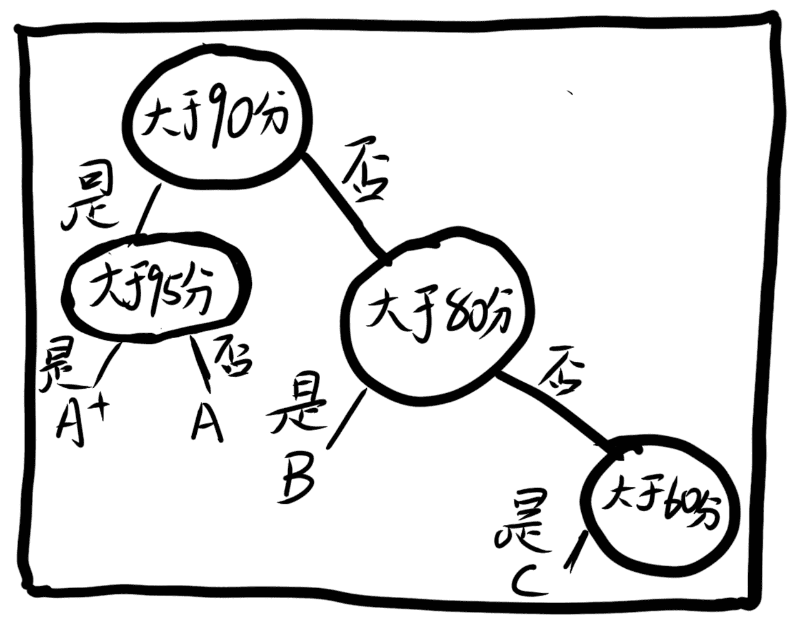
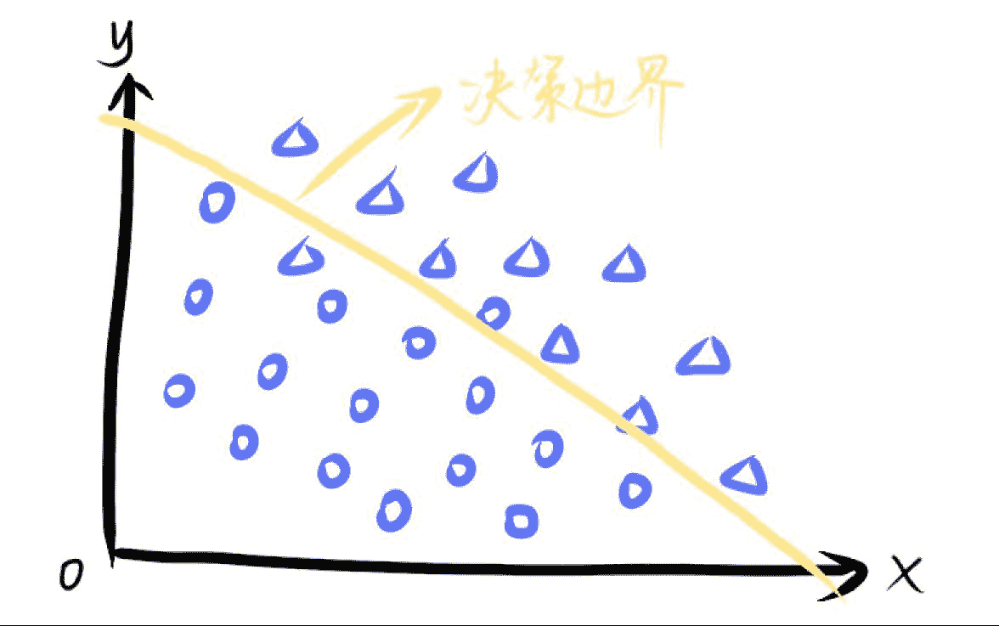
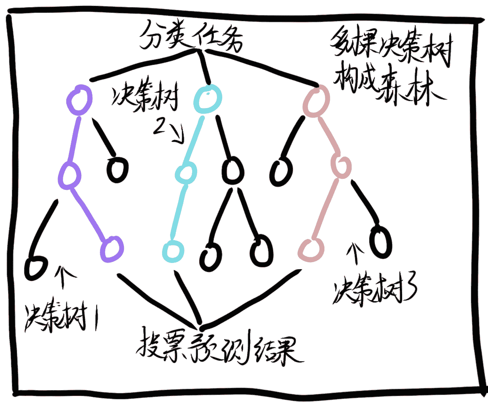
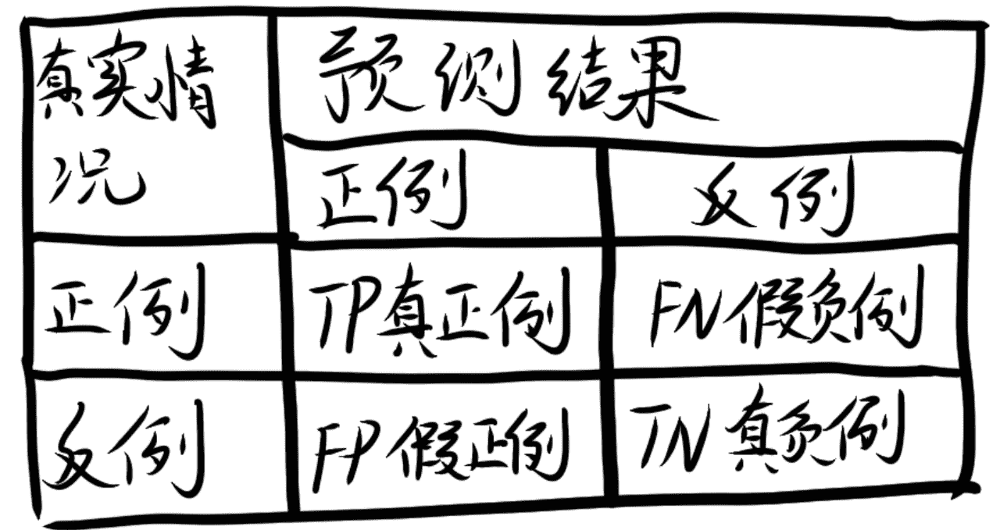
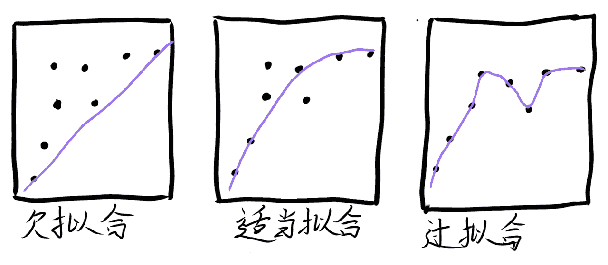
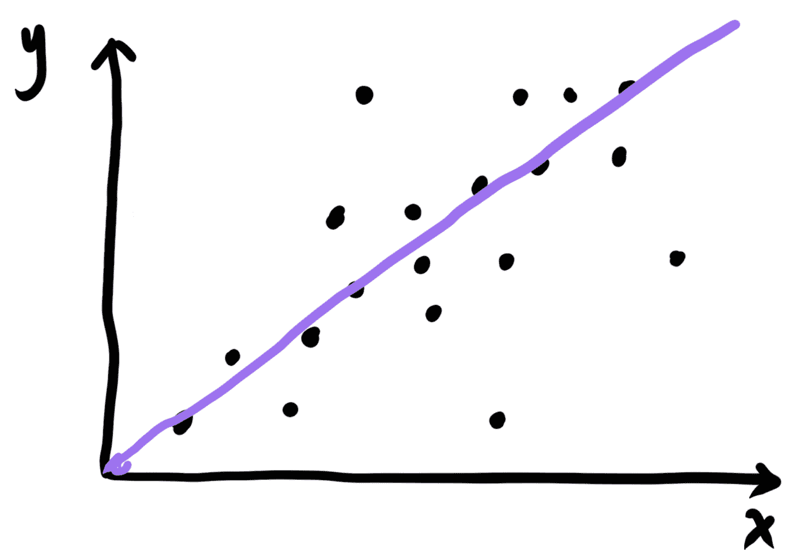
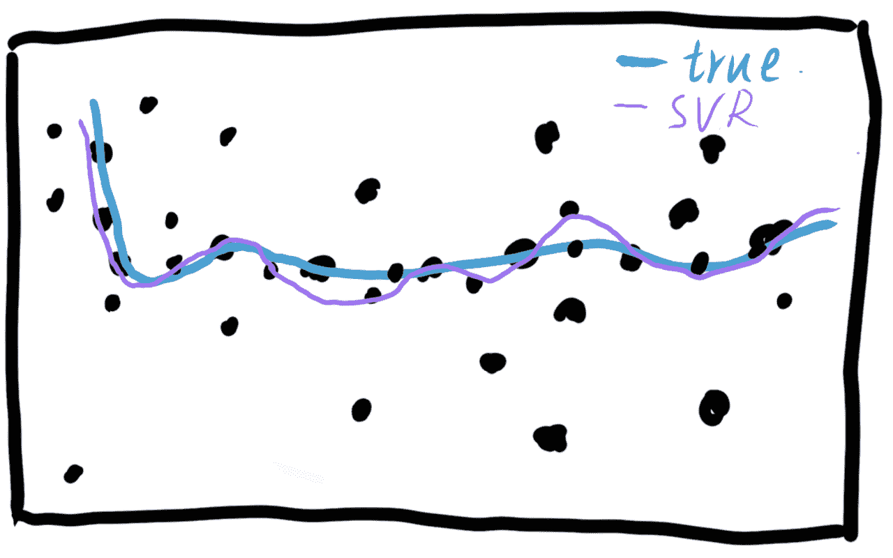
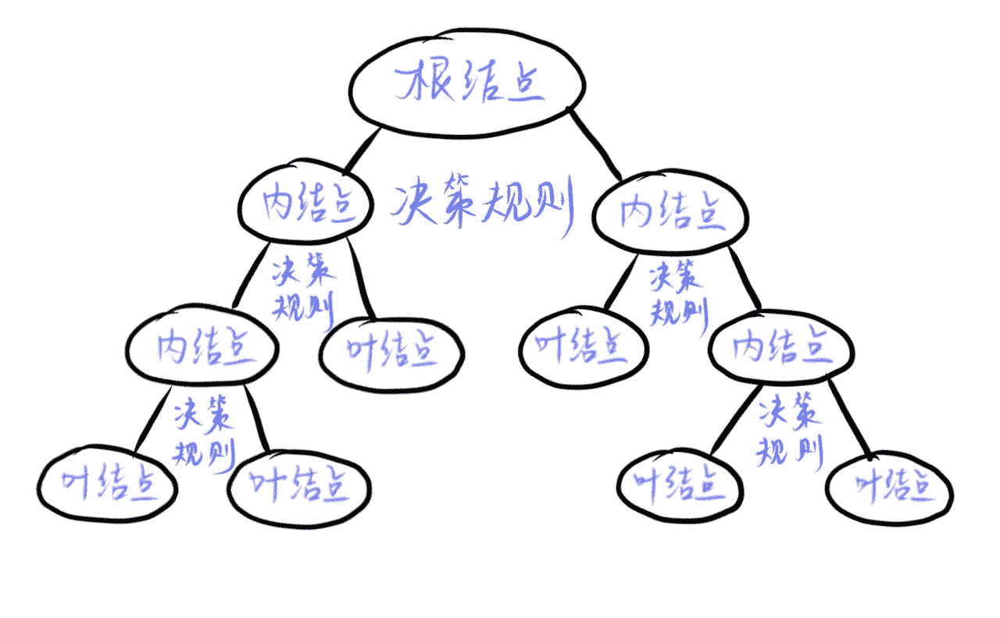

# 1.2 分类、回归、决策优化、语言识别与生成_蔡鋆捷 & 杨璐

> 来源：[https://datawhaler.feishu.cn/docx/AYpxd2eBKoREO2xzD1RcUdxInMc](https://datawhaler.feishu.cn/docx/AYpxd2eBKoREO2xzD1RcUdxInMc)

| 版本信息 | 内容版本号 | V1.0 | |
| --- | --- | --- | --- |
| | 最近更新时间 | 2024.11.24 | |
| | 历史更新 | 2024.11.24：V1.0内容发布 | |
| | 内容信息 | + 所属版本：AI通识课-零基础版 | |
| 贡献详情 | 最近贡献 | | |
| | 内容贡献 | 蔡鋆捷、杨璐 | 标题前有（补充）字样的可以在根据后续需要删除，作为补充知识附在课后资料上 |
| | 内测反馈 | 程宏 | 1. 公式渲染修改， |
| | 更多贡献详情见：[致谢AI通识课贡献者们](https://datawhaler.feishu.cn/wiki/HnMiwEzpdiLvWRkfbvFcaJFLnSg) | | |

## 分类

### 人工智能导论课：分类

#### 一、引言

分类和回归是基本的人工智能中基本的机器学习任务。

这一节当中我们先讨论分类的内容。

分类在人工智能中至关重要，主要作用是确定特定对象归属于预先定义的目标类。

比如说给猫与狗的图片，让机器分辨出那一张图片是猫，那一张图片是狗。

此过程需要通过对比各种特征和属性，判断对象与各个目标类的契合程度，准确确定对象所属的目标类别。

比如说猫的特征有：尖耳朵，有胡须等，狗的特征有耷拉的耳朵，没有胡须等等，我们通过特征来对图片里的物体进行分类。

#### 二、分类任务的基础概念

##### 2.1 分类任务的定义

分类任务是人工智能中的一种任务类型，其具体含义是将输入数据划分到不同的类别中，预测结果是离散值。在分类任务中，深度学习模型通过学习输入数据的特征，找到能够区分不同类别的分界面或决策边界，当不同于训练集的陌生数据进入模型时，模型会根据学习到的分界面将其划分到相应的类别中。

###### 2.1.1 分类任务的应用领域

分类在日常生活中有很多应用：在自然语言处理中，文本分类是常见的应用之一，例如将新闻文章分为不同的主题类别，如体育、政治、娱乐等。在计算机视觉领域，图像识别可以将图像分为不同的物体类别，如猫、狗、鸟等。在生物信息学中，基因分类可以帮助研究人员更好地理解基因的功能和作用。此外，在医疗领域，疾病诊断可以通过对患者的症状、检查结果等数据进行分类，确定疾病类型。在金融领域，信用评估可以将客户分为不同的信用等级，为贷款决策提供依据。

#### 三、分类任务的类型

##### 3.1 二分类（Binary classfication task）

二分类任务是将数据分为两类的一种分类任务，其输出只有两个类别，通常被表示为 0 和 1，或者 -1 和 1，代表两个不同的类别或状态。二分类任务在实际中有广泛的应用场景，如垃圾邮件检测、疾病预测、客户流失预测、信用卡欺诈检测等。

###### 3.1.1 案例分析：垃圾邮件识别

在垃圾邮件识别中，这是一个典型的二分类任务。例如，我们可以设定垃圾邮件为正类（`+`），普通邮件为负类（`-`）。如果某个邮件中包含单词“Viagra”，则判定为垃圾邮件，否则要看邮件中是否有单词“lottery”，如果有，则判定为垃圾邮件。这里需要解释的是，若邮件中包含单词Viagra，可能包含虚假广告、诈骗、或不适当的宣传内容，因此通常判定为垃圾邮件；同理，lottery垃圾邮件通常使用彩票或抽奖活动作为诱饵来吸引用户点击链接或提供个人信息。这种类型的诈骗邮件通常被称为“彩票骗局”或“抽奖骗局”。因此也会被判断为垃圾邮件。

我们可以选取一定数量的垃圾邮件和普通邮件作为测试集，如 50 封垃圾邮件和 50 封普通邮件。根据特定的特征规则进行分类后，可能会出现`TP`（True Positives）：真正例（预测值和实际值相同，都为正例）、`TN`(True Negatives)：真负例（预测值和实际值相同，都为负例）、`FP`（False Positives）：假正例（预测值为正例，实际值为负例）和`FN`（False Negatives）：假负例（预测值为负例，实际值为正例）。比如在上述案例中，50 封垃圾邮件中有 30 封被正确分类，50 封普通邮件中有 40 封被正确分类，那么就有 30 个真正例，20 个假负例，40 个真负例，10 个假正例。

###### 3.1.2 性能评估指标

二分类任务常用的性能评估指标有准确率（`Accuracy`）、精确率（`Precision`）、召回率（`Recall`）、`F1` 分数和混淆矩阵等。

准确率是正确预测的样本数量占总样本数量的比例；

精确率是正确预测的正样本数量占预测为正样本的数量的比例；

召回率是正确预测的正样本数量占实际正样本数量的比例；

`F1` 分数是精确率和召回率的调和平均数，综合考虑了精确率和召回率。

混淆矩阵用于描述真实值和预测值之间的关系，包括真正例、伪正例、伪反例和真反例。比如在垃圾邮件识别案例中，真正率为 0.6，真负率为 0.8，假负率为 0.4，假正率为 0.2。如果我们感兴趣的是少数类，且规模很小，则不应该优化针对多数类的准确率和性能，应该使用精度作为指标，取代真负率。

##### 3.2 多分类（Multi-Class Classification）

多分类任务是将数据分为多个不同类别的分类任务，与二分类任务相比，其具有更高的复杂性和挑战。在多分类任务中，模型需要学习多个不同类别的特征，并能够准确地将输入数据分配到正确的类别中。

###### 3.2.1 多分类的应用

多分类在实际生活中应用广泛，尤其是在图像识别领域。例如，在商品识别中，可以将商品分为 25 个大类、数百个细分类别，包括电商、广告场景下的常见商品，并输出商品所在坐标。在多分类的图像识别中，模型需要学习不同类别的特征，如车辆的品牌、颜色、车型等，宠物的类型、坐标信息等，以准确地对图像中的对象进行分类。

##### 3.3 有监督与无监督

有监督与无监督在分类问题与回归问题均有涉及到，在这里我们将会一起讨论。

有监督任务有训练样本集，在训练样本集中给出不同类别的训练样本，用这些训练样本可以找出不同类样本的方法，从而在特征空间中划定决策区域，以此来分类/预测。例如在图像识别中，将大量带有标注的图像作为训练样本，让模型学习不同类别图像的特征，从而能够对新的图像进行分类。

无监督任务则没有训练样本的标签，其目标是通过对无标签样本的学习来揭示数据的内在特性及规律，代表方法是聚类。比如在一些商业应用中，对新用户的类型进行判别时，可以先通过对用户进行聚类，根据聚类结果将每个簇定义为一个类，然后基于这些类训练模型。

#### 四、常用分类算法解析

##### 4.1 决策树

决策树算法是一种直观运用概率分析的图解方法，在风险决策和机器学习中广泛应用。它利用概率论的原理，以树形图作为分析工具，通过决策点（圆圈内部的判断条件）、方案枝、概率枝等组成决策树结构。

###### 4.1.1 决策树的典型方法

决策树有多种典型的方法，比如 `ID3` 算法、`C4.5` 算法、`CART` 算法等。

1. `ID3` 算法通过信息增益选择特征，倾向于选择取值较多的特征，可能导致过拟合。

举个例子：如果你要根据一些特征来判断一个水果是苹果还是橙子。你有以下几个特征可以观察：颜色（红色、橙色）、形状（圆形、椭圆形）、表皮光滑度（光滑、粗糙）。

假设你有一堆已经知道种类的水果样本，比如有 10 个苹果和 10 个橙子的样本数据。

`ID3` 算法就像是一个很 “单纯” 的分类小助手，它首先会看哪个特征能让我们最快地区分苹果和橙子。比如说，它发现通过颜色这个特征，一下子就能把大部分苹果和橙子分开。那它就会先以颜色这个特征来构建一个简单的 “决策树分支”。

比如：如果水果颜色是红色，那可能是苹果，然后再看剩下的形状、表皮光滑度等特征进一步确认。如果水果颜色是橙色，那可能是橙子，同样再用其他特征来更精准判断。

1. `C4.5` 算法在 `ID3` 算法的基础上进行了改进，采用信息增益率来选择特征，一定程度上缓解了过拟合问题。

我们来继续按照分类苹果与橙子的例子来说明。`C4.5` 算法就比 `ID3` 算法要 “聪明” 一点。`ID3` 算法只用信息增益来选特征作为分支节点，有时候可能会出现一些小问题。比如说，如果某个特征的取值特别多，比如水果表皮的纹理，可能有十几种不同的纹理，那按照 `ID3` 算法，它可能因为这个特征能把样本分得很细，就优先选它作为分支节点，但实际上可能并不是最能准确分类的特征。

对`C4.5` 算法来说，它除了考虑信息增益，还会考虑一个叫 “信息增益比” 的东西。就是在选取特征时，`C4.5`不仅看这个特征能把苹果和橙子分开多少（信息增益），还会看这个特征本身取值的复杂程度（通过信息增益比来衡量）来综合考量。

1. `CART` 算法既可以用于分类问题，也可以用于回归问题，通过基尼指数或平方误差来选择特征进行分裂。

继续用判断水果的例子做说明。`CART` 算法就像是一个很“智能”的分类器 。值得说明的是，`CART`不管是分类问题还是回归问题都能处理。

对于我们判断水果是苹果还是橙子这个分类问题，`CART` 算法会把每个特征分成两部分。比如说对于颜色这个特征，它不会像前面那样只是说红色可能是苹果、橙色可能是橙子，而是会把颜色分成 “是红色” 和 “不是红色” 这两部分。然后它会通过计算一个叫 “基尼系数” 的东西，看把哪个特征这样分成两部分后，能让我们区分苹果和橙子区分得最好。比如它可能发现把颜色分成 “是红色” 和 “不是红色” 后，根据这两部分里苹果和橙子的分布情况，通过计算基尼系数，发现这样区分效果很好，那就以颜色这个特征先构建一个分支，然后继续在分支下面再用同样的方法找其他特征继续构建分支，直到能很好地把苹果和橙子区分开。

##### 4.2 支持向量机

支持向量机（`Support Vector Machine`，`SVM`）是一种在机器学习中广泛应用的监督学习算法。其核心思想是在训练数据中找到一个最优的超平面，将不同类别的数据分开。这个超平面的选择是基于最大化间隔原则，即找到一个平面使得离它最近的正例和负例之间的距离最大化。

###### 4.2.1 支持向量机的应用案例

支持向量机在实际中有很多应用。在图像识别领域，`SVM` 可以用于识别不同的物体、场景等。例如，对数字图像进行分类，将手写数字图像准确地分为不同的数字类别。在生物信息学中，`SVM` 可以用于基因分类，帮助研究人员更好地理解基因的功能和作用。在金融领域，`SVM` 可以用于信用评估，将客户分为不同的信用等级，为贷款决策提供依据。

##### 4.3 逻辑回归

逻辑回归虽然名字中有“回归”二字，但实际上是一种用于分类任务的算法。它将样本的特征与样本发生的概率联系起来，通过概率转换函数（通常为 `sigmoid` 函数）将线性计算的结果映射到 0 到 1 之间，从而得到样本属于某一类别的概率。

##### 4.4 随机森林

随机森林是一种有监督学习算法，是以决策树为基学习器的集成学习算法。它通过集成多个决策树来提高分类和回归任务的性能。森林当中有很多树，每一棵树都会输出一个判断结果，将这些判断结果，经过综合统计（类似投票）之后，我们就能够将“得票数”最多的结果进行输出。通过投票结果就能够对分类结果进行输出。

##### 5.1 准确率

准确率是分类任务中最简单的评估指标之一，用来衡量模型预测正确的比例。其计算公式为：`Accuracy = (TP + TN) / (TP + TN + FP + FN)`，其中 `TP` 表示真正例，即实际为正类且被模型正确预测为正类的样本数；`TN` 表示真负例，即实际为负类且被模型正确预测为负类的样本数；`FP` 表示假正例，即实际为负类但被模型错误预测为正类的样本数；`FN` 表示假负例，即实际为正类但被模型错误预测为负类的样本数。

#### 六、分类任务的挑战

##### 6.1 过拟合与欠拟合

过拟合和欠拟合是分类与回归任务中常见的问题，会影响模型的性能和泛化能力。后续在回归问题中将不会重复讨论过拟合与欠拟合的内容。

###### 过拟合

1. 原因：过拟合是指模型在训练数据上表现得非常好，但在新数据（测试集或验证集）上表现较差。产生过拟合的原因主要有以下几点：

1. 模型过于复杂：模型的参数过多，如深度神经网络中的层数过多或每层的神经元数量过多。例如在图像分类任务中，如果使用过于复杂的神经网络结构，模型可能会学习到图像中的噪声和不相关的信息。

1. 训练数据不足：训练数据量较少，模型在少量样本上过度拟合。例如在一个小数据集上进行训练，模型可能会过度适应这些特定的数据，而无法很好地泛化到新的数据。

1. 特征选择不当：使用了太多不相关或噪声较多的特征，导致模型容易过拟合。例如在文本分类任务中，如果使用了过多的无关词汇作为特征，模型可能会被这些无关特征误导。

1. 未进行正则化：模型在训练过程中没有使用适当的正则化方法（如 `L1` 或 `L2` 正则化）来防止参数变得过大。

1. 表现：过拟合的模型在训练数据上表现得很好，但在新数据上表现较差。例如在房价预测任务中，过拟合的模型可能在训练数据上能够非常准确地预测每个房价，但在新的房价数据上表现不佳，无法很好地泛化到未见过的房源。在图像分类任务中，过拟合的模型可能学习到了与分类无关的背景信息，当新图片中背景变化时，模型无法正确分类。

###### 欠拟合

1. 原因：欠拟合是指模型在训练数据和新数据上表现都较差，无法从数据中学到有效的规律。产生欠拟合的原因主要有以下几点：

1. 模型过于简单：模型的容量不足，参数过少，如使用的模型过于简单（如线性模型无法处理非线性数据）。例如在复杂的非线性数据上使用线性模型进行分类，模型无法捕捉数据的复杂模式。

1. 训练时间不足：模型未充分训练，无法很好地拟合数据。例如在训练神经网络时，如果训练轮数过少，模型可能无法充分学习数据的特征。

1. 特征不足：输入数据的特征不够丰富，未提供足够的信息供模型学习。例如在疾病诊断任务中，如果只使用了少数几个症状作为特征，模型可能无法准确地诊断疾病。

1. 表现：欠拟合的模型在任何数据上都表现不好，原因是它无法捕捉数据的复杂模式。例如在学生考试场景中，只记住了老师给的几个解题公式，但没有理解它们的使用场景。遇到稍微变化的题目时，不知道该使用哪个公式，甚至不能解答简单的题目。在房价预测任务中，使用简单线性模型预测复杂的房价，模型在训练数据上表现一般，预测结果和实际房价的差距很大。

分类任务中，特征工程至关重要。它能够显著提升模型的性能和泛化能力，是提高分类准确性的关键因素之一。

## 七、课后习题

### 习题7.1

在电商平台的商品管理中，我们要把商品分成多个类别，比如服装类、电子产品类、食品类等，这是分类任务中的（1）______分类。如果我们采用决策树算法来进行分类，决策树会根据商品的不同属性（如价格、品牌、功能等）构建树形结构，每个内部节点代表一个（2）______，分支代表该属性的不同取值，通过这样的结构来判断商品属于哪个类别。（答案：（1）多分类（2）决策点）

### 习题7.2

在图像识别领域，对于识别不同物体类别，如区分猫、狗、鸟等，这属于分类任务中的（1）______分类。模型需要学习不同类别物体的各种特征，例如猫的外形轮廓、毛发纹理等。在训练模型时，如果使用大量带有标注的图像让模型学习，这是（2）______学习；要是没有图像的标注信息，模型通过自身对图像的分析来揭示数据内在特性，这属于（3）______学习。（答案：（1）多分类（2）有监督（3）无监督）

### 习题7.3

在垃圾邮件识别的工作中，我们会将邮件分为两类，垃圾邮件和普通邮件，这是一个典型的（1）______分类任务（填分类任务类型）。如果我们把垃圾邮件当作正类（`+`），普通邮件当作负类（`-`），当模型预测一封邮件为垃圾邮件，但实际上它是普通邮件时，这就产生了（2）______。为了评估模型的好坏，我们可以使用混淆矩阵，它能展示模型在不同类别上的分类结果，像真正例、真负例、假正例和假负例等情况，帮助我们全面了解模型的性能。（答案：（1）二（2）假正例）

## 回归

### 人工智能先导课：回归分析

#### 一、引言

回归分析是一种通过一个或多个输入变量（自变量或特征）来预测连续值输出（因变量）的方法，它在金融、医疗、营销等多个领域广泛应用，通过寻找变量之间的潜在关系实现对连续数值的准确预测，其算法包括线性回归、多项式回归、支持向量回归和决策树回归等，同时面临数据质量、特征选择、模型性能和解释性等方面的挑战，本文将围绕回归分析的这些方面展开探讨。

#### 二、回归基础理论

##### 2.1 回归问题的定义

回归问题是一种通过一个或多个输入变量（自变量或特征）来预测连续值输出（因变量）的方法。它的本质在于寻找变量之间的潜在关系，以实现对连续数值的准确预测。

###### 2.1.1 与分类的输出差异

回归问题的输出是连续值，这意味着它可以取任意实数范围内的值。例如在预测房价时，房价可能是一个具体的数值，如 500 万元、120 万美元等，可以是非常广泛的数值范围。而分类问题的输出是离散标签，是有限个明确的类别。比如判断一幅图片上的动物是猫、狗或鸟，这些类别是明确且相互独立的。在数学性质上，回归输出的连续值具有无限的可能性，两个相近的数值之间还可以存在无数个其他数值。比如预测气温为 25.6℃，实际上在 25.59℃和 25.6℃之间还存在无数个可能的温度值。而分类输出的离散标签是定性的，具有明确的边界和定义。

##### 2.2 回归的应用场景

回归问题在金融、医疗、营销等多个领域都有着广泛的应用，为这些领域的决策提供了重要的支持。

### 2.2.1 金融领域应用

在金融领域，回归分析有着诸多重要的应用。其中，股票价格预测是一个典型的例子。通过对历史股票价格数据以及相关的宏观经济指标、公司财务数据等进行回归分析，可以建立回归模型来预测股票未来的价格走势。例如，将某股票的价格与宏观经济指标如利率、通货膨胀率、国内生产总值增长率等进行回归分析，从而得出对该股票未来价格的预测。根据搜索素材中的内容，回归分析可用于评估风险，确定不同资产之间的相关性。比如，资产类别与股票市场相关性的数据可以帮助投资者构建多元化的投资组合，降低整体风险。此外，回归分析还能够评估投资策略的有效性。对于一种基于技术分析的交易策略，可以将其历史交易结果与相关市场指标进行回归分析，以判断该策略是否真正有效。在基金投资中，回归分析可以帮助筛选优质基金。通过对基金的历史业绩、费用比率、基金经理的经验等因素进行回归分析，找到影响基金表现的关键因素，从而筛选出具有潜力的基金。

### 2.2.2 医疗领域应用

在医疗领域，回归分析也发挥着重要作用。根据体征预测疾病风险是一个常见的应用场景。例如，通过分析患者的年龄、性别、遗传特征、生活方式和环境因素等多个自变量，建立回归模型来预测个体患某种疾病的风险。像心血管疾病的风险因素包括高血压、高胆固醇、糖尿病和吸烟等，通过回归分析，医生可以评估患者的风险水平，并制定相应的预防措施。回归分析还可以用于疾病的诊断和预后评估。医生可以根据患者的症状、体征和实验室检查结果，运用回归分析模型来确定疾病的诊断依据和严重程度。例如，在病理学检测中，回归分析可以帮助分析肿瘤的大小、形态与恶性程度之间的关系，从而辅助医生做出准确的诊断。对于癌症患者，回归分析可以预测患者的生存率，为治疗决策提供参考。此外，线性回归在医疗保健中也有着广泛的应用，它可以帮助预测疾病风险、分型疾病、评估预后、预测治疗效果并优化治疗方案。通过分析患者的年龄、性别、生活方式等因素，建立线性回归模型，可以计算出患者的疾病风险评分，有助于早期识别高危人群，并采取预防措施。同时，线性回归还可以用于分型疾病和评估预后，将癌症患者分为不同的亚型，并预测他们的预后，指导治疗决策和制定个性化治疗计划。主成分回归在智能医疗诊断中也具有重要贡献，通过对大量医疗数据进行主成分回归分析，建立疾病风险评估模型，为患者提供个体化的疾病预测，提高疾病诊断的准确性，降低医疗成本，提高医疗资源利用率。

### 2.2.3 营销领域应用

在营销领域，回归分析可用于：预测销售额、客户满意度等指标。对于销售额预测，企业收集历史销售数据，关注市场趋势和广告投入，建立回归模型以准确预测未来销售额，为企业制定营销策略和生产计划提供指导。企业可根据预测安排生产资源、优化广告投放、调整产品定价等策略实现利润最大化。回归分析在客户关系管理方面也出色，通过分析客户行为和特征数据，企业可预测客户忠诚度和购买意愿，对不同客户采取相应策略提高客户粘性和购买转化率。

## 三、常见回归算法

### 3.1 线性回归

线性回归是一种常用的回归算法，它通过找到最佳拟合直线来模拟因变量和自变量之间的关系。

紫色直线是通过对图中的散点进行拟合的结果，通过直线对密集分布的点进行拟合，我们能够借助直线的函数表达式，大致预测出下一个点出现的位置。

### 3.2 支持向量回归

支持向量回归（Support Vector Regression, SVR）是支持向量机（SVM）的一种扩展，用于回归问题。SVR通过寻找一个最佳的回归超平面，使得尽可能多的数据点落在超平面附近的ε-管内，从而达到预测连续值的目的。

### 3.3 决策树回归

决策树回归是一种基于树结构的回归方法。它通过将特征空间划分为一系列简单的区域，在每个区域内建立一个简单的预测模型，通常是均值或常量。

## 四、课后习题

### 习题 4.1

气象站为了预测每天的气温，会记录每天的湿度、气压、风速以及日照时长等数据，这是因为气象专家认为气温和这些因素之间存在某种联系，这种通过多个因素来预测一个连续数值（气温）的做法体现了回归分析中的（多变量回归的概念。其中，湿度、气压等数据被看作是（1）______，而气温则是需要预测的（2）______。如果气象站使用一种算法，它通过构建树状结构，将不同特征空间划分为多个区域来进行气温预测，这可能是决策树回归在起作用。（答案：（1）自变量（或特征）（2）因变量）

### 习题 4.2

学校的老师想要预测学生期末考试的成绩，他考虑了学生平时的作业完成情况、课堂表现、出勤次数以及上次考试的成绩等因素，这体现了回归分析中通过（1）______来预测（2）______的思想。其中，学生的平时作业完成情况等因素是（3）______。如果老师使用一种算法，该算法通过对多项式方程进行拟合来找到学生成绩与这些因素之间的关系，那么这个算法可能是（4）______（举例一种回归算法）。

（答案：（1）多个输入变量（或自变量、特征）（2）连续值输出（或因变量）（3）自变量（或特征）（4）多项式回归）

### 习题 4.3

农民伯伯想要预估今年小麦的产量，他知道小麦产量可能和播种时的种子质量、种植密度、土壤肥力以及生长期间的降雨量、日照时长等因素有关。这是在利用回归分析中（1）______的概念，通过多个因素（自变量）来预测小麦产量这个（2）______。在这个过程中，如果发现土壤肥力这一因素对产量的影响非常大，那它在回归分析中就属于（3）______较高的自变量；相反，如果某个因素对产量的影响微乎其微，在实际分析时可能会考虑将其舍去，以简化模型。

（答案：（1）多变量预测（2）因变量（3）相关性（或重要性、影响力等合理表述））

# 决策优化
# 人工智能导论：决策优化

## 一、引言

决策优化旨在寻找最佳的决策方案，以实现特定的目标。决策优化的过程通常包括明确决策目标、收集相关信息、建立决策模型、评估各种方案以及选择最佳方案等步骤。在这个过程中，需要运用到多种理论和方法，如决策理论、数学建模、数据分析等。同时，随着人工智能技术的不断发展，人工智能可以通过机器学习算法对大量数据进行分析，为决策提供更准确的预测和建议，帮助决策者更好地了解问题的全貌。

## 二、理论基础

### 2.1 决策理论与方法

#### 2.1.1 决策理论的基本概念

决策问题是指实际状态与期望状态之间存在的一种需要缩小或排除的差距。

决策问题的基本要素包括状态、状态概率、方案、益损矩阵和决策准则及最优值。决策问题的建模方法通常需要明确问题的目标、确定决策变量、建立约束条件以及构建目标函数等步骤。通过对实际问题的抽象和简化，将其转化为数学模型，以便利用各种决策分析方法进行求解。

#### 2.1.2 决策问题的分类

决策问题可以分为三类：确定性决策问题、风险决策问题和不确定性决策问题。

1.  确定性决策问题中，决策者可以准确地知道每种行动的结果和可能的后果，因此可以选择最优的方案。这类问题通常具有确定的因果关系，可以使用数学模型进行计算和优化。如生产线的优化、成本控制等。

2.  风险决策问题中，决策者可以知道每种行动的可能结果和概率，但是无法准确预测结果。因此，需要权衡风险和回报，并选择最佳方案。这类问题需要使用概率和统计学方法进行分析和决策。如金融投资、保险业务等。据统计，在金融投资领域，约有 70%的决策问题属于风险决策问题。风险决策问题的特点在于其结果具有一定的不确定性，但决策者可以通过对各种可能结果的概率估计，来评估不同方案的风险和收益。

3.  不确定性决策问题中，决策者无法预测每种行动的结果和可能性，因此需要依靠经验、判断和直觉进行决策。这类问题通常涉及到不稳定的环境和多种不确定的因素。如新产品开发、市场拓展等。在新产品开发中，由于市场需求、技术发展等因素的不确定性，决策者很难准确预测产品的市场表现。这种不确定性的因素主要来自两个方面：一是决策者无法获得关键信息，二是无法对行动方案或其结果做出科学的判断。

## 三、数据驱动的人工智能预测

### 3.1 数据特征的重要性

#### 3.1.1 数据特征在预测中的作用

数据特征在人工智能预测中起着至关重要的作用。首先，数据特征能够提供关于数据本质的关键信息，帮助模型更好地理解数据的内在规律和模式。例如，在预测用户在电子商务网站上的购买行为时，用户的年龄、性别、地理位置、购买历史等数据特征可以为模型提供有关用户偏好和行为模式的线索，从而提高预测的准确性。

数据特征还可以增强模型的泛化能力。通过提取具有代表性的数据特征，模型可以更好地适应不同的数据集和场景，减少过拟合的风险。例如，在自然语言处理中，词向量作为一种数据特征，将单词映射到一个低维实数向量空间中，使得具有相似含义或上下文的单词在向量空间中具有相近的位置。这种表示方法有助于捕捉词汇之间的语义关系，并使得机器学习算法能够更好地处理文本数据，提高模型的泛化能力。

此外，数据特征可以提高预测的效率。通过选择和提取关键的数据特征，可以减少模型的计算量和存储空间，提高预测的速度和效率。例如，在数据编码处理中，独热编码将分类变量转换为一个二进制向量，其中向量的长度等于分类变量的可能取值数量。对于每个分类变量的取值，独热编码会在向量中对应的位置设置为 1，其他位置设置为 0。这种编码方法可以有效地减少数据的维度，提高模型的训练和预测效率。

## 四、人工智能决策优化的实践

1.  在机械制造领域，通过人工智能驱动的预测性维护，企业可以利用数据分析和机器学习算法，在设备故障发生之前进行预测，主动安排维护计划。在智能检测方面，利用机器视觉和深度学习技术，能够对产品质量进行实时监控和缺陷检测，提高产品质量的同时减少了返工成本。此外，在工艺优化方面，人工智能技术可以根据生产数据，自动调整工艺参数，提高加工效率。

2.  在医疗领域，人工智能也发挥着重要作用。在疾病预测与诊断方面，基于机器学习的算法可以通过分析患者的病史数据和生理指标，预测个人发生某些疾病的风险，帮助医生及时采取预防措施。智能医疗影像分析利用计算机视觉技术，能够自动识别病灶、测量尺寸、评估病变程度，辅助医生做出更准确的诊断。在临床决策支持方面，基于规则引擎的系统可以将患者的病史、检查结果、用药情况等多源数据整合到一个智能决策系统中，为医生提供最优的诊疗建议。

3.  在金融领域，人工智能的应用同样广泛。例如，人工智能可以通过分析历史交易数据和市场趋势，为投资决策提供精准的建议。在信用决策方面，人工智能解决方案通过利用各种因素帮助银行和信贷机构做出更明智的信贷决策。

## 五、课后习题

### 习题 5.1

小王大学毕业后收到了几个不同公司的工作 offer，他需要做出决策。他考虑的因素有公司的发展前景、薪资待遇、工作环境、职业发展空间以及自己对工作内容的兴趣程度等。这里小王面临的决策问题类型属于（1）______，因为他虽然能了解到一些关于这些因素的信息，但无法完全准确预测在每个公司工作的具体结果。他在权衡这些因素时，可以借助效用函数来综合评估每个工作机会所带来的满足程度或价值，帮助自己做出决策。在这个过程中，他对不同因素的重视程度可以通过（2）______来体现。如果他最终选择了一家公司，那他的这个决策是基于（3）______做出的，即他认为这个选择能够在各种因素之间达到较好的平衡，实现自己的期望。

（答案：（1）风险决策问题（2）效用函数的参数（3）决策准则及最优值（或对各因素权衡后的判断标准，选择能使自己效用最大化的方案等合理表述））

# 人工智能导论：语言识别与生成

## 一、引言

语言识别与自然语言生成技术在当今数字化时代发挥着至关重要的作用。语音识别技术，如将人类语音信号转变为文本或命令，已经广泛应用于语音输入系统、语音控制系统等领域。自然语言生成技术则能够自动生成可理解的自然语言文本，在机器新闻写作、聊天机器人等方面表现出色。例如，在智能客服领域，语音识别技术可以快速准确地将客户的语音问题转换为文本，再通过自然语言生成技术生成清晰的回复，极大地提高了客户服务效率。

## 二、发展历程

### 2.1 语言识别技术发展历程

#### 2.1.1 起步阶段

从贝尔实验室发明自动数字识别机到简单的语音号码识别系统。1952 年，贝尔实验室发明了自动数字识别机，科学家对智能语音有了模糊的概念。1952 年贝尔实验室率先研制出语音号码识别系统——AUDERY，在严格控制的条件下，AUDERY 系统识别语音号码的准确率为 97 - 99%，但系统庞大且维护困难。

#### 2.1.2 突破阶段

深度学习算法兴起，如卷积神经网络和循环神经网络的应用。2010 年开始，微软的俞栋、邓力等学者首先尝试将深度学习技术引入到语音识别领域。此后，百度等中国企业也迅速发展，不断推出新的语音识别技术。例如，百度在 2015 年初推出基于 LSTM - HMM 的语音识别，年底发展出基于 LSTM - CTC 的端对端语音识别系统。深度学习的引入使得语音识别准确率大幅提升。

#### 2.1.3 发展阶段

大数据和计算能力提升，多语种支持和个性化定制的实现。随着大数据的积累和计算能力的不断提升，语音识别技术能够处理更多的语种。例如，IBM 在世界博览会上推出的数字语音识别系统，在中国市场适配了四川、上海、广东等地方方言。同时，个性化定制也成为可能，如谷歌的 VoiceFilter - Lite 在交易的设备端优化个人的语音，让消费者可以用自己的声音“训练”他们的设备。

### 2.2 自然语言生成技术发展历程

#### 2.2.1 简单规则阶段

早期自然语言生成技术主要基于一些简单的规则和模板，通过设计和编写规则来生成特定的文本。这种方法具有清晰明了、易于理解和调试的优势。然而，其局限性也很明显，受制于规则的复杂性和表达能力的限制，无法应对复杂和多样化的语言场景。例如，在特定领域的文本生成中，可能需要大量的规则来覆盖各种情况，这不仅增加了开发的难度，还可能导致系统的灵活性不足。

#### 2.2.2 统计方法阶段

为突破简单规则的局限性，研究者们开始利用统计方法处理自然语言生成问题。统计方法基于大量的语料库数据进行学习和推理，通过计算词语之间的概率分布以及语言模型等统计信息，生成自然流畅的文本。这种方法能够更好地应对语言的灵活性和多样性。但是，它也存在一些问题，例如模型的复杂度较高，需要大量的训练数据来保证准确性。据统计，一个中等规模的统计自然语言生成模型可能需要数百万甚至上千万的语料数据进行训练。

#### 2.2.3 机器学习阶段

随着机器学习在自然语言处理领域的广泛应用，深度学习模型如循环神经网络（RNN）和转换器（Transformer）等成为自然语言生成的主要工具。这些模型能够自动学习输入数据之间的关联性和依赖关系，并生成高质量的自然语言文本。例如，长短期记忆网络（LSTM）能够更好地处理输入序列中的长期依赖问题，在语言生成任务中表现出色。Transformer 则通过多头自注意力机制，能够高效地捕捉全局信息，生成更加准确和流畅的文本。

#### 2.2.4 预训练语言模型阶段

预训练语言模型是近年来自然语言生成的重要进展之一。通过在庞大的语料库上进行预训练，模型能够学习到更为丰富的语言知识和语义表达能力。之后，通过微调和细调这些预训练模型，可以实现各种自然语言生成任务，如文本摘要、对话生成等。预训练语言模型的出现极大地推动了自然语言生成技术的发展，并在众多应用场景中取得了显著成果。例如，微软亚洲研究院提出的 ProphetNet，通过引入新的自监督学习目标函数，在序列到序列的自然语言生成任务中取得了优异性能。

## 三、理论基础

### 3.1 语言识别技术原理

#### 3.1.1 特征提取技术

Mel 频率倒谱系数（MFCC）在语音识别中起着重要作用。MFCC 基于人耳听觉特性，梅尔频率倒谱频带划分是在 Mel 刻度上等距划分的，频率的尺度值与实际频率的对数分布关系更符合人耳的听觉特性。

MFCC 的计算过程较为复杂。首先将信号帧化为短帧，通常为 20 - 40ms 帧，比如标准的 25 毫秒。对于每一帧，计算功率谱的周期图估计。然后将 mel 滤波器组应用于功率谱，将每个滤波器中的能量相加。接着取所有滤波器组能量的对数，这一步也是受人类听觉的启发，因为人类没有听到线性音阶的响度，通常为了使声音的感知体积增加一倍，需要将 8 倍的能量投入其中。最后对对数滤波器组能量求 DCT，保持 DCT 系数 2 - 13，丢弃其余部分。

除了 MFCC，还有其他一些常用的特征提取方法。线性预测分析（LPC）拟人类的发声原理，通过分析声道短管级联的模型得到。感知线性预测系数（PLP）是一种基于听觉模型的特征参数，通过计算应用到频谱分析中，将输入语音信号经过人耳听觉模型处理，有利于抗噪语音特征的提取。Tandem 特征和 Bottleneck 特征是利用神经网络提取的两类特征。基于滤波器组的 Fbank 特征亦称 MFSC，保留了更多的原始语音数据。线性预测倒谱系数（LPCC）基于声道模型的重要特征参数，丢弃了信号生成过程中的激励信息，用十多个倒谱系数可以代表共振峰的特性。

#### 3.1.2 模式匹配准则

在语音识别中，将提取的特征与预训练模型进行匹配是关键步骤。通常采用一定的准则，使未知模式与模型库中的某一个模型获得最佳匹配，从而确定最可能的文本或命令输出。

例如，可以使用基于参数模型的隐马尔可夫模型（HMM）进行模式匹配。HMM 主要用于大词汇量的语音识别系统，它需要较多的模型训练数据，较长的训练和识别时间，而且还需要较大的内存空间。一般连续隐马尔可夫模型要比离散隐马尔可夫模型计算量大，但识别率要高。

也可以使用基于非参数模型的矢量量化（VQ）方法。VQ 方法所需的模型训练数据、训练和识别时间、工作存储空间都很小，在孤立字（语音识别系统中得到了很好的应用。但对于大词汇量语音识别的识别性能不如 HMM 好。

此外，还有基于人工神经网络（ANN）的算法和混合算法，如 ANN/HMM 法、FSVQ/HMM 法等。这些方法结合了不同模型的优势，提高了模式匹配的准确性。

### 3.2 自然语言生成技术原理

#### 3.2.1 内容确定

## 三、自然语言生成技术

### 3.2.1 内容确定

在自然语言生成中，内容确定是至关重要的第一步。它决定了文本中应包含哪些信息，这需要综合考虑多个因素。例如，在机器新闻写作中，首先要明确新闻的主题和关键事件。如果是体育新闻，可能需要确定比赛的结果、关键球员的表现、比赛中的重要时刻等信息。通过对大量数据的分析和筛选，提取出最有价值的内容。据统计，在一些专业的新闻机构中，利用自然语言生成技术撰写体育新闻时，会从众多的数据来源中提取出约70%的关键信息用于新闻内容的确定。

#### 3.2.2 文本结构

文本结构的合理组织能够确保信息的逻辑传达。在机器新闻写作中，通常会按照一定的结构安排内容。比如，先介绍事件的背景，然后陈述主要事件，最后可能会加上对事件的影响分析或未来展望。以一篇关于科技公司新产品发布的新闻为例，可能会先提及科技行业的发展趋势作为背景，接着详细介绍新产品的特点和功能，最后分析该产品对市场的影响。这种结构安排有助于读者更好地理解新闻内容，提高信息传达的效率。

#### 3.2.3 句子聚合

句子聚合可以提高文本的流畅性，在聊天机器人中表现得尤为明显。当回答用户的问题时，聊天机器人可以将多个相关的信息合并到一个句子中，而不是分别用多个简短的句子回复。例如，当用户询问某个旅游景点的信息时，聊天机器人可以将景点的位置、特色、开放时间等信息聚合在一个句子中回答，如“该旅游景点位于[具体位置]，以[特色]而闻名，开放时间为[具体时间]。”这样的回答更加流畅自然，也更易于用户理解。

#### 3.2.4 语法化

语法化是通过添加连接词等方式将信息组织成自然语言。在智能客服的语言生成中，语法化起着重要作用。例如，当回答用户的问题时，智能客服需要将不同的信息片段用合适的连接词连接起来，形成一个完整的句子。比如，“您的问题是[问题描述]。我们的解决方案是[解决方案描述]。因为[原因解释]，所以我们建议您[具体建议]。”这样的回答更加通顺，也更具逻辑性。

#### 3.2.5 参考表达式生成

参考表达式生成要求识别内容领域并使用该领域的词汇。在特定领域的文本生成中，这一点尤为关键。例如，在医学领域的文本生成中，需要使用专业的医学术语来准确表达相关内容。如果是生成一篇医学研究报告，可能会用到“临床试验”“病理分析”“药物疗效”等专业词汇。通过识别内容领域并使用该领域的词汇，可以使生成的文本更加准确、专业。

#### 3.2.6 语言实现

语言实现是将单词和短语组合成一个结构良好的完整句子。例如，一些自动写作软件会根据用户输入的主题和关键信息，通过语言实现步骤生成完整的文章。在这个过程中，需要考虑语法、语义、语用等多个方面，确保生成的句子通顺、合理、有逻辑性。同时，还可以根据不同的需求和风格进行调整，如正式、幽默、简洁等风格，以满足不同用户的需求。

## 四、应用领域

### 4.1 语言识别技术应用

#### 4.1.1 语音输入系统

如今，智能手机的语音输入功能极大地提高了用户的输入效率。如华为手机内置的百度输入法华为版，语音输入被集成在空格键上，方便用户随时使用。长按带话筒图标的按钮，弹出语音识别页面，对着手机说话即可随说随输入，还会根据每句话的停顿、语气合理插入标点符号。此外，ColorOS 的语音输入功能也十分受欢迎，其语音识别功能相当准确，提供了普通话、粤语、英语三种语种。

#### 4.1.2 语音控制系统

在智能家居领域，语音控制系统让用户可以通过语音指令控制家电。例如，天猫精灵可以实现“天猫精灵，开灯”“天猫精灵，打开/关闭空调”等操作，为用户带来极大的便利。此外，离在线语音方案在智能家电的行业应用案例中，东胜物联为厨电企业提供了针对厨电应用场景的高性价比离在线语音解决方案，使消费者可以通过简单的语音命令控制厨房设备，如“AI 语音随时指导”，让厨艺变得轻松而有趣；“解放双手，语音控制厨房设备”，避免厨房杂乱；“为厨房增加更多娱乐性”，播放音乐、收听新闻等，为厨房创造更加轻松愉悦的氛围。

#### 4.1.3 智能对话查询系统

在智能客服领域，语音交互发挥着重要作用。例如，快递智能客服通过 CNN，BiLSTM - Attention 实现意图解析，构建多场景自动客服问答。智能客服语音导航机器人利用 ASR（语音识别）技术将语音信息转译成文本，经过 NLP（自然语言理解）阶段理解用户的真实意图，在其知识库中查找与用户意图相匹配的信息，并通过 TTS（语音合成）技术将文本转化为语音，播报给用户。回答准确率高度依赖于 ASR 转译和 NLP 理解的准确率，企业需要不断标注和训练数据，以提高这些技术的准确率，从而提升用户体验。

### 4.2 自然语言生成技术应用

#### 4.2.1 机器新闻写作

近年来，自然语言生成技术在机器新闻写作领域取得了显著成果。例如，一些新闻机构利用自然语言生成技术可以快速生成大量的体育新闻报道。在一场重要的足球比赛结束后，机器新闻写作系统能够迅速收集比赛数据，包括比分、进球球员、关键事件等信息，并根据这些信息自动生成新闻报道。比如“在昨晚的激烈对决中，[球队 A]与[球队 B]展开了一场惊心动魄的较量。最终，[球队 A]以[比分]的优势战胜了[球队 B]。[进球球员名字]在比赛中表现出色，凭借其精湛的球技为球队打入了关键进球。这场比赛不仅展现了两支球队的实力，也为球迷们带来了一场视觉盛宴。”这样的新闻报道既准确又高效，大大提高了新闻的时效性。

#### 4.2.2 聊天机器人

智能聊天机器人是自然语言生成技术的一个重要应用场景。以某智能聊天机器人为例，当用户询问“今天天气怎么样？”时，聊天机器人会根据获取的天气数据生成回答，如“今天天气晴朗，气温在[具体温度区间]，非常适合外出活动。”在与用户的对话过程中，聊天机器人能够根据用户的问题和上下文进行自然语言生成，提供个性化的回答。如果用户接着问“那有什么适合户外活动的地方推荐吗？”聊天机器人会分析用户的地理位置和兴趣爱好等信息，生成推荐内容，如“根据你的位置，附近的[公园名称]是一个不错的选择。那里有美丽的风景、宽敞的绿地，非常适合散步、野餐等户外活动。”通过自然语言生成技术，聊天机器人可以与用户进行流畅的对话，为用户提供有用的信息和建议。

#### 4.2.3 智能客服

在智能客服领域，自然语言生成技术可以实现生成个性化推荐文本等功能。当用户向智能客服咨询产品时，客服系统可以根据用户的历史购买记录、浏览行为等信息，生成个性化的推荐文本。例如，“根据你的购买记录，我们发现你对[产品类别]产品比较感兴趣。我们为你推荐[具体产品名称]，这款产品具有[产品特点]，非常适合你的需求。”此外，智能客服还可以利用自然语言生成技术生成解答问题的文本，如当用户询问“产品出现故障怎么办？”时，客服系统可以生成详细的解决方案文本，如“如果你的产品出现故障，可以先尝试[解决方法 1]。如果问题仍然没有解决，请联系我们的客服人员，我们将为你提供进一步的帮助。”通过自然语言生成技术，智能客服可以为用户提供更加个性化、高效的服务。

## 五、课后习题

### 习题5.1

游客小赵在一个旅游景区使用手机上的虚拟导游服务。当他走到一个景点前，他对着手机说：“给我介绍一下这个景点。” 虚拟导游需要先利用（1）______技术识别小赵的语音指令，然后根据景点信息数据库生成一段介绍该景点的自然语言文本，这涉及自然语言生成中的内容确定、文本结构组织、语言实现等步骤，比如确定介绍的重点内容、组织语言结构等。在生成文本过程中，虚拟导游要使用适合旅游场景的语言风格，这体现了自然语言生成的（2）______特点。最后，虚拟导游将生成的文本通过语音合成技术播报给小赵，让他更好地了解景点信息。如果小赵的语音指令中有口音，虚拟导游可能需要具备一定的口音适应能力，这属于语言识别技术面临的（3）______挑战。

（答案：（1）语音识别（2）灵活性（或适应性、多样性）（3）口音和语速差异（或噪音干扰））
