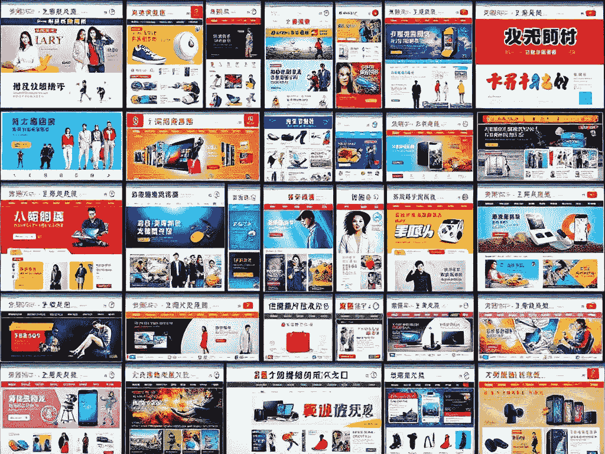
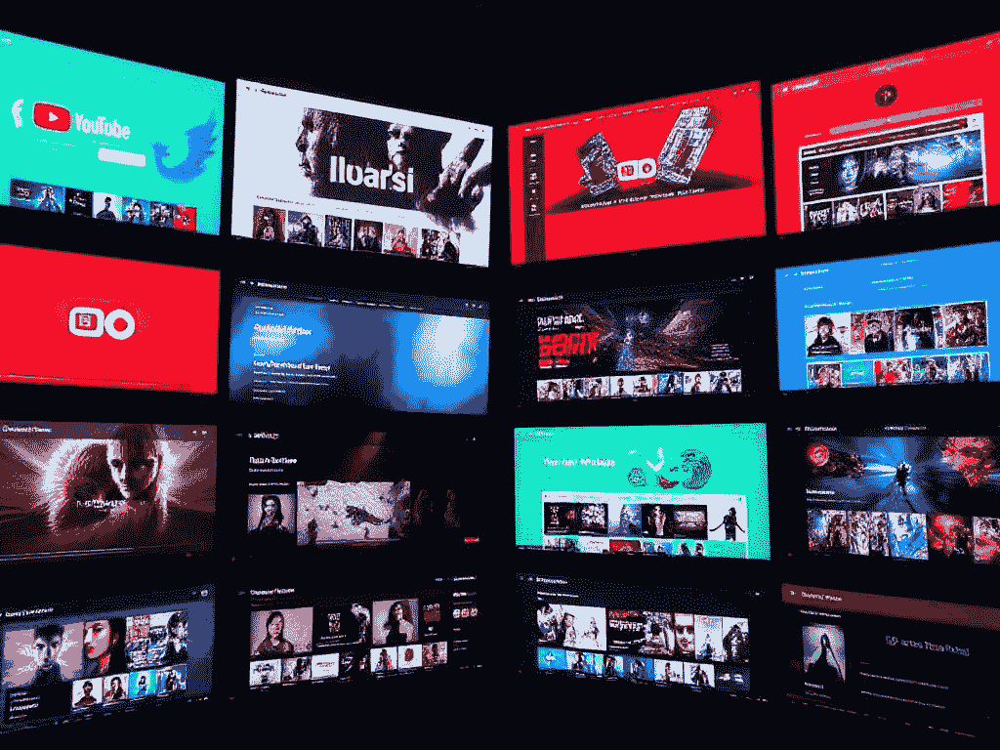

# 1.2 推荐系统_慕灵&清晖

> 来源：[https://datawhaler.feishu.cn/docx/RbU3dgn8boz2O4xoz9Cc9ruBn1g](https://datawhaler.feishu.cn/docx/RbU3dgn8boz2O4xoz9Cc9ruBn1g)

| 版本信息 | **内容版本号** | V1.0 |  |
| --- | --- | --- | --- |
|  | **最近更新时间** | 2024.11.24 |  |
|  | **历史更新** | 2024.11.24：V1.0内容发布 |  |
|  | **内容信息** | +   **所属版本**：**AI通识课-零基础版 ** |  |
| 贡献详情 | **最近贡献** |  |  |
|  | **内容贡献** | 罗清泉、柯慕灵 |  |
|  | **内测反馈** | 程宏 | 描述和介绍清晰，浅显易懂，举例生动，完成度很高 |
|  | 更多贡献详情见：[致谢AI通识课贡献者们](https://datawhaler.feishu.cn/wiki/HnMiwEzpdiLvWRkfbvFcaJFLnSg) |  |  |

# **人工智能导论课：推荐系统**

# **一、推荐系统简介**

推荐系统是一种利用数据分析来自动预测用户可能感兴趣的内容或物品的系统。它的主要任务是根据用户的需求和行为，提供个性化的信息服务。推荐系统的应用场景非常广泛，几乎涵盖了所有互联网相关的服务，包括在线购物、社交媒体、视频流平台、新闻推荐等。

## 推荐系统产生的背景

### 1.1 信息过载与推荐系统

在互联网时代，相信大家每天都被浩如烟海的数据所裹挟着。如何在海量信息中筛选出对自己有价值的内容，对于我们来说变得异常困难。这种情况下，信息使用的效率非但没有提升，反而因筛选难度增加而降低，我们称之为“信息过载”问题。

从信息匮乏到信息过载，人类社会经历了信息处理能力的飞速发展。在信息匮乏的时代，我们面临的主要问题是获取信息的渠道有限。为了解决这一问题，我们可以通过图书馆和档案馆，以及通过亲朋好友、同事等社交关系获取信息。随着互联网的普及，信息量迅速增长，我们开始面临信息过载的问题。为了解决这一问题，推荐系统应运而生。

我们可以不再局限于依赖搜索引擎来筛选信息。通过推荐系统，我们往往不需要非常明确地表达自己的需求是什么。推荐系统就可以通过预测和展示我们可能感兴趣的内容，主动建立我们与信息之间的高效连接。现代推荐系统的精准度甚至能超越我们自身对自己的了解。

### 1.2个性化需求

在信息丰富的时代，我们每个人都有着独特的兴趣和需求，推荐系统化身超级侦探，能够敏锐地捕捉到我们的的显性和隐性偏好。

它通过分析我们的历史行为、浏览习惯、互动反馈、甚至是社交网络活动，来构建一个多维度的用户画像。

比如我们当中的有些人可能对科技新闻情有独钟，而另一些人则更倾向于时尚潮流或文化艺术。个性化推荐除了能够帮助我们发现自己感兴趣的内容，还能够帮助我们发现那些我们可能未曾意识到但实际会感兴趣的新内容。这种“惊喜”体验往往能够增加我们的好奇心和探索欲，进一步促进我们与平台之间的互动。在这个过程中，推荐系统不仅仅扮演着信息的传递者，更扮演者我们兴趣的发掘者和引导者。

### 1.3商业价值

在当今的商业世界，精准推荐系统就仿佛是我们的私人购物助手，它能通过分析我们的点点滴滴，比如浏览历史和购物偏好，来准确猜出我们想要购买什么。这样的系统让我们如遇知音，在无形中增加了对平台的喜爱和忠诚。最终，这种个性化服务间接帮助商家完成更多的订单，获取更多的利润。所以，精准推荐系统不仅是技术上的创新，更是商业上聪明的应用，对企业的长远发展非常关键。

## 推荐系统的分类

1.  基于内容的推荐（Content-based Filtering）：

想象一下你去书店买书。如果你之前买了一本关于历史书籍，并且非常喜欢，基于内容的推荐系统会根据这本书的特征（比如“历史”、“非小说”、“深入分析”等标签）来推荐其他类似特征的书给你。就像是书店的店员看到你喜欢历史书，就推荐了其他一些历史相关的书籍给你，因为他们认为你会喜欢相似主题的书籍。

1.  协同过滤推荐（Collaborative Filtering）：

协同过滤就像是通过观察你的朋友们的阅读习惯来推荐书籍。如果你有一群朋友，他们都有相似的阅读兴趣，并且他们中的一些人最近买了一本新书并且很喜欢，那么协同过滤系统可能会推荐那本书给你，因为它认为你可能会喜欢你的朋友们喜欢的书。如果你喜欢一本书，那么和它相似的书也会被推荐给你。

1.  混合推荐（Hybrid Recommendation）：

混合推荐就像是结合了以上两种方法的优势。想象书店的店员不仅考虑了你喜欢的书籍类型（基于内容），还参考了你朋友们的阅读建议（协同过滤）。通过这种方式，店员可以更全面地了解你的阅读喜好，并给出更准确的推荐。

1.  基于模型的推荐（Model-based Recommendation）：

基于模型的推荐就像是书店使用了一个智能系统来分析你的购买历史和阅读习惯。这个系统可能会使用复杂的算法（比如机器学习模型）来预测你可能喜欢的书籍。就像是书店有一个“读书喜好预测机”，它可以根据你的数据来预测你会给哪些书打高分，然后推荐那些书给你。

1.  基于规则的推荐（Rule-based Recommendation）：

基于规则的推荐就像是书店有一套固定的规则来推荐书籍。例如，如果顾客买了一套关于旅行的书，书店的规则可能是“也推荐指南书和旅行日志”。这些规则是由书店的专家根据经验和顾客的常见需求制定的。就像是书店有一个“推荐手册”，店员只需要按照手册上的规则来推荐书籍。

# 二、推荐系统的工作原理

为方便你理解推荐系统的工作原理，在这里我想邀请你暂时扮演一位厨师，你的任务是为客人准备一顿美味的晚餐。为了做好这顿晚餐，你需要在接下来进行一系列的准备工作。

## 2.1数据收集与预处理

### 2.1.1**数据收集**

1.  用户数据（顾客信息）：

+   就像你需要了解顾客的口味偏好、饮食限制（比如素食、过敏等）、以往喜欢的菜肴（历史行为），甚至他们喜欢的餐厅（社交网络信息）。这些信息帮助你更好地定制晚餐菜单。

1.  项目数据（食材信息）：

+   这就像是你需要了解各种食材的特性，比如蔬菜的种类、肉类的来源、调味料的口味（特征信息），以及它们的保质期、产地、价格（元数据）等，以便选择合适的食材来烹饪。

1.  上下文数据（用餐环境）：

+   就像你需要考虑晚餐的时间（比如是午餐还是晚餐）、地点（比如是在家里还是户外）、用餐设备（比如是用筷子还是刀叉）等环境信息，这些都会影响你的烹饪决策。

### 2.1.2**数据预处理**

1.  数据清洗：

+   就像你在准备食材时，需要去除不新鲜的蔬菜、过期的食材、或者不小心掉进锅里的异物（无效、错误或重复的数据）。

1.  数据集成：

+   这就像是你可能需要将来自不同市场的食材（不同源的数据）合并在一起，比如将超市买的蔬菜和网上订购的肉类放在一起准备。

1.  数据转换：

+   就像你需要将食材加工成适合烹饪的格式，比如将肉切成片、将蔬菜切成丁（数值化、归一化等），这样它们才能在烹饪过程中更好地发挥作用。

1.  特征工程：

+   这就像是你根据晚餐的主题（如意大利菜、亚洲菜等）提取和选择关键的食材特征，比如选择番茄和罗勒来做意大利菜，选择酱油和姜来做亚洲菜。这些关键特征将帮助你创造出符合顾客口味的一顿晚餐。

通过这个例子，我们可以清晰地理解推荐系统在开始推荐之前，需要收集和准备数据，就像厨师在烹饪前需要了解顾客的喜好和准备食材一样。这些准备工作对于最终提供满意的服务至关重要。

## 2.2画像构建

### 2.2.1 用户画像（顾客特征模型）

通过前面的数据收集和预处理，你已经收集了顾客的口味偏好和饮食历史。现在，你需要基于这些信息来构建一个“用户画像”。

+   用户画像就相当于你为每位顾客创建的一个“口味档案”。这个档案包括了顾客喜欢什么样的菜肴（比如喜欢辣的还是清淡的）、有没有特殊的饮食需求（比如素食、低糖、无麸质）、以及他们通常在什么场合下用餐（比如家庭聚会、商务宴请）。

+   比如，你发现顾客张先生每次来都喜欢点辣的川菜，你就在他的用户画像上标注“偏好辣味”和“喜欢川菜”。如果李女士总是选择健康的沙拉，你就在她的用户画像上标注“偏好健康饮食”。

这个“口味档案”将帮助你在未来为这些顾客推荐他们可能喜欢的菜肴。

### 2.2.2 **项目画像（食材特征模型）**

接下来，你需要为你的食材也建立一个“项目画像”。

+   项目画像就像是为每种食材写的“食材说明书”。这个说明书描述了食材的特性（比如食材的味道、质地、营养价值和烹饪方法）。

+   例如，对于辣椒，你可能会在项目画像中标注“辣味强烈”、“适合炒菜”；对于鸡肉，你可能会标注“蛋白质丰富”、“适合多种烹饪方式”。

这些“食材说明书”将帮助你在烹饪时选择合适的食材搭配，以确保菜肴的口味和质量。

通过这个例子，我们可以清晰地理解，在推荐系统中，构建用户画像和项目画像是为了更好地理解用户的需求和项目的特性，从而能够做出更准确的推荐。这就像厨师通过了解顾客的口味偏好和食材的特性来准备一顿美味的晚餐一样。

## 2.3推荐算法

除了扮演厨师角色，相信现在有许多小伙伴喜欢喝咖啡，那么我们这次扮演一家咖啡馆的老板，以提供给客户最爱的咖啡体验作为目标，我们一起探寻推荐算法的奥妙。

### **2.3.1基于内容的推荐（Cont**ent-based Filtering）

1.  **原理**

就像你注意到客户Tom喜欢浓郁口味的咖啡，你会推荐其他浓郁口味的咖啡给他。

1.  **步骤**

+   分析项目特征：你记录下每种咖啡的口味强度、产地、烘焙程度等。

+   计算相似度：你比较这些特征与Tom喜欢的咖啡的相似度。

+   排序和推荐：你根据相似度推荐新的浓郁口味咖啡给Tom。

1.  **特点**

+   **个性化**：Tom的推荐是基于他的口味偏好。

+   **可解释性**：因为Tom喜欢浓郁咖啡，所以推荐其他浓郁咖啡很容易理解。

+   **新项目冷启动**：即使新推出了一种咖啡，只要它符合浓郁口味，也能被推荐给Tom。

### 2.3.2协同过滤（Collaborative Filtering）

1.  **原理**

就像你发现另一个客户Jane和Tom有相似的咖啡口味，你会根据Jane的喜好来推荐给Tom。

1.  **类型**

+   用户基于协同过滤（User-based CF）：如果Jane喜欢某种咖啡，你可能会推荐给Tom。

+   **项**目基于协同过滤（Item-based CF）：如果Tom喜欢某种特定风味的咖啡，你会推荐其他具有相似风味的咖啡。

1.  **特点**

+   依赖用户行为：我们的推荐基于Tom和Jane的咖啡选择。

+   算法复杂度：需要分析多位客户的喜好。

+   冷启动问题：新客户或新咖啡品种可能不容易被推荐。

### 2.3.3混合推荐（Hybrid Recommendation）

1.  **原理**：就像你在推荐咖啡时，既考虑了Tom的口味偏好（基于内容），也参考了其他客户的相似喜好（协同过滤）。

1.  **常见组合**：

+   **加权混合**：你可能会更重视Tom的口味，所以给它更高的权重。

+   **分层混合**：你先筛选出Tom可能喜欢的咖啡，然后再看其他客户的评价。

+   **混合特征**：结合Tom的口味和其他客户的喜好，找到最适合他的咖啡。

### 2.3.4**基于模型的推荐算法（Model-b**ased Recommendation）

1.  **原理：**就像你使用一个智能系统来分析客户的购买历史和偏好，然后推荐咖啡。

1.  **特点：**

+   **个性化推荐**：系统根据Tom的历史选择推荐咖啡。

+   **自动化程度高**：一旦系统设置好，推荐过程自动进行。

+   **适应性强**：即使Tom的口味变化，系统也能适应。

1.  **缺点：**

+   **黑箱问题**：有时候Tom可能不明白为什么推荐某款咖啡。

+   **计算成本高**：系统需要处理大量数据。

+   **数据依赖性**：推荐质量取决于数据的质量和数量。

### 2.3.5**基于规则的推荐算法（Rule-b**ased Recommendation）

1.  **原理：**就像你设定了一个规则，如果客户点了浓缩咖啡，就推荐搭配的甜点。

1.  **特点：**

+   **透明度高**：推荐规则很清楚，容易理解。

+   **易于实现**：你可以根据咖啡馆的运营情况轻松设定规则。

+   **灵活性**：你可以根据季节或活动调整推荐规则。

1.  **缺点：**

+   **扩展性差**：规则太多可能会难以管理。

+   **个性化程度低**：规则是通用的，可能不适用于所有客户。

+   **可能过时**：如果不更新规则，可能无法满足客户的新需求。

通过这个咖啡馆的例子，我们可以看到不同推荐算法是如何在实际场景中应用的，以及它们各自的特点和潜在的挑战。

## 2.4排序和优化

排序是推荐系统中的一个重要环节，它的目的是确定哪些项目应该被推荐给用户，以及这些项目在推荐列表中的显示顺序。

### 2.4.1**排序流程：**

想象你是一位书店的店员，你的任务是帮助顾客找到他们可能会喜欢的书籍。你需要决定哪些书籍应该展示给顾客，以及这些书籍应该如何摆放才能吸引顾客的注意。

1.  **候选**：

+   当顾客走进书店并表示对某个主题感兴趣（比如科幻小说），你会首先从书店里成千上万的书籍中挑选出一些可能符合他们兴趣的科幻书籍。这就像推荐系统从庞大的项目库中筛选出一批候选项目。

1.  **特征**：

+   对于挑选出的每本书，你会考虑一些关键特征，比如书籍的作者、出版社、封面设计、内容摘要等。这些特征就像是推荐系统中的用户特征、项目特征、上下文特征等。

1.  **打分**：

+   你可能会根据顾客的喜好（比如他们喜欢的作者、题材等）来给每本书打分。这个过程就像推荐系统使用预训练的排序模型来给每个候选项目打分。你的“模型”可能是你的经验和对顾客喜好的理解。

1.  **排序**：

+   根据打分结果，你会将这些书籍按照顾客可能喜欢的程度排序，把最可能吸引他们的书籍放在最前面。这就是推荐系统根据打分结果对候选项目进行排序的过程。

1.  **截断**：

+   由于书店的展示空间有限，你不可能把所有挑选出来的书籍都展示给顾客。所以，你通常会只挑选出排序后的前几本书（比如前5本）展示给顾客。这个选择展示书籍数量的过程就是推荐系统中的列表截断。

### 2.4.2排序技术：

在这里，还需要麻烦你继续扮演书店的店员角色，我们一起来理解一下排序技术：

1.  基于规则的排序：你可能会把最新发布的畅销书放在门口的展示桌上，因为你知道很多顾客对新书感兴趣。你也可以决定将销量最高的书籍放在最显眼的位置，或者将评分最高的书籍推荐给顾客。总之，你可以根据预设的规则（如销量、评分、发布时间等）来决定书籍的展示顺序。

1.  基于模型的排序：现在，想象你不仅仅依靠简单的规则，而是使用一种更高级的方法来摆放书籍。你根据顾客过去的购买记录、阅读习惯和其他信息来训练一个“模型”，这个模型可以帮助你预测顾客可能最喜欢哪些书籍。你可能会使用一个模型来预测一本书的点击率（即顾客拿起这本书的概率），然后根据这个预测来排序书籍，把最有可能被顾客点击的书籍放在前面。

### 2.4.3**优化流程：**

在这里，我们将扮演全新的角色：健身教练，我们的任务是帮助会员达到他们预期的目标。

1.  **目标设定**：

+   作为健身教练，我们通常会和会员一起设定具体的健身目标（比如减重、增肌、提高耐力等），在推荐系统中，你需要明确优化的目标，比如提高点击率（会员点击查看健身计划的频率）、转化率（会员实际执行计划的比率）、用户满意度（会员对健身结果的满意程度）等。

1.  **数据分析**：

+   你会记录会员的训练数据（如他们参加了哪些课程、使用的器械、训练时长等），这就像分析用户反馈数据。通过这些数据，你可以了解会员的训练习惯和偏好，以及他们是否在朝着目标前进。

1.  **性能评估**：

+   你会使用一些指标来评估会员的健身进度，比如体重变化、体脂比例、力量增加等。在推荐系统中，这相当于使用评估指标（如准确率、召回率、多样性、新颖性等）来量化推荐系统的性能。

1.  **问题诊断**：

+   如果会员的进度不如预期，你会诊断问题所在，比如训练强度不够、饮食计划不合理等。在推荐系统中，这相当于识别推荐系统的问题，比如推荐结果不准确、缺乏多样性或冷启动问题。

1.  **算法调整**：

+   根据诊断结果，你可能会调整会员的训练计划，比如增加有氧运动、改变饮食建议等。在推荐系统中，这相当于调整推荐算法的参数或更换算法，比如改进特征工程、调整模型结构或使用更复杂的模型。

1.  **A/B测试**：

+   在调整计划后，你会通过对比实验（比如一组会员按照新计划训练，另一组按照旧计划训练）来验证新计划是否更有效。在推荐系统中，这相当于进行A/B测试，比较新旧算法的性能。

1.  **持续监控**：

+   即使会员开始遵循新的健身计划，你也会持续监控他们的进度，确保计划仍然有效，并根据会员的变化进行调整。在推荐系统中，这相当于在算法上线后，持续监控推荐系统的性能，确保它能够适应数据的变化和用户行为的变化。

通过这个例子，我们可以清楚地理解优化流程是如何帮助推荐系统不断改进，以更好地满足用户需求和业务目标的。

## 2.5评估与反馈

评估推荐系统的目的是为了衡量其性能，并确定推荐系统是否满足预定的业务目标。评估通常分为离线评估和在线评估两种。

#### 2.5.1**离线评估：**

想象你在准备一场朋友的生日派对，并负责挑选游戏。

1.  数据准备：

+   就像你会查看朋友们过去喜欢的游戏列表（历史行为数据），然后挑选一些游戏出来。你可能会把这些游戏分成三类：一些用来提前试玩（训练集），一些用来确定是否适合派对（验证集），剩下的则留到派对当天来玩（测试集）。

1.  选择评估指标：

+   你可能会考虑几个标准来挑选游戏，比如：

+   准确率（Precision）和召回率（Recall）：你希望选的游戏大家都会喜欢玩（准确率），而且尽量涵盖各种类型，让每个人都有机会玩到自己喜欢的游戏（召回率）。

+   **平均绝对误差（MAE）**：平均绝对误差（MAE）就像是衡量你挑选游戏准确性的一个尺子。如果你用MAE来评估，通过预测的每个游戏的评分与你们实际给出的评分之间的差距，然后把所有这些差距加起来，再除以游戏的总数。这样就能得到一个平均的误差值。MAE越小，说明你挑选的游戏越符合朋友们的口味。”

+   **均方根误差（RMSE）**：而均方根误差（RMSE）则是另一种衡量方式。它也考虑了你预测的评分与你们实际评分之间的差距，但是它把这些差距先平方，然后再求平均值，最后再开平方。这样做的好处是，如果你对某个游戏的预测偏差很大，那么这个大的误差在计算过程中会被放大，因为它被平方了。所以，RMSE能够更明显地反映出你的预测是否出现了较大的偏差。

+   **覆盖率（Coverage）**：你希望游戏种类覆盖面广，不仅仅是棋类游戏，也包括动作游戏等。

+   **多样性（Diversity）**：你希望游戏种类丰富，不要都是同一类型的游戏。

+   **新颖性（Novelty）**：你可能会想加入一些大家没玩过的新游戏，给大家带来新鲜感。

1.  执行评估：

+   你会在派对前和几个朋友试玩选出的游戏（验证集），看看哪些游戏最受欢迎。如果有时间，你可能会尝试几种不同的游戏组合（多个推荐算法），看看哪种组合效果最好。

1.  分析结果：

+   通过试玩，你会了解哪些游戏受欢迎，哪些不太适合，从而调整你的游戏清单。

#### 2.5.2**在线评估：**

现在派对开始了，你开始观察游戏的实际情况。

1.  A/B测试：

+   你可能会让一半的朋友（A组）先玩你挑选的游戏，而另一半（B组）玩之前的老游戏。通过比较两组朋友的参与程度和开心程度，你就能知道你的游戏挑选得怎么样。

1.  多臂老虎机（Multi-Armed Bandit）：

+   如果你在派对中发现，某些游戏特别受欢迎，你可能会更多地提供这类游戏，就像玩老虎机的玩家会更多地选择中奖率高的老虎机臂一样。

1.  持续监控：

+   派对进行时，你可以不断观察大家的反应，比如哪个游戏桌笑声最多，哪个游戏大家玩得最久。这些观察就像是在线监控推荐系统的性能指标。

通过这些例子，我们可以看到，离线评估就像是事先准备和测试，而在线评估则是在实际操作中观察和调整。反馈则是派对结束后，朋友们告诉你他们对游戏的看法，这些反馈可以是他们直接告诉你（显式反馈），也可以是从他们玩游戏的热情和次数中推测出来（隐式反馈）。这些反馈将帮助你下次更好地挑选游戏。

#### 2.5.3**显式反馈：**

好啦，想象一下，在刚才愉快的游戏结束之后，大家饥肠辘辘地到一家餐厅吃饭的场景。

1.  用户评分：

+   就像你在美团或大众点评上给餐厅打分一样，你可能会根据食物的味道、服务、环境等因素给出1到5星的评分。这就是显式反馈中的用户评分。

1.  用户评论：

+   在评分之外，你还可能会留下评论，比如“这家餐厅的牛排非常美味，服务也很周到。”这样的评论就是显式反馈中的用户评论，它提供了更详细的个人感受和信息。

1.  调查问卷：

+   当你用餐结束后，服务员给你一张调查问卷，询问你对餐厅的整体满意度，以及你有什么建议。你填写并提交的问卷就是显式反馈中的调查问卷。

#### 2.5.4**隐式反馈：**

在我们吃饱喝足之后，现在，让我们想象一下你在回家路途经过一家超市，进去逛超市时的行为。

1.  点击行为：

+   当你在超市里看到一块新出的巧克力，你拿起来看看，这就好比在网上你点击了一个链接来查看更多信息。这个行为表明你对这个项目感兴趣。

1.  购买行为：

+   你决定买下那块巧克力，这就相当于在网上你购买了一个推荐给你的商品。这是一个非常强烈的信号，表明你不仅感兴趣，而且愿意为之付费。

1.  浏览时长：

+   如果你站在巧克力的货架前，花了很长时间挑选不同的口味，这就像在网上你在一个网页上停留了很长时间，浏览各种信息。这个行为表明你对这个项目有较高的兴趣度。

总的来说，显式反馈就像是人们直接告诉你他们的想法，而隐式反馈则是通过观察人们的行为来推测他们的喜好。显式反馈直接明了，而隐式反馈则需要通过行为来解读。

#### 2.5.5**反馈处理：**

想象你是一家餐厅的经理，你非常注重顾客的用餐体验，并希望通过顾客的反馈来不断改进服务。

1.  收集反馈：

+   就像餐厅通过顾客填写的意见卡、在线评价或者服务员直接询问顾客的方式来收集他们对食物、服务、环境等方面的意见（显式反馈），同时，你也会观察顾客的行为，比如他们是否吃完了所有的食物、是否经常光顾（隐式反馈）。

1.  整合反馈：

+   你会将这些反馈信息整理起来，比如把所有关于菜品口味的意见放在一起，把关于服务态度的意见放在一起。这个过程就像是将顾客的各种反馈数据整合到餐厅的“用户模型”和“菜品模型”中，以便更好地理解顾客的需求和喜好。

1.  模型更新：

+   根据收集到的反馈，你可能会调整菜品的配方，或者对服务员进行额外的培训。这就像是使用顾客的反馈来更新餐厅的“推荐模型”，即改进菜品和服务，以提升顾客的满意度。

1.  循环迭代：

+   在调整了菜品和服务之后，你不会就此停止，而是继续观察顾客的反馈。如果新的改变得到了顾客的认可，你会继续保留这些改变；如果还有改进的空间，你会根据新的反馈再次进行调整。这个过程就是将更新后的“模型”重新应用于餐厅的运营中，并持续收集新的反馈，形成一个不断循环和迭代的过程。

通过这个例子，可以理解，反馈处理是推荐系统不断学习和改进的关键步骤，它确保了系统能够根据用户的实际反应和喜好来调整推荐策略，从而提供更加个性化的推荐。

# 三、推荐系统应用实例

## 3.1业界常用推荐系统流程

当你阅读到这里，千万不要被“业界”两个字吓到，我们用一个去超市购物的例子来类比推荐系统的流程:

### 3.1.1召回（Recall）

想象你是一名超市的经理，超市里有成千上万种商品。一个顾客走进来说：“我想买点零食。”你不可能把所有零食都拿给他，所以你会快速地从货架上挑选出几种你认为他可能会喜欢的零食。

即你根据顾客的简单需求（“我想买点零食”），快速地从大量的商品中挑选出几种可能的选项。

### 3.1.2粗排（Pre-Ranking）

接下来，你可能会根据顾客的喜好（比如他喜欢甜的还是咸的，国产的还是进口的）对挑选出的零食进行初步排序。

即你根据顾客的喜好，把可能喜欢的零食放在前面，不太可能喜欢的放在后面。

### 3.1.3精排（Ranking）

然后，你可能会根据顾客的购买历史（如果他之前买过很多巧克力，那么可能更喜欢巧克力味的零食）和当前的需求（如果现在是夏天，可能更喜欢冷饮），进一步精确地排列这些零食的顺序。

即你根据顾客的购物历史和当前情况，仔细考虑哪些零食最有可能满足他的需求，并据此调整零食的排列顺序。

### 3.1.4重排（Re-Ranking）

最后，在顾客准备结账时，你可能会考虑一些其他因素。比如，如果某种零食正在打折，你可能会把它放在更显眼的位置；或者你想要推广新产品，可能会把它加到推荐列表中。

即你在顾客准备离开前，根据促销活动或者想要推广的商品，对推荐的商品列表进行最后的调整。

通过这个例子，我们可以看到，推荐系统的每个阶段都类似于超市经理根据顾客的需求和喜好来挑选和排列商品的过程，目的都是为了让顾客满意，同时也能达到超市的销售目标。

## 3.2推荐系统的应用领域

推荐系统是作为一种信息过滤系统，旨在预测我们对某项商品或服务的评价或偏好。目前推荐系统现已在多个领域有着广泛的应用，以下是一些主要的应用领域：

+   新闻推荐：在新闻推荐系统中，AI会根据用户的阅读习惯、兴趣领域、点击历史等来推荐新闻内容。这样能确保用户得到个性化的新闻推送，而不是仅仅按照传统的时间顺序排列新闻。如今日头条、腾讯新闻根据用户的阅读习惯推荐新闻文章；

+   电商平台：在电商平台，推荐系统基于用户的浏览历史、购买记录、搜索关键词等数据，推荐用户可能感兴趣的商品。这样不仅能提高用户的购物体验，也能增加平台的销售额。如Amazon、淘宝、京东等平台根据用户的购物历史和浏览行为推荐商品；

+   视频流媒体平台：视频平台通过分析用户观看的视频内容、搜索记录和点赞等数据，推荐可能感兴趣的电影、电视剧或视频。这不仅提升了用户的观看体验，也增加了平台的用户粘性。如网易云音乐、YouTube、Netflix等推荐用户可能喜欢的歌曲或视频；

+   社交媒体：在社交媒体平台上，推荐系统会根据用户的互动（如点赞、评论、分享）以及朋友的行为推荐帖子、图片或视频。通过社交推荐，平台能够提高用户参与度和内容互动。如Facebook、Instagram、🧣推荐可能认识的人或相似兴趣的用户。

+   旅游和酒店业：携程、去哪儿网等根据用户的旅行偏好推荐旅游目的地、酒店或机票。

+   餐饮服务业：如美团、大众点评等根据用户的口味偏好推荐餐厅和食物。

# 四、推荐系统的挑战

+   冷启动问题（Cold Start Problem）

当你是一个来店里的新客户或新商品上架时，由于对你或者新商品缺乏足够的了解，推荐系统难以向你推荐东西。这是推荐系统中的一个经典问题。

+   数据稀疏性（Data Sparsity）

在大多数情况下，用户只会与少量物品互动，因为你面对琳琅满目的商品时候，并不会购买所有商品，这导致大规模用户-物品数据矩阵非常稀疏。如何处理这种稀疏数据是推荐系统的一大挑战。

+   **多样性与新颖性**

推荐系统往往会推荐你已经喜欢的或者日用品，可能会忽视你的探索欲望，较少的推荐你没见过的好玩意儿，即推荐内容的多样性和新颖性。因此，设计推荐系统时需要平衡精准度和多样性。

推荐系统的应用领域非常广泛，它通过为我们提供个性化的内容和服务，帮助我们在信息过载的时代快速找到自己感兴趣的信息，同时也为商家提供了更高效的营销手段。随着技术的不断进步，推荐系统的应用将更加深入和广泛。