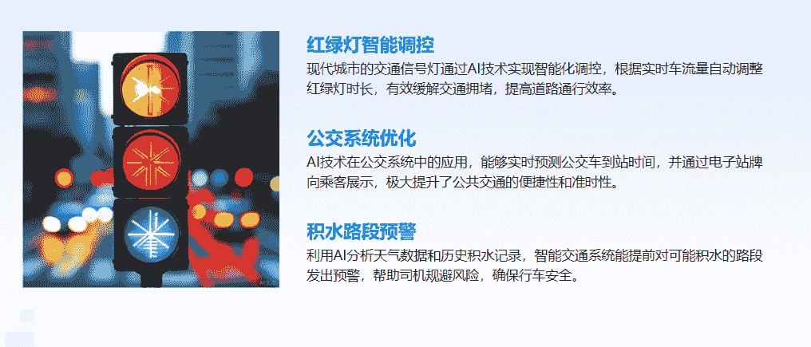
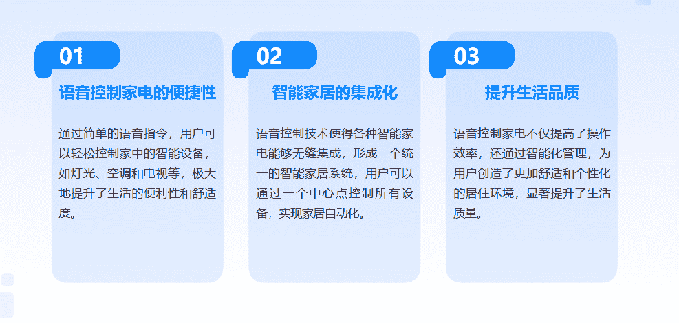
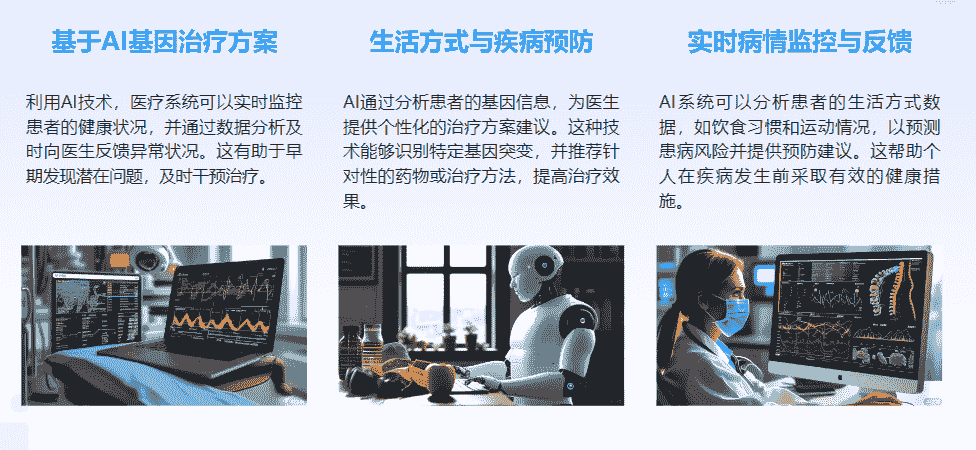
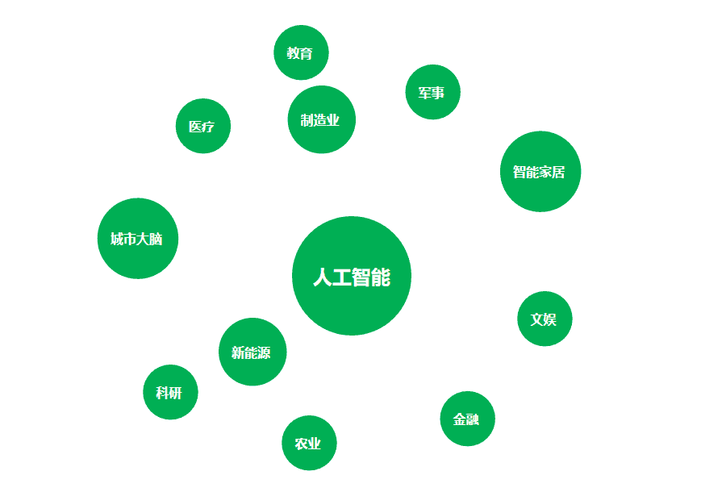

# 1.3 人工智能对社会发展的影响与未来趋势_增玉

> 来源：[https://datawhaler.feishu.cn/docx/RUemdEvW4oiAnZx2nnqc1uP7nBf](https://datawhaler.feishu.cn/docx/RUemdEvW4oiAnZx2nnqc1uP7nBf)

| 版本信息 | **内容版本号** | V1.0 |  |
| --- | --- | --- | --- |
|  | **最近更新时间** | 2024.11.24 |  |
|  | **历史更新** | 2024.11.24：V1.0内容发布 |  |
|  | **内容信息** | +   **所属版本**：**AI通识课-零基础版 ** |  |
| 贡献详情 | **最近贡献** |  |  |
|  | **内容贡献** | 高增玉 |  |
|  | **内测反馈** | 宋志学 | 1.  部分语言存在错别字或表意不清晰。 |
|  | 更多贡献详情见：[致谢AI通识课贡献者们](https://datawhaler.feishu.cn/wiki/HnMiwEzpdiLvWRkfbvFcaJFLnSg) |  |  |

## 人工智能对社会发展的影响

### 接下来就让我用生活中的例子来聊聊AI带来的变化

1.  就业市场的重构

传统岗位转型或消失 想想以前银行柜台排着长队，现在很多业务都被手机APP替代了。但银行职员并没有消失，而是转型做理财顾问，因为AI处理了简单重复的工作，让他们能专注在需要人情味和专业判断的服务上。 就像我们身边的客服行业，很多简单问题由AI客服回答，但处理复杂问题和情感安抚的人工客服反而更受重视了。这不是工作岗位的消失，而是升级。 新职业的诞生： 现在有了"AI训练师"这个工作，就是教AI更好地理解人类需求。比如让AI能看懂医学影像，帮医生发现可能被忽略的病变。还有"数据标注员"，就像教小孩认知世界一样，教AI认识各种图像和文字。

1.  生产效率的提升

记得以前去服装店，导购员要一件件找衣服。现在有了智能仓储，一秒就能定位到库存位置。工厂里的质检，以前要人工一个个检查，现在AI摄像头一扫就能找出瑕疵，比人眼还准。 决策效率： 就拿开个小店来说，以前要凭感觉进货，现在AI能分析历史销售数据，精准预测下周可能卖多少件，该进什么货。农民种地也是，AI能根据天气、土壤状况建议什么时候该浇水施肥。

1.  供应链优化

外卖平台用AI预测午高峰哪个区域会有多少订单，提前调配骑手。超市用AI预测蔬菜水果的销售量，减少浪费，既省钱又环保。 其实AI就像一个贴心的助手，它不是要取代我们，而是帮我们减少重复劳动，让我们能把精力放在更有创造性的工作上。就像计算器没有取代数学家，反而让他们能思考更深层的问题。 这些变化看似很大，但都是循序渐进的。就像我们从功能机换到智能手机一样，一开始可能不太适应，但慢慢就会发现新技术其实让生活更便利了。关键是我们要主动拥抱变化，学着和新技术打交道，找到属于自己的位置。 重要的是，AI发展的最终目的是服务人类，让我们的生活更好。它确实会带来一些改变，但也创造了更多机会。只要我们保持开放和学习的心态，就能在这个充满可能的时代找到自己的舞台。

### 接下来我们聊聊技术创新与应用

1.  深度学习进化

还记得几年前的人脸识解锁吗？刚开始戴个口罩就不认识了，现在即使戴着口罩也能准确识别。这就是深度学习不断进步的结果，就像小孩学习一样，AI通过不断"观察"和"学习"，越来越聪明了。

1.  大语言模型发展

现在我们跟AI聊天，它不再是简单的"你说一句我答一句"。比如让它帮忙写个菜谱，它不光会告诉你步骤，还能根据你家现有的食材调整配方，提醒你注意事项。就像有个懂你、理解你的助手，而不是冷冰冰的机器。

1.  多模态AI融合

以前AI要么只懂图像，要么只懂文字，现在却能同时理解图像、声音和文字。就像🛰️视频通话时自动加个美颜背景，或者拍照时自动调整最佳效果，这些都是多种AI技术合在一起才能实现的。

1.  智慧城市建设

现在不少城市的红绿灯都变"聪明"了，能根据实时路况自动调节时长。下雨天，积水容易的路段会提前发出预警。公交站牌能显示公交车还有几分钟到站，这些都是AI在背后默默工作的结果。

智慧交通

1.  智能家居普及

比如智能音箱，不光能放音乐，还能控制家里的灯光、空调、窗帘。晚上回家前，提前用手机打开空调；做饭时手上沾着油，直接用声音控制定时器。这些原来科幻片里的场景，现在都变成了现实。

智能家居

1.  数字化转型加速

现在去医院，很多医生看病前都会用AI辅助分析你的检查报告，提高诊断准确率。老年人去银行，智能机器人会主动帮忙指引业务。甚至种地也用上了AI，无人机自动喷药，传感器监测土壤墒情。 有意思的是，这些技术进步并不是突然出现的，而是在我们生活中一点点渗透的。就像我们用手机支付一样，刚开始可能觉得麻烦，担心安全问题，现在却觉得特别自然。 其实AI就是这样，它不是要创造一个全新的世界，而是让我们现有的生活变得更简单、更轻松。就像我们用上电器后，省下来的时间可以做更多想做的事。AI也是一样，它接管了重复的工作，让我们能把精力放在更有意义的事情上。 最重要的是，这些技术都是为了服务人类。比如老年人不会用智能手机，现在的语音助手就能帮他们轻松完成很多操作。这才是技术进步的真正意义 - 让生活变得更美好，让人与人之间的联系更紧密。

### 那么接下来聊聊AI是怎么改变我们的教育、医疗和社会治理的

1.  教育革新：

智能化学习

+   个性化学习 现在的孩子学习可太幸福了！就像有了专属家教。AI能发现小明数学除法不太行，就多出这方面的题目；发现小红英语听力特别好，就会推荐难度大点的听力材料。每个孩子都能按照自己的节奏学习，不用担心跟不上或者觉得太简单。

+   教育资源重分配 以前农村孩子想上好课只能去县城。现在通过AI助教，好老师的课程可以同时让很多地方的学生观看，AI还能实时回答学生疑问。就像把最好的老师"复制"到了每个角落。

+   终身学习 现在学习不分年龄了。比如退休的张阿姨想学插花，AI课程能反复讲解，让她慢慢学；上班族小王想学编程，晚上下班打开手机就能学，想学到哪停到哪。

1.  医疗健康进步

智能医疗

+   智能诊断 以前感冒发烧跑医院挂号排队，现在很多医院有AI初筛，像个细心的小护士，问你症状，建议你该挂什么科，需不需要急诊。医生看片子时，AI能帮忙标注可疑区域，减少漏诊的可能。

+   精准医疗 现在看病更"私人定制"了。AI能根据你的检查报告、生活习惯、过往病史，推荐最适合你的治疗方案。比如有的人对某种药物特别敏感，AI就会提醒医生换另一种药。

+   健康管理 手机上的运动App越来越聪明，不光计步数，还能根据你的作息、饮食习惯给出建议。"今天久坐了，建议起来走动下"、"最近压力大，建议做个冥想"，就像随身带着个健康顾问。

1.  社会治理变革：

+   智慧政务 现在办事真是方便多了！以前换驾驶证要跑好几趟，现在手机上就能办，AI智能审核，分分钟搞定。就算不会操作，也有AI客服24小时在线指导。

+   公共服务优化 坐公交不用担心错过站了，到站提醒、实时到达时间一目了然。下雨天，井盖有积水风险，系统会自动报警，维修人员立马处理，这些都是AI在默默工作。

智能公共服务治理

+   社会治理精细化 比如小区安防，AI摄像头能识别可疑人员，自动报警。垃圾分类时，不知道怎么扔，扫一扫就能知道是什么类别。这些小事加起来，让城市运转更顺畅。

其实这些变化都特别贴近我们的日常生活。AI就像一个无处不在的小助手，让教育更适合每个人，让看病更精准方便，让城市更安全舒适。它不是要取代人，而是要帮助人，让我们的生活变得更好。 最重要的是，这些技术都是为了解决实际问题。比如让偏远地区的孩子也能享受优质教育，让老年人看病更方便，让城市更安全环保。这才是科技发展的意义 - 让每个人的生活都能变得更美好。

## 人工智能的未来趋势

人工智能领域辐射图

1.  智能生活

未来，AI将更深入地融入我们的生活，智能家居、健康管理、自动驾驶等技术将使生活更加便捷和高效。头号玩家中的世界也将会成为可能

1.  新型产业和就业的蓬勃发展

AI将推动新兴行业的发展，比如量子计算与AI的结合，同时也会催生新职业，如AI伦理顾问、AI法律专家等。

1.  医疗和健康管理的突破性提升

AI与生物技术的结合将带来个性化治疗方案和精准医疗，提升人类健康水平。

1.  社会决策与治理的智能化

AI的数据分析和模拟预测能力将协助政府进行更科学的社会治理，提升社会的可持续性和适应性。比如城市大脑等等

1.  伦理和法律的创新与挑战

随着AI的深入参与，我们将面临更复杂的伦理和法律问题，需要全球性的AI伦理规范和法律框架。

### 6.人类与AI共生的社会形态

未来可能出现人类与AI高度共生的社会形态，AI将成为人类的合作伙伴，共同推动社会繁荣。

第一次工业革命将人类从农耕时代带入工业时代，第二次工业革命进一步推动了生产力的提升，为第三次工业革命——数字革命奠定了基础。数字革命让我们的生活全面数字化。现在，我们正站在第四次工业革命的门槛上，它将由人工智能引领，虽然具体变化难以预测，但无疑将带来生产力的又一次飞跃，使人们的生活更加美好。未来的人工智能将是开放性的，它将成为复杂性科学的巅峰之作。然而，科技是一把双刃剑，我们在享受其便利的同时，也必须深思其潜在风险，确保将AI转化为一个可控的工具，以优化我们的未来。

---

## 期待大家参与共建！

<https://datawhaler.feishu.cn/sync/AbYkdEkwYs6dHbbNLNEcDaVGnmh>