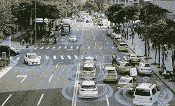
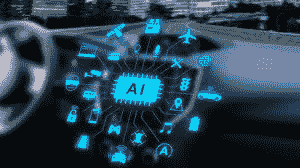
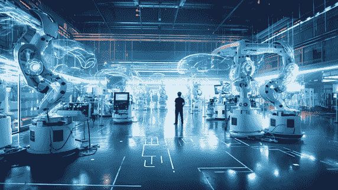
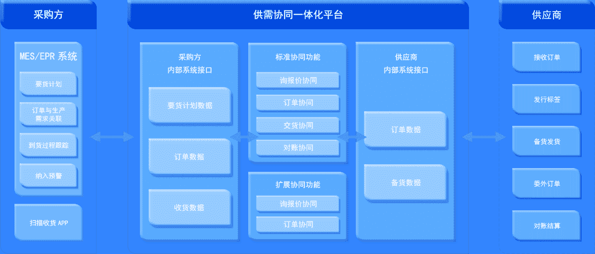
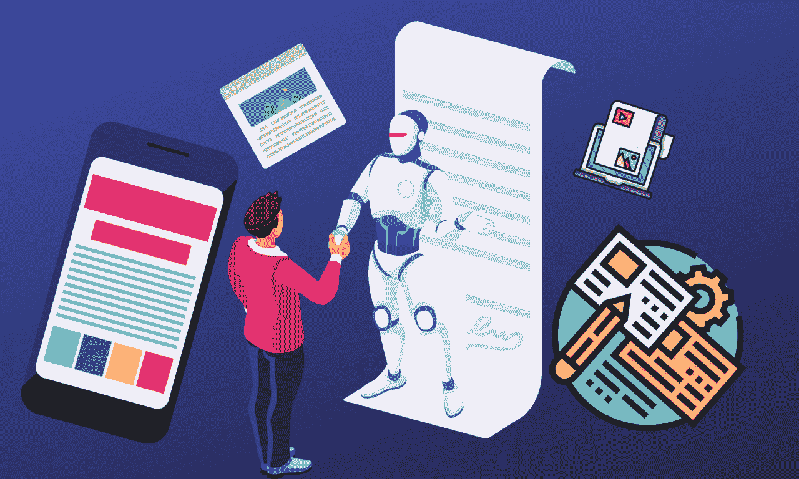
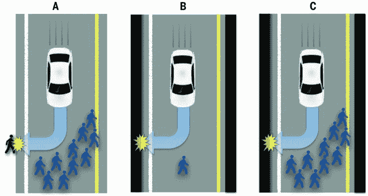
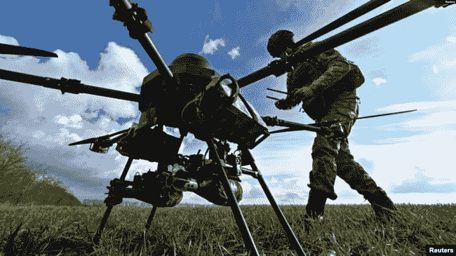
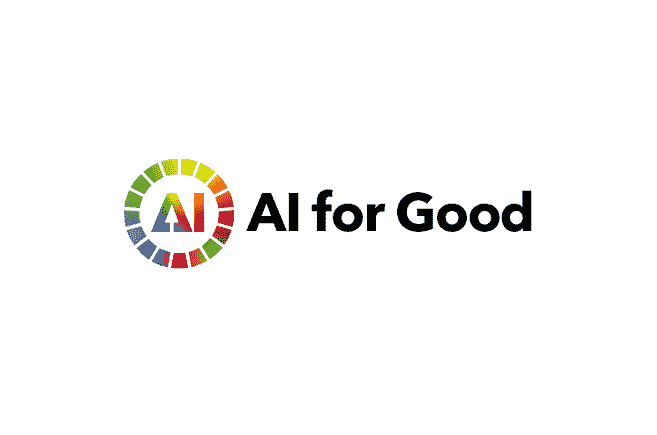

# 1.3 人工智能的能与不能_wohou

> 来源：[https://datawhaler.feishu.cn/docx/DfJddUgjeoXmoLx4gdocM4dMnkc](https://datawhaler.feishu.cn/docx/DfJddUgjeoXmoLx4gdocM4dMnkc)

| 版本信息 | **内容版本号** | V1.0 |  |
| --- | --- | --- | --- |
|  | **最近更新时间** | 2024.11.24 |  |
|  | **历史更新** | 2024.11.24：V1.0内容发布 |  |
|  | **内容信息** | +   **所属版本**：**AI通识课-零基础版 ** |  |
| 贡献详情 | **最近贡献** |  |  |
|  | **内容贡献** | Gray |  |
|  | **内测反馈** | 霍潇潇 | 整体结构清晰，语言文字流畅，通俗易懂，但内容较少，且有一些细节需要修改。 |
|  | 更多贡献详情见：[致谢AI通识课贡献者们](https://datawhaler.feishu.cn/wiki/HnMiwEzpdiLvWRkfbvFcaJFLnSg) |  |  |

## 1.5.1 引言

在现代社会中，人工智能（AI）无处不在。从手机语音助手到医疗影像识别技术，AI已经渗透到我们生活的方方面面。然而，AI的真正能力和局限性是什么？在这章中，我们将详细探讨人工智能的优势与不足，帮助你理解它如何改变我们的生活，以及如何在未来负责任地使用和发展AI技术。

> 思考时刻🤔：

1.  你能想到哪些日常生活中的人工智能应用？

1.  你认为人工智能和人类的智能有什么不同？

## 1.5.2 人工智能的能

1.  数据处理与分析

AI的崛起首先依赖于其在**数据处理和分析方面**的卓越能力。数据是现代社会的“新石油”，而AI则是开采和利用这些数据的“机器”。通过复杂的算法和强大的计算能力，AI可以快速处理海量数据，发现其中的隐藏模式和规律。这种能力使得AI在金融、医疗、市场分析等领域大放异彩。

在金融行业中，**AI通过分析历史数据、市场趋势和新闻事件来**帮助投资者预测未来市场走向，进行风险控制。这种实时数据分析和决策能力使得交易变得更加高效和精确。同样，在医疗领域，AI已经应用于从疾病检测到个性化治疗方案推荐的各个方面。例如，AI系统可以扫描大量的医学影像，检测早期的癌症迹象，辅助医生提高诊断的准确性和效率。

1.  图像和语音识别

数据分析能力的进一步延展是图像和语**音识别技术。这些技术使AI在**与人类的互动中更加智能化。例如，面部识别技术已经广泛应用于安保系统和智能设备的解锁功能。它通过识别脸部的独特特征，如眼睛、鼻子和嘴巴的位置和形状，快速验证用户身份，提高了安全性。而语音识别技术则使得人与机器的交流更加自然。例如，语音助手Siri、Google Assistant等，能够理解和执行用户的语音指令，从拨打电话到播放音乐。AI的语音识别能力还在智能家居设备中发挥了重要作用，使人们可以通过语音控制家里的灯光、温度和家电。

这些技术的背后是**深度学习**的强大支持。AI通过学习大量的图像和语音数据，识别出模式和特征，进而完成复杂的任务。比如，自动驾驶汽车依赖于图像识别技术来检测交通标志、路况和行人，实现安全驾驶。

> **思考点**: 你有没有想过，如果AI能理解和响应语音，它是否能够理解语言背后的真正含义？这引出我们对AI能力的进一步探索：AI的自动化和创造性应用。

1.  高效自动化

AI在自动化领域的应用**改变了传统的工作方式**。自动化不仅限于简单的任务，还包括复杂的多步骤操作。例如，在制造业中，工业机器人可以24小时不停地工作，精确地进行焊接、组装和包装。这种应用提高了生产效率，降低了人力成本，并减少了人为错误。

**AI在自动化方面的成就不仅限**于物理任务。在金融和商业领域，AI被用于自动化客户服务系统，通过智能聊天机器人处理客户问题，减少了人力资源的使用。另一个典型的应用是自动化的数据输入和报告生成，帮助公司节省了大量的时间和劳动力。

AI自动化的核心在于其对任务流程的优化能力。通过基于实际业务场景数据的持续学习，AI系统可以很好的帮助提高任务的执行效率。例如，在供应链管理中，AI可以预测未来的库存需求，优化运输路径，从而减少浪费和成本。这种预测和优化能力使企业能够更加敏捷和高效地应对市场变化。

1.  创造性应用

AI不仅仅是一个执行任务的工具，它还开始在创意领域展示出独特的应用潜力。通过学习和模仿已有的艺术作品，AI可以生成新的音乐、绘画和写作。例如，基于深度学习的AI模型可以创作乐曲，模仿巴赫或莫扎特的风格。AI创作的绘画作品已经在一些艺术展览中亮相，让人们重新思考艺术创作的边界。

在内容创作方面，AI生成的文章和新闻稿已经开始被媒体使用。虽然这些作品的内容和语气较为有限，但它们显示出AI在一定程度上具备了模仿人类写作风格的能力。AI还被用于电影和游戏行业，用来生成场景和角色设计，使创作者可以更加专注于核心创意工作。

> **反思性思考**: 如果AI能够创作音乐和绘画，它是否能拥有和人类一样的创造力？接下来我们进入“人工智能的不能”这一部分，探讨其局限性。

## 1.5.3 人工智能的不能

1.  AI有哪些是做不到的呢？

1.  情感理解

**虽然AI可以模仿情感，**如在语音助手中使用温柔的语调回应用户，但它无法真正理解或体验情感。人类的情感复杂且受文化、环境和经历的影响，而AI只是一系列算法，无法体会这种情感的深度。即使是最先进的情感计算系统，也只能识别和模仿人类的情绪，而非真正理解或共情。

**情**感理解的缺乏使得AI在涉及情感交流和心理健康等领域时存在局限。例如，尽管AI聊天机器人可以进行简单的心理疏导，但它无法像人类心理医生那样，基于丰富的情感体验和直觉提供有深度的支持。

1.  创造力与原创性

**A**I能够生成新内容，但这些内容的“原创性”受到限制。AI生成的音乐、绘画和文章都基于学习已有的数据和模式。它们没有独立的创造力，无法从无到有地产生完全创新的概念或想法。创造力不仅仅是对已有知识的重组，它需要灵感、直觉和情感，而这些是AI无法模仿的。

例如，AI可以创作出一首与巴赫风格相似的乐曲，但无法发明一种全新的音乐流派。创造力涉及到打破常规、跨领域思考，而AI的逻辑和算法限制了其在这一方面的潜力。

1.  复杂伦理决策

**A**I在面对复杂的伦理问题时无法自主做出决策。例如，自动驾驶汽车在无法避免的车祸场景中，如何选择保护车内乘客还是外部行人？这种“电车难题”凸显了AI在伦理决策中的局限性。人类在做出道德选择时，受到文化、社会背景和个人价值观的影响，而这些复杂因素目前难以被AI算法完全捕捉和应用。

而伦理问题不仅存在于自动驾驶，还涉及到AI在军事、医疗等关键领域的应用。对于涉及生命和死亡的决策，AI缺乏道德意识和价值判断。

> AI的技术局限和伦理挑战表明，不是所有领域都适合使用AI。除了AI做不到的事情外，有什么是“不能用AI来做的”？

1.  AI不能用来做什么？

1.  隐私侵犯

AI依赖于对大量数据的分析，这使得隐私保护成为一个重大问题。如果没有合理的监管和保护措施，AI系统可能会滥用个人数据，威胁用户的隐私权。

例如，**社交媒体平台上的AI算法通过分析用户行为**来推送广告和内容，这有时会侵犯用户的隐私。如何确保AI在使用数据时尊重用户隐私，是社会和立法者面临的重要挑战。

1.  虚假信息生成

深度伪造技术（Deepfake）可以生成极具迷惑性的虚假视频和图片，这种技术在某些情况下可能被用于恶意目的，破坏社会信任。AI生成的假新闻和虚假信息会在社交媒体上传播，导致公众对信息来源的信任度下降。为了避免AI技术被用于不良用途，必须制定严格的政策和技术防御措施。

1.  自动化武器

最后，也是最重要的：AI技术不应被用于开发自动化武器，这类武器的不可控性会带来巨大的安全隐患。国际社会和科技伦理组织一致认为，应限制AI在军事用途上的开发，以确保和平与安全，而不是开展以AI为主的军备竞赛。

在AI快速发展的今天，我们需要制定和遵循道德准则，确保技术始终以造福人类为目标。

## 1.5.4 总结与讨论

AI具备强大**的数据处理、识别和自动**化能**力，已经为社会带来了诸多便利和创新。然而，我**们必须清楚地认识到，尽管AI在各个领域的潜力巨大，但它在情感理解、原创性、复杂伦理决策等方面仍有着不可忽视的局限性。AI虽然能够模拟情感，但无法真正理解或体验人类情感。它可以通过学习大量数据来生成内容，但缺乏真正的创新性和灵感。而在涉及道德和伦理的复杂决策中，AI更是无法独立应对，仅能基于预设的规则或数据进行反应。

这些技术局限突显了AI在某些关键领域的适用性限制。更为重要的是，当我们探讨**A**I的广泛应用时，如何确保AI始终为人类服务而不是引发新的问题，是一个长期挑战。人工智能技术的进步伴随着强大的社会和伦理责任——AI的使用必须符合人类的共同利益，不应被滥用于隐私侵犯、虚假信息传播或作为武器。

**正如2025年即将在**瑞士日内瓦举办的全球人工智能向善大会活动所传递的信息，AI技术有潜力推动包容性增长、创造就业和改善社会福祉，并提高教育水平、普及医疗保健、推动农业生产力。然而，我们必须时刻牢记“科技向善”的理念。在应用和推广AI技术时，审慎对待可能的风险和挑战是必不可少的。

从长远看，**我们**要在政策和技术上进行不断调整和完善，确保AI的应用在遵循伦理、尊重人权和促进公平的前提下进行。只有这样，AI才能真正成为人类发展的有力工具，推动社会的全面进步而不是制造新的问题。

## 1.5.5 附录与参考资料

1.  https://easyai.tech/blog/what-ai-can-do/?variant=zh-hans

1.  https://futurecity.cw.com.tw/article/2228

1.  https://futurecity.cw.com.tw/article/2986

1.  《智能时代：大数据与智能革命重新定义未来》 吴军

1.  《AI·未来》 李开复

---

## 期待大家参与共建！

<https://datawhaler.feishu.cn/sync/AbYkdEkwYs6dHbbNLNEcDaVGnmh>