# 1.4 为什么医学也需要学人工智能

> 来源：[https://datawhaler.feishu.cn/docx/YFHDdyn8Do38SXxIxc3cDKTVn3f](https://datawhaler.feishu.cn/docx/YFHDdyn8Do38SXxIxc3cDKTVn3f)

| 版本信息 | **内容版本号** | V1.0 |  |
| --- | --- | --- | --- |
|  | **最近更新时间** | 2024.11.24 |  |
|  | **历史更新** | 2024.11.24：V1.0内容发布 |  |
|  | **内容信息** | +   **所属版本**：**AI通识课-零基础版 ** |  |
| 贡献详情 | **最近贡献** |  |  |
|  | **内容贡献** | 王雅文、杜政泉 |  |
|  | **内测反馈** | 聂雄伟 |  |
|  | 更多贡献详情见：[致谢AI通识课贡献者们](https://datawhaler.feishu.cn/wiki/HnMiwEzpdiLvWRkfbvFcaJFLnSg) |  |  |

# 课程主题：**为什么医学也需要人工智能？**

**课程时长：** 25分钟

**目标受众：** 高校医学生（无技术或编程背景）

---

# 人工智能在医学的应用

我们将从几个方面来探讨AI是如何帮助我们提升医学教育质量、推动科研进步以及优化临床决策的。希望通过今天的讨论，大家能更清晰地认识到AI在医学领域的潜力，以及未来我们可以如何更好地运用它。

分别对应以下案例：

## 案例1：人工智能在医学教育**中的应用——AI标准化病人**

### **传统标准化病人**

+   **固定反应和表现**：传统的标准化病人通常是由受过训练的人扮演，虽然可以模拟常见的临床表现，但他们的反应和症状大多是预先设定的，难以动态调整。

+   **场景局限性**：只能在特定时间和地点进行，无法灵活安排，学生的训练机会受限。

+   **缺乏个性化反馈**：在训练过程中，很少有实时分析学生表现的机制，学生无法清晰了解自己的不足。

+   **资源有限**：案例库相对固定，难以涵盖各种复杂或突发的临床场景。

### **AI标准化病人**

+   **动态调整与模拟**：AI可以学习病历内容，动态调整临床表现，基于学生提问和互动实时改变反应。这种灵活性能够更好地模拟复杂和突发的临床场景。

+   **随时随地使用**：AI标准化病人可以通过移动设备或其他平台访问，学生可以不受时间和地点的限制进行练习。

+   **实时反馈与个性化分析**：AI可以即时分析学生的表现，提供精准的反馈，帮助学生发现问题并快速改进。

+   **丰富的案例资源**：通过生成式人工智能技术，AI可以模拟大量不同病症的患者，覆盖更多临床案例，尤其是稀有或复杂的病例。

### **实际应用场景**

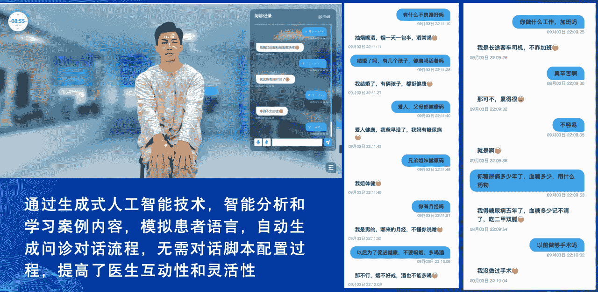

例如，在病史采集训练中，学生可以与AI标准化病人进行互动问诊。AI基于生成式技术智能分析病例，自动生成问诊对话，动态回应学生的提问。这不仅提升了学生的互动体验，还帮助他们更有针对性地练习病史采集能力，强化临床思维能力。相比传统标准化病人，AI标准化病人在灵活性、反馈精确度以及训练场景的丰富性上有显著优势，是医学教育中临床思维能力训练的强大工具。

## 案例2：人工智能在医学教育**中的应用——AI驱动的智能学习**

作为医学生，传统学习方式常常意味着在固定的课堂和教材框架下进行学习，课堂进度、学习内容和复习方式都是统一的，无法灵活适应每个同学的个性化需求。大家通常需要依赖大量的书籍、讲义以及外部搜索工具，费时费力地查找资料，尤其在遇到难题时，解决问题的效率低下。

### 传统学习方式

1.  **学习方式**

在传统学习模式下，学生的学习进度和内容通常是统一的，整个班级按照预设的节奏进行学习。学生在遇到难题时，依赖于查阅教材、翻阅参考书籍或询问老师，但这些方法往往费时且效率较低。大部分学习内容固定，难以因材施教，尤其在遇到个别知识盲点时，学生可能没有得到及时的指导。

1.  **知识获取**

**学生在学习过程中主要依赖教**师讲解和教材，若遇到难题，需要自行查找书籍或在线资源，过程繁琐且容易受到时间和精力的限制。同时，传统方式难以在短时间内提供深度的解释或案例分析，需要更多的时间和精力来消化和理解知识。

1.  **学习反馈与调整**

**传统的学习反**馈通常依赖于课堂讨论、作业批改和期末考试，反馈周期较长，且可能因班级人数过多而缺乏个性化。学生在错误中积累的经验较为有限，可能需要等待教师的指导来进行调整和改进。

1.  **学习灵活性**

传统学习方式受时间和空间限制，**通常仅限于教室和固定的学习时间**。学生若想利用课外时间复习，可能受到教材和学习资源的局限，无法进行灵活的自主学习。

### AI驱动的智能学习

1.  **学习方式**

A**I通过大数据和机器学习技术**，能够实时跟踪学生的学习进度，并根据学生的表现动态调整学习内容和难度。AI能够分析每个学生的优劣势，提供个性化的学习资源和练习，使学习更具针对性和高效性。例如，AI可以根据学生的错误类型自动推荐补充资料或练习题，帮助学生突破瓶颈。

1.  **知识获取**

AI智能知识助手能够在几秒钟内提供精准的答案，并根据上下文给出个性化的解答。与传统的“搜索-阅读”方式不同，AI不仅能提供基础知识，还能生成案例分析，帮助学生深入理解复杂的医学问题。例如，当你询问某个病症时，AI可以在解答的同时提供相关的病历背景、最新的研究成果等，增强学习的深度和广度。

1.  **学习反馈与调整**

**AI能够实时分析学生的学习表现，提供即**时反馈并给出改进建议。AI在问诊练习中会在学生犯错时立刻指出问题，并给出正确的做法，帮助学生及时修正。长此以往，学生能在练习中不断进步，避免长期积累错误。此外，AI还能长期追踪学习进度，生成个性化的成长报告，帮助学生清楚地了解自己的进步与不足。

1.  **学习灵活性**

AI技术使得学习更加灵活。通过手机或电脑，**学生可以随时随地进行医**学学习和模拟练习，打破了时间和空间的限制。AI标准化病人的应用让学生可以在任何地方进行虚拟的病史采集训练，充分利用碎片化的时间进行知识巩固。

### 实际应用场景

+   由紫荆智康科技有限公司开发的“紫荆AI医生”系统已经上线，首批来自21个科室的42位AI医生正式亮相，并开始进行内部测试，以评估AI医生的疾病诊断能力。

+   目前，该系统已经覆盖了300余种疾病，每个科室方向挑选了十余种常见疾病，构造多样的患者合成数据用于AI医生的进化。

+   Agent Hospital的核心理念是通过模拟真实医院的设施和流程，特别是建立了超拟人、广分布、多样化的AI患者，以帮助AI医生在虚拟世界中通过大量诊疗实践进行进化。该系统是一个时间加速器，虚拟世界内的时间流逝速度是真实世界的约100倍，使得AI医生可以在短时间内完成漫长的进化。

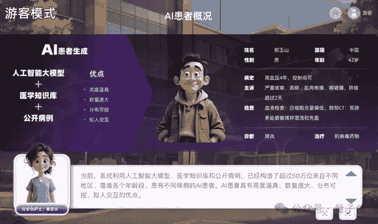

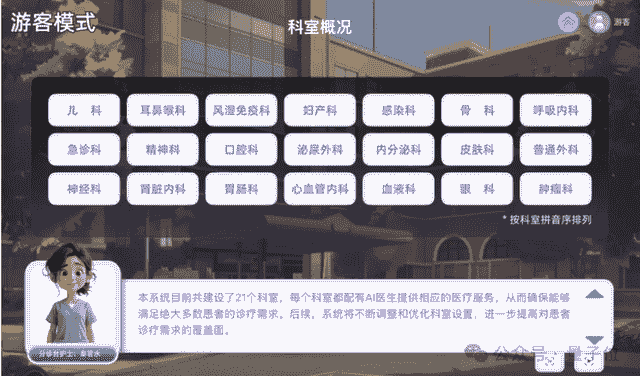

通过AI在医学教育中的应用我们可以看到，传统的学习方式已经产生了巨大的改变了，这种改变就好像之前没有电子教材没有教学视频都是用纸质的课本，而现在我们不仅有电子的教材我们还有AI的辅助，纸质书依然需要，没有被代替，但是学习新工具的使用能够大大提高我们学习的效率。

## 案例3：人工智能在医学科研中的应用——AI驱动科研发现与分析

### 传统科研方法

1.  **数据处理与分析效率**

**传统科研方法**：在传统的医学科研中，数据分析通常依赖人工处理，研究人员需要花费大量的时间收集、整理和分析各种数据。由于数据量庞大且复杂，人工分析的效率较低，容易出现遗漏或错误，尤其在面对海量临床数据、实验数据和基因组数据时，传统方法的局限性愈加明显。

1.  **模式识别与发现新线索**

传统的研究方法通常依赖于人工分析和经验推断，研究人员在大量数据中寻找模式和联系时容易受到人为主观因素的影响。对于复杂的、隐藏在大数据中的模式和关联，传统方法可能无法有效发现，甚至可能错失重要的科学突破。

1.  **研究速度与及时性**

传统的医学科研需要数月或数年才能完成数据收集、整理和分析，尤其是在需要大规模收集病例或样本的研究中，时间周期通常较长。此外，人工分析的结果往往需要反复验证和调整，进一步延长了研究周期。

1.  **预测与预警能力**

传统的医学科研往往无法提前预测疾病的演变或病毒的变异，因为其依赖于已有数据进行分析，并且通常缺乏实时预测和预警能力。研究人员只能在已有病例或实验数据基础上作出推测，无法做到及时发现未来可能发生的重大变化。

### AI驱动的科研分析

1.  **数据处理与分析效率**

**AI驱动的科研分析**：AI特别是大模型的应用，能够迅速处理和分析大量复杂数据，识别数据中的潜在模式、趋势和关联。AI不仅提高了数据分析的速度，还能发现传统方法难以察觉的细节和趋势。AI系统能够在短时间内处理成千上万的数据点，并精准预测疾病模式，显著提高科研效率和准确性。

1.  **模式识别与发现新线索**

AI特别是在大数据领域的应用能够更高效地识别潜在的疾病模式和新发现。通过深度学习模型，AI能够从海量数据中提取出隐藏的规律和联系，甚至发现传统分析方法难以察觉的重要线索。AI不仅能加速科研进程，还能从新的角度带来突破性发现。

1.  **研究速度与及时性**

AI的强大计算能力使得科研可以在极短的时间内完成海量数据的分析，显著缩短研究周期。AI系统能够实时分析数据，并迅速给出潜在的科研结果，为研究人员提供及时的科研支持，快速推动研究进展。

1.  **预测与预警能力**

AI的预测能力特别适用于快速变化的领域，如病毒变异或传染病蔓延。通过机器学习和数据建模，AI可以基于现有的数据进行未来趋势的预测，为公共卫生防疫提供预警，提前做出应对。

### 实际应用场景

在患者招募场景，**医渡科技利用大数据+大模型技术打造智能筛选系统，可以为肿**瘤类项目平均节省88.5%人工筛查成本，非肿瘤类项目平均节省69.8%人工筛查成本。该药物临床试验加速平台已在北京大学肿瘤医院完成了系统部署及推广工作，发挥实际效果。在数字化质控场景，医渡科技与北京大学肿瘤医院合作，利用AI自动扫描技术发现临床试验数据质量问题，针对不同项目类型、科室、申办方的项目进行风险和质量控制。公司目前正在将大模型技术全面融入临床试验场景，以覆盖更多的医疗机构、疾病种类，提供更丰富的服务内容。

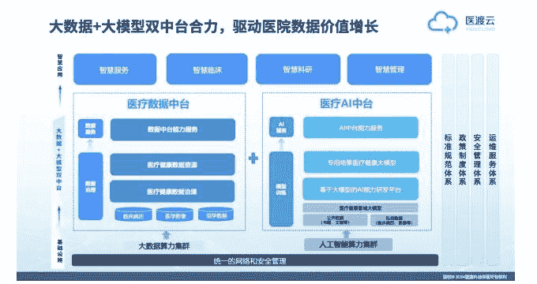

AI大模型对中医相关知识进行数据挖掘，推动中医知识标准化、诊疗标准化发展。天士力医药集团与华为云联合发布的“数智本草”中医药大模型，集守正、创新、产业化三大类数据，为中医药研究提供有力支持。该大模型拥有380亿参数量，基于中医药海量文本数据预训练，结合向量库检索强化，以及中药研发多场景的微调，能够更好地帮助研究者完成中医药理论证据的挖掘和总结，推动中医药现代化发展。

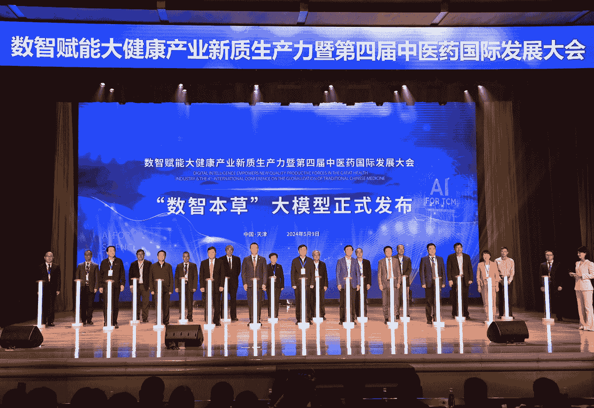

## 案例4：人工智能在医学科研中的应用——AI提升科研写作效率

### 传统科研写作

**文献查找与综述撰写**：

+   传统科研中，文献查找是一个耗时且重复的过程。科研人员需要手动搜索、筛选、阅读和总结大量的文献，才能编写出一篇完整的文献综述。这不仅费时，还容易遗漏一些重要的研究成果或观点。

+   例如，研究人员可能需要几周甚至几个月的时间来完成一篇文献综述，且在整理和总结文献时容易受到个人理解和主观看法的影响。

**数据分析与报告生成**：

+   数据整理与分析在传统科研中通常是由科研人员手动完成。对于大量实验数据，手工分析往往容易出现错误或遗漏，且分析速度较慢，尤其是在处理复杂或多维数据时。

+   生成实验报告也是一个需要耗费大量时间和精力的过程，科研人员需要整理分析结果、撰写报告草稿，并确保报告内容的准确性。

**科研效率与创新性**：

+   传统方式中，科研人员往往需要大量时间进行文献查阅、数据分析和报告撰写等重复性工作。这些繁琐的任务占用了大量的时间和精力，使得科研人员难以专注于创新性研究。

+   由于人工操作的局限，创新的速度往往受到拖慢，且研究中的模式识别和深层次数据挖掘也受到人为限制。

### AI提升科研写作效率

**文献查找与综述撰写**：

+   AI驱动的科研写作大大提升了文献查找和综述撰写的效率。AI可以通过自然语言处理（NLP）技术，快速从成千上万篇文献中提取出最相关的信息，并自动生成文献综述报告。

+   例如，AI可以在几小时内分析数百篇文献，并提炼出领域内的最新进展和核心结论，极大地节省了科研人员查阅文献的时间，同时提高了综述的覆盖面和准确性。

**数据分析与报告生成**：

+   AI能够自动化地处理和分析海量数据。通过机器学习和深度学习算法，AI可以从数据中发现潜在的模式和关联，快速进行数据预测和趋势分析。

+   在报告生成方面，AI能够自动整合分析结果，并生成报告草稿，甚至根据预设格式自动调整报告内容，帮助科研人员减少大量的手工工作，提升报告编写效率和精度。

**科研效率与创新性**：

+   AI的应用使科研人员能够专注于高层次的创新性工作，而不再被繁琐的文献查阅、数据整理和报告撰写所困扰。AI的自动化和高效性释放了科研人员的创造力，加速了科研进程。

+   通过AI的辅助，科研人员可以快速识别数据中的重要趋势和潜在发现，从而在更短的时间内做出创新性的突破。AI的应用使得科研人员能够进行更加精准和高效的深度分析，推动科研的边界向前推进。

### 实际应用场景

Wordvice AI 智能写作助手是一款基于最新 AI 技术开发而成的线上即时 All-in-one 写作辅助工具，旨在满足用户多语言文本写作过程中的各种潜在需求，解决各种潜在难题，协助高效提高用户书面作品的整体质量，使文字表述更加简洁、清晰和具备影响力。值得注意的是，与市面上许多软件不同，以专注于学术和研究写作而脱颖而出，充分能够满足学生、研究人员等专业人士的需求，达到学术期刊、学术会议等专业出版物的标准。成为广大科研人员最佳的AI学术写作工具，名副其实。

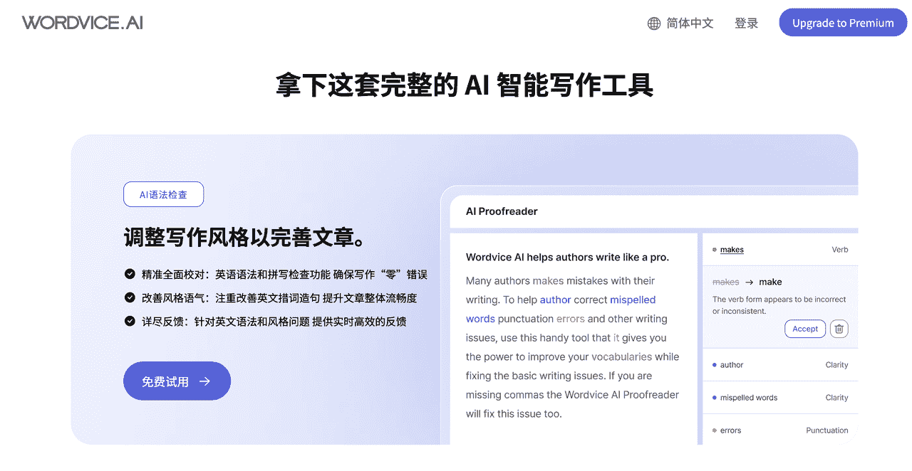

[ResearchRabbit](https://www.researchrabbit.ai/)是一个能帮助用户快速有效率浏览科学论文的网络应用程序。传说中论文界中的 Spotify 可让您创建论文集，并根据您的个人兴趣定期向您推荐新的作品。ResearchRabbit 还可以帮助您可视化论文和共同作者关系，并让您与同事共享您的收藏以进行更有效率的协作。虽然它可能不是最适合科研学术写作的 AI 工具，但它绝对是最优秀的 AI 科研写作工具之一。

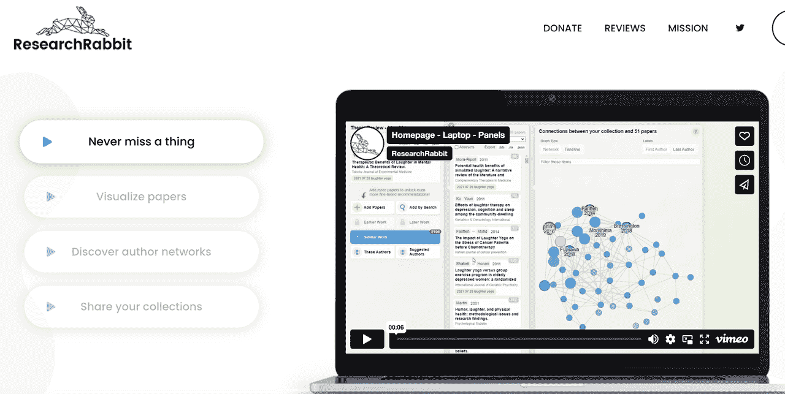

## 案例5：人工智能在医学影像中的应用

### 传统医学影像

**效率和速度**：

+   依赖于医生的个人经验和技能，分析和诊断过程可能耗时较长。

+   医生处理大量数据的能力有限。

+   需要大量的专业医生和设备。

**准确性和减少漏诊**：

+   受限于医生的主观判断，可能存在漏诊和误诊的风险。

+   医生需要依赖自己的知识和经验进行诊断。

+   诊断结果可能受到医生个人经验和情绪的影响。

**学习和适应能力**：

医生的学习和适应能力受限于个人。

### AI支持下的医学影像应用

**诊断与决策支持**

AI可协助医生做出诊断，尤其是在复杂病例和影像分析中。例如，影像诊断（如放射科、病理科）中的AI应用。

**医学影像辅助诊断**

+   影像识别与分析

+   病灶自动检测

+   定量分析报告

**病理诊断支持**

+   数字切片分析

+   细胞分类计数

+   病理特征提取

### 实际应用场景

**目前成熟的医学影像AI模型：**

**谷歌Med-PaLM 2**：Med-PALM 2 AI模型在X光片分析中的应用表现出色，其效果显著。根据多项证据，Med-PALM 2能够自动分析和诊断X光片，覆盖14个应用场景，平均准确率高达92.6%。这一模型不仅能够处理和分析X光片，还能结合其他医学数据，如MRI、CT扫描等，提供全面的医疗状况洞察。

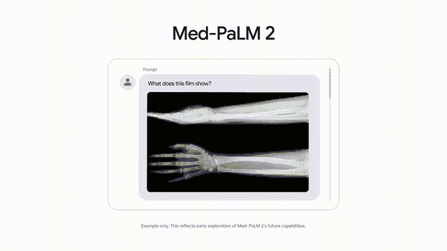

在临床实用性方面，Med-PALM 2甚至超越了医生的表现。例如，在246份真实胸部X光片中，临床医生在高达40.50%的病例中更倾向于选择Med-PALM 2生成的报告，而不是放射科医生的报告。此外，Med-PALM 2在回答临床问题时也展现了卓越的能力，甚至在某些情况下优于医生。

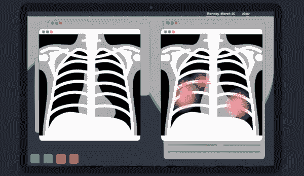

**XrayGLM模型**

1.  **应用案例**：

+   **胸部X光片诊断**：XrayGLM能够对胸部X光片进行自动分析，并生成详细的诊断报告。例如，它可以识别心脏大小、肺部阴影、异常结节等细节信息，并对是否存在炎症、积液等问题给出明确判断。

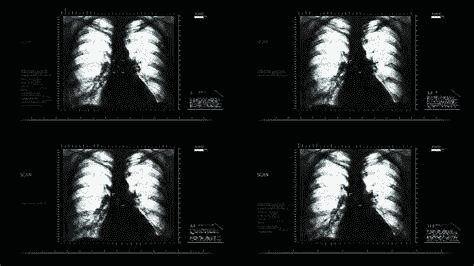

+   **多轮对话系统**：XrayGLM支持医生与患者之间的多轮对话，帮助医生提供更加个性化的医疗建议，并解释复杂的医学术语。

1.  **效果展示**：

+   **诊断准确性**：XrayGLM通过结合大量中文医学影像数据和高质量的中文诊疗报告，能够准确描述胸部X光片的诊断结果，与医生报告相吻合。

+   **用户体验**：在实际应用中，XrayGLM不仅能够生成专业的诊断报告，还能通过多轮对话与用户互动，提供更加详细的解释和建议，从而提升医患交流的质量。

Visual Med-Alpaca模型

1.  **应用案例**：

+   **医学影像分析**：Visual Med-Alpaca可以协助放射科医生分析X光片、CT扫描和MRI图像，提高诊断准确性和效率。例如，它可以自动识别肺部X光片中的异常阴影，并结合患者病历给出初步诊断建议。

+   **病历解读与管理**：该模型能够理解和分析电子病历，提取关键信息，辅助医生快速了解患者病史和治疗过程。

1.  **效果展示**：

+   **多模态融合能力**：Visual Med-Alpaca能够同时处理文本和图像信息，使其在医学影像分析、病历解读等任务中表现出色。

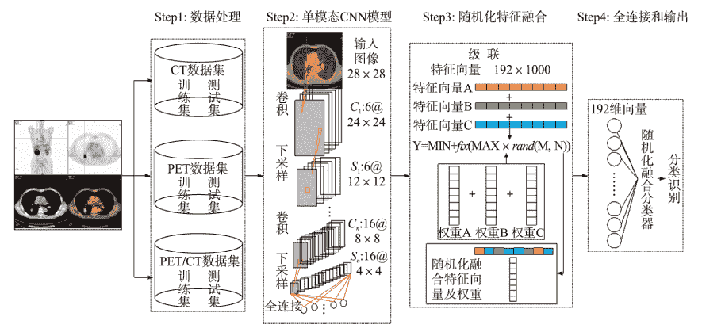

+   **药物研发与医学教育**：在新药研发过程中，Visual Med-Alpaca可以分析大量的实验数据和文献资料，预测药物分子的性质和潜在副作用，加速药物筛选过程。此外，它还可以作为智能教学助手，帮助医学生理解复杂的医学概念。

## 案例6：人工智能在临床决策支持中的应用

### 传统的临床决策模式

医院中传统的临床决策模式是一个复杂的过程，涉及多个步骤和考量因素。

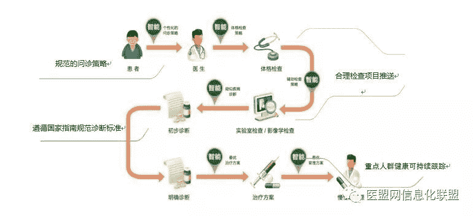

1.  **病史采集和体格检查**：医生通过病史采集和体格检查收集患者信息，作为诊断的起点，并决定需要哪些信息和检查。

1.  **形成诊断假设**：基于收集的信息，医生形成初步的诊断假设，考虑可能的疾病和病理状态。

1.  **辅助检查安排**：为了验证诊断假设，医生可能会安排实验室测试、影像学检查等辅助检查。

1.  **诊断确认**：根据辅助检查结果，医生确认或调整诊断假设，得出最终诊断结论。

1.  **制定治疗方案**：确定诊断后，医生根据患者具体情况、疾病严重程度、治疗指南和临床经验制定治疗方案。

1.  **风险评估与决策分析**：医生评估不同治疗方案的风险和收益，选择最有利的治疗方法。

1.  **医患沟通与共同决策**：医生与患者沟通诊断结果和治疗方案，考虑患者偏好和价值观，共同制定治疗计划。

1.  **治疗实施与疗效评估**：治疗方案确定后，医生执行治疗计划，并持续监测患者反应和疗效，必要时进行调整。

1.  **复诊与长期随访**：治疗结束后，患者进行复诊评估治疗效果，医生进行随访监控患者长期健康状况。

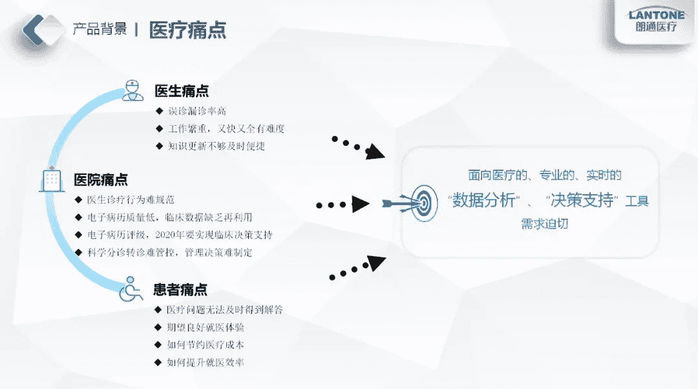

**传统临床决策的特点：**

**个人经验和专业知识的依赖**：

传统临床决策高度依赖医生的个人经验和专业知识，这些经验来源于医生的教育背景和实践积累，对病情的判断和治疗起着决定性作用。

**主观性与循证医学的结合**：

医疗决策过程中存在主观性，不同医生可能对相同的症状和检查结果有不同的解释。同时，循证医学的应用使得临床决策越来越基于科学研究和临床试验结果，提高了治疗的科学性和有效性。

**患者中心的决策考量**：

在传统临床决策中，医生需要考虑患者的个人偏好、价值观和生活质量，这种以患者为中心的模式有助于提高患者的满意度和治疗依从性。

**风险评估与多专业协作**：

医生在制定治疗方案时需要进行风险评估，选择最有利的治疗方法，并与患者、家属以及其他医疗专业人员进行沟通和协作，以确保治疗方案的全面性和有效性。

教育、伦理、成本和应急能力的考量：

医生的临床决策能力受到其教育和培训的影响，同时需要遵循伦理原则和法律规定。在紧急情况下，医生需要在压力下迅速做出决策，并且需要考虑治疗的成本效益，以在有限资源下实现最佳治疗效果。

### AI辅助临床决策

成熟的临床决策支持系统（CDSS）在现代医疗领域中扮演着至关重要的角色，其发展和应用已经取得了显著的进展。根据现有的文献和研究，我们可以从多个角度来探讨成熟的CDSS的特点和功能。

成熟的CDSS通常具备高度集成的能力，能够与电子健康记录（EHR）和其他临床信息系统无缝连接，从而实现数据的实时获取和处理。这种集成不仅提高了系统的效率，还确保了数据的准确性和一致性，使得医生能够在诊疗过程中获得及时、准确的信息支持。

成熟的CDSS具备强大的知识管理和表示能力，主要采用基于规则、临床实践指南和逻辑算法的模块化技术。这些技术使得系统能够根据患者的病史、症状和检查结果，提供个性化的诊断建议和治疗方案。此外，系统还能够通过深度学习和自然语言处理技术，智能识别用户意图和需求，为医生提供更加精准的建议。

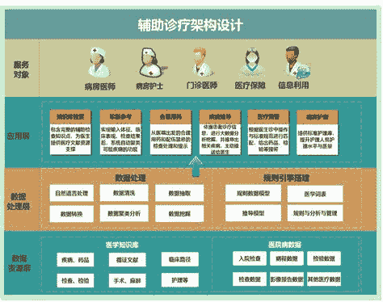

第三，成熟的CDSS在功能上涵盖了诊前、诊中和诊后的全过程。在诊前环节，系统可以辅助诊断和检查检验推荐；在诊中环节，系统提供治疗方案推荐和合理用药监测；在诊后环节，系统则能够进行疾病预测和风险评估。这种全方位的功能覆盖，使得CDSS能够在整个医疗流程中发挥重要作用，提高诊疗效率，减少医疗错误。

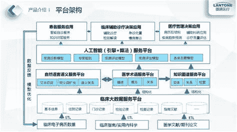

临床决策支持系统(CDSS)-轻识

此外，成熟的CDSS还注重用户体验和操作便捷性。系统设计直观且可配置的用户界面，确保医生在就诊时能够获得实时决策支持，并提供简明相关的警报、提醒和建议。同时，系统还支持在线报告编辑和审核功能，方便医生进行日常工作的记录和管理。

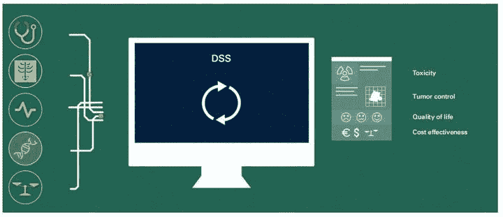

然而，尽管CDSS在技术上取得了显著进步，但其成熟度仍存在一定的局限性。根据现有研究，大多数CDSS的成熟度水平不超过第二级，主要处于情报和设计阶段。这意味着尽管系统具备一定的功能和技术特性，但在实际应用中仍需进一步优化和完善。

成熟的临床决策支持系统通过高度集成、强大的知识管理能力、全面的功能覆盖以及良好的用户体验，为医疗决策提供了强有力的支持。然而，为了进一步提升系统的成熟度和应用效果，仍需不断进行技术创新和优化改进。

### 实际应用场景1：**个性化治疗**

AI通过分析患者的基因、病史和生活习惯，帮助医生定制治疗方案，实现精准医疗。

**精准医疗**

+   基因分析

+   表型-基因型关联

+   靶向治疗推荐

**治疗方案优化**

+   个体化给药方案

+   治疗反应预测

+   并发症预防

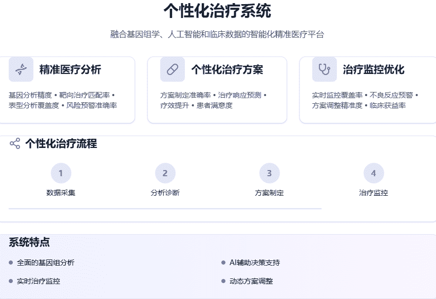

### **实际应用场景2：****管理与效率提升**

AI在医院的运作管理中应用，比如预约系统、病人管理、数据分析等，提升医护人员的工作效率。

**智能预约系统**

+   自动排班

+   资源优化分配

+   就诊流程优化

**病历管理系统**

+   电子病历智能录入

+   病历质量控制

+   临床路径管理

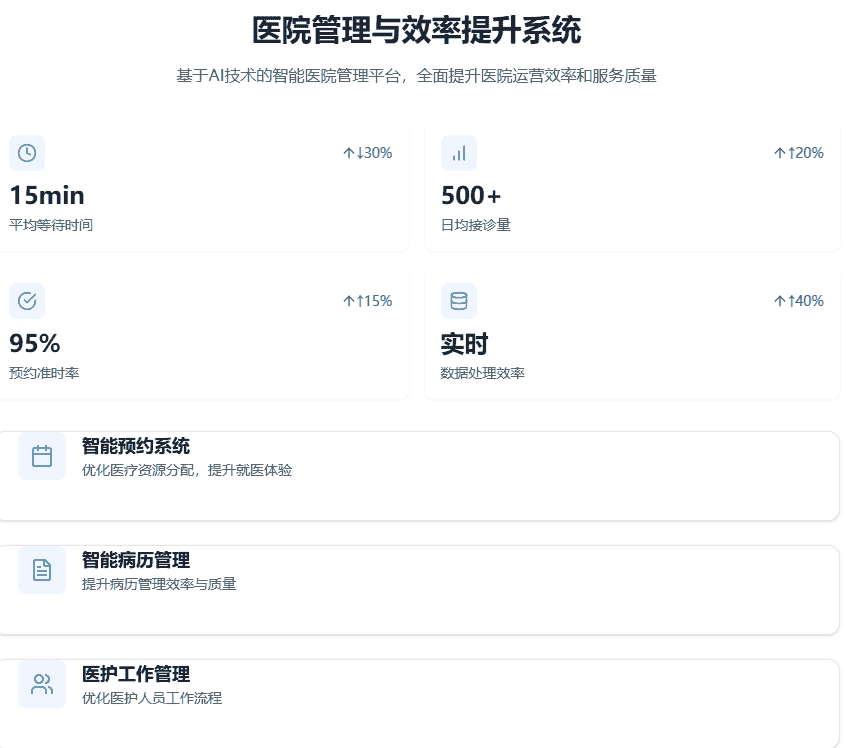

+   **互动讨论**：你认为AI的诊断结果是否能完全替代医生的判断？为什么？

## 总结与讨论

**重要性总结**

+   AI是现代医学发展的重要推动力

+   AI能够提升医疗质量和效率

+   AI促进医学教育和研究创新

**未来展望**

**技术发展趋势**

+   AI技术不断进步

+   应用场景持续扩展

+   与医学深度融合

**需要关注的问题**

+   医疗安全和质量控制

+   AI技术在医学领域的可解释性

+   患者隐私保护

+   医疗责任界定

+   AI伦理问题

**开放问答**

欢迎同学们就以下话题展开讨论：

+   重申人工智能在医学教育、科研和临床中的作用。

+   展望未来：鼓励学生思考AI在医学中可能带来的伦理问题及责任问题，比如隐私保护、决策权、技术依赖等。

+   开放问答：学生可以就课堂内容提出疑问，或分享对AI在医学中的看法。

## 引用

Harvard University. (2020). AI Analysis of Chronic Disease Risk During COVID-19 Pandemic. Retrieved from Harvard Medical Journal.

CDC. (2020). COVID-19 Spread Prediction and AI Applications. Centers for Disease Control and Prevention Report.

Stanford University. (2021). Identification of New Gene Mutations Linked to Breast Cancer Risk Using Deep Learning. Stanford Medicine Genetics Research.

DeepMind. (2023). AI Models Reveal New Mutations in Cancer Genomes, Advancing Precision Medicine. Nature Biotechnology, 2023. Retrieved from DeepMind's official publication.

MIT & Pfizer. (2022). Accelerated Drug Discovery for Tuberculosis with AI-Based Compound Screening. Massachusetts Institute of Technology and Pfizer Joint Report.

UCSF. (2022). Efficient Literature Review Generation in Cardiovascular Disease Research Using GPT Models. University of California, San Francisco Medical Research Archives.

Mayo Clinic. (2022). AI-Driven Personalized Intervention Plans for Diabetes Management. Mayo Clinic Endocrinology Journal.

https://hms.harvard.edu/news/ai-tool-can-help-forecast-viral-outbreaks

Wang, K., Cui, H., Zhu, Y. et al. Evaluation of an artificial intelligence-based clinical trial matching system in Chinese patients with hepatocellular carcinoma: a retrospective study. BMC Cancer 24, 246 (2024). https://doi.org/10.1186/s12885-024-11959-7