# 文本提示词工程&优化方法

> 来源：[https://datawhaler.feishu.cn/docx/TBvPdzqFoovfRuxfRKlc7VhwnbG](https://datawhaler.feishu.cn/docx/TBvPdzqFoovfRuxfRKlc7VhwnbG)

| 版本信息 | **内容版本号** | V1.0 |  |
| --- | --- | --- | --- |
|  | **最近更新时间** | **2024.12.3** |  |
|  | **更新日志** | 12.4.书写文档 |  |
|  | **历史更新** | **2024.12.4**：V1.0内容发布 |  |
|  | **内容信息** | +   **所属版本**：**AI通识课-零基础版 ** |  |
| 贡献详情 | **最近贡献** | 蔡鋆捷 |  |
|  | **内容贡献** | 蔡鋆捷 |  |
|  | **内测反馈** |  |  |
|  | 更多贡献详情见：[致谢AI通识课贡献者们](https://datawhaler.feishu.cn/wiki/HnMiwEzpdiLvWRkfbvFcaJFLnSg) |  |  |

# 一、文本提示词工程概述

## 文本提示词工程是什么

文本提示词工程是通过优化提示词来提高与 AI 模型交互效率的方法，旨在引导模型生成符合预期的输出。它专注于设计、调整和优化用于指导大语言模型生成特定类型输出的输入文本。通过精心设计的提示词，可以引导模型聚焦于特定任务，提高生成内容的准确性、相关性和创造性。

提示词工程的作用广泛，无论是在文本生成、问答系统还是其他场景中，都能通过优化提示词来提升与 AI 模型的交互效果。一个好的提示词应该包含任务、上下文背景、示例、角色和格式等部分。

说明：本次测试使用的AI为[豆包](https://www.doubao.com/)。

# 二、文本提示词工程基础

## 提示词的作用和构成

提示词在与 AI 模型交互中起到引导作用，由任务描述、输入示例和期望输出等部分构成。

例如，当我们希望 AI 生成一篇关于自然风景的文章时，提示词可以是 “请以生动的语言描述美丽的自然风景，包括山脉、河流、森林等元素，文章适合大众阅读，长度在 800 字左右。”

生成结果如下：

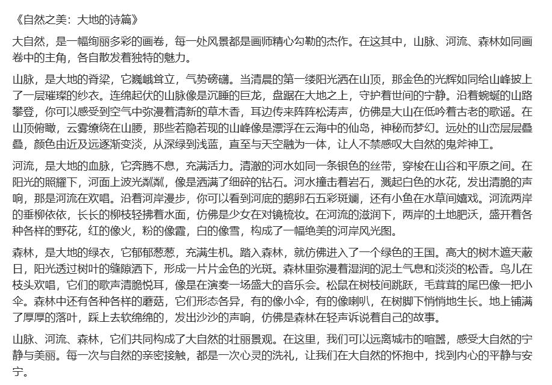

## 提示词的基本结构和类型

提示词主要分为直接提示和间接提示两大类，直接提示明确指示模型生成的文本类型或结构，间接提示通过提供背景信息或上下文间接引导模型生成预期输出。

直接提示的例子：“生成一首描述秋天美景的五言绝句。” 这里明确指示模型生成五言绝句这种特定的文本类型，让模型直接聚焦于这个任务。

生成效果如下：

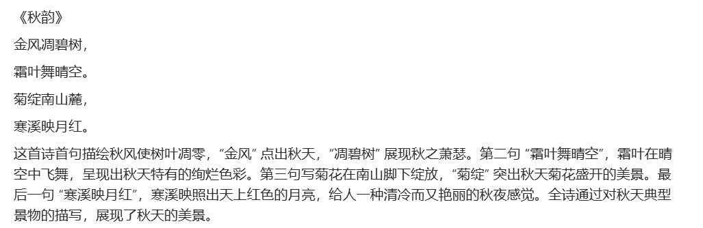

间接提示的例子：“秋天来了，树叶渐渐变黄，空气中弥漫着丰收的气息。请根据这段描述生成相关的五言绝句。” 这里通过提供秋天的背景信息，间接引导模型生成与秋天相关的五言绝句。

生成效果如下：

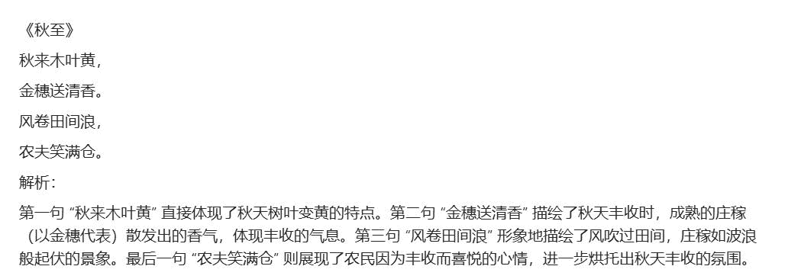

可以看到，在解析当中，有“树叶”，“变黄”等关键词，不同于第一个例子，使用间接提示词的时候要注意到，生成的内容会受到背景等信息的干扰，好处是可以更加接近我们的所想，坏处就是如果我们将这种”隐藏“信息忽略的时候，会觉得AI生成的内容有点冗余的感觉在里面。

# 三、提示词设计技巧

## 1.明确背景和目标的重要性

在设计提示词时，明确背景和目标至关重要。就像给同事指派任务一样，如果只提供模糊的描述，任务完成效果可能不尽如人意。但如果提供明确的目标、思考方向和执行策略等信息，同事更有可能高标准完成任务。与 AI 模型交互也是如此，明确的背景和目标能帮助模型更好地理解任务，生成更符合需求的输出。

例如，在要求 AI 生成一篇关于科技公司创业的文章时，如果提示词只是 “写一篇关于科技公司的文章”，模型可能会生成一篇较为宽泛的关于科技公司的概述。而如果提示词明确为 “请写一篇关于如何在科技公司创业中进行市场调研的文章，重点分析调研方法和数据来源”，模型就能更准确地聚焦于特定任务，生成更有针对性的内容。

## 2.提供输出样例的影响

提供输出样例可以让模型更好地把握输出的格式和风格。比如，当我们要求 AI 生成一首诗时，如果只是简单地给出 “写一首诗” 的提示词，模型生成的诗可能风格各异，难以满足我们的具体要求。但如果我们提供一个输出样例，如 “明月几时有，把酒问青天。” 并要求模型生成一首类似风格的诗，模型就能更好地理解我们期望的格式和风格，生成更符合要求的作品。

## 3.使用分隔符号区分内容单元

分隔符号能提高提示词的可读性和理解性。在提示词中，我们可以使用各种分隔符号，如逗号、句号、斜杠等，或者特定的关键词，将不同的任务或内容部分清晰地划分开来。这样可以帮助模型更好地理解和处理信息，避免提示注入的问题。

例如，我们可以使用 “/” 分隔符来明确不同的任务要求，如 “生成一首诗 / 关于秋天的美丽 / 包含红叶和丰收的场景”。这样的提示词更加清晰明了，模型能够准确地理解每个部分的要求，从而生成更符合预期的输出。同时，分隔符号也可以作为避免提示注入的一种有效技术，确保模型按照我们的要求执行任务，而不会受到其他可能冲突的指令影响。

# 四、提示词优化策略

## 1.简洁明了的语言

在与 AI 模型交互时，应使用简单、清晰的语言，避免复杂词汇和冗长句子。比如，不要用生僻专业术语，而是用通俗易懂的词语表达问题。例如，不要说 “这个方案有点复杂难理解”，而要说 “这个方案的步骤不太清晰”。

+   **优化前**：

+   Prompt：请详细描述一下你对于人工智能在教育领域应用的全面理解和分析，包括但不限于历史发展、现状分析以及未来趋势预测，并结合具体案例进行阐述。

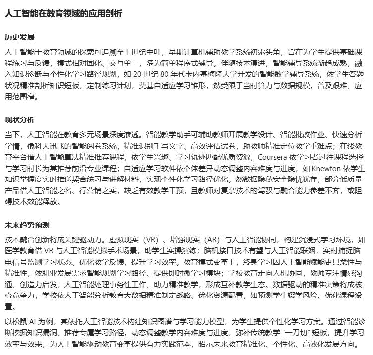

+   **优化后**：

+   Prompt：请简述人工智能在教育中的应用，包括历史、现状和未来趋势。

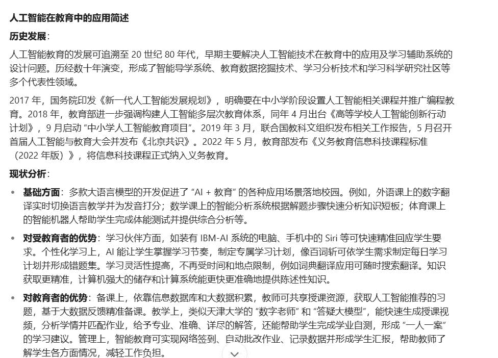

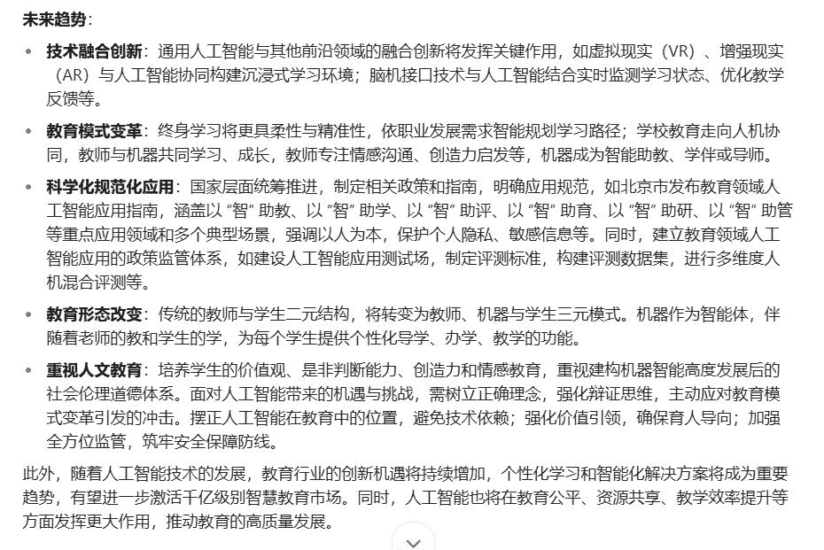

这里我们会有一个疑问，为什么提示词越简单，生成内容的逻辑性层次行反而更好呢？这就不得不提及冗余的问题。在第一个提示词当中很多是冗余的，比如说“包括但不限于”，AI的一般是不会生成多于提示词语句的例子的，因为这样的的话有可能会凭空捏造一些奇奇怪怪的东西出来。

“全面理解和分析”对于AI来说也是冗余的，因为我们人类的思考的时候可以要求全面理解也可以要求片面理解，不强调的话我们都会下意识认为只需要有一个片面的理解就可以。但是AI是通过推理+整理得出结论，通过把能找到的资料都找到，然后在分析得出结论，虽然看上去跟人类的全面理解相似，但是对于AI来说这仅仅是一个推理步骤，必须找到能找到资料，再分析最终得出来的生成结果也必然是所有资料的信息总和，也就是“全面”的，如果对结果有误差的话那就是目前信息没有更新完成或者模型的知识库没有更新完成。

## 2.指定输出格式

明确所需的输出格式，如列表、段落结构等。可以用特定的句子数量、段落结构或格式要求来描述。比如，要求以列表形式回答问题，或者指定输出的字数范围。例如，可以说 “请以三个要点的列表形式回答如何提高文本提示词工程的效果”。

+   **优化前**：

+   Prompt：请提供一些关于健康饮食的建议。

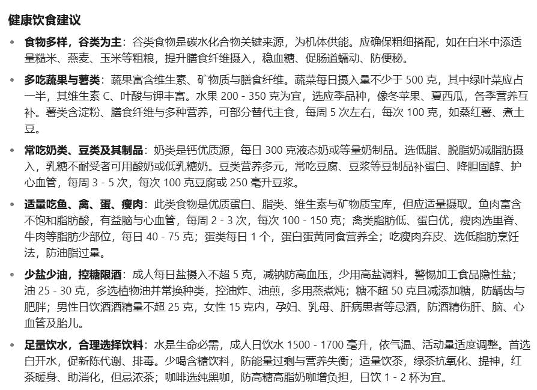

+   **优化后**：

+   Prompt：请列出5条健康饮食的建议，每条用一句话概括。

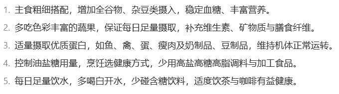

通过指定格式输出，我们可以将需要的内容编辑成我们所需要的样子，满足我们对一些特定格式的需求，比如说“一句话概括”，“每一个点后都要加入例子”，“输出内容是无序列表”等等。有时候指定的输出格式很多，这里的建议是试一试，遇到有需要的输出格式就去试一下，因为输出的格式非常繁多，组合起来更是天文数字，所以这里只能介绍到一些常用的，如果有更多的需要也是可以去多多尝试的。

## 3.使用明确指令

采用肯定的指示词，避免否定语言。例如，用 “做” 代替 “不要”。这样可以让 AI 模型更清楚地理解要求。比如，不要说 “不要回答得太宽泛”，而要说 “回答要具体明确”。

+   **优化前**：

+   Prompt：你能帮我写点东西吗？

+   **优化后**：

+   Prompt：请写一篇关于可持续发展的500字文章。

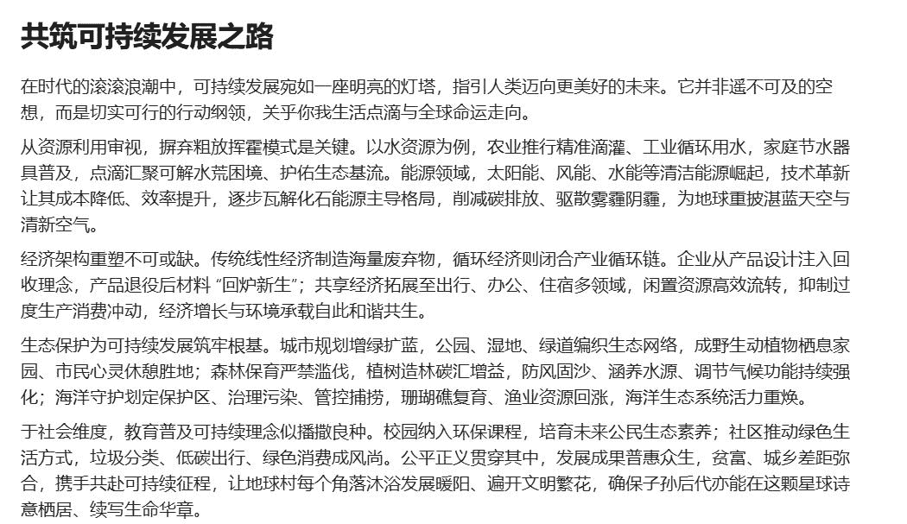

通过示例可以看到，有明确的需求对于AI生成的内容质量影响很大，这里的建议是生成内容之前先想好自己需要什么，体裁是散文，诗歌，还是报道，字数多少，什么风格，什么题材等等，当有一个大纲的时候，哪怕输入的语句可能逻辑性没那么强，但是AI凭借强大的推理能力，还是能够大致明白生成的要求。然后我们等其生成之后，在对内容进行微调。

## 4.分步骤引导

将复杂任务分解成简单的对话提示。如果要让模型写一篇论文，可以先让它列出大纲，然后再分别对每个部分进行提问和完善。例如，“先列出关于文本提示词工程的论文大纲，然后我们再讨论每个部分的具体内容”。

+   **优化前**：

+   Prompt：请解释一下量子力学的基本原理。

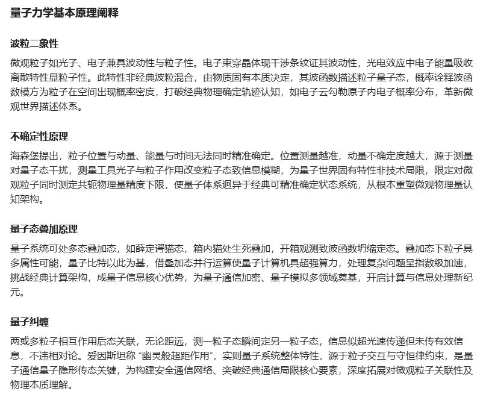

+   **优化后**：

+   Prompt：请分步解释量子力学原理：1. 量子态的叠加；2. 观测导致的坍缩；3. 海森堡不确定性原理。

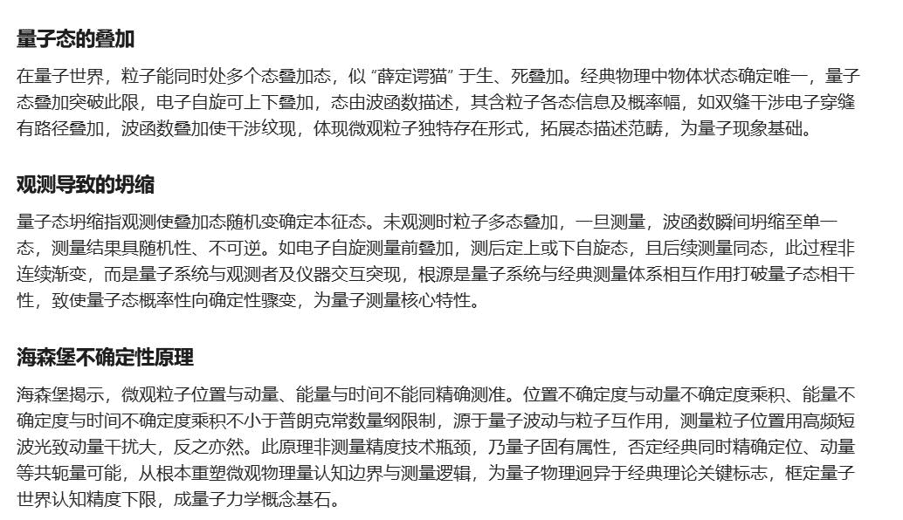

在这里通过分步解释优化prompt有下面几点好处：

1.  能够根据自己的思路进行内容的编排

1.  在得到文本之后，AI会自动生成大小标题，方便后续的复制与排版

1.  对某一段内容不满意的时候，可以对具体某一段内容要求其重新生成，节约润色作品的时间。

## 5.使用示例驱动

在提示开始时提供例子，让模型更好地理解需求。如果要让模型推荐书籍，可以先给出一些自己喜欢的书籍例子，然后要求它推荐类似的书籍。比如，“我喜欢《百年孤独》和《活着》，请推荐一些类似风格的书籍”。

+   **优化前**：

+   Prompt：请描述一下一个好的领导应该具备哪些特质。

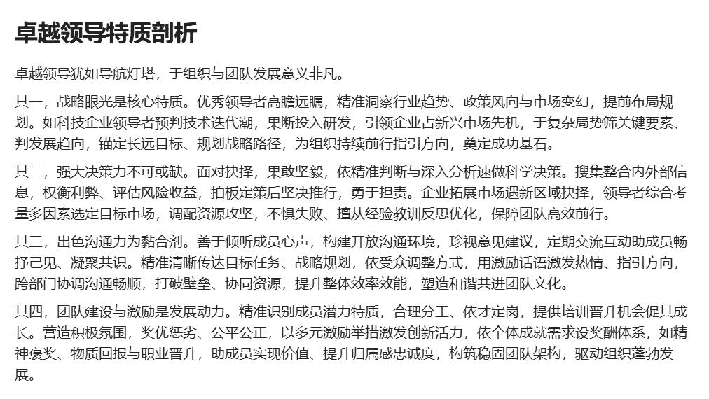

+   **优化后**：

+   Prompt：请描述一个好的领导应该具备的特质，并以于东来为例进行说明。

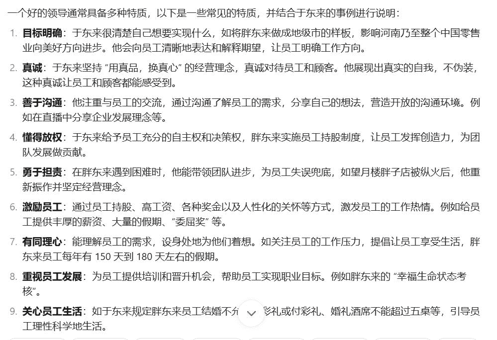

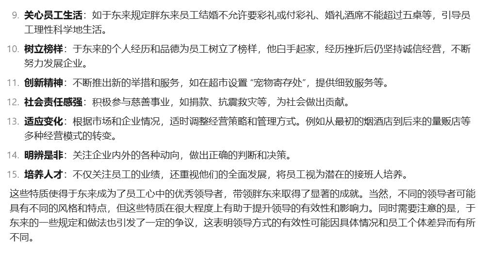

通过对比两个prompt我们会发现，通过示例驱动的优化，我们所生成的内容不会像之前那么假大空，而是会结合具体例子进行分析，生成更为详细的内容，在写作的时候，通常会选择此方法来润色自己的报告与作品，使文章更加翔实立体。