# 国内文生图/视频AI工具介绍与使用

> 来源：[https://datawhaler.feishu.cn/docx/T8N0dtgAXolYlqx4VC4cJ8RwnAb](https://datawhaler.feishu.cn/docx/T8N0dtgAXolYlqx4VC4cJ8RwnAb)

| 版本信息 | 内容版本号 | V1.0 | |
| --- | --- | --- | --- |
| | 最近更新时间 | 2024.12.1 | |
| | 历史更新 | 2024.12.1：V1.0内容发布 | |
| | 内容信息 | + 所属版本：AI通识课-零基础版 | |
| 贡献详情 | 最近贡献 | 蔡鋆捷 | |
| | 内容贡献 | 蔡鋆捷 | |
| | 内测反馈 | | |
| | 更多贡献详情见：[致谢AI通识课贡献者们](https://datawhaler.feishu.cn/wiki/HnMiwEzpdiLvWRkfbvFcaJFLnSg) | | |

## 文生图AI工具介绍

### [豆包](https://www.doubao.com/chat/?channel=AIdaohang&source=hw_db_123dh)

**介绍**

豆包是字节跳动开发的一款人工智能，可以理解和生成人类语言，能够回答各种问题，包括但不限于科学知识、历史文化、技术领域、生活常识等多方面的疑问。还可以进行文本创作，如故事编写、诗歌创作、文案撰写等，帮助用户获取灵感、拓展思路，在学习、工作、生活以及创意探索等诸多场景中都能发挥作用，并且完全免费向用户开放使用的，不存在充值机制。

**使用方法与应用**

模板：[主题（如人物、风景等）]，[细节描述（外貌、服饰、场景元素等）]，[风格（如写实、卡通等）]，[色彩基调]，[特殊效果或氛围]

**人像摄影风格图片：**

`prompt` 语句：一位年轻时尚的女性模特，穿着白色连衣裙站在海边沙滩上，长发随风飘动，人像摄影风格，暖色调，柔和的阳光洒在身上。

`prompt` 语句：一位成熟的男性商务人士，身着黑色西装打着红色领带，站在城市高楼的落地窗前，表情严肃，人像摄影风格，冷色调，背景有城市夜景灯光虚化效果。

**艺术风格图片：**

`prompt` 语句：一个抽象的人体雕塑，由金属和玻璃材质构成，放置在白色的展厅中央，周围有光影交错，艺术风格，冷色调，有强烈的明暗对比。

`prompt` 语句：一幅以花朵为主题的油画，花朵色彩斑斓且有夸张的形状，背景是模糊的花园景色，艺术风格，暖色调，笔触厚重有质感。

**国风插画风格图片：**

`prompt` 语句：一位古代的宫廷舞女，身着华丽的汉服，头戴金饰，在雕梁画栋的宫殿庭院中翩翩起舞，国风插画风格，传统中国色彩，画面有飘落的花瓣。

`prompt` 语句：一位身着道袍的老者，手持拂尘站在云雾缭绕的山巅，背后是古老的道观建筑若隐若现，国风插画风格，淡雅色调，有袅袅升腾的仙气氛围。

**动漫风格图片：**

`prompt` 语句：一个可爱的动漫少女，粉色头发双马尾，蓝色大眼睛，穿着水手服，站在校园的樱花树下，动漫风格，粉色系色调，有微风拂动头发和花瓣的动态感。

`prompt` 语句：一位帅气的动漫少年，黑色短发，眼神坚毅，穿着机甲战服，背后是科幻城市的战火纷飞，动漫风格，金属色调，有激光武器发射的光芒效果。

**3D 渲染风格图片：**

`prompt` 语句：一辆超跑汽车，红色车身，流畅的线条，停在未来感十足的立体车库中，周围有蓝色的能量光线环绕，3D 渲染风格，高光泽度色彩，有金属反光和光影反射效果。

`prompt` 语句：一个科幻风格的外星生物，绿色皮肤，大眼睛，多只触手，站在布满奇异晶体的星球表面，3D 渲染风格，荧光色调，有星球大气的光晕效果。

**商品图片：**

`prompt` 语句：一款智能手表，圆形表盘，黑色表带，表盘有蓝色的电子显示界面和精致的金属边框，商品图片，冷色调，有光泽感和立体感。

`prompt` 语句：一瓶香水，透明的玻璃瓶身，瓶颈系着粉色丝带，瓶身有金色的品牌标识，周围有散落的花瓣，商品图片，粉色系色调，有柔和的光影效果。

**风景图片：**

`prompt` 语句：一片宁静的森林湖泊，湖水清澈见底，周围是茂密的绿色树林，远处有雪山映照，风景图片，自然色调，有阳光透过树叶洒在湖面的光斑。

`prompt` 语句：一座古老的欧式小镇，街道由石板铺成，两旁是彩色的房屋，天空有绚丽的晚霞，风景图片，暖色调，有炊烟从烟囱升起的生活气息。

### [即梦](https://jimeng.jianying.com/ai-tool/home)

**介绍**

即梦 AI 是字节跳动旗下的一站式智能创作平台，提供了丰富多样的创作功能，包括 AI 绘画和 AIGC 视频创作等。它具备强大的图像和视频生成能力，能依据用户的输入指令快速生成相应的创意内容。其界面设计较为友好，操作相对简便，无论是专业创作者还是普通爱好者都能轻松上手，利用它来探索和实现自己的创意想法，在创作过程中还能激发用户的无限灵感，促进创作社区的交流与互动，让创作变得更加有趣和高效。

**平台使用特点**

即梦 AI 每天为用户提供 80 积分的免费额度，可用于生成视频或图片等创作操作。例如，生成图片时会根据图片的复杂程度和尺寸等因素消耗不同数量的积分。当免费积分用完后，用户可以选择开通会员来获取更多积分和其他特权。会员价格为每月 18 元，开通会员后可享受诸如更多创作资源、更高质量的输出、优先处理等权益，能够满足用户更大量和更高要求的创作需求，进一步提升创作体验和效率。

**使用方法与应用**

模板：[主题描述]，[风格限定]，[细节要求]，[色彩氛围]，[画面构图]

**国风美学风格图片**

+ `prompt` 语句：一位古代温婉的女子，身着淡粉色的汉服，手持一把精致的团扇，站在古雅的庭院中赏荷，呈现国风美学风格，具有精美的刺绣花纹和飘逸的丝带等细节，运用淡雅的传统中国色彩搭配，采用中心构图，突出人物主体与庭院环境的和谐。

+ `prompt` 语句：一座雄伟的古代宫殿建筑群，红墙黄瓦，飞檐斗拱，宫灯摇曳，呈现国风美学风格，具有精雕细琢的门窗和华丽的装饰图案等细节，运用庄重的暖色调，采用全景构图，展现宫殿的宏伟气势与威严。

**海报设计风格图片（参考后续的海报设计内容）**

+ `prompt` 语句：一场盛大的音乐节宣传海报，以摇滚明星为核心元素，明星身着酷炫的黑色皮装，手持电吉他激情演奏，呈现海报设计风格，具有闪耀的舞台灯光和动感的音符特效等细节，运用强烈对比的色彩搭配，如黑与红、紫与黄等，采用三分法构图，将明星主体置于画面关键位置，搭配醒目的文字信息。

+ `prompt` 语句：一部新上映的科幻电影海报，未来城市的天际线作为背景，一艘巨大的宇宙飞船冲破云霄，呈现海报设计风格，具有科幻风格的机械纹理和光影效果等细节，运用冷色调为主，如蓝与银，采用对称构图，营造出宏大而神秘的氛围，吸引观众眼球。

**动漫游戏风格图片**

+ `prompt` 语句：一位勇敢的动漫女战士，金色长发随风飘动，身着闪耀着光芒的银色铠甲，手持长剑站在神秘的魔法森林入口，呈现动漫游戏风格，具有精致的铠甲纹理和魔法光芒特效等细节，运用明亮鲜艳的色彩搭配，采用引导线构图，将观众视线引向女战士和森林深处。

+ `prompt` 语句：一个奇幻的游戏场景，古老的城堡坐落在云端之上，周围有飞龙盘旋，城堡内有神秘的魔法符文闪烁，呈现动漫游戏风格，具有细腻的建筑纹理和绚丽的魔法色彩等细节，运用丰富多样的色彩组合，采用鸟瞰构图，展现整个奇幻场景的全貌。

**未来科幻风格图片**

+ `prompt` 语句：一座未来都市的街头景象，高楼大厦表面布满了智能显示屏，各种飞行汽车穿梭其中，呈现未来科幻风格，具有高科技的电子线路和透明材质等细节，运用冷金属色与霓虹灯光的色彩搭配，采用透视构图，体现都市的深度与科技感。

+ `prompt` 语句：一个科幻实验室内部，巨大的能量反应堆散发着蓝光，周围有各种复杂的仪器设备和机器人助手在忙碌工作，呈现未来科幻风格，具有精密的仪器仪表和机械臂的细节，运用蓝白色调为主的色彩搭配，采用中心构图，聚焦于能量反应堆和核心工作区域。

**动物萌宠风格图片**

+ `prompt` 语句：一只毛茸茸的白色小猫，蓝色的大眼睛圆溜溜的，戴着粉色的蝴蝶结，趴在柔软的粉色垫子上，呈现动物萌宠风格，具有柔软的毛发质感和可爱的表情等细节，运用柔和的粉色系色彩搭配，采用特写构图，突出小猫的可爱模样。

+ `prompt` 语句：一群小松鼠在森林中的大树下嬉戏玩耍，它们毛茸茸的大尾巴翘得高高的，呈现动物萌宠风格，具有生动的松鼠动作和森林环境的细节，运用自然的绿色与棕色系色彩搭配，采用群像构图，展现小松鼠们的活泼可爱与群体互动。

**绘本插画风格图片**

+ `prompt` 语句：一个宁静的乡村夜晚，月亮高高挂在星空，农舍的烟囱冒着袅袅炊烟，一只小狗在院子里守望着，呈现绘本插画风格，具有简单而富有童趣的线条和柔和的色彩等细节，运用暖黄色与深蓝色的色彩搭配，采用全景构图，营造出温馨宁静的乡村氛围。

+ `prompt` 语句：在一片花海中，一个小女孩穿着碎花裙追逐着彩色的蝴蝶，呈现绘本插画风格，具有夸张的人物比例和丰富的花卉图案等细节，运用明亮的彩色系色彩搭配，采用中心构图，突出小女孩与蝴蝶的互动。

**写实人像风格图片**

+ `prompt` 语句：一位中年男性，深邃的眼神，脸上有着岁月的痕迹，穿着一件破旧的牛仔外套，站在海边的礁石上，海风拂动他的头发，呈现写实人像风格，具有真实的皮肤纹理和衣物褶皱等细节，运用自然的海边色彩色调，采用三分法构图，人物与大海背景相互映衬。

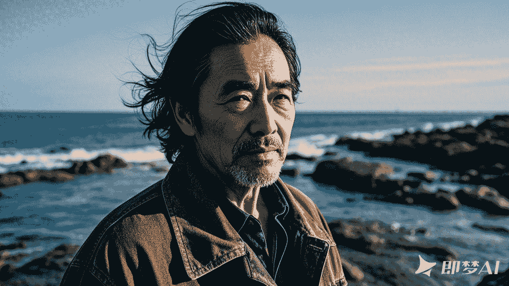

+ `prompt` 语句：一位年轻的女性模特，有着精致的五官和高挑的身材，穿着华丽的晚礼服，在金碧辉煌的大厅中优雅地微笑，呈现写实人像风格，具有细腻的妆容和礼服质感等细节，运用明亮的灯光色彩效果，采用中心构图，突出人物的美丽与高贵。

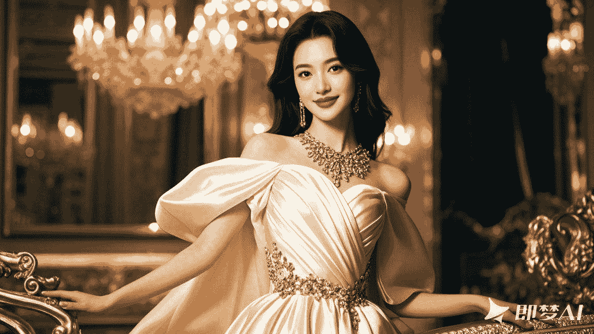

**产品设计风格图片**

+ `prompt` 语句：一款新型的智能手机，超薄的机身，大屏幕占比，金属边框带有独特的纹理，呈现产品设计风格，具有清晰的屏幕显示内容和精致的按键设计等细节，运用简洁的银灰色与黑色搭配，采用多角度展示构图，全方位呈现手机的外观与特色。

+ `prompt` 语句：一款时尚的运动鞋，鞋面采用透气的编织材料，鞋底有特殊的防滑纹路，鞋身有彩色的品牌标识，呈现产品设计风格，具有真实的材料质感和光影效果等细节，运用鲜明的色彩搭配，采用特写与侧面展示构图，突出运动鞋的设计亮点与实用性。

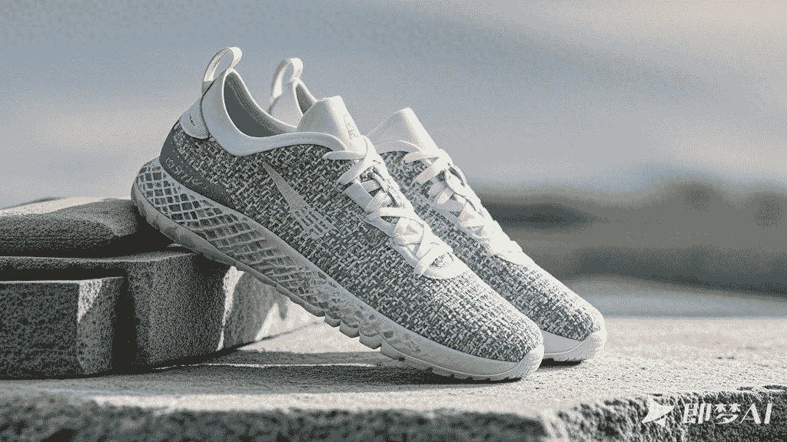

**海报设计**

**模板**

“设计一张[主题]海报，包含[具体元素]，使用[风格]风格，海报中要有[文字内容]。”

选择模型：

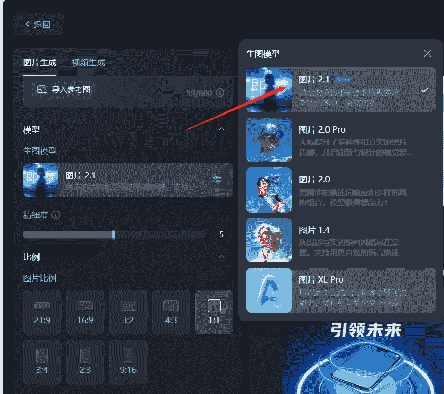

**应用**

1. 设计一张科技产品发布会海报，包含一个智能手机和一些科技感线条，使用简约现代风格，海报中要有“创新科技，引领未来”字样。

2. 设计一张美食节海报，包含各种美食的图片和一些餐具，使用色彩鲜艳风格，海报中要有“Taste the deliciousness（品尝美味）”字样。

3. 设计一张运动赛事海报，包含跑步运动员和终点线，使用活力动感风格，海报中要有“挑战自我，超越极限”字样。

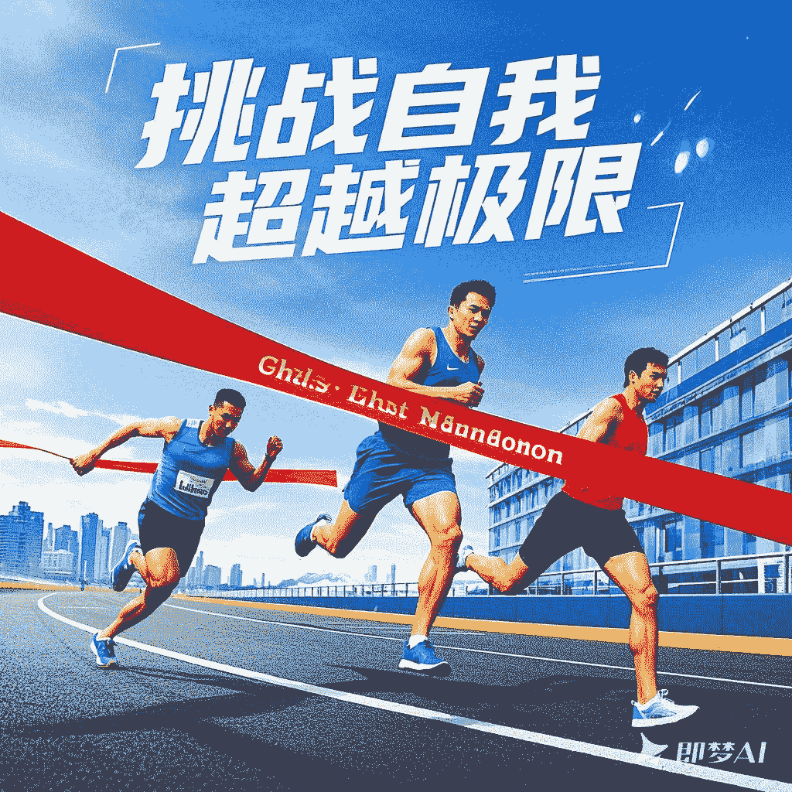

4. 设计一张音乐演唱会海报，包含吉他和麦克风，使用炫酷摇滚风格，海报中要有“Rock and roll forever（永远的摇滚）”字样。

5. 设计一张环保公益海报，包含绿树和垃圾桶，使用清新自然风格，海报中要有“Protect the environment（保护环境）”字样。

### [可灵](https://kling.kuaishou.com/)

**介绍**

可灵 AI 是快手 AI 团队自研的视频生成大模型，具备强大的文生图与文生视频能力。它能够根据用户输入的文本描述，精准地生成高质量、高分辨率的图像和视频内容。其在生成视频方面表现卓越，支持生成长达 2 分钟的 30fps 视频且分辨率可达 1080p，在图像生成上也能很好地理解各种复杂的指令，无论是描绘细腻的场景、独特的人物形象还是奇幻的概念元素，都能出色完成，为创作者提供了丰富的创作灵感和便捷的创作工具，在创意设计、影视制作、广告宣传等多领域都有着广泛的应用潜力。

**平台使用特点**

可灵 AI 在内容创作过程中需要消耗灵感值。用户每次登录可免费获得一定数量的灵感值，用于图片和视频的生成。例如，生成一张较为复杂的图片可能会消耗一定量的灵感值，具体消耗数值根据图像的要求和设定而有所不同。当免费的灵感值耗尽后，若要继续创作，则需要开通会员获取灵感值。会员价格为 66 元 / 月，成为会员后不仅可以获得更多的灵感值，还能享受如生成内容高清画质、无水印等特权，从而满足用户更多样化和更高质量的创作需求，提升创作体验与作品质量。

**使用方法与应用**

模板：[主题说明]，展现 [风格特征]，包含 [细节元素]，色调呈现 [色彩特点]，构图方式为 [构图描述]

**古风风格图片**

+ `prompt` 语句：一位古代的侠客，身背长剑，头戴斗笠，行走在云雾缭绕的山间古道，展现古风风格，包含随风飘动的衣袂和古朴的剑柄装饰等细节，色调呈现淡雅的水墨色调，构图方式为引导线构图，以古道引导视线至侠客。

+ `prompt` 语句：一座古雅的庭院，亭台楼阁错落有致，庭院中有盛开的桃花和潺潺的流水，展现古风风格，包含精美的雕花门窗和石桌石凳等细节，色调呈现暖粉色与青绿色交织，构图方式为对称构图，突出庭院的规整与和谐。

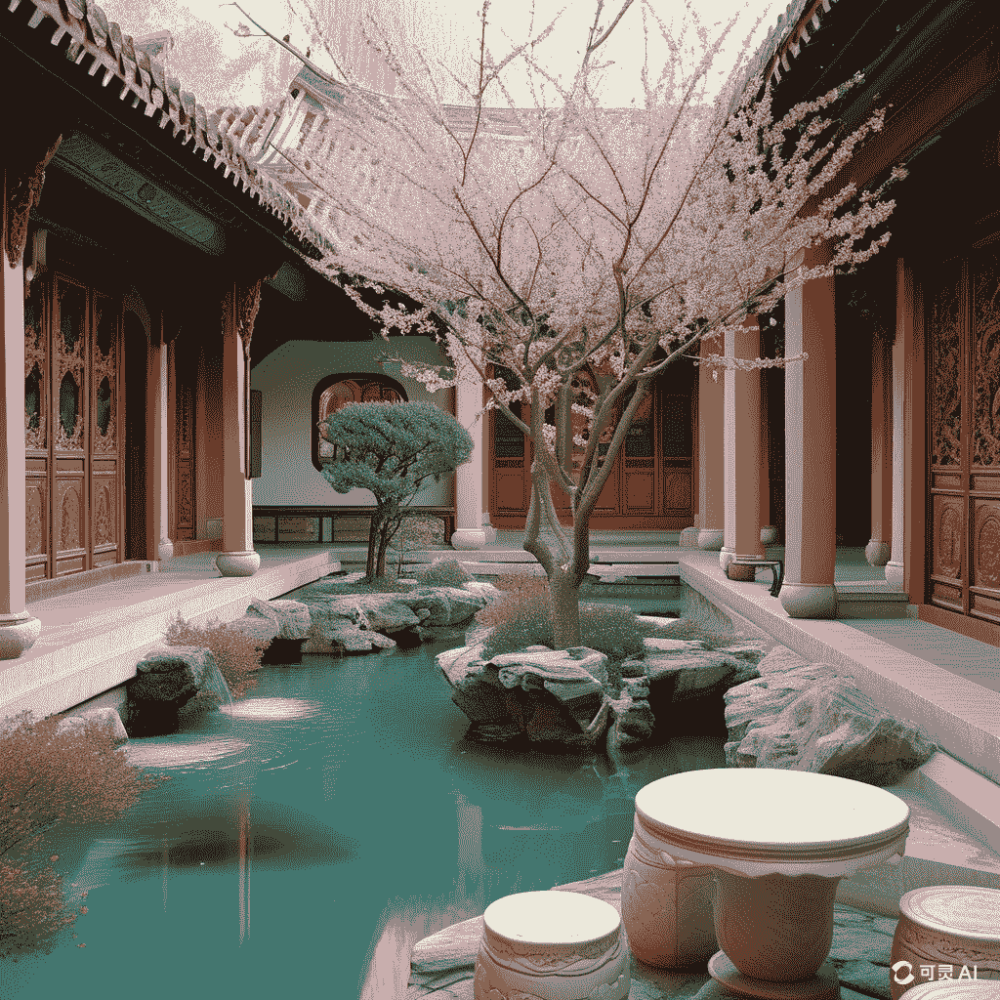

**赛博朋克风格图片**

+ `prompt` 语句：未来都市的夜晚，高楼大厦林立，大厦表面闪烁着霓虹灯广告，街道上有飞驰的磁悬浮摩托和机械改造人，展现赛博朋克风格，包含机械义肢的金属光泽和电子线路的蓝光等细节，色调呈现冷蓝与暖橙的强烈对比，构图方式为透视构图，体现都市的纵深与科技感。

+ `prompt` 语句：一个赛博朋克风格的地下酒吧，舞池中人们戴着炫酷的电子面具跳舞，酒吧墙壁上有巨大的全息投影屏幕，展现赛博朋克风格，包含闪烁的激光光线和烟雾缭绕的氛围等细节，色调呈现暗紫与荧光绿的搭配，构图方式为中心构图，聚焦于舞池和全息投影。

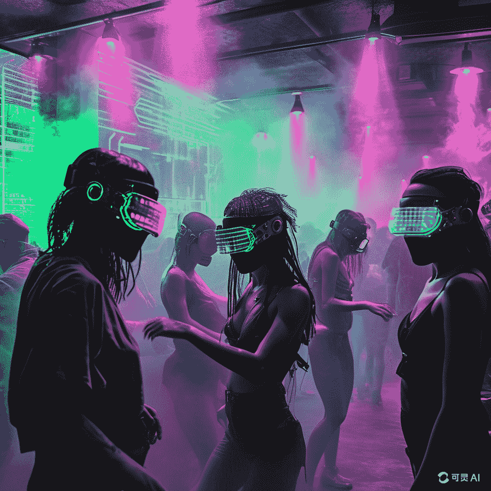

**写实风景风格图片：**

+ `prompt` 语句：辽阔的非洲大草原，成群的斑马和长颈鹿在吃草，远处是金色的夕阳映照下的乞力马扎罗山，展现写实风景风格，包含动物的毛发纹理和草原的风吹草动等细节，色调呈现暖黄色与草绿色的自然融合，构图方式为全景构图，展现大草原的广袤。

+ `prompt` 语句：宁静的北欧峡湾，湛蓝的海水倒映着岸边陡峭的雪山和茂密的森林，一艘小船在水面上飘荡，展现写实风景风格，包含海水的波光粼粼和雪山的积雪细节，色调呈现冷蓝与白色为主，构图方式为三分法构图，平衡山水船的布局。

**卡通萌系风格图片：**

+ `prompt` 语句：一只大眼睛的小熊，穿着粉色的蝴蝶结裙子，坐在堆满蜂蜜罐的树桩前，展现卡通萌系风格，包含小熊毛茸茸的身体和可爱的表情等细节，色调呈现粉色与黄色的甜美搭配，构图方式为特写构图，突出小熊的可爱模样。

+ `prompt` 语句：一群小动物在森林里举办派对，有兔子、松鼠和小鸟，它们都戴着彩色的帽子，周围有鲜花和气球，展现卡通萌系风格，包含动物们欢快的动作和派对装饰的细节，色调呈现五彩斑斓的活泼色调，构图方式为群像构图，展现派对的热闹场景。

**抽象艺术风格图片：**

+ `prompt` 语句：由各种几何形状和线条组成的抽象图案，有圆形、三角形和波浪线相互交织，展现抽象艺术风格，包含形状的不规则变化和色彩的渐变过渡等细节，色调呈现绚丽的彩虹色，构图方式为自由式构图，无明显规则束缚。

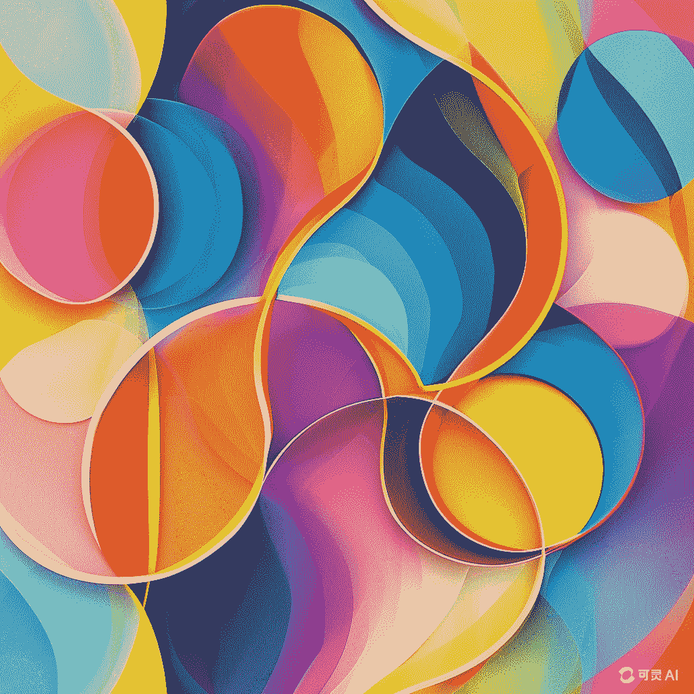

+ `prompt` 语句：以音乐为灵感的抽象画，用色彩和线条表现出音符的跳动和旋律的起伏，展现抽象艺术风格，包含灵动的线条走势和色彩的明暗对比等细节，色调呈现黑白与彩色的碰撞，构图方式为散点构图，营造出音乐的节奏感。

**奇幻风格图片：**

+ `prompt` 语句：一位精灵少女，背后长着透明的翅膀，站在神秘的魔法森林中，森林里有发光的蘑菇和会说话的小动物，展现奇幻风格，包含精灵少女的精致面容和魔法光芒等细节，色调呈现荧光色与绿色的奇幻组合，构图方式为中心构图，突出精灵少女。

+ `prompt` 语句：一座漂浮在云端的城堡，城堡由水晶建造而成，周围有飞龙和独角兽守护，展现奇幻风格，包含城堡的水晶折射光线和神兽的威严形象等细节，色调呈现蓝白色的空灵色调，构图方式为全景构图，展现云端城堡的壮观。

## AI 绘画风格图片示例

### 时尚杂志风格图片

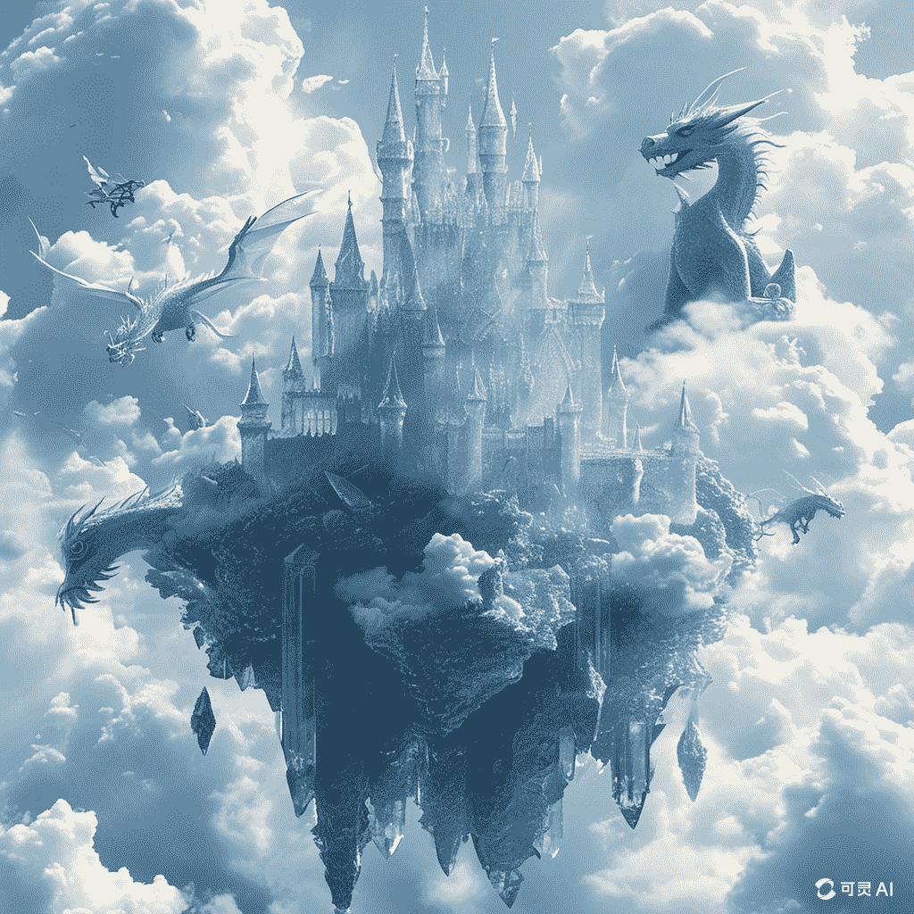

+   `prompt` 语句：一位超模穿着华丽的晚礼服，走在巴黎时装周的 T 台上，背后是耀眼的聚光灯和时尚的观众，展现时尚杂志风格，包含晚礼服的精致剪裁和超模的高冷表情等细节，色调呈现黑色与金色的奢华搭配，构图方式为三分法构图，突出超模与 T 台背景。

+   `prompt` 语句：一组时尚潮流的年轻人在城市街头拍摄时尚大片，他们穿着个性的服装，搭配独特的配饰，展现时尚杂志风格，包含服装的时尚元素和街头的潮流标识等细节，色调呈现多元的时尚色彩，构图方式为群像构图，展现年轻人的时尚态度。

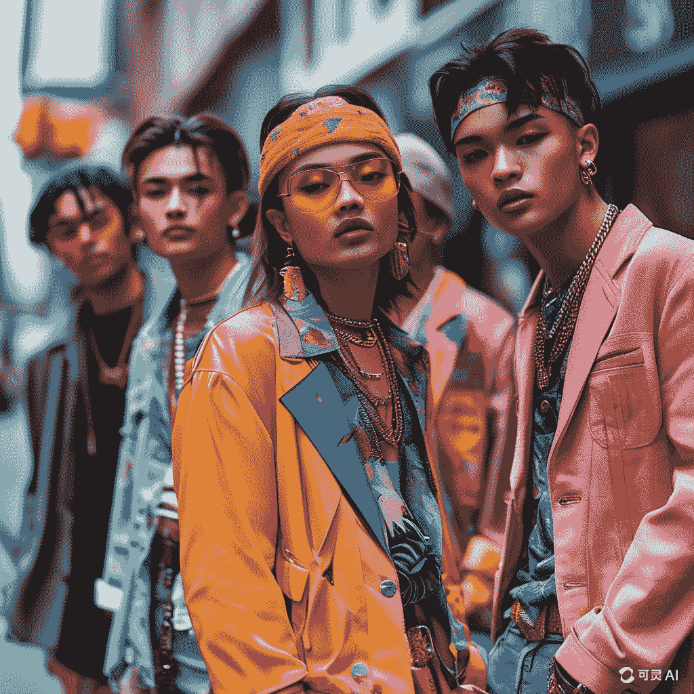

### 美食摄影风格图片

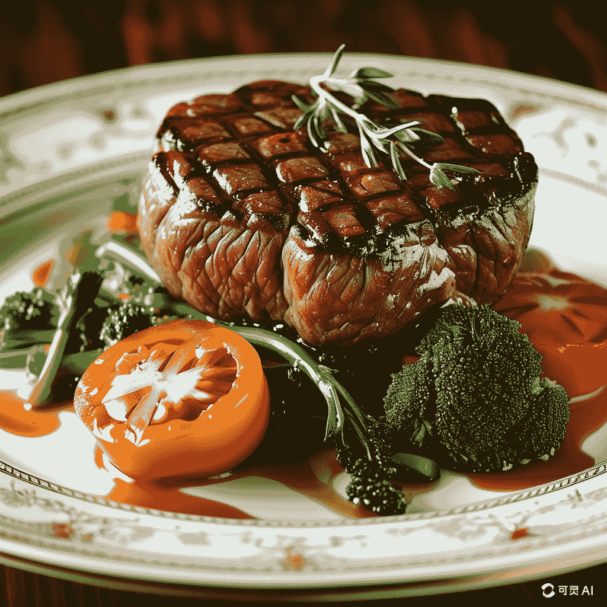

+   `prompt` 语句：一份精致的法式牛排套餐，牛排煎至金黄色，搭配红色的番茄和绿色的西兰花，放在白色的瓷盘上，展现美食摄影风格，包含牛排的纹理和蔬菜的新鲜色泽等细节，色调呈现暖色调以突出食物的诱人，构图方式为特写构图，聚焦于美食本身。

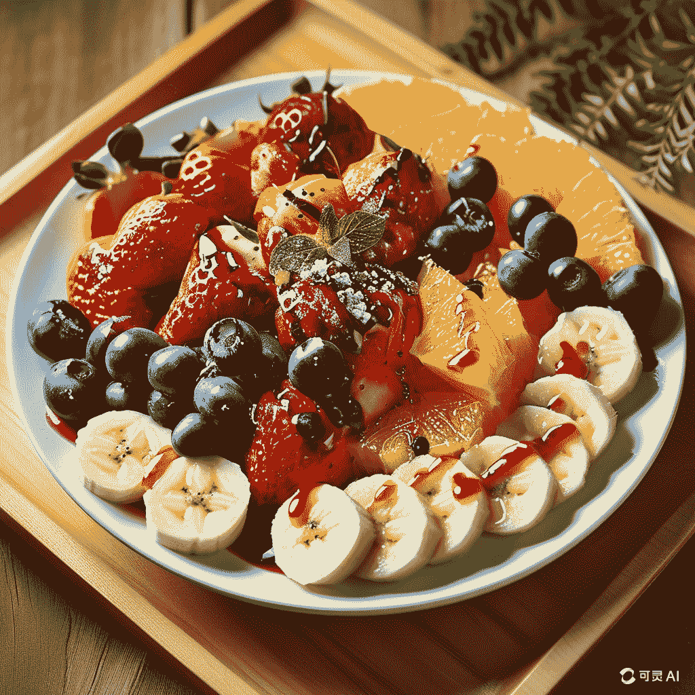

+   `prompt` 语句：一盘色彩斑斓的水果沙拉，有草莓、蓝莓、香蕉和橙子等水果，淋上了晶莹的沙拉酱，放在木质的托盘上，展现美食摄影风格，包含水果的饱满形态和沙拉酱的光泽等细节，色调呈现鲜艳的水果色，构图方式为中心构图，突出水果沙拉的美观。

# 文生视频AI工具介绍

## [智谱清言](https://chatglm.cn/video?lang=zh)

### 介绍

上线时间与使用权限：2024 年 7 月 26 日正式上线，面向所有 C 端用户开放使用，且不限量，用户申请后一般 30 分钟内可通过。

生成速度与视频规格：能在 30 秒内生成 6 秒的视频，生成视频的清晰度为 1440x960 ，后续还计划推出更高分辨率、更长时长的生成视频功能。

技术亮点：其底座的视频生成模型是 CogVideoX，能将文本、时间、空间三个维度融合起来，参考了 Sora 的算法设计，采用 DiT 架构，相比前代模型 CogVideo，推理速度提升了 6 倍。

收费模式：C 端用户使用清影免费，但可付费 5 元 / 24 小时或 199 元 / 年加速排队。此外，其 API 定价为 0.5 元 / 次。

### 平台使用特点

文生视频：用户输入不超过 1000 字的文本，可选择卡通 3D、黑白、油画、电影感等多种视频风格，以及运镜方式、情感氛围等进阶参数，系统据此生成相应视频。

图生视频：用户上传图片，并配上文字描述，AI 将图片转化为动态视频，可用于制作表情包梗图、广告、剧情创作、短视频等。

### 使用方法与应用

#### 文生视频

`prompt` 模板：模板：[主题描述]，采用 [风格类型] 风格，展现 [特定场景或元素]，以 [运镜方式] 运镜，营造 [情感氛围]

##### 示例1

如果想要生成一段海边日落的视频，可以根据自己的想象，先选好模板内的元素，如：

+   主题描述：美丽的海边日落

+   风格类型：油画

+   特定场景或元素：金色的太阳缓缓落入海平面，波光粼粼的海面，飞翔的海鸟

+   运镜方式：从远到近推镜

+   情感氛围：宁静而浪漫

`prompt` 则为语句：美丽的海边日落，采用油画风格，展现金色太阳缓缓落入海平面，波光粼粼的海面及飞翔的海鸟，以从远到近推镜运镜，营造宁静而浪漫的氛围。

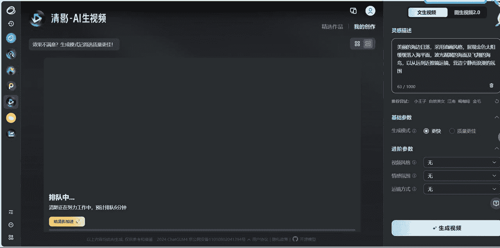

生成视频如下：一般要等5~7分钟，需要有点耐心。

[70cd2bfa-af37-11ef-9028-924d1513ba9b_0 (1).mp4](https://internal-api-drive-stream.feishu.cn/space/api/box/stream/download/all/ZIHyb6wGSoaEgSxk9Z8cRzqen6f)

##### 示例2

示例2与示例3在示例1的基础上给出生成视频多元化的展示。

`prompt` 语句：未来城市的街道，采用赛博朋克风格，展现霓虹闪烁的高楼大厦、飞驰的磁悬浮汽车以及机器人在街边巡逻，以环绕运镜运镜，营造科技感与炫酷感的氛围

生成视频如下：

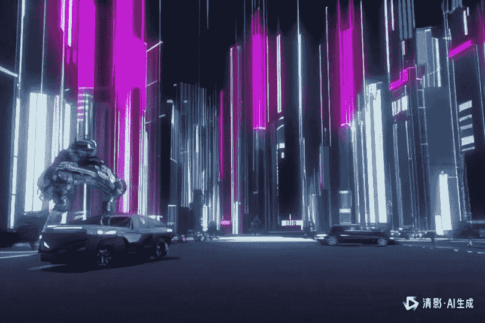

[a05cd396-af39-11ef-8365-362327b4b831_0.mp4](https://internal-api-drive-stream.feishu.cn/space/api/box/stream/download/all/B6GqbjkEHo78LMxAHDLcqtDtnCd)

##### 示例3

古老的森林探险，采用写实 3D 风格，展现茂密树木、潺潺溪流、奇异动植物以及探险家在林间穿梭，以跟随运镜运镜，营造神秘而刺激的氛围

生成视频如下：

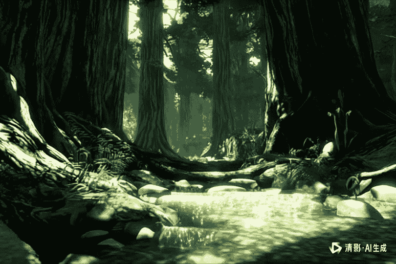

[a86d5ba4-af3a-11ef-97b3-422b4e96d734_0.mp4](https://internal-api-drive-stream.feishu.cn/space/api/box/stream/download/all/G2rzbmiW5oWotUxftUkcgAQXnMS)

#### 图生视频

`prompt` 模板：将这张 [图片主题描述] 图片转化为视频，以 [风格类型] 风格呈现，加入 [动态元素或情节补充]，营造 [情感氛围]

##### 示例 1

`prompt` 语句：将这张壮丽的雪山景色图片转化为视频，以电影感风格呈现，营造壮观与坚韧的氛围

生成视频效果如下：

[fab947e6-af95-11ef-a476-32a960d04a86_0.mp4](https://internal-api-drive-stream.feishu.cn/space/api/box/stream/download/all/Hi3SbA4TwoJ3aRxDOs8coggsnnd)

##### 示例 2

`prompt` 语句：将这张繁华的都市夜景图片转化为视频，以黑白风格呈现，加入街头艺人表演、车辆和行人穿梭的动态，营造文艺与怀旧的氛围

需要的图片如下：

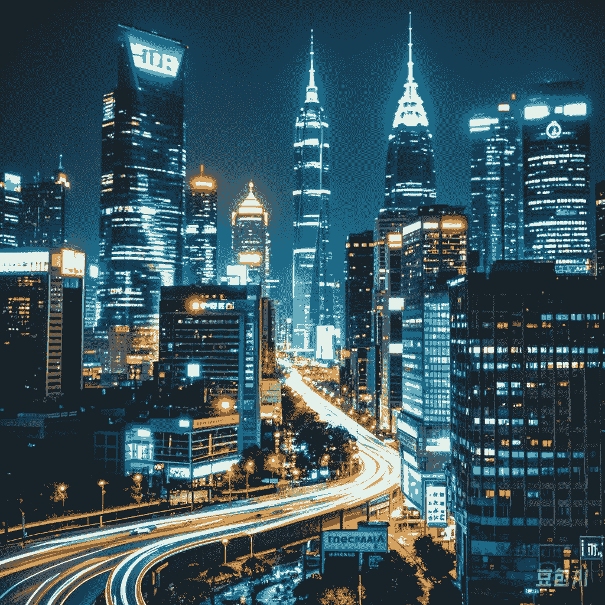

生成的视频效果如下：

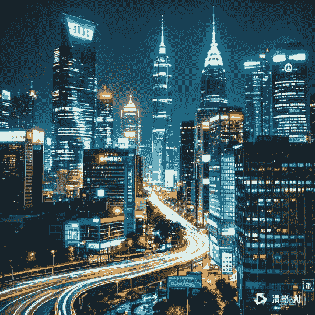

[b346bca2-af8d-11ef-bc79-c2593b38bec0_0.mp4](https://internal-api-drive-stream.feishu.cn/space/api/box/stream/download/all/XJbkbO3Xdoi991xVInXc6UALnDE)

## [即梦](https://jimeng.jianying.com/ai-tool/home)

### 简介

+   即梦 AI 是字节跳动旗下的一个一站式智能创作平台，于 2024 年 11 月 22 日更新至 1.2.7 版本，生成速度快，每日都有免费额度，它为用户提供了 AI 绘画和 AIGC 视频创作体验，具有以下特点：

+   功能丰富：涵盖了视频生成、AI 作图、超能画布、故事创作、对口型、AI 音乐等六大功能，能满足用户多样化的创作需求。

+   创作方式多样：支持文本生视频、图片生视频等多种创作方式，用户可以通过自然语言描述或上传图片来生成高质量的视频作品。

+   社区互动性强：拥有激发无限创作灵感的社区，用户可以在社区中浏览其他用户的作品，还能使用他人的提示词创作出同款效果，分享自己的作品并与其他创作者交流互动。

+   编辑功能完善：对于生成的图片和视频，提供了如图片的超清图、细节修复、局部重绘等编辑功能，方便用户进一步完善创作作品。

### 平台使用特点

+   免费积分额度：即梦 AI 每天为用户提供 80 积分的免费额度，可用于生成视频。例如，用户可以用这 80 积分生成 4 个 5 秒的视频，或者 2 个 10 秒的视频。

+   多模型选择：在视频生成方面，即梦 2.0 Pro 推出了 S2.0、S2.0 Pro 和 P2.0 Pro 三款模型。其中 S2.0 Pro 模型主打的是图生视频，首帧一致性强，能牢牢锁住画面的主体形象、色彩细节以及各种元素；P2.0 Pro 模型则可以在单一提示词的指导下生成多镜头视频，并实现多个场景的流畅切换。

+   操作便捷：用户只需打开官网，点击 “AI 视频”，选择相应的模型，输入提示词，再根据需要上传参考图片，几秒钟就能生成视频。同时，手机端操作同样顺滑，方便用户随时随地进行创作

### 使用方法与应用

#### 文生视频

模板：[镜头语言] 拍摄，[主体描述] 的 [主体]，正在 [主体运动]，背景是 [场景描述]，整体氛围为 [情感氛围]，风格为 [风格类型]

##### 示例1

镜头语言：特写

主体描述：一只毛茸茸的、眼睛大大的

主体：熊猫幼崽

主体运动：在草地上打滚

场景描述：阳光明媚的竹林草地

情感氛围：活泼可爱

风格类型：卡通

`prompt` 语句：特写拍摄，一只毛茸茸的、眼睛大大的熊猫幼崽，正在草地上打滚，背景是阳光明媚的竹林草地，整体氛围为活泼可爱，风格为卡通

生成视频效果如下：

[特写拍摄，一只毛茸茸的、眼睛大大的熊猫幼崽，正在草地上打滚，背景是阳光明媚的竹林草地，整体氛围为活泼可爱，风格为卡通_2024-12-01 10_04_28.mp4](https://internal-api-drive-stream.feishu.cn/space/api/box/stream/download/all/MZWEbAT9HoAwykxYgdAc8IM8nIf)

##### 示例2

`prompt` 语句：航拍拍摄，高耸入云、玻璃幕墙闪烁着光芒的现代化写字楼，周围有无人机在穿梭，背景是繁华的都市中心，整体氛围为科技感与现代感，风格为写实

生成视频效果如下：

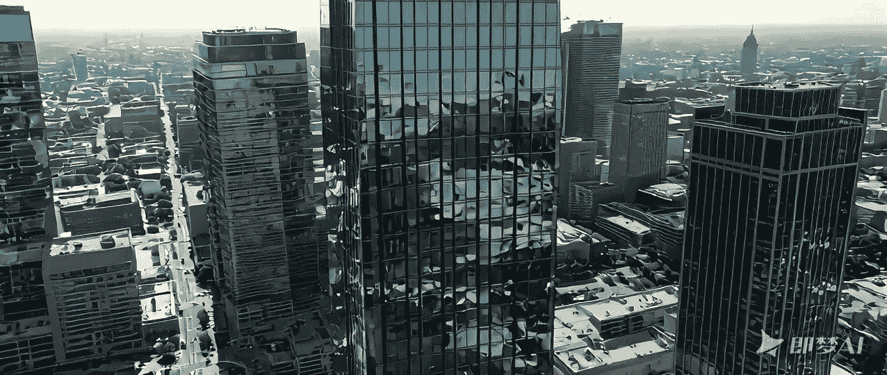

[航拍拍摄，高耸入云、玻璃幕墙闪烁着光芒的现代化写字楼，周围有无人机在穿梭，背景是繁华的都市中心，整体氛围为科技感与现代感，风格为写实_2024-12-01 10_08_06.mp4](https://internal-api-drive-stream.feishu.cn/space/api/box/stream/download/all/FFASbSf6RoGRo1xFqxbckPcmntc)

##### 示例3

`prompt` 语句：中景拍摄，身着华丽古装、手持宝剑的侠客，在古老的城墙上施展轻功飞跃，背景是夕阳下的古城墙，整体氛围为侠义与豪迈，风格为古风。

生成效果如下：

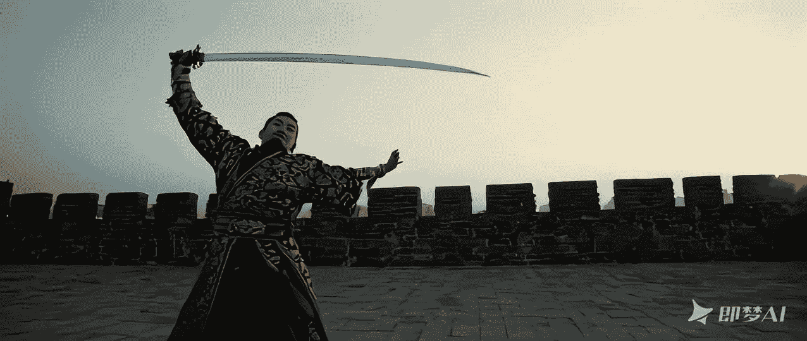

[中景拍摄，身着华丽古装、手持宝剑的侠客，在古老的城墙上施展轻功飞跃，背景是夕阳下的古城墙，整体氛围为侠义与豪迈，风格为古风_2024-12-01 10_11_17.mp4](https://internal-api-drive-stream.feishu.cn/space/api/box/stream/download/all/DWHAbtBzIoXXByxQGEGc8wd9nuh)

#### 图生视频

模板：将这张 [图片主题描述] 的图片转化为视频，[主体] 进行 [主体运动]，并加入 [动态元素补充]，运镜方式为 [运镜方式]，整体风格为 [风格类型]，营造出 [情感氛围]

##### 示例1

图片主题描述：海边的椰树与沙滩

主体：椰树

主体运动：随风轻轻摇曳

动态元素补充：海浪不断涌上沙滩，海鸟在天空飞翔

运镜方式：从左到右平移

风格类型：清新自然

情感氛围：悠闲惬意

`prompt` 语句：将这张海边的椰树与沙滩的图片转化为视频，椰树进行随风轻轻摇曳的运动，并加入海浪不断涌上沙滩、海鸟在天空飞翔的动态元素，运镜方式为从左到右平移，整体风格为清新自然，营造出悠闲惬意的情感氛围

生成效果如下：

[imageinput_将这张海边的椰树与沙滩的图片转化为视频，椰树进行随风轻轻摇曳的运动，并加入海浪不断涌上沙滩、海鸟在天空飞翔的动态元素，运镜方式为从左到右平移，整体风格为清新自然，营造出悠闲惬意的....mp4](https://internal-api-drive-stream.feishu.cn/space/api/box/stream/download/all/O0l8bY4gJoePIEx17y1c7XMSnbd)

##### 示例 2

图片如下：

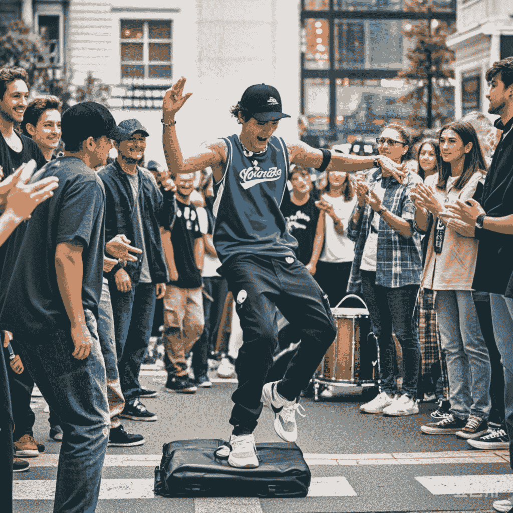

`prompt` 语句：将这张城市街头的人群的图片转化为视频，人群中的一位街头艺人进行正在热情地表演街舞的运动，并加入周围行人驻足观看、有人在鼓掌喝彩的动态元素，运镜方式为环绕运镜，整体风格为时尚动感，营造出热闹欢快的情感氛围

生成效果如下：

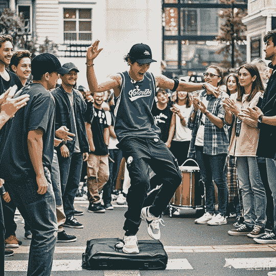

[imageinput_将这张城市街头的人群的图片转化为视频，人群中的一位街头艺人进行正在热情地表演街舞的运动，并加入周围行人驻足观看、有人在鼓掌喝彩的动态元素，运镜方式为环绕运镜，整体风格为时尚动感，....mp4](https://internal-api-drive-stream.feishu.cn/space/api/box/stream/download/all/ODN8bk6Loo2vDLxeZRucXolSnPd)

##### 示例 3

图片：

`prompt` 语句：将这张雪山脚下的村庄的图片转化为视频，村庄中的几间小木屋进行烟囱里冒出袅袅炊烟的运动，并加入雪花纷纷扬扬飘落、有孩子在雪地里玩耍的动态元素，运镜方式为由远及近推镜，整体风格为唯美诗意，营造出宁静祥和的情感氛围

视频生成效果如下：

[imageinput_将这张雪山脚下的村庄的图片转化为视频，村庄中的几间小木屋进行烟囱里冒出袅袅炊烟的运动，并加入雪花纷纷扬扬飘落、有孩子在雪地里玩耍的动态元素，运镜方式为由远及近推镜，整体风格为唯美....mp4](https://internal-api-drive-stream.feishu.cn/space/api/box/stream/download/all/B0pjbBDeGouUhYxayNWc2Fvknsg)

## [可灵](https://kling.kuaishou.com/)

### 简介

可灵 AI 是快手 AI 团队自研的视频生成大模型，于 2024 年 6 月 6 日在官网正式上线，但是生成时间长，每个月单个账号的使用额度有限，多余的需要充值会员，具有以下特点：

+   强大的生成能力：支持生成长达 2 分钟的 30fps 视频，分辨率高达 1080p，并且支持多种宽高比。其采用类 sora 的 dit 结构，用 transformer 取代传统的卷积网络结构，还使用 flow 模型作为扩散模型基座，生成的视频运动幅度大且合理，能模拟物理世界特性，具备强大的概念组合能力和想象力。

+   多端跨平台：已形成网页版、APP、小程序、海外版等多端跨平台的产品矩阵，方便用户随时随地进行创作。

+   功能丰富：除了基础的文生视频和图生视频功能外，还拥有高表现模式、视频延长、视频生成尾帧参考、视频运镜支持大师运镜等多种会员专属功能。

+   海量用户基础与数据支持：自发布以来，已有超过 360 万用户，累计生成 3700 万个视频和超过一亿张图片，其数据质量高，团队构建了完备的标签体系，从多个维度对视频数据进行筛选和优化，并研发了视频描述模型，提升了文本指令响应能力。

### 平台使用特点

+   灵感值机制：可灵 AI 内容的创作过程中需要消耗灵感值，用户每次登录都能免费获得一定数量的灵感值，用于图片和视频的生成。当灵感值消耗完后，需要开通会员获取灵感值，会员还能享受高清画质、内容无水印等特权，价格为 66 元 / 月。

+   模型版本选择：在视频生成方面，可灵 AI App 提供可灵 1.0 或 1.5 版本模型，其中 1.5 模型支持生成 1080p 视频，但此模式下仅可使用高品质生成模式，且需要 VIP 资格。

+   视频时长与比例选择：生成的视频时长有 5 秒和 10 秒两个方案，文生视频的视频比例可在 16:9、9:16、1:1 之间选择。

### 使用方法与应用

#### 文生视频

模板：

[镜头语言] 下，[主体描述] 的 [主体]，在 [场景描述] 中进行 [主体运动]，整体氛围为 [情感氛围]，风格为 [风格类型]，光影为 [光影效果]

##### 示例 1

镜头语言：特写

主体描述：一只毛色鲜艳、眼睛灵动的

主体：鹦鹉

场景描述：布置精美的鸟笼内

主体运动：欢快地啄着自己的羽毛

情感氛围：轻松愉悦

风格类型：写实

光影效果：柔和的自然光从笼子缝隙洒入

`prompt` 语句：特写镜头下，一只毛色鲜艳、眼睛灵动的鹦鹉，在布置精美的鸟笼内欢快地啄着自己的羽毛，整体氛围为轻松愉悦，风格为写实，光影为柔和的自然光从笼子缝隙洒入

生成视频如下：

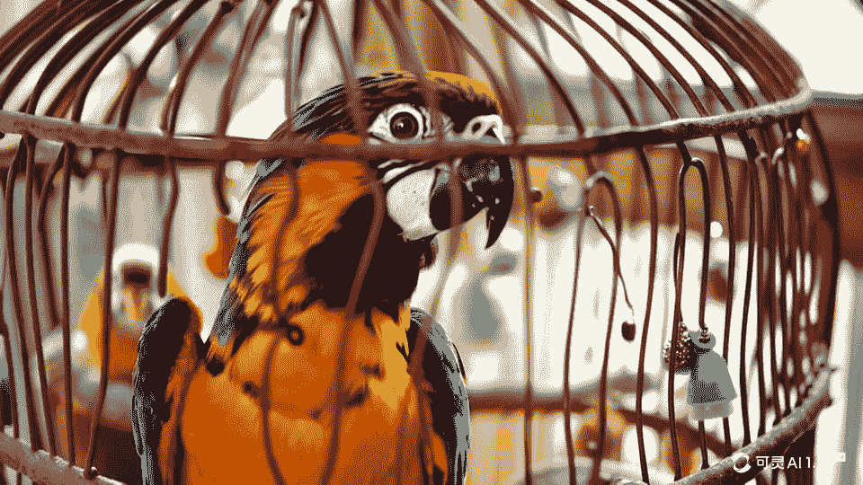

[高品质_16x9___prompt_语句_特写镜头下_一只毛色鲜艳_眼睛灵动的鹦鹉.mp4](https://internal-api-drive-stream.feishu.cn/space/api/box/stream/download/all/KD5VbSH8toHMoNxhVhuc03sMnnb)

### 示例2

`prompt` 语句：中景镜头下，身着华丽古装、头戴凤冠的女子，在古色古香的宫殿庭院中手持团扇翩翩起舞，整体氛围为优雅高贵，风格为古风，光影为温暖的夕阳余晖映照在庭院

生成效果如下：

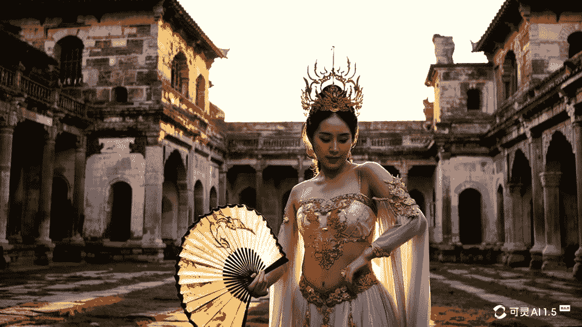

[高品质_16x9_中景镜头下_身着华丽古装_头戴凤冠的女子_在古色古香的宫殿庭院中.mp4](https://internal-api-drive-stream.feishu.cn/space/api/box/stream/download/all/LcwEbntC2ofl92xR4gSckO1Qnie)

### 示例3

全景镜头下，一群充满活力、穿着时尚运动装的年轻人，在现代化的城市广场上正在进行滑板表演和街舞秀，整体氛围为青春活力，风格为现代时尚，光影为明亮的阳光洒在广场上

生成效果如下：

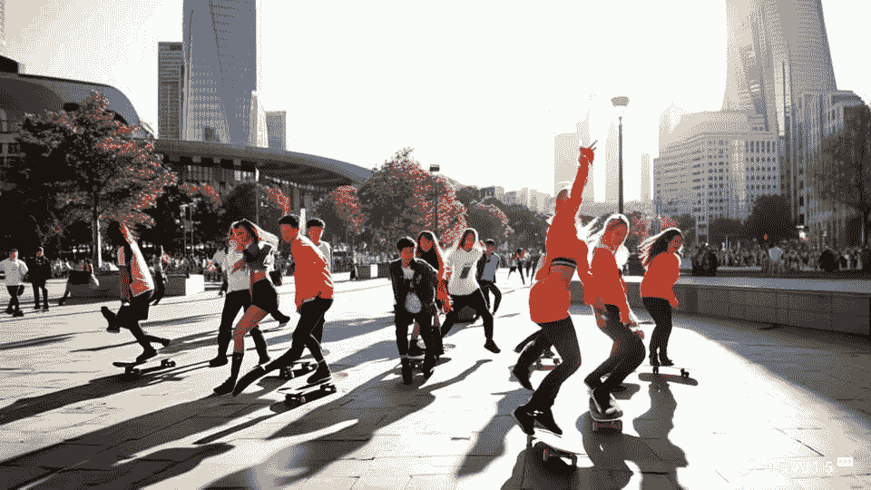

[高品质_16x9___全景镜头下_一群充满活力_穿着时尚运动装的年轻人_在现代化的.mp4](https://internal-api-drive-stream.feishu.cn/space/api/box/stream/download/all/JxPQbJnUvoiv6oxIMAfcpmz1nYe)

## 图生视频

模板：将这张 `图片主题描述` 的图片转化为视频，使图片中的 `主体` 进行 `主体运动`，背景加入 `动态背景元素`，运镜方式为 `运镜方式`，整体风格为 `风格类型`，营造出 `情感氛围`

### 示例1

使用图片：

图片主题描述：海边的一艘帆船

主体：帆船

主体运动：在海面上缓缓航行

动态背景元素：海鸥在天空飞翔，海浪轻轻拍打着船身

运镜方式：跟拍

风格类型：清新自然

情感氛围：宁静惬意

`prompt` 语句：将这张海边的一艘帆船的图片转化为视频，使图片中的帆船在海面上缓缓航行，背景加入海鸥在天空飞翔、海浪轻轻拍打着船身的动态元素，运镜方式为跟拍，整体风格为清新自然，营造出宁静惬意的情感氛围

生成视频效果如下：

[高品质___主体_帆船___主体运动_在海面上缓缓航行___动态背景元素.mp4](https://internal-api-drive-stream.feishu.cn/space/api/box/stream/download/all/Cvdwb0v21o0QwRxnJsycsfBhnvg)

### 示例2

使用的图片：

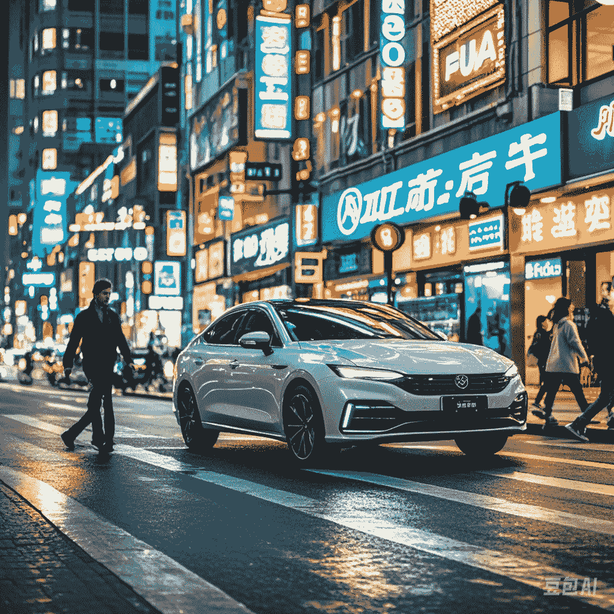

`prompt` 语句：将这张繁华街道上的汽车的图片转化为视频，使汽车在马路上快速行驶，背景加入行人在路边行走、店铺招牌闪烁的动态元素，运镜方式为平移运镜，整体风格为都市时尚，营造出热闹繁华的情感氛围

生成效果如下：

[标准_图片主题描述_繁华街道上的汽车_主体_汽车_主体运动_在马路上快.mp4](https://internal-api-drive-stream.feishu.cn/space/api/box/stream/download/all/OWbJbRcGUo5vKbxWgwectt51nxf)
