#  国内语音识别/合成AI工具介绍与使用

> 来源：[https://datawhaler.feishu.cn/docx/P0CAdyiwComKMwxGfHScIpyqn7G](https://datawhaler.feishu.cn/docx/P0CAdyiwComKMwxGfHScIpyqn7G)

| 版本信息 | **内容版本号** | V1.0 |  |
| --- | --- | --- | --- |
|  | **最近更新时间** | **2024.12.3** |  |
|  | **更新日志** | 12.3.更新了具体的使用方法，更新了剪辑软件--必剪的AI配音使用方法 |  |
|  | **历史更新** | **2024.12.2**：V1.0内容发布 |  |
|  | **内容信息** | +   **所属版本**：**AI通识课-零基础版 ** |  |
| 贡献详情 | **最近贡献** | 蔡鋆捷 |  |
|  | **内容贡献** | 蔡鋆捷 |  |
|  | **内测反馈** |  |  |
|  | 更多贡献详情见：[致谢AI通识课贡献者们](https://datawhaler.feishu.cn/wiki/HnMiwEzpdiLvWRkfbvFcaJFLnSg) |  |  |

本文将采用先语言合成，再利用生成的文本反向给语言识别的AI识别文字，方便识别出来的结果与投入的文字对照。

# 国内语音合成AI工具

## [**科大讯飞语音合成**](https://www.xfyun.cn/services/online_tts#anchor4503211)

### 介绍

科大讯飞的在线语音合成服务提供了多种发音人选择，适用于阅读听书、语音助手、客服助理等多种场景。

讯飞的语音合成技术支持37个语种共55个小语种发音人，包括中文、英文、韩语、日语等。它还支持11种方言，如广东话、四川话等。

### 使用

进入网址之后即可体验。

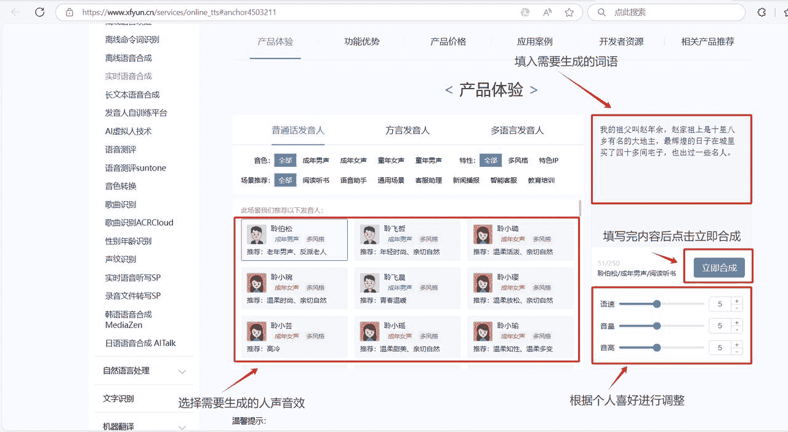

文案：在那片宁静的海边，夕阳的余晖洒在金色的沙滩上，海浪轻轻拍打着海岸，发出悦耳的声响。海鸟在天空中翱翔，时而俯冲入海，时而振翅高飞。远处的灯塔在暮色中闪烁着温暖的光，为归航的船只指引方向。

男声：

[1.mp3](https://internal-api-drive-stream.feishu.cn/space/api/box/stream/download/all/GmsHbGu2RoYCYxxxohec6wHBnPf)

女声：

[202412021237.mp3](https://internal-api-drive-stream.feishu.cn/space/api/box/stream/download/all/JhNUbD4leoJSNjxnoAscrRRwnog)

这里使用的是免费体验的功能，感兴趣的小伙伴可以实名注册后领取有效期一年的额度进行使用，只不过需要一点点API调用的编程基础~！

## [**腾讯云语音合成**](https://cloud.tencent.com/product/tts?fromSource=gwzcw.3561177.3561177.3561177&utm_medium=cpc&utm_id=gwzcw.3561177.3561177.3561177)

### 介绍

腾讯云语音合成基于业界领先技术构建的语音合成系统，具备合成速度快、合成语音自然流畅等特点。

腾讯云语音合成支持中文、英文、粤语、四川话，也可以合成中英混读语音。它支持根据业务需求选择合适的音量、语速等属性。

腾讯云还支持为企业客户定制发声人，使得音色能够覆盖多样化的应用场景。

### 使用

点击链接后使用方法如下：

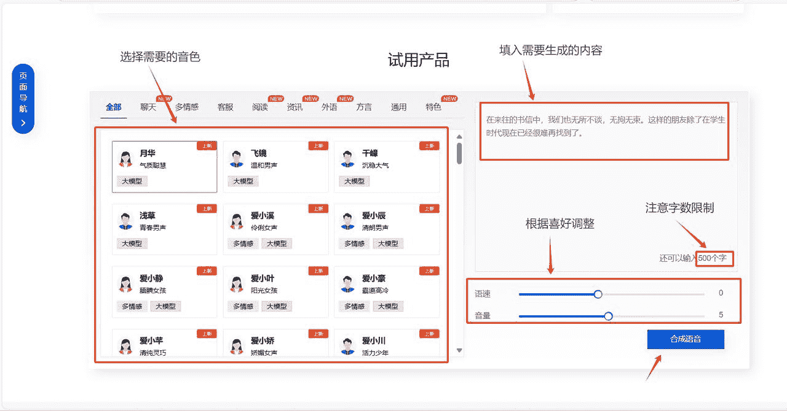

女声

[女声.mp3](https://internal-api-drive-stream.feishu.cn/space/api/box/stream/download/all/LAezb9Zeto6oLXxfirBc9giAnah)

男声

[男声.mp3](https://internal-api-drive-stream.feishu.cn/space/api/box/stream/download/all/UCnsbWeQJogAm0xEeHNcQkFnnog)

## [**阿里云语音合成**](https://ai.aliyun.com/nls/tts)

### 介绍

阿里云的语音合成技术将文本转化为语音，将神经网络与领域知识双重结合，兼具读音准确，韵律自然，声音还原度高，表现力强的特点。

阿里云语音合成支持多语种方言及中英混合播报，目前支持日语及多种东南亚语种，粤语、天津、湖南、东北等方言。

它还支持字级别时间戳，可用于视频配音中的音频与字幕时间对齐，虚拟形象口型对齐等。此外，支持动态调整发音人、语速、音量、语调、采样率、多种音频编码格式等。

### 使用

点击链接后进入下方的体验页面，按照图片内的标注进行使用体验就可以啦~！

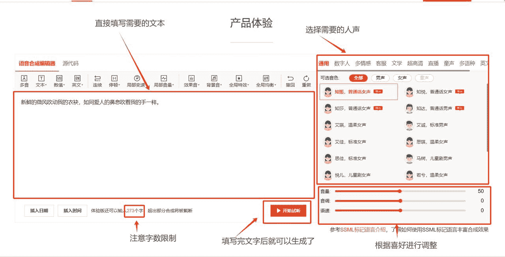

男声

[男声.mp3](https://internal-api-drive-stream.feishu.cn/space/api/box/stream/download/all/V1P7bxBAgoHilNxO872cSnYbnNh)

女声

[女声.mp3](https://internal-api-drive-stream.feishu.cn/space/api/box/stream/download/all/L7SaboLYaoXRWVxSBUucncGOn4f)

## 必剪（剪辑软件）

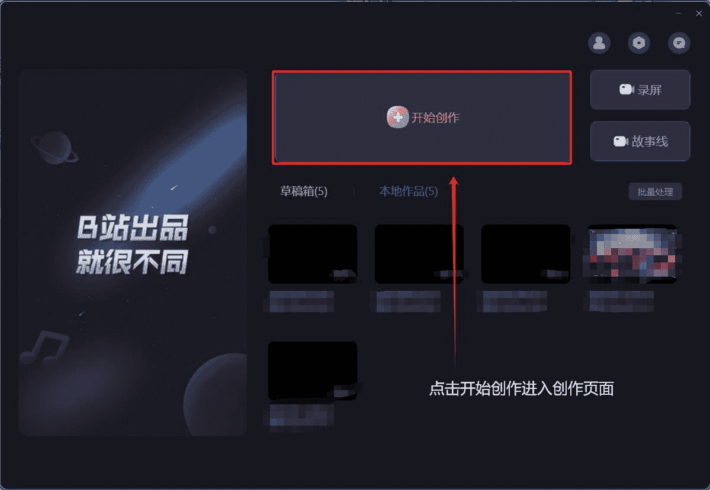

由于创作需要素材，考虑到大家的素材不一样，这里以素材库的素材进行演示

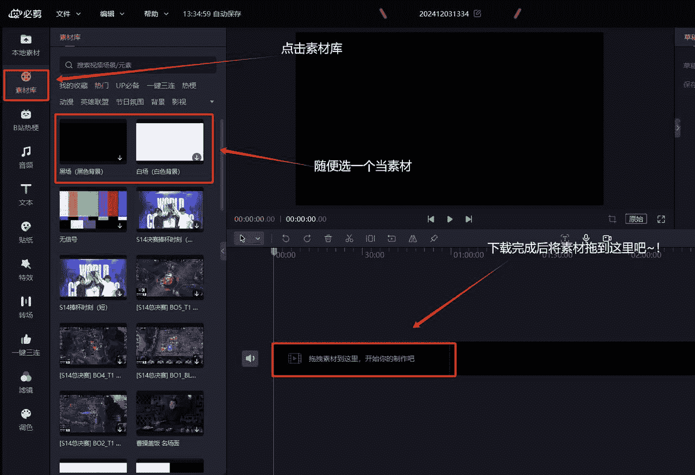

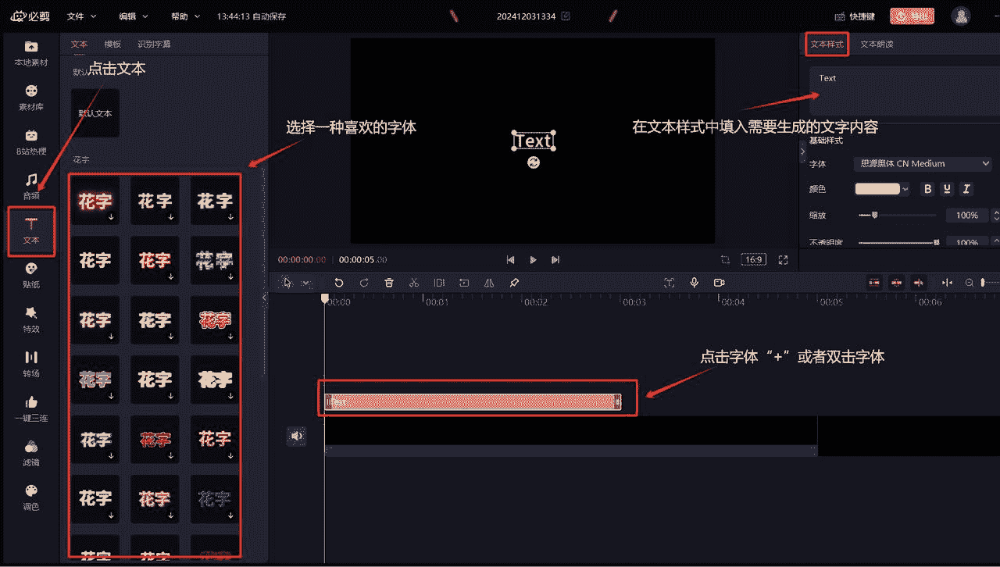

使用的文案如下：

> 一幅美丽的海边落日景象，金色的阳光洒在波光粼粼的海面上，沙滩上有几棵椰子树，远处有一艘帆船。

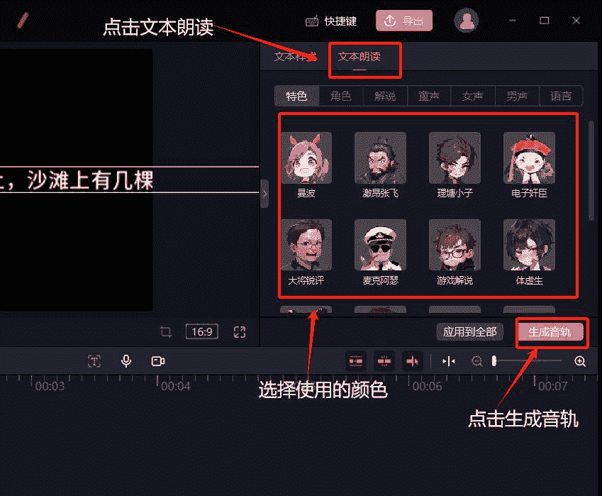

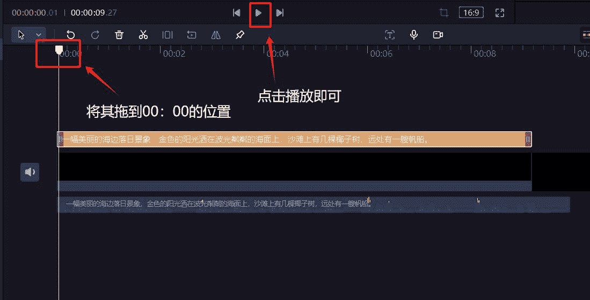

导出音频过程：

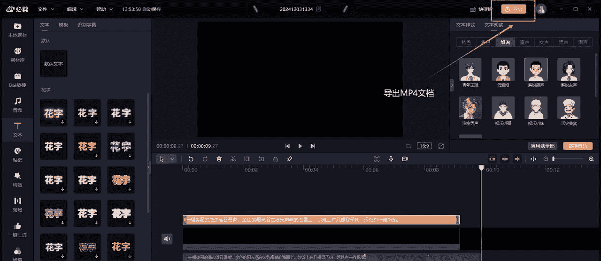

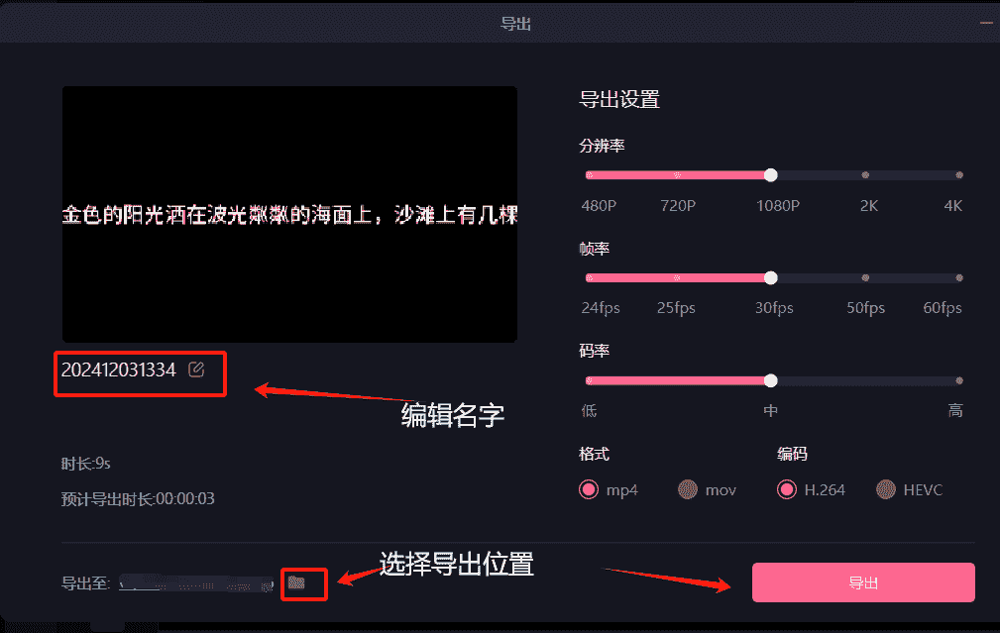

使用以下的网址进行MP4转MP3格式：

MP4到MP3转换器- FreeConvert.com

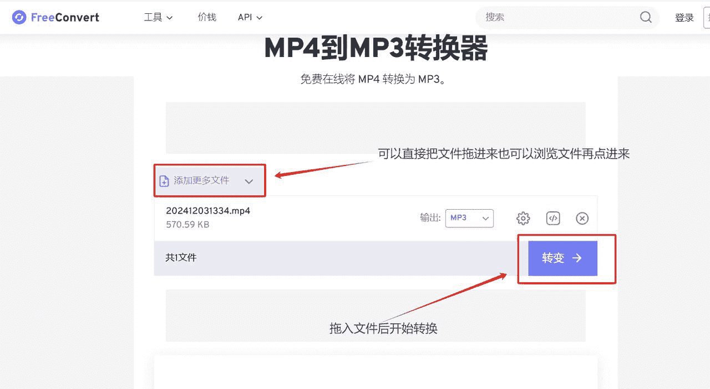

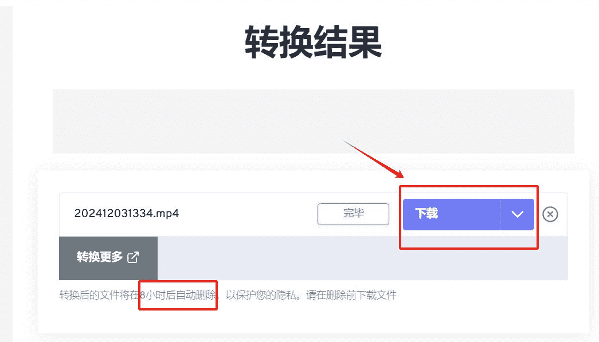

生成效果如下：（导出音频给大家展示效果）

[202412031334.mp3](https://internal-api-drive-stream.feishu.cn/space/api/box/stream/download/all/ZK8GbmoENowaa9x5pRYccoFongJ)

# 国内语音识别AI工具

## [**腾讯AI语音识别**](https://cloud.tencent.com/product/asr?fromSource=gwzcw.3561176.3561176.3561176&utm_medium=cpc&utm_id=gwzcw.3561176.3561176.3561176)

### 介绍

腾讯AI开放平台提供了强大的语音识别能力，支持多种语言和方言的识别，适用于多种场景，如智能票据、视频教学等。

腾讯云TI平台TI-ONE是一站式机器学习平台，为用户提供从数据预处理、模型构建、模型训练、模型评估到模型服务的全流程模型开发支持。

### 使用

使用音频如下（阿里云生成的男声）：

[男声.mp3](https://internal-api-drive-stream.feishu.cn/space/api/box/stream/download/all/SDFmbFwvgomFrPxmcIHcpiBinIf)

使用过程如下：

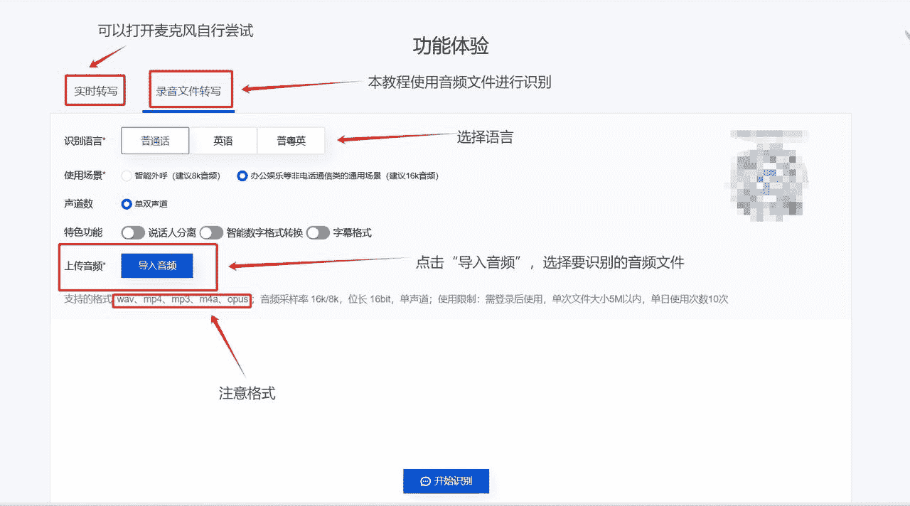

识别结果如下：（注意次数限制哦~！）

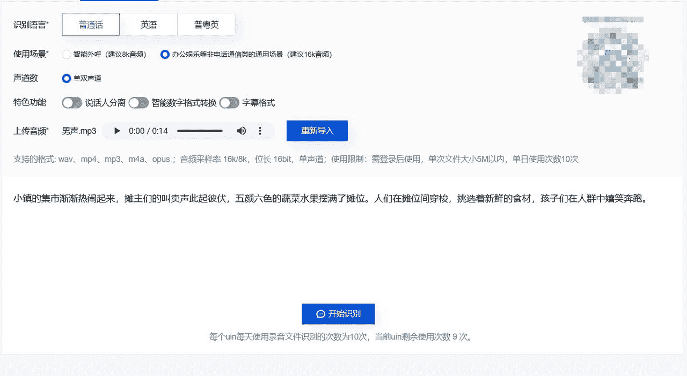

使用音频如下：（科大讯飞，女声）

[202412021237.mp3](https://internal-api-drive-stream.feishu.cn/space/api/box/stream/download/all/InZIbRb0VoeQYBx7BQNcaqJCnUf)

识别结果如下：

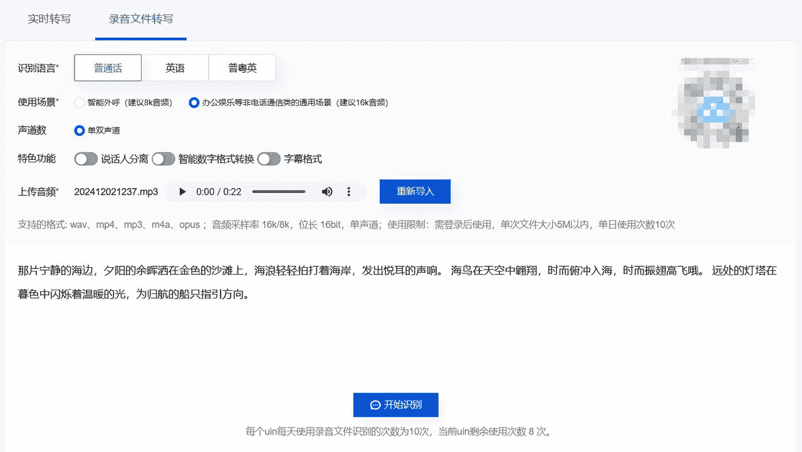