# AIGC办公应用实践之时序分析和相关性分析

> 来源：[https://datawhaler.feishu.cn/docx/Wb1od0xqYo56mUxd7OocjEagn0e](https://datawhaler.feishu.cn/docx/Wb1od0xqYo56mUxd7OocjEagn0e)

# 一、概述

## 1、AIGC办公应用背景介绍

随着数字化**转**型的加速，数据分析在现代办公中扮演着越来越重要的角色。然而，传统数据分析流程往往复杂且耗时，需要专业的技术背景和大量的手动操作。近年来，AIGC（生成式人工智能）技术的兴起为数据分析带来了新的机遇。AIGC能够通过自然语言处理和机器学习，快速生成数据分析报告、可视化图表，并自动化处理数据清洗、建模等复杂任务。它不仅降低了数据分析的技术门槛，还显著提升了工作效率，使非专业人士也能轻松完成数据分析工作。在本文我们将重点围绕如何使用AI工具来进行表格类数据（Excel）的数据分析工作，借此学习和领略使用AIGC进行办公的灵活高效。

## 2、AIGC办公应用常用工具

本文我们使用的工具主要为kimi大模型

**工具名称：Kimi**

功能简介：Kimi是一款由月之暗面科技有限公司开发的人工智能助手，专注于提供高效、准确的对话式服务。它能够理解自然语言指令，支持多语言对话，并具备强大的信息处理能力，可帮助用户完成写作、数据分析、学习辅导等多种任务，尤其适合初学者和零基础用户快速上手。

其余相关的数据分析方面的ai工具参考如下：

**工具名称：办公小浣熊**

功能简介：办公小浣熊是一款智能办公助手，专注于提升办公效率。它支持文档生成、数据分析、PPT制作等多功能，通过自然语言交互，帮助用户快速完成复杂任务。无论是撰写报告、整理数据，还是制作演示文稿，办公小浣熊都能提供智能建议和自动化操作，让办公更轻松、高效。

工具名称：Microsoft Excel Copilot

功能简介：通过AIGC技术，自动生成数据图表、分析趋势并撰写数据报告，帮助用户快速完成数据分析和可视化

**工具名称：Power BI**

功能简介：利用AI快速生成可视化报表，支持数据建模和预测分析，帮助管理层更快做出决策

**工具名称：DataRobot**

功能简介：自动化创建、优化和调整数据分析模型，支持机器学习和预测分析，降低数据分析的技术门槛

**工具名称：Alteryx**

功能简介：专注于数据质量，通过可视化方式自动处理和分析数据，支持数据清洗、转换和报告生成

**工具名称：LangChain**

功能简介：将自然语言处理与数据分析结合，支持将用户需求转化为SQL查询，帮助非技术人员进行数据库查询和分析

**工具名称：ChatGPT**

功能简介：通过自然语言生成数据分析代码、解释结果并提供分析建议，适用于初学者和专业分析师

工具名称：Array Assistant

功能简介：作为Microsoft Excel插件，提供公式创建、数据清理、文本总结等功能，提升电子表格处理效率

**工具名称：Jasper AI**

功能简介：自动生成数据分析报告和可视化内容，支持根据数据生成营销文案和社交媒体内容

**工具名称：Otter.ai**

功能简介：自动转录会议记录并生成会议摘要，支持数据分析和总结，帮助团队快速了解重点决策

**工具名称：Notion AI**

功能简介：支持生成数据分析报告和总结，结合笔记功能，帮助用户快速整理和分析数据

## 3、通用方法论

以下是基于 **Kimi** 的数据分析方法论：

1.  **明确分析目标**：根据业务需求，确定数据分析的具体目标，例如数据趋势分析、异常检测或相关性分析。

1.  **数据预处理**：对数据进行清洗、筛选和整理，确保数据质量。

1.  **探索性数据分析（EDA）**：通过描述性统计、可视化等手段，初步了解数据的分布和特征。

1.  **深入分析**：根据目标进行更复杂的数据分析，如回归分析、聚类分析等。

1.  **结果呈现**：将分析结果以清晰的图表或报告形式呈现，便于决策者理解。

> 需要注意的是：

> kimi本身不能处理Excel表格，所以只能提供分析、提取信息或提供相关的建议和结论。

> **因此kimi更多的是辅助分析，但具**体操作数据还得需要你在Excel中执行。

> 有没有可以自动加载数据、智能交互式分析的工具呢？目前商汤的办公小浣熊可以做到，而且效果还不错，感兴趣的友友可以试一下。

# 二、实践1---时序分析与增长规律挖掘

时间序列分析是数据分析中常见的分析场景，本实践案例将介绍如何利用AIGC和Excel进行时间序列分析，探索用户增长规律。

我们现在有一张系统后台导出的数据表格，是一份按日的用户数数据，数据只有日期和用户数两列，日期范围从2022-5-12到2023-5-11，其中，数据预览如下：

数据源：📎时间序列分析数据源.xlsx

怎么分析？

一上来就直接画图吗？哈哈，画完图后呢？

所以，在分析之前，我们可以先对时间序列分析简单做一个了解。

> prompt：请告诉我时间序列分析是做什么的？时间序列分析能解决什么问题？一般时间序列涉及到哪些统计模型和技术方法？

> AI：时间序列分析是**研究按时间顺序排列的数据点以提取信息和分析数据的统计方法**。

>

> 时间序列分析的主要目的是通过按时间顺序排列的数据点，来研究和预测现象随时间变化的规律和特征。这种分析可以揭示数据中的趋势、周期性以及其它重要的特性。

>

> 时间序列分析能解决的主要问题包括**单点时间序列的预测、模式识别、趋势分析等**。

>

> 时间序列分析能够对未来某一时间点或多个时间点的状态进行预测。这在金融领域（如股票价格预测）以及水文、气象领域都有广泛应用。还可以用于识别数据中的特定模式，比如季节性波动，以及进行趋势分析，了解数据的长期走向。

>

> **时间序列涉及的统计模型和技术方法包括**但不限于**自回归模型、滑动平均模型、指数平滑法、ARIMA模型、深度学习方法等**。

>

> - 自回归模型（AR）：假设当前的观测值与之前的值存在线性关系。

> - 滑动平均模型（MA）：假设当前的观测值与之前的预测误差存在线性关系。

> - 指数平滑法：赋予旧数据较小的权重，而新数据较大的权重，以实现对时间序列的平滑处理。

> - ARIMA模型：结合了自回归和滑动平均的特点，适用于非季节性的时间序列数据。

> - 深度学习方法：如循环神经网络（RNN）、一维卷积神经网络（1D-CNN）、Transformer等，它们在处理复杂的时序数据上具有优势。

>

> 总之，时间序列分析是一种强大的统计工具，它不仅可以帮助我们理解过去和现在的数据变化，还能够对未来的发展进行预测和推断。

emmm看来ai已经讲的挺清楚的了。

但是，我们只有两列数据，要怎么下手呢？不妨问问ai，看看ai有什么好思路。

> prompt：我有一组Excel数据，包含AB两列，A列是日期，B列是用户数。数据包含了从2022-5-12到2023-5-11每日的用户数。围绕日期和用户数这两个字段，不考虑其他的数据，可以从哪些角度进行业务分析？

> AI：仅围绕日期和用户数这两个字段，您可以从以下几个角度进行业务分析：

> 1. **总体趋势分析**：观察这段时间内用户数的整体增长或下降趋势，判断业务的长期发展情况。

> 2. **周期性分析**：分析数据中是否存在周期性模式，例如周末与工作日的对比，或者每个月、每个季度的变化情况。

> 3. **季节性分析**：检查用户数是否受到季节性因素的影响，比如节假日、学校假期等可能导致用户数波动的情况。

> 4. **增长率分析**：计算各个时间段（如每周、每月）的用户增长率，了解业务增长的速度和加速度。

> 5. **平均用户数**：计算整个时间段的平均每日用户数，作为业务稳定性的一个指标。

> 6. **峰值分析**：识别出用户数的最高点，分析这些峰值背后可能的原因，如特殊事件或营销活动的影响。

> 7. **谷值分析**：找出用户数的最低点，分析这些谷值可能的原因，比如系统故障、服务中断或其他外部事件的影响。

> 8. **变化幅度分析**：分析用户数的波动程度，了解业务的不稳定性。

> 9. **预测未来趋势**：使用时间序列分析方法，如移动平均或指数平滑法，来预测未来的用户数趋势。

> 10. **用户流失率分析**：如果能够区分活跃用户和非活跃用户，可以估算用户流失率。

> 由于只考虑日期和用户数，某些分析可能会受限于数据的维度。但是，即使是这样的简单数据集，也可以通过上述方法提供有关业务性能和用户行为模式的重要见解。

结合数据本身和可操作性考虑，我们暂时选取4个方向进行分析：

1、趋势分析。

2、周期性分析。

3、异常点分析。

4、预测用户增长。

## 2.1 **完善时间序列分析思路和方法**

### 时间序列分析与预测

因为我们分析工具只限于Excel，因此需要了解这个软件能实现的时间序列分析工具及其功能是什么。

注：案例中Excel版本是2021

> prompt：Excel2021中有哪些功能能够实现针对时间序列数据的分析和预测？请按功能类型简要列出功能项或实现方法，每个功能类型的描述大概在50字左右。

> AI：在Excel 2021中，针对时间序列数据的分析和预测可以通过以下功能实现：

> 1. **图表工具**：

> - 绘制折线图和柱状图来可视化时间序列数据的趋势和模式。

> 2. **数据分析工具箱**：

> - 使用“回归”分析工具进行线性回归分析，预测未来值。

> 3. **时间序列预测函数**：

> - `FORECAST.LINEAR` 函数根据已有数据预测未来的值。

> 4. **移动平均**：

> - 使用 `AVERAGE` 函数配合滚动窗口计算移动平均，平滑时间序列数据。

> 5. **指数平滑**：

> - Excel没有内置指数平滑函数，但可以通过编写公式或使用插件实现。

> 6. **条件格式**：

> - 突出显示数据表中的峰值、谷值或趋势变化。

> 7. **数据透视表**：

> - 创建数据透视表来分析不同时间段内的用户数变化。

> 8. **日期和时间函数**：

> - 如 `DATE`, `DAY`, `MONTH`, `YEAR` 等函数提取日期组件，辅助分析。

> 9. **趋势线**：

> - 在图表上添加趋势线，直观展示数据趋势。

> 10. **高级分析工具**：

> - 如“时间序列分析工具”插件，可以进行更复杂的时序分析。

>

> 请注意，虽然Excel提供了一些基本的时间序列分析工具，但对于复杂的时间序列分析和预测，可能需要使用更专业的统计软件或编程语言。

综合考虑，我们梳理出几个分析思路：

1、图形观察

用柱形图、折线图等图形展示用户量观察数据走势。

2、趋势线拟合

在图形上添加趋势线和模型拟合，观察数据变化趋势。

3、数据透视表、分组和汇总

按不同时间周期或对比维度，得到数据变化和对比结果。

4、数据分析工具

用指数平滑、移动平均等方法拟合分析数据，预测数据发展变化。回归模型在时间序列场景中效果有限。

5、公式和函数

包括自相关、平滑函数等，以及结合函数自定义数据分布状态。

6、预测工作表

根据历史数据自动建模，预测未来指定时间项目数量

7、其他基础功能

包括排序、筛选，以及筛选出Top n个数据点等。

8、VBA

虽未被提及，但任何Excel数据功能都可通过vba来实现。

在后续的时间序列分析中，我们将根据具体场景选择不同的方法来进行分析应用。

### **用户增长趋势分析**

为了分析用户增长趋势，我们尝试在Excel中添加趋势线，看看效果如何。

> prompt：你是一个数据分析师，你有一组Excel数据，包含AB两列，A列是日期，B列是用户数。数据包含了从2022-5-12到2023-5-11每日的用户数。你要如何在Excel中使用趋势线拟合，对上述时间序列数据进行趋势分析？please tell me step by step

> AI：在Excel中，您可以通过以下步骤使用趋势线拟合对时间序列数据进行趋势分析：

> 1. **创建图表**：

> - 打开包含日期和用户数的数据表。

> - 选中A列和B列的数据，然后点击“插入”选项卡，选择“折线图”或“散点图”来创建图表。

> 2. **添加趋势线**：

> - 在图表中，点击代表用户数的数据系列，右击选择“添加趋势线”。

> - 在弹出的“设置趋势线格式”对话框中，选择您希望的趋势线类型。对于线性增长或下降的数据，选择“线性趋势线”[Linear]；如果数据显示指数增长或衰减，选择“指数趋势线”[Exponential]。

> - 勾选“显示公式”选项，这样Excel会在图表中显示趋势线的方程式，以及R平方值，后者表示趋势线的可靠性，越接近1代表拟合程度越高。

> 3. **分析趋势线**：

> - 观察图表中的趋势线，它会根据数据的走势绘制出一条直线或曲线，帮助您直观地了解数据的变化趋势。

> - 查看趋势线旁边的方程式和R平方值，这将提供趋势线的数学描述和拟合度的量化信息。

> 4. **预测未来值**：

> - 如果您需要预测未来的用户数，可以在趋势线上右击，选择“扩展趋势线”或者在“设置趋势线格式”中输入前推周期的数量。

> - Excel会自动根据现有趋势线延长并预测未来的数据点。

> 5. **记录结果**：

> - 回到数据表，您可以使用趋势线的方程式来计算特定日期的预测用户数。

> - 如果需要，您可以将预测的用户数添加到数据表中，以便于后续分析和报告。

> 通过以上步骤，您可以在Excel中使用趋势线对时间序列数据进行趋势分析，并据此进行预测。记住，趋势线分析是基于历史数据的模式，而实际未来值可能会因多种因素而有所不同。因此，预测结果应结合实际情况和可能的影响因素一起考虑。

根据提示，我们选择了“线性”模型，并显示方程和R平方值，如图所示，趋势线呈现下降趋势，表明用户数量在慢慢减少。

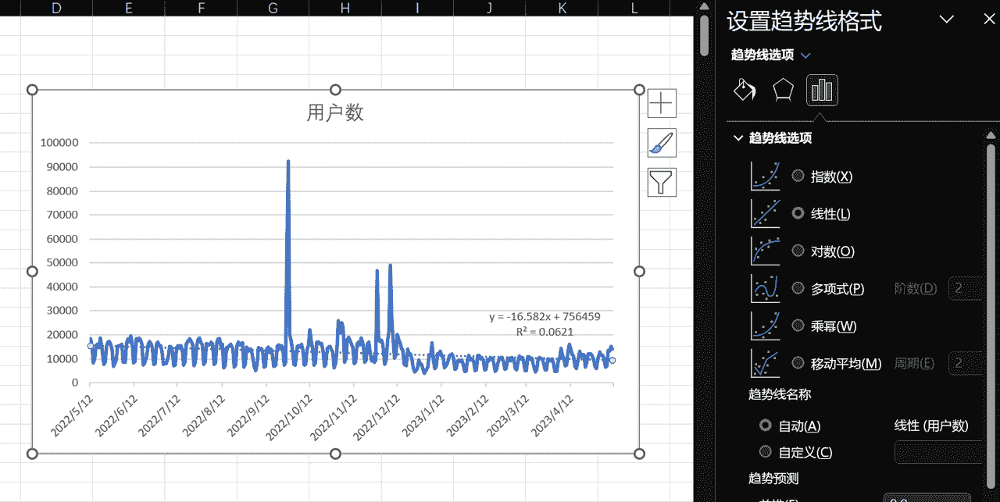

由图可知，线性函数公式为y = -16.582x + 756459，R方=0.0621

那这是什么意思呢？

问ai。

> prompt：我在Excel中设置了趋势线，同时选择了“线性”模型，然后设置了显示公式和R平方值，最后得到了这个公式：y = -16.582x + 756459，R方=0.0621。你能帮我解读一下这个公式吗？

> AI：这个趋势线公式 `y = -16.582x + 756459` 和 R平方值 (R方) 0.0621 提供了关于您的时间序列数据趋势的信息。

> - **斜率 (Slope)**: 公式中的 `-16.582` 是趋势线的斜率，表示随着时间（日期）每增加一个单位，用户数（y）平均减少16.582个单位。负斜率表明随着时间的推移，用户数呈下降趋势。

> - **截距 (Intercept)**: 公式中的 `756459` 是趋势线的截距，也就是当 x（日期）为 0 时 y（用户数）的预测值。在时间序列分析中，截距通常不是关注的重点，因为它并不代表实际的时间点或用户数值。

> - **R平方值 (R Squared)**: 值 `0.0621` 表示趋势线对于数据变化的拟合程度。R平方值的范围是0到1，值越接近1表示拟合度越高。在这个例子中，R平方值为0.0621，这意味着趋势线只解释了数据中6.21%的变异性。换句话说，趋势线并没有很好地捕捉到数据中的变化趋势，因此使用这条趋势线进行预测可能不会非常准确。

> 总结来说，这个趋势线表明用户数随着时间的推移有轻微的下降趋势，但是R平方值很低，说明这种趋势可能并不可靠，还有许多其他因素在影响用户数的变化，这些因素没有被当前的趋势线模型捕捉到。在实际应用中，可能需要更复杂的模型或考虑更多变量来进行更准确的预测。

通过ai的回答，我们知道了公式的具体含义。但是，显然拟合效果并不是很理想。我们接下来可以想到的是：要优化改进模型。具体应该怎么做呢？

> prompt：请问我在Excel中要怎么做才能改进模型的拟合效果呢？

> AI：如果Excel中使用线性关系进行数据拟合的效果不佳，说明数据可能不遵循简单的线性关系。为了改进模型的拟合效果，你可以尝试以下几种方法：

>

> 1. **变换数据**：

> - 对数据进行变换，如对数、平方或倒数变换，以查看变换后的数据是否呈现线性关系。

>

> 2. **添加多项式趋势线**：

> - 在图表中添加多项式趋势线，这可以捕捉到数据中的非线性趋势。尝试不同的阶数，如二次或三次多项式。

>

> 3. **分段线性拟合**：

> - 如果数据在不同区间呈现不同的线性关系，可以使用分段线性拟合，即在不同的数据区间内分别进行线性拟合。

>

> 4. **使用指数或对数趋势线**：

> - 对于指数增长或衰减的数据，尝试添加指数趋势线。

> - 对于百分比增长的数据，尝试添加对数趋势线。

>

> 5. **移除异常值**：

> - 检查数据集中是否有异常值或离群点，这些值可能会扭曲模型的拟合效果。如果可能，移除或修正这些值。

>

> 6. **使用非线性回归**：

> - Excel的数据分析工具包中包含非线性回归分析，可以尝试使用更复杂的非线性模型。

>

> 7. **平滑技术**：

> - 使用移动平均或指数平滑技术来减少数据中的随机波动，改善趋势的可视化。

>

> 8. **季节性调整**：

> - 如果时间序列数据具有明显的季节性波动，尝试使用季节性调整方法，如X-12-ARIMA，来去除季节性影响。

>

> 9. **数据透视表分析**：

> - 使用数据透视表来分析数据的不同部分，这有助于识别数据中的模式或趋势。

>

> 10. **相关系数分析**：

> - 计算不同变量之间的相关系数，以确定是否存在更强的相关性，可能需要用其他变量来改进模型。

>

> 11. **自定义模型**：

> - 如果标准的Excel工具不能满足需求，可以使用VBA创建自定义的拟合模型。

>

> 12. **外部工具**：

> - 对于复杂的数据分析，可能需要使用专门的统计软件或Excel插件，如R、Python或专业的数据分析工具。

>

> 13. **专家咨询**：

> - 如果你不熟悉统计分析，可能需要咨询统计学专家或数据科学家。

>

> 14. **模型评估**：

> - 使用R平方、均方误差等统计指标来评估模型的拟合效果，这有助于选择最佳的模型。

>

> 通过尝试上述方法，你可以改进Excel中时间序列数据的拟合效果，并找到更符合数据特性的模型。记住，选择模型时要考虑到数据的实际意义和业务背景。

综合考虑，我们接下来除了线性模型，尝试一下不同的模型，来看看函数和R方各是如何。

| **趋势线类型** | **公式** | **R平方值** |
| --- | --- | --- |
| **指数** | 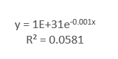 | 0.0581 |
| **线性** | 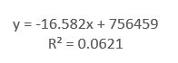 | 0.0621 |
| **对数** | 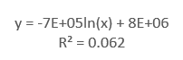 | 0.062 |
| **多项式** | 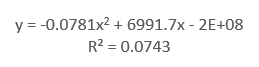 | 0.0743 |
| **乘幂** | 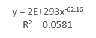 | 0.0581 |
| **移动平均** | - | - |

根据表内数据，我们看到在现有的数据样本下，上述模型R方最高只有0.0743，优化空间十分有限，在这种情况下，线性模型依然是比较理想的模型。

> 注意要点：对于分析师而言，要多尝试不同的模型。这有可能是数据的限制，也有可能是工具的限制。我们可以向ai提问还有没有其他的解决方案，继续尝试。

## 2.2 用户增长周期性波动分析

接下来我们希望增加分析的维度，因为日期的维度太少了。所以，我们可以基于日期来提取更多的时间和季节特征，然后进行分析。在这里，我们可能需要用到公式和函数，来帮助我们完成分析。

> prompt：你是一个数据分析师，你有一组Excel数据，包含A、B两列，A列是日期（日期型），B列是用户数（数值型）。数据包含了从2022-5-12到2023-5-11每日的用户数。你将如何在Excel中对上述时间序列数据开展周期性分析，利用公式和函数提取出星期几、是否工作日、周数、月份等时间季节特征，然后利用数据透视表分析用户在这些时间季节特征中的变化或规律？请简单列出操作步骤。

> AI：要在Excel中对时间序列数据进行周期性分析，并利用公式和函数提取出星期几、是否工作日、周数、月份等时间季节特征，然后使用数据透视表分析用户在这些时间季节特征中的变化或规律，可以遵循以下操作步骤：

> 1. **创建**辅助列****：

> - 在数据表中添加新列，用于存放日期的星期几、是否工作日、周数、月份等信息。

> 2. **填充**星期几****：

> - 使用 `TEXT` 函数将日期转换为星期几，例如 `=TEXT(A2, "dddd")`，其中 A2 是日期所在的单元格。

> 3. ****标记工作日****：

> - 使用 `IF` 函数和 `WEEKDAY` 函数来判定是否为工作日，例如 `=IF(OR(WEEKDAY(A2, 2)>5, WEEKDAY(A2, 2)<2), "非工作日", "工作日")`。

> 4. **计算**周数****：

> - 使用 `WEEKNUM` 函数提取每个日期的周数，例如 `=WEEKNUM(A2, 2)`。

> 5. **提取**月份****：

> - 使用 `MONTH` 函数提取月份，例如 `=MONTH(A2)`。

> 6. **创建**数据透视表****：

> - 选中包含原始用户数和新创建的辅助列的数据区域。

> - 转到“插入”选项卡，点击“数据透视表”。

> - 在弹出窗口中，选择创建透视表的位置（新工作表或现有工作表）。

> 7. **设置数据透视表字段**：

> - 将日期字段拖到“行”或“列”区域，并将星期几、是否工作日、周数、月份等字段也拖到相应的区域。

> - 将用户数字拖到“值”区域，选择合适的汇总方式（如求和、平均等）。

> 8. **分析周期性变化**：

> - 观察数据透视表中用户数随星期几、是否工作日、周数、月份等字段的变化情况，寻找可能的周期性规律。

> 9. **调整数据透视表设置**：

> - 如果需要，可以通过数据透视表的“值字段设置”进一步进行计算，比如计算每个时间段内用户数的增长比率或其他指标。

> 通过这些步骤，您可以在Excel中对时间序列数据的周期性进行分析，并通过数据透视表直观地看到用户数在不同时间特征下的变化规律。

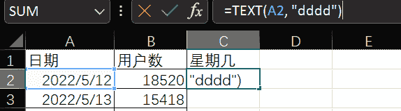

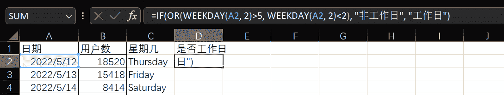

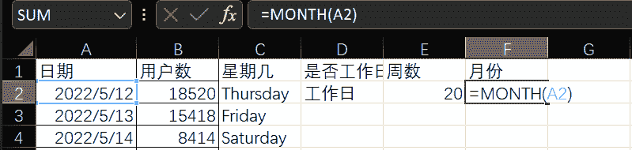

公式全部填好以后，效果图是这样：

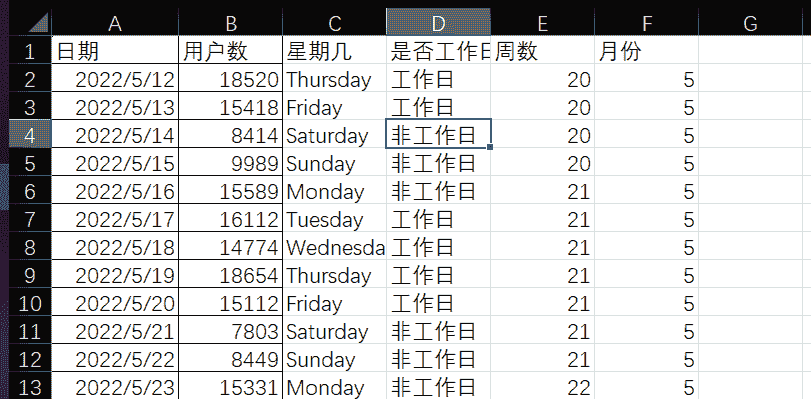

> **注意要点：利**用ai生成的代码和模型，一定要验证数据的正确性。因为大模型会有“幻觉”，会给出不准确的信息，这个对数据分析来说很重要，因为数据分析对数据的要求是非常高的。

下面是在数据透视表中，分别依据“星期几”、“是否工作日”、“周”进行透视的结果：

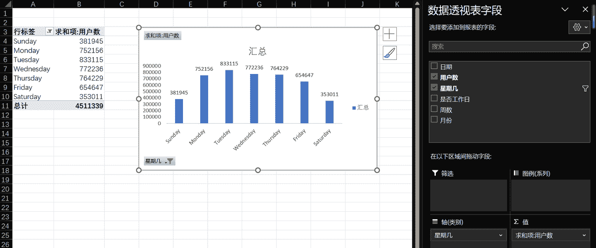

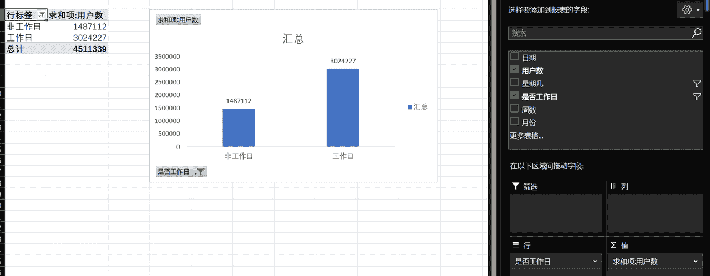

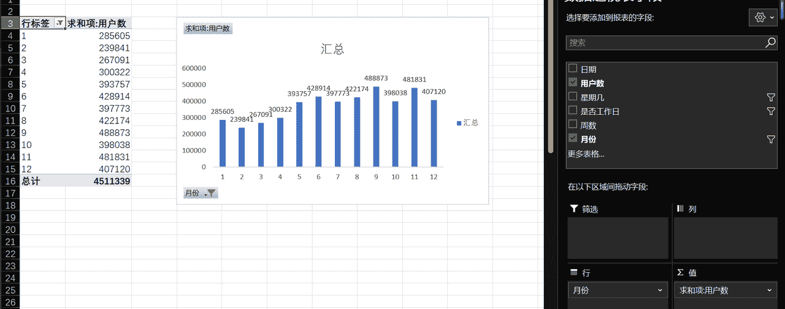

从这几张图上，我们可以简单得出以下结论：

1、工作日流量明显高于非工作日，从图上可以看出，周末的流量几乎等于工作日流量的1/5；

2、一周内的流量呈现先上升后下降的趋势，并不是齐平的。

> 注意要点：

> 到这里，如果还要继续挖掘，为什么周末的流量会这么少？或者为什**么一周内的流量**趋势会先上升后下降？这可能需要更多的数据，才能继续去做分析啦。

## 2.3 用户增长异常分析

其实刚刚，在做时间序列的折线图的时候，很明显就看到了数据异常的地方了：

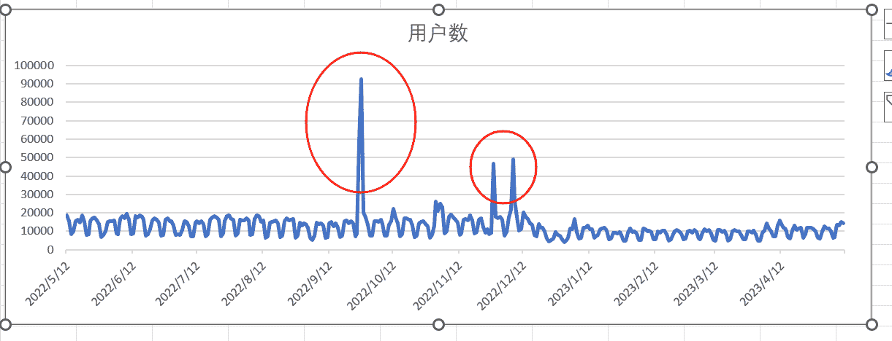

然而，作为专业的分析师，我们不能凭借直觉观察来得出结论，我们需要借助一些数据工作方法来精准定位到问题。

> prompt：你是一个数据分析师，你有一组Excel数据，包含A、B两列，A列是日期（日期型），B列是用户数（数值型）。数据包含了从2022-5-12到2023-5-11每日的用户数。你的任务是识别出数据中的异常数据记录，并分析异常的原因。请问你会采用哪些异常值处理的方法来完成这项任务？下面是数据样例：

> | 日期        | 用户数   |

> |-----------|-------|

> | 2022/5/12 | 18520 |

> | 2022/5/13 | 15418 |

> | 2022/5/14 | 8414  |

>

> AI：为了识别和处理时间序列数据中的异常值，我会采用以下方法：

> 1. **视觉检查**:

> - 绘制时间序列图，如折线图或散点图，以直观地检查数据中是否存在明显的异常波动。

> 2. **计算统计量**:

> - 计算用户数的均值、中位数、标准差等基本统计量。

> - 使用这些统计量来识别远离平均值的异常值，例如使用3σ原则（即在均值±3个标准差之外的值）。

> 3. **盒须图分析**:

> **   -** 利用盒须图来识别异常值，盒须图可以显示数据的四分位数和异常值（离群点）。

> 4. **移动平均和标准差带**:

> - 计算移动平均和标准差，然后在时间序列图上绘制标准差带（如±2个标准差），以识别落在带外的异常值。

> 5. **时间序列分解**:

> - 将时间序列分解为趋势、季节性和随机成分，分析随机成分以发现不符合正常模式的异常值。

> 6. **周期性对比**:

> - 如果数据具有明显的周期性（如每周、每月的规律性变化），比较周期内的数据以发现不符合周期性规律的异常值。

> 7. **外部信息验证**:

> - 对于检测到的异常值，查找相应的外部事件（如节假日、促销活动、系统故障等）来解释异常波动的原因。

> 8. **模型预测比较**:

> - 使用时间序列预测模型（如ARIMA、Holt-Winters指数平滑等）来预测用户数，并将实际数据与预测值进行比较，差异较大的点可能是异常值。

> 9. **自动化异常检测算法**:

> - 应用基于聚类、基于密度或基于统计的异常检测算法来自动识别异常值。

> 10. **专家审查**:

> - 将疑似异常的数据点提交给业务分析师或领域专家进行审查，以确定是否为真正的异常值，并探索背后的原因。

> 11. **异常值处理**:

> - 根据异常值的性质和原因，决定是保留、修正还是删除这些值。保留可能需要注释说明异常的原因，修正可能需要依据历史数据或其他相关信息，而删除则是在确认这些值是由错误或无关因素引起的情况下采取的措施。

> 通过上述方法，可以有效地识别和处理时间序列数据中的异常值，确保数据分析的准确性和可靠性。

这里我们以四分位数方法为例，用这个方法来识别和筛选数据中的异常值。

> prompt：我想用四分位法找出异常值，我可以在Excel的一个单元格内，通过一个函数公式直接实现四分位数、下界、上界计算以及异常值结果判断吗？我的数据范围是B2:B366。

> AI：在Excel中，你可以使用单个函数来计算四分位数，但是没有单一的函数可以同时计算四分位数、下界、上界以及判断异常值。不过，你可以组合使用多个函数来实现这一目标。

>

> 以下是如何使用Excel函数来计算第1四分位数（Q1）、第3四分位数（Q3）以及下界和上界，并判断异常值的步骤：

>

> 1. **计算第1四分位数（Q1）**：

> 使用`QUARTILE.INC`函数（在Excel 2019及更早版本中使用`QUARTILE.EXC`）。

> ```excel

> =QUARTILE.INC(B2:B366, 1)

> ```

>

> 2. **计算第3四分位数（Q3）**：

> ```excel

> =QUARTILE.INC(B2:B366, 3)

> ```

>

> 3. **计算四分位距（IQR）**：

> IQR是Q3和Q1之间的差。

> ```excel

> =QUARTILE.INC(B2:B366, 3) - QUARTILE.INC(B2:B366, 1)

> ```

>

> 4. **确定下界和上界**：

> 通常，下界是Q1减去1.5倍的IQR，上界是Q3加上1.5倍的IQR。

> ```excel

> =QUARTILE.INC(B2:B366, 1) - 1.5 * (QUARTILE.INC(B2:B366, 3) - QUARTILE.INC(B2:B366, 1))

> ```

> ```excel

> =QUARTILE.INC(B2:B366, 3) + 1.5 * (QUARTILE.INC(B2:B366, 3) - QUARTILE.INC(B2:B366, 1))

> ```

>

> 5. **判断异常值**：

> 你可以使用`IF`函数结合`MIN`和`MAX`函数来判断一个值是否超出了计算出的下界和上界。

> ```excel

> =IF(B2 < MIN(四分位数下界计算公式) OR B2 > MAX(四分位数上界计算公式), "异常", "正常")

> ```

> 其中“四分位数下界计算公式”和“四分位数上界计算公式”是你之前计算得到的下界和上界公式。

>

> 请记住，你需要将上述提到的计算四分位数、IQR、下界和上界的公式替换为具体的单元格引用。

>

> 由于Excel不提供直接的数组公式来标记异常值，你可能需要对每个数据点应用上述`IF`函数，或者使用条件格式来高亮显示异常值。

>

> 如果你希望避免使用单独的公式来标记异常值，可以考虑使用Excel的“条件格式”功能来高亮显示落在下界和上界之外的值。这不需要数组公式，而是根据设定的条件自动应用格式。

注意，不同的大模型在类似“给出具体计算公式”**这一步的答**案不尽相同，例如如果你使用的是星火大模型，可能它没办法直接得到判断异常值的函数，相反，它可能会让你使用数组来计算。但这对操作有很高的要求。

尽管我们并不想用数组。但其实kimi的公式也不能直接拿来用，还需要做两个辅助列（上界和下界），所以其实还不是很完美。这可能就是目前国内大模型的上限吧。

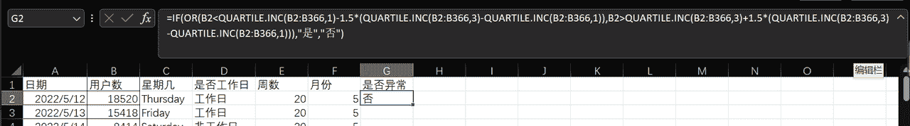

我们找出以下这些异常值，总共17个。其中部分是特别高的数据，部分是特别低的数据。

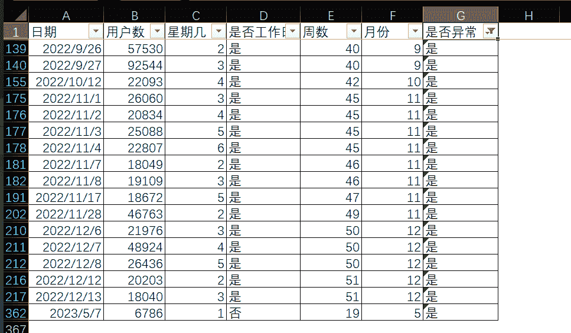

对于异常值我们要怎么处理？直接删掉？还是用平均值来填充？

我们可以继续提问ai，“如何处理异常值”，但其实有个更重要的问题：那就是需要解释这些异常值。

> 注意要点：获得异常值结果后，我们必须解释异常值产生的原因和依据，包括检测方法的原理、理论支持和判断标准等，这样才能更好地与业务方沟通数据的结论。

## 2.4 用户增长预测

> prompt：你是一个数据分析师，你有一组Excel数据，包含A、B两列，A列是日期（日期型），B列是用户数（数值型）。数据包含了从2022-5-12到2023-5-11每日的用户数。接下来你需要使用Excel的“预测工作表”的功能，来预测2023-5-12到2023-6-12的用户数，请把详细的步骤告诉我

> AI：要使用Excel的“预测工作表”功能来预测2023-5-12到2023-6-12的用户数，请按照以下步骤操作：

> 1. **打开Excel并导入数据**：

> - 确保你的Excel工作簿中包含A、B两列的数据。

> - A列是日期（日期型），格式应为YYYY-MM-DD。

> - B列是用户数（数值型）。

> 2. **准备数据**：

> - 确认数据没有缺失值。

> - 如有需要，将日期格式设置为Excel可识别的日期格式。

> 3. **选择数据范围**：

> - 选择包含日期和用户数的数据范围。

> 4. **创建预测工作表**：

> - 点击Excel的“数据”选项卡。

> - 在“预测”组中，点击“预测工作表”按钮。

> 5. **设置预测参数**：

> - 在弹出的“创建预测工作表”对话框中，Excel会自动检测日期列和预测列。

> - 确保日期列被设置为“时间序列”，用户数字段被设置为“预测”。

> - 指定预测结束日期，即你想要预测的最后日期，例如2023-6-12。

> - 根据需要调整其他选项，如置信区间等。

> 6. **生成预测工作表**：

> - 点击“创建”按钮，Excel将生成一个包含历史数据和预测结果的新工作表。

> 7. **查看预测结果**：

> - 在新生成的预测工作表中，你会看到实际的历史数据和预测的未来用户数。

> - 预测数据通常会以图表的形式展示，以便直观地比较实际数据和预测数据。

> 8. **调整预测参数**（可选）：

> - 如果预测结果不满意，可以返回到原始数据，调整预测参数后重新生成预测工作表。

> 9. **保存预测工作表**：

> - 完成预测后，保存工作簿以保留预测结果。

> 请注意，预测工作表使用的是基于历史数据的统计模型来进行预测，因此预测结果可能会因模型的不同而有所差异。对于更准确的预测，可能需要使用更复杂的时间序列分析或机器学习方法。(by 星火大模型）

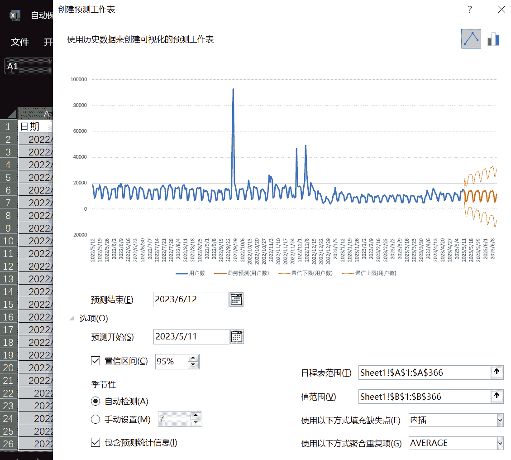

按照ai的提示，在Excel中进行预测工作簿的操作，如图所示。在“选项”中设置更多的选项，要勾选“包含预测统计信息”，这样便于输出多种模型效果评估效果。

完成上述操作后，得到结果如下：

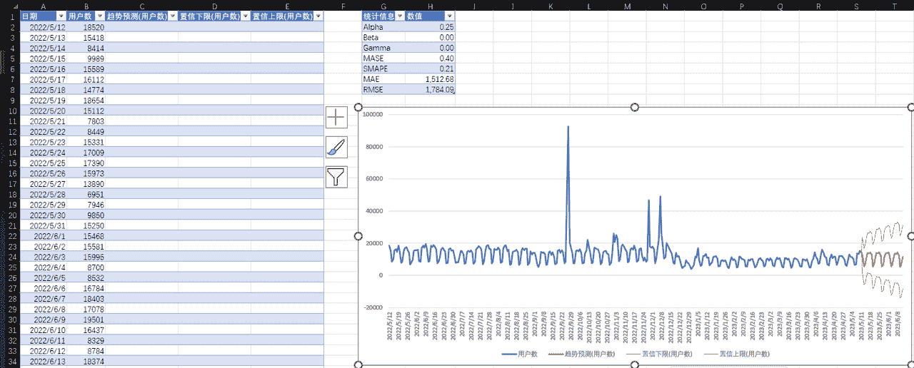

至此，我们可能不一定看得懂图表的意思，我们可以问问ai。

> prompt：如何解释使用预测工作表得到的预测结果？

> AI：在Excel中使用“预测工作表”功能生成的图表和统计信息提供了对时间序列数据未来趋势的洞察。以下是如何解释这些元素的一般指南：

>

> 1. **实际数据点**：

> - 图表上的散点或线段代表了实际观测到的数据点。

>

> 2. **预测趋势线**：

> - 通常有一条橘色的线表示预测的趋势。**这条线是**基于你的数据和所选的预测模型（如指数平滑）计算出的。

>

> 3. **置信区间**：

> **   -** 另外两条橘色线通常代表预测的置信区间，即预测值周围可能的波动范围。这些置信区间通常是基于特定的置信水平（如95%）。

>

> 4. **统计信息**：

> - Excel可能会显示一些统计信息，如：

> - **AE**（平均误差）：预测值与实际值之间差异的平均值。

> - **RMSE**（均方根误差）：预测误差的标准差，提供了误差大小的量化。

> - **MAE**（平均绝对误差）：预测值与实际值之间差异的平均绝对值。

> - **R²**：表示模型拟合数据的好坏，值越接近1，表示模型的解释力越强。

>

> 5. **残差**：

> - 残差是实际观测值与预测值之间的差。理想情况下，残差应该是随机分布的，没有明显的趋势或模式。

>

> 6. **季节性**：

> - 如果数据具有季节性，预测模型可能会考虑这一点，并在图表中体现出季节性的影响。

>

> 7. **模型假设**：

> - 检查模型的假设是否与数据特性相匹配。例如，线性模型假设数据之间存在线性关系。

>

> 8. **预测值**：

> - 图表旁边的表格可能包含了具体的预测值，包括每个预测点的数值。

>

> 9. **解释预测**：

> - 使用图表和统计信息来解释预测结果。如果预测趋势线与实际数据点相符，那么模型可能是合适的。

>

> 10. **评估不确定性**：

> - 通过置信区间评估预测的不确定性。区间越宽，不确定性越大。

>

> 11. **结合业务知识**：

> - 结合你对业务的理解，评估预测结果是否合理。

>

> 12. **沟通结果**：

> - 向利益相关者清晰地解释预测结果，包括模型的假设、预测的不确定性和可能的业务影响。

>

> 13. **验证模型**：

> - 使用保留的数据集或后续的实际数据来验证模型的预测能力。

>

> 14. **更新模型**：

> - 随着新数据的获得，定期更新模型以提高预测的准确性。

>

> 15. **敏感性分析**：

> - 考虑对模型参数或输入数据进行更改，以评估预测结果的稳定性。

>

> 请记住，预测模型是基于历史数据的，未来的实际结果可能会因为未被模型捕捉到的因素而有所不同。因此，预测结果应谨慎使用，并结合专业判断和其他信息。（by kimi）

当然，里面的技术词汇，例如平滑算法、置信区间等，你若是感兴趣，可以继续在ai里面进行提问，这里就不做展示了。

同样的，我们得到了一份预测的统计信息和相应的数据，如果我们想要详细了解这些信息和数据，同样可以在ai里面提问。

> 注意要点：

> 时间序列算法，有数种算法，简单至线性回归算法，复杂的可以到复杂回归，包括深度神经网络、高斯回归等。但因为Excel环境的使用所限，以及本着“举一反三”的原则，案例旨在演示如何运用ai辅助增长分析和增长预测的思路，各位如果有兴趣可自行学习和尝试。

> **总结：**

> 1、本案例展示了如何借助AIGC进行时间序列的数据分析，重点探讨和时间了如何利用AIGC来拓展和完善思维。由于数据源、训练方式、模型特点等多方面的因素，不同的AI工具会有不同的效果，我们可以综合多个AI工具的答案，进行比较和分析，最终得到一个更全面和更深入的结果；

> 2、在时间序列的数据分析中，对时间格式数据的处理，有时候会特别重要，因为时间数据涉及到的公式和格式特别多，而且时间特征可以衍生出很多相关的其他特征，所以在处理时间数据的时候，要特别慎重和小心；

> 3、在使用ai工具进行数据分析的时候，一定要对数据进行校验；

> 4、如果涉及到企业机密的数据，尽量不要上传到各种平台上面，会有泄密的风险。

# 三、实践2---相关性分析与热力图展示

本案例主要展示如何使用AIGC和Excel进行相关性分析，并最终以热力图的形式，进行可视化呈现。

通过案例，我们会学到相关性分析的概念和方法，并感受AIGC和Excel在数据分析上的结合和应用。

简单介绍下本案例背景：

我们现在有一张关于网站的流量分析数据表，数据格式如图所示：

数据源：[📎相关性分析数据源.xlsx](https://www.yuque.com/attachments/yuque/0/2024/xlsx/33942383/1715666890568-aabd2d44-1844-41a0-bc9f-121ecbe3d022.xlsx)

其中，主要指标的含义如下：

**网页浏览量：**

用户在一定时间内浏览网站的页面数，用于衡量网站的内容吸引力和用户的兴趣程度。

**用户数：**

在一定时间内访问网站的不同用户数量，用于衡量网站的受众规模和市场份额。

**新用户：**

在一定时间内，首次访问网站的用户数量，用于衡量网站的拓展能力和潜在客户数。

**会话数：**

在一定时间内，用户与网站之间发生的交互次数，用于衡量网站的活跃度和用户的忠诚度。

**访问深度：**

每个会话中用户浏览的页面数，用于衡量用户对网站内容的满意度和参与度。

**平均会话时长：**

每个会话中用户在网站上停留的平均时间，用于衡量用户对网站内容的关注度和价值感知程度。

**跳出率：**

只浏览一个页面就离开网站的会话占总会话的百分比，用于衡量网站内容是否符合用户需求和预期。

## 3.1 观察数据特征

问题：我们想知道，数据指标之间是否有相关关系，以及相关性如何？

> prompt：相关性分析，有什么用？

> AI：相关性分析是一种统计方法，用于研究两个或多个变量之间的关系。它可以帮助我们了解变量之间的相互作用和影响，从而为决策提供依据。相关性分析在许多领域都有广泛的应用，包括经济学、社会学、心理学、生物学等。

> 相关性分析的主要用途如下：

> 1. 预测：通过分析变量之间的关系，我们可以预测一个变量如何随着另一个变量的变化而变化。例如，根据历史数据，我们可以预测销售额与广告支出之间的关系，从而制定更有效的营销策略。

> 2. 诊断：相关性分析可以帮助我们识别问题的根源。例如，如果我们发现员工满意度与生产率之间存在强烈的负相关关系，那么我们可以进一步研究原因，并采取措施提高员工满意度。

> 3. 描述：相关性分析可以帮助我们描述现象之间的关系。例如，通过分析教育水平和收入之间的关系，我们可以了解不同教育水平对收入的影响。

> 4. 控制：在某些情况下，我们需要控制某些变量以保持其他变量的稳定。例如，在生产过程中，我们需要控制原材料的质量以确保产品的一致性。

> 5. 假设检验：相关性分析可以用于检验假设。例如，我们可以检验某个药物是否对疾病的治疗效果有显著影响。

> 总之，相关性分析是一种强大的统计工具，可以帮助我们更好地理解变量之间的关系，从而为决策提供依据。

> prompt：相关性分析，一般怎么实施？有哪些步骤？please show me step by step

> AI：相关性分析一般通过以下步骤实施：

>

> 1. **绘制散点图**：利用软件如SPSS绘制散点图，这有助于直观地查看两个变量之间是否存在某种关系。如果数据点呈现出一定的趋势，而非随机分布，则表明变量间可能存在相关性。

> 2. **选择适当的相关系数公式**：根据数据特征（如是否正态分布）选择合适的相关系数计算方法。Pearson相关系数适用于正态分布的连续变量，而Spearman或Kendall相关系数适用于非正态分布或等级数据。

> 3. **计算相关系数**：在统计软件中计算所选变量的相关系数。例如，在SPSS中可以通过“分析”菜单下的“相关”选项进行双变量相关性分析。

> 4. **显著性检验**：计算得到的相关系数需要通过显著性检验来确定其统计意义。通常使用P值来判断相关性是否显著，P值小于0.05意味着相关性显著。

> 5. **业务解读与建议**：根据相关性的强度和方向，结合实际情况给出相应的业务策略或建议。强相关意味着一个变量的变化很可能引起另一个变量的明显变化，这可以为决策提供依据。

>

> 以上步骤是进行相关性分析的标准流程。在实际操作中，可能需要根据具体的研究目的和数据特性进行适当调整。

由此可知，我们需要先看看上面指标两两之间的散点图如何？

现在有7个指标，理论上应该有21组散点图。如果人工来画，那真是太麻烦了，有没有可能让ai来帮我们做？而且把这21张图合成一张大图来实现？

指令如下：

> prompt：你是一个数据分析师。你要用散点图探索excel工作簿Sheet1中B:H列的变量关系。这些列分别为网页浏览量、用户数、新用户、会话数、访问深度、平均会话时长、跳出率。首行是标题，数据区域为B2:H11。你的目标是：

> （1）一个散点图中同时显示所有指标两两之间的关系，共21种组合，不要分开画21个散点图。

> （2）每种组合用一个散点表示两个指标的关系，比如网页浏览量和用户数的关系用一个散点表示。

> （3）每种组合用不同的图例或颜色来区分，比如网页浏览量和用户数用菱形，网页浏览量和新用户用正方形。如果有相同的图例，请换一个颜色来区分。

> （4）每种组合在图例中显示两个指标的名称，比如网页浏览量VS用户数。

> 请告诉我如何使用VBA代码一次性实现这个过程，谢谢

得到代码如下（步骤文字已省略）：

```
Sub createmychart()
    Dim Chart1 As Chart
    Dim i As Integer
    Dim j As Integer
    Dim k As Integer
    Dim xring As Range
    Dim yring As Range

    Set Chart1 = Charts.Add
    With Chart1
        &#x27;删除已有的数据系列
        Do While .SeriesCollection.Count &gt; 0
            .SeriesCollection(1).Delete
        Loop
        &#x27;设置图表类型为散点图
        .ChartType = xlXYScatter

        &#x27;循环添加数据系列，每个系列只显示两个变量之间的关系
        k = 1 &#x27;用于记录数据系列的编号
        For i = 2 To 7 &#x27;循环B:H列中的变量
            For j = i + 1 To 8 &#x27;循环B:H列中的变量，避免重复
                &#x27;设置x轴数据区域
                Set xrng = Sheets(&quot;Sheet3-1&quot;).Range(Cells(2, i), Cells(31, i))
                &#x27;设置y轴数据区域
                Set yrng = Sheets(&quot;Sheet3-1&quot;).Range(Cells(2, j), Cells(31, j))
                With .SeriesCollection.NewSeries &#x27;添加新的数据系列
                    &#x27;设置数据系列的名称，如&quot;网页浏览量 vs 用户数&quot;
                    .Name = &quot;=&quot;&quot;&quot; &amp; Cells(1, i) &amp; &quot; vs &quot; &amp; Cells(1, j) &amp; &quot;&quot;&quot;&quot;
                    .XValues = xrng &#x27;设置x轴数据源
                    .Values = yrng &#x27;设置y轴数据源
                End With
                k = k + 1 &#x27;增加数据系列的编号
            Next j
        Next i
        &#x27;设置图表的其他元素，如标题、图例、坐标轴等，可以根据需要修改或删除
        .SetElement msoElementChartTitleAboveChart &#x27;添加图表标题
        .ChartTitle.Text = &quot;变量关系散点图&quot; &#x27;设置图标标题文本
        .SetElement msoElementLegendRight &#x27;添加右侧图例
        .Axes(xlCategory, xlPrimary).HasTitle = True &#x27;添加x轴标题
        .Axes(xlCategory, xlPrimary).AxisTitle.Text = &quot;X轴变量&quot; &#x27;设置x轴标题文本
        .Axes(xlValue, xlPrimary).HasTitle = True &#x27;添加y轴标题
        .Axes(xlValue, xlPrimary).AxisTitle.Text = &quot;y轴变量&quot; &#x27;设置y轴标题文本
    End With
End Sub

```

得到可视化散点图如下所示：

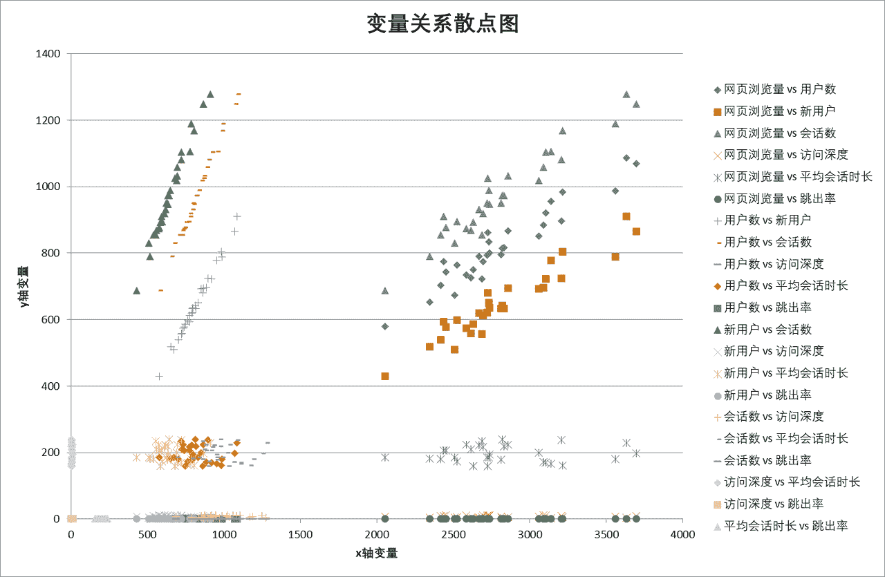

类似于这种趋势的，一般可以认为这两个变量是存在比较强的线性关系的，而且是正向的线性相关关系，其中一个指标数值增长，另一个指标的数值也随之增长，这是正相关。

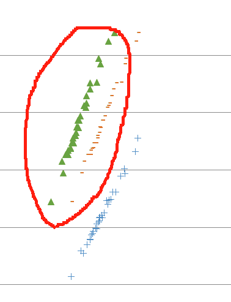

> 注意要点：VBA的代码非常难调，如果调不出来就算了，理解相关性的概念就行。

## 3.2 输出相关性分数矩阵

问题：怎样以具体数值的方式呈现数据指标之间的相关性关系？

> prompt：如何在Excel中针对B:H列的所有数据，使用数据分析工具中的相关性分析，输出相关系数矩阵？

> AI：在Excel中，要针对B:H列的所有数据进行相关性分析并输出相关系数矩阵，您可以使用数据分析工具中的相关性分析功能。以下是具体的操作步骤：

>

> 1. **确保已激活数据分析工具**：您需要确认Excel中的“数据分析”工具已经激活。如果尚未激活，可以通过“文件”->“选项”->“加载项”来启用“分析工具库”加载项。

> 2. **选择数据区域**：在进行相关性分析之前，请确保您的数据区域只包含数值型数据，并且不包括列标题。也就是说，您需要选择B:H列中所有的数据单元格，但不包括第1行的列标题。

> 3. **使用数据分析工具**：在Excel的“数据”选项卡中，点击“数据分析”按钮。如果已经激活，该按钮应该出现在工具栏中。如果没有出现，可能需要先加载“分析工具库”插件。

> 4. **进行相关性分析**：在弹出的“数据分析”对话框中，选择“相关系数”选项。然后，设置“输入范围”为B:H列的数据区域（不含标题），并指定输出结果的位置。您可以选择新建工作表或现有工作表来放置分析结果。

> 5. **查看分析结果**：点击“确定”，Excel将执行相关性分析，并在指定位置生成一个相关系数矩阵。这个矩阵会显示B:H各列之间的相关系数，其中对角线上的值代表每个变量自身与自身的相关系数，因此总是1。

>

> 总的来说，通过以上步骤，您可以得到B:H列数据之间的相关系数矩阵，从而了解不同列数据之间的相关性强弱。如果您的数据量较大或者需要进行更为复杂的统计分析，建议使用专业的统计软件来获得更准确的分析结果。

根据提示和步骤操作Excel，得到结果如下：

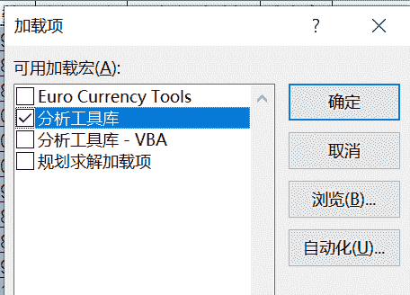

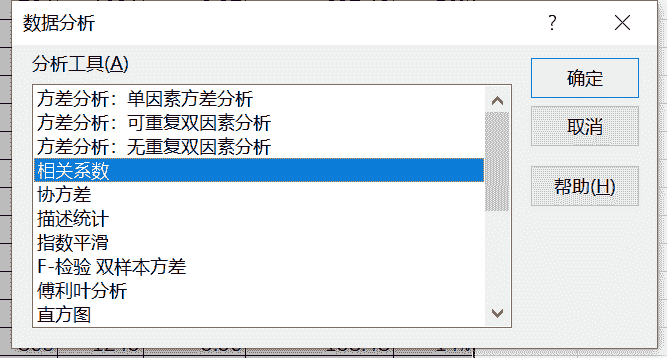

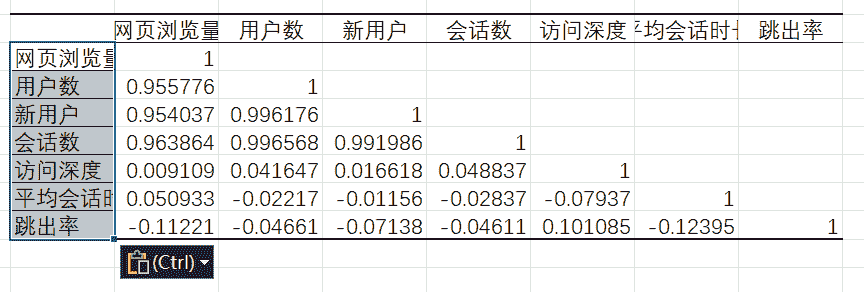

光是数值看着还不太明显，我们引入条件格式，用可视化的方式（热力图）呈现相关性结果。

> prompt：如何利用Excel的条件格式功能，让不同的数字显示不同的颜色，展示出类似热力图的效果？

> AI：在Excel中，您可以利用条件格式功能来创建类似热力图的效果，使得不同的数值以不同颜色显示。以下是具体的步骤：

>

> 1. **选择数据区域**：您需要选中包含您要分析数据的单元格区域。请确保不要选择列标题或行标题，只选择包含数据的单元格。

> 2. **应用条件格式**：点击“开始”菜单下的“条件格式”，然后选择“色阶”。这将打开一个颜色梯度的选项窗口。

> 3. **调整色阶设置**：在“色阶”设置中，您可以根据预览效果选择不同的颜色梯度。默认是“双色刻度”，但您可以选择“三色刻度”以获得更细致的视觉效果。

> 4. **自定义颜色规则**：设置最小值、中间值和最大值的类型和颜色。建议将类型都改为“数字”，这样您可以自定义这些值的具体数值，从而更精确地控制颜色的分布。

> 5. **查看最终效果**：完成上述设置后，您的数据区域将根据数值大小显示不同的颜色，形成类似热力图的效果。

>

> 通过以上步骤，您可以很容易地在Excel中创建出能够直观展示数据相关性的热力图效果。这种图表非常适合于快速识别数据集中的趋势和模式。

然后，我们使用Excel条件格式功能，调一下颜色，就得到一个热力图效果的结果了：

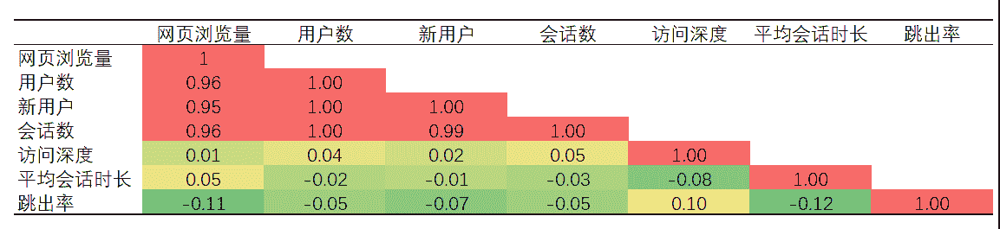

## 3.3 关于相关性的解读

相关性分析结果和可视化效果只是数据概览的第一步，我们还需要深入理解相关性的结果及其含义。我们继续向ai提问，了解上述信息。

> prompt：我应该如何解读相关性结果？例如，相关性得分在不同范围时，分别代表什么样的关系？如何判断高相关、低相关或者不相关？相关性低或者不相关意味着什么？

> AI：相关性得分是衡量两个变量间线性关系强度和方向的统计指标。以下是对相关性得分不同范围的解读以及它们代表的关系：

>

> 1. **强正相关**：当相关系数接近+1时，表明两个变量之间存在强烈的正相关关系。这意味着一个变量的增加往往伴随着另一个变量的增加。例如，随着工作人员培训次数的增加，产品合格率也提高，则说明培训次数与合格率呈强正相关。

> 2. **弱正相关或无相关**：如果相关系数接近0，这通常意味着两个变量之间没有线性关系或者关系非常微弱。这不一定意味着变量之间没有任何类型的关联，而只是指它们之间不存在直线关系。

> 3. **强负相关**：当相关系数接近-1时，表明两个变量之间存在强烈的负相关关系。即一个变量的增加与另一个变量的减少有关。例如，如果随着温度的上升，冷饮销量下降，则两者之间存在强负相关。

> 4. **低度相关**：如果相关系数的值在-1与+1之间，但远离0，这表明变量之间存在一定的线性关系，但不是非常强烈。这种关系可能是由于其他未考虑的变量影响或数据中的随机波动导致的。

>

> 总的来说，相关性分析是探索性数据分析的一部分，它可以揭示变量之间的潜在联系，但它并不等同于因果关系。即使在两个变量间发现了强相关关系，也不能简单地推断出一个变量导致了另一个变量的变化。（by 星火大模型）

基于ai给出的建议，我们对表格中相关性的结果有了比较深的了解。

再深入一下，我们通过数据可以解读出什么？我们把结果导回给ai，看看ai能给出什么样的解读？

> prompt：作为数据分析师，基于下面的相关性系数矩阵，如何应用到业务实际工作中？

> | 网页浏览量  | 用户数          | 新用户          | 会话数          | 访问深度         | 平均会话时长       | 跳出率         | |--------|--------------|--------------|--------------|--------------|--------------|-------------| | 网页浏览量  | 1            |              |              |              |              |             |   | | 用户数    | 0.955775723  | 1            |              |              |              |             |   | | 新用户    | 0.954036999  | 0.996176485  | 1            |              |              |             |   | | 会话数    | 0.963863576  | 0.996568287  | 0.991986202  | 1            |              |             |   | | 访问深度   | 0.009108964  | 0.041646954  | 0.016618312  | 0.048837014  | 1            |             |   | | 平均会话时长 | 0.050932996  | -0.022170118 | -0.011559662 | -0.02837469  | -0.079371635 | 1           |   | | 跳出率    | -0.112214282 | -0.046611191 | -0.071383529 | -0.046108782 | 0.101084952  | -0.12395418 | 1 |

> AI：在业务分析中，相关性系数矩阵提供了不同指标之间关系的信息，这有助于理解用户行为和网站性能之间的相互作用。根据提供的相关性系数矩阵，我们可以得出以下结论：

>

> 1. **网页浏览量与用户数**：相关系数为0.955775723，表明网页浏览量与用户数之间存在非常强的正相关关系。这意味着用户数的增加通常伴随着网页浏览量的增加，反之亦然。

>

> 2. **用户数与新用户**：相关系数为0.996176485，显示出极强的正相关。这表明新用户的增加与用户总数的增长紧密相关。

>

> 3. **新用户与会话数**：相关系数为0.991986202，也显示出极强的正相关。这意味着新用户数量的增加与网站会话数的增加密切相关。

>

> 4. **会话数与访问深度**：相关系数为0.048837014，表明会话数与访问深度之间存在较弱的正相关关系。这意味着会话数的增加可能与访问深度的增加有一定的关联，但这种关系不是很强。

>

> 5. **平均会话时长与跳出率**：相关系数为-0.12395418，表明两者之间存在弱负相关。这意味着平均会话时长较长时，跳出率可能较低，但这种关系并不强烈。

>

> 6. **访问深度与跳出率**：相关系数为0.101084952，表明访问深度与跳出率之间存在弱正相关。这意味着用户访问的页面越多，跳出率可能越高，但这种趋势不是很明显。

>

> 7. **网页浏览量与跳出率**：相关系数为-0.112214282，表明网页浏览量与跳出率之间存在弱负相关。这可能意味着网页浏览量较高时，跳出率较低，但这种关系不是很强。

>

> 综上所述，用户数、新用户和会话数之间存在非常强的正相关关系，而其他指标之间的相关性较弱。这些信息可以帮助业务分析师了解哪些因素对网站性能的影响最大，并据此制定策略来提高用户参与度和网站效率。例如，由于新用户与用户数和会话数有强相关性，增加新用户的策略可能会对整体用户活跃度和网站流量产生积极影响。同时，由于平均会话时长和跳出率之间的负相关性较弱，可能需要进一步分析以确定如何提高用户的停留时间和降低跳出率。

这里表格转markdown可以借助工具（https://tableconvert.com/zh-cn/）来实现，非常方便。

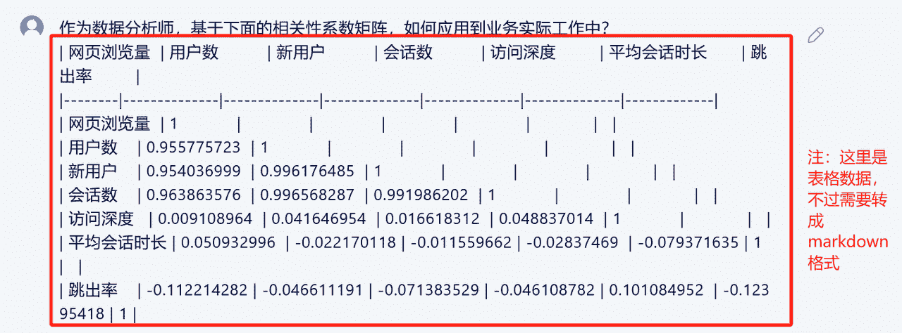

> 注意要点：

> Ai的建议主要集中在以下三个方面，我们可以根据实际的业务需求，在这些方向上进行进一步的细分和数据研究：

> 1、如何选择不同的指标作为评估网站监控和运营效果的衡量标准，可以根据场景将其分为流量指标和行为指标两类。

> 2、提供了初步的优化指标方向，包括提升网站体验，增加网站交互等多项功能。

> 3、提供了进一步的研究方向，包括因果研究，a/b测试等，以更好地了解不同指标之间的相互关系，从而更准确地衡量和评估运营效果。

> **总结：**

> 本案例中，AIGC主要的作用有两个：

> 1、提供技术指导和建议；

> 2、提供业务数据的解读和总结。

> 需要注意的是：

> 1、在涉及到VBA代码的调试环节，国内大模型的代码生成质量并不够好，代码的调试对业务人员的技术功底、提示词的提炼总结和调试耐心是三重巨大的考验。在这点上，国外的模型性能显然更有优势。

> 2、在不能直接上传数据表格的ai工具（国内办公小浣熊可以支持直接上传数据表格）如果涉及到解读表格数据，则需要把表格转换为markdown格式才行。

---

（完）