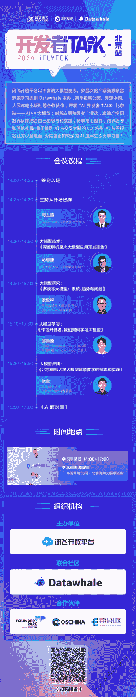
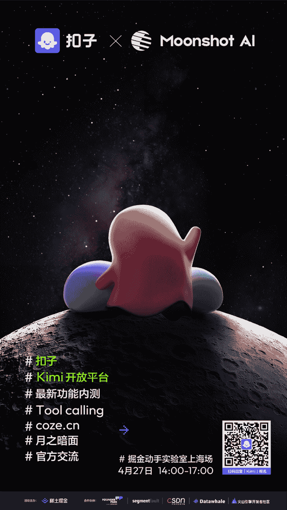
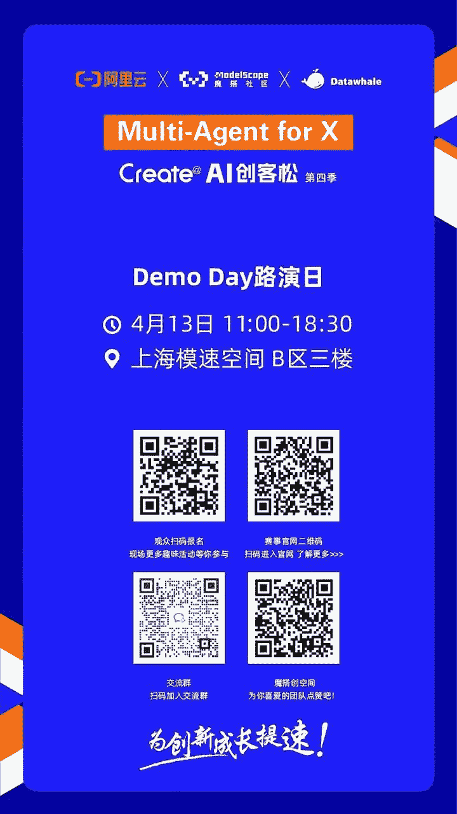
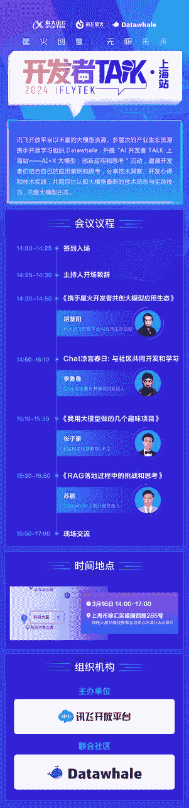
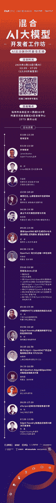

# AI +X 城市活动

> 来源：[https://datawhaler.feishu.cn/docx/XbEbdW0GDoI2shxFUnkc7KSpnqb](https://datawhaler.feishu.cn/docx/XbEbdW0GDoI2shxFUnkc7KSpnqb)

# 5-18 AItalk北京站

# 4- 27 Agent workshop

## 🌕 上海站 - 扣子 x Kimi 开放平台联动，邀你与扣子（coze.cn）一起探索月之暗面！

🎉 **#大模型上新# K**imi 大模型 入驻扣子！

+   Kimi 大模型全新 Tool Calling 功能

+   超长的文本能力、Variable、LTM、Task、Multiagent 等众多强大功能邀你解锁～

🎉 **#现场动手# **

+   与「扣子」&「月之暗面」官方现场交流！

+   现场手搓Coze

+   时间：4月27日，14：00 - 18：00

+   地点：上海徐汇区古美路1520号漕河泾中心D栋F2-培训室1

🔥 **报名链接：**

https://www.bagevent.com/event/8821050?bag_track=cllposter

# 4-13 AI创客松

## 上海站 - Multi-Agent for X  AI创客松

# 3-16 AI talk & workshop

## 上海站 - 2024 iFLYTEK - 开发者talk

## 杭州站 - 混合AI大模型开发者工作坊

