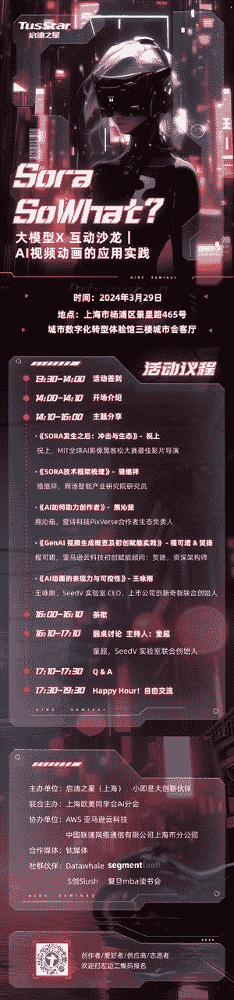

# 上海站

> 来源：[https://datawhaler.feishu.cn/docx/C5kddXz8EovSICxdZW3cgz3xn7e](https://datawhaler.feishu.cn/docx/C5kddXz8EovSICxdZW3cgz3xn7e)

# 3月29日（周五）启迪之星（上海）“大模型 X”精品沙龙第三期

Sora带来的震撼余韵未央，AIGC对于视频动画业正引发怎样的震荡？3月29日（周五）14:00，启迪之星（上海）将举办“大模型 X”精品沙龙第三期，聚焦视频动画，邀请产业、服务商等多方参与，分享和讨论Sora技术内涵及大模型在视频行业落地的场景和应用，共同探讨大模型+垂直行业场景落地的机会及挑战。

欢迎感兴趣的行业从业者及专家扫码报名，与我们共话AI大模型的落地机遇！

