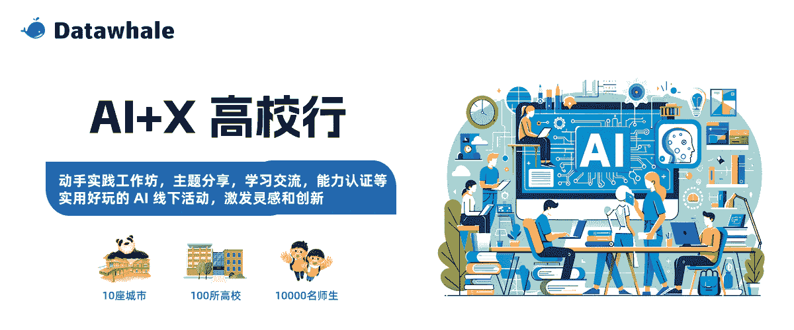
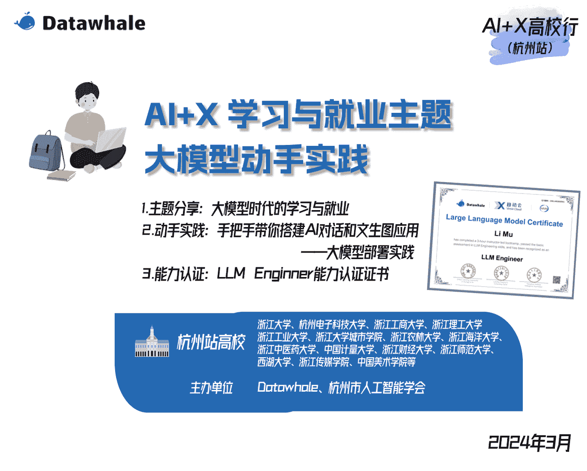
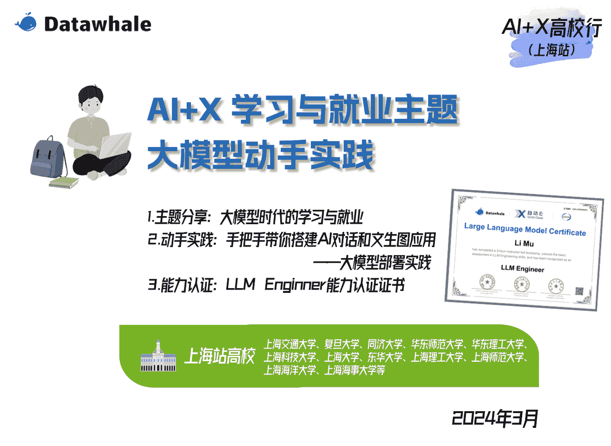
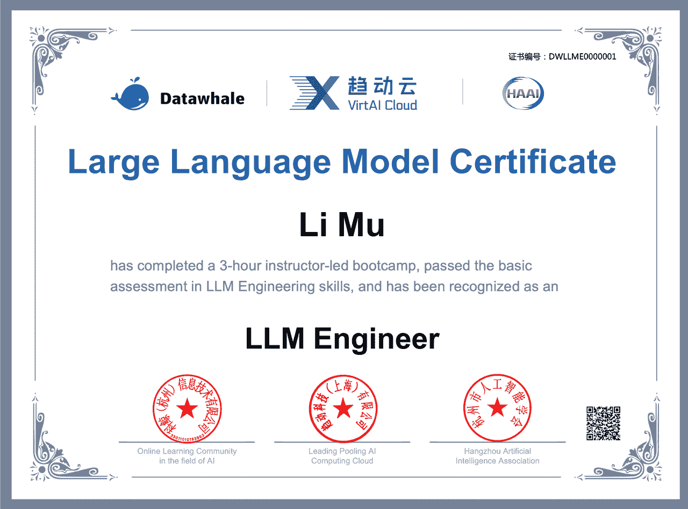

# AI+X 高校行说明书

> 来源：[https://datawhaler.feishu.cn/docx/W6X3dILjOokwRGxReIpcdtljncg](https://datawhaler.feishu.cn/docx/W6X3dILjOokwRGxReIpcdtljncg)

# 🐳活动简介

> **AI+X：**希望将人工智能（AI）与各个学科和行业（X）结合，

> 激发无限潜力和创造力（X），让年轻人拥有更多可能性（X）

> **高校行**：把AI带到10座城市，100所高校，影响10000名高校师生

>

> **AI+X 高校行活动 **融合人工智能企业最新技术与应用场景、Datawhale丰富的学习资源、以及高校创新火种，打造独特的AI学习体验，激发高校学生的学习热情和应用能力，促进AI与各高校专业交融。

>

> 我们倡导学习者追寻兴趣热爱，包容开放，协作学习，动手实践，鼓励探索和创新

**杭州站 ****

主办单**位：Datawhale、杭州市人工智能学会

**协办单位**：趋动云、人民邮电出版社、OpenI启智、智海Mo

**北京站**

AITISA联盟

**深圳站**

OpenI启智，鹏城实验室

四月一起参与2050大会，站上更大的舞台，与来自全国各地的学习者团聚。

[2050视频.mov](https://internal-api-drive-stream.feishu.cn/space/api/box/stream/download/all/LC2ebf2rFoj59vxEvFrcMOkBnmb)

深入了解 2050 ➡️ 官方网站 https://2050.org.cn/#/

# 🙋‍♂️第1站：杭州站

# 🙋‍♂️第2站：上海站

**活动形式：**

+   **Datawhale 的AI朋友**：

+   **大模型****动手实践**：和在场同学一起实践AI

+   **见面交流**：专业和热爱让我们看到更多可能性

+   **AI+X 集市：**提供实践、就业等机会

## 各高校对接人

多维表格（YZyabiKG6a3JLosJ2jMc7Wl0nqh_tblKCWd7Nzwq7Q3h）

其他感兴趣的学校也可以联系（🛰️号：CindyGan166）报名，添加请备注“高校-专业-年级”

**活动参与者：**

+   对AI感兴趣的同学的各专业同学

+   不需要代码和技术基础，0门槛

+   有一些Python基础会更好

**活动证书：**

参与活动的同学完成实操和测试后，

即可获得由Datawhale、杭州市人工智能学会、趋动云联合颁发的LLM Engineer能力认证证书。

# 💡加**入AI+X 高校行**

## 🐳高**校活动组织者**

如果你是高校的同学，我们诚邀你与我们联合举办AI+X 2050高校活动。一起组织、策划和共建精彩的线下活动，让AI+X走向更多城市和学校。如果你曾经担任过Datawhale助教/宣传大使/高校联盟成员，将被优先考虑。

🐳高**校宣传大使**

如果你希望参与高校活动宣传，提升活动影响力，让更多高校学生有机会参与，欢迎加入。

🐳贡**献者**

如果你愿意现场带领同学动手实践学习，或分享你的AI相关学习心得。我们鼓励和愿意帮助你站到讲台上分享，让更多人看到你的思考和努力。这是一个展示你自我的绝佳机会。

🐳助**教团队**

如果你愿意提前学习课程，并愿意帮助其他同学解决现场学习的困难，欢迎加入Datawhale助教团队，你更有机会遇到志同道合的学习小伙伴。

## 🐳企**业支****持方**

我们也在寻找更多的企业伙伴为高校同学提供更多学习资源。如果你愿意赞助或者提供资源，走近高校和同学们，请联系我们。

## **联系我们**

Datawhale团队成员 - 甘小琦，添加请备注“高校-专业-年级”

# 🐳 Datawhale介绍

Datawhale成立于2018年——是国内AI领域最大的开源学习组织，汇聚了众多有开源精神和探索精神的开源贡献者，致力于构建开源学习社区，和学习者一起成长。

成立5年来，Datawhale开源学**习成为全国知名的学习****活动，覆盖了海内外2000多**所院校，不断吸引具有影响力的顶尖学者、知名教授、企业家、青年贡献者等在此分享知识和远见，成为关注青年人才成长的主阵地，加快高校和产业的链接，持续推动青年AI人才培养。

[Datawhale学习生态伙伴](https://datawhaler.feishu.cn/docx/UAFjdrSBBo9hJDxeIsYc6ilYnvc)

> H**u**gging Face、科大讯飞、阿里云天池、百度飞桨、英特尔、异步社区、OpenI启智社区、阿里达摩院、阿里ModelScope、上海人工智能实验室、南京数据运筹科学研究院 、和鲸科技、DataCastle、趋动云科技、OpenDataLab、世界人工智能大赛、开源社、DataFun、上海白玉兰开源开放研究院、上海市数据科学重点实验室、雪浪工业软件研究院、集智俱乐部、思否、亚马逊云科技、OpenMMLab、OceanBase、Zilliz、滴滴技术、木兰开源社区、复旦大学、DataFun、DataFountain、深信科创、Microsoft Reactor，Google Developer Groups，智海平台、AIGCOPEN开放社区等