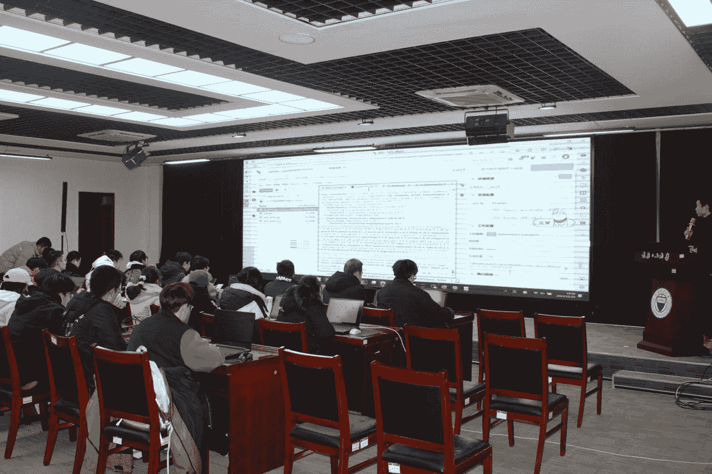
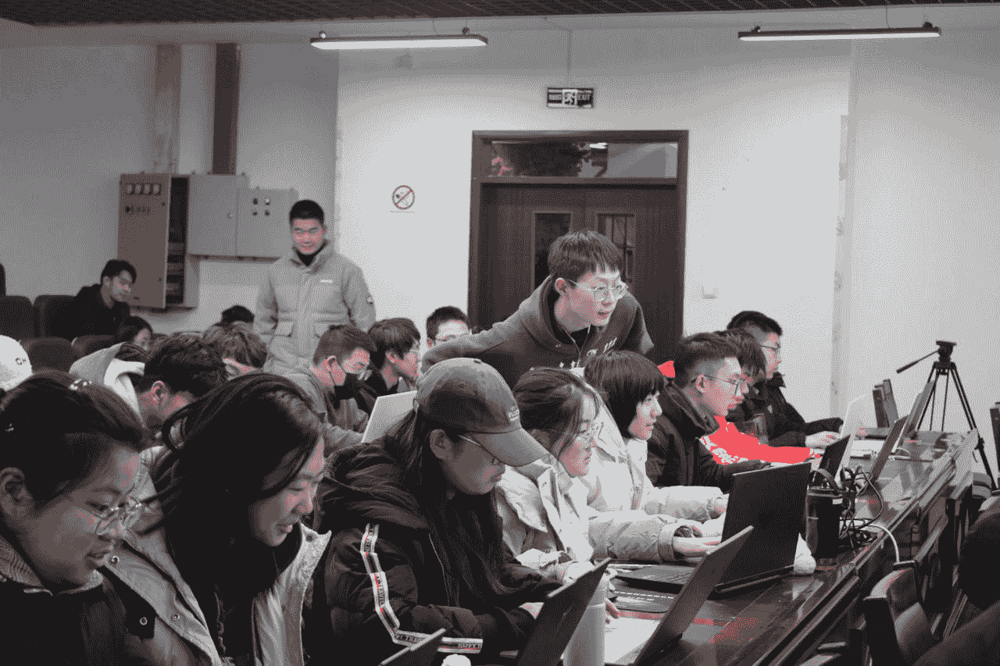
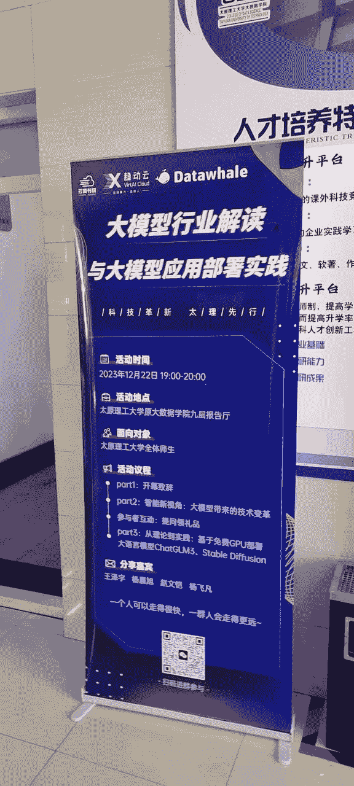
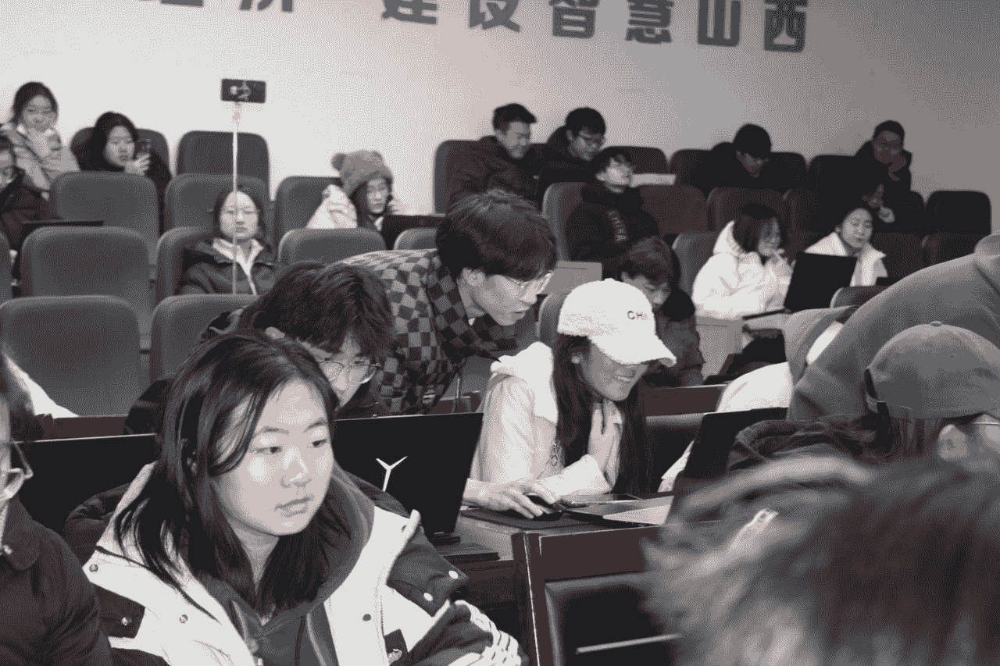

# 高校行案例库

> 来源：[https://datawhaler.feishu.cn/docx/Nr2Ednsdxodd2ux2GcKc0wNhn8b](https://datawhaler.feishu.cn/docx/Nr2Ednsdxodd2ux2GcKc0wNhn8b)

# 太原理工大学

[趋动云活动准备](https://yundingshuyuan.feishu.cn/docx/Pfdxd8xLMoutByxooEyc3zDAnff?from=from_copylink)

> 感谢贡献者：王泽宇、杨晨旭、赵文恺、杨飞凡