# AI+X高校行 战略签约案例

> 来源：[https://datawhaler.feishu.cn/docx/MlOidZ2U6o3H83xiB7ncK2yRnlw](https://datawhaler.feishu.cn/docx/MlOidZ2U6o3H83xiB7ncK2yRnlw)

# 一、Datawhale介绍

Datawhale成立于2018年——是国内AI领域最大的开源学习组织，汇聚了众多有开源精神和探索精神的开源贡献者，致力于构建开源学习社区，和学习者一起成长。

成立5年来，Datawhale开源学习成为全国知名的学习活动，覆盖了海内外2000多所院校，不断吸引具有影响力的顶尖学者、知名教授、企业家、青年贡献者等在此分享知识和远见，成为关注青年人才成长的主阵地，加快高校和产业的链接，持续推动青年AI人才培养。

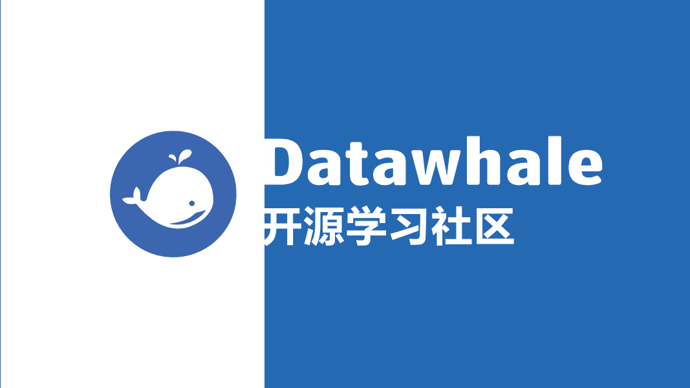

[Datawhale介绍-高校.pdf](https://internal-api-drive-stream.feishu.cn/space/api/box/stream/download/all/YMigbdS3hoLeMgxYvPmcVhFrnBh)

# 二、过往战略合作签约案例

## 清华大学深圳国际研究生院

+   组织介绍：清华大学深圳国际研究生院（英文名 Tsinghua Shenzhen International Gra[duat](https://baike.baidu.com/item/%E6%B8%85%E5%8D%8E%E5%A4%A7%E5%AD%A6/111764?fromModule=lemma_inlink)e[ Scho](https://baike.baidu.com/item/%E4%BA%A7%E5%AD%A6%E7%A0%94%E5%90%88%E4%BD%9C/6871884?fromModule=lemma_inlink)ol，简称Tsinghua SIGS）是在国家深化高等教育改革和推进粤港澳大湾区建设的时代背景下，由清华大学与深圳市合作共建的公立研究生教育机构，致力于建设成为服务社会和引领发展的人才培养基地、学科交叉融合的国际创新研究中心，以及产学研合作和国际化办学的典范。

+   合作方向：AI+ 交叉创新，学习课题共建

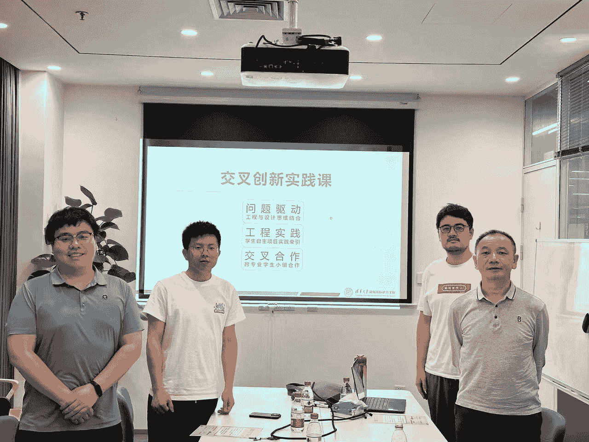

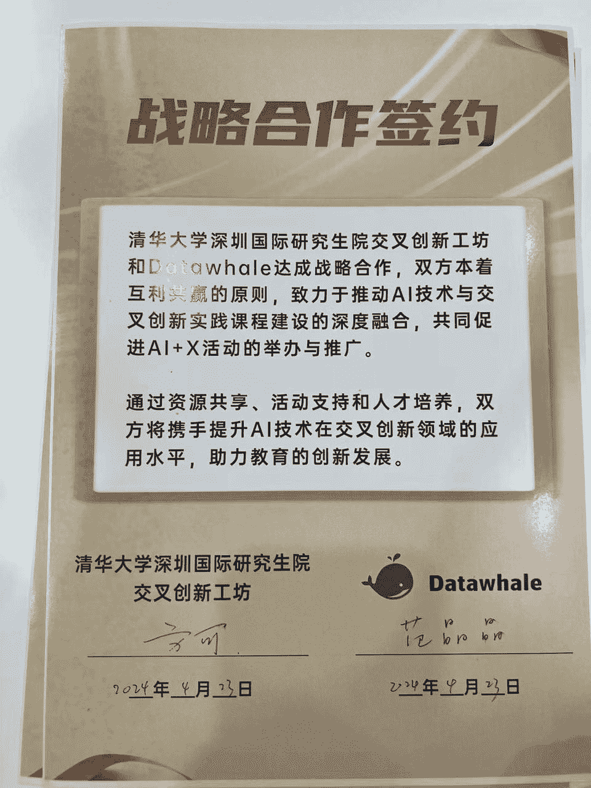

## 上海交通大学上海高级金融学院

+   组织介绍：上海交通大学上海高级金融学院（高金）是上海市人民政府为实现将上海建设成为国际金融中心的国家战略，依托上海交通大学，按照国际一流商学院模式创立的国际化金融学院。目前，高金已成功汇聚起一支“国际一流、亚洲领先、国内第一”的师资队伍，覆盖金融、会计、管理等不同学科的 70 余位教授，均拥有丰富的国际研究、教学和实践经历，是推动高金建设世界一流金融学院的核心力量。

+   合作方向：AI+金融，学习课题共建

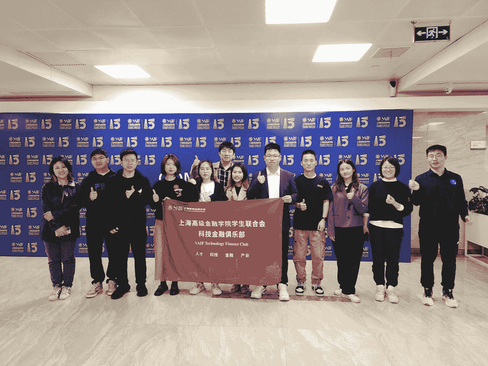

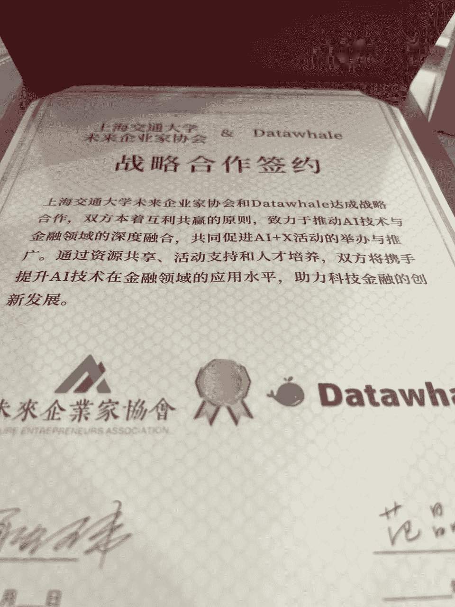

## 北京邮电大学“码上”教学平台

+   组织介绍：北京邮电大学“码上”平台（入选教育部首批“人工智能+高等教育”应用场景案例全国第一）

【码上浪潮】北邮“码上”亮相多省研讨会 -北京邮电大学信息化技术中心

+   合作方向：AI+智慧教育，Datawhale团队负责人范晶晶与码上出发创新社指导老师徐童老师共同签署合作协议，标志着双方将在AI领域开源学习平台构建，AI+X微专业、微认证等方面展开更深层次的合作。

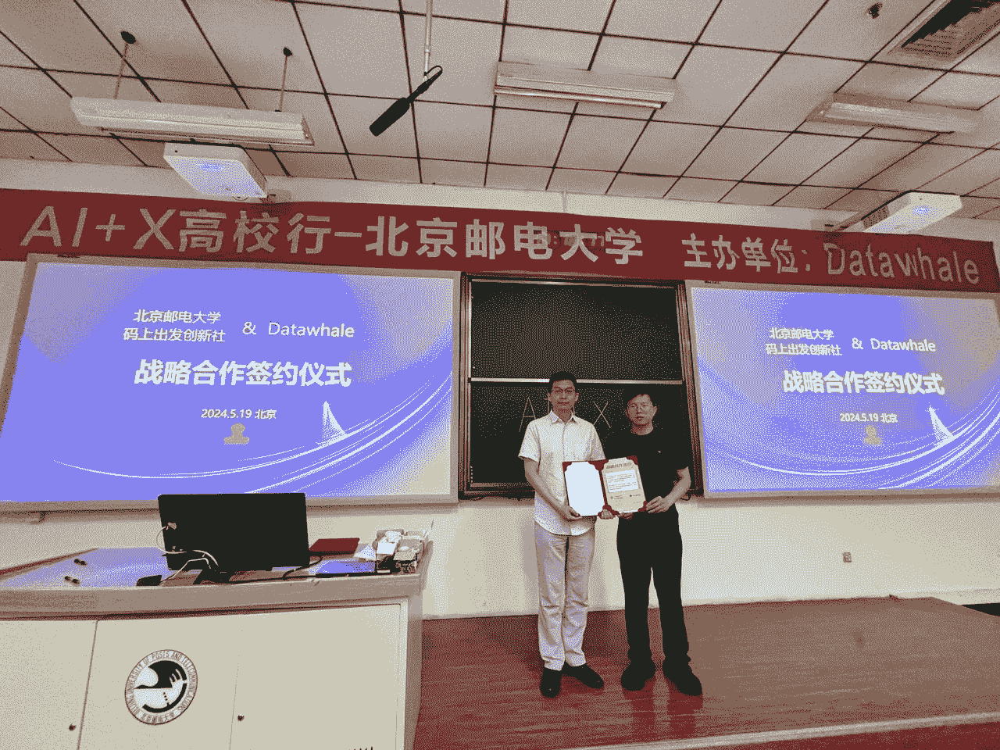

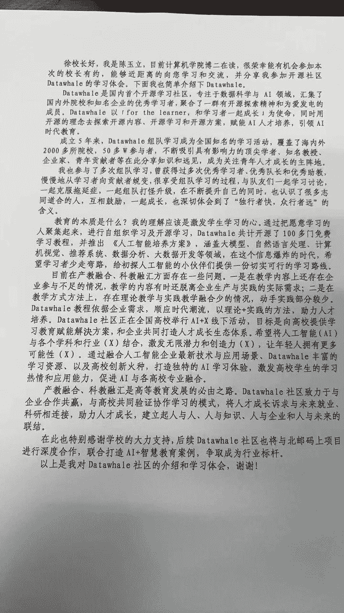

## 浙大智海Mo平台

+   组织介绍**：智海**新一代人工智能科教平台（以下简称“智海平台”）是在教育部人工智能科技创新专家组的指导下，遵循产教融合、科教融合宗旨发起的人工智能及交叉学科领域新型大规模科教开放创新及生态社区建设示范平台，于2020年7月1日正式揭牌成立。中国工程院院士、科技部新一代人工智能战略咨询委员会组长、教育部人工智能科技创新专家组组长潘云鹤为平台取名“智海”并亲笔题字。

+   合作方向：Datawhale 范晶晶与浙大的吴超老师共同签署了合作协议，标志着双方在未来将在AI+X微专业、微认证方面展开更深层次的合作，结合浙江大学和Datawhale的优势，打造师资+课程+平台+服务+认证+就业的整体解决方案。这一仪式不仅为Datawhale与浙大智海Mo之间的合作开启了新篇章，也为参与活动的师生展示了校企合作的典范。

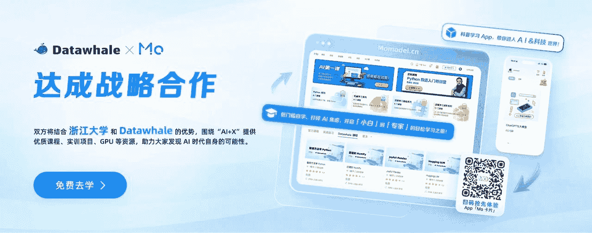

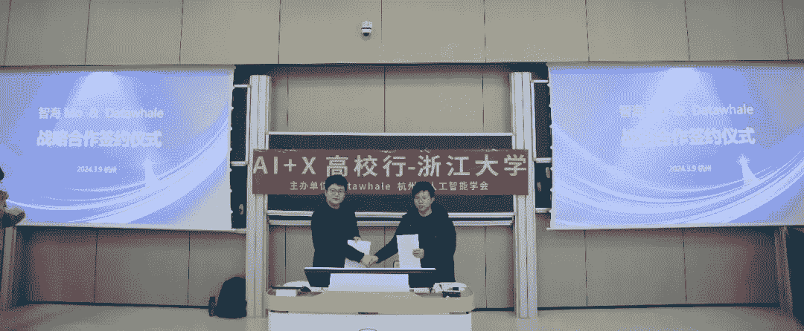

## 吉林大学机器人梦工场

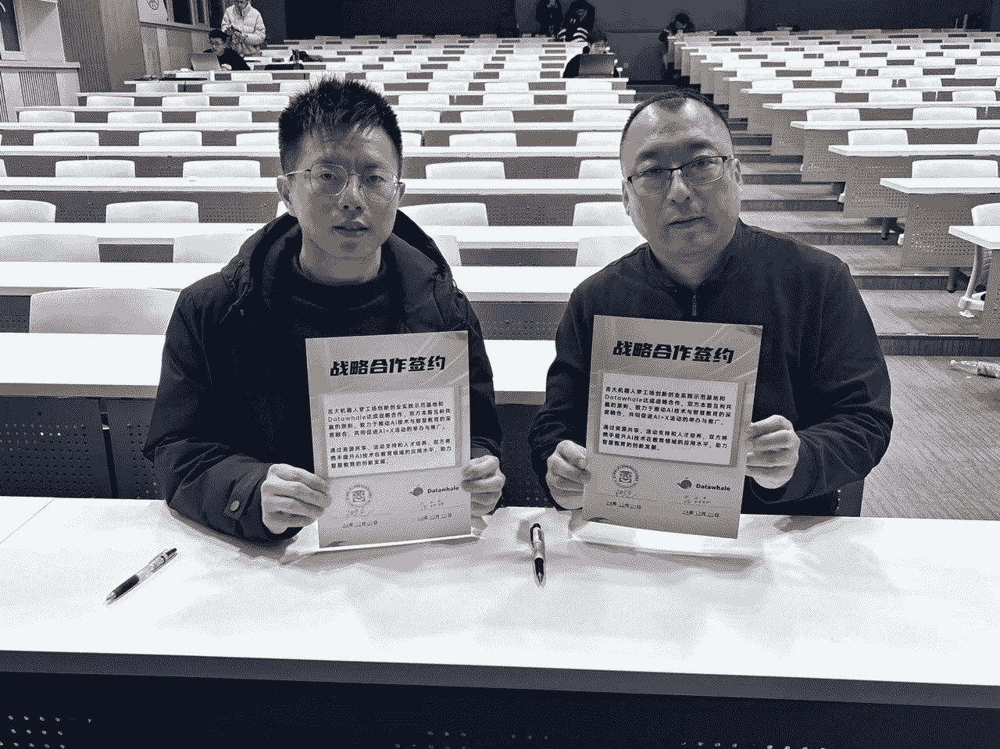

## 开放原子开源基金会

+   组织介绍：开放原子开源基金会（以下简称“开源基金会”）是在民政部注册的致力于开源产业公益事业的非营利性独立法人机构。 开源基金会的服务范围包括开源软件、开源硬件、开源芯片及开源内容等，为各类开源项目提供中立的知识产权托管，保证项目的持续发展不受第三方影响，通过开放治理寻求更丰富的社区资源的支持与帮助，包括募集并管理资金，提供法律、财务等专业支持。

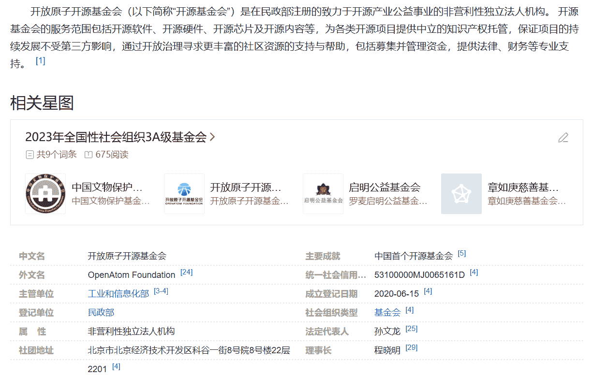

+   合作方向：高校开源教育方向战略合作签约。

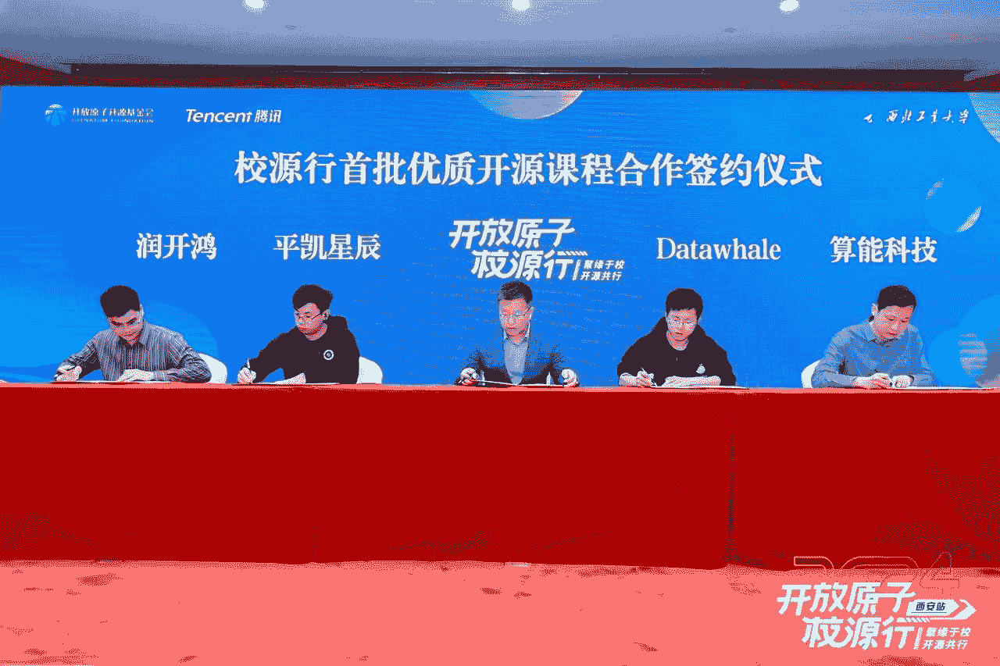

## 杭州市人工智能学会

+   组织介绍：杭州市人工智能学会成立于2012年，现有成员 300多名，涵盖在杭人工智能高等学校教师及杭州市人工智能强优企业的主要负责人。学会通过组织各类活动、搭建合作平台等方式，促进了学术界与产业界的深度融合，推动了人工智能技术的创新和应用。未来，杭州市人工智能学会将继续秉承“开放、合作、创新、发展”的理念，加强学术交流与合作，推动人工智能技术的创新和应用，为杭州市乃至全国的人工智能产业发展做出更大的贡献。

+   合作方向：杭州市人工智能学会与Datawhale达成战略合作，双方将共同探索人工智能领域的最新发展趋势，并以此为契机推动学术交流、技术创新和应用实践，通过定期举办AI+X高校行、技术研讨会、高峰论坛以及人才培养项目。双方将共同促进人工智能技术在杭州的广泛应用和深入发展。为构建智能杭州智慧社会贡献力量！

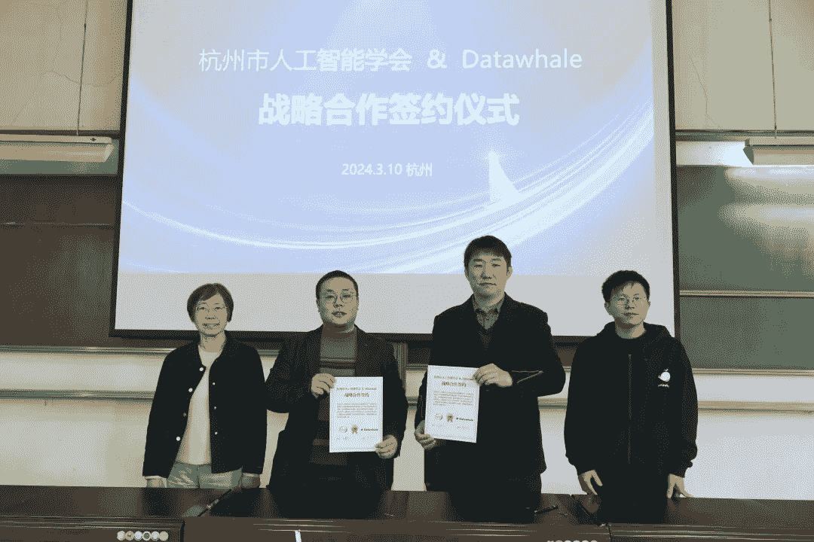

# 三、战略合作模式

促进产学研资源融合，推动AI人才培育和发展。

具体合作模式共同商定。