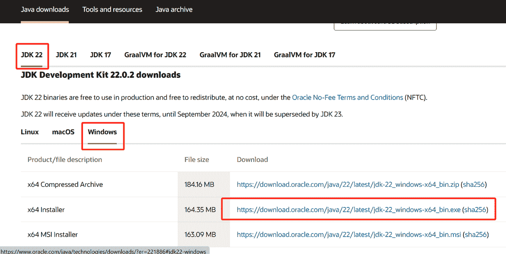
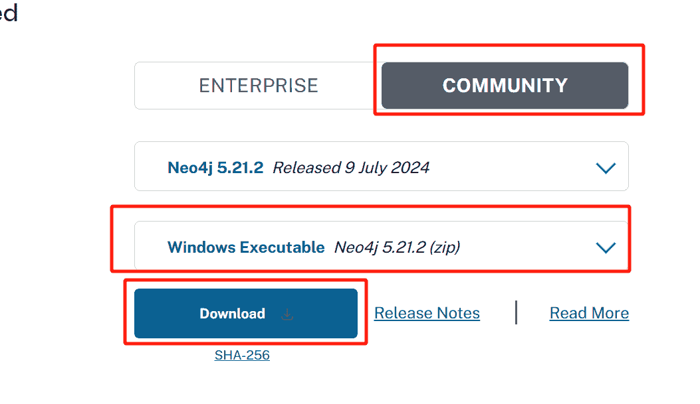
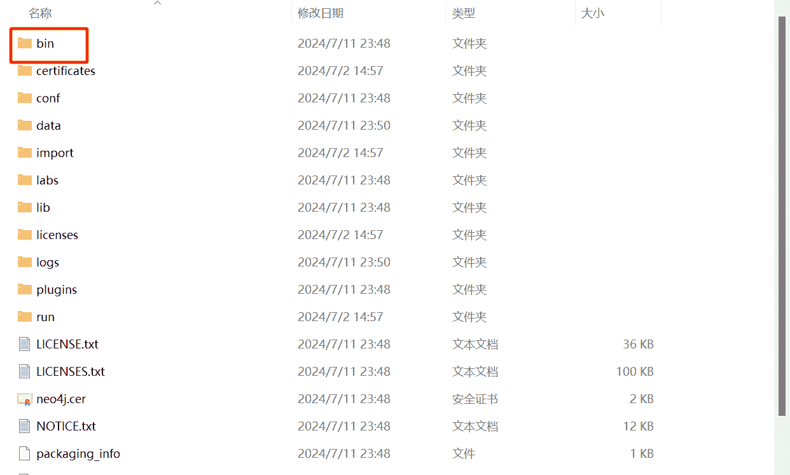
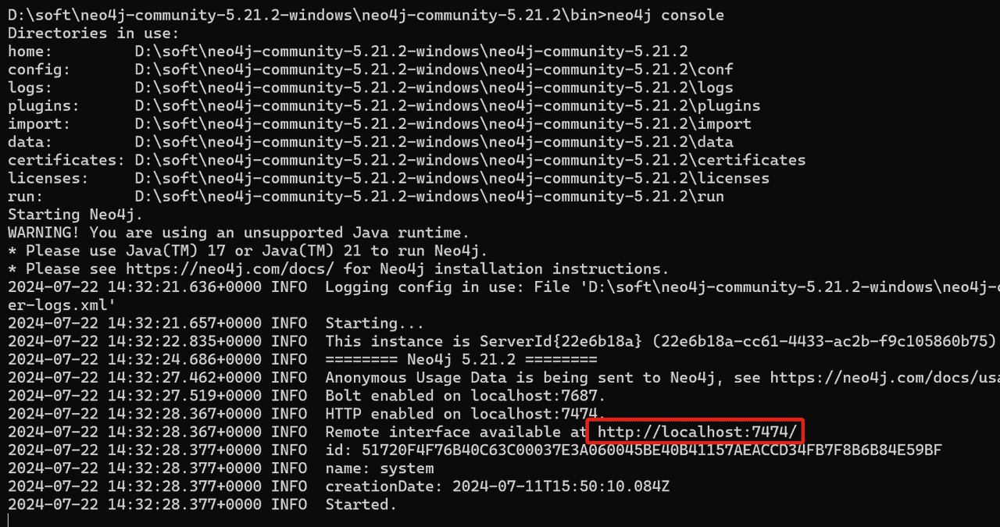
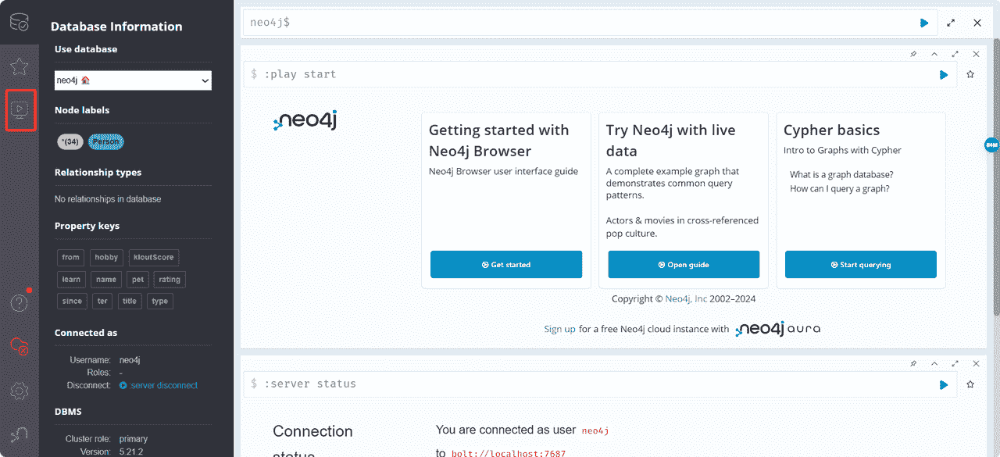

# 知识图谱neo4j

> 来源：[https://datawhaler.feishu.cn/docx/OQ6NdnTrVoF1amxy0X1cRXGZnch](https://datawhaler.feishu.cn/docx/OQ6NdnTrVoF1amxy0X1cRXGZnch)

> 本部分内容由 供稿~

> 内容初始来源：[知识图谱neo4j](https://zaiwen-chattests.feishu.cn/wiki/Qkgww2qzBiJHd2kJzwjcRGbNnJb)

>

> **内容贡献者说：****文档不断完善中...**

>

# neo4j介绍

neo4j是现在最流行的知识图谱工具，在学习中我也感觉用起来很简单。

# neo4j的部署与运行

## windows中部署

### 安装java jdk

如果已经有了，就不需要安装了，判断是否已经安装的方式是

在cmd中输入java --version，如果已经安装会显示版本信息

如果没有安装的话，打开以下网址：https://www.oracle.com/java/technologies/downloads/?er=221886#jdk22-windows

然后下载下面对应的exe文件，下载下来后，直接双击运行就可以



### 下载neo4j

打开以下网址：https://neo4j.com/deployment-center/

选择社区版，然后选择windows系统，点击download



下载的文件是一个压缩包，下载下来后，直接解压到一个位置即可

### 运行neo4j

在上一步解压后的文件夹中有一个bin目录



在cmd中cd到bin下面，然后直接运行neo4j console，即可运行neo4j，运行成功的截图如下



在浏览器中打开运行结果中的链接，截图中红字部分，即可以打开可视化的知识图谱操作界面

第一次打开应该会让输入用户名和密码，默认用户名和密码都是neo4j，然后输入后，会强制修改密码，记得输入一个密码就可以了。

## linux中部署

以下以腾讯云的轻量服务器为例。

### 安装neo4j

参考这篇文章即可，介绍的很详细。之前按照其它教程走了很多弯路，这里面介绍了更方便的方法

我使用的是里面介绍的Visit的方式安装的，这样可以省略很多安装依赖的时间。

如果大家使用的rpm或者deb包的方式的话，下面的方法可能有所区别，请自行探索

### 配置neo4j

通过以下命令找到，neo4j的配置文件

```
sudo find / -name &quot;neo4j.conf&quot;
```

取消以下内容的注释，注意：这一步跟很多教程上面的不太一样，很多教程上面都写的是dbms.connectors.default_listen_address，我找很长时间没有找到，最后修改了下面的内容，才解决了问题。

这段代码的作用是，可以让我们远程访问neo4j的可视化界面

```
server.default_listen_address=0.0.0.0
```

### 修改腾讯云的防火墙

具体就是在防火墙中开放7474,7687端口，其它的服务器应该也会有这种限制。

腾讯云中开放端口的方式，可以详细参考以下文章

### 运行neo4j

请使用以下命令运行neo4j，我使用neo4j console也可以运行，但是无法支持远程访问

```
sudo neo4j start
```

运行后，会出现以下输出

```
Directories in use:
home:         /var/lib/neo4j
config:       /etc/neo4j
logs:         /var/log/neo4j
plugins:      /var/lib/neo4j/plugins
import:       /var/lib/neo4j/import
data:         /var/lib/neo4j/data
certificates: /var/lib/neo4j/certificates
licenses:     /var/lib/neo4j/licenses
run:          /var/lib/neo4j/run
Starting Neo4j.
WARNING! You are using an unsupported Java runtime.
* Please use Java(TM) 17 or Java(TM) 21 to run Neo4j.
* Please see https://neo4j.com/docs/ for Neo4j installation instructions.
Started neo4j (pid:3953349). It is available at http://0.0.0.0:7474
There may be a short delay until the server is ready.
```

在倒数第2行可以看到输出了一个地址http://0.0.0.0:7474，将0.0.0.0修改为你的公网ip，即可在浏览器中访问neo4j的可视化界面了

## 学习使用neo4j的可视化界面

以下是neo4j的可视化界面



点击截图中红框位置，neo4j为我们准备了一份详细的教程，跟着它这里面的教程走一遍，就可以基本学会neo4j的各种操作

请大家一定按照教程去学习以下，大概也就15分钟左右就可以学完。

## Neo4j的查询语言

直接使用gpt去写就ok了，AI时代，我们不需要学习这种了

## 在python中操作知识图谱

在python中使用py2neo包来操作知识图谱即可，py2neo包的使用方法，可以直接参考以下文档，这个文档讲解的很详细

https://segmentfault.com/a/1190000040519140?sort=newest

# 我对知识图谱的理解

知识图谱就是我们熟悉的三元组，实体，关系，实体。

不过学过后，我发现知识图谱没有那么简单，每一个实体还可以定义很多属性，比如一个人物的实体，它可以有name，age，sex等等各种属性。

而每一个关系也可以有很多属性，比如一个人物与另外一个人物关系是朋友，这个关系中还可以定义一个属性，表示这两个人物是亲密无间的朋友，还是点头之交的朋友。

## 知识图谱与结构化数据库

知识图谱在一定程度上也可以完成结构化数据库的功能。

例如我们可以定义一个节点Person，在节点Person上面，我们就可以定义name，age，sex等等各种属性，这些属性就跟结构化数据库中的表字段一样。

善用这些属性，我们可以使用知识图谱完成一些不是那么复杂的结构化数据库的内容。

# 参考资料

1.  很详细的neo4j部署安装教程，会教我们如何阅读官方文档，根据官方文档的方式去部署安装。视频很长，也比较拖沓，但是看完会让我们学会如何去根据官方文档去学习。

1.  介绍了Py2neo如何操作neo4j创建节点和关系

1.  详细介绍了知识图谱的应用与原理