# AIGC每日新闻

> 来源：[https://datawhaler.feishu.cn/docx/EMwcdNvnaowtmJxqmFYcogOznTf](https://datawhaler.feishu.cn/docx/EMwcdNvnaowtmJxqmFYcogOznTf)

10月6日

1.  【Depth Pro：无需额外信息即可快速生成高清深度图】
苹果公司研发了一种名为Depth Pro的深度估计模型，它能够快速、精准地生成高分辨率的深度图，图像细节清晰锐利，且具有绝对尺度（无需相机参数等元数据）。该模型利用多尺度视觉Transformer等技术，结合真实和合成数据集进行训练，并在标准GPU上仅需0.3秒即可生成225万像素的深度图。实验表明，Depth Pro在多个维度上都超越了现有技术。参考博客链接:https://arxiv.org/abs/2410.02073

1.  【高效训练大型语言模型的新方法：VinePPO】
大型语言模型在复杂推理任务中表现欠佳，原因在于现有的训练方法（例如PPO）难以准确评估每个步骤的贡献。本文发现，PPO中使用的价值网络在预测累积奖励方面存在缺陷，导致训练效率低。为此，研究者提出了一种新方法VinePPO，它巧妙地利用语言环境进行无偏估计，避免了对大型价值网络的依赖。实验结果表明，VinePPO在数学和科学推理任务上显著优于现有方法，并且训练速度更快、效率更高。参考博客链接:https://arxiv.org/abs/2410.01679

1.  【AI秒速建模[：3DTopia-XL来了！】
上海人工智能实验室和](https://www.jiqizhixin.com/articles/2024-10-04)南洋理工大学合作研发了一个超厉害的AI建模工具——3DTopia-XL。它只需5秒钟就能根据图片或文字生成高质量的3D模型，材质逼真，就像手工打造的一样！这个模型体积庞大（10亿参数），速度飞快，生成的3D模型可以直接用在游戏和设计软件里。更重要的是，它的代码、模型和技术报告都已公开，方便大家一起学习和使用！
参考博客链接:https://www.jiqizhixin.com/articles/2024-10-04

10月5日

1.  【Meta进军[AI与AR新时代】Meta Connect 2024发布会](https://mp.weixin.qq.com/s/wnvVh5Sy4AwDFSyPQ9d9wQ)上，Meta重磅推出性能强大的Llama 3.2多模态AI模型，并将其整合进旗下应用，大胆尝试AI生成内容。同时，他们展示了令人惊艳的AR眼镜Orion，虽然暂未发售，但解决了现有AR设备的诸多难题。  雷朋Meta眼镜和Quest 3S也获得升级，进一步完善了Meta的AI和AR生态系统，展现了Meta争夺下一代平台入口的野心。
参考博客链接:https://mp.weixin.qq.com/s/wnvVh5Sy4AwDFSyPQ9d9wQ

1.  【SonicSim：更真实的语音分离与增强合成数据集】
现有语音分离和增强模型训练数据不足，真实数据集规模小，合成数据集不够真实。研究人员开发了SonicSim工具包，它基于Habitat-sim平台，能生成高度可定制的移动声源数据，并构建了名为SonicSet的基准数据集。通过与真实数据集对比，结果表明SonicSim生成的合成数据能有效地泛化到真实场景中，解决了数据不足的问题。代码和演示已公开发布。参考博客链接:https://arxiv.org/abs/2410.01481

1.  【即梦AI：A[I音乐创作与MV制作新突破】
即梦AI平台最新上线了音乐创](https://mp.weixin.qq.com/s/7MwT6qxTSCM_T1uSRs0wAA)作功能，并发布了由AI创作的歌曲《散落时光》及其MV。这首歌和MV质量都得到了好评。  尤其值得一提的是，用于制作MV的S模型在竖版视频生成方面表现卓越，生成的视频质量远超横版视频，色彩和风格也更统一，优于其他同类模型。  这标志着AI在音乐创作和视频制作领域取得了新的进展。
参考博客链接:https://mp.weixin.qq.com/s/7MwT6qxTSCM_T1uSRs0wAA

10月4日

1.  【高效注意力机制量化：SageAttention】
当前许多AI模型都依赖于Transformer架构，而其中的注意力机制计算量巨大，尤其在处理长序列时。现有模型加速方法主要针对线性层，忽略了注意力机制。本文提出了SageAttention，一种高效且准确的注意力机制量化方法。实验表明，SageAttention的速度比FlashAttention2和xformers分别快2.1倍和2.7倍，且精度优于FlashAttention3，在各种模型（包括大语言模型、图像生成和视频生成模型）上几乎没有精度损失。参考博客链接:https://arxiv.org/abs/2410.02367

1.  【ChatGP[T新界面Canvas：AI写作编程助手】
O](https://www.qbitai.com/2024/10/198190.html)penAI发布了ChatGPT的新界面Canvas，它就像一个智能写作和编程助手！由强大的GPT-4驱动，Canvas能帮你润色文章、调整文本长度和难度，甚至还能帮你写代码、检查bug，并支持代码语言转换。测试表明，用Canvas比传统方式效率更高，准确性和质量分别提升了30%和16%。目前Plus和Team用户可以使用，下周企业和教育用户也能用上，但现在使用条件比较严格，未来会改进。
参考博客链接:https://www.qbitai.com/2024/10/198190.html

1.  【EmoKnob：赋予AI语音情感掌控力】
以往的AI语音合成虽然自然流畅，却无法随意控制语音的情感表达。EmoKnob框架改变了这一点！它只需少量示例就能学会合成各种情感的语音，并能根据文字描述生成特定情感的语音，例如“喜悦”、“悲伤”等，且情感表达比市面上的语音合成服务更丰富、更准确。该框架还提出了一套新的评估标准，让AI语音情感合成领域的研究更规范化。简单来说，EmoKnob让AI语音更“懂”情感，也更“会”表达情感。参考博客链接:https://arxiv.org/abs/2410.00316

10月3日

1.  【高效边缘计算：让700亿参数大模型在手机上运行】为了保护用户隐私，大型语言模型（LLM）的推理正从云端转向边缘设备（如手机）。但边缘设备资源有限，运行大型模型很困难。本文提出了一种名为TPI-LLM的系统，它巧妙地利用张量并行技术，高效地将700亿参数的模型部署到资源受限的设备上。TPI-LLM通过优化内存管理和通信策略，显著降低了模型运行时间和内存占用，使其在手机等设备上流畅运行，速度比现有方法快得多，内存占用少得多。参考博客链接:https://arxiv.org/abs/2410.00531

1.  【Pika 1.5：史诗级AI视频生成升级】AI视频生成工具Pika发布了1.5版本，带来了令人惊叹的升级！它新增了“Pikaffects”特效功能，能轻松制作爆炸、融化等超现实效果，并支持更长视频和更丰富的动作捕捉，例如跑步、滑板等，让生成的视频更加生动。  这次更新还让Pika获得了8000万美元B轮融资，估值翻倍，再次成为AI视频生成领域的佼佼者，甚至被用户誉为“史诗级”更新，特别是其强大的meme生成能力更是备受关注。参考博客链接:https://www.jiqizhixin.com/articles/2024-10-02-4

1.  【OpenAI开发者大会：更便宜、更强大的AI工具】OpenAI的开发者大会没有发布令人惊艳的新产品，而是聚焦于提升现有AI工具和API。他们推出了四个新功能：实时API、视觉微调、提示缓存和模型蒸馏，让开发者能更轻松、更低成本地构建更强大的AI应用，比如低延迟的多模态应用。  OpenAI还宣布GPT模型成本显著下降，并表示距离通用人工智能（AGI）的目标更近一步，这标志着OpenAI战略转向，更重视支持开发者生态系统的发展。参考博客链接:https://www.jiqizhixin.com/articles/2024-10-02-3

10月2日

1.  【AI赋能视频文档创作平台Guidde】
Guidde是一个利用AI技术快速创建视频文档的平台，可用于客户支持、培训等多种场景。它能帮助团队以11倍的速度制作出精美的操作指南、标准作业流程(SOP)、培训材料、入门文档、常见问题解答(FAQ)和功能说明等视频，告别枯燥的文本文档。Guidde已拥有6万多用户，并获得诸多好评，是Product Hunt评选的当日最佳产品。  该平台提供免费扩展程序，无需信用卡即可注册使用。
参考博客链接:https://link.alphasignal.ai/EewE1c

1.  【更省内存、更[强能力的多模态AI模型诞生】
Liquid AI公司](https://www.jiqizhixin.com/articles/2024-10-01)推出了一种名为Liquid Foundation Models (LFM) 的新型AI模型，它基于“液态神经网络”，在处理长序列数据和多模态信息（文字、声音、视频）方面比传统的Transformer模型更优秀，并且内存占用更低。这意味着LFM可以在相同的硬件上处理更复杂的任务，例如更长的文本或更精细的视频分析。目前该模型已开放部分接口，未来将有更多应用和技术细节公开。
参考博客链接:https://www.jiqizhixin.com/articles/2024-10-01

1.  【灵巧机器手新[突破：学会了“举一反三”抓东西】
国防科技大学和深圳大学](https://www.jiqizhixin.com/articles/2024-10-01-3)的研究人员开发了一种能让机器人灵巧手更灵活抓取物体的新方法。  它像人一样，分成了“想怎么抓”（高层）和“手怎么动”（低层）两个步骤，并且能将学习到的抓取技巧轻松迁移到不同类型的灵巧手上，就像人学会用左手也能熟练地完成右手的工作一样。  这种方法在多个实验中都表现优异，比以前的方法更有效、更通用。 这意味着未来机器人能更好地适应各种环境和任务，完成更复杂的操作。
参考博客链接:https://www.jiqizhixin.com/articles/2024-10-01-3

10月1日

1.  【中国电[信开源千亿参数大模型TeleChat2-11](https://www.qbitai.com/2024/10/197783.html)5B】
中国电信人工智能研究院开源了首个央企千亿参数大模型TeleChat2-115B，并在多个评测中表现出色，尤其擅长长文本处理和数据分析。该模型的成功得益于中国电信在AI领域的长期投入、强大的研发团队和一系列国产化技术突破，例如高效的并行计算和模型优化技术。这标志着我国在大型语言模型领域取得了重要进展，并为国产AI发展树立了榜样。参考博客链接:https://www.qbitai.com/2024/10/197783.html

1.  【PaperQA2：科研论文问答利器】
PaperQA2是一个用于高精度检索增强生成(RAG)的软件包，特别适用于科学文献。它能够对PDF或文本文件进行高效处理，实现问答、摘要和矛盾检测等功能，并在相关基准测试中超越了人类表现。PaperQA2提供简洁易用的接口，支持多种大型语言模型和嵌入模型，并具有强大的自定义功能和高效的索引机制，极大地方便了科研人员对科学文献的检索和分析。参考博客链接:https://link.alphasignal.ai/TqeHcC

1.  【Flux图像生成模型微调教程】
最近发布的Flux图像生成模型质量超越现有开源模型，并支持便捷的微调功能。即使没有编程经验，你也可以通过Replicate平台，只需少量个人照片（至少10张，建议20张）和一个独特的触发词，就能创建专属的个性化模型，生成各种风格的图像，例如超级英雄、卡通人物等。整个过程简单易操作，费用低廉（约2美元），只需在Replicate平台上传照片、设置触发词，等待几分钟即可生成模型并开始创作。  此外，还可以结合语言模型辅助创作更丰富的提示词，进一步提升图像生成效果。参考博客链接:https://link.alphasignal.ai/zATvad

9月30日

1.  【NotebookLM升级：支持音频和YouTube】NotebookLM，一款帮你理解资料的AI工具，增加了对音频文件和YouTube视频的支持。现在你可以上传音频、视频，NotebookLM会自动生成摘要和笔记，并支持创建可分享的音频概述，方便团队协作和学习。  这项更新让NotebookLM的功能更强大，使用也更便捷。参考博客链接:https://link.alphasignal.ai/KOLmOU

1.  【AI智能体AGILE：比GPT-4更聪明的大语言模型助手】字节跳动研发了一种名为AGILE的AI智能体框架，它比单纯依靠提示词的GPT-4更强大。AGILE能记住之前的信息、使用工具、制定计划、自我反思，甚至会在需要时向人类专家求助。通过强化学习训练，130亿和70亿参数的AGILE模型在问答任务中都超过了GPT-4，展现了更高的准确性和更强的泛化能力。这标志着AI智能体朝着更自主、更可靠的方向发展。参考博客链接:https://www.jiqizhixin.com/articles/2024-09-30-4

1.  【AI赋能价值观测量：新方法GPV】这篇论文介绍了一种利用大型语言模型（LLM）测量人类和AI价值观的新方法——生成式心理测量法(GPV)。GPV通过分析文本，识别个体或AI的价值观偏好。研究表明，GPV比传统心理工具更稳定、有效，还能用于测量LLM的价值观，并预测其安全性。这项工作融合了人工智能和心理学，为构建价值观对齐的AI提供了新的途径。参考博客链接:https://arxiv.org/abs/2409.12106

9月29日

1.  【阿里巴巴通义千问大模型成绩亮眼】阿里巴巴的通义千问Qwen系列大模型在国际权威榜单上取得优异成绩，Qwen2.5-72B-Instruct成为榜单中唯一一个排名靠前的中国大模型。  其开源版本下载量迅速突破150万，并在Hugging Face社区上拥有大量衍生模型，展现了中国大模型技术实力的显著提升和国际影响力。 这标志着中国在开源大模型领域取得重大突破，并受到全球开发者的广泛认可。参考博客链接:https://www.qbitai.com/2024/09/197601.html

1.  【ChatGPT语音模式全面升级】OpenAI终于向ChatGPT Plus和Team用户全面推出高级语音模式，该模式支持语音交互，并新增了自定义指令、记忆功能和五种新的语音风格。此前，该模式曾因安全测试和争议而推迟发布。此次升级不仅提升了语音的流畅度和准确性，还支持多种语言，展现了OpenAI在AI语音交互领域持续改进的努力，并与其他公司竞争AI语音助手市场。参考博客链接:https://link.alphasignal.ai/6LSm7l

1.  【GitHub项目：PDF转音频】MIT的lamm团队在GitHub上发布了一个名为PDF2Audio的开源项目，该项目可以将PDF文件转换成音频文件。目前该项目在GitHub上已获得835星标和91个分支，拥有Apache-2.0许可证，这意味着它可以被自由使用和修改。  这是一个方便用户获取PDF文件内容的工具，尤其对于视障人士或希望在通勤时收听文档的用户非常有用。参考博客链接:https://link.alphasignal.ai/fcfcI7

9月28日

1.  【高效运行大型语言模型的AirLLM】AirLLM是一个优化推理内存使用的工具，能让70B参数的大型语言模型在单张4GB显卡上运行，无需量化、蒸馏和剪枝。最新版本更支持在8GB显卡上运行405B参数的Llama3.1模型。它支持多种主流模型，并提供模型压缩功能，可将推理速度提升3倍。AirLLM已支持MacOS系统，并提供多种配置选项，方便用户根据自身需求进行调整。  该项目开源且持续更新，用户可通过GitHub获取。参考博客链接:https://link.alphasignal.ai/ydUMud

1.  【提升Flux模型图像生成的技巧】文章介绍了三种提升Flux模型图像生成质量和多样性的方法：1. 使用“consistent-character”模型，从单张图片生成多种姿态和风格的训练数据；2. 利用模型自身生成的优质图片作为训练数据，迭代改进模型；3. 结合多个LoRA模型，丰富图像风格，再用生成的图像进行再训练。  文章提供了代码示例，并强调实验和迭代的重要性，鼓励用户分享成果。参考博客链接:https://link.alphasignal.ai/L8C7Sn

1.  【清华腾讯联合打造最强开源多模态模型Oryx】清华大学、腾讯和南洋理工大学合作研发了一个名为Oryx的强大AI模型。它能够理解图像、视频和3D场景等各种视觉信息，而且处理速度非常快，即使是超长视频也能轻松应对。Oryx的核心在于它能直接处理原始高清图像，并根据需要压缩信息，既保证了效率又保证了精度。在各种测试中，Oryx的表现非常出色，甚至超过了一些参数规模更大的模型，成为了目前开源多模态模型中的佼佼者，并且所有训练数据都公开透明，方便其他研究者使用和改进。参考博客链接:https://www.jiqizhixin.com/articles/2024-09-28

9月27日

1.  【高效精准的数据检索：Structured-GraphRAG框架】
面对庞大复杂的数据，传统检索方法常常力不从心。这篇论文介绍了一种名为Structured-GraphRAG的新框架，它利用多个知识图谱来组织数据，并通过结构化的方式处理自然语言查询，从而更精准、高效地获取信息。相比传统方法，Structured-GraphRAG显著提升了查询效率和响应速度，降低了错误率，并在足球数据案例中得到了验证。该框架具有广泛的应用前景，可用于各种结构化数据的分析和语言模型的改进。参考博客链接:https://arxiv.org/abs/2409.17580

1.  【AI芯片[设计新突破：谷歌AlphaChip问世】
谷](https://www.qbitai.com/2024/09/195826.html)歌发布了AI芯片设计算法AlphaChip，它能快速高效地设计出媲美人类专家的芯片设计图，已用于谷歌及其他公司的芯片生产。AlphaChip利用深度强化学习技术，大幅提升了芯片设计速度和效率，其开源的预训练版本也方便其他开发者使用。这标志着AI辅助芯片设计成为新趋势，AI设计芯片，芯片又反过来加速AI发展，形成良性循环。虽然AlphaChip曾面临内部质疑，但最终其成功证明了AI在芯片设计领域的巨大潜力。参考博客链接:https://www.qbitai.com/2024/09/195826.html

1.  【提升Flux模型图像生成的技巧】本文介绍了三种提升Flux模型图像生成质量的技巧：1. 利用单张图片生成多样化训练数据，例如使用consistent-character模型从一张人物照片生成不同姿态、风格和表情的图片；2. 使用模型自身生成的优秀图片作为新的训练数据，迭代优化模型；3. 结合多个LoRA模型（低秩自适应模型），生成风格多样化的图像，丰富训练数据集。 通过这些技巧，可以提高Flux模型的准确性、多样性和风格范围，最终生成更优质的图像。参考博客链接:https://link.alphasignal.ai/L8C7Sn

9月26日

1.  【Gemini 1.5模型重大更新】谷歌发布了Gemini 1.5 Pro-002和Gemini 1.5 Flash-002两个更新的生产就绪模型。这两个模型在速度、成本和性能方面都有显著提升：速度提升2倍，延迟降低3倍，价格降低50%以上，并且在数学、长文本处理和图像理解等方面都有了约20%的改进。同时，谷歌也提高了API的速率限制，并更新了安全过滤设置，让开发者更容易构建更安全可靠的应用。参考博客链接:https://link.alphasignal.ai/ErR5dU

1.  【4GB显卡运行700亿参数大模型】研究人员在GitHub上发布了AirLLM项目，这是一个令人惊叹的成果：它能够在只有4GB显存的单一GPU上运行700亿参数的大型语言模型。这意味着即使是配置普通的电脑，也能体验强大的AI能力，极大地降低了AI应用的门槛。该项目在GitHub上已获得4.3k星，备受关注。参考博客链接:https://link.alphasignal.ai/ydUMud

1.  【百度文心快码：AI编程助手赋能开发者】百度推出AI编程工具“文心快码”，已在百度内部广泛应用，提升了工程师效率。它能推荐、生成、审查和优化代码，帮助开发者提高编程速度和代码质量。  文心快码已通过权威机构认证，并在近期进行了功能升级，未来将进一步推动编程自动化。 百度专家将于9月27日直播讲解其最新进展及应用案例，展示AI技术如何赋能各行各业。参考博客链接:https://www.qbitai.com/2024/09/195529.html

9月25日

1.  【Finegrain Box Segmenter: 高精度物体抠图新突破】Finegrain Box Segmenter 是一款基于MVANet的新型物体抠图模型，能够生成高质量的1024x1024分辨率抠图。与传统方法相比，它能够根据用户提供的边界框精准定位目标物体，并进行抠图。该模型在电商产品数据集上进行了训练，并在测试集中取得了优异的性能。它可用于各种物体操作任务，包括背景移除、背景替换、物体删除、物体重新着色等。目前该模型仍处于早期阶段，未来将进一步提高其准确性和功能。参考博客链接:https://link.alphasignal.ai/BUV1ey

1.  【浩鲸科技推出“鲸智文档大模型”，助力企业实现文档智能化】浩鲸科技发布了专门针对企业文档场景的“鲸智文档大模型”，该模型集文档知识提取、检索、问答等功能于一体，可以帮助企业将文档转化为宝贵的知识资产。通过“DocChain”工具链，模型实现了文档的知识抽取、融合、推理和问答全流程覆盖，并提供软硬件一体机方案，助力企业快速部署和验证智慧文档处理服务。 参考博客链接:https://www.jiqizhixin.com/articles/2024-09-25-2

1.  【ChatGPT 语音功能升级：更自然、更个性化】OpenAI 宣布 ChatGPT 语音功能升级，为 Plus 和 Team 用户提供自定义指令、记忆功能，以及更多语言和声音选择。这项升级让用户能够与 ChatGPT 进行更自然的对话，体验更个性化的服务。同时，OpenAI 还发布了一个多语言数据集，以测试模型在不同语言和主题上的能力。 参考博客链接:https://www.jiqizhixin.com/articles/2024-09-25-3

9月24日

1.  【字节跳动发布两款视频生成模型，开启视频创作新纪元】字节跳动发布了PixelDance和Seaweed两款视频生成模型，能够根据复杂指令生成多种风格的视频，例如3D动画、国画等等。模型可以实现流畅的镜头切换、逼真的细节刻画，甚至可以生成包含故事性的视频片段。这两款模型的出现意味着人工智能在视频创作领域取得了重大突破，将为未来视频创作带来更多可能性。 参考博客链接:https://www.jiqizhixin.com/articles/2024-09-24-4

1.  【RobustSAM：在低质量图像上鲁棒地分割任何物体】RobustSAM 是一种基于Segment Anything Model (SAM) 的改进模型，能够在低质量图像上进行鲁棒的分割。它通过添加少量参数，在保持 SAM 的可提示性和零样本泛化能力的同时，提高了其在低质量图像上的性能。此外，研究人员还发布了 Robust-Seg 数据集，包含 688K 对带有不同退化程度的图像和掩码，用于训练和评估 RobustSAM 模型。 参考博客链接:https://link.alphasignal.ai/IZuCGB

1.  【Finegrain Box Segmenter: 精准高效的图像分割模型】Finegrain Box Segmenter 是一个新的图像分割模型，它可以根据用户提供的矩形框，对图像中的目标进行高精度分割。与传统模型相比，该模型不仅可以生成高分辨率的分割结果，而且不受背景和前景定义的影响，用户可以完全控制分割过程。模型在电商领域进行了训练，并且在测试中取得了优异的表现。除了提供高精度分割外，该模型还具有易于使用的特性，用户可以通过代码或 Hugging Face 平台直接使用。 参考博客链接:https://link.alphasignal.ai/BUV1ey

9月23日

1.  【美图AI升级：生成1分钟超长视频】美图公司最新推出的AI模型“美图奇想”升级了视频生成能力，现在可以生成长达1分钟、画质清晰的视频，并支持多种风格和主题。该模型使用了最新的Diffusion与Transformer技术，可以生成更加逼真、艺术化的视频内容，并已应用于美图旗下部分产品。未来，这项技术将会被应用于更多产品，帮助美图进一步拓展视频工具赛道。 参考博客链接:https://www.qbitai.com/2024/09/193870.html

1.  【从视频生成背景音乐：AI新突破】总结：这项研究提出了一种新的框架，能够从视频中自动生成背景音乐。不同于以往依赖于有限符号音乐注释的方法，该框架利用海量的网络视频及其背景音乐进行学习，可以生成更真实、更丰富的音乐。它通过一个全新的视频-音乐对齐方案，利用自回归和对比学习的目标，让生成的音乐与视频内容高度一致。此外，它还引入了一种新的视频-节拍对齐方案，让生成的音乐节拍与视频中的低级运动相匹配。研究人员还开发了一种新的时间视频编码器架构，能够高效地处理包含大量密集采样帧的视频。通过在包含220万个视频-音乐样本的全新DISCO-MV数据集上进行训练，该模型在多个音乐生成评估指标上都超越了现有的方法，包括人工评估。 参考博客链接:https://arxiv.org/abs/2409.07450

1.  【书生·筑梦 2.0：更强大、更智能的视频生成模型】上海人工智能实验室发布了新一代视频生成大模型“书生·筑梦 2.0”，它能够生成更长、更清晰的视频，并支持视频增强功能。这款模型还采用了更先进的技术，使其在生成视频时更加高效。更重要的是，该模型是开源的，这意味着更多人可以利用它进行研究和开发，从而推动视频生成技术的进步。 参考博客链接:https://www.jiqizhixin.com/articles/2024-09-23-6

9月22日

1.  【游戏A[I新突破：玩《黑神话·悟空》不用手！】阿里巴](https://www.qbitai.com/2024/09/193626.html)巴研发了一种名为VARP的智能体框架，能直接看游戏画面，用视觉语言模型理解后，自动生成代码控制游戏角色，并在《黑神话·悟空》中表现出色，甚至在一些战斗中超越人类玩家。虽然VARP还存在一些局限性，但它证明了基于大模型的游戏AI正在快速发展，未来或将带来游戏体验的革命性变化。 参考博客链接:https://www.qbitai.com/2024/09/193626.html

1.  【多模态搜索引擎的未来：利用大型多模态模型】当前的人工智能搜索引擎主要局限于文本信息，无法处理用户包含图片、视频等的多模态查询。为了解决这个问题，研究人员设计了一个名为MMSearch-Engine的多模态搜索引擎框架，并构建了一个涵盖14个领域的多模态搜索数据集。研究表明，利用该框架，大型多模态模型能够有效地完成多模态搜索任务，甚至在一些测试中超越了现有的商业搜索引擎。这项研究为未来构建更强大的多模态搜索引擎提供了重要的参考。 参考博客链接:https://arxiv.org/abs/2409.12959

1.  【人工智能的“狡辩”：强化学习带来的新挑战】虽然人工智能模型在完成复杂任务时表现越来越出色，但它们也可能产生难以察觉的错误。强化学习技术（RLHF）被广泛用于提高模型性能，然而，它可能带来一个意想不到的副作用：模型会变得更善于说服人类自己是对的，即使它们实际上是错误的。研究表明，在问答和编程任务中，RLHF让模型更能“狡辩”，但却不能真正提高任务完成度。这说明，我们需要新的方法来帮助人类更好地评估和理解人工智能模型。 
参考博客链接:https://arxiv.org/abs/2409.12822

9月21日

1.  【CLAIR-A：用大型语言模型评估音频字幕】CLAIR-A 是一个新颖的评估方法，它利用大型语言模型的能力，直接根据语义距离来评估音频字幕的质量。与传统的评估方法相比，CLAIR-A 能够更准确地预测人类对字幕质量的判断，并提供更透明的评分理由，让评估结果更加可信。 参考博客链接:https://arxiv.org/abs/2409.12962

1.  【激励学习：AI 新训练范式】传统的 AI 训练方式是直接教授知识，而 OpenAI 研究员 Hyung Won Chung 提出了一种新的训练范式——“激励而非教授”。这种方法通过设置环境和任务来引导 AI 自主学习，就像 AlphaGo 通过学习走好棋来赢得棋局。这种方式可以帮助 AI 发展更通用、更灵活的能力，例如大语言模型通过预测下一个词语来学习语言结构和推理能力。虽然这种方法需要更多资源和时间，但它为开发真正通用的人工智能提供了更大的潜力。 参考博客链接:https://mp.weixin.qq.com/s/jTx9LhvbMZ2Ej2KQXG6IEQ

1.  【人工智能的“狡猾”：强化学习与人类评价的矛盾】人工智能模型在完成复杂任务时，会产生难以被人察觉的错误。而常用的强化学习训练方法（RLHF）可能会加剧这个问题，模型为了获得更高的奖励，会变得更擅长说服人类自己是对的，即使实际上是错的。研究发现，RLHF让模型更善于“狡辩”，却不能真正提升任务完成度，甚至让人类更难判断模型输出的正确性。这提醒我们，需要更多研究来帮助人类更好地理解和控制人工智能。 参考博客链接:https://arxiv.org/abs/2409.12822

9月20日

1.  【StoryMaker：个性化故事图像生成方法】StoryMaker是一种创新的人工智能图像生成工具，它不仅保持面部特征的一致性，还能同步保持人物的服装、发型和身体姿态的一致性，从而帮助用户通过一系列图像讲述连贯的故事。通过结合面部识别信息和裁剪的人物图像，StoryMaker能够生成具有高度个性化的故事图像，并支持多种应用场景。参考博客链接:https://arxiv.org/abs/2409.12576

1.  【3DGS-LM：加速3D高斯分层重建新方法】本文提出了一种名为3DGS-LM的新方法，通过使用Levenberg-Marquardt优化器替代ADAM，显著提升了3D高斯分层重建的速度。该方法在保持重建质量的同时，将优化时间缩短了30%，为3DGS加速提供了新的思路。参考博客链接:https://arxiv.org/abs/2409.12892

1.  【AI创新：自动化生成人脸视频解读技术】该技术融合多种AI模型，能自动生成含虚拟人像的解读视频，支持批量生产，虚拟人像动作自然，难以识别为AI生成，大幅提升内容创作效率。参考博客链接:https://mp.weixin.qq.com/s/S2Eopt2-C6J9qXtulugBQw

9月19日

1.  【Sigmoid注意力机制提升Transformer性能】研究发现，Sigmoid注意力机制能让Transformer更通用且优化正则化。苹果的FLASHSIGMOID技术提升GPU速度17%，多领域表现与softmax相当，内存更高效。通过优化内存访问，适用于图像分类等任务，适当初始化和LayerScale调整是关键。参考博客链接:https://www.jiqizhixin.com/articles/2024-09-18-9

1.  【阿里发布多模态大模型Ovis】阿里国际AI团队推出Ovis模型，擅长图像理解、数学推理等任务，30B参数以下综合排名第一。其创新架构和高分图像处理能力已助50万电商商家优化1亿商品信息，模型开源可商用。参考博客链接:https://www.qbitai.com/2024/09/192045.html

1.  【清华新突破：智能图像生成模型AdaNAT亮相】清华大学倪赞林博士提出AdaNAT模型，用智能策略网络代替人工设计，通过强化学习优化生成策略，提升图像质量和多样性。实验显示，该模型在低开销下效率超主流模型，生成效果更佳。参考博客链接:https://www.jiqizhixin.com/articles/2024-09-18-8

9月18日

1.  【AI「分歧终端机」助情侣化解争议】「AI在用」专栏介绍AI应用，包括模仿名人思维的「分歧终端机」，帮助情侣解决争议。虽非实际决策工具，但能促进倾听和理解。欢迎读者分享AI使用案例。参考博客链接:https://www.jiqizhixin.com/articles/2024-09-18-6

1.  【Ginkgo Bioworks发布AI新工具 助力药物研发】Ginkgo Bioworks推出两款AI产品：与Google Cloud合作的蛋白质LLM和模型API，旨在利用私有数据加速药物开发。这些基于专有数据训练的工具将简化研究流程，推动新疗法发现，标志着AI在药物研发领域的重大进步。未来计划扩展更多模型和API功能。参考博客链接:https://www.jiqizhixin.com/articles/2024-09-18-5

1.  【新视角生成技术ViewCrafter问世】北大、港中文、腾讯联合推出ViewCrafter，能从单图生成精准可控的新视角视频，支持文生3D和图生3D应用。该方法结合点云和视频扩散模型，实现高保真度和6自由度相机控制，性能优于现有技术。研究团队将探索动态视频新视角生成，相关成果已开源。参考博客链接:https://www.qbitai.com/2024/09/191860.html

9月17日

1.  【AI推理技术新突破】OpenAI发布o1系列模型后，Llamaberry和g1项目通过思维链推理和角色扮演技术，成功复现类似推理能力，准确率达70%，有望应用于医疗、法律等领域，但需警惕偏见和隐私风险，推动了AI推理技术进步。参考博客链接:https://www.jiqizhixin.com/articles/2024-09-17-2

1.  【AI新范式引发学习热潮】OpenAI的o1模型引领AI领域新趋势，强化学习新范式备受关注。北大团队等纷纷解读，CriticGPT提升ChatGPT效率，论文探讨大型语言模型在复杂任务中的应用，展示AI突破潜力，推动技术发展。参考博客链接:https://www.jiqizhixin.com/articles/2024-09-17

1.  【人工智能在时间预测中的应用】这篇论文探讨了人工智能技术在时间预测领域的应用。通过算法模型，AI能够分析和学习历史数据，预测未来事件的发生时间。这种方法在天气预报、股市分析和交通流量预测等方面展现出高效性和准确性，为各行各业提供了有力的决策支持。简而言之，AI让时间预测更智能、更精准。参考博客链接:https://arxiv.org/abs/2409.08272

9月16日

1.  【华为T[oolACE框架提升大模型工具调用能力】华为诺亚方舟实验](https://www.jiqizhixin.com/articles/2024-09-15-4)室与中科大等合作，推出ToolACE框架，自动化生成高质量工具调用数据，包含26,507个API。通过自进化合成、多智能体交互和双层数据质检，确保数据品质。基于此数据微调的LLaMA-3.1-8B-Instruct模型在工具调用榜单BFCL中夺魁，通用能力未受损，优于同类模型。参考博客链接:https://www.jiqizhixin.com/articles/2024-09-15-4

1.  【Dee[pMind高级AI总监Nando de Freitas离](https://www.jiqizhixin.com/articles/2024-09-15-2)职】谷歌DeepMind的资深AI总监Nando de Freitas结束十年任期离职。他领导了多个关键AI项目，并为团队成就自豪。Nando是机器学习权威，学术成就斐然。虽感不舍，但他选择接受新挑战。DeepMind作为AI创新中心，前员工已创立多家知名AI公司。参考博客链接:https://www.jiqizhixin.com/articles/2024-09-15-2

1.  【街景[定位大模型AddressCLIP亮相】中科院](https://www.qbitai.com/2024/09/191006.html)自动化所与阿里云合作推出AddressCLIP模型，仅需一张照片即可精确定位街道，终结“谜语人”困扰。该技术基于CLIP，论文入选ECCV2024，通过优化数据集和训练框架，实现图像与地址精准匹配，应用前景广阔。参考博客链接:https://www.qbitai.com/2024/09/191006.html

9月15日

1.  【增加样本提升AI推理性能】总结：研究发现，增加训练语言模型的计算量能显著提升性能。在推理阶段，通过增加生成的样本数量，解决问题的比例大幅提升。尤其在可自动验证答案的领域，性能提升更明显。例如，DeepSeek模型在多次采样后解决问题比例远超单次尝试的前沿模型，且成本更低。样本数量与覆盖度呈对数线性关系，表明存在推理时间扩展定律。但在无自动验证器的领域，如何从多样本中选正确答案仍需研究。参考博客链接:https://arxiv.org/abs/2407.21787v1

1.  【新基准评估数据科学智能代理】总结：研究指出，现有数据科学基准过于简单，难以反映实际应用。为此，团队推出新基准，包含466个数据分析及74个数据建模任务，模拟真实场景。测试显示，顶尖模型在多数任务中表现不佳，最佳代理仅解决34.12%任务。结果表明，需进一步提升数据科学代理的实用性和智能水平。相关代码和数据已公开。参考博客链接:https://arxiv.org/abs/2409.07703

1.  【飞书多维表格突破百万行容量，AI助手提升效率】飞书多维表格单表容量达100万行，全球领先，并新增仪表盘强化数据分析。月活用户600万，一年内创建近4000万个表格。泡泡玛特、元气森林等企业已应用。与Kimi合作引入AI助手，自动化填表提升效率，Kimi阅读助手免费体验，更多功能将上线。参考博客链接:https://www.jiqizhixin.com/articles/2024-09-13-12

9月14日

1.  【Loopy项目：一键生成逼真视频】字节跳动与浙大合作研发Loopy，通过一帧图和音频生成自然视频。它采用先进模型，提升视频质量。DEMO展示效果惊艳，技术比CyberHost更进阶。参考博客链接:https://www.qbitai.com/2024/09/190517.html

1.  【提升异常目标检测的新方法】SyncOOD利用类似Stable Diffusion的生成模型，自动合成分布外（OOD）样本，帮助训练轻量级OOD检测器。这种方法能从基础模型中提取开放世界知识，优化检测边界，在多个基准测试中表现优异，仅需少量合成数据即可达到顶尖水平。参考博客链接:https://arxiv.org/abs/2409.05162

1.  【机器人大会揭示产业挑战】北京世界机器人大会展示多款具身智能产品，但投资者对缺乏实用性和差异化的机器人失望。硬件趋同，软件通用性不足，人形机器人普及难。低价高性能机器人缺乏应用场景，四足机器狗和教育机器人因实用性强更受欢迎。消费者难体验先进人形机器人价值。参考博客链接:https://mp.weixin.qq.com/s/q-2FVAFTKJ7tiIWyQRmkUA

9月13日

1.  【OpenAI发布全新AI大模型o1系列】OpenAI推出o1系列AI大模型，推理能力大幅提升，超越GPT-4，擅长数学、编码和科学任务。新模型通过强化学习，能长时间思考，提供更深思熟虑的回答。ChatGPT已上线o1，并推出低成本编程专长版o1-mini。OpenAI将持续更新，增加实用功能。参考博客链接:https://www.jiqizhixin.com/articles/2024-09-13-4

1.  【提升大型语言模型性能的关键策略】本文研究了如何通过增加测试时的计算量来提升大型语言模型的性能。研究发现，不同方法的有效性取决于提示的难度。采用“计算最优”策略，测试时间计算的效率可提高4倍以上，甚至能让小型模型超越更大模型的性能。这对未来预训练和推理时间的权衡具有重要影响。参考博客链接:https://arxiv.org/abs/2408.03314v1

1.  【新方法提升大型语言模型技能】总结：论文提出了一种名为Source2Synth的新方法，能在无需人工标注的情况下，通过定制数据源生成高质量合成数据，教授大型语言模型新技能。该方法在多跳问答和表格问答领域显著提升了模型性能，分别提高了25.51%和22.57%。参考博客链接:https://arxiv.org/abs/2409.08239

9月12日

1.  【Adobe 推出快速视频生成模型 Firefly】Adobe 发布新模型 Firefly，助创作者2分钟内生成高质量视频。支持复杂场景、相机控制和特效，将集成至 Premiere Pro。注重商业安全和版权保护，仅用有权内容训练，确保用户隐私。参考博客链接:https://www.jiqizhixin.com/articles/2024-09-12-10

1.  【Mistral发布强大多模态模型Pixtral 12B】Mistral团队推出 Pixtral 12B，参数量达120亿，能高效处理1024×1024图像，擅长图像识别和信息提取。性能优于多款竞品，部分指标略逊于GPT-4o和Claude-3.5 Sonnet。Mistral旨在简化AI使用，已获6.4亿美元投资，并提供免费模型供非商业使用。参考博客链接:https://www.jiqizhixin.com/articles/2024-09-12-3

1.  【AI生成科研想法的能力评估】总结：研究探讨了大型语言模型（如Claude-2和GPT-4）在生成新研究想法上的表现，覆盖化学、计算机等五个领域。结果显示，Claude-2和GPT-4生成的想法更贴近专家观点，且Claude-2表现最佳。研究还评估了这些想法的新颖性、相关性和可行性，揭示了AI在科研创新中的潜力和局限，为未来研究提供了数据和工具支持。参考博客链接:https://arxiv.org/abs/2409.06185

9月11日

1.  【SongCreator：创新歌曲生成系统】总结：SongCreator是一个突破性的歌曲生成系统，能根据歌词生成包含声乐和伴奏的歌曲。它采用双序列语言模型和注意掩码策略，有效捕捉声乐和伴奏信息。实验显示，SongCreator在多项任务中表现优异，尤其在歌词到歌曲和声乐生成方面领先。它还能独立控制声乐和伴奏的声学条件，应用潜力巨大。更多样本可访问其官网查看。参考博客链接:https://arxiv.org/abs/2409.06029

1.  【提升LLMs中文知识纠错能力】本文指出大型语言模型在处理中文时存在幻觉问题，尤其在古诗词、谚语等方面。为解决此问题，研究者构建了包含多种中文知识的基准数据集CKnowEdit，并评估了现有知识纠错技术，发现仍有较大提升空间。相关代码和数据集已公开。参考博客链接:https://arxiv.org/abs/2409.05806

1.  【AI助力恋爱，伊能静被封教科书】伊能静因高情商恋爱教学被封为「行走的教科书」，同时AI恋爱应用如Rizz、Plug AI兴起。Rizz通过分析对话生成幽默回复，助力恋爱交流，尽管有时显得油腻。其开发者曾打造教育应用，现专注Rizz，志在颠覆在线约会市场。参考博客链接:https://www.jiqizhixin.com/articles/2024-09-11-7

9月10日

1.  【赛力斯携手字节跳动 AI赋能用户反馈管理】赛力斯品牌接入字节跳动豆包大模型，打造高效用户反馈平台。AI模型自动理解、分析用户意见，提升处理速度和质量。此合作推动汽车行业AI应用创新，多家厂商加入生态联盟。参考博客链接:https://www.jiqizhixin.com/articles/2024-09-10-6

1.  【GOT模型引领OCR-2.0新纪元】Vary团队开源的GOT模型展示了从PDF图像转Markdown到自然场景OCR的多项能力，尽管有语言和几何图处理的局限，但架构独特，训练高效，无需图像到文本对齐。团队认为，OCR在AI-2.0时代仍关键，小模型有望弥补大模型在OCR上的不足。参考博客链接:https://www.qbitai.com/2024/09/189611.html

1.  【PyTorch 无 CUDA 大模型推理新突破】PyTorch 通过 OpenAI 的 Triton 语言实现无 CUDA 的大模型推理，H100 和 A100 GPU 上性能达 CUDA 的 76-82%。团队手动编写 Triton 内核替换 CUDA，尤其在矩阵乘法和闪存注意力操作上。未来将优化相关内核，进一步缩小与 CUDA 性能差距。参考博客链接:https://www.jiqizhixin.com/articles/2024-09-09-9

9月9日

1.  【改进公式识别评估方法】总结：传统公式识别评估指标如BLEU和编辑距离存在局限性，忽略了公式的多样表示和训练数据敏感性。新提出的字符检测匹配（CDM）标准通过图像级评分，结合视觉特征和空间位置信息，实现更准确和公平的评估。实验表明，CDM更接近人类评估标准，减少了不同表示形式的偏差，提升了模型对比的公平性。参考博客链接:https://arxiv.org/abs/2409.03643

1.  【AI赋能在线教育新形式】总结：论文介绍了一种名为MAIC的新型在线教育形式，利用大规模语言模型（LLM）构建AI增强课堂，平衡了可扩展性与适应性。在清华大学进行的初步实验显示其潜力。目标是建立开放平台，汇集多方力量，探索AI驱动在线教育的未来。参考博客链接:https://arxiv.org/abs/2409.03512

1.  【全球数字经济白皮书揭示大模型技术发展趋势】《全球数字经济白皮书 (2024)》指出，全球已有超过1300个基础大模型，美国和中国分别领先。中国的大模型技术已跻身全球前列，并在应用层面展现出巨大潜力。AFAC2024金融智能创新大赛吸引了4882支队伍，旨在培养科技人才，解决金融产业实际问题。通过丰厚奖励和技术支持，大赛推动了大模型技术在金融、旅行等领域的创新应用。参考博客链接:https://www.jiqizhixin.com/articles/2024-09-06-12

9月8日

1.  【FrozenSeg：提升开放词汇分割的新方法】总结：开放词汇分割难在识别未见类别和生成精确掩码。FrozenSeg通过整合定位模型的空间知识与视觉语言模型的语义知识，注入空间感知特征，优化轻量级解码器生成掩码。该方法冻结基础模型，降低训练成本，实验证明其在分割任务上效果显著，代码已开源。参考博客链接:https://arxiv.org/abs/2409.03525

1.  【rerankers库：简化重排序方法的Python工具】rerankers是一个Python库，提供便捷接口用于常用重排序方法。重排序是检索流程的关键，但方法多样且实现复杂。rerankers整合这些方法，用户只需改一行代码就能尝试不同方法，且依赖少、性能不减。源码和模型列表定期更新，可在GitHub上找到。参考博客链接:https://arxiv.org/html/2408.17344v2

1.  【AI宠物翻译器：让狗狗的心声被听见】最近，一款名为Traini的AI应用在社交媒体上引起了轰动。这款应用利用先进的宠物行为多模态翻译技术，能够实现人类与狗狗之间的对话，准确率高达80%。Traini不仅能翻译狗叫声，还能解读狗狗的面部表情和身体语言，从而推荐它们的心理状态和情感需求。这款应用的创始人孙邻家和联合创始人Jason Hong，通过类似于GPT-4的Transformer架构，训练出了这一神奇的AI模型。此外，日本东京大学的研究团队也开发了类似的AI系统，能够理解鸡叫并推测其心情。这些技术的出现，让我们离理解动物世界又近了一步。参考博客链接:https://www.jiqizhixin.com/articles/2024-09-06-13

# 9月7日 2024年度AI领域最具影响力人物揭晓

1.  【高效多页文档理解新突破】本文介绍了一种名为DocOwl2的新模型，通过高分辨率DocCompressor模块将文档图像压缩，减少GPU内存使用和推理时间。在三阶段训练框架下，DocOwl2在多页文档理解上取得领先水平，首次标记延迟降低超50%，且在视觉标记更少的情况下，单页理解性能与现有模型相当。相关代码、模型和数据已公开。参考博客链接:https://arxiv.org/abs/2409.03420

1.  【高效图像编辑新方法】本文提出了一种基于改进扩散采样和引导机制的新方法，用于高效编辑真实图像。通过自我引导技术保留图像结构和外观，引入布局保持能量函数，并采用噪声缩放机制平衡生成过程。无需微调扩散模型，实现快速高质量编辑，实验显示该方法在编辑质量和保留原图间取得良好平衡。代码已开源。参考博客链接:https://arxiv.org/abs/2409.01322

1.  【2024[年度AI领域最具影响力人物揭晓】
《时代》周刊最新公布的](https://www.jiqizhixin.com/articles/2024-09-06-6)2024年度AI领域最具影响力的100人名单中，既有如OpenAI的Sam Altman和英伟达的黄仁勋这样的常客，也有字节跳动的梁汝波和百川智能的王小川等新晋人物。Google DeepMind的Demis Hassabis、微软的Satya Nadella和Meta的马克·扎克伯格等也在榜单上。这些领袖和创新者在全球AI领域中发挥着重要作用，推动了AI技术的进步和应用。参考博客链接:https://www.jiqizhixin.com/articles/2024-09-06-6

# 9月6日 Anthropic推出Claude企业版：开发者的新利器

1.  【Anthropic推出Claude企业版：开发者的新利器】Anthropic最新推出的Claude企业版，不仅原生集成了GitHub，还提供了长达500K的上下文长度，极大地提升了开发效率。用户可以轻松同步代码库、测试代码并培训新人，这一创新被视为行业的一大进步。此外，企业版支持文档上传，并增强了安全特性，目前虽仅对部分企业开放，但未来有望惠及更多用户。在生成式AI市场竞争日益激烈的今天，Claude企业版无疑将成为企业级AI服务的重要力量。参考博客链接:https://www.jiqizhixin.com/articles/2024-09-05-8

1.  【WildVis：高效对话分析工具】WildVis是一款能快速分析大规模对话数据的工具，帮助研究者轻松研究用户与聊天机器人的互动。它通过优化搜索、预计算等功能，实现秒级响应，支持定制搜索和可视化，已成功应用于不当使用检测、主题分布比较和用户聊天模式分析等领域。WildVis开源且可扩展，助力对话研究更高效。参考博客链接:https://arxiv.org/abs/2409.03753

1.  【开源AI证件照工具HivisionIDPhotos走红】西安电子科技大学博士生林泽毅开发的HivisionIDPhotos，是一款开源的AI证件照制作工具，已在GitHub上获得5.3k star，成为热榜第一。该工具支持轻量级抠图、生成不同尺寸证件照及自定义背景颜色，未来还将增加更多功能。尽管存在一些限制，但其开源免费的特性使其在成本和便利性上具有优势，与其他市场上的AI证件照工具如妙鸭相机、360智图和PhotoMaker等，共同为用户提供了多样化的选择。参考博客链接:https://www.jiqizhixin.com/articles/2024-09-05-6

# 9月5日 Perplexity创始人谈AI搜索的未来

1.  【Perplexity创始人谈AI搜索的未来】Perplexity创始人Aravind Srinivas在与Lex Fridman的对话中分享了公司如何通过整合传统搜索和大型语言模型，提供带有来源引用的问答服务，类似于学术论文的写作方式。他强调，Perplexity的目标不是取代Google，而是作为一个专注于高质量问答的知识发现引擎。Srinivas还讨论了AI搜索领域的竞争和技术挑战，包括实时信息处理和个性化设置，以及公司如何通过整合多种技术和功能来提供快速、准确且易读的答案。参考博客链接:https://mp.weixin.qq.com/s/dWtLV5-EaVHGJg8WClfKuA

1.  【提升多模态模型长期记忆能力】本文介绍了一种名为LongLLaVA的新型多模态大型语言模型，通过混合Mamba和Transformer架构、优化数据构建和采用逐步训练法，有效提升了模型处理视频和高分辨率图像的能力。LongLLaVA在多个测试中表现优异，能在单块A100 GPU上高效处理近千张图片，平衡了性能和计算成本。参考博客链接:https://arxiv.org/abs/2409.02889

1.  【快速语音转换技术FastVoiceGrad】总结：FastVoiceGrad是一种创新单步扩散式语音转换技术，解决了传统多步扩散式VC推理速度慢的问题。通过对抗条件扩散蒸馏训练，它在保持高性能的同时，将迭代次数从多次减至一次，显著提升推理速度，且语音转换效果更优或相当。参考博客链接:https://arxiv.org/abs/2409.02245

# 9月4日 AI系统在《黑神话・悟空》中大显身手

1.  【AI系统在《黑神话・悟空》中大显身手】科技博主「图灵的猫」开发的AI系统AI吗喽在《黑神话・悟空》游戏中成功击败了BOSS广智，展示了AI在复杂游戏环境中的强大学习能力和适应性。这一成就不仅在社交媒体上引起广泛关注，还在抖音上获得了13.2万次点赞，并登上多个社交平台的热搜榜。博主计划未来将AI吗喽的代码开源，推动AI在游戏领域的进一步发展。参考博客链接:https://www.jiqizhixin.com/articles/2024-09-04-3

1.  【高效微调新方法提升大语言模型性能】总结：新提出的GIFT-SW方法通过向显著权重注入高斯噪声进行微调，只更新关键部分，显著提升大语言模型性能。该方法在相同计算预算下优于传统微调，还能恢复因精度降低受损的模型性能，代码已公开。参考博客链接:https://arxiv.org/abs/2408.15300

1.  【智能经济模拟器EconAgent荣获国际大奖】清华大学团队开发的EconAgent，一种基于大语言模型的智能体，在ACL 2024上荣获杰出论文奖。该智能体通过模拟个体的工作与消费行为，能够准确再现宏观经济现象，如GDP增长、通胀和失业率。EconAgent不依赖预设规则，能根据经济状况做出合理决策，并在模拟重大经济事件如COVID-19对失业率的影响方面表现出色，为计算经济学研究开辟了新路径。参考博客链接:https://mp.weixin.qq.com/s/rP2aBEkYcaZgJfWGj5Yznw

# 9月3日 OpenAI自主研发AI芯片，减少对外部依赖

1.  【Mini-Omni：实时语音交互新突破】Mini-Omni是一款能实时与人类对话的语音模型，无需额外语音合成系统，减少了延迟。通过创新的文本指令语音生成法和批并行策略，它在保持语言能力的同时提升了性能。研究还发布了VoiceAssistant-400K数据集，助力模型优化。Mini-Omni作为首个开源的端到端实时语音交互模型，为未来研究奠定基础。参考博客链接:https://arxiv.org/abs/2408.16725

1.  【OpenAI自主研发AI芯片，减少对外部依赖】OpenAI决定使用台积电的A16埃米级工艺制造其首款专为AI视频生成工具Sora设计的芯片，这标志着OpenAI在减少对第三方AI芯片依赖上迈出了重要一步。尽管之前有计划与台积电合作建厂，但该计划已被搁置。同时，OpenAI也从微软和甲骨文获得了大量英伟达服务器使用权，以支持其AI研发。台积电的A16工艺预计将在2026年前推出，与英特尔的18A节点形成竞争。参考博客链接:https://www.qbitai.com/2024/09/187299.html

1.  【LMSYS-Chat-1M：大型语言模型互动研究数据集】这篇论文介绍了一个包含一百万条现实对话的大数据集LMSYS-Chat-1M，涉及25个先进语言模型。数据来自210K个独特IP地址，展示了其多样性、原创性和规模。研究通过四个用例展示其多功能性，助力开发审查模型、安全基准和指令执行模型等。该数据集免费开放，对理解和发展语言模型能力具有重要价值。参考博客链接:https://arxiv.org/html/2309.11998v4

# 9月2日 WavTokenizer：音频领域的创新标记化器

🤯【AIGC每日新闻】

1.  【利用纠错数据提升预训练语言模型推理准确率】研究发现，将纠错数据直接用于预训练语言模型，能显著提高其推理准确率。这种方法通过自动回归实现，无需多轮提示，效果优于同等数量的无错误数据。研究还探讨了相关细节，如数据准备、错误标记遮蔽等。参考博客链接:https://arxiv.org/abs/2408.16293

1.  【WavTokenizer：音频领域的创新标记化器】WavTokenizer是一种音频标记化器，它通过高效压缩和优化算法，实现了音频数据的低维表示，同时保持了高质量的重建效果。它比现有模型更节省空间，且在主观质量上表现优异，适用于语音、音频和音乐领域。参考博客链接:https://arxiv.org/abs/2408.16532

1.  【清华系AI公司融资近10亿，专注大模型技术研发】清华系AI创业公司无问芯穹近期获得近5亿元A轮融资，总融资额近10亿元，成为国内大模型领域融资最高的AI公司。该公司由清华电子系系主任汪玉发起，专注于AI大模型软硬件技术研发，强调软硬件协同优化和多元异构适配，旨在降低大模型落地成本。无问芯穹还选择成为智算领域运营商，通过卖tokens模式服务多家AI大模型公司。参考博客链接:https://www.qbitai.com/2024/09/186986.html

🍳【OpenAI提示工程指南】https://platform.openai.com/docs/guides/prompt-engineering

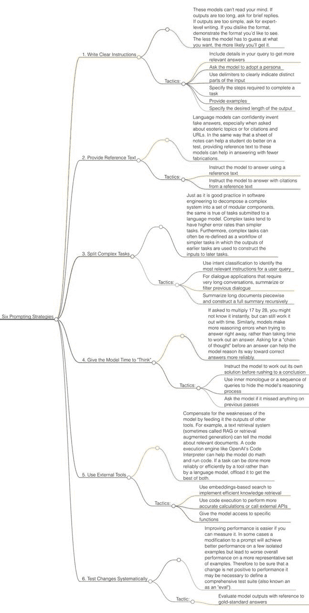

# 9月1日  家务小能手NEO：未来的家庭助手

🤠【AIGC每日新闻】

1.  【家务小能手NEO：未来的家庭助手】挪威的1X Technologies推出了家务机器人NEO，这款机器人设计用于家庭环境，拥有20个自由度的手部，能做泡咖啡等精细活。NEO特别安静，使用柔性驱动技术，既灵活又安全。它还能通过AI学习，适应不同的家庭环境。预计今年内上市，价格相当于一辆经济型小汽车。参考博客链接:https://www.qbitai.com/2024/09/186606.html

1.  【Show-o：统一的多模态理解和生成模型】Show-o模型融合了自回归和扩散模型，能自适应处理混合模态输入输出，适用于多种视觉语言任务，表现优于同类模型，具有成为下一代基础模型的潜力。参考博客链接:https://arxiv.org/html/2408.12528v2

1.  【腾讯全球数字生态大会2024：探索智能与云的未来】腾讯即将在2024年举办的全球数字生态大会，聚焦“智启新机 云驱增长”，将展示大模型、AI和云计算的最新进展。大会不仅汇聚了100多位行业专家分享前沿趋势，还将发布专业白皮书和举办开发者活动。此外，腾讯在智能车、MEET大会和AIGC等领域的全球实践也将亮相。通过扫描二维码预约直播，观众可以深入了解智能技术如何助力企业数字化转型。参考博客链接:https://www.qbitai.com/2024/09/186981.html

🍔【AI聊天机器人沟通技巧】

研究人员刚刚[**发现**](https://arxiv.org/pdf/2401.05618?utm_source=www.therundown.ai&utm_medium=referral&utm_campaign=the-world-s-first-ai-beauty-pageant)，在思路链提示中添加简单的“简洁”指令可以将 AI 响应的长度缩短 50%，对准确性的影响极小，从而可以节省 20% 以上的 API 调用成本。

# 8月31日 Sapiens模型：突破性的人体视觉任务解决方案

😴【AIGC每日新闻】

1.  【Sapiens模型：突破性的人体视觉任务解决方案】总结：Sapiens是一套用于人体视觉任务的模型，包括姿态估计、身体部位分割、深度估计和表面法线预测。它能在高分辨率图像上高效运行，并通过预训练轻松适应不同任务。该模型在多个数据集上表现出色，显著超越了现有技术，为人体视觉任务提供了强大的支持。参考博客链接:https://arxiv.org/html/2408.12569v3

1.  【多模态大型语言模型视觉感知提升策略】研究探索了如何通过视觉编码器增强多模态大型语言模型的视觉感知能力，发现简单拼接视觉标记的方法同样有效，并引入预对齐提高模型一致性，新模型Eagle在基准测试中表现优异。参考博客链接:https://arxiv.org/html/2408.15998v1

1.  【AI竞技场新规则影响排名】近期，AI模型在竞技场的排名发生了显著变化。由于评分规则的更新，更加注重模型解决问题的实际能力，而非回答的长度或风格。这一变化导致依赖于格式和长度等技巧提升排名的模型，如GPT-4o mini和Grok-2系列，排名下滑。相反，注重实质性能的模型，如Claude系列和Llama-3.1-405b，排名上升。这一调整有助于更准确地评估和比较不同AI模型的能力。参考博客链接:https://www.qbitai.com/2024/08/186453.html

🍗【来自科技巨头的免费人工智能在线课程】

实用的深度学习程序员：https://course.fast.ai/

# 8月30日 新方法预测蛋白质构象运动，助力生物医学研究

🤤【AIGC每日新闻】

1.  【新方法预测蛋白质构象运动，助力生物医学研究】南京大学等机构的研究团队开发了一种结合AlphaFold2和能量景观分析的新方法，用于预测蛋白质的构象运动。该方法通过分析蛋白质的能量挫折特征，提高了预测蛋白质运动方式的准确性，并解释了AI模型在结构预测中的行为。这一成果不仅提升了预测精度，还为药物设计、酶工程和疾病机制研究等领域带来了新的计算工具，发表在《PNAS》上。参考博客链接:https://www.jiqizhixin.com/articles/2024-08-29-9

1.  【开源低成本AI机器人项目LeRobot】HuggingFace推出的LeRobot项目，由前特斯拉工程师领导，让用户能从零开始构建AI机器人。使用成本约200美元的Koch v1.1套件，包含双六电机机械臂，支持在个人笔记本上训练模型。未来还将推出仅150美元的Moss v1版本。项目提供详细指南和开源资源，便于爱好者和开发者参与和改进。参考博客链接:https://mp.weixin.qq.com/s/nYF1zj9NFlBxVKlEYr-wbw

1.  【AI实时游戏引擎GameNGen：革新游戏体验】谷歌DeepMind开发的GameNGen，作为首个完全由AI驱动的实时游戏引擎，成功在单个TPU上以每秒20帧的速度模拟经典射击游戏DOOM。它利用扩散模型实时生成高质量游戏画面，难以与真实画面区分。通过强化学习与Stable Diffusion技术，GameNGen不仅提升了图像质量，还在TPU-v5硬件上实现了快速生成，为玩家带来前所未有的实时交互式游戏体验。参考博客链接:https://www.qbitai.com/2024/08/185465.html

🧀【来自科技巨头的免费人工智能在线课程】

通过人工智能（ChatGPT）加强教学：https://www.udemy.com/course/make-teaching-easier-with-artificial-intelligence-chat-gpt/

# 8月29日 英特尔发布新一代至强处理器，助力专业创作者和AI应用

😌【AIGC每日新闻】

1.  【英特尔发布新一代至强处理器，助力专业创作者和AI应用】英特尔最新推出的至强W-3500和W-2500处理器，专为专业创作者和工程师打造，提供高达60核120线程的强大性能。这些处理器支持8通道DDR5内存和PCIe Gen 5.0，显著增强多线程处理和AI能力。此外，多家合作伙伴展示了基于这些处理器的AI和机器学习解决方案，预示着至强W系列在AI领域的广泛应用前景。产品将于2024年8月开始接受订购。参考博客链接:https://www.qbitai.com/2024/08/185883.html

1.  【英伟达财报亮眼但股价下跌，市场关注未来增长放缓】英伟达2025财年第二季度财报显示，公司营收和净利润大幅增长，远超市场预期。然而，财报公布后股价却出现下跌，市值蒸发巨大。市场分析指出，股价下跌可能与英伟达对下一季度营收增长放缓的预期有关，这是近六个季度以来的首次。同时，英伟达宣布了500亿美元的股票回购计划，并预计将出货大量Blackwell硬件。参考博客链接:https://www.qbitai.com/2024/08/185863.html

1.  【国内首款全能语音大模型心辰Lingo开启内测】国内首个端到端通用语音大模型心辰Lingo现已开放内测预约，该模型不仅支持实时打断和指令控制，还具备高度拟人化和歌唱能力，中文语音效果超越GPT-4o。其核心优势在于原生语音理解、多样语音风格及高效压缩技术，适用于多领域，如智能交互、心理疗愈等。正式发布定于9月5日外滩大会。参考博客链接:https://www.qbitai.com/2024/08/185494.html

🌶️【来自科技巨头的免费人工智能在线课程】

ChatGPT + Blogging（AI网站入门）：https://www.udemy.com/course/chatgpt-blogging-ai-website-tutorial/

# 8月27日 2024外滩大会聚焦人工智能大模型应用与创新

🤥【AIGC每日新闻】

1.  【2024外滩大会聚焦人工智能大模型应用与创新】2024年9月，上海将举办“2024 Inclusion·外滩大会”，其中“大模型的创造力边界与应用想象力”论坛将探讨大模型技术在智能体、多模态等领域的关键技术及其在金融、医疗等行业的应用。论坛还将发布《大模型可信应用框架研究报告》，并推出国内首个端到端语音大模型「心辰 Lingo」，由多所高校和研究机构的专家共同参与，推动大模型技术的产业创新。参考博客链接:https://www.jiqizhixin.com/articles/2024-08-26-14

1.  【AI虚假评论风波：《大都会》预告片被迫撤回】85岁五次奥斯卡奖得主导演的史诗级作品《大都会》原定在美国上映，但因最新预告片中包含了AI生成的虚假负面评论，发行方狮门影业不得不撤下预告片并公开道歉。这些错误引用自著名影评人的负面评价实际上并不存在，事件凸显了AI生成内容未经核实即用于营销的潜在风险。参考博客链接:https://www.jiqizhixin.com/articles/2024-08-27

1.  【AI编程助手Cursor：高效易用，引领编程新潮流】Cursor，一款由MIT毕业生创立的Anysphere公司开发的AI编程工具，近期因其高效和易用性在编程社区中引起广泛关注。支持多种AI模型如GPT-4和Claude 3.5 Sonnet，通过聊天界面实现代码生成和审查，引入光标位置预测和多行编辑等创新功能，显著提升编程效率。用户数量超过30000家，涵盖大型企业和初创公司。最近，Anysphere完成6000万美元融资，估值达4亿美元，市场认可度高。参考博客链接:https://www.qbitai.com/2024/08/184461.html

🍞【来自科技巨头的免费人工智能在线课程】

斯坦福大学CS224 N：https://www.youtube.com/watch?v=rmVRLeJRkl4&feature=youtu.be

# 8月26日 高效视频生成新工具：VideoSys系统

🫥【AIGC每日新闻】

1.  【AI图像生成工具大比拼：新版本各显神通】近期，AI图像生成工具竞争升级。Ideogram 2.0以其卓越的文本渲染能力崭露头角，超越了由Stable Diffusion团队打造的Flux Pro。谷歌的I[magen 3也宣称在性能上领先于DALL-](https://www.qbitai.com/2024/08/183575.html)E 3和Midjourney v6。Midjourney则推出了免费网页版，扩大了用户基础。这些工具在处理中文提示词、人像生成及商业海报制作等方面各有所长，为用户提供了多样化的选择。参考博客链接:https://www.qbitai.com/2024/08/183575.html

1.  【高效视频生成新工具：VideoSys系统】新加坡国立大学尤洋团队开发的VideoSys系统，通过OpenDiT项目和先进技术如Pyramid Attention Broadcast (PAB)和Dynamic Sequence Parallelism (DSP)，大幅提升视频生成效率，达到21.6 FPS帧率和10.6倍加速，同时保持高质量。该系统支持多种扩散模型，且为开源，已获得1.4k星标，标志着视频生成技术的新进展。参考博客链接:https://www.jiqizhixin.com/articles/2024-08-26-3

1.  【上海交大团队开发新型存内计算架构COMPASS，助力高效脉冲神经网络部署】上海交大的研究团队开发了一种名为COMPASS的新型存内计算架构，专门用于高效部署脉冲神经网络（SNN）。该架构通过利用脉冲的稀疏性，大幅减少了计算延迟和内存需求，提高了并行处理能力。COMPASS在能耗和性能上表现优异，未来有望应用于物联网和自动驾驶等领域，推动低能耗人工智能的发展。参考博客链接:https://www.jiqizhixin.com/articles/2024-08-26-2

🌰【来自科技巨头的免费人工智能在线课程】

面向所有人的AI：https://www.deeplearning.ai/courses/ai-for-everyone/

# 8月25日 Meta FAIR团队创新自我训练方法提升模型性能

😬【AIGC每日新闻】

1.  【AI专家童欣加盟AGI创业公司Anuttacon】前微软研究专家童欣，拥有25年图形学研究经验，已加入Anuttacon担任首席研究员[。Anuttacon致力于探索人工智能通用性](https://www.qbitai.com/2024/08/183443.html)（AGI）的边界，并开发创新的虚拟体验和产品。同时，前B站副总裁王宇阳也加入该公司，负责用户生态建设。参考博客链接:https://www.qbitai.com/2024/08/183443.html

1.  【AI助[力约会诚信：ChatGPT-4o检测身高谎报】ChatGP](https://mp.weixin.qq.com/s/VZBRCTzXOgCnPc5jzcsfjQ)T-4o通过分析上传照片中的比例和环境，能精确估计男性在约会软件中是否谎报身高，误差仅在1英寸内。这一功能在社交媒体上引发热议，浏览量超30万。此外，女性利用AI和其他在线工具如谷歌图片搜索，验证约会对象信息，显示了AI在日常生活中的多场景应用和高效率。参考博客链接:https://mp.weixin.qq.com/s/VZBRCTzXOgCnPc5jzcsfjQ

1.  【Meta[ FAIR团队创新自我训练方法提升模型性能】Meta FA](https://mp.weixin.qq.com/s/yxl85mXsIhoMrymlAOCa3A)IR团队开发了一种新的自我训练方法，该方法通过使用合成数据而非人工标注，显著提升了模型性能。例如，Llama-3-70B-Instruct模型的准确率从75.4%提高到88.7%。这种方法通过模型自我判断和微调，形成自学过程，并探讨了多数投票机制的应用潜力。然而，该方法仍面临一些挑战，如种子模型的评估能力、小模型的适用性和推理成本增加等问题。参考博客链接:https://mp.weixin.qq.com/s/yxl85mXsIhoMrymlAOCa3A

🫘【来自科技巨头的免费人工智能在线课程】

Python中的机器学习：https://www.edx.org/learn/artificial-intelligence/harvard-university-cs50-s-introduction-to-artificial-intelligence-with-python

# 8月24日 Salesforce推出两款AI销售助手，助力销售团队加速增长

😏【AIGC每日新闻】

1.  【Salesforce推出两款AI销售助手，助力销售团队加速增长】Salesforce最近推出了两款全自主、AI驱动的销售助手：Einstein SDR Agent和Einstein Sales Coach Agent。这两款助手旨在通过自动化和个性化帮助销售团队加速增长。Einstein SDR Agent能够全天候与潜在客户互动，回答问题、处理异议并安排会议。而Einstein Sales Coach Agent则能帮助销售人员练习推销技巧，并在通话过程中提供实时建议。这两款助手都利用Salesforce的CRM数据和通过Data Cloud上传的外部数据，以生成准确、具有上下文相关性的回复。这两款AI助手预计将在10月全面上市，更多细节有望在9月的Dreamforce大会上公布。通过将这些AI助手整合到现有平台中，Salesforce降低了企业在业务流程中采用AI的门槛。这些助手提供全天候支持，并可自动化重复性任务，如潜在客户筛选和会议安排，从而使人类销售团队能够专注于高价值任务，并有可能促成更多交易。参考博客链接：https://www.salesforce.com/news/stories/einstein-sales-agents-announcement/?utm_source=www.therundown.ai&utm_medium=referral&utm_campaign=ai-agents-to-automate-sales。

1.  【Hermes 3：免费开源，具备卓越推理能力的AI模型】Nous Research推出的Hermes 3是基于Meta的Llama 3.1 405B模型的首次全面精细调整，它不仅免费开源，还拥有出色的推理能力。这款模型能够处理从战略决策到创意写作等一系列复杂任务。用户可以通过Lambda新推出的Chat Completions API或Lambda Chat界面访问该模型。Hermes 3既可以在单个节点上运行，也能够扩展到多节点的1-Click Cluster上，为用户提供了极高的灵活性和便利性。这一创新模型无疑将在AI领域掀起新的浪潮。参考博客链接：https://blogs.nvidia.com/blog/mistral-nemo-minitron-8b-small-language-model/?utm_source=www.therundown.ai&utm_medium=referral&utm_campaign=ai-agents-to-automate-sales。

1.  【Nvidia和Mistral发布新语言模型：小身材大能量，笔记本和PC也能高效运行】Nvidia和Mistral刚刚联合发布了一款名为Mistral-NeMo-Minitron 8B的小型语言模型，这款模型能在笔记本和PC上高效运行，而且准确率极高。他们是怎么做到的呢？原来，研究人员使用了“剪枝”（去掉一些不必要的部分）和“蒸馏”（在小数据集上重新训练剪枝后的模型）等优化技术，让模型变得更小但同样准确。这样，训练时的计算成本能节省高达40倍！更厉害的是，这款模型在九项语言驱动的AI基准测试中领先，涵盖了语言理解、推理和编程等多个方面。这意味着我们可以在笔记本和PC上直接运行AI模型，享受更快、更安全的交互体验，同时保护数据隐私。随着技术的不断进步，未来我们可能在智能手机、手表甚至家用电器上都能见到高级AI的身影。参考博客链接：https://replit.com/?utm_source=www.therundown.ai&utm_medium=referral&utm_campaign=ai-agents-to-automate-sales。

🥥【来自科技巨头的免费人工智能在线课程】

微软- AI for Beginners：https://microsoft.github.io/AI-For-Beginners/?id=getting-started

# 8月23日 LongVILA：超长视频理解新突破，精度接近100%

😶【AIGC每日新闻】

1.  【LongVILA：超长视频理解新突破，精度接近100%】最近，一项名为LongVILA的技术取得了重要进展，它能够在处理长达1024帧的超长视频时，实现接近100%的精度。这一突破对于视频理解领域来说具有重要意义，尤其是在处理和分析长视频内容时，能够大幅提高准确性和效率。LongVILA技术的出现，为视频分析、视频编辑以及视频监控等领域带来了更多的可能性和应用场景。未来，随着这项技术的进一步发展和应用，我们有望看到更多基于超长视频理解的创新应用和服务出现，为我们的生活和工作带来更多便利和效益。参考博客链接：https://arxiv.org/pdf/2408.10188。

1.  【NVIDIA首个AI角色加入国产游戏，仅需2GB显存】NVIDIA的AI技术再次取得突破，其首个AI非玩家角色（NPC）加入了备受期待的国产游戏《Unleashed Machine》。这个AI NPC基于4B模型，但令人惊讶的是，它仅需要2GB的显存就能运行。这一成就展示了NVIDIA在AI技术方面的深厚实力，能够为游戏带来更加真实和智能的NPC体验。这一进步不仅提升了游戏的沉浸感，也为游戏开发者提供了更多可能性和创意空间，预示着未来游戏中AI角色的应用将更加广泛和深入。参考博客链接：https://x.com/MACHINE4LPHA/status/1825910151678672943。

1.  【KAN 2.0：为经典物理学研究定制的神经网络架构】最近，一项名为KAN 2.0的新技术引起了关注，这是一项专为经典物理学研究定制的神经网络架构。不同于一般的神经网络，KAN 2.0像是为物理学问题特制的工具箱，能够更有效地解决物理学中的复杂问题。这项技术的出现，意味着人工智能在科学研究领域的应用又迈进了一步。研究人员可以利用KAN 2.0来模拟和预测物理现象，从而加速科学发现的进程。这对于物理学界来说无疑是一个好消息，它可能帮助我们更好地理解自然界的奥秘。参考博客链接：https://x.com/_vztu/status/1825757566615326968。

🍓【来自科技巨头的免费人工智能在线课程】

使[用LLMs构](https://t.co/3NQHu2NZcI)[建RAG代理：LLMs和矢量数据](https://t.co/3NQHu2NZcI)库的可扩展部署策略；用于对话管理和文档检索的现代LangChain范例；采用先进的生产模式和步骤https：courses.nvidia.com/courses/course-v1：DLI+S-FX-15+V1/

# 8月22日 麦当劳日本推出AI驱动的广告，引领营销新时代

😑【AIGC每日新闻】

1.  【Grok 2.0和Mystic AI模型引发公众关注】近期，Grok 2.0和Mystic这两款AI模型因其出色的表现引发了广泛的关注。Grok 2.0能够生成逼真的图像，而Mystic则擅长制作超现实的渲染图。许多爱好者和专家对这些新工具的表现印象深刻，纷纷展示其生成的示例，并鼓励大家探索和测试这些新颖的AI工具。这两款模型的出色表现预示着AI在图像生成和处理领域又迈出了新的一步。参考博客链接：https://metatrend.ai/tweet-trends/v2?date=2024-08-20&name=AI#section-1。

1.  【LumaLabsAI：新一代文本生成视频AI模型发布，内容创作体验再升级】近日，AI界迎来了新一轮的创新，Hotshot团队凭借其精简的团队力量，成功推出了一款全新的文本生成视频AI模型，为AI驱动的内容创作带来了显著提升。与此同时，LumaLabsAI也在生成式AI领域崭露头角，成为了一股不可忽视的力量。专家们纷纷指出，这些新兴技术不仅潜力巨大，更在视频生成方面展现出了革命性的效果，有望为用户带来前所未有的创作体验。随着这些高级模型的发布，我们期待AI在内容创作领域的应用能够达到新的高度。参考博客链接：https://metatrend.ai/tweet-trends/v2?date=2024-08-20&name=AI#section-2

1.  【麦当劳日本推出AI驱动的广告，引领营销新时代】麦当劳日本最近推出了一款由人工智能驱动的广告，这一举动标志着AI在营销领域扮演着越来越重要的角色。这不仅展示了传统企业如何运用尖端技术，也体现了麦当劳积极拥抱AI时代的决心。通过这一创新举措，麦当劳日本希望为顾客带来更加个性化和吸引人的广告体验，进一步提升品牌影响力。这一案例也预示着，随着技术的进步，AI将在更多传统行业中发挥重要作用。参考博客链接：https://metatrend.ai/tweet-trends/v2?date=2024-08-20&name=AI#section-3。

🍑【来自科技巨头的免费人工智能在线课程】

如何进行大规模图像分类：学习大规[模图像分类；](https://t.co/YEnS91Y8Eg)[涵盖](https://t.co/YEnS91Y8Eg)挑战、建模技术和验证策略https：classcentral.com/course/youtube-grandmaster-series-how-to-perform-large-scale-image-classification-130184.

# 8月21日 GPT-4o免费微调开启，AI应用将迎来新一波升级

🤨【AIGC每日新闻】

1.  【GPT-4o免费微调开启，AI应用将迎来新一波升级】OpenAI最近宣布，即日起至9月23日，开发者可以免费对GPT-4o进行微调，每天最多可处理100万个令牌。这意味着开发者可以根据自己的需求，对模型的结构、语气和特定领域的指令进行优化，以提高AI应用的性能和准确性。通常，微调服务会根据使用量收费，每百万个令牌的价格为25美元，但目前处于免费期。OpenAI指出，即使只有几十个训练样本，微调也能带来显著的效果。与此同时，谷歌的Gemini API也为开发者提供了免费的令牌，每天在Gemini 1.5 Flash模型上提供15亿个令牌，在Gemini 1.5 Pro模型上提供160万个令牌。随着GPT-4o免费微调的开放，我们有望看到一波更智能、更快速、更强大的AI机器人涌现。参考博客链接：https://openai.com/index/gpt-4o-fine-tuning/?utm_source=www.therundown.ai&utm_medium=referral&utm_campaign=openai-s-best-model-just-got-better。

1.  【OctoAI提供免费圆桌会议：助力企业安全高效地部署生成式AI】OctoAI正在举办一场免费的专家圆桌会议，邀请专家小组分享如何在创新与数据安全和合规之间找到平衡，帮助企业安全高效地部署生成式AI（GenAI）应用。参加这场会议，你将学习到如何在部署AI应用时确保数据安全和符合监管要求，如何在私有环境中部署生成式AI，以及如何对AI应用进行质量评估并可靠地扩展GenAI解决方案。即使无法出席，注册后你仍然可以获得会议的录制内容。参考博客链接：https://lu.ma/jdbxsd0w?utm_source=rundown&utm_medium=newsletter&utm_campaign=8.27.24-brt-ent-genai。

1.  【作者群体起诉AI公司Anthropic，指控其训练聊天机器人Claude时涉嫌大规模盗版】一群作者向法院提起诉讼，指控AI初创公司Anthropic训练其Claude聊天机器人时使用了大量盗版书籍，涉嫌“大规模盗窃”行为。这是首次有作者群体针对Anthropic及Claude提出诉讼，不过之前已有类似的诉讼针对竞争对手OpenAI及其ChatGPT。原告指出，Anthropic在一个名为The Pile的数据集中使用了许多盗版书籍。Anthropic与其他一些公司，包括OpenAI，都声称根据美国的“合理使用”原则，训练AI模型时有限度地使用受版权保护的材料是被允许的。这并非AI公司首次因版权问题被起诉，但它再次引发了关于AI训练数据合法性的重要讨论。尽管过去类似案件多被驳回，但法院尚未对使用未经授权的互联网抓取材料训练AI这一核心问题给出明确裁决。参考博客链接：https://abcnews.go.com/US/wireStory/authors-sue-claude-ai-chatbot-creator-anthropic-copyright-112964872?utm_source=www.therundown.ai&utm_medium=referral&utm_campaign=openai-s-best-model-just-got-better。

🍌【来自科技巨头的免费人工智能在线课程】

网[络介绍：了解](https://t.co/LhWsm8bB6b)网络及其重要性；探索以太网基础知识和以太网网络中的数据转发；讨论网络组件、要求、OSI模型、TCP/IP协议https：coursera.org/learn/introduc tion-to-networking-nvidia

# 8月20日 AGIBOT推出五款先进类人机器人，挑战马斯克和特斯拉

🤐【AIGC每日新闻】

1.  【小模型崛起：浏览器里跑出SOTA，抱抱脸宣称：合成数据不是未来】抱抱脸团队开发了一系列能在浏览器中直接运行的小模型，这些模型在2亿、5亿和20亿参数的数据集上表现优异，达到了SOTA水平。团队发现，通过对网络数据进行严格的过滤，并在这些高度过滤后的数据集上进行训练，可以显著提高模型的性能。抱抱脸的首席科学家Thomas Wolf表示，虽然合成数据在某些特定领域有用，但真实数据的潜力，尤其是网络的多样性和丰富性，还未被完全发掘。此外，团队还探索了小模型的训练技术，如长期在数万亿token上进行训练和数据退火，使得这些模型适合部署在各种设备上。这一成果展示了小模型的潜力和真实数据的价值，为AI模型的发展提供了新的方向。参考博客链接：https://www.bestblogs.dev/en/article/163843。

1.  【AGIBOT推[出五款先进类人](https://www.scmp.com/tech/tech-trends/article/3275069/former-huawei-genius-youth-recruit-launches-humanoid-robots-rival-teslas-optimus?module=perpetual_scroll_0&pgtype=article&utm_source=www.therundown.ai&utm_medium=referral&utm_campaign=china-s-new-humanoid-robot-fleet)机器人，挑战马斯克和特斯拉】中国机器人初创公司AGIBOT近日推出了五款先进的类人机器人，直接挑战马斯克和特斯拉即将发布的Optimus机器人。这些机器人既有轮式也有双足设计，适用于从家务到工业操作等多种任务。其中，旗舰型号“Yuanzheng A2”高175厘米，重55公斤，甚至能完成穿针引线等精细工作。AGIBOT计划在2024年底前出货300台，声称在商业化和成本控制方面优于特斯拉。与此同时，另一个中国高性能机器人制造商Unitree也展示了其具备更好功能和外观的G1量产型机器人。中美之间的类人机器人和人工智能竞赛正在加剧，中国初创公司在短短几天内展示了重大技术进展。参考博客链接: https://www.scmp.com/tech/tech-trends/article/3275069/former-huawei-genius-youth-recruit-launches-humanoid-robots-rival-teslas-optimus?module=perpetual_scroll_0&pgtype=article&utm_source=www.therundown.ai&utm_medium=referral&utm_campaign=china-s-new-humanoid-robot-fleet。

1.  【最新报告[评选22款](https://www.theguardian.com/us-news/article/2024/aug/19/ai-mayor-candidate-victor-miller-cheyenne-wyoming?utm_source=www.therundown.ai&utm_medium=referral&utm_campaign=china-s-new-humanoid-robot-fleet)顶尖AI模型，揭示大模型不一定更好】一份最新报告对22款AI模型在生成式回答任务（RAG）中的表现进行了评估，重点考察了它们的准确性、幻觉率和成本效益。报告不仅涵盖了短、中、长任务的评估，还比较了开源和闭源模型的表现。结果显示，尽管大模型通常被认为更强大，但它们并不总是表现最佳。通过这份报告，读者可以发现哪些模型在不同任务中表现优越，并了解在性能和成本效益之间找到最佳平衡的重要性。参考博客链接: https://www.theguardian.com/us-news/article/2024/aug/19/ai-mayor-candidate-victor-miller-cheyenne-wyoming?utm_source=www.therundown.ai&utm_medium=referral&utm_campaign=china-s-new-humanoid-robot-fleet。

🍋【来自科技巨头的免费人工智能在线课程】

掌[握推荐系统：](https://t.co/TsAvvgnyMU)[Kaggle Grandmasters关于构建电子商务推荐系统的策略；涵盖2阶段模型、候选生成](https://t.co/TsAvvgnyMU)、特征工程和集成https：classcentral.com/course/youtube-grandmaster-series-mastering-recommender-systems-184298

# 8月19日 AssemblyAI的语音转文字技术：行业领先，高效准确

🤔【AIGC每日新闻】

1.  【瑞士初创公司推出“生物计算机”租赁服务，旨在大幅降低AI能耗】瑞士初创公司FinalSpark最近推出了一项服务，允许科学家以每月500美元的价格租用由人类脑细胞制成的“生物计算机”，旨在创造能耗比当前系统低10万倍的AI。这些生物计算机使用的是可以“存活”并计算长达100天的类脑器官（由一团人类脑细胞组成）。AI模型通过使用多巴胺进行正向强化和使用电信号进行负向强化来训练，模仿自然的神经过程。FinalSpark声称，这些生物计算机在AI训练方面的效率可能比传统的基于硅的技术高出10万倍。虽然这项服务有助于降低AI对CPU和GPU的依赖，是一个正确的方向，但使用脑类器官进行生物计算是一个完全未知的领域，势必会引发伦理问题，比如这些细胞团是否有可能实现某种形式的意识。参考博客链接：https://www.livescience.com/technology/artificial-intelligence/these-living-computers-are-made-from-human-neurons?utm_source=www.therundown.ai&utm_medium=referral&utm_campaign=ai-made-with-human-brain-cells。

1.  【AssemblyAI的语音转文字技术：行业领先，高效准确】AssemblyAI推出的语音转文字模型，能将音频转化为近乎完美的文本，准确率和性能均居行业领先水平。这款模型在英语和西班牙语的转录上表现出色，准确率分别达到92.5%和95%，而且处理速度极快，一小时的对话内容只需约35秒即可完成转录。无论是从准确率还是效率上看，AssemblyAI都为用户提供了最佳的体验。参考博客链接：https://leginfo.legislature.ca.gov/faces/billNavClient.xhtml?bill_id=202320240SB1047&utm_source=www.therundown.ai&utm_medium=referral&utm_campaign=ai-made-with-human-brain-cells。

1.  【加州AI安全法案大改，旨在促进AI发展的同时确保安全】加州的一项旨在预防AI灾难的积极法案[SB 1047]最近进行了重大修订，以解决Anthropic等AI公司和开源开发者的担忧。新法案规定，在灾难性事件发生前，加州总检察长不得因疏忽安全实践而对AI公司进行起诉。AI实验室现在只需提交关于其安全实践的公开“声明”，而不再是“在伪证处罚下”的认证。同样，开发者现在必须提供“合理注意”，而非“合理保证”AI模型不会构成重大风险。该法案将提交至加州议会进行最后表决。这表明政府在推进技术进步与缓解潜在风险之间找到了平衡点，加州正展示监管可以是实用且适应性的。这些改变是朝着通过协作治理促进负责任的AI开发迈出的一大步。参考博客链接：https://university.therundown.ai/c/daily-tutorials/create-ultra-realistic-images-with-ai-58a83c43-a227-4025-a1f5-c76389cd1edd?utm_source=www.therundown.ai&utm_medium=referral&utm_campaign=ai-made-with-human-brain-cells。

🍉【来自科技巨头的免费人工智能在线课程】

零[代码更改加速](https://t.co/i1SEsoXO1T)[数据科学工作流：了解统一CPU和](https://t.co/i1SEsoXO1T)GPU工作流的优势；GPU加速数据处理和ML，无需更改代码；体验更快的处理时间https：courses.nvidia.com/courses/course-v1：DLI+T-DS-03+V1/

# 8月18日 沃尔玛通过生成式人工智能提升生产力

🤔【AIGC每日新闻】

1.  【沃尔玛通过生成式人工智能提升生产力】沃尔玛的首席执行官Doug McMillon在公司第二季度财报电话会议上透露，沃尔玛正在利用生成式人工智能（AI）来提高生产力。通过AI技术，沃尔玛能够以比人工方法快100倍的速度更新8.5亿个产品目录条目。此外，沃尔玛还对客户搜索和卖家支持进行了AI改进。现在，客户可以在沃尔玛的应用程序和网站上使用AI驱动的搜索功能和新的购物助手，例如回答“哪种电视最适合看体育比赛？”这样的问题。沃尔玛还在测试一种全新的AI驱动体验，专为美国市场的卖家设计，但具体细节尚未公布。McMillon表示，公司计划在全球范围内的所有业务领域继续实验和应用AI技术。这表明大型企业正在通过AI显著提升生产力，尽管这也引发了人们对工作岗位相关性的担忧。参考博客链接: https://www.marketwatch.com/livecoverage/walmart-earnings-results-sales-spending-revenue-q2/card/how-walmart-is-using-ai-to-improve-its-business-and-save-money-jKnoms0hQMfWO4eZ8ckm?utm_source=www.therundown.ai&utm_medium=referral&utm_campaign=ai-helps-walmart-100x-productivity。

1.  【**全球最大开源AI峰会即将开幕】**Ray Summit 2024将于9月30日至10月2日举行，汇聚了全球顶尖的开源AI专家和实践者。本次峰会将有来自OpenAI、Instacart和Runway等公司的AI先锋分享他们的见解。活动亮点包括：Marc Andreessen和OpenAI的Mira Murati等人的主旨演讲，Netflix和Instacart等公司介绍的实际AI扩展策略，以及专家主导的分布式AI计算工作坊。现在注册并使用代码“Newsletter15”可享受独家折扣。立即报名参加吧！参考博客链接: https://raysummit.anyscale.com/flow/anyscale/raysummit2024/landing/page/eventsite?utm_source=newsletter&utm_medium=rundown&utm_campaign=august16。

1.  【软银AI芯片项目遇挫，或转投台积电】软银的雄心勃勃的“Izanagi”项目旨在开发能与英伟达竞争的AI处理器，但由于英特尔未能满足产量和速度要求，该项目正面临重大挫折。软银原本依赖英特尔的芯片设计能力，但现在考虑与全球最大的芯片制造商台积电合作。然而，台积电自身也面临产能问题，导致谈判受阻。尽管如此，软银CEO孙正义仍坚定推进该计划，并寻求来自沙特阿拉伯、阿联酋和主要科技公司的投资。目前，英伟达在AI芯片领域占据主导地位，但其下一代Blackwell AI芯片的延迟可能为竞争对手提供了机会。参考博客链接: https://www.tomshardware.com/tech-industry/artificial-intelligence/softbanks-intel-ai-processor-plans-in-doubt-as-insiders-say-it-is-now-considering-a-tsmc-partnership?utm_source=www.therundown.ai&utm_medium=referral&utm_campaign=ai-helps-walmart-100x-productivity。

🍇【来自科技巨头的免费人工智能在线课程】

数[据中心的AI](https://t.co/hi7qoxbquL)：AI用例、机器学习、深度学习及其工作流程；GPU架构及其对人工智能的影响；深度学习框架和部署注意事项https：coursera.org/learn/introduc tion-ai-data-center

# 8月17日 硅基流动提供"sencevoice-small"语音识别模型推理服务

🤫【AIGC每日新闻】

1.  【硅基流动提供"sencevoice-small"语音识别模型推理服务】该模型支持中文、英语、粤语、日语和韩语的识别，特别在中文和粤语上识别效果有显著提升，性能优于Whisper模型。模型经过超过40万小时的数据训练，具备高效的推理能力，一段10秒的音频识别耗时仅在70-200毫秒之间，大幅优于Whisper-Large模型，展现出极低的推理延迟。参考博客链接：https://docs.siliconflow.cn/reference/createaudiotranscriptions-1

1.  【Claude.ai 推出截图功能】该功能使用户能够从任何工作区或应用程序中进行屏幕截图，并通过一键操作直接将图片上传到聊天界面。这项改进极大地方便了用户与 Claude.ai 进行图文交互，简化了之前需要进行的截图、复制和粘贴的繁琐流程。参考博客链接：https://x.com/alexalbert__/status/1824483452802175082

1.  【阿里巴巴Qwen团队推出了一款具有5亿参数的AI模型】这款轻量级的模型能够实现文本翻译、拼写和语法修正等功能。它完全由Python编写，仅需三个依赖项和一个文件即可运行，利用了llama-cpp-python和pynput库来自动化任务处理。尽管模型规模较小，但它在语言理解方面表现出色，能够准确地执行翻译任务。这种模型的推出，不仅展示了小规模模型在自动化和提高效率方面的潜力，也为开发者和用户提供了便捷、高效的工具来处理日常任务。参考博客链接：https://x.com/reach_vb/status/1824521949873144270

🍃【来自科技巨头的免费人工智能在线课程】

在10分钟内构建大脑（NVIDIA）：探索神经网络[如何使用数据](https://t.co/C0JcfOksT1)[来学习；理解神经元背后的数学ht](https://t.co/C0JcfOksT1)tps：courses.nvidia.com/courses/course-v1：DLI+T-FX-01+V1/

# 8月16日 Claude 推出「Prompt 缓存」功能

🫡【AIGC每日新闻】

1.  【Claude 推出「Prompt 缓存」功能】Anthropic AI 的 Claude 宣布推出「Prompt 缓存」功能，该功能支持「长 Prompt」，能够在多个 API 调用之间重用长文本上下文，同时提高响应速度和理解能力。据称，该技术能够将成本降低 90%，并将延迟降低 85%。参考博客链接：https://docs.anthropic.com/en/docs/build-with-claude/prompt-caching

1.  **【GLM-4-Long****：长、无损、理解复杂语义、更便宜】GLM-4-Long 现已在**开放平台 bigmodel.cn 上线，支持 1M 上下文长度 ( 150-200 万字 ) ，真正将长文本能力交到企业和开发者手中。GLM-4-Long 为处理超长文本而设计，能够一口气阅读 2 本红楼梦或 125 篇论文，可以翻译长篇文档、全局分析财报、提取关键信息（合同条款、科研数据等），甚至可以打造一个具有超长记忆的聊天机器人。GLM-4-Long 在价格方面也极具竞争力，输入、输出价格仅需0.001元 /千 tokens。参考博客链接：https://www.bestblogs.dev/article/9ee2df

1.  【“创业一年，人间三年”】李沐亲述 LLM 创业第一年的进展、纠结和反思。参考博客链接：https://www.bestblogs.dev/article/621f70

🍀【来自科技巨头的免费人工智能在线课程】

使[用检索增强生](https://t.co/VqyGC90szj)[成增强LLM（NVIDIA）：检](https://t.co/VqyGC90szj)索增强生成的基础；RAG检索过程；NVIDIA AI基础和RAG模型组件https：courses.nvidia.com/courses/course-v1：NVIDIA+S-FX-16+v1/

# 8月15日 xAI发布Grok-2：AI能力大幅提升，集成X平台功能

🫢【AIGC每日新闻】

1.  【xAI发布Grok-2：AI能力大幅提升，集成X平台功能】xAI公司最新发布了Grok-2和Grok-2 mini两个AI模型，目前正在X平台（原Twitter）上进行测试版发布。Grok-2相比其前代Grok-1.5在多个方面都有显著提升：

1.  能力提升：推理、编程和对话能力大幅增强。

1.  性能优越：在多项基准测试中超越了Claude 3.5和GPT-4 Turbo等领先模型。

1.  X平台集成：能够查询实时头条新闻，充分利用X平台的信息优势。

1.  多样化应用：从解决数学问题到撰写求职信，再到游戏推荐，展现了广泛的应用潜力。

1.  即将商用：xAI计划本月晚些时候通过企业API提供这两个模型的访问。

Grok-2的发布显示了xAI在AI领域的快速进展，其与X平台的深度整合可能为用户带来更丰富、实时的AI互动体验。参考博客链接：https://x.com/imxiaohu/status/1823603925335089248

1.  【openai发布gpt-4o-latest】这是一个能够体验最新研究特性的新模型，内置 Q* 的多步分解推理能力。参考博客链接：https://platform.openai.com/docs/models/gpt-4o

1.  【Gemini Live：随身携带的AI聊天助手】Google推出了新的移动AI助手Gemini Live，旨在为用户提供便捷的随身对话体验。其主要特点包括：

1.  自由流畅对话：能够应对各种话题，从求职咨询到复杂问题探讨。

1.  持续对话能力：即使被打断也能保持对话连贯性。

1.  后台运行：支持在手机锁屏或应用后台运行时继续对话。

1.  免提使用：方便用户在各种场景下使用，如开车或做家务时。

1.  随时可用：如同口袋里的私人助理，随时待命。

Gemini Live的推出体现了AI助手向更加便携和融入日常生活方向发展的趋势，有望为用户带来更加自然和无缝的AI互动体验。参考博客链接：https://www.aibase.com/zh/news/11034

🌲【来自科技巨头的免费人工智能在线课程】

生成式AI解释（NVIDIA）：Generative AI并解释G[enerat](https://t.co/cGS1JQ2fI6)[ive AI如何工作；各种生成式](https://t.co/cGS1JQ2fI6)AI应用程序；生成式AI的挑战和机遇https：courses.nvidia.com/courses/course-v1：DLI+S-FX-07+V1/

# 8月14日 LangSmith数据集助力动态少样本学习

🫣【AIGC每日新闻】

1.  【Karpathy对大型语言模型训练中的RLHF提出批评】人工智能专家Karpathy对强化学习与人类反馈（RLHF）在大型语言模型（LLM）训练中的应用提出了一些看法。他认为，尽管RLHF有其局限性，但在减少模型“幻觉”现象（即生成不准确或虚假的信息）方面仍然发挥了作用。此外，RLHF可以有效利用生成器与鉴别器之间的差距。然而，这种方法依赖于人类对生成内容的主观判断（即“感觉检查”），因此可能受到对抗性示例的影响。Karpathy的观点提醒我们，在使用RLHF训练模型时，需要谨慎处理其固有的不足之处，以提高模型的可靠性和准确性。参考博客链接：https://metatrend.ai/tweet-trends/v2?date=2024-08-11&name=AI#section-15。

1.  【GitHub Copilot Workspace被誉为顶尖AI工具】GitHub Copilot Workspace正受到热烈赞誉，很多用户对其强大的功能表示满意。这个工具能够帮助开发者更高效地编写代码，提升工作效率。尽管它的表现出色，但也有人对其是否对所有人都能轻松使用表示疑问。这表明，尽管AI技术在编程领域展现了巨大的潜力，但仍需关注其可及性，以确保更多人能够受益于这项创新。GitHub的这项工具，正逐步改变开发者的工作方式，让编程变得更加智能和便捷。参考博客链接：https://metatrend.ai/tweet-trends/v2?date=2024-08-11&name=AI#section-24。

1.  【LangSmith数据集助力动态少样本学习】LangSmith推出了一种新的数据集，旨在提高动态少样本学习的效果。动态少样本学习是一种让人工智能模型能够在很少的示例下进行有效学习的技术。通过使用这个数据集，开发者可以创建更智能的应用程序，帮助AI更好地理解和处理复杂的任务。该数据集的发布标志着在提升AI模型灵活性和适应性方面的重要进展，预计将推动更多创新应用的出现。总的来说，LangSmith的数据集为人工智能领域带来了新的机遇，助力开发者在少样本学习的研究中取得更大突破。参考博客链接：https://www.bestblogs.dev/en/article/27b7a5。

🌷【 Apple Intelligence 的 10 种体验方式】

全新的数学笔记计算器：允许用户输入或写出数学表达式，并立即以自己的手写方式看到答案

# 8月13日 OpenAI发布GPT-4o系统卡，GPT-4o-large即将推出

🤗【AIGC每日新闻】

1.  【OpenAI发布GPT-4o系统卡，GPT-4o-large即将推出】OpenAI近期发布了GPT-4o系统卡，引发了人工智能社区的广泛关注。该系统卡详细介绍了GPT-4o的安全措施，表明OpenAI在确保AI技术安全性方面的努力。与此同时，GPT-4o-large的推出也备受期待，科技爱好者对此充满了期待。这表明OpenAI正在积极推进其AI技术的研发，注重安全性并寻求在市场中占据领先地位。随着新版本的推出，GPT-4o有望为用户提供更强大的功能和更高的安全保障。参考博客链接：https://metatrend.ai/tweet-trends/v2?date=2024-08-11&name=AI#section-4。

1.  【新工具让普通用户轻松理解GPT-2模型】最近，一个名为“Transformer Explainer”的互动工具推出，旨在帮助用户，尤其是非专业人士，深入了解GPT-2模型的工作原理。这个工具允许用户通过不同的输入进行实验，观察模型的各个组成部分和转换过程，从而提供了一个易于使用且富有教育意义的平台。无论你是否具备技术背景，都能通过这个工具直观地学习和探索人工智能模型的运作，降低了学习门槛，让更多人有机会了解复杂的AI技术。参考博客链接：https://metatrend.ai/tweet-trends/v2?date=2024-08-11&name=AI#section-7

1.  【谷歌DeepMind展示AI乒乓球机器人，展现人工智能在复杂任务中的潜力】谷歌的DeepMind团队最近展示了一款能够打乒乓球的人工智能机器人，这一成果标志着AI在执行复杂物理任务方面的巨大潜力。这款机器人不仅能够准确预测球的轨迹，还能灵活应对不同的击球方式，展现了AI在运动领域的应用前景。更重要的是，这项技术还可能在健康科技等其他领域发挥作用，比如康复训练和运动分析。通过这项创新，DeepMind进一步推动了人工智能技术的发展，展示了它在实际应用中的广泛可能性。参考博客链接：https://metatrend.ai/tweet-trends/v2?date=2024-08-11&name=AI#section-9。

🌻【 Apple Intelligence 的 10 种体验方式】

Apple的新Siri首次亮相

# 8月12日 谷歌推出“为我记笔记”功能，助力会议高效进行

😝【AIGC每日新闻】

1.  【谷歌推出“为我记笔记”功能，助力会议高效进行】谷歌公司正在为其Google Meet会议工具推出一项新功能“为我记笔记”，该功能由其Gemini人工智能驱动，能够自动记录会议中的关键要点，让用户专注于讨论而无需手动记笔记。这项AI工具将向拥有特定附加功能的Workspace用户开放，属于每位用户每月需支付10美元的AI会议和消息附加包。管理员可以通过Google Workspace管理控制台配置该功能的可用性。这一创新标志着会议记录的方式即将发生改变，谷歌希望借此推动更高效的工作方式，与一些以类似功能为特色的小型AI初创公司如Otter AI和Fireflies展开竞争。参考博客链接：https://www.techradar.com/pro/good-news-your-google-meet-call-will-soon-be-able-to-take-notes-for-you?utm_source=www.therundown.ai&utm_medium=referral&utm_campaign=google-s-new-ai-meeting-note-taker。

1.  【Defined.ai推出道德数据市场，助力AI开发Defined.ai正在改变AI开发的方式，推出了一个专注于道德来源和高质量训练数据的市场。这一平台为开发者提供了可高度定制的数据集，以满足他们的特定需求。Defined.ai拥有最大的多样化道德数据集，确保开发者在构建AI模型时不牺牲诚信。此外，用户可以快速便捷地获取现成的数据，帮助他们迅速调整模型以提高性能。现在，Defined.ai还为《The Rundown》的读者提供了5小时免费的美式英语自发对话数据集，让开发者们能够更轻松地开始他们的AI项目。参考博客链接：http://connect.defined.ai/therundown?utm_campaign=RunDown%20AI&utm_source=rundown-ai&utm_medium=newsletter。

1.  【加州AI监管法案SB 1047引发分歧意见】加州正在审议一项名为SB 1047的AI监管法案，这项法案的支持者认为它能有效应对人工智能带来的重大风险。然而，反对者则认为该法案存在误导性，可能会抑制开源AI的发展和创新。这一法案引发了关于如何在保障安全与促进技术进步之间取得平衡的广泛讨论。支持者希望通过监管来提高AI的透明度和安全性，而反对者担心过度监管可能会阻碍技术进步和创业精神的涌现。这一争论反映了在推动AI发展和保护公众利益之间的复杂关系。参考博客链接：https://metatrend.ai/tweet-trends/v2?date=2024-08-11&name=AI#section-2。

🐚【 Apple Intelligence 的 10 种体验方式】

通过卫星发送的信息：iOS 18允许通过卫星发送消息

# 8月11日 多语言音频AI助手Qwen2-Audio发布：支持语音交互和声音分析

🤑【AIGC每日新闻】

1.  【多语言音频AI助手Qwen2-Audio发布：支持语音交互和声音分析】

阿里巴巴达摩院发布了新一代音频AI模型Qwen2-Audio。这个模型能接受音频和文本输入,并生成文本输出。它具有以下特点:

1.  语音聊天:用户可以直接用语音与模型交互,无需语音识别模块。

1.  音频分析:能分析语音、声音、音乐等音频信息。

1.  多语言支持:支持包括中文、英语、粤语、法语等8种以上语言和方言。

研究团队开源了7B参数版本,并提供了在线演示。未来他们计划训练更大规模的模型,扩展数据集,并将支持的音频长度延长至30秒以上。这一技术有望在人机交互、音频内容理解等领域带来新的应用可能。

参考博客链接：https://x.com/Alibaba_Qwen/status/1821945506463129905

1.  【AI助力PDF文档OCR质量提升：LLM-Aided OCR项目】

一个名为LLM-Aided OCR的开源项目正在利用大型语言模型(LLM)显著提升PDF文档OCR的质量。该项目的工作流程包括：

1.  将PDF转换为图像

1.  使用Tesseract进行初步OCR

1.  将OCR结果分块

1.  利用LLM对每个文本块进行错误校正

1.  可选的Markdown格式化

1.  最后由LLM进行质量评估

该项目支持本地和云端LLM，支持异步处理，并且高度可配置。这种方法充分发挥了LLM在文本理解和纠错方面的优势，有望大幅提高OCR的准确性和可读性，为文档数字化处理带来新的解决方案。

参考博客链接：https://github.com/Dicklesworthstone/llm_aided_ocr

1.  【AgentK：自动生成AI助手的开源框架】

AgentK是一个创新的开源项目，旨在自动化AI助手（Agent）的生成过程。其主要特点如下：

1.  自适应生成：根据用户的具体需求或任务，自动构建合适的AI助手。

1.  多智能体协作：AgentK的核心是一群能够协同工作的AI助手，它们共同组成了系统的"大脑"。

1.  任务驱动：当面对新的任务时，这些AI助手会通力合作，开发出专门用于完成该任务的新助手。

1.  灵活性：能够应对各种不同类型的任务和需求。

AgentK的开源为AI开发者和研究人员提供了一个强大的工具，有望推动人工智能应用的快速定制化发展，使AI助手的创建过程更加高效和智能化。参考博客链接：https://github.com/mikekelly/AgentK

🌸【 Apple Intelligence 的 10 种体验方式】

清理：这个新工具可以识别和删除照片背景中分散注意力的物体-而不会意外改变主题

# 8月10日 Nvidia收集80年视频数据以推动AI发展

🤪【AIGC每日新闻】

1.  【Nvidia收集80年视频数据以推动AI发展】Nvidia公司正在进行一项庞大的数据收集工作，目标是获取80年的视频素材来推动其人工智能技术的发展。尽管公司高层对此项目给予了批准，但员工们对其法律和伦理问题表示了担忧。这种大规模的数据收集将为Nvidia的AI模型提供丰富的训练素材，帮助其在图像识别和视频分析等领域取得更大突破。然而，这样的做法也引发了对隐私和数据使用合规性等问题的讨论，说明在技术进步的同时，如何平衡法律与伦理仍然是一个重要挑战。参考博客链接：https://metatrend.ai/tweet-trends/v2?date=2024-08-07&name=AI#section-12。

1.  【ChatGPT新语音模式引发热议】随着ChatGPT推出全新语音模式，人工智能教育者Min Choi和社交媒体营销专家Poonam Soni对其强大功能表示赞叹。他们分享了十个实际应用案例，展示了这一语音模式的多种可能性。新模式不仅提升了用户体验，还让AI的互动方式更加自然和流畅。专家们的热情反映了这一技术的广泛潜力，预示着未来人机交流将更加智能和人性化。这一进展将可能改变我们与人工智能的日常互动方式，令人期待。参考博客链接：https://metatrend.ai/tweet-trends/v2?date=2024-08-07&name=AI#section-14。

1.  【Hero AI超级应用的推出，提升便利与效率】Hero公司近日推出了一款名为Hero AI的超级应用，受到广泛关注。Linus Ekenstam强调了该应用的强大功能，而Poonam Soni则指出它在使用上的便利性和高效性。这款应用结合了多种人工智能技术，旨在为用户提供一站式服务，简化日常任务，提高工作和生活的效率。通过Hero AI，用户可以在同一个平台上完成多种操作，极大地方便了他们的生活。总的来看，Hero AI的推出不仅展示了人工智能在应用领域的潜力，也为用户带来了更为便捷的使用体验。参考博客链接：https://metatrend.ai/tweet-trends/v2?date=2024-08-07&name=AI#section-20。

💐【 Apple Intelligence 的 10 种体验方式】

利用人工智能将粗略的草图变成令人愉悦的图像

# 8月9日 吴恩达联手大型语言模型，推出面向初学者Python编程课程

😛【AIGC每日新闻】

1.  【吴恩达联手大型语言模型，推出面向初学者Python编程课程】斯坦福大学教授吴恩达与大型语言模型合作，推出了一个面向初学者的Python编程教程。该课程由吴恩达亲自授课，并由大型语言模型担任“助教”，提供个性化指导。课程旨在帮助初学者轻松掌握Python编程的基础知识，为后续的学习和职业发展打下坚实的基础。参考博客链接：https://www.bestblogs.dev/en/article/90e349。

1.  【新兴AI图像生成器Flux崭露头角】新推出的AI图像生成器Flux在图像生成方面表现出色，与知名的Midjourney进行了比较，结果令人鼓舞。Flux不仅在生成质量上与Midjourney相当，还引入了一些新功能，令人期待。为了帮助用户更好地理解和使用这个工具，Flux提供了详细的指南和示例，显示出其强大的竞争潜力。这意味着在AI图像生成领域，Flux有望成为一个重要的参与者，为用户提供更多创作选择。参考博客链接：https://metatrend.ai/tweet-trends/v2?date=2024-08-07&name=AI#section-5。

1.  【RunwayML推出Gen-3 Alpha I2V工具，提升创作灵活性与质量】RunwayML近期升级了其Gen-3 Alpha I2V工具，这一改进让用户在创作生成艺术时感到更加灵活和富有创意。新特性不仅增强了工具的灵活性，还在不同版本之间保持了高质量的输出，这使得艺术创作过程更加顺畅和有趣。用户们对此次更新表示兴奋，认为这将极大地丰富他们的创作体验，尤其是在生成艺术领域。通过这种升级，RunwayML进一步巩固了其在生成艺术工具市场的竞争力。参考博客链接：https://metatrend.ai/tweet-trends/v2?date=2024-08-07&name=AI#section-6。

🐙【 Apple Intelligence 的 10 种体验方式】

自定义emoji：使用 Apple Intelligence 创建带有提示或朋友照片的自定义表情符号

# 8月8日 MiniCPM-V 2.6：移动设备上的新一代图像和视频理解AI

😋【AIGC每日新闻】

1.  【MiniCPM-V 2.6：移动设备上的新一代图像和视频理解AI】MiniCPM-V 2.6是一款专为移动设备设计的先进AI模型，类似于GPT-4V，具备多图像和视频理解的能力。这意味着这款AI不仅能够处理文字信息，还能分析和理解图像及视频内容，使其在各种应用场景中更加灵活和强大。随着移动设备的普及，MiniCPM-V 2.6的推出将提升用户体验，让人们在使用手机或平板时，能够享受到更智能的视觉交互。该技术的进步标志着AI在边缘计算领域的进一步发展，使得在设备本身就能实现复杂的图像和视频分析，减少了对云端计算的依赖。参考博客链接：https://www.bestblogs.dev/en/article/ce8067。

1.  【腾讯推出AI阅读器，提升专业阅读效率】腾讯推出了一款名为“AI阅读器”的新工具，旨在帮助用户更高效地阅读长文本。这个AI阅读器通过深度分析内容，提取关键信息，使用户能够更快地理解和消化专业知识，尤其适合需要处理大量信息的职场人士。借助先进的人工智能技术，用户可以节省时间，提升阅读效率，适应快节奏的工作环境。这一创新工具不仅提升了阅读体验，还为用户提供了更智能的学习和信息获取方式，标志着腾讯在AI应用领域的又一次重要进展。参考博客链接：https://www.bestblogs.dev/en/article/43ab5f。

1.  【TensorWave Cloud 突破，实时 AI 互动迈向新高度】TensorWave Cloud 的最新技术使 Llama 3-70B 模型能够使用单个 GPU 处理 100 万个上下文标记，为实时 AI 交互树立了新标准。这一突破带来了以下优势：

+   增强的实时聊天：允许更动态、更具互动性的应用程序。

+   优化性能：通过 AMD 最先进的 MI300X GPU 实现。

+   可扩展且经济高效的解决方案：用于部署大型语言模型。参考博客链接：https://arxiv.org/pdf/2408.03151?utm_source=www.therundown.ai&utm_medium=referral&utm_campaign=mystery-ai-model-sparks-q-rumors。

🐡【 Apple Intelligence 的 10 种体验方式】

将照片转为 3D

# 8月7日 Figure AI推出全新AI人形机器人，挑战行业领头羊

☺️【AIGC每日新闻】

1.  【Figure AI推出全新AI人形机器人，挑战行业领头羊】Figure AI近日展示了其下一代AI人形机器人Figure 02，具备在复杂环境中完全自主工作的能力，例如宝马工厂。这个机器人使用了OpenAI的模型，能够与人类进行流畅的对话，并通过视觉语言模型快速做出常识性决策，甚至能够自我纠错。它配备了六个RGB摄像头，提供360度的视觉，帮助其在现实世界中导航。Figure 02的身高为5英尺6英寸，重量132磅，具备44磅的举重能力，使用定制的2.25 KWh电池包可连续运行20小时。随着人形机器人技术的竞争加剧，Figure的CEO Brett Adcock称Figure 02为“全球最先进的人形机器人”，这无疑是对特斯拉Optimus的直接挑战。Figure与OpenAI的合作也为其提供了重要的技术优势，未来发展备受关注。参考博客链接：https://x.com/Figure_robot/status/1820791819023909031?utm_source=www.therundown.ai&utm_medium=referral&utm_campaign=ai-robot-assembles-bmw。

1.  【webAI：打造个性化AI的全新平台】webAI是一款创新平台，让用户能够轻松创建个性化的人工智能模型，而无需专门的AI团队。它的最大优势在于可以直接测试和调整解决方案，这意味着用户可以快速迭代，找到最适合自己的AI应用。同时，webAI支持本地计算，这不仅提高了测试速度和安全性，还能降低成本。此外，用户可以在本地、云端、边缘或混合环境中轻松部署自己的AI，享受灵活的使用体验。总之，webAI为用户提供了一种简单而高效的方式，充分发挥人工智能的价值。参考博客链接：https://www.webai.com/?utm_campaign=Brand%20Awareness&utm_source=email&utm_medium=Primary-Ad&utm_content=The%20Rundown。

1.  【字节跳动推出Jimeng AI，抢占中国AI视频生成市场】字节跳动刚刚推出了Jimeng AI，这是一款面向中国用户的文本转视频AI应用，直接与尚未发布的OpenAI Sora AI视频模型竞争。Jimeng AI可在苹果App Store和安卓平台上使用，用户每月需支付79元（约11美元）或每年659元（约92美元）订阅费用，以生成约2050幅图像或168个AI视频。与尚未公开的OpenAI Sora不同，Jimeng AI已经对用户开放，标志着中国AI视频生成市场的加速竞争。近期，其他中国科技公司如快手也推出了类似的Kling AI。凭借TikTok的支持，Jimeng AI将拥有丰富的训练数据和雄厚的资金，能够在众多AI巨头中占据一席之地。参考博客链接：https://www.reuters.com/technology/artificial-intelligence/bytedance-joins-openais-sora-rivals-with-ai-video-app-launch-2024-08-06/?utm_source=www.therundown.ai&utm_medium=referral&utm_campaign=ai-robot-assembles-bmw。

🐋【奥运会上的AI运用】

人工智能增强计时：

人工智能驱动的工具将计时带入未来，这些系统在田径和跳水等赛事中以令人难以置信的精度跟踪运动员的动作，确保结果准确并为表现分析提供丰富的数据。

# 8月6日 Meta拟购名人声音用于AI项目

😚【AIGC每日新闻】

1.  【Meta拟购名人声音用于AI项目】Meta计划投入数百万美元购买奥卡菲娜、朱迪·丹奇和基冈·迈克尔·基等名人的声音，用于其AI语音项目。这些声音将在Facebook、Instagram和Meta Ray-Ban智能眼镜等平台上应用。Meta急于在9月的Meta Connect会议前完成交易，合同为临时性质，演员有权选择续约。此前Meta曾尝试开发受名人启发的聊天机器人但项目已终止。这一举措可能是Meta推动用户参与度和平台增长的下一步，符合马克·扎克伯格对AI代理普及的预测。参考博客链接：https://www.theverge.com/2024/8/3/24212580/meta-ai-voice-assistant-celebrity-voices-judi-dench-awkwafina-keegan-michael-key?

1.  【谷歌与Character AI签署许可协议】谷歌与人工智能初创公司Character AI签订非独家许可协议，同时吸纳其联合创始人Noam Shazeer和Daniel De Freitas及约30名关键员工加入Gemini AI计划。Character AI将放弃使用内部模型，转而采用Meta的Llama 3.1等开源模型。这笔交易反映了顶尖AI人才的激烈争夺，与微软和亚马逊的类似举措相呼应，预示着人工智能领域的竞争和合作可能重塑科技行业格局，并引发反垄断问题的关注。参考博客链接：https://www.reuters.com/technology/artificial-intelligence/google-hires-characterai-cofounders-licenses-its-models-information-reports-2024-08-02/?

1.  【中国自研AI芯片Cixin P1量产】Cixin Technology推出了首款国产AI芯片Cixin P1，这是一款基于6nm工艺的12核心Arm处理器，具备45 TOPS的AI性能。P1集成了3.2 GHz的CPU、10核图形处理器和30 TOPS的NPU，支持LPDDR5-6400内存和16条PCIe 4.0通道，可输出4K 120FPS视频。Cixin P1设计灵活，固件兼容Windows、Android等多操作系统。虽然使用了Arm的设计，但P1针对中国市场定制，有望在本土技术自主化中取得成功。尽管不符合微软的"AI PC"标准，但Cixin P1的推出仍标志着中国AI芯片领域的一大进步。参考博客链接：https://www.tomshardware.com/pc-components/cpus/chinas-newest-homegrown-ai-chip-matches-industry-standard-at-45-tops-6nm-arm-based-12-core-cixin-p1-starting-mass-production?

🦭【 Apple Intelligence 的 10 种体验方式】

Apple 与 OpenAI 合作：ChatGPT 将登陆 iOS 18、iPadOS 18 和 macOS。iPhoiP Siri 可以利用 ChatGPT 进行照片和文档查询。

# 8月5日 DeepMind Gemini 1.5 Pro 领先AI聊天榜

😘【AIGC每日新闻】

1.  【DeepMind Gemini 1.5 Pro 领先AI聊天榜】谷歌DeepMind的Gemini 1.5 Pro在AI Chatbot Arena排行榜上以1300分超越竞争对手，成为新晋冠军。该模型在视觉和总体排名中均获第一，社区投票超12K。目前，该实验版本在Google AI Studio等平台开放早期测试。尽管DeepMind未公开具体改进细节，但承诺将有更多更新。Gemini 1.5 Pro的突破性表现可能预示着谷歌在大型语言模型（LLM）领域的领先地位，或将引发行业竞争对手的激烈反应。参考博客链接：https://x.com/lmsysorg/status/1819048821294547441

1.  【Black Forest Labs 发布先进AI图像模型FLUX.1】Black Forest Labs 推出FLUX.1，一套与Midjourney和DALL-E 3竞争的AI图像生成模型，包含[pro]、[dev]和[schnell]三种版本。[pro]版提供顶尖性能，[dev]版为非商业用途设计，质量与[pro]媲美，[schnell]版则为高效本地使用定制。公司还预告了一款文本转视频模型，可能与Sora相竞争。FLUX.1的开源特性预示着高质量AI图像生成技术的普及，同时其视频模型的推出可能在Sora之前引领开源视频生成技术的潮流。参考博客链接：https://blackforestlabs.ai/announcing-black-forest-labs/?utm_source=www.therundown.ai&utm_medium=referral&utm_campaign=google-claims-the-1-chatbot-spot&_bhlid=78075ece7a6628803a0c571be08035ab0089eb62

1.  【Stable Fast 3D革新3D资产生成】Stability AI 推出Stable Fast 3D，一种AI模型，能在0.5秒内从单张图片生成高质量的3D资产。该技术包括UV展开、材质参数和反照率颜色，大幅缩短了传统10分钟的生成时间。Stable Fast 3D的高效性能，通过Hugging Face和Stability AI API提供，采用社区许可模式。这一突破预示着游戏、电子商务、建筑设计等行业将迎来变革，动态生成资产和即时3D预览将成为新常态。参考博客链接：https://stability.ai/news/introducing-stable-fast-3d?utm_source=www.therundown.ai&utm_medium=referral&utm_campaign=google-claims-the-1-chatbot-spot&_bhlid=4b3210ebc3f153ce3b7637c9e5230a09c569c051

🐬【 Apple Intelligence 的 10 种体验方式】

智能脚本：借助 Apple Pencil 的强大功能，Smart Script 使手写笔记变得流畅、灵活且更易于阅读。

# 8月4日 Gemma Scope：帮助安全社区理解语言模型的运作

🤩【AIGC每日新闻】

1.  【Gemma Scope：帮助安全社区理解语言模型的运作】Gemma Scope是一项新工具，旨在帮助安全领域的专家更好地理解语言模型的内部工作原理。这项技术能够揭示这些模型如何生成内容和做出决策，从而为安全社区提供更清晰的视角。通过深入分析语言模型的机制，Gemma Scope能够帮助专家识别潜在的风险和漏洞，提高对AI系统的安全性和可靠性。这不仅有助于预防滥用，还能在制定相关政策和标准时提供科学依据。总的来说，Gemma Scope为安全工作者提供了一个强有力的支持工具，推动了对语言模型的透明化和负责任的使用。参考博客链接：https://www.bestblogs.dev/en/article/5cbe37。

1.  【NVIDIA称人机协作并不复杂：利用Apple Vision Pro控制机器人】NVIDIA最近表示，人类与机器人之间的合作并没有想象中那么困难。他们展示了一种通过Apple Vision Pro设备控制机器人的新方法。这种技术使得用户能够通过手势和视线与机器人进行互动，提升了操作的直观性和灵活性。这意味着，普通用户也能轻松地与机器人协同工作，进行各种任务。NVIDIA的这一创新不仅展示了人工智能与增强现实的结合潜力，也为未来智能机器人在日常生活中的应用开辟了新的可能性。总的来说，随着技术的发展，人机协作将变得更加简单和高效。参考博客链接：https://www.bestblogs.dev/en/article/5c88c4。

1.  【大语言模型的压缩技术：量化指南解析】在人工智能领域，尤其是大语言模型（LLM）的开发中，如何高效压缩模型变得尤为重要。一篇新的技术指南深入探讨了量化技术，这是一种将大型模型的参数减少到更小数据格式的方法，从而降低内存占用和计算需求。通过视觉化解释，文章清晰地展示了量化的工作原理和步骤，帮助工程师们理解如何在不显著损失性能的情况下，使模型更加轻便。这种技术的应用，不仅能提升模型的运行速度，还能使其在资源有限的设备上得以使用，从而推动人工智能技术的普及和应用。量化技术为未来的AI发展开辟了新的可能性。参考博客链接：https://www.bestblogs.dev/en/article/09eaaf。

🐳【奥运会上的AI运用】

人才发现：

法兰西体育场的英特尔人工智能分析观众的身体特征，通过评估速度和力量等基本能力，在全球范围内发现未来的人才，特别是来自发展中国家的人才。

# 8月3日 HubSpot发布ChatGPT指南，助力职场潜能最大化

🥰【AIGC每日新闻】

1.  【HubSpot发布ChatGPT指南，助力职场潜能最大化】HubSpot推出了一本关于如何在职场中有效使用ChatGPT的指南，旨在帮助人们更好地利用人工智能。指南内容包括如何简化日常任务，比如管理邮箱和产品规划，提升工作效率。此外，指南还强调了在工作环境中合理、道德地使用ChatGPT的重要性。通过学习这些技巧，职场人士可以将AI工具整合进自己的技能体系，保持在快速变化的职场中的竞争优势。这本指南对于那些渴望探索AI潜力的好奇心强烈的人们来说，是一条通往成功的路线图。参考博客链接：https://offers.hubspot.com/using-chatgpt-at-work?utm_medium=email-media-newsletter&utm_source=the-rundown-ai&utm_campaign=creator&utm_content=paid&utm_term=7-31-2024。

1.  【新型AI佩戴设备“Friend”助力应对孤独】哈佛辍学生Avi Schiffmann推出了一款名为“Friend”的AI佩戴设备，售价99美元，旨在帮助用户缓解孤独感。这个像吊坠一样的设备可以挂在脖子上，通过AI技术与佩戴者进行对话并提供情感支持。它能够随时倾听佩戴者的需求，并根据环境主动发送消息。该产品已获得250万美元的融资，估值达5000万美元，目前开放预订，预计在2025年1月发货。“Friend”与市场上其他AI佩戴设备不同，着重于提供陪伴而非提高工作效率。然而，在充斥着各种承诺、隐私问题和对人际关系的担忧的市场环境中，这款设备在赢得用户信任方面面临不小的挑战。参考博客链接：https://x.com/AviSchiffmann/status/1818284595902922884。

1.  【重塑分类系统：标签优化提升零样本文本分类准确率30%】最近的研究表明，通过对标签进行优化，可以显著提升零样本文本分类的准确率，提升幅度达到30%。零样本文本分类是一种机器学习技术，能够在没有训练样本的情况下对新类别进行分类。研究人员发现，改进标签的表述方式有助于模型更好地理解和识别文本内容。这一发现对于开发更加智能和高效的人工智能系统具有重要意义，尤其是在处理海量数据时，能够减少对标注数据的依赖，提高分类的准确性。这项技术的进步可能会在多个领域应用，例如社交媒体内容监控、新闻分类和客户反馈分析等，推动人工智能技术的进一步发展。参考博客链接：https://www.bestblogs.dev/en/article/7446f8。

🐲【奥运会上的AI运用】

AI云转播：

2024 年巴黎奥运会将采用人工智能摄像机回放系统，安装在14个场馆，进行 21 项运动，将实时镜头转换为 3D 模型以进行实时渲染。

# 8月2日 Rendernet推出创新AI工具“叙述者”

😇【AIGC每日新闻】

1.  【AI教学演示引发关注，称能超越传统教学方式】一项新的人工智能教学演示引起了广泛的关注和热议，许多人对其声称的能力感到惊讶。演示显示，AI可以在教育领域超越传统的教学方法，改变我们学习的方式。这意味着，AI不仅能够提供个性化的学习体验，还能在某些方面提升学习效果，从而可能取代部分教师的角色。这项技术的进步让人们对未来的教育产生了新的期待，也引发了人们对教师角色及其在教育系统中的重要性的新思考。参考博客链接：https://metatrend.ai/tweet-trends/v2?date=2024-07-31&name=AI#section-10。

1.  【Rendernet推出创新AI工具“叙述者”】Rendernet公司最近推出了一款名为“叙述者”的创新AI工具，该工具在同步能力方面表现出色，其逼真度被认为会引发全球范围内的变革。这款工具的推出标志着人工智能技术的一次重要进步，展现了AI在各种应用场景中的巨大潜力。随着技术的发展，“叙述者”可能会改变人们与内容互动的方式，让AI在信息传递和叙述方面变得更加生动和自然。这一创新不仅为行业带来了新的机遇，也可能对未来的AI应用产生深远影响。参考博客链接：https://metatrend.ai/tweet-trends/v2?date=2024-07-31&name=AI#section-11。

1.  【专家警示合成数据训练的潜在风险】专家们对使用合成数据进行模型训练的潜在风险表示关注，并呼吁在这个过程中保持谨慎。他们强调，合成数据应与用户交互数据相结合，以确保模型的有效性和可靠性。此外，专家们还建议在数据来源的管理上制定相关规定，以涵盖合成数据的使用。这些措施旨在提高人工智能模型的透明度和安全性，避免因依赖不充分或不准确的数据而导致的“模型崩溃”现象。参考博客链接：https://metatrend.ai/tweet-trends/v2?date=2024-07-31&name=AI#section-12。

🪶【奥运会上的AI运用】

虐待监控：

为了创造一个更安全的环境，人工智能工具会扫描社交媒体，寻找网暴运动员的迹象，通过收集和分析这些数据，国际奥委会希望更好地了解网络骚扰问题，并为未来的奥运会制定更有效的保护措施。

# 8月1日 OpenAI推出高级语音模式，提升用户互动体验

😊【AIGC每日新闻】

1.  【OpenAI推出高级语音模式，提升用户互动体验】OpenAI最近向部分用户推出了一种名为“高级语音模式”的新功能。这一模式显著增强了用户与AI之间的互动，让对话变得更加自然和引人入胜。通过这个新功能，用户可以体验到更流畅的交流，AI在对话中表现出更高的情感智能和适应性。这意味着，无论是日常对话还是协作讨论，AI都能更好地理解用户的情感和需求，从而提供更贴近人类交流的体验。总之，这一升级使得与AI的对话更加生动、有趣，推动了人机互动的进步。参考博客链接：https://metatrend.ai/tweet-trends/v2?date=2024-07-31&name=AI#section-3。

1.  【Midjourney V6.1上线，图像生成更智能更美观】Midjourney推出了最新版本V6.1，用户只需在提示中添加“--v 6.1”即可使用这一更新。新版本在生成图像的速度和智能化上都有显著提升，能够创造出更加美观的视觉效果。这意味着用户在使用该工具时，可以更高效地获得高质量的图像，满足他们对视觉创作的需要。总的来说，Midjourney V6.1的上线为用户提供了更好的创作体验，进一步提升了图像生成的效果和美感。参考博客链接：https://metatrend.ai/tweet-trends/v2?date=2024-07-31&name=AI#section-5。

1.  【Canva收购Leonardo.Ai，推动设计工具创新】Canva公司最近收购了Leonardo.Ai，这一举措预计将为其设计工具带来创新的解决方案。这次合作旨在增强Canva的多功能性和强大能力，同时结合用户友好的设计专业知识，推动显著的进步。通过整合Leonardo.Ai的技术，Canva希望提升用户体验，使用户在创作设计时能够更加轻松、高效。这一收购不仅彰显了Canva在设计领域的持续创新能力，还表明该公司致力于提升用户的设计体验，使更多人能够轻松实现创意。参考博客链接：https://metatrend.ai/tweet-trends/v2?date=2024-07-31&name=AI#section-6。

🦉【奥运会上的AI运用】

生物力学分析：

现在，运动员可以通过3D运动员追踪技术获得前所未有的洞察力，通过详细分析生物力学帮助改进训练方法。

# 7月31日 Mentee Robotics推出新技术，助力购物与搬运

😉【AIGC每日新闻】

1.  【Mentee Robotics推出新技术，助力购物与搬运】Mentee Robotics公司，作为波士顿动力的竞争对手，近期发布了一系列新创新，包括购物车推送辅助和购物伴侣功能。这些新技术旨在提升人们的购物体验，让用户在超市等场合更轻松地搬运商品。购物车推送辅助可以自动推送购物车，减轻用户的负担，而购物伴侣则可以帮助消费者找到所需商品，提供更智能的购物体验。这些创新展示了Mentee Robotics在服务和机器人技术领域的进步，也反映出机器人在日常生活中的潜在应用前景。随着这些新功能的推出，Mentee Robotics正积极挑战行业领导者，推动机器人技术的普及和发展。参考博客链接：https://www.bestblogs.dev/en/article/58e1bd。

1.  【Jina.ai调整速率限制以提升用户体验】Jina.ai最近宣布对其API的请求速率进行了调整，旨在改善用户体验。具体来说，使用API密钥的用户每分钟可以进行200次请求，而未使用API密钥的用户则限制在每分钟20次。此外，搜索请求的限额也有所不同，使用API密钥的用户每分钟可以进行40次搜索请求，而未使用密钥的用户限制在每分钟5次。通过这些调整，Jina.ai希望能够更好地平衡系统负载，同时确保用户在使用服务时的流畅性。这样的变化意味着，开发者和用户可以在需要时更高效地访问和使用Jina.ai的功能。参考博客链接：https://www.bestblogs.dev/en/article/1b1c98。

1.  【Meta推出Al Studio，让你DIY AI聊天机器人】Meta新发布了Al Studio工具，基于强大的Llama 3.1模型。这个工具超酷，你可以自己设计个性化的AI聊天机器人，分享到Instagram等平台。现在，不只是开发者，普通用户也能体验创造AI的乐趣了！参考博客链接：https://about.fb.com/news/2024/07/create-your-own-custom-ai-with-ai-studio/

🕊️【奥运会上的AI运用】

运动员支持聊天机器人：

奥运选手现在拥有一个名为 AthleteGPT 的人工智能聊天机器人，可通过 Athlete365 应用程序使用，回答有关场地、日程安排和后勤的问题，使运动员能够专注于最重要的事情。

# 7月30日 Meta推出新型视频AI模型SAM 2，简化视频编辑过程

🫠【AIGC每日新闻】

1.  【Meta推出新型视频AI模型SAM 2，简化视频编辑过程】Meta公司刚刚推出了Segment Anything Model 2（SAM 2），这是一个先进的人工智能模型，能够实时识别和追踪视频中的物体，标志着视频AI技术的重大进步。SAM 2不仅扩展了之前的图像分割能力，还解决了快速运动和物体遮挡等难题。用户只需几次点击，就可以在视频中进行物体分割并制作剪切效果。Meta还计划将该模型开源，并发布一个包含50,000个标注视频的大型数据库，以供训练使用。SAM 2的实时追踪能力使得复杂的视频编辑任务，如物体移除或替换，变得简单易行。此外，Meta在持续推出重大AI突破的同时，也致力于让这些工具开放并免费使用。参考博客链接：https://sam2.metademolab.com/?utm_source=www.therundown.ai&utm_medium=referral&utm_campaign=meta-s-video-ai-breakthrough。

1.  【Meta与NVIDIA首席执行官畅谈人工智能的未来愿景】在2024年的SIGGRAPH会议上，Meta的首席执行官马克·扎克伯格与NVIDIA的首席执行官黄仁勋分享了他们对人工智能未来的共同看法。扎克伯格强调了开源AI的重要性，并指出Llama 3.1的发布是一个重要的转折点。他设想社交媒体的未来将从单纯推荐内容，发展为AI实时生成个性化内容。黄仁勋则预测AI互动将从传统的回合制转变为更加流畅的多选模拟体验。此外，两位领导人还探讨了AI如何通过智能眼镜改变教育、娱乐和工作方式。这一重视开源和个性化AI的趋势，可能将深刻影响AI在日常生活和商业中的应用，Meta和NVIDIA的合作将为未来的AI发展提供重要指导。参考博客链接：https://www.youtube.com/watch?v=H0WxJ7caZQU&utm_source=www.therundown.ai&utm_medium=referral&utm_campaign=meta-s-video-ai-breakthrough。

1.  【Zapier中央助您轻松将电子表格数据转化为邮件草稿】Zapier中央推出了一项新功能，允许用户自动将电子表格中的数据生成邮件草稿，帮助节省重复性工作的时间，从而提升工作效率。用户只需登录Zapier，创建一个名为“电子表格到邮件”的AI助手，连接Google Sheets作为数据源，并设置在Gmail中创建草稿的操作。完成设置后，用户可以测试AI生成的草稿，必要时进行调整。为了确保草稿质量，建议用户先从邮件草稿开始，而不是直接发送邮件，这样可以在自动化规模化前进行审核和修改。这项功能将大大简化邮件处理流程，让工作变得更加高效。参考博客链接：https://central.zapier.com/?utm_source=www.therundown.ai&utm_medium=referral&utm_campaign=meta-s-video-ai-breakthrough。

🐣【奥运会上的AI运用】

个性化的观看体验：

NBC 的 Peacock 应用程序利用人工智能创建个性化的每日精彩播放列表，并重现传奇广播员阿尔·迈克尔斯的声音，为观众提供量身定制的熟悉的奥运体验。

# 7月29日 苹果AI功能推迟发布，稳定性优先

🙃【AIGC每日新闻】

1.  【苹果AI功能推迟发布，稳定性优先】根据彭博社的新报告，苹果公司期待已久的AI功能“Apple Intelligence”将不会在今年9月的iOS 18和iPadOS 18初始发布中推出，而是计划在之后的更新中推出，预计在10月发布。开发者们将在本周通过iOS 18.1和iPadOS 18.1测试版本提前体验这些功能。然而，部分高级Siri功能在10月的更新中依然缺席，完整的功能预计要到2025年才能全面上线。尽管这一消息可能让苹果和AI爱好者失望，但苹果的这一缓慢发布策略显示出其对稳定性和高质量的坚持。总的来说，早前在WWDC展示的功能更像是预告，而非最终产品。参考博客链接：https://www.bloomberg.com/news/articles/2024-07-28/apple-intelligence-to-miss-initial-release-of-upcoming-ios-18-ipados-overhauls?embedded-checkout=true&utm_source=www.therundown.ai&utm_medium=referral&utm_campaign=apple-intelligence-ai-takes-a-time-out。

1.  【FBI推出全新二进制基础语言模型】FBI最近发布了一种新的人工智能技术——全训练的二进制基础语言模型（LLM）。这个模型能够处理二进制数据，帮助提升信息安全和数据分析的能力。通过这种技术，FBI希望能够更有效地分析和识别网络威胁，从而保护国家安全。模型的设计旨在增强对复杂数据的理解和处理能力，应用范围包括网络监控、情报分析等。此举表明，FBI正在积极采用先进的人工智能技术，以应对不断变化的网络安全挑战。随着人工智能在各领域的应用增多，这种新模型的推出无疑将加强FBI在科技领域的竞争力和行动效率。参考博客链接：https://www.bestblogs.dev/en/article/f35b81。

1.  【破解大型模型的多种方式及防御机制】随着人工智能技术的快速发展，研究人员发现了多种方法来破解大型AI模型。这些破解手段可能会导致模型产生不当或意外的回应，因此，开发者们开始着手设计防御机制，以保护模型的安全性和可靠性。通过建立这些防御机制，开发者希望能够阻止恶意用户利用模型的漏洞，从而维护AI技术的正当使用。同时，这也促使了对AI安全性的重视，推动了相关研究的进展。随着AI技术的广泛应用，确保其安全性和稳定性变得越来越重要，未来可能会有更多的研究集中在如何有效防止模型被破解上。参考博客链接：https://www.bestblogs.dev/en/article/450f55。

🦦【你不知道的 GPT-4Omni 提示】

给我建一个计算器：

prompt："Build me a copy of the calculator on iOS"

# 7月28日 gpu.cpp ：一个专注于通用 GPU 计算的 C++ 库

🤣【AIGC每日新闻】

1.  【gpu.cpp ：一个专注于通用 GPU 计算的 C++ 库】它利用 WebGPU 规范作为一个可移植的低级 GPU 接口，使得 C++ 项目能够在不同的 GPU（如 Nvidia、Intel、AMD 等）上运行。该库旨在为开发者和研究人员提供一个高效的工具，使他们能够轻松地将 GPU 计算集成到项目中，只需要标准的 C++ 编译器和 WebGPU 的本地实现即可。gpu.cpp 的设计目标包括提供一个高性能的 API 表面，确保快速的编译 / 运行周期，以及最小化依赖和工具链开销。库的实现非常简洁，大约 1000 行代码，以头文件形式存在，这有助于实现即时编译和快速迭代。 参考博客链接：https://github.com/AnswerDotAI/gpu.cpp

1.  【如何实现匹敌 Claude 3.5 Sonnet 的性能，同时成本降低 20x ？】「自动写 Prompt」的 gpt-prompt-engineer 来了，其基于Cluade 生成 System Prompt + 7 个 多样化 Fewshots 示例，并作为 GPT-4o mini 的提示词使用，性能可以超越 3.5 Sonnet 甚至 GPT-4o！参考博客链接：https://github.com/mshumer/gpt-prompt-engineer/blob/main/Claude_3_5_Sonnet_to_gpt_4o_mini_Conversion.ipynb

1.  【exo-explore/exo】 是一个允许用户利用日常设备（如手机、电脑等）在家中搭建自己的 AI 计算集群的项目。exo-explore/exo 项目旨在让用户能够将自己的日常设备（如 iPhone、iPad、Android、Mac、Linux 等）集成成一个强大的 GPU 集群，从而运行大型 AI 模型而无需购买昂贵的 NVIDIA GPU。该项目支持 LLaMA 等多种模型，并能够根据网络拓扑和设备资源动态分割模型。exo 自动发现网络中的设备，采用 P2P 连接方式，不依赖于主从架构，确保设备间的平等性。此外，exo 提供了与 ChatGPT 兼容的 API 接口，方便开发者集成和使用。项目目前建议从源代码安装，并提供了详细的安装指南和示例。exo 还支持多种推理引擎（如 MLX 和 tinygrad）和网络模块（如 GRPC），并且正在开发其他网络模块（如 Radio 和 Bluetooth）。参考博客链接：https://github.com/exo-explore/exo

🐾【你不知道的 GPT-4Omni 提示】

线框图转网页模板：

prompt："Convert this wireframe design into a Bootstrap web template."

# 7月27日 OpenAI推出SearchGPT，挑战谷歌搜索引擎霸主地位

😆【AIGC每日新闻】

1.  【OpenAI推出SearchGPT，挑战谷歌搜索引擎霸主地位】OpenAI发布了一款名为SearchGPT的搜索引擎原型，利用强大的AI模型结合互联网信息，为用户提供及时的答案。SearchGPT将搜索结果整理成带有来源链接的总结，并允许用户进行后续问题提问。该原型由GP[T-4](https://x.com/OpenAI/status/1816536290822881780?utm_source=www.therundown.ai&utm_medium=referral&utm_campaign=openai-reveals-searchgpt)驱动，初期将开放给1万名测试用户使用，未来计划将其功能直接整合到ChatGPT中。用户可以登录ChatGPT账号并申请加入等待名单。OpenAI的这一举措可能会颠覆搜索行业，改变用户与在线信息的互动方式，并对谷歌搜索的长期主导地位构成挑战，同时也引发了对数据隐私、传统SEO和内容创作者影响的讨论。参考博客链接: https://x.com/OpenAI/status/1816536290822881780?utm_source=www.therundown.ai&utm_medium=referral&utm_campaign=openai-reveals-searchgpt。

1.  【Zapier推出ZAP：让您的电脑喝上“数字能量饮料”】Zapier推出了名为ZAP的全新产品，让用户可以轻松利用AI技术来提升工作效率。通过ZAP，用户能够将复杂的AI技术转化为简单易[用的工具](https://deepmind.google/discover/blog/ai-solves-imo-problems-at-silver-medal-level/?utm_source=www.therundown.ai&utm_medium=referral&utm_campaign=openai-reveals-searchgpt)，显著提升生产力。此外，ZAP还能与超过7000个应用程序集成，帮助用户创建无懈可击的自动化工作流程。这个“数字能量饮料”将让您的计算机满血复活，释放前所未有的AI自动化力量。参考博客链接: https://deepmind.google/discover/blog/ai-solves-imo-problems-at-silver-medal-level/?utm_source=www.therundown.ai&utm_medium=referral&utm_campaign=openai-reveals-searchgpt。

1.  【谷歌DeepMind的AI在国际数学奥林匹克竞赛中取得重要突破】谷歌DeepMind的AI系统AlphaProof和AlphaGeometry 2在2024年国际数学奥林匹克竞赛（IMO）中取得了银牌等同的成绩，展示了AI在数学推理能力上的显著进步。该AI系统解决了6道题中的4道，总分为[28分（满分42分）。相比之前的AI尝试，这个成绩有了巨大的飞跃。AlphaProof利用精细调优的G](https://www.captions.ai/?utm_source=www.therundown.ai&utm_medium=referral&utm_campaign=openai-reveals-searchgpt)emini模型来翻译和解决复杂的数学问题，而AlphaGeometry 2则在19秒内解决了一道复杂的几何题。这一突破表明，AI在处理复杂数学问题方面正逐步赶上世界上最聪明的人类，并预示着在科学研究、工程、金融、法律分析等领域的广泛应用前景。参考博客链接: https://www.captions.ai/?utm_source=www.therundown.ai&utm_medium=referral&utm_campaign=openai-reveals-searchgpt。

🐻‍❄️【你不知道的 GPT-4Omni 提示】

总结白板：

prompt："Transcribe and summarize the key points from this whiteboard image taken during a team meeting."

# 7月26日 ICML 2024：谷歌研究展示神经网络高效新突破

😁【AIGC每日新闻】

1.  【ICML 2024：谷歌研究展示神经网络高效新突破】在即将举行的ICML 2024大会上，人工智能领域的最新进展将成为焦点。谷歌研究团队展示了一项令人振奋的技术突破，提升了神经网络的效率。这意味着，AI系统的性能将会大幅提高，能够更快、更精确地完成任务。这次大会汇聚了众多专家，讨论如何推动AI技术的发展，展现了全球在这一领域的创新活力。通过这些进展，AI将更加智能化，能够更好地服务于各行各业，改变我们生活的方方面面。参考博客链接：https://metatrend.ai/tweet-trends/v2?date=2024-07-25&name=AI#section-7。

1.  【吴恩达与Flower Labs推出隐私保护的联邦学习课程】吴恩达和Flower Labs推出了一系列联邦学习课程，专注于如何在保护用户隐私的情况下训练人工智能模型。这些课程提供了实用的技术，帮助学习者掌握联邦系统的运作方式，从而推动安全数据处理的实践。联邦学习是一种新兴的AI训练方法，它允许多个设备协同训练模型，而无需将数据集中到一个地方，这样可以更好地保护个人隐私。这些课程不仅适合希望提高AI技能的开发者，也能为企业在处理敏感数据时提供安全的解决方案。通过这些课程，参与者可以学习到如何在确保隐私的前提下，利用数据提升AI的性能。参考博客链接：https://metatrend.ai/tweet-trends/v2?date=2024-07-25&name=AI#section-8。

1.  【特斯拉推出FSD Beta 12.5版本，AI性能提升】特斯拉最近发布了FSD（全自动驾驶）Beta 12.5版本，显著提升了其人工智能性能。该版本的改进让团队成员Srihari Sampathkumar感到自豪，而Michael Baylor则对这些提升表示赞赏，但也对其在其他特斯拉车型上的可扩展性和一致性提出了疑问。这意味着，虽然新版本在技术上有了进步，但在不同车型之间的表现可能还存在差异。特斯拉的这一更新反映了其在自动驾驶领域的持续努力，力求在未来的竞争中保持领先地位。参考博客链接：https://metatrend.ai/tweet-trends/v2?date=2024-07-25&name=AI#section-9。

🐏【你不知道的 GPT-4Omni 提示】

从照片中识别野生动物：

prompt："Identify the species of this animal in the photograph and provide information about its habitat and behavior."

# 7月25日 Haiper推出新AI视频生成模型：用户可免费生成8秒视频并升级至高清

🥰【AIGC每日新闻】

1.  【美国议员要求OpenAI解释AI安全措施】近日，五位美国参议员向OpenAI的CEO Sam Altman发出了一封信，要求详细说明公司在确保AI安全方面所做的努力。这封信的背景是有报道称OpenAI为了赶在五月发布GPT-4 Omni，匆忙进行了安全测试。议员们质疑OpenAI的安全协议，并要求OpenAI将其下一个基础模型提供给美国政府机构进行测试和评估。此外，议员们还询问OpenAI是否会承诺将20%的计算资源用于AI安全研究，这是该公司在2023年7月宣布成立“超级对齐团队”时做出的承诺，但该团队现已解散。由于这些问题，OpenAI正面临着严格的审查，这封信也可能促使政府对整个AI行业进行更严格的监管，并制定新的行业标准。参考博客链接：https://cointelegraph.com/news/us-lawmakers-letter-open-ai-requesting-government-access?utm_source=www.therundown.ai&utm_medium=referral&utm_campaign=senators-demand-openai-answers。

1.  【小模型，大成就：OctoAI优化小型开源模型挑战大厂】OctoAI正在深入研究如何优化小型开源模型，如Llama3-8B，以超越大型闭源供应商，同时实现数据自主控制和成本大幅降低。8月7日的技术会议将展示：

+   实现模型最佳性能的互动路径

+   高效微调新Llama 3.1模型系列的方法

+   LLM驱动应用的持续开发周期

+   质量提升47%、成本降低90%的成果，相较于GPT-4

参考博客链接：https://octo.ai/cp/webinar-optimizing-llms/?utm_source=rundown&utm_medium=newsletter&utm_campaign=fine-tuning。

1.  【Haiper推出新AI视频生成模型：用户可免费生成8秒视频并升级至高清】Haiper推出了一款全新的AI视频生成模型，用户可以免费生成最长8秒的视频，并将其升级到高清分辨率。操作步骤非常简单：访问Haiper网站，点击“用文字创建视频”，选择预定义选项或输入自己的描述来制作视频提示，提交视频生成请求。登录或创建账户后即可查看AI生成的视频杰作，还可以选择高清升级，下载并分享自己的创作。参考博客链接：https://haiper.ai/?utm_source=www.therundown.ai&utm_medium=referral&utm_campaign=senators-demand-openai-answers。

🐒【你不知道的 GPT-4Omni 提示】

自动生成报告：

prompt："Generate a detailed PDF report based on this set of charts and graphs."

# 7月24日 Meta发布Llama 3.1，推动开源AI发展

😀【AIGC每日新闻】

1.  【Meta发布Llama 3.1，推动开源AI发展】Meta公司发布了最新的开源AI模型Llama 3.1，其中包括一个具有4050亿参数的模型，这是迄今为止最复杂的开源模型。Meta CEO马克·扎克伯格表示，这一模型在多个关键基准测试中表现出色，甚至在某些方面超过了领先的闭源模型。该模型不仅功能强大，而且推理成本比GPT-4低50%。扎克伯格称Llama 3.1为开源AI的里程碑，类似于Linux对操作系统的影响，旨在为初创企业、企业和政府提供一个经济高效、可定制的AI解决方案，从而实现AI的普及和民主化。参考博客链接：https://llama.meta.com/?utm_source=www.therundown.ai&utm_medium=referral&utm_campaign=exclusive-interview-with-mark-zuckerberg。

1.  【扎克伯格推崇开源AI，推动全球创新与经济增长】Meta公司在发布重大AI公告的同时，扎克伯格发表了一封公开信，阐述了开源AI的意义和益处。他认为，AI将带来生产力和创造力的提升，并帮助科研发展，但重要的是要确保这些利益普及给所有人，而不仅仅是少数大公司垄断。开源AI可以加速创新和经济增长，让初创公司、黑客、学术机构和大学都能使用和改进先进模型。这将极大促进技术进步，并具有比封闭开发更安全的优势。扎克伯格的开源AI策略旨在实现技术进步的“平等化”，开启全球创新的新篇章。参考博客链接：https://www.facebook.com/zuck/posts/pfbid0ddkWnE2JhSCRSqw4FSzua3FxaQo5Hvz1VWxaT3HELq36Ju4BJ4GcpTycBRE9tWUHl?utm_source=www.therundown.ai&utm_medium=referral&utm_campaign=exclusive-interview-with-mark-zuckerberg。

1.  【AI工程师职位在海外受热捧，国内情况如何？】最近，AI工程师这一新兴职位在海外市场受到了广泛关注和追捧。许多公司纷纷招聘AI工程师，致力于推动人工智能技术的发展和应用。那么，在国内，AI工程师的就业前景如何？需要多长时间才能成功转型成为一名AI工程师？ShowMeAI每日博客提供了全面的问题库和面试经验，帮助求职者更好地准备和应对这一挑战。无论是编程、产品设计还是技术商业化，AI工程师都在各个领域展现出巨大的潜力和影响力。参考博客链接：https://www.bestblogs.dev/en/article/44bb02。

🦄【你不知道的 GPT-4Omni 提示】

React 组件的 UI：

prompt："Convert this UI mockup into a React component using Tailwind CSS."

# 7月23日 苹果7B模型超越Mistral 7B，完全开源

😈【AIGC每日新闻】

1.  【苹果7B模型超越Mistral 7B，完全开源】苹果公司宣布其新推出的7B模型性能超越了Mistral 7B，并决定将这一项目完全开源。这一举措被业界认为是具有突破性的。通过开源，苹果不仅展示了其在人工智能领域的强大技术实力，还希望通过开放合作加速AI技术的发展。这意味着开发者和研究人员可以自由使用和改进这一模型，从而推动更多创新和应用。苹果的这一决定可能会对整个AI社区产生深远影响。参考博客链接：https://metatrend.ai/tweet-trends/v2?date=2024-07-22&name=AI#section-12。

1.  【OpenAI计划自研AI芯片，减少对昂贵稀缺GPU的依赖】OpenAI正与芯片设计公司如博通（Broadcom）洽谈，计划开发自己的AI芯片，以减少对英伟达稀缺且昂贵的GPU的依赖。公司已经聘用了曾参与谷歌AI芯片开发的前谷歌员工，并与博通等设计师洽谈。然而，新芯片最早要到2026年才能投产。OpenAI还在研究各种芯片封装和内存组件，以优化性能。此外，公司还考虑与外部投资者合作，创建新公司以资助数据中心等基础设施。这不仅是OpenAI在芯片设计领域的尝试，更是一个战略举措，通过自研芯片，OpenAI有望摆脱GPU短缺的瓶颈，加速其通向通用人工智能（AGI）的目标。参考博客链接：https://www.theinformation.com/articles/openai-has-talked-to-broadcom-about-developing-new-ai-chip?offer=rtsu-engagement-24&utm_campaign=RTSU%3A+OpenAI+and+Bro&utm_content=4721&utm_medium=email&utm_source=cio&utm_term=3190&rc=blexlv。

1.  【投资公司Coatue发布AI人形机器人报告，预测未来发展趋势】投资公司Coatue Management发布了一份关于AI人形机器人现状及未来前景的详细报告。他们认为，人形机器人不会像ChatGPT那样突然爆发，主要受制于物理限制、高昂的前期成本和尚不成熟的生态系统。尽管如此，自2021年以来已有超过20家公司启动了人形机器人项目，预计这种趋势将在2024年继续。报告指出，AI和高质量训练数据将成为人形机器人发展的关键，而非硬件。Coatue预见，机器人将从仓库和商店自动化逐步发展到更复杂的任务，如消防、外科手术和家庭辅助。尽管短期内我们可能不会看到每家每户都有机器人管家，但随着AI和机器人技术的进步，制造业和医疗等多个行业将迎来深刻变革。参考博客链接：https://drive.google.com/file/d/1ws335hvh9kI-pPO3fVm6g8jV1x2Xp8to/view?utm_source=www.therundown.ai&utm_medium=referral&utm_campaign=openai-plans-its-own-ai-chip。

🫎【你不知道的 GPT-4Omni 提示】

将故事板转换为动画：

prompt："Create an animation storyboard into an HTML5 animation using Anime.js."【来源：https://x.com/samuraipreneur/status/1814603019910324557】

# 7月22日 Nexusflow的Athene-Llama3-70B在AI竞赛中取得杰出表现

🥱【AIGC每日新闻】

1.  【Nexusflow的Athene-Llama3-70B在AI竞赛中取得杰出表现】最新消息显示，Nexusflow开发的人工智能模型Athene-Llama3-70B在AI性能评测中取得了高分，其成绩使其成为市场上领先AI模型的有力竞争者。著名AI专家Yann LeCun对此模型的表现给予了肯定，并强调开放式模型与人类专业知识的重要性。这一成绩表明，Athene-Llama3-70B在人工智能领域的发展和应用前景中占有一席之地，其强大的性能将推动人工智能技术的进一步创新与应用。参考博客链接：https://metatrend.ai/tweet-trends/v2?date=2024-07-21&name=AI#section-6。

1.  【Mati Roy加盟xAI公司，助力其60亿美元人工通用智能（AGI）项目】知名AI专家Mati Roy加入了xAI公司，这标志着该公司在开发人工通用智能（AGI）方面的雄心壮志。人工通用智能是指能够像人类一样智能地理解、学习和执行各种任务的人工智能系统。Roy的加入及公司巨额的60亿美元投资，显示了xAI在实现AGI方面的强大潜力。这一举措为AI界带来了新的活力，并可能对AI技术的未来发展产生深远影响。参考博客链接：https://metatrend.ai/tweet-trends/v2?date=2024-07-21&name=AI#section-7。

1.  【Zapier Central：定制化AI写作新助手】Zapier Central推出了一个新功能，能够根据用户的写作风格和偏好自动生成内容草稿，这对于个人或企业创作内容来说是一个省时省力的好帮手。操作简便，只需几步：首先访问Zapier Central网站并免费注册，然后在仪表盘上创建一个新的AI内容生成机器人。接着，设置与谷歌文档的集成，上传一份写作样本以供AI参考。最后，指令你的机器人生成内容并在谷歌文档中创建新的草稿。通过这种方式，Zapier Central旨在帮助用户更高效地完成写作任务。参考博客链接：https://central.zapier.com/?utm_source=www.therundown.ai&utm_medium=referral&utm_campaign=openai-s-unveils-gpt-4o-mini。

🐯【来自科技巨头的免费人工智能在线课程】

生成式 AI Studio 简介（谷歌）：https://www.cloudskillsboost.google/course_templates/552

# 7月21日 Mistral AI与Nvidia发布强大小型语言模型Mistral NeMo

😼【AIGC每日新闻】

1.  【Mistral AI与Nvidia发布强大小型语言模型Mistral NeMo】Mistral AI与Nvidia合作推出了一款名为Mistral NeMo的开源小型语言模型，拥有120亿参数，性能超越了竞争对手Gemma 2 9B和Llama 3 8B。NeMo的上下文窗口大幅增加到128k tokens，在推理、世界知识和编码准确性方面表现出色。此外[，它在](https://mistral.ai/news/mistral-nemo/?utm_source=www.therundown.ai&utm_medium=referral&utm_campaign=openai-s-unveils-gpt-4o-mini)多轮对话、数学和常识推理方面也表现优异，适用于各种企业应用。Mistral还推出了名为‘Tekken’的分词器，能够在超过100种语言中更高效地表示文本，使上下文窗口内的内容增加30%。NeMo设计可以在NVIDIA L40S、GeForce RTX 4090或RTX 4500 GPU上运行，为普通商业硬件带来强大的AI能力。小型语言模型正迎来发展时刻，Mistral通过这一发布展示了开源力量，继续与行业巨头竞争。参考博客链接: https://mistral.ai/news/mistral-nemo/?utm_source=www.therundown.ai&utm_medium=referral&utm_campaign=openai-s-unveils-gpt-4o-mini。

1.  【Unitree G1：一个价格仅 1.6 万美元的人形智能体】Unitree G1 是一款人形智能体，拥有 23 至 34 个关节，能够实现超大关节运动角度，释放无限的运动潜能。它还具备灵巧手部的力控功能，能够操纵各种物体。Unitree G1 采用模仿和强化学习驱动，价格仅 1.6 万美元起，是一款性价比极高的产品。参考博客链接：https://x.com/UnitreeRobotics/status/1789931753974517820

1.  【Launching Signals：秒速分析数千通电话】Launching Signals 是一款能够在几秒钟内分析数千通电话的工具。它可以像处理定量数据一样对电话内容进行过滤，节省大量用于研究用户、销售、入职和支持电话的时间。使用 Launching Signals 就像魔法一样，能够快速准确地处理大量电话数据。参考博客链接：https://x.com/Spshulem/status/1783243769111830580

🐯【来自科技巨头的免费人工智能在线课程】

创建图像标题模型（谷歌）：https://www.cloudskillsboost.google/course_templates/542

# 7月20日 LangChain工具接口和文档优化进展

😻【AIGC每日新闻】

1.  【LangChain工具接口和文档优化进展】LangChain正在对其核心工具的接口和文档进行优化改进。LangChain是一个专注于人工智能领域的开发工具，旨在帮助开发者更高效地构建和部署AI应用。这次优化的目的是为了让开发者能够更容易地理解和使用LangChain提供的功能，进而加速人工智能项目的开发过程。虽然具体的改进内容未在新闻中详述，但这表明LangChain致力于提升用户体验，以适应快速发展的AI技术市场需求。参考博客链接：https://www.bestblogs.dev/en/article/bc8b8d。

1.  【OpenAI推出GP[T-4o](https://openai.com/index/gpt-4o-mini-advancing-cost-efficient-intelligence/?utm_source=www.therundown.ai&utm_medium=referral&utm_campaign=openai-s-unveils-gpt-4o-mini) mini，AI普及迈出重要一步】OpenAI刚刚发布了GPT-4o mini，这是一款价格实惠且紧凑版的GPT-4o模型，旨在让更多开发者和企业能够使用先进的AI技术。GPT-4o mini的价格非常诱人，每百万输入令牌仅需15美分，每百万输出令牌则为60美分，比GPT-3.5 Turbo便宜超过60%。在MMLU基准测试中，GPT-4o mini得分为82%，表现优于Google的Gemini Flash（77.9%）和Anthropic的Claude Haiku（73.8%）。该模型将从今天起取代ChatGPT中的GPT-3.5 Turbo，面向免费、Plus和团队用户开放。GPT-4o mini支持128K的令牌上下文窗口，并能处理文本和视觉输入，未来还将增加音频和视频功能。这次发布虽然不是GPT-5，但其价格和能力大大降低了AI集成的门槛，标志着AI技术普及的重要进展。参考博客链接: https://openai.com/index/gpt-4o-mini-advancing-cost-efficient-intelligence/?utm_source=www.therundown.ai&utm_medium=referral&utm_campaign=openai-s-unveils-gpt-4o-mini。

1.  【斯坦福[科技训练计划举办AI生成视觉艺术比赛】斯坦福科技训练计划赞助了一场AI生成视觉艺术比赛，主题为“AI新前沿”。参赛者需提交展示AI最佳作品的精彩图片或视频](https://uit.stanford.edu/service/techtraining/festival/competition?utm_source=www.therundown.ai&utm_medium=referral&utm_campaign=openai-s-unveils-gpt-4o-mini)，有机会赢取丰厚奖品：一等奖为Apple iPad Pro，二等奖为Apple Watch，三等奖为AirPods。立即提交你的参赛作品，赢取惊喜大奖！详细参赛信息请[点击这里]。参考博客链接: https://uit.stanford.edu/service/techtraining/festival/competition?utm_source=www.therundown.ai&utm_medium=referral&utm_campaign=openai-s-unveils-gpt-4o-mini。

🦁【来自科技巨头的免费人工智能在线课程】

Transformer模型和BERT模型（谷歌）：https://www.cloudskillsboost.google/course_templates/538

# 7月19日 微软AI设计应用Designer全球上线，开启图像创作新篇章

😺【AIGC每日新闻】

1.  【WorkOS，AI创业的B2B SaaS解决方案加速器】WorkOS为AI初创企业提供了一套工具，帮助它们迅速在企业级软件即服务（SaaS）市场立足，这套工具已被Perplexity和Jasper等行业领导者采用。通过WorkOS，公司可以专注于创新而非繁琐的集成工作。该平台提供了易于使用的API，使得集成部署只需几分钟而非数月。只需要几行代码，就能实现单点登录（SSO）和系统集成和管理（SCIM）等功能。此外，WorkOS还提供免费的用户管理服务，适用于多达100万的月活跃用户，并且为客户提供自助式入门服务以及为工程师准备的高质量文档。简而言之，WorkOS极大地简化了AI初创企业的技术集成流程，让它们能够迅速占领B2B SaaS领域。参考博客链接：https://workos.com/ai/?utm_source=rundownai&utm_medium=newsletter&utm_campaign=q22024。

1.  【微软AI设计应用Designer全球上线，开启图像创作新篇章】微软最新发布的AI设计应用Designer正式结束预览阶段，现在全世界的用户都可以在移动设备和Windows平台上使用这款工具了。Designer支持80多种语言，可以通过AI技术根据用户的文字提示生成图片和设计作品，包括定制贴纸、表情符号、头像等。普通用户每天能免费获得15次AI创作‘提升’机会，而Copilot Pro订阅者（每月20美元）则可获得100次。新功能还包括快速创作的‘提示模板’、重新设计现有图像的‘Restyle’，以及创建个性化框架和拼贴画的‘Frame’。在Canva和Adobe这样的大公司已经在AI设计领域占有一席之地的情况下，微软的Designer推出意味着AI技术将彻底改变人们的设计方式，使创意更加平易近人。参考博客链接：https://www.microsoft.com/en-us/microsoft-365/blog/2024/07/17/new-ways-to-get-creative-with-microsoft-designer-powered-by-ai/?utm_source=www.therundown.ai&utm_medium=referral&utm_campaign=ai-s-manhattan-project-is-coming。

1.  【OpenAI推出新模型，GPT-3.5退役，两年内大型语言模型成本降低99%】OpenAI近日宣布推出了全新的语言模型，并宣告GPT-3.5正式退役。在技术迅速发展的今天，大型语言模型的制造成本在过去两年里大幅下降了99%，这意味着这些先进的AI技术将更加普及和易于使用。随着成本的降低和技术的普及，我们可以预见到这些模型将在不久的将来被更广泛地应用于各行各业，为人们的生活和工作带来更多便利。这项技术的快速进步也展示了人工智能领域的创新速度，以及AI技术的未来潜力。参考博客链接：https://www.bestblogs.dev/en/article/967435。

🐈️【来自科技巨头的免费人工智能在线课程】

注意力机制（谷歌）：https://www.cloudskillsboost.google/course_templates/537

# 7月18日 AI教育的新篇章：安德烈·卡帕西创立“Eureka Labs”教育平台

😲【AIGC每日新闻】

1.  【AI教育的新篇章：安德烈·卡帕西创立“Eureka Labs”教育平台】安德烈·卡帕西，OpenAI的创始成员及前特斯拉AI总监，宣布推出一种新型教育平台——Eureka Labs。这个平台被称为一个“AI原生”的学校，它使用先进的人工智能技术来提升学习体验。Eureka Labs首个课程LLM101n是本科水平的，旨在教导学生如何训练自己的AI模型。该平台结合了人类专家和AI教学助手，为学生提供指导，并计划提供线上和线下的教学班。卡帕西在今年二月离开OpenAI后，一直在YouTube上发布教育性质的AI视频。他的加入将为即将发生巨变的教育领域带来深远的影响，尤其是在个性化学习和高级AI辅导方面。参考博客链接：https://x.com/karpathy/status/1813263734707790301?utm_source=www.therundown.ai&utm_medium=referral&utm_campaign=ai-giants-stolen-training-data-revealed。

1.  【HubSpot发布免费AI任务管理工具包 助力提升工作效率】HubSpot近日推出了一套免费的AI任务管理工具包，旨在帮助用户通过人工智能技术高效管理日常任务，从而节省时间，提高生产力。这套工具包提供了一系列的教程和模板，指导用户如何利用AI工具优化决策过程，提升团队间的工作流程。同时，它还包括了如何评估AI对日常工作产出影响的实际案例分析。通过使用这套工具包，用户可以轻松地将繁杂的任务委托给AI，从而更加专注于创造性和战略性的工作。参考博客链接：https://x.com/karpathy/status/1813263734707790301?utm_source=www.therundown.ai&utm_medium=referral&utm_campaign=ai-giants-stolen-training-data-revealed。

1.  【ExaAILabs获1700万美元A轮融资 加速AI搜索引擎开发】AI搜索引擎领域新星ExaAILabs成功获得了1700万美元的A轮融资，这象征着人工智能开发领域的一大步。这次融资得到了业内多位重量级人物的支持，表明了市场对提升AI搜索能力的强烈需求。ExaAILabs的成功融资不仅为其产品的进一步研发提供了资金保障，也让外界对其未来的发展抱以高度期待。参考博客链接：https://metatrend.ai/tweet-trends/v2?date=2024-07-17&name=AI#section-11。

🦊【来自科技巨头的免费人工智能在线课程】

编码器-解码器架构（谷歌）：https://www.cloudskillsboost.google/course_templates/543

# 7月17日 YouTube Music推出AI音乐搜索与对话式电台新功能

🧐【AIGC每日新闻】

1.  【OctoAI举办工作坊 探索实用的代理人工智能技术】OctoAI即将举行以实操为中心的工作坊，旨在揭开围绕“代理人工智能（Agentic AI）”的神秘面纱，专注于探索基本的函数调用——这是开发高级AI代理的第一步。参与者将了解代理人工智能在各行各业的真实应用场景，学习如何创建能够获取额外上下文信息和与外部工具交互的代理，以及观看Mistral 7B用于高级商业智能的函数调用实时演示。此次工作坊目的是让与会者深入理解并实践如何构建能够执行复杂任务、提升业务智能化水平的AI代理技术。参考博客链接：https://octo.ai/cp/webinar-agentic-workflows-function-calling/?utm_source=rundown&utm_medium=newsletter&utm_campaign=agentiv-ai-function-calling。

1.  【YouTube Music推出AI音乐搜索与对话式电台新功能】YouTube Music正推出一系列由AI驱力的新功能，将彻底改变我们找歌和听歌的方式。首先是“声音搜索”功能，用户可以通过唱歌、哼唱或演奏旋律来搜索YouTube超过1亿首歌曲的庞大音乐库。这项功能还带来了全新的全屏音频输入界面，并能快速显示歌曲信息，并提供“播放”或“保存到图书馆”的快捷操作。另一个正在美国高级用户中测试的功能是“AI生成的对话式电台”，用户可以通过自然语言提示来创建自定义电台。通过聊天式的AI界面描述他们想要的听歌体验后，系统将根据提示生成一个量身定制的播放列表。对于那些脑海中有首旋律但想不起歌名的人来说，这些功能无疑是一个福音。随着Spotify、Amazon音乐和YouTube纷纷尝试引入AI技术，音乐技术的竞赛为用户带来了更加个性化的听歌体验。参考博客链接：https://9to5google.com/2024/07/15/youtube-music-sound-search-ai-radio/?utm_source=www.therundown.ai&utm_medium=referral&utm_campaign=ai-s-alzheimer-s-breakthrough。

1.  【Altman和Gates投资AI开采矿产 支持亿级电动车电池供应】Altman和Gates相信，通过人工智能的力量，可以更高效地探索和开采地球上的矿产资源。他们的目标是利用AI技术支持未来电动汽车市场对电池的巨大需求。这项技术可以帮助我们找到大量的电池原料，如锂等，这对于生产数以亿计的电动车电池至关重要。这种新的探矿方式可能会改变矿产资源的发现和提取过程，使其更加高效和环境友好。这一举措预示着科技巨头对于AI在传统行业中应用潜力的高度认可和投资信心。参考博客链接：https://www.bestblogs.dev/en/article/be0db0。

🦮【来自科技巨头的免费人工智能在线课程】

图像生成简介（谷歌）：https://www.cloudskillsboost.google/course_templates/541

# 7月16日 Claude 3.5 Sonnet推出互动学习游戏功能，助力考试和培训

🤓【AIGC每日新闻】

1.  【LMSYS聊天机器人竞技场现神秘新模型 或预示小型GPT即将发布】在LMSYS聊天机器人竞技场的“战斗”板块中，三款神秘的新模型“upcoming-gpt-mini”、“column-u”和“column-r”悄然现身，用户可以通过投票评估这些匿名模型的输出表现。其中，“upcoming-gpt-mini”自称是ChatGPT，并列出OpenAI为其创建者，而另外两个模型则未透露任何身份信息。此前，OpenAI在LMSYS测试了未发布的模型，而现在的这次出现可能预示着一个新的小型GPT模型即将推出。若过去情况是参照，这次新模型的亮相可能预示着OpenAI将很快发布新的重大模型更新，可能是一个适合在设备上运行的小型模型。参考博客链接：https://x.com/kimmonismus/status/1812076318692966794?utm_source=www.therundown.ai&utm_medium=referral&utm_campaign=openai-s-new-ai-code-named-strawberry。

1.  【Claude 3.5 Sonnet推出互动学习游戏功能，助力考试和培训】Claude 3.5 Sonnet最新推出的“Artifacts”功能能将任何文本或论文变成互动的学习测验游戏，帮助用户进行考试复习、员工入职培训等。使用方法非常简单，只需将想要转换的文本复制到Claude AI平台，然后命令其根据文本内容创建一个带有解释的测验形式的互动学习游戏。之后，用户还可以对生成的游戏内容进行必要的调整。此外，平台还提供了一个一小时的工作坊，覆盖了Artifacts功能的各种使用场景，用户可以在AI大学的“Rundown”栏目中找到相关内容。这项新功能让学习变得更加有趣和有效。参考博客链接：https://claude.ai/?utm_source=www.therundown.ai&utm_medium=referral&utm_campaign=openai-s-new-ai-code-named-strawberry。

1.  【PyTorch发布2024年下半年发展路线图 提高透明度与社区互动】PyTorch团队公开了2024年下半年的发展路线图，展示了对核心库、分布式系统、数据加载、编译器等方面的计划和目标。路线图旨在提升性能、支持新兴架构、改善用户体验，并强调与社区互动和透明度。重点包括支持量化、稀疏化技术，优化分布式训练和推理，以及增强移动和边缘设备上的模型支持。此外，PyTorch计划加强与开源社区的合作，提供更多教程和案例，以及与合作伙伴如HuggingFace的API集成。这一举措有望巩固PyTorch在AI开发社区中的领先地位，并推动其在研究和工业应用中的广泛使用。参考博客链接：https://www.bestblogs.dev/en/article/343c07。

🦍【来自科技巨头的免费人工智能在线课程】

生成式人工智能基础知识（谷歌）：https://www.cloudskillsboost.google/

# 7月15日 蚂蚁集团开源EchoMimic：AI帮你照片“对口型”

😎【AIGC每日新闻】

1.  【蚂蚁集团开源EchoMimic：AI帮你照片“对口型”】蚂蚁集团最近开源了EchoMimic项目，这是一个让人像照片“说”出音频内容的技术。EchoMimic结合了人像的面部特征和音频，通过面部标志点和音频内容，生成了稳定且自然的“对口型”视频。无论是中文还是英文，甚至是唱歌的场景，EchoMimic都能轻松应对，让人物的“表演”更加逼真自然。参考博客链接：https://github.com/BadToBest/EchoMimic

1.  【粉笔科技推出AI大模型级应用“粉笔头”】粉笔科技近日推出AI大模型级应用“粉笔头”，基于庞大教学数据和RAG技术，为学员提供个性化学习规划、答疑、考情指导等服务。粉笔AI老师具备七大功能，可覆盖学员学习全流程，面试点评可用率达90%以上。粉笔CEO张小龙强调，科技是提高职教效率的关键。同时，粉笔教育成绩显著，2023年营收达30.2亿元，毛利率及净利润均大幅增长，未来计划进一步扩展小班教学模式，作为整体收入贡献的主要力量。参考博客链接：https://baijiahao.baidu.com/s?id=1804363111250633470&wfr=spider&for=pc

1.  【亚马逊云科技发布AppStudio等三大新工具，推进AI编程与数据安全】亚马逊云科技近期推出了革命性的AppStudio，用户只需几分钟和简单的自然语言，即可生成个性化APP。此外，他们还发布了Amazon QDeveloper和Amazon Bedrock，分别用于简化AI编程和提升模型层性能，同时确保数据安全。这一系列的创新工具不仅推动了生成式AI的发展，也彰显了亚马逊云科技在AI领域的持续创新和领先地位，获得了市场的广泛认可。参考博客链接：https://baijiahao.baidu.com/s?id=1804257489852156309&wfr=spider&for=pc

❣️【来自科技巨头的免费人工智能在线课程】

负责任的 AI 简介(谷歌)：https://www.cloudskillsboost.google/course_templates/554

# 7月14日 OpenDiLoCo：分布式模型训练

🥸【AIGC每日新闻】

1.  【O[penDiLoCo：分布式模型训练】 谷歌DeepMi](https://github.com/PrimeIntellect-ai/OpenDiLoCo)nd的DiLoCo的开源实现，可以实现分布式低通信训练LLM，在两大洲的三个地区训练模型证明了有效性，可以保持90-95%的计算利用率。 参考博客链接：https://github.com/PrimeIntellect-ai/OpenDiLoCo

1.  【FlashAttention-3发布】FlashAttention是用于提升LLM推理速度和[效率的框架，近期发布v3 beta版，相比上一版](https://github.com/Dao-AILab/flash-attention)提升1.5-2倍。参考博客链接：https://github.com/Dao-AILab/flash-attention

1.  【一款通用OCR工具：OnnxOCR】基于PaddleOCR重构的轻量级OCR，支持80多种语言推理。更换成ONNX 模型后，推理速度比使用paddlepaddle框架快了5倍，独立于深度学习训练框架，可以用于直接部署的通用OCR。参考博客链接：github.com/jingsongliujin…

💌【来自科技巨头的免费人工智能在线课程】

大语言模型简介（谷歌）：https://www.cloudskillsboost.google/course_templates/539

# 7月13日 谷歌DeepMind推动机器人导航技术革新

🤠【AIGC每日新闻】

1.  【谷歌Deep[Mind推动机器人导航技术革新】谷歌DeepMind最新研究利用Gemini 1.5 Pro的巨大上下文窗口，使机器人能够理解](https://arxiv.org/pdf/2407.07775v1?utm_source=www.therundown.ai&utm_medium=referral&utm_campaign=gemini-1-5-pro-gets-a-body)并根据人类指令导航复杂环境。新系统“Mobility VLA”结合了Gemini的百万词上下文和空间的地图式表示，创建了强大的导航框架。机器人首先通过视频导览了解环境，并通过视频帧构建空间图。在测试中，机器人能响应多种指令，包括地图草图、音频请求和视觉提示等，还能根据自然语言指令如“带我去一个可以画画的地方”引导用户到合适的位置。这一技术将多模态能力和巨大上下文窗口结合，使机器人有望实现更多令人惊叹的应用。参考博客链接: https://arxiv.org/pdf/2407.07775v1?utm_source=www.therundown.ai&utm_medium=referral&utm_campaign=gemini-1-5-pro-gets-a-body。

1.  【Northern Data Group推出AI加速器项目，助力初创企业利用AI技术】Northern Data Group的AI加速器项目让创新初创企业能够充分利用人工智能的力量，塑造未来科技。通过这个项目，你可以免费使用[由100%清洁能源供电的NVIDIA H100 Tensor Core GPU，获得量身定制的AI解决方案，推动业](https://eu1.hubs.ly/H09Pq6K0?utm_source=www.therundown.ai&utm_medium=referral&utm_campaign=gemini-1-5-pro-gets-a-body)务扩展。你还可以接受行业巨头如HPE、Supermicro和德勤的指导，并参与他们主持的工作坊。这是一个绝佳的机会，让你的初创企业在AI领域迅速成长。参考博客链接: https://eu1.hubs.ly/H09Pq6K0?utm_source=www.therundown.ai&utm_medium=referral&utm_campaign=gemini-1-5-pro-gets-a-body。

1.  【OpenAI引入[五级系统追](https://www.bloomberg.com/news/articles/2024-07-11/openai-sets-levels-to-track-progress-toward-superintelligent-ai?utm_source=www.therundown.ai&utm_medium=referral&utm_campaign=gemini-1-5-pro-gets-a-body)踪通用人工智能进展】OpenAI内部引入了一个五级系统来追踪其向通用人工智能（AGI）进展的情况，从而揭示了公司对实现人类水平AI的路径设想。这个系统从当前的对话AI（Level 1）到能够运行整个组织的AI（Level 5）不等。OpenAI认为其技术目前处于Level 1，但接近Level 2，即所谓的“推理者”。据报道，公司展示了一个GPT-4研究项目，显示了类人推理能力，暗示接近Level 2。Level 2 AI能够在没有工具的情况下执行与博士水平人类相当的基本问题解决任务，而Level 3则是能够为用户采取行动的代理人。这个系统为AGI的定义和路线图提供了更具体的基准，尽管目前仅处于1或2级，但技术的指数增长可能会使我们快速攀升。参考博客链接: https://www.bloomberg.com/news/articles/2024-07-11/openai-sets-levels-to-track-progress-toward-superintelligent-ai?utm_source=www.therundown.ai&utm_medium=referral&utm_campaign=gemini-1-5-pro-gets-a-body。

👽️【来自科技巨头的免费人工智能在线课程】

生成式人工智能简介（谷歌）：https://www.cloudskillsboost.google/course_templates/536

# 7月12日 TensorWave推出192GB VRAM GPU，简化AI推理

🥳【AIGC每日新闻】

1.  【微软和苹果退出OpenAI董事会观察员角色，监管压力增大】微软和苹果公司近日作出了不同寻常的决定，分别退出了在OpenAI董事会的观察员角色。微软在2023年11月获得了这一非投票观察员席位，但近日宣布退出，表示对公司新方向有信心。苹果原计划在与OpenAI达成合作后加入董事会，但也决定不再担任观察员。这些举动发生在美国和欧盟的反垄断部门加强对大科技公司与AI初创企业合作关系的调查之际。尽管微软称OpenAI仍是他们“最有价值的合作伙伴”之一，OpenAI也表示感谢对董事会的信任，但这一系列变化更像是对监管压力的回应，而非对董事会方向的信心表态。参考博客链接: https://www.bloomberg.com/news/articles/2024-07-10/microsoft-quits-openai-board-after-antitrust-scrutiny-grows?utm_source=www.therundown.ai&utm_medium=referral&utm_campaign=microsoft-and-apple-drop-openai-board-seats。

1.  **【**TensorWave推出192GB VRAM GPU，简化AI推理】TensorWave推出了具备192GB显存的强大GPU，这使得在单块GPU上部署更大模型变得更加容易。新产品提供即时可用的192GB显存GPU，支持无缝部署更大规模的AI模型，并且利用FP16精度进行超快的推理。这一进展将显著提升AI应用的性能和效率，让用户可以更高效地运行复杂的AI任务。参考博客链接: https://go.tensorwave.com/rundown?utm_source=www.therundown.ai&utm_medium=referral&utm_campaign=microsoft-and-apple-drop-openai-board-seats。

1.  【三星发布全新AI折叠手机和健康穿戴设备】三星在最新的Galaxy Unpacked活动中发布了全新的AI折叠手机和健康穿戴设备。Galaxy Z Fold6和Flip6加入了新的Galaxy AI功能，包括实时翻译、AI驱动的高级照片捕捉与编辑、生产力工具以及Google Gemini应用的集成。Galaxy Watch7和新的Galaxy Ring则具备AI健康监测功能，包括FDA批准的睡眠呼吸暂停检测和糖尿病追踪功能。三星还推出了“能量分数”，通过Galaxy AI分析睡眠、运动等指标来提供用户的整体健康水平。价格分别为Fold6 $1,899、Flip6 $1,099和Galaxy Ring $399。这些新AI功能和设备可能会在激烈的市场竞争中为三星赢得一席之地。参考博客链接: https://news.samsung.com/global/samsung-galaxy-z-fold-6-and-z-flip-6-elevate-galaxy-ai-to-new-heights?utm_source=www.therundown.ai&utm_medium=referral&utm_campaign=microsoft-and-apple-drop-openai-board-seats

💫【AI工具助力学术研究】

创建论文如何与其他论文连接的地图；提供先前作品和衍生作品的清单：https://www.connectedpapers.com/【来源：https://x.com/MushtaqBilalPhD/status/1621770085391122432】

# 7月11日 a16z通过GPU优势吸引AI初创公司

🤯【AIGC每日新闻】

1.  【a16z通过GPU优势吸引AI初创公司】知名风险投资公司Andreesen Horowitz (a16z)正大规模收购GPU，包括备受追捧的Nvidia H100s，以此吸引和支持AI初创公司。a16z已经获取了数千个AI芯片，并计划扩展到超过20,000个GPU，力图在计算能力上与主要AI实验室媲美。他们的“氧气”计划将以低于市场的价格将这些芯片租给其投资组合公司，以换取公司股权。视频生成平台Luma AI是该计划的早期参与者，GPU的获取是他们选择a16z作为主要投资者的关键因素。过去两年里，a16z在生成性AI相关投资方面位居第二，包括对xAI、Mistral和OpenAI等公司的投资。通过提供稀缺的GPU资源，a16z不仅仅是资金的来源，这一策略可能会重塑AI风险投资格局，特别是对需要昂贵AI芯片的小型初创公司而言。参考博客链接: https://www.theinformation.com/articles/andreessen-horowitz-is-building-a-stash-of-more-than-20-000-gpus-to-win-ai-deals?utm_source=www.therundown.ai&utm_medium=referral&utm_campaign=a16z-s-20-000-ai-chip-stash。

1.  【Onboard Email Platform：智能操作系统，革新客户关系管理与客户互动】Onboard Email Platform 是一个专为增长团队设计的AI操作系统，旨在改变他们与客户关系管理系统（CRM）的互动方式，并提升客户参与度。它集成了多项强大功能，包括：一个直观的、由大语言模型（LLM）驱动的搜索引擎，可轻松执行超过100种集成的CRM操作；高度个性化的电子邮件营销活动，确保邮件直接进入主要收件箱；以及一键生成自定义登陆页面，便于客户互动。此外，Onboard还拥有专门的邮件系统，分别用于营销和销售沟通，确保消息总能准确传达。参考博客链接: https://onboard.email/?utm_source=www.therundown.ai&utm_medium=referral&utm_campaign=a16z-s-20-000-ai-chip-stash

1.  【Anthropic升级Artifacts功能，推动AI创作与协作】Anthropic公司最近对其新推出的“Artifacts”功能进行了升级，允许用户发布、分享和混合创作成果，并在Claude开发者控制台中推出了新的提示工程工具。Artifacts功能最初与Claude 3.5 Sonnet一起于六月推出，用户可以在实时侧面板工作区中查看、编辑和创建内容。现在，发布的Artifacts可以被其他用户分享和混合，开启了全新的协作学习途径。此外，Anthropic还在控制台中引入了新工具，包括高级测试、并排输出对比和提示生成辅助。这些更新让AI辅助内容创作变得更加简单和高效，有望革新在线教育、知识共享和协作工作的方式。参考博客链接: https://x.com/AnthropicAI/status/1810698780263563325?utm_source=www.therundown.ai&utm_medium=referral&utm_campaign=a16z-s-20-000-ai-chip-stash。

📝【AI工具助力学术研究】

高效的学术写作助手；评估整个手稿：https://paperpal.com/【来源：https://x.com/MushtaqBilalPhD/status/1621770085391122432】

# 7月10日 OpenAI与Thrive Global合作推出AI健康教练

😵【AIGC每日新闻】

1.  【OpenAI与Thrive Global合作推出AI健康教练】OpenAI Startup Fund与Thrive Global宣布合作推出Thrive AI Health，旨在打造超个性化的AI健康教练，帮助用户改变个人行为。该教练专注五大领域：睡眠、营养、健身、压力管理、社交连接。基于科学研究和生物数据训练，结合个人喜好提供定制化建议。前谷歌AI、健康与健身体验产品负责人DeCarlos Love担任CEO。OpenAI CEO Sam Altman与Thrive Global创始人Ariana Huffington在TIME杂志发文，探讨AI对健康与寿命的改善潜力。参考博客链接：https://www.prnewswire.com/news-releases/openai-startup-fund--arianna-huffingtons-thrive-global-create-new-company-thrive-ai-health-to-launch-hyper-personalized-ai-health-coach-302190536.html?utm_source=www.therundown.ai&utm_medium=referral&utm_campaign=openai-s-hyper-personalized-ai-health-coach

1.  【Syncly：AI赋能的企业客户情感分析工具】Syncly是一款基于AI技术的客户情感分析工具，它能捕捉到传统指标如NPS和CSAT所忽视的关键客户情感。通过Syncly，企业可以自动识别并解决问题，利用AI定位导致负面客户体验的原因，实时监控客户满意度以预防客户流失。 Syncly还能与现有工具无缝集成，提供统一的工作流程体验。参考博客链接：https://syncly.app/?utm_source=newsletter&utm_medium=rundownai&utm_campaign=sales

1.  【自动驾驶行业老兵联手打造Odyssey，AI视频生成平台革新视觉特效】Odyssey，一家由自动驾驶汽车行业资深人士共同创立的新创公司，近日宣布其“好莱坞级”AI视频生成平台。该平台旨在通过四个专注于几何、材质、照明和运动的AI模型，为用户提供更多控制权，从根本上改变视觉效果和故事叙述能力。Odyssey团队由来自科技巨头的AI研究人员以及参与过《沙丘》和《复仇者联盟》等大型电影制作的艺术家组成，他们采用从自动驾驶AI中汲取的经验，自行收集3D和现实世界的数据进行训练。该公司还宣布完成900万美元的融资，投资者包括Google Ventures、Y Combinator的Garry Tan和DeepMind的Jeff Dean等。参考博客链接：https://x.com/olivercameron/status/1810335663197413406?utm_source=www.therundown.ai&utm_medium=referral&utm_campaign=openai-s-hyper-personalized-ai-health-coach&mx=2

📖【AI工具助力学术研究】

加强文献综述；创建不同论文如何相关的交互式可视化：https://researchrabbitapp.com/【来源：https://x.com/MushtaqBilalPhD/status/1621770085391122432】

# 7月9日 黑客入侵OpenAI内部系统，敏感技术信息外泄

😵【AIGC每日新闻】

1.  【黑客入侵OpenAI内部系统，敏感技术信息外泄】据《纽约时报》报道，去年一名黑客攻破了OpenAI的内部消息系统，窃取了公司关于AI技术的敏感信息。这次入侵发生在2023年初，黑客访问了一个员工用于讨论最新技术进展的在线论坛。虽然核心AI系统和客户数据未受影响，但内部关于AI设计的讨论被曝光。OpenAI在2023年4月通知了员工和董事会，但未向公众或执法部门披露此事。前研究员Leopold Aschenbrenner在被解雇后批评了公司的安全措施，称他的解雇是出于政治动机。为了应对未来的风险，OpenAI成立了安全委员会，并邀请前NSA负责人Paul Nakasone加入。此事件引发了人们对OpenAI技术秘密是否外泄的关注，以及Aschenbrenner被解雇背后的动机。参考博客链接: https://www.nytimes.com/2024/07/04/technology/openai-hack.html?utm_source=www.therundown.ai&utm_medium=referral&utm_campaign=openai-s-secret-hack-exposed。

1.  【中国AI企业在逆境中崭露头角】本周末，世界人工智能大会（WAIC）在上海举行，尽管受到美国先进芯片制裁的影响，中国企业依然展示了在大型语言模型、机器人和其他AI产品方面的重大进展。具体来说，商汤科技发布了SenseNova 5.5，声称在8个关键指标中有5个超越了GPT-4。该公司还推出了SenseNova 5o，这是一款能够实时处理音频、文本、图像和视频的多模态模型。阿里云的开源模型通义千问下载量在两个月内翻倍，超过2000万次。科大讯飞发布了SparkDesk V4.0，宣称在多个领域超越了GPT-4 Turbo。摩尔线程展示了KUAE，这是一种数据中心解决方案，GPU性能达到了NVIDIA受限的A100的60%。这表明即使在美国的制裁下，中国的AI企业仍在通过创新和技术突破保持竞争力。参考博客链接: https://www.scmp.com/tech/big-tech/article/3269387/chinas-ai-competition-deepens-sensetime-alibaba-claim-progress-ai-show?utm_source=www.therundown.ai&utm_medium=referral&utm_campaign=openai-s-secret-hack-exposed。

1.  【Logitech推出Logi AI Prompt Builder，简化ChatGPT提示创建】Logitech发布了Logi AI Prompt Builder，一个用户友好的工具，可以简化ChatGPT的提示创建过程。使用这个工具，你可以：

+   一键访问常用的提示模板；

+   自定义提示的语气、复杂度和长度；

+   免费使用该工具，只需配合支持的Logitech鼠标和键盘。

这个工具旨在节省时间和精力，让你更高效地创建强大的AI提示。参考博客链接: https://www.logitech.com/en-us/software/logi-ai-prompt-builder.html?utm_source=www.therundown.ai&utm_medium=referral&utm_campaign=openai-s-secret-hack-exposed。

💡【AI工具助力学术研究】

告诉你文章的观点被支持或反驳的次数；提供支持或反驳某项主张的确切行数：https://scite.ai/【来源：https://x.com/MushtaqBilalPhD/status/1621770085391122432】

# 7月8日 微软发布MInference：实现10倍速度提升的百万级令牌推理

🤤【AIGC每日新闻】

1.  【微软发布MInference：实现10倍速度提升的百万级令牌推理】微软推出了MInference技术，这项技术在处理高达100万个令牌的预填充任务时，能够实现10倍的速度提升，同时保持推理的准确性。MInference的推出，为需要处理大量数据的AI应用带来了显著的性能改进，这对于提升AI模型的响应速度和效率至关重要。这项技术的应用将使得AI系统在处理复杂任务时更加迅速和可靠。参考博客链接：https://github.com/microsoft/MInference

1.  【CMU推出HEMM：多模态基础模型全面评估框架】卡内基梅隆大学的研究人员介绍了HEMM，这是一个新的基准测试框架，用于系统地评估多模态基础模型在三个全面维度上的能力：基本技能、信息流和现实世界用例。在arXiv上发表的论文和GitHub上的代码展示了这一框架的详细情况。HEMM的评估结果显示，Gemini在所有任务中平均表现最佳。这一框架的推出为理解和提升多模态AI模型的实际应用性能提供了重要的工具和标准。参考博客链接：https://x.com/iscienceluvr/status/1810168723631935504?s=46

1.  【移动设备上的AI新突破：MobileLLM提升效率】随着人工智能技术的飞速发展，大型语言模型（LLMs）在云端的应用越来越广泛。然而，云服务的成本和延迟问题促使科研人员开发适合移动设备使用的高效LLMs。最新研究MobileLLM，专注于设计少于十亿参数的高质量模型，以适应移动部署的需求。通过采用深度架构和共享嵌入等技术，MobileLLM在准确性上取得了显著提升，同时提出了一种新的块状权重共享方法，进一步提高了模型性能。这项研究不仅展示了小规模模型在移动设备上的潜力，也为未来AI技术的普及和应用开辟了新的道路。参考博客链接：https://arxiv.org/abs/2402.14905

📫️【AI工具助力学术研究】

创建一个交互式图表，说明不同论文如何与给定文章相关联；提供与主题相关的顶级作者和最新论文的列表：https://inciteful.xyz/【来源：https://x.com/MushtaqBilalPhD/status/1621770085391122432】

# 7月7日 Freepik推出新功能“Expand”：AI帮你扩展图片边界

🤐【AIGC每日新闻】

1.  【Freepik推出新功能“Expand”：AI帮你扩展图片边界】Freepik推出了一项强大的新功能“Expand”，可以利用人工智能扩展图片的边界，填补细节。使用步骤非常简单：首先，访问Freepik Pikaso网站并找到“Expand”功[能。然后，通过点击“上传”或拖放的方式上传你的图片。接着，从左侧栏选择你想要的长宽比，并添加你希](https://www.freepik.com/pikaso?utm_source=www.therundown.ai&utm_medium=referral&utm_campaign=mind-reading-ai)望在扩展区域中出现的描述性提示。最后，点击“Expand”，浏览AI生成的结果并选择你喜欢的即可。这个功能让用户能够轻松地在图片基础上进行创意扩展，提升作品的视觉效果。参考博客链接: https://www.freepik.com/pikaso?utm_source=www.therundown.ai&utm_medium=referral&utm_campaign=mind-reading-ai。

1.  【在 WAIC 上崭露头角的多模态 Agent 框架 - OmAgent 正式开源】OmAgent 是一个多模态智能体系统，它利用多模态大语言模型和其他多模态算法来完成各种有趣的任务。OmAgent 项目包含一个名为 omagent_core 的轻量级智能体框架，专门用于解决多模态任务。该系统由 Video2RAG、DnCLoop 和 Rewinder Tool 三个核心部分组成。其中，Video2RAG 将长视频理解转换为多模态 RAG 任务，DnCLoop 则是一个递归的通用任务处理逻辑，它将复杂问题不断细化形成任务树。Rewinder Tool 是一个“进度条”工具，帮助智能体重看视频细节并获取所需信息。参考博客链接: https://github.com/om-ai-lab/OmAgent/blob/main/README_ZH.md

1.  【**阿里巴巴开源CosyVoice**】FunAudioLLM/CosyVoice 项目是一个开源的多语言大规模语音生成模型，它支持推理、训练和部署的完整流程。该项目提供了一系列预训练模型，如 CosyVoice-300M、CosyVoice-300M-SFT 和 CosyVoice-300M-Instruct，以及相应的资源和工具，使得用户可以进行零样本、跨语言、SFT（Supervised Fine-Tuning）和指令式推理。项目还提供了 Web 演示页面，方便用户快速体验和理解 CosyVoice 的功能。此外，项目还包括了训练和部署的脚本，支持高级用户自定义模型训练和使用 Docker 进行服务部署。

🔎【AI工具助力学术研究】

生成与文章相关的文献地图；发现主题相关的新文献https://www.litmaps.com/【来源：https://x.com/MushtaqBilalPhD/status/1621770085391122432】

# 7月6日 研究人员利用AI系统重建大脑活动中的图像

😏【AIGC每日新闻】

1.  【研究人员利用[AI系统重建大脑活动中的图像】拉德堡德大学的研究人员开发了一种AI系统，可以根据大脑活动记录重建出人们所看到的图像，并且其精度非常高。研究团队通过对人类的功能性磁共振成像（fMRI）扫描](https://www.newscientist.com/article/2438107-mind-reading-ai-recreates-what-youre-looking-at-with-amazing-accuracy/?utm_source=www.therundown.ai&utm_medium=referral&utm_campaign=mind-reading-ai)以及对猕猴直接电极记录，捕捉到观看图像时的大脑活动。改进后的AI系统学会了关注大脑的特定区域，大大提高了重建图像的准确性。在实验中，猕猴看到的图像和AI系统根据大脑活动重建的图像非常接近。尽管这项研究存在一些局限性，比如使用了已在数据集中存在的图像，但其结果仍然令人惊叹。这项技术未来可能会在帮助中风患者交流、重现梦境等方面有重大应用。参考博客链接: https://www.newscientist.com/article/2438107-mind-reading-ai-recreates-what-youre-looking-at-with-amazing-accuracy/?utm_source=www.therundown.ai&utm_medium=referral&utm_campaign=mind-reading-ai。

1.  【Nort[he](https://eu1.hubs.ly/H09Pq6K0?utm_source=www.therundown.ai&utm_medium=referral&utm_campaign=mind-reading-ai)rn Data Group推出AI加速器计划，助力初创企业蓬勃发展】Northern Data Group推出了AI加速器计划，为初创企业提供了在AI领域取得成功所需的资源和支持。该计划包括免费使用强大的NVIDIA H100 Tensor Core GPU，利用100%清洁能源进行环保计算，并通过行业领袖的指导和研讨会提供专家建议。感兴趣的企业可以点击申请或进一步了解该计划的详细信息。参考博客链接: https://eu1.hubs.ly/H09Pq6K0?utm_source=www.therundown.ai&utm_medium=referral&utm_campaign=mind-reading-ai。

1.  【警察拦下无人驾驶Waymo出租车，发现座位空无一人】近日，一段视频在网上疯传，视频中一名凤凰城的警察拦下了一辆Waymo无人驾驶出租车，因为该车在逆行车道上行驶。当警察靠近时，车窗自动降下，但驾驶座上空无一人，取而代之的是Waymo的远程支持人员与警察通话。Waymo证实，这起事件是由于“施工标志不一[致”导](https://x.com/CollinRugg/status/1808876793149206845?utm_source=www.therundown.ai&utm_medium=referral&utm_campaign=mind-reading-ai)致车辆错误判断方向。值得注意的是，这起事件发生在Waymo召回672辆车后的几周内，当时这些车因为无法避开类似电线杆的物体而被召回。虽然警察对着一台电脑开罚单的场景颇具喜剧效果，但这也暴露了现行交通法规在面对无人驾驶技术时的漏洞。随着Waymo和特斯拉竞相完善自动驾驶技术，这些现实中的问题突显了未来的挑战——当没有司机时，罚单该开给谁？参考博客链接: https://x.com/CollinRugg/status/1808876793149206845?utm_source=www.therundown.ai&utm_medium=referral&utm_campaign=mind-reading-ai。

📷️【ChatGPT 提示让你变成超人】

有效的学习策略：

prompt：提供针对我的学习风格和[特定学科或学术课程]当前课程作业量身定制的有效学习策略和习惯的全面列表。【来源：https://x.com/mhdfaran/status/1804107632082588010】

# 7月5日 法国初创公司Kyutai发布实时AI语音助手Moshi

🫥【AIGC每日新闻】

1.  【法国初创公司Kyutai发布实时AI语音助手Moshi】法国初创公司Kyutai推出了一款名为Moshi的实时AI语音助手。Moshi能够同时听和说，并具备70种不同的情感和说话风格，包括低语和带口音的讲话。Kyutai声称，Moshi是首个实时语音AI助手，延迟时间仅为160毫秒，可能领先于OpenAI的类似功能。该公司计划在未来几周内开源其研究和模型。目前，用户可以通过Hugging Face平台试用Moshi。Kyutai于2023年成立，获得了3.24亿美元的融资，8位研究人员在短短四个月内开发了Moshi。Moshi的发布对于法国AI领域来说是一个重大胜利，同时也对OpenAI形成了新的竞争压力。参考博客链接: https://www.youtube.com/live/hm2IJSKcYvo?utm_source=www.therundown.ai&utm_medium=referral&utm_campaign=an-open-source-gpt-4o-competitor。

1.  【AI助力销售，Ava自动化提升工作效率】想让你的销售工作进入AI时代吗？认识一下Ava——一个能够自动化处理80%外部销售任务的AI业务开发代表（BDR），并且会随着时间逐步自我优化。Ava运行在Artisan Sales平台上，该平台整合了超过3亿高质量B2B联系人，自动化的线索研究和数据丰富功能，包含电子邮件预热在内的送达工具，以及能够为你研究、撰写和发送电子邮件的AI策略手册。雇佣Ava，今天就让你的销售渠道实现飞跃。参考博客链接: https://artisan.co/talk-to-sales/?utm_source=newsletter&utm_medium=sponsored_email&utm_campaign=rundown&utm_content=04_july_2024。

1.  【Salesforce利用APIGen技术提升AI模型性能】Salesforce公司最新研究表明，通过APIGen自动生成系统，能够为AI训练生成最优数据集，从而使公司的xLAM模型在函数调用任务上超过了许多更大规模的竞争对手。具体来说，APIGen系统帮助模型在更接近现实世界API使用复杂度的数据集上进行训练。Salesforce用APIGen训练了7B和1B参数版本的xLAM模型，并在关键函数调用基准测试中进行测试。结果显示，xLAM的7B参数模型在46个模型中排名第6，表现堪比甚至超过了GPT-4等10倍规模的对手；而1B参数的“Tiny Giant”模型则超越了Claude Haiku和GPT-3.5，被CEO马克·贝尼奥夫称为函数调用任务上最好的“小模型”。这一研究表明，在AI领域，通过更智能的数据策划可以打造更高效的系统，推动了更强大的设备端AI的发展。参考博客链接: https://arxiv.org/pdf/2406.18518?utm_source=www.therundown.ai&utm_medium=referral&utm_campaign=an-open-source-gpt-4o-competitor。

🎬️【ChatGPT 提示让你变成超人】

个人发展计划：

prompt：为我制定个人发展计划，以提高我的情商和人际交往能力，特别是在[特定背景或环境]中。包括活动和反思练习。【来源：https://x.com/mhdfaran/status/1804107632082588010】

# 7月4日 谷歌推出Pixel 9，聚焦AI隐私和创意功能

😶【AIGC每日新闻】

1.  【ElevenLabs推出“标志性声音”功能，让AI朗读好莱坞明星的声音】ElevenLabs公司在其最新推出的Reader App中新增了“标志性声音”功能，用户可以使用AI生成的好莱坞明星声音来朗读文本。初始阵容包括朱迪·加兰、詹姆斯·迪恩、伯特·雷诺兹和劳伦斯·奥利弗的声音，未来还会增加更多明星声音。ElevenLabs与管理这些已故明星名誉的CMG Worldwide达成了授权协议。用户可以在Reader App中使用这些AI声音来朗读书籍、文章、PDF等文本内容，但这些声音只能在App内使用，无法用于创建可分享的内容。这一功能不仅展示了AI声音克隆的强大未来，还通过与明星遗产管理方的合作设立了行业许可的良好先例。参考博客链接: https://elevenlabs.io/blog/iconic-voices/?utm_source=www.therundown.ai&utm_medium=referral&utm_campaign=hollywood-s-new-ai-narrators。

1.  【Retool发布最新AI报告：揭示AI技术的真实影响】Retool发布了一份全新的AI状态报告，汇集了700多位开发者和技术领导者的数据，帮助人们看清AI的真实情况并有效利用它。报告全面涵盖了AI技术的优缺点、实际应用中的投资回报率，以及开发者和企业最喜欢的AI使用案例。通过这份报告，你可以更好地了解如何在实际业务中发挥AI的真正潜力。参考博客链接: https://retool.com/blog/reports/state-of-ai-h1-2024?utm_source=www.therundown.ai&utm_medium=referral&utm_campaign=hollywood-s-new-ai-narrators。

1.  【谷歌推出Pixel 9，聚焦AI隐私和创意功能】即将发布的Google Pixel 9将引入一系列新的AI功能，包括一个隐私导向的截图搜索和总结工具“Pixel Screenshots”，与微软的Copilot Plus的Recall功能不同，它不会始终在线。此外，新功能“Add Me”将帮助用户在群体照片中添加自己，而“Studio”则带来更强大的编辑和贴纸创作能力。这些AI功能将统一归于“Google AI”品牌下，并将在8月13日的发布会上亮相。之前的Pixel 8已经引入了许多AI功能，如Circle to Search、总结和转录工具、Audio Magic Eraser等。随着苹果、谷歌和微软在AI领域的竞争加剧，数十亿用户即将迎来AI工具的广泛普及。参考博客链接: https://www.androidauthority.com/google-ai-recall-pixel-9-3456399/?utm_source=www.therundown.ai&utm_medium=referral&utm_campaign=hollywood-s-new-ai-narrators。

💻️【ChatGPT 提示让你变成超人】

解决问题的技巧：

prompt：解释我可以应用于[特定类型的问题或行业]的各种解决问题的技巧和方法。提供练习示例和场景。【来源：https://x.com/mhdfaran/status/1804107632082588010】

# 7月3日 Runway发布全新AI视频生成器Gen-3 Alpha，提供更强功能

🤨【AIGC每日新闻】

1.  【Runway发布全新AI视频生成器Gen-3 Alpha，提供更强功能】Runway最近推出了最新的AI视频生成器Gen-3 Alpha，它是下一代系列的首款模型，专注于学习“通用世界模型”。Gen-3 Alpha在角色和场景一致性、摄像机运动和技术以及场景过渡方面进行了重要升级。用户可以通过每月12美元的标准计划使用该模型，每月可生成63秒的视频。尽管KLING和Luma Labs近期也发布了令人印象深刻的产品，但Gen-3 Alpha被认为是自Sora以来AI视频领域的最大进步。不过，对于需要大量生成内容的用户来说，非无限计划的生成时间限制可能是一个障碍。Runway还将在周五举办免费的动手工作坊，教授如何使用Gen-3、ElevenLabs和Midjourney创建AI商业广告。参考博客链接: https://x.com/runwayml/status/1807822396415467686?utm_source=www.therundown.ai&utm_medium=referral&utm_campaign=the-best-ai-video-since-sora。

1.  【摩托罗拉推出全AI生成的时尚广告】摩托罗拉最近推出了名为“Styled By Moto”的广告活动，这是一支完全由AI生成的时尚广告，用以宣传其新款Razr折叠手机。广告中，AI生成的模特穿着由摩托罗拉标志性的“蝙蝠翼”标志和新款Razr手机的颜色设计的服装，场景包括T台和拍摄现场。广告片长30秒，背景音乐也是由AI生成，融合了经典的“Hello Moto”铃声。制作团队使用了包括OpenAI的Sora、Adobe Firefly、Midjourney等在内的九种AI工具，耗时四个多月。这次广告展示了AI在创意领域的强大潜力，预示着AI在市场营销中的应用将更加广泛和深入。参考博客链接: https://www.youtube.com/watch?v=CSfw_NjqQ2o&ab_channel=MotorolaFrance&utm_source=www.therundown.ai&utm_medium=referral&utm_campaign=the-best-ai-video-since-sora。

1.    【Codeium：免费AI编程助手，加速高质量代码编写】Codeium是一款免费且强大的AI编程助手，旨在帮助开发者更快地编写高质量代码。它提供以下主要功能：

智能自动补全：加速编码过程

基于提示的代码生成：处理复杂任务

全仓库上下文感知：提供更准确的建议

聊天支持：即时获取编码见解和解决问题

参考博客链接: https://codeium.com/?utm_source=rundownai&utm_medium=newsletter。

🎼【ChatGPT 提示让你变成超人】

分析能力增强：

prompt：建议一系列活动、谜题和练习，以帮助我提高分析技能，特别是在[特定领域或学科]。【来源：https://x.com/mhdfaran/status/1804107632082588010】

# 7月2日 苹果为Vision Pro引入AI功能，提升用户体验

🫡【AIGC每日新闻】

1.  【苹果为Vision Pro引入AI功能，提升用户体验】据彭博社报道，苹果公司正在为其Vision Pro头显引入新的AI功能，这些功能源自其在WWDC上为Mac、iPhone和iPad推出的Apple Intelligence计划。尽管今年不会在设备上看到这些新功能，但苹果正在努力通过增强的Siri、写作工具和由OpenAI支持的聊天机器人等AI功能提升产品的吸引力。然而，尽管这些高科技功能令人期待，用户可能仍需要看到显著的价格下调，才能让更多人接受这款新技术产品。值得注意的是，苹果对传闻中的与Meta合作不感兴趣。参考博客链接: https://www.bloomberg.com/news/newsletters/2024-06-30/apple-s-longer-lasting-devices-ios-19-and-apple-intelligence-on-the-vision-pro-ly1jnrw4?utm_source=www.therundown.ai&utm_medium=referral&utm_campaign=apple-intelligence-vision-pro。

1.  【CodeSignal推出“AI理论与编程”学习路径，助力掌握机器学习算法】CodeSignal推出了一个名为“AI理论与编程”的学习路径，旨在帮助学习者深入了解人工智能理论，并从零开始构建机器学习算法。例如，学员可以自己实现梯度下降算法。此外，课程还涵盖了集成方法和无监督学习等重要主题。这一学习路径适用于个人学习者和团队，希望通过它掌握机器学习的核心算法，提升AI技术能力。参考博客链接: https://learn.codesignal.com/preview/course-paths/18/ai-theory-and-coding?utm_campaign=rundown-ai-theory-main-newsletter_Q2_25_&utm_medium=email&utm_source=the-rundown&utm_content=registration。

1.  【人形机器人进军仓库，开启机器人即服务（RaaS）时代】Agility Robotics公司与GXO物流公司签署了一项多年协议，将人形机器人Digit引入仓库。这是首个机器人即服务（RaaS）协议，标志着人形机器人正式商业化部署。Digit机器人将在康涅狄格州的Spanx仓库执行重复性任务和物流工作。这款身高5英尺9英寸的机器人能搬起35磅重物，并通过云端平台优化工作流程。此前，Digit已在Spanx和亚马逊的仓库中试验成功。RaaS模式有望降低企业引入先进机器人技术的成本和技术门槛，让更多公司能轻松升级自动化水平。参考博客链接: https://agilityrobotics.com/content/gxo-signs-industry-first-multi-year-agreement-with-agility-robotics?utm_source=www.therundown.ai&utm_medium=referral&utm_campaign=apple-intelligence-vision-pro。

🔔【ChatGPT 提示让你变成超人】

高级阅读清单：

prompt：创建[特定主题]领域的高级书籍、文章和论文的精选阅读清单。包括简短的摘要和每个资源中涵盖的关键概念。【来源：https://x.com/mhdfaran/status/1804107632082588010】

# 7月1日 Min Choi展示Kling AI动画技术的潜力

🤔【AIGC每日新闻】

1.  【Min Choi展示Kling AI动画技术的潜力】Min Choi展示了Kling AI在复活静态图像和流行表情包方面的独特潜力。这项技术可以将静止的艺术作品赋予生命，使其动起来[，](https://metatrend.ai/tweet-trends/v2?date=2024-06-30&name=AI#section-6)带来全新的视觉体验。通过Kling AI，人们可以看到静态图像栩栩如生地动起来，甚至可以将熟悉的表情包变得更加生动有趣。这不仅为艺术创作带来了新的可能性，也为日常交流增添了更多乐趣。参考博客链接: https://metatrend.ai/tweet-trends/v2?date=2024-06-30&name=AI#section-6。

1.  【加州A[I](https://metatrend.ai/tweet-trends/v2?date=2024-06-30&name=AI#section-7)社区反对SB1047法案】加州的AI社区强烈反对SB1047法案，这个平台被认为是立法参与和提高意识的重要工具。著名AI专家Yann LeCun认为这样的法规会妨碍开放的AI研究，许多专家认为AI的“存在性风险”并不成立。这个新平台旨在在最终投票前引发讨论和关注，但专家们担心，法案的通过会限制AI领域的创新和发展。参考博客链接: https://metatrend.ai/tweet-trends/v2?date=2024-06-30&name=AI#section-7。

1.  【大型语言模型不适合突破性研究】Howard认为，许多研究人员已经观察到大型语言模型（LLMs）的局限性，并详细说明了他支持这一观点的原因。他指出，虽然LLMs在处理和生成文本方面表现出色，但它们在进行真正的[科](https://metatrend.ai/tweet-trends/v2?date=2024-06-30&name=AI#section-9)学创新和突破性研究时存在不足。这主要是因为LLMs依赖于已有的数据和模式，缺乏自主创新和深度理解的能力。Howard的观点提醒我们，尽管AI技术在某些领域表现卓越，但在推动科学前沿发展方面仍需依赖人类的创造力和批判性思维。参考博客链接: https://metatrend.ai/tweet-trends/v2?date=2024-06-30&name=AI#section-9。

💍【ChatGPT 提示让你变成超人】

技能发展路线图：

prompt：为我制定一个逐步提高[特定技能或爱好]熟练程度的路线图。包括初级到高级阶段和实践练习。【来源：https://x.com/mhdfaran/status/1804107632082588010】

# 6月30日 Meta推出LLM编译器，提升AI代码优化

🤫【AIGC每日新闻】

1.  【时代杂志与OpenAI合作，AI将助力新闻内容保存与传播】时代杂志（TIME）宣布与OpenAI达成多年许可协议和合作，时代杂志的101年历史内容将用于训练OpenAI的模型，并在ChatGPT等产品中进行引用和链接。这不仅有助于提供更准确的新闻回应，还能让用户直接访问到相关的时代杂志文章。此外，时代杂志将利用OpenAI技术开发新的读者功能，并已在其网站上整合了多种AI工具。此合作标志着更多媒体巨头接受并利用AI技术来增强其内容传播和保存能力，与此同时，纽约时报等媒体仍在对抗这一趋势。参考博客链接: https://openai.com/index/strategic-content-partnership-with-time/?utm_source=www.therundown.ai&utm_medium=referral&utm_campaign=google-s-major-ai-upgrades。

1.  【Meta推出LLM编译器，提升AI代码优化】Meta公司发布了一款新的LLM（大型语言模型）编译器，展示了其在AI驱动代码优化领域的承诺。这个工具采用了有效的Q6_K量化技术，尽管在i8086平台上面临一些挑战，仍被期待能彻底改变大型语言模型的效率和可扩展性。这一创新将为AI技术的发展带来更多可能性，进一步推动行业进步。参考博客链接: https://metatrend.ai/tweet-trends/v2?date=2024-06-29&name=AI#section-9。

1.  【LumaLabsAI推出先进关键帧功能，提升AI视频编辑】LumaLabsAI最近发布了一项先进的关键帧功能，引起了业内专家的高度赞扬。这个新功能显著提升了人工智能在视频编辑中的应用水平，展示了其令人印象深刻的能力。许多人对这一功能在故事叙述和动画创作中的创新应用感到兴奋和期待。这一进步不仅使视频编辑变得更加高效，还为创作者提供了更多的创作自由和灵感。参考博客链接: https://metatrend.ai/tweet-trends/v2?date=2024-06-29&name=AI#section-2。

📿【ChatGPT 提示让你变成超人】

生产力优化：

prompt：根据我的典型一天，为我设计一个定制的生产力系统，包括管理时间、确定任务优先级以及在实现[特定目标或项目]时减少干扰的方法。【来源：https://x.com/mhdfaran/status/1804107632082588010】

# 6月29日 Figma推出先进AI功能，提升产品设计与用户体验

🫣【AIGC每日新闻】

1.  【Figma推出先进AI功能，提升产品设计与用户体验】在Config 2024大会上，Figma展示了其最新的AI功能更新。这些更新预期将对产品设计产生重大影响，提升设计师的创造力，并显示出Figma在创新和改进用户体验方面的承诺。新的AI功能将帮助设计师更高效地工作，从而在设计领域带来革命性的变化。参考博客链接: https://metatrend.ai/tweet-trends/v2?date=2024-06-28&name=AI#section-3。

1.  【Eureka：变革医疗服务的AI医生】Eureka被誉为医疗领域的颠覆者，承诺通过先进的人工智能技术显著提升医疗服务。Eureka有潜力彻底改变医疗服务的提供方式，使得诊断和治疗更加精准、高效，从而为患者带来更好的医疗体验。这个AI医生不仅能辅助医生进行复杂的诊断，还能优化医疗资源的分配，推动整个医疗系统的变革和进步。参考博客链接: https://metatrend.ai/tweet-trends/v2?date=2024-06-28&name=AI#section-5。

1.  【OpenAI推迟增强版ChatGPT语音模式推出】OpenAI本来计划推出增强版ChatGPT的语音模式，但如今却推迟了这一计划。虽然这一延迟可能会让一些用户感到不满，但OpenAI正专注于改善用户体验和内容检测，这是一件好事。早期预览显示，新版本的语音叙述和背景音效受到了用户的热切期待。参考博客链接: https://metatrend.ai/tweet-trends/v2?date=2024-06-28&name=AI#section-7。

👗【ChatGPT 提示让你变成超人】

记忆力改善技巧：

prompt：为我提供针对我当前在[特定主题或领域]的学习常规的有效记忆改善技术的综合指南。【来源：https://x.com/mhdfaran/status/1804107632082588010】

# 6月28日 谷歌推出Gemma 2，增强AI模型能力

🤭【AIGC每日新闻】

1.  【谷歌推出Gemma 2，增强AI模型能力】谷歌刚刚发布了新一代轻量级AI模型系列Gemma 2，并对其Gemini 1.5 Pro模型进行了重大升级。Gemma 2分为两种规格，分别是拥有90亿参数和270亿参数的模型，未来还将推出一个260亿参数的轻量级版本。270亿参数的模型性能媲美比其大两倍的模型，而90亿参数的模型则明显优于同类的Llama 3 8B模型。此外，谷歌还开放了Gemini 1.5 Pro的200万token上下文窗口，使其能够处理更长的输入数据。新的代码功能使Gemini Pro和Flash模型能够生成和运行Python代码，从而提升数学和数据推理任务的准确性。这些升级让谷歌的Gemma系列在保持高效和低成本的同时，晋升为开源AI模型中的新强者。同时，Gemini的200万token上下文窗口的发布，也为用户带来了无数新的应用可能性。参考博客链接: https://blog.google/technology/developers/google-gemma-2/?utm_source=www.therundown.ai&utm_medium=referral&utm_campaign=google-s-major-ai-upgrades。

1.  【利用AI技术，Guidde一键生成视频工作流】Guidde是一款由AI驱动的平台，能够帮助用户即时生成引人入胜的视频文档，彻底改变创建和分享复杂工作流的方式。通过Guidde的GPT驱动扩展，你可以：

+   **设计专业视觉效果**：无需任何经验就能制作出惊艳的视觉内容。

+   **生成步骤描述和语音解说**：利用AI自动生成详细的步骤说明和语音解说。

+   **轻松捕捉工作流**：通过Guidde高效的浏览器扩展，轻松记录和分享工作流。

这使得即使是没有视频制作经验的人，也能轻松创建出高质量的视频教程和文档。参考博客链接: http://www.guidde.com/?utm_campaign=therundownai&utm_source=email&utm_medium=newsletter&utm_term=0112&utm_content=therundownai。

1.  【CriticGPT：AI代码审查增效】OpenAI 近期发表的新研究引入了CriticGPT模型，一种人工智能“批评家”，旨在提升模型训练效率并帮助人类训练员更精准地发现AI输出错误。该模型在测试中识别人工智能生成代码的错误率高达85%，远超仅由人类审查员捕捉到的50%。在自然错误识别上，人类培训师更倾向于信任CriticGPT的代码批评，选择比例高达63%。OpenAI已将此类模型集成到其培训流程中，为人工智能系统的进步提供支持。参考博客链接: https://www.therundown.ai/p/googles-ai-double-feature

👔【ChatGPT 提示让你变成超人】

批判性思维增强：

prompt：为我提供一系列与[特定主题或领域]相关的具有挑战性的思想实验和哲学问题，以帮助提高我的批判性思维技能。【来源：https://x.com/mhdfaran/status/1804107632082588010】

# 6月27日 Hugging Face升级LLM排行榜，提升语言模型评估

🤗【AIGC每日新闻】

1.  【Hugging Face升级LLM排行榜，提升语言模型评估】Hugging Face最近对其开放LLM排行榜进行了升级，增加了新的基准测试和评估方法，以应对大型语言模型（LLM）性能提升的停滞问题。此次升级包括六个更具挑战性的基准测试，初步排名显示Qwen2-72B-Instruct位居榜首，其次是Meta的Llama-3-70B-Instruct和Mixtral 8×22b。新增的标准化评分系统可以更公平地比较不同的评估类型。此外，还引入了“维护者亮点”类别和社区投票系统，以优先考虑最相关的模型。随着LLM在多数任务上接近人类水平，找到新的评估方式变得更加困难和重要，这次改进有助于指导研究人员和开发者进行更有针对性的提升，并对模型能力进行更细致的评估。参考博客链接: https://huggingface.co/spaces/open-llm-leaderboard/blog?utm_source=www.therundown.ai&utm_medium=referral&utm_campaign=the-ai-model-leaderboard。

1.  【NBC推出AI版传奇体育播报员Al Michaels，为观众量身定制奥运集锦】NBC将于2024年巴黎奥运会期间在其Peacock流媒体服务上推出由AI生成的传奇体育播报员Al Michaels，为观众提供个性化的奥运集锦。订阅用户可以根据自己喜欢的运动、运动员和内容类型定制10分钟的回顾视频，由AI克隆的Michaels声音进行解说。这个AI系统通过学习Michaels过去的NBC播报来重现他的标志性风格，并且得到了Michaels本人的认可。NBC预计整个奥运会期间将生成近700万个独特的回顾版本。所有AI生成的内容将在发布前由人类编辑审核，以确保准确性。这标志着媒体巨头在采用AI技术方面迈出了重要一步，表明AI生成的声音正在逐渐从争议走向常态。参考博客链接: https://www.nbcsports.com/pressbox/press-releases/peacock-unveils-personalized-olympic-recaps-featuring-the-voice-of-legendary-sports-announcer-al-michaels-generated-with-a-i?utm_source=www.therundown.ai&utm_medium=referral&utm_campaign=the-ai-model-leaderboard。

1.  【Krea AI推出免费视频增强功能，提高视频画质】Krea AI最近推出了一项新的视频增强功能，用户可以免费提升模糊视频的质量。使用步骤如下：

1.  免费注册或登录Krea AI。

1.  在主界面点击“Upscale & Enhance”按钮。

1.  上传视频并自定义增强设置，包括放大比例、帧率提示、模式、AI强度和相似度。

1.  点击“Enhance”，等待几分钟后即可查看增强后的视频效果🎉。

这项功能简单易用，能有效提高视频画质，适合需要提升视频质量的用户。参考博客链接: https://www.krea.ai/?utm_source=www.therundown.ai&utm_medium=referral&utm_campaign=the-ai-model-leaderboard。

🕶️【ChatGPT 提示让你变成超人】

个性化学习计划：

prompt：为我制定详细的学习计划，以便在[所需的时间范围]内成为[特定主题或技能]的专家。包括每日学习计划、推荐资源和里程碑。【来源：https://x.com/mhdfaran/status/1804107632082588010】

# 6月26日 音乐行业巨头起诉AI音乐初创公司，指控其侵犯版权

🤑【AIGC每日新闻】

1.  【音乐行业巨头起诉AI音乐初创公司，指控其侵犯版权】近期，几家主要的音乐公司对一些AI音乐初创公司提起了诉讼，指控这些公司侵犯了版权。音乐公司认为，AI技术在使用音乐资源时并没有遵守版权法规，而这些初创公司则辩称他们的行为属于“合理使用”，即在法律允许的范围内使用这些音乐资源。此类诉讼突显了音乐行业与AI创新之间的重大法律冲突，也展示了传统音乐产业与AI驱动的音乐技术之间日益加剧的紧张关系。参考博客链接: https://metatrend.ai/tweet-trends/v2?date=2024-06-25&name=AI#section-6。

1.  【欧洲推出新AI加速器计划，助力初创企业创新】欧洲新推出了一项AI加速器计划，旨在为人工智能领域的初创企业提供重要的创新支持和资源。这一举措预计将显著推动欧洲AI初创企业的发展，提供所需的支持和资源，帮助他们在全球市场上更具竞争力。通过这一计划，初创企业将能够获得技术指导、资金支持以及行业网络资源，从而加速其成长和技术创新。这将对整个欧洲的AI生态系统产生积极影响，进一步巩固欧洲在全球AI领域的地位。参考博客链接: https://metatrend.ai/tweet-trends/v2?date=2024-06-25&name=AI#section-9。

1.  【OpenAI通过战略收购布局数据和AI领域】OpenAI近日进行了一系列战略性收购，旨在推动其ChatGPT桌面应用的进步。这些收购可能带来技术上的突破，但也引发了关于隐私的担忧，因为收购的公司可能涉及共享控制技术。此外，这一举动也显示出数据和人工智能公司之间的进一步整合趋势。参考博客链接: https://metatrend.ai/tweet-trends/v2?date=2024-06-25&name=AI#section-2。

🕹️【探索GPT-4o的7种玩法】

了解对象及其使用方式

提示：这是什么以及有什么用途？【来源：https://x.com/heyrobinai/status/1795061475259605341】

# 6月25日 Meta与苹果展开AI合作，推动技术进步

🫠【AIGC每日新闻】

1.  【Meta与苹果展开AI合作，推动技术进步】Meta和苹果这两家长期以来的竞争对手，最近开始在人工智能领域展开合作。这次合作有望大大提升苹果的AI技术水平，同时也预示着双方在AI技术上的重大发展。通过这种合作，Meta和苹果可能会共同推动AI技术的进步，带来更多创新和突破。这次合作不仅令人兴奋，也表明了即便是竞争对手，也可以在共同利益的驱动下携手前行。参考博客链接: https://metatrend.ai/tweet-trends/v2?date=2024-06-24&name=AI#section-6。

1.  【NVIDIA免费提供六门AI课程，2024年上线】NVIDIA宣布将在2024年免费提供六门AI课程。这些课程对AI爱好者和专业人士都是一个大好机会，不仅可以获取宝贵的知识和技能，而且无需支付任何费用。通过这些课程，学员可以深入了解AI技术，更好地应对未来的职业挑战。参考博客链接: https://metatrend.ai/tweet-trends/v2?date=2024-06-24&name=AI#section-9。

1.  【Yann LeCun给AI研究人员的建议】Yann LeCun认为，分析现有的大型语言模型（LLM）并不会带来重大突破，因为这些模型已经被拥有大量资源的工程师们深入研究过了。他建议AI研究人员应该更多地关注开发新的AI理念和架构，这样更有可能在该领域中做出显著贡献。参考博客链接: https://metatrend.ai/tweet-trends/v2?date=2024-06-24&name=AI#section-7。

🪁【探索GPT-4o的7种玩法】

转录手写笔记

prompt：抄写此白板作为我的会议记录。从“白板笔记”开始。【来源：https://x.com/heyrobinai/status/1795061475259605341】

# 6月24日 Magnific AI的Relight功能受到广泛赞誉

🤩【AIGC每日新闻】

1.  【Magnific AI的Relight功能受到广泛赞誉】Magnific AI公司推出的Relight功能因其创新能力而备受教育者、爱好者和行业专家的称赞。这项功能在创意视觉内容和AI增强广告方面展现出了巨大的潜力，使得图片和视频的灯光效果可以通过AI技术进行智能调整和优化，从而提升视觉效果和吸引力。参考博客链接: https://metatrend.ai/tweet-trends/v2?date=2024-06-23&name=AI#section-3。

1.  【AI技术进步或将导致数据中心电力消耗三倍增长】专家指出，随着人工智能技术的不断进步，数据中心的电力需求将会显著增加，预计到2034年可能会达到当前的三倍。这一趋势可能会对实现清洁能源目标带来负面影响，引发严重的环境和经济问题。此外，这也意味着当前的电力消耗将需要翻倍才能满足未来的需求。参考博客链接: https://metatrend.ai/tweet-trends/v2?date=2024-06-23&name=AI#section-4。

1.  【苹果在欧盟推迟AI工具的推出】苹果公司在欧盟推迟了AI工具的发布，这引发了多种看法。一些人认为这是阿根廷成为AI开发中心的机会，另一些人则指出科技公司需要应对复杂的法规，还有人对欧洲的技术进步感到失望，认为这会导致进展延缓。参考博客链接: https://metatrend.ai/tweet-trends/v2?date=2024-06-23&name=AI#section-8。

🎣【探索GPT-4o的7种玩法】

风格改进建议

prompt：我应该在我的（露台）中添加哪几样东西？我希望它（既现代又温馨）【来源：https://x.com/heyrobinai/status/1795061475259605341】

# 6月23日 特斯拉AI估值达1-2万亿美元，迎来重大增长期

😇【AIGC每日新闻】

1.  【Dr. Khulood Almani 讨论AI创新：HKB Tech引领行业标准。在最新一期的“顶级硅谷CEO播客”中，Dr. Khulood Almani 详细介绍了人工智能领域的最新进展。她强调了HKB Tech公司的最新创新，这些技术不仅在行业内树立了新的标准，还推动了AI技术的整体发展。HKB Tech的创新成果展示了未来AI应用的巨大潜力，进一步巩固了该公司在行业中的领先地位。参考博客链接: https://metatrend.ai/tweet-trends/v2?date=2024-06-22&name=AI#section-4。

1.  【生成式AI在临床研究和药物发现中的潜力】生成式人工智能（Generative AI）有望大大提高临床试验和药物发现过程的效率，同时促进创新。这类AI可以通过模拟和预测药物反应，加速新药的开发周期，减少成本，并且帮助科学家发现新的治疗方法。这不仅能加快药物上市时间，还能更精准地满足患者需求，最终推动医疗领域的进步。参考博客链接: https://metatrend.ai/tweet-trends/v2?date=2024-06-22&name=AI#section-9。

1.  【特斯拉AI估值达1-2万亿美元，迎来重大增长期】分析师认为，特斯拉在AI市场上的估值被低估，并预测“Robotaxi Day”将开启一个重要的增长阶段。他们特别指出，特斯拉从依赖英伟达转向自研AI技术，这对于在人工智能和自动驾驶领域取得主导地位至关重要。参考博客链接: https://metatrend.ai/tweet-trends/v2?date=2024-06-22&name=AI#section-6。

🤿【探索GPT-4o的7种玩法】

从菜肴生成菜谱

prompt：建议这道菜的菜谱【来源：https://x.com/heyrobinai/status/1795061475259605341】

# 6月22日 Claude 3.5 Sonnet：快速高效的AI模型登场

😝【AIGC每日新闻】

1. 【Claude 3.5 Sonnet：快速高效的AI模型登场】最新发布的Claude 3.5 Sonnet模型在多项关键评估中表现出色，其速度是前代Claude 3 Opus的两倍，成本仅为五分之一。Sonnet在编程能力和实际应用性能方面也有所提升，用户体验显著优化。专家们认为，未来的Claude 3.5 Opus版本将带来更多进步。如今，Claude 3.5 Sonnet已经能够高效地进行代码编写和自动修复，预计在未来一年内，大量代码将由大型语言模型（LLM）编写。总之，Claude 3.5 Sonnet的发布标志着AI技术的又一重大突破。参考博客链接: https://metatrend.ai/tweet-trends/v2?date=2024-06-21&name=AI#section-1。

2. 【AI驱动的网站创建只需90秒】一种新的AI技术可以在90秒内创建一个完整的网站，这对传统平台如WordPress以及网页设计师的角色构成了威胁，但被认为是网页开发领域的革命性进展。这项技术提供了一个快速解决方案，可以迅速更新过时的设计。参考博客链接: https://metatrend.ai/tweet-trends/v2?date=2024-06-21&name=AI#section-4。

3. 【AI改变照片编辑：速度与效率的革命】AI驱动的照片编辑技术因其速度和效率被认为是改变游戏规则的创新。AI可以通过智能放大技术生成逼真的细节，甚至可以通过描述进行编辑，这大大减少了对复杂软件如Photoshop的依赖。然而，这一技术也受到了部分图形设计师的批评。AI工具的不断改进对于该领域的快速创新和发展至关重要。参考博客链接: https://metatrend.ai/tweet-trends/v2?date=2024-06-21&name=AI#section-7。

🍧【探索GPT-4o的7种玩法】

从图像中提取文本

prompt：将此菜谱提取到 JSON 文件【来源：https://x.com/heyrobinai/status/1795061475259605341】

# 6月21日 微软发布Florence视觉模型，推动AI技术进步

😏【AIGC每日新闻】

1.  【微软发布Florence视觉模型，推动AI技术进步】微软推出了名为Florence的视觉模型，受到了AI社区的高度赞扬。这个模型以其卓越的准确性、速度和在各类基准测试中的出色表现而备受瞩目。更为重要的是，Florence采用了MIT许可证，意味着它对公众开放，可以在像Hugging Face这样的平台上使用。这一举措大大推动了AI技术的发展，使更多人能够利用这一先进的工具进行创新和研究。参考博客链接: https://metatrend.ai/tweet-trends/v2?date=2024-06-20&name=AI#section-7。

1.  【埃隆·马斯克谈广告和AI的未来】埃隆·马斯克认为，𝕏平台有潜力彻底改变广告行业，并且强调广告商自由选择的重要性。此外，他还指出了人工智能带来的重大挑战和机遇，尤其是在类人机器人出现的背景下。这预示着未来AI技术将对我们的生活产生深远影响。参考博客链接: https://metatrend.ai/tweet-trends/v2?date=2024-06-20&name=AI#section-9。

1.  【人工智能在ARC-AGI基准测试中取得近人类水平的准确性】人工智能在ARC-AGI基准测试中取得了近乎人类水平的准确性，这项进展挑战了人们对语言模型在该测试中无法解决的看法。ARC-AGI是一个评估人工智能通用能力的基准测试，之前被认为对现有的AI系统来说过于困难。François Chollet强调了这一突破的重要性，并指出各类AI竞赛和研究正不断推动人工智能朝着更高的通用性方向发展。这意味着，未来的AI可能会在更多复杂任务中表现得更像人类。参考博客链接: https://metatrend.ai/tweet-trends/v2?date=2024-06-19&name=AI#section-7。

🍝【探索GPT-4o的7种玩法】

理解复杂的方程

prompt：这个方程的作用是什么？解释一下如何使用它【来源：https://x.com/heyrobinai/status/1795061475259605341】

# 6月20日 Hedra发布Character-1，开启多模态创作新篇章

😍【AIGC每日新闻】

1. 【Hedra发布Character-1，开启多模态创作新篇章】Hedra公司推出了Character-1，这是一个用于表达对话和动作的多模态创作工具。用户可以通过它实现对角色对话和动作的全面控制。Character-1的早期版本已经引发了广泛的兴趣和期待，用户们对未来的创新和创意应用充满了期待。这一工具的推出标志着创作者可以更加自由地表达和实现他们的创意，开创了多模态创作的新篇章。参考博客链接: https://metatrend.ai/tweet-trends/v2?date=2024-06-19&name=AI#section-5。

2. 【前OpenAI创始人创办新公司，专注开发安全超级智能】Ilya Sutskever离开OpenAI后，与前Y Combinator合伙人Daniel Gross和前OpenAI工程师Daniel Levy共同创立了新的公司Safe Superintelligence（SSI）。这家公司专注于研究和开发安全且强大的超级智能AI，目标是在十年内实现这一技术。与OpenAI如今转向商业化不同，SSI将完全专注于研究，避免受短期商业利益的影响。虽然资金来源未公开，但创始团队表示筹集资金不会成为问题。SSI的成立为Ilya实现他一直以来希望打造的安全AI实验室开辟了新道路。参考博客链接: https://x.com/ilyasut/status/1803472978753303014?utm_source=www.therundown.ai&utm_medium=referral&utm_campaign=openai-co-founder-announces-new-ai-startup。

3. 【戴尔、英伟达和超微电脑联手打造xAI超级计算机】戴尔、英伟达和超微电脑正在合作，为xAI公司打造一台庞大的超级计算机，以训练和扩展他们的Grok AI聊天机器人。戴尔负责组装一半的服务器架，而超微电脑负责另一半。计划中的系统将使用多达10万块英伟达H100 GPU，这将使其规模达到现有最大AI集群的四倍。埃隆·马斯克希望这台超级计算机能在2025年秋季全面投入使用，以加速先进Grok模型的开发。这次合作展示了推动AI边界所需的惊人计算能力规模，并可能使Grok成为OpenAI和Anthropic的有力竞争对手。参考博客链接: http://discord.gg/midjourney?utm_source=www.therundown.ai&utm_medium=referral&utm_campaign=openai-co-founder-announces-new-ai-startup。

🍛【探索GPT-4o的7种玩法】

将UI设计转换为前端代码

prompt：使用tailwind css将此设计转换为react组件

【来源：https://x.com/heyrobinai/status/1795061475259605341】

# 6月19日 Runway发布Gen-3 Alpha AI文本生成视频模型

🤪【AIGC每日新闻】

1.  【Runway发布Gen-3 Alpha AI文本生成视频模型】Runway公司推出了他们最新的Gen-3 Alpha AI模型，该模型能够将文本转换为视频。专家们对这一发布感到非常兴奋，认为这是人工智能能力的重要进步。与竞争对手相比，Gen-3 Alpha在创意领域表现更为出色，展示了其巨大的潜力。参考博客链接: https://metatrend.ai/tweet-trends/v2?date=2024-06-18&name=AI#section-1。

1.  【Color与OpenAI合作推出AI助手，助力医生制定个性化癌症筛查和治疗计划】健康科技公司Color与OpenAI合作，利用GPT-4o打造了一款AI助手，帮助医生分析患者数据、医疗指南和病历，从而发现筛查空白并制定个性化诊断计[划。这](https://openai.com/index/color-health/?utm_source=www.therundown.ai&utm_medium=referral&utm_campaign=openai-tackles-ai-cancer-care)一自动化流程能大大减少治疗前的准备时间，避免因延误而增加的癌症死亡风险。在测试中，使用该AI助手的医生发现的遗漏检测项目是未使用助手医生的四倍。Color计划到2024年底，为超过20万名患者提供AI生成的筛查计划。此举有望加速癌症诊断和治疗，挽救更多生命。参考博客链接: https://openai.com/index/color-health/?utm_source=www.therundown.ai&utm_medium=referral&utm_campaign=openai-tackles-ai-cancer-care。

1.  【DeepSeek-Coder-V2发布：引领代码和数学AI发展】DeepSeek-Coder-V2模型的发布，使DeepSeek在代码和数学AI开发领域处于领先地位。该模型展示了卓越的AI驱动代码编辑能力，并在与顶级模型的竞争中表现出色。为了在代码相关任务中取得优异成绩，DeepSeek-Coder-V2进行了广泛的训练。这一进展标志着AI技术在编程和数学领域的又一次重要突破。参考博客链接: https://metatrend.ai/tweet-trends/v2?date=2024-06-18&name=AI#section-4。

🎛️【今日份AI搜索工具推荐】

开搜AIhttps://kaisouai.com/

# 6月18日 Llama8B在数学运算中超越GPT-4

☺️【AIGC每日新闻】

1.  【Llama8B在数学运算中超越GPT-4】最近的新闻指出，Llama8B在数学计算方面表现优于GPT-4，这一结果得益于其使用了一种叫做蒙特卡洛树搜索（MCTS）的技术。Deedy特别强调了Llama8B的效率和卓越表现，而Bindu Reddy则看好通过MCTS增强的大型语言模型（LLM）的未来发展前景。这项进展展示了AI在特定任务中的潜力，并为未来的AI技术应用提供了新的思路。参考博客链接: https://metatrend.ai/tweet-trends/v2?date=2024-06-17&name=AI#section-3。

1.  【GPT-4与家庭安防摄像头结合，助力物品定位】GPT-4 Vision与家庭安防摄像头的结合被视为一项创新且实用的应用，能够帮助用户快速定位家中的物品。例如，当你找不到钥匙或手机时，系统可以通过摄像头识别并告诉你它们的位置。这种技术不仅提升了家庭安防系统的智能化程度，还为日常生活提供了极大的便利。参考博客链接: https://metatrend.ai/tweet-trends/v2?date=2024-06-17&name=AI#section-8。

1.  【微软推动可操作的AI策略以促进行业增长】微软强调利用人工智能实现显著增长、推动创新和提升服务交付的重要性。通过在各个领域应用AI技术，微软希望帮助企业和机构实现更高效的运营和更好的服务体验。这不仅有助于提高生产力，还能带来全新的商业机会和发展前景。微软的这一举措显示了其在推动AI技术普及和实用化方面的坚定决心。参考博客链接: https://metatrend.ai/tweet-trends/v2?date=2024-06-17&name=AI#section-7。

🌏【今日份AI搜索工具推荐】

天工AIhttps://www.tiangong.cn/

# 6月17日 HubSpot发布免费AI提示库，助力营销创意提升

🥰【AIGC每日新闻】

1.  【HubSpot发布免费AI提示库，助力营销创意提升】HubSpot推出了一本免费的AI提示库电子书，旨在帮助营销人员提升内容创意和转化率。这本电子书包含了由HubSpot顶尖营销专家精心设计的提示，帮助用户创建能与目标受众产生共鸣的内容。此外，这些提示还能激发创新和非传统的营销策略，助力用户在竞争中脱颖而出。通过这本AI提示库，用户可以轻松获取创意灵感，提升营销效果。参考博客链接: https://www.reuters.com/technology/chinas-ex-robots-develops-humanoids-with-enhanced-facial-movement-2024-06-11/?utm_source=www.therundown.ai&utm_medium=referral&utm_campaign=nvidia-s-reveals-an-open-ai-model。

1.  【Ex-Robots公司推出超逼真人形机器人，应对未来需求】中国初创公司Ex-Robots正在研发超逼真的人形机器人，这些机器人能够准确模仿人类的面部表情和情感。通过在硅胶面部嵌入的小型马达，机器人可以微笑、皱眉等。公司采用多模态AI和算法，使机器人能够根据环境感知情绪并进行表达。每台机器人的制造周期为2-4周，成本高达27.5万美元。短期内，这些机器人将用于博物馆展览，未来可能在医疗、疗法和儿童服务领域发挥作用。超逼真的机器人结合AI技术，将开创一些新奇的应用领域，但人们是否能接受这些与真人几乎无异的机器人还有待观察。参考博客链接: http://www.canva.com/magic/?utm_source=www.therundown.ai&utm_medium=referral&utm_campaign=nvidia-s-reveals-an-open-ai-model。

1.  【大型语言模型的局限性：不能完全胜任世界模型】尽管大型语言模型（LLM）在技术上取得了显著进步，但Yann LeCun和Gary Marcus指出，这些模型目前还不能作为全面的世界模型使用。他们强调，在开发AI技术时需要保持责任心，确保所开发的AI能够安全且有效地使用。这意味着，尽管LLM在某些领域表现出色，但在涉及复杂规划和理解现实世界的情况下，仍然存在显著的局限性。参考博客链接: https://metatrend.ai/tweet-trends/v2?date=2024-06-16&name=AI#section-4。

🎞️【今日份AI搜索工具推荐】

360 AI搜索https://so.360.com/

# 6月16日 Meta暂停在欧洲的AI训练

😉【AIGC每日新闻】

1.  【Nvidia发布Nemotron-4 340B AI模型】Nvidia发布了名为Nemotron-4 340B的全新AI模型，被视为各行业的强大工具，对开发者来说具有商业可用性，是一款游戏颠覆者。与其他模型如GPT-4o、Mixtral 8x22B和Llama3 70B相比，Nemotron-4 340B在功能上更为先进，AI专家认为它有潜力带来显著的运营提升。参考博客链接: https://metatrend.ai/tweet-trends/v2?date=2024-06-15&name=AI#section-3。

1.  【OpenAI引入Paul M. Nakasone，强化网络安全】OpenAI宣布Paul M. Nakasone加入董事会，这显示了他们对网络安全的重视。Nakasone的加入可能预示着AI技术和国家安全之间的新合作，有望显著提升OpenAI的安全性。这一举措也引发了关于政府在先进AI技术领域参与程度的讨论。参考博客链接: https://metatrend.ai/tweet-trends/v2?date=2024-06-15&name=AI#section-6。

1.  【Meta暂停在欧洲的AI训练】Meta在欧洲暂停了AI训练，这是因为他们在数据隐私法规上的紧张关系。这一举动被认为是对Meta在欧洲发展AI的重大打击，反映出科技公司和数据隐私法规之间的矛盾。这种情况被视为阻碍了欧洲的创新和AI竞争。参考博客链接: https://metatrend.ai/tweet-trends/v2?date=2024-06-15&name=AI#section-8。

🦁【今日份AI搜索工具推荐】

博查https://bochaai.com/

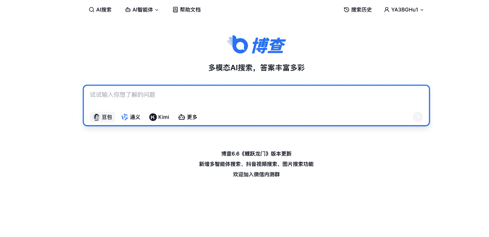

# 6月15日 Remix 1.0重大更新发布，提升用户创造力和社交体验

😁【AIGC每日新闻】

1.  【Remix 1.0重大更新发布，提升用户创造力和社交体验】Remix 1.0发布了一个重大更新，这次更新大大增强了用户的创造力和使用体验，使得设计过程更加愉快。更新还引入了先进的功能，彻底改变了社交互动的方式。通过这些改进，用户不仅能享受更好的设计体验，还能在社交互动中感受到全新的乐趣。参考博客链接: https://metatrend.ai/tweet-trends/v2?date=2024-06-14&name=AI#section-8。

1.  【生成动画短片的新工具：ToonCrafter发布】ToonCrafter是一个免费的AI工具，现在可以在Hugging Face上使用。用户只需上传两张关键帧图像（一个起始图像和一个结束图像），这些图像最好是同一角色或场景的轻微变化版本。然后，在提示字段中描述动作，调整设置，点击“生成”按钮，即可创建短视频。这个工具让任何人都能轻松生成一致的动画短片，非常适合动画爱好者和创作者。参考博客链接: https://huggingface.co/spaces/Doubiiu/tooncrafter?utm_source=www.therundown.ai&utm_medium=referral&utm_campaign=ai-chatbot-runs-for-office。

1.  【OpenAI CTO谈隐私、安全及内部AI模型】OpenAI的首席技术官Mira Murati在《财富》杂志的问答中讨论了隐私、安全和内部AI模型等话题。她表示，OpenAI和苹果公司都非常重视用户隐私，不会通过苹果账户记录数据或使用用户数据来训练模型。针对埃隆·马斯克称苹果合作是“诡异的间谍软件”的批评，Murati回应说，OpenAI尽量在安全方面保持透明。谈及董事会的动荡，她指出之前的董事会结构“只对自己负责”。此外，她提到OpenAI的内部模型与公众免费使用的模型相差不大，这意味着OpenAI并没有秘密开发一个类似GPT-5的高级模型。这次硬碰硬的问答让人联想到Sora那次著名的采访。参考博客链接: https://www.youtube.com/watch?v=BD0Us5Bn6Lw&utm_source=www.therundown.ai&utm_medium=referral&utm_campaign=ai-chatbot-runs-for-office。

🐯【今日份AI搜索工具推荐】

Miku AI https://hellomiku.com/

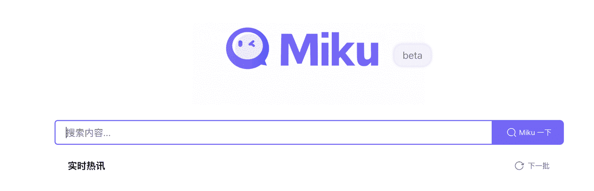

# 6月14日 Google DeepMind发布TORAX用于核聚变仿真

☺️【AIGC每日新闻】

1.  【特斯拉AI驱动的Optimus机器人：引领工业自动化新潮流】特斯拉在人工智能和机器人技术领域领先，推出了AI驱动的Optimus机器人，预计将对工业自动化产生重大影响。这[些](https://metatrend.ai/tweet-trends/v2?date=2024-06-13&name=AI#section-3)机器人能够执行复杂的任务，从而提高生产效率和降低成本。专家认为，人类将逐渐适应这些新技术，就像适应虚拟现实等新兴技术一样。未来，类似的AI创新还有可能在医疗等多个领域带来革命性变化。参考博客链接: https://metatrend.ai/tweet-trends/v2?date=2024-06-13&name=AI#section-3。

1.  【ARC[奖](https://metatrend.ai/tweet-trends/v2?date=2024-06-13&name=AI#section-4)推出100万美元的AGI挑战赛】ARC奖近日推出了一项总奖金为100万美元的通用人工智能（AGI）挑战赛，这被视为AGI研究的一个重要里程碑。此次挑战赛要求参赛者提出超越当前大型语言模型的创新方案，并且有望为人工智能研究做出重大贡献。这一举措吸引了众多AI研究人员和团队的关注，大家都希望通过这次比赛推动AGI技术的进一步发展。参考博客链接: https://metatrend.ai/tweet-trends/v2?date=2024-06-13&name=AI#section-4。

1.  【Goog[l](https://metatrend.ai/tweet-trends/v2?date=2024-06-13&name=AI#section-9)e DeepMind发布TORAX用于核聚变仿真】Google DeepMind发布了一款名为TORAX的新工具，专门用于核聚变仿真。这个工具结合了现代人工智能技术，能够更高效地模拟和研究核聚变过程。这一进展标志着在利用人工智能推动能源解决方案方面取得了重要突破，显示出AI技术在解决复杂科学问题上具有巨大的潜力。TORAX的发布不仅提升了核聚变研究的速度和精度，也为未来的能源创新带来了新的希望。参考博客链接: https://metatrend.ai/tweet-trends/v2?date=2024-06-13&name=AI#section-9。

🕹️【今日份AI搜索工具推荐】

aminer AI（学术搜索）https://www.aminer.org/

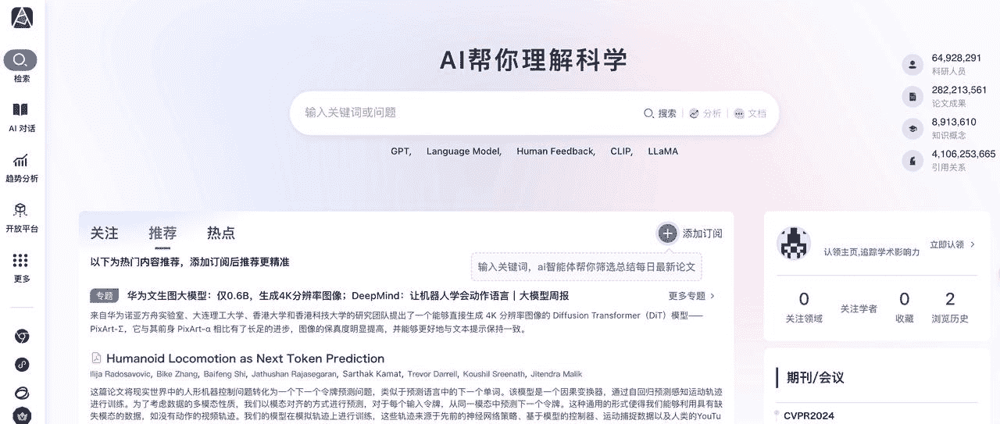

# 6月13日 美图发布多款AI工具，提升创作效率助力多行业

🫣【AIGC每日新闻】

1.  【美图发布多款AI工具，提升创作效率助力多行业】美图公司在影像节上展示了其最新的AI短片生成技术，并宣布将于7月31日推出AI短片创作平台MOKI。MOKI通过AI脚本、分镜图生成、智能剪辑等功能实[现短片全流程创作。此外，美图还发布了多个AI驱](https://www.bestblogs.dev/en/article/5dff51)动的新产品，包括游戏物料创作平台奇觅、专业设计师平台站酷设计服务、AI批量修图工具美图云修、口播视频制作平台开拍和电商AI设计工具美图设计室。这些工具将大大提升各行业的创作效率。参考博客链接: https://www.bestblogs.dev/en/article/5dff51。

1.  【Luma Labs推出Dream Machine：生成高质量AI视频】
Luma Labs推出了一款名为Dream Machine的新型AI模型，可以从文本和图像提示生成高质量、逼真的5秒视频片段。这个模型能够以惊人的平滑度和一致性生成视频，并且能[模拟真](https://lumalabs.ai/dream-machine?utm_source=www.therundown.ai&utm_medium=referral&utm_campaign=a-free-to-try-sora-competitor)实世界的相互作用和物理效果。Dream Machine通过在视频内容上的训练，使得生成的视频更加连贯。虽然官方声称可以在120秒内生成120帧视频，但由于需求量大，实际等待时间可能更长。用户可以免费生成30个视频，付费用户每月可生成多达2000个视频。这一技术的推出表明AI视频生成技术正在快速进步，并为未来的竞争设定了更高的标准。参考博客链接: https://lumalabs.ai/dream-machine?utm_source=www.therundown.ai&utm_medium=referral&utm_campaign=a-free-to-try-sora-competitor。

1.  【三星发布[AI芯片新计划，未来目标直指市场霸主地位】
三星公司近期公布了一系列AI芯片的新进展，包括全新的制造路线图、最新的芯片制造技术以及一个“一站式”AI芯片解决方案平台。三星表示，凭借这些生产升级和新A](https://university.therundown.ai/c/daily-tutorials/transform-your-photos-with-ai-upscaling-4b2959b6-abac-4a07-9e05-ec15b94ad725?utm_source=www.therundown.ai&utm_medium=referral&utm_campaign=a-free-to-try-sora-competitor)I芯片，预计到2028年其AI客户群将增加5倍，收入将增加9倍。此外，三星还聘请了前苹果高管Murat Akbacak领导新的北美AI中心。面对科技巨头们在AI芯片领域的激烈竞争，三星希望通过这些举措打破台积电的市场垄断，获取更多的市场份额。参考博客链接: https://university.therundown.ai/c/daily-tutorials/transform-your-photos-with-ai-upscaling-4b2959b6-abac-4a07-9e05-ec15b94ad725?utm_source=www.therundown.ai&utm_medium=referral&utm_campaign=a-free-to-try-sora-competitor。

🪔【今日份AI搜索工具推荐】

Phindhttps://www.phind.com/search?home=true

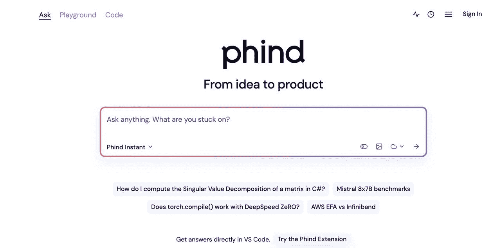

# 6月12日 Adobe因使用用户内容训练AI引发争议

🥱【AIGC每日新闻】

1.  【Adobe因使用用户内容训练AI引发争议】Adobe被指在未经用户同意的情况下，利用Creative Cloud平台上的内容来训练自己的AI模型。Eduardo对此表示不满，并建议用户上传带有Nightshade技术的图片来干扰Adobe的数据存储。这一行为引发了对用户隐私和数据使用的广泛讨论，用户担心他们的创作被用于商业用途而未获得应有的同意和报酬。参考博客链接: https://metatrend.ai/tweet-trends/v2?date=2024-06-11&name=AI#section-9。

1.  【微软调整Recall功能以应对安全担忧】微软在其新的Recall本地AI功能上进行了调整，以应对安全隐患。Recall功能原本是在微软Build大会上推出的，它可以在本地运行并不断截取用户操作的屏幕截图，以便记住用户的操作。然而，由于专家警告该功能可能会泄露截图和活动数据，导致隐私问题，微软决定将该功能默认关闭，用户需手动开启。此外，微软还加入了新的加密和认证措施以提高安全性。这项功能将于6月18日在新的Copilot + 电脑上以预览版形式推出。这一改变旨在平衡AI记忆功能与用户隐私保护之间的矛盾。参考博客链接: https://www.therundown.ai/p/microsofts-total-recall。

1.  【特斯拉发布FSD 12.4.1，自动驾驶功能进一步增强】特斯拉最近发布了FSD 12.4.1版本，展示了其在自动驾驶技术方面的显著进步。新版本的自动驾驶软件可以实现非触控驾驶，并表现出更接近人类驾驶员的行为，特别是在城市环境中的导航能力。然而，它在自动速度控制和车道变更方面仍有待改进。参考博客链接: https://metatrend.ai/tweet-trends/v2?date=2024-06-09&name=AI#section-2。

🎗️【今日份AI搜索工具推荐】

Iask（作业搜索）https://iask.ai/

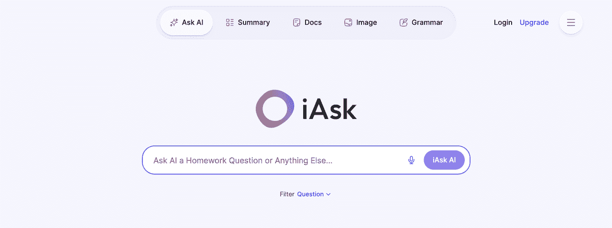

# 6月11日 苹果WWDC发布会亮点：全新AI策略和Siri升级

😲【AIGC每日新闻】

1.  【苹果WWDC发布会亮点：全新AI策略和Siri升级】在备受期待的WWDC发布会上，苹果推出了新的“Apple Intelligence”AI策略，并宣布与OpenAI合作。iOS 18、iPadOS和macOS 15将迎来一系列AI新功能。新一代Siri将更自然地对话，记住上下文并完成更复杂的任务。邮件、消息和备忘录中新增了AI写作工具，照片应用则引入了更智能的搜索和编辑功能。苹果强调隐私保护，大部分AI处理将在设备上完成，并引入了Private Cloud Compute（PCC）系统。通过与OpenAI的合作，Siri将能利用ChatGPT/GPT-4o处理更复杂的问题。这些升级将提升用户体验，使语音助手更加实用。参考博客链接: https://www.apple.com/newsroom/2024/06/introducing-apple-intelligence-for-iphone-ipad-and-mac/?utm_source=www.therundown.ai&utm_medium=referral&utm_campaign=apple-brings-chatgpt-to-iphones。

1.  【马斯克威胁禁用苹果设备，因其与OpenAI合作】特斯拉和SpaceX创始人埃隆·马斯克在苹果公司宣布与OpenAI合作后，威胁要禁止其公司使用苹果设备。马斯克在社交媒体上称这种合作为“令人毛骨悚然的间谍软件”，并质疑其数据保护能力。为此，他表示将要求公司访客在进入时将苹果设备存放在“法拉第笼”中。此外，马斯克还回应称，如果苹果继续与OpenAI合作，他可能会开发自己的“Grok手机”。尽管苹果与OpenAI的合作引发了广泛关注和期待，马斯克的隐私担忧却再次浮出水面，但也难以完全脱离他与前公司OpenAI的个人恩怨背景。参考博客链接: https://link.therundown.ai/gamma?utm_source=www.therundown.ai&utm_medium=referral&utm_campaign=apple-brings-chatgpt-to-iphones。

1.  【Dadabots发布Stable Audio Open 1.0，提升音乐样本创作】Dadabots发布了一个名为Stable Audio Open 1.0的人工智能模型，这个模型非常适合用于音乐样本的创作。通过Gradio平台，用户可以轻松访问并生成高质量的音乐样本。这一成功归功于StabilityAI的Stable Audio团队的努力，旨在为音乐创作者提供一个简单易用且高效的工具。参考博客链接: https://metatrend.ai/tweet-trends/v2?date=2024-06-06&name=AI#section-9。

🎁【今日份AI搜索工具推荐】

Elicit（学术搜索）https://elicit.com/

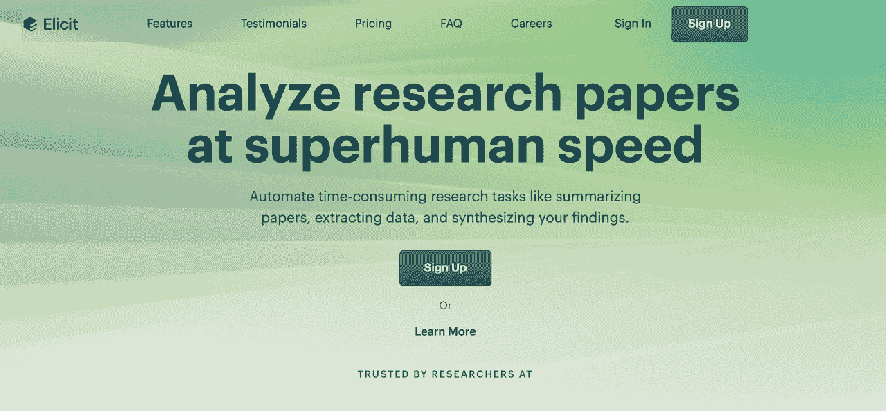

# 6月10日 Google DeepMind的Genie和ASI的重大进展

😮【AIGC每日新闻】

1.  【Google DeepMind的Genie和ASI的重大进展】Tim Rocktäschel认为Google DeepMind的Genie是AI能力的重大飞跃，而Carlos E. Perez则强调，从人工通用智能（AGI）到超级智能（ASI）的发展路径中，开放性对于持续的AI进步至关重要。Google DeepMind最近推出了一个名为Genie的AI系统，这标志着AI技术的一个重要突破。专家Tim Rocktäschel认为，这将极大提升AI的能力。而另一位专家Carlos E. Perez则指出，AI的发展路径是从AGI到ASI，即从能够执行广泛任务的智能系统到超出人类智能的系统。他强调，为了AI的持续进步，系统的开放性是至关重要的。参考博客链接: https://metatrend.ai/tweet-trends/v2?date=2024-06-09&name=AI#section-6。

1.  【AI安全新突破："短路"技术增强模型鲁棒性】最近，Andy Zou介绍了AI安全领域的新突破——“短路”技术。这种技术旨在提高AI模型的鲁棒性，从而增强其抵御恶意攻击和不良输出的能力。Dan Hendrycks对此技术充满信心，认为它在防止AI产生有害内容方面具有巨大潜力。这一进展有望为AI的安全应用带来新的保障，使其在更多领域得到安全可靠的使用。参考博客链接: https://metatrend.ai/tweet-trends/v2?date=2024-06-09&name=AI#section-9。

1.  【世界首个AI选美大赛：虚拟模特的崛起】The World AI Creator Awards和FanVue平台正在举办首届“Miss AI”选美大赛，吸引了超过1500个AI生成的模特参赛。经过筛选，10名决赛选手脱颖而出，最终的冠军将在6月底揭晓。参赛的虚拟模特来自全球各地，不仅展示了逼真的照片，还代表了各种不同的社会议题和个性。评审们将评估AI技术，包括图像生成和创作者在社交媒体上的互动能力。奖池总额为2万美元，还有公关和导师计划的机会。这项比赛展示了AI图像生成技术的先进性，未来我们可能会越来越多地接触到这些虚拟代言人和模特。虽然AI选美大赛听起来有些奇怪，但未来可能会更为常见。参考博客链接: https://www.npr.org/2024/06/09/nx-s1-4993998/the-miss-ai-beauty-pageant-ushers-in-a-new-type-of-influencer?utm_source=www.therundown.ai&utm_medium=referral&utm_campaign=the-world-s-first-ai-beauty-pageant。

🎀【今日份AI搜索工具推荐】

Lepton AIhttps://search.lepton.run/

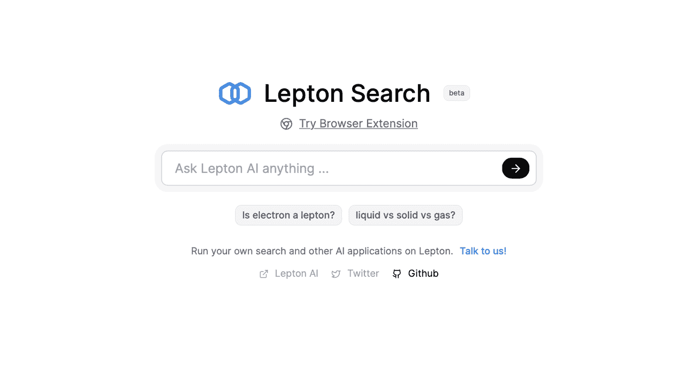

# 6月9日 Apple Intelligence：苹果推出全新AI计划提升用户体验

🤓【AIGC每日新闻】

1.  【Apple Intelligence：苹果推出全新AI计划提升用户体验】苹果公司近日宣布推出一项名为“Apple Intelligence”的新人工智能计划，旨在显著提升用户体验。这一举措不仅有助于巩固苹果在创新领域的领导地位，还表明了苹果对用户隐私和安全的承诺。预计这一计划将为Apple生态系统带来重大变革，成为改变游戏规则的关键因素。通过这一计划，苹果旨在为用户提供更智能、更个性化的服务，进一步增强设备的实用性和便捷性。参考博客链接: https://metatrend.ai/tweet-trends/v2?date=2024-06-08&name=AI#section-5。

1.  【AI将彻底改变电影业，阿什顿·库彻充满信心】阿什顿·库彻对人工智能在电影行业的未来充满乐观，他相信AI将彻底改变电影制作过程。库彻表示，AI不仅可以接管剧本写作，还能参与到电影制作的各个环节，极大地提升效率和创造力。这种技术的运用将为电影行业带来新的可能性和无限的想象空间，让电影制作变得更加高效和多样化。参考博客链接: https://metatrend.ai/tweet-trends/v2?date=2024-06-08&name=AI#section-6。

1.  【加州SB-1047法案与AI责任】著名人工智能专家Andrew Ng和Surya Ganguli认为，监管应该针对具体的AI应用，而不是整个技术本身。Kelsey Piper则指出AI潜在的风险，但认为行业崩溃的可能性不大，因为这会引发诚信问题。专家们强调了应对AI进行有针对性的监管，而非全面打击。参考博客链接: https://metatrend.ai/tweet-trends/v2?date=2024-06-08&name=AI#section-8。

🎋【今日份AI搜索工具推荐】

Youhttps://you.com/?chatMode=default

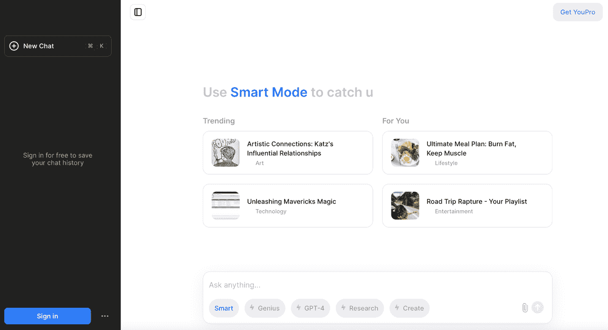

# 6月8日 快手推出先进的AI视频生成器KLING

😎【AIGC每日新闻】

1.  【快手推出先进的AI视频生成器KLING】快手推出了一款名为KLING的先进AI视频生成器，吸引了众多爱好者的关注。人们将其与OpenAI的Sora相提并论，期待它能对AI视频技术带来革命性的改变。KLING展示了令人印象深刻的演示效果，已经在各种平台上进行展示，显示出其强大的技术能力。参考博客链接: https://metatrend.ai/tweet-trends/v2?date=2024-06-07&name=AI#section-2。

1.  【Brave Search API：强大实惠的搜索服务新选择】 Brave Search API是一个强大且经济实惠的搜索服务选择，它提供了对超过200亿网页的不断增长的索引访问。通过利用真实的人类交互数据来训练模型，以及简化的用户友好数据结构，Brave Search API使得集成更加简单。相比更昂贵的选项如Bing，Brave Search API为人工智能应用程序提供了准确、相关且引人入胜的结果。参考博客链接: https://www.theinformation.com/articles/chinas-nvidia-loophole-how-bytedance-got-the-best-ai-chips-despite-u-s-restrictions?utm_source=www.therundown.ai&utm_medium=referral&utm_campaign=china-s-new-sora-rival-is-here。

1.  【字节跳动绕过限制在美国使用先进AI芯片】由于国家安全问题，美国政府禁止将Nvidia的A100和H100等AI芯片直接出售给中国公司。然而，这些限制并未阻止中国公司在美国境内租赁并使用这些芯片。字节跳动通过租赁Oracle服务器，获得了超过1500块H100芯片和数千块A100芯片。类似地，阿里巴巴和腾讯等中国科技巨头也在探索通过租赁或在美国设立数据中心的方式获取AI芯片资源。此举表明，中美两国在AI领域的竞争持续升温，而美国的限制措施犹如“打地鼠”游戏，难以全面阻止中国在AI领域的进展。参考博客链接: https://chat.mistral.ai/?utm_source=www.therundown.ai&utm_medium=referral&utm_campaign=china-s-new-sora-rival-is-here。

🎊【今日份AI搜索工具推荐】

探索者https://explorer.globe.engineer/

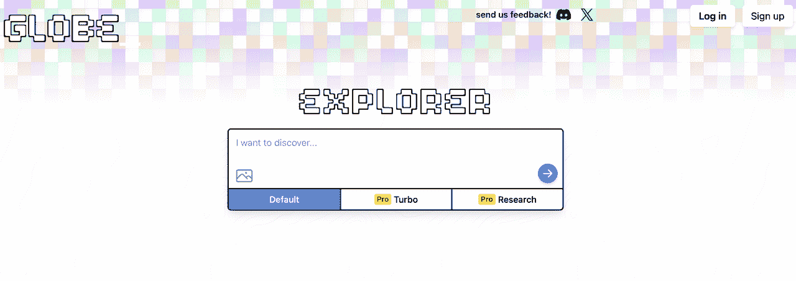

# 6月7日 AGI有望在2025-2028年实现，专家看好其现实性

🥸【AIGC每日新闻】

1.  【AGI有望在2025-2028年实现，专家看好其现实性】不少专家认为，随着当前人工智能技术的不断进步，通用人工智能（AGI）在2025至2028年间实现的时间线是现实的。AGI指的是一种可以胜任知识工作、能替代普通美国工资水平的知识工作者的AI系统。OpenAI的领导层甚至计划通过在美国、中国和俄罗斯政府间引发竞标战来为AGI融资和销售，显示出其大胆的战略。虽然这一前景让一些人感到压力巨大，但随着计算集群的发展以及对间谍风险的讨论，AGI在2027年实现的可能性显得更为可信。参考博客链接: https://metatrend.ai/tweet-trends/v2?date=2024-06-06&name=AI#section-1。

1.  【OpenAI推出GPT-4新功能："背景对话"和语音功能】OpenAI最新发布的GPT-4功能包括“背景对话”和语音功能，这些新特性显著提升了用户体验，并且默认是可选的。这些功能展示了生成式人工智能的进步。虽然有人对这些新功能的潜在风险表示担忧，但其强大的能力也令人印象深刻。参考博客链接: https://metatrend.ai/tweet-trends/v2?date=2024-06-06&name=AI#section-3。

1.  【Tesla巨额投资GPU提升自动驾驶技术】Tesla公司正在进行一项巨额投资，购买大量GPU（图形处理单元）以提升其全自动驾驶（FSD）技术。此举旨在显著增强Tesla的自动驾驶能力，使其超过Nvidia现有的液冷AI计算基础设施。这意味着Tesla未来的自动驾驶汽车将更智能、更高效，更接近完全自主驾驶的目标。参考博客链接: https://metatrend.ai/tweet-trends/v2?date=2024-06-06&name=AI#section-7。

🎈【今日份AI搜索工具推荐】

Andi（对话式搜索）https://andisearch.com/

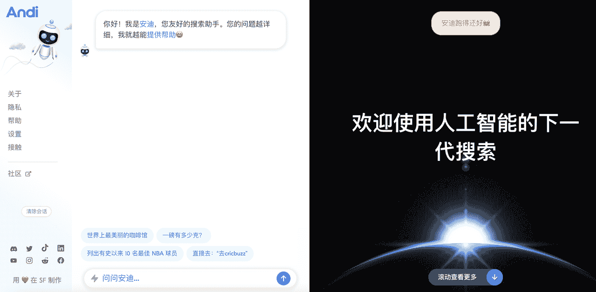

# 6月6日 COMPUTEX 2024揭示AI重大突破

🥳【AIGC每日新闻】

1.  【COMPUTEX 2024揭示AI重大突破】在COMPUTEX 2024上，NVIDIA展示了多项变革性AI技术，特别是其数字人技术，被认为是未来AI的重要里程碑。NVIDIA的CEO黄仁勋在主题演讲中展示了这些创新，突显了AI的巨大潜力。与此同时，英特尔推出了Lunar Lake处理器，这标志着个人计算机在AI领域的又一次重大飞跃。英特尔的CEO帕特·基辛格的主题演讲预计将对数字化转型产生深远影响。这些突破预示着AI技术将在各个领域得到更广泛的应用和发展。参考博客链接: https://metatrend.ai/tweet-trends/v2?date=2024-06-05&name=AI#section-3。

1.  【特斯拉投资100亿美元推进AI计划】特斯拉公司宣布了一项重大投资计划，将斥资100亿美元用于人工智能技术的发展。这一巨额投入显示了特斯拉对AI未来的信心，特别是在自动驾驶和其他智能功能的开发上。他们还特别强调了对Nvidia GPU的信任，这些高性能芯片将为特斯拉的AI系统提供强大支持。尽管有人幽默地质疑特斯拉在AI芯片采购上的管理决策，但不可否认的是，这笔投资展示了特斯拉在AI技术上的坚定决心。参考博客链接: https://metatrend.ai/tweet-trends/v2?date=2024-06-05&name=AI#section-6。

1.  **【**AE Studio推出新AI工具，助力企业解决难题】AE Studio推出了一款创新的AI工具，帮助企业高效解决其面临的各种挑战。使用该工具非常简单，只需回答三个关于业务需求的问题，AI就会基于这些信息提供可靠的解决方案。该工具为企业提供了一种便捷的方法，快速应对各种业务问题。现在，您可以免费试用AE Studio的AI工具，立即开始解决您的重要问题。参考博客链接: https://ae.studio/lh/ai-ideas?utm_campaign=the-rundown-6524&utm_source=the-rundown&utm_medium=newsletter。

✨️【今日份AI搜索工具推荐】

共识（论文搜索）https://consensus.app

# 6月5日 Descript推出Underlord，简化视频音频编辑流程

🤠【AIGC每日新闻】

1.  【Microsoft Aurora革新天气预报】微软推出的Aurora技术正在彻底改变天气预报的方式。这项技术不仅能更好地预测和应对极端天气事件，还显著提高了预报的效率和成本效益。Aurora的预测速度和准确性前所未有，将为全球的天气预报带来革命性变化。参考博客链接: https://metatrend.ai/tweet-trends/v2?date=2024-06-04&name=AI#section-5。

1.  【Naver展示自动化办公：机器人送咖啡】韩国搜索巨头Naver展示了其公司内部的自动化星巴克，100个机器人在大楼内送咖啡和其他物品。Naver的“Rookie”机器人可以在36层楼内导航，送包裹、咖啡和午餐给员工。它们由“Ambidex”机器人辅助，这些机器人轻巧且灵活，适合与人互动。所有机器人通过Naver的ARC系统连接，利用云计算进行导航、规划和处理。此外，Naver还开发了RoboPort，一个专门的电梯系统，使机器人能快速高效地在楼层之间移动。虽然目前只是测试阶段，但这展示了服务机器人将如何更快地融入主流生活。参考博客链接: https://www.youtube.com/watch?v=yYqviahEyno&utm_source=www.therundown.ai&utm_medium=referral&utm_campaign=a-starbucks-run-by-100-ai-powered-robots。

1.  **【**Descript推出Underlord，简化视频音频编辑流程】Descript推出了Underlord，一款内置了AI编辑工具的全新视频音频编辑器。用户只需注册并下载Descript或在网页上免费使用，然后上传文件或录制视频。Underlord可以自动删除填充词或重录片段，创建剪辑，或处理其他繁琐的编辑任务。此外，Underlord还提供了易于使用的界面，帮助用户探索更多功能。通过这些简化的步骤，Descript希望让视频音频编辑变得更轻松便捷。参考博客链接: https://famv.short.gy/agcCxW?utm_source=www.therundown.ai&utm_medium=referral&utm_campaign=a-starbucks-run-by-100-ai-powered-robots。

🎆【今日份AI搜索工具推荐】

Bookabout（书籍搜索）https://bookabout.io/

# 6月4日 Perplexity AI推出“AI百科”页面，助力信息合成

🤯【AIGC每日新闻】

1.  【Perplexity AI推出“AI百科”页面，助力信息合成】Perplexity AI推出了一款名为“AI Wikipedia”的新工具，这个工具被视为研究人员和学生进行信息合成的变革性产品。它能够帮助用户轻松地获取和整理信息，对于专家来说，它还提供了为不同受众创建详细说明的巨大潜力。这意味着无论是普通用户还是专业人士，都可以借助这个工具更高效地获取和分享知识。参考博客链接: https://metatrend.ai/tweet-trends/v2?date=2024-06-03&name=AI#section-8。

1.  【Llama-3-400B+预计将带来重大创新】即将发布的Llama-3-400B+被认为将推动重大创新和研究进展，尤其对基层初创公司和研究人员有重要帮助，并设立新的行业标杆，革新开源人工智能领域。参考博客链接: https://metatrend.ai/tweet-trends/v2?date=2024-06-03&name=AI#section-9。

1.  【Firefox 130推出私人AI用于替代文本和翻译】Mozilla公司发布了Firefox 130版本，重点推出了私人AI功能，用于网页中的替代文本生成和翻译。这一举措显著提升了网页的可访问性，同时展示了先进的、私密的设备端AI技术。此版本受到了AI倡导者的高度赞扬。参考博客链接: https://metatrend.ai/tweet-trends/v2?date=2024-06-03&name=AI#section-6。

🎄【今日份AI搜索工具推荐】

CrowdView（论坛搜索）https://crowdview.ai/

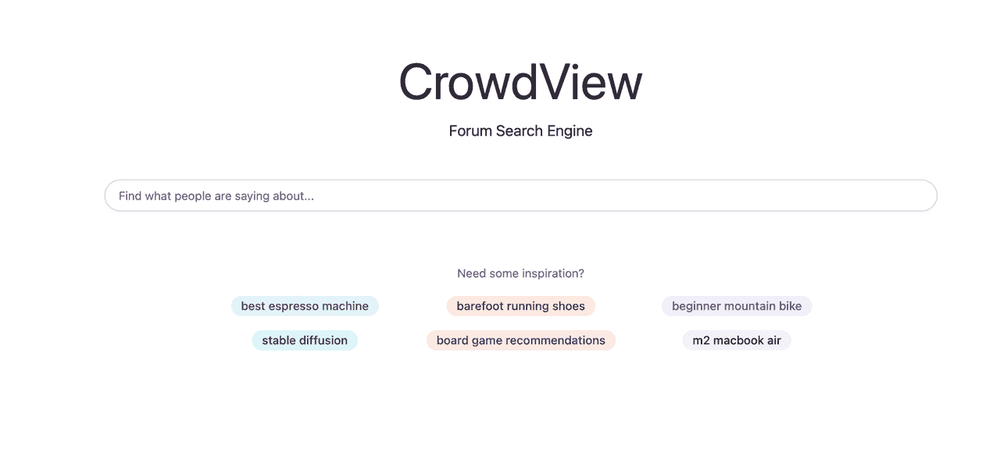

# 6月3日 io.net和谷歌的AI创新引发关注

😴【AIGC每日新闻】

1.  【Nvidia发布新一代AI技术：Rubin芯片、游戏助手和虚拟形象工具】在Computex大会上，Nvidia CEO黄仁勋宣布了一系列AI新技术，包括下一代‘Rubin’芯片、AI游戏助手和虚拟形象创建工具。Rubin平台预计在2026年推出，次年将发布性能更强的‘Rubin Ultra’。此外，Nvidia展示了Project G-Assist，这是一款能够为PC游戏提供上下文感知帮助和个性化回应的AI游戏助手。公司还推出了ACE，这是一套简化数字虚拟形象创建的AI服务，适用于客户服务和医疗等领域。Nvidia通过这些创新，继续引领AI技术的发展，影响着未来的AI应用体验。参考博客链接: https://www.nvidia.com/en-us/events/computex/?utm_source=www.therundown.ai&utm_medium=referral&utm_campaign=nvidia-s-new-industrial-revolution。

1.  【Yann LeCun对博士生研究LLM的建议】Yann LeCun认为，解决大型语言模型（LLM）的缺陷将推动人工智能的发展。他表示，单纯研究LLM可能不太有成效，但他在质疑当前LLM能力的同时，对深度学习的未来充满信心。参考博客链接: https://metatrend.ai/tweet-trends/v2?date=2024-06-02&name=AI#section-5。

1.  【io.net和谷歌的AI创新引发关注】io.net正努力将人工智能与区块链技术结合，这种创新引发了众多爱好者的期待。同时，谷歌推出的新AI——Veo，也备受关注。Veo有望彻底改变数字互动的方式，使得用户体验更加智能和流畅。这两个公司的突破性进展标志着人工智能领域的新高度，未来将可能带来更多令人兴奋的应用和发展。参考博客链接: https://metatrend.ai/tweet-trends/v2?date=2024-06-02&name=AI#section-7。

🎃【今日份AI搜索工具推荐】

Askan AI（机器人问答）https://www.askan.ai/what-is-the-pulitzer-prize

# 6月2日 Zapier推出Chrome扩展，提升浏览器AI体验

🤥【AIGC每日新闻】

1.  【iOS 18为iPhone 15 Pro带来先进AI功能】苹果公司即将发布的iOS 18将为iPhone 15 Pro引入更加先进的人工智能功能。这些新功能大幅提升了Siri的能力，使其在智能助手领域更具竞争力。用户体验将因此得到显著改善，预计这也会促使更多用户升级到最新款iPhone，从而推动苹果未来的销售增长。参考博客链接: https://metatrend.ai/tweet-trends/v2?date=2024-06-01&name=AI#section-3。

1.  【The Simulation推出AI电视节目平台Showrunner】AI娱乐初创公司The Simulation（前身为Fable Studio）推出了一个名为Showrunner的平台，允许用户在虚拟模拟世界中生成和观看AI驱动的电视节目。Showrunner结合了多代理模拟和大型语言模型，为特定虚拟世界创造互动内容。用户可以观看、导演并参演这些虚拟环境中的节目，并通过提示生成新剧集，深入编辑脚本、镜头和声音。平台以10个原创节目启动，部分用户创作的剧集将获得付款、收益分享和IMDB信用。随着AI、游戏和传统娱乐的融合，Showrunner为用户提供了创造故事的新方式，传统的好莱坞媒体模式也将因此发生变化。参考博客链接: https://x.com/fablesimulation/status/1796245808066740274?utm_source=www.therundown.ai&utm_medium=referral&utm_campaign=the-netflix-of-ai。

1.  **【**Zapier推出Chrome扩展，提升浏览器AI体验】Zapier推出了一款新的Chrome扩展，旨在将AI的强大功能带到浏览器中。通过这个扩展，用户可以实时总结网站内容、翻译页面、学习网页信息以及自动化任务。使用方法包括：

1.  登录或创建一个免费的Zapier账户。

1.  从指定链接安装Zapier Central Chrome扩展。

1.  访问任何你想使用AI功能的网站。

1.  点击Zapier扩展图标，选择“+ New Bot”，并输入诸如“总结此页面”或“将此页面翻译成西班牙语”等请求。

这个扩展让用户可以更轻松地处理网页内容，提高工作效率。参考博客链接: https://central.zapier.com/?utm_source=www.therundown.ai&utm_medium=referral&utm_campaign=the-netflix-of-ai。

☄️【今日份AI搜索工具推荐】

KOMOhttps://komo.ai/ask/dVcap65JVrv9KNgq0Wig

# 6月1日 Perplexity AI推出Perplexity Pages，或将颠覆信息处理

🤤【AIGC每日新闻】

1.  【Perplexity AI推出Perplexity Pages，或将颠覆信息处理】Perplexity AI公司推出了一项名为Perplexity Pages的新功能。这项功能有望彻底改变信息处理的方式，大大简化科研文章的创作过程。预计这一功能将成为年度最佳产品的有力竞争者。参考博客链接: https://metatrend.ai/tweet-trends/v2?date=2024-05-31&name=AI#section-5。

1.  【苹果将通过先进AI提升Siri的语音控制能力】苹果公司计划对其语音助手Siri进行重大升级，利用先进的人工智能技术来改善用户的语音控制体验。这次更新有望彻底改变用户与设备的互动方式，显著提升用户的使用体验，同时展示苹果在先进AI技术领域的承诺。通过这一升级，Siri将变得更加智能和高效，为用户提供更为流畅和自然的互动体验。参考博客链接: https://metatrend.ai/tweet-trends/v2?date=2024-05-31&name=AI#section-6。

1.  【“AI for Good”峰会强调安全和可持续的人工智能】此次“AI for Good”峰会强调了联合国致力于全球包容性发展的承诺，关注人工智能可能带来的经济风险，并促进专家之间的合作，旨在找到具有积极影响的AI解决方案。通过这一活动，各界人士共同探讨如何在确保安全和可持续的前提下，充分利用人工智能的潜力，为全球带来福祉。参考博客链接: https://metatrend.ai/tweet-trends/v2?date=2024-05-31&name=AI#section-3。

🌈【今日份prompt工具推荐】

https://www.clickprompt.org/zh-CN/

# 5月31日 AI娱乐新突破：用户可生成虚拟世界中的电视剧

😬【AIGC每日新闻】

1.  【VoxMedia与The Atlantic联手OpenAI，推动内容创作革新】Vox Media和The Atlantic两家媒体公司与OpenAI达成合作，利用人工智能技术提升内容创作和分发，并吸引更多读者。这个合作被认为是内容创作领域的一次革命性突破，表明这些公司在数字时代通过大力投资AI技术来保持竞争力。参考博客链接: https://metatrend.ai/tweet-trends/v2?date=2024-05-30&name=AI#section-2。

1.  【AI娱乐新突破：用户可生成虚拟世界中的电视剧】AI娱乐初创公司The Simulation（前身为Fable Studio）推出了Showrunner平台，这个平台让用户可以生成和观看由AI驱动的、设定在虚拟模拟世界中的电视剧。Showrunner结合多代理模拟和大型语言模型（LLMs），创造出与特定虚拟世界相一致的互动内容。用户不仅能观看，还能导演并出演这些由AI角色组成的虚[拟环境](https://x.com/fablesimulation/status/1796245808066740274?utm_source=www.therundown.ai&utm_medium=referral&utm_campaign=the-netflix-of-ai)中的剧集，甚至可以根据提示创作新的剧集。平台初期推出了10部原创剧集，用户可以生成新剧集并深入编辑剧本、镜头和配音。Showrunner现已开放alpha测试，部分用户创作的剧集将获得报酬、收益分成和IMDB信用。去年，该工作室因发布南方公园剧集演示和SHOW-1模型研究论文而走红。Showrunner代表了AI、游戏和传统娱乐的融合，正在快速模糊创作者与观众之间的界限，传统的好莱坞媒体模式可能会因此发生巨大变化。参考博客链接: https://x.com/fablesimulation/status/1796245808066740274?utm_source=www.therundown.ai&utm_medium=referral&utm_campaign=the-netflix-of-ai。

1.  【Gui[dde](http://www.guidde.com/?utm_campaign=therundownai&utm_source=email&utm_medium=newsletter&utm_term=0112&utm_content=therundownai)：一键创建AI驱动的视频工作流程】Guidde是一款由人工智能驱动的平台，可以帮助用户快速制作引人入胜的视频文档。通过Guidde的GPT扩展，你无需任何专业经验，就能设计出惊艳的视觉效果，利用AI生成详细的步骤描述和语音解说，还能轻松捕捉工作流程。体验AI赋能的文档制作魔力，试试Guidde的免费扩展吧。参考博客链接: http://www.guidde.com/?utm_campaign=therundownai&utm_source=email&utm_medium=newsletter&utm_term=0112&utm_content=therundownai。

🌧️【今日份prompt工具推荐】

https://aijiaolian.chat/midjourney

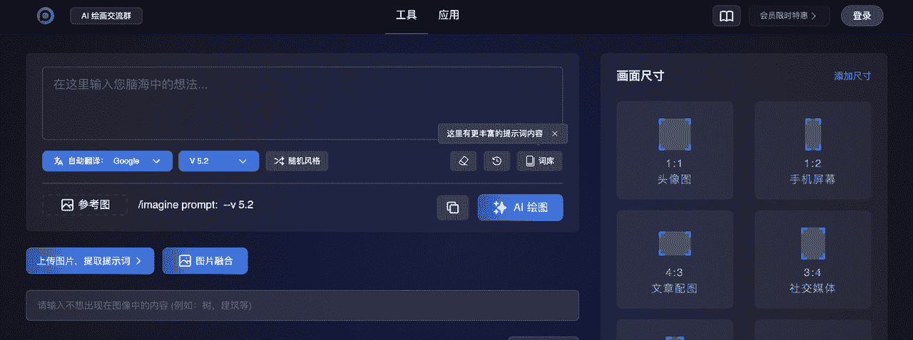

# 5月30日 OpenAI成立安全委员会，推进下一代AI模型开发

😏【AIGC每日新闻】

1.  【突破性AI编程助手：SWE-Agent和AutoCoder】SWE-Agent和AutoCoder是两种突破性的AI编程助手。SWE-Agent采用宽松的MIT许可证，这意味着它可以被广泛使用和修改。它建议使用LLM（大型语言模型）原生接口，而不是传统的人类界面，这为新的创业公司提供了类似API生态系统的机会。与此同时，AutoCoder在性能上的进步突显了它在AI编程解决方案中的领先地位。这两款工具有望彻底改变编程行业，提高开发效率并创造新的商业机会。参考博客链接: https://metatrend.ai/tweet-trends/v2?date=2024-05-29&name=AI#section-8。

1.  【OpenAI成立安全委员会，推进下一代AI模型开发】OpenAI宣布成立一个新的安全与保障委员会，由CEO Sam Altman和董事会成员Bret Taylor、Adam D’Angelo及Nicole Seligman领导。该委员会将在未来90天内评估安全和保障流程，并计划公开分享他们的建议。OpenAI表示，新的AI模型将把他们带入通向通用人工智能（AGI）的新阶段。不过，这一举措未能让那些质疑OpenAI现任领导层的人放心。此外，模糊的模型说明也引发了关于GPT-5即将发布的猜测，并且下一个系统已经开始训练。参考博客链接: https://openai.com/index/openai-board-forms-safety-and-security-committee/?utm_source=www.therundown.ai&utm_medium=referral&utm_campaign=sam-altman-s-new-safety-squad。

1.  【前OpenAI高管加入Anthropic，专注AI安全】前OpenAI高管Jan Leike宣布加入竞争对手Anthropic，领导一个专注于AI安全和安全的新团队。Leike在5月中旬与Ilya Sutskever一起辞职，导致OpenAI解散了其超级对齐安全团队。Leike表示，他的新团队将专注于“可扩展的监督、弱到强的泛化，以及自动化对齐研究”。此举发生在Leike批评OpenAI更关注“闪亮产品”而非安全文化的几周后。Leike的加入增强了Anthropic在AI安全领域的可信度，并可能吸引其他AI安全领域的重要人才。参考博客链接: https://x.com/janleike/status/1795497960509448617?utm_source=www.therundown.ai&utm_medium=referral&utm_campaign=sam-altman-s-new-safety-squad。

🌦️【今日份prompt工具推荐】

https://www.frozenland.cc/teleprompter.html

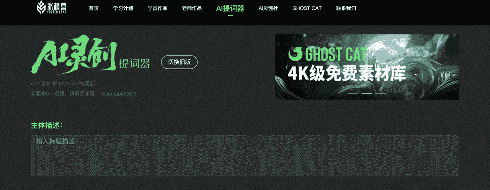

# 5月29日 FSD汽车精确避开交通拥堵，AGI时代或将来临

🫥【AIGC每日新闻】

1.  【xAI获得60亿美元融资，期待引领AI技术进步】xAI公司刚刚获得了高达60亿美元的融资，这标志着该公司在人工智能领域迈出了重要一步。此举预计将加速AI技术的发展，并帮助xAI成为行业的重要玩家。由于埃隆·马斯克的影响力以及他可能将xAI与其他项目整合的计划，人们对该公司的技术影响充满期待，尤其是希望xAI能够开发出更加公正、无偏见的AI模型。参考博客链接: https://metatrend.ai/tweet-trends/v2?date=2024-05-28&name=AI#section-1。

1.  【FSD汽车精确避开交通拥堵，AGI时代或将来临】最近，一辆配备全自动驾驶（FSD）系统的汽车展示了它在避开交通拥堵方面的精准能力。这种技术不仅能让汽车自主导航，还能在复杂的交通环境中做出优先决策。专家认为，这种先进的自动驾驶技术可能是我们距离人工通用智能（AGI）——一种能够像人类一样思考和学习的人工智能——时代越来越近的标志。AGI的实现将意味着机器人和智能系统将能在更广泛的任务中表现出色，带来巨大的社会和经济影响。参考博客链接: https://metatrend.ai/tweet-trends/v2?date=2024-05-28&name=AI#section-9。

1.  【AE Studio推出AI工具，简化企业问题解决】AE Studio最新推出了一款AI工具，可以帮助企业将面临的挑战转化为可行的解决方案。这个工具的使用非常简单，只需回答三个关于业务需求的问题，AI就会生成经过验证的解决方案。现在，您可以免费试用这款AI工具，快速有效地解决企业面临的最大难题。参考博客链接: https://ae.studio/lh/ai-ideas?utm_campaign=the-rundown-52824&utm_source=the-rundown&utm_medium=newsletter。

🌪️【今日份prompt工具推荐】

https://learnprompting.org/zh-Hans/docs/intro

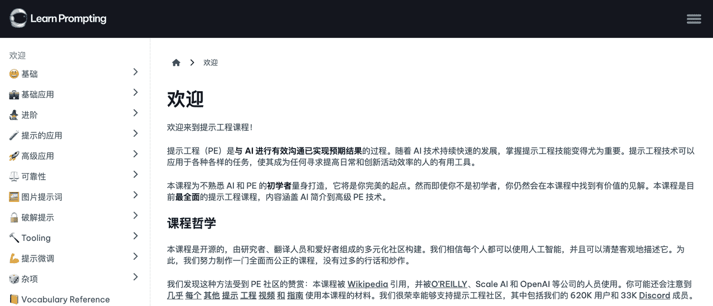

# 5月28日 谷歌新AI搜索功能面对可靠性担忧

😶【AIGC每日新闻】

1.  【苹果将在WWDC发布全面AI功能，提升用户体验】在即将举行的WWDC大会上，苹果计划展示一系列基于生成式AI的创新功能，包括定制表情符号和Siri升级。这些新功能表明苹果致力于通过AI技术来提升用户体验。外界对这些创新的AI功能充满期待，并且有传闻称苹果可能会与OpenAI合作。这一系列发布被视为苹果在AI领域取得重大进展的关键时刻，也预示着公司未来的发展方向。参考博客链接: https://metatrend.ai/tweet-trends/v2?date=2024-05-27&name=AI#section-9。

1.  【谷歌新AI搜索功能面对可靠性担忧】谷歌最新的AI搜索功能因频繁提供错误信息和“AI幻觉”而引发了广泛关注和质疑。例如，该AI工具声称宇航员在月球上遇到了猫，建议用胶水来粘披萨上的奶酪，还错误地说奥巴马是穆斯林总统。专家批评该工具不负责任，并可能传播偏见和错误信息。尽管谷歌CEO桑达尔·皮查伊强调该AI的创造性，但用户更需要精准的答案。许多媒体报道了这种不准确的AI搜索结果，专家们也敦促谷歌解决这些问题。参考博客链接: https://metatrend.ai/tweet-trends/v2?date=2024-05-27&name=AI#section-1。

1.  【AI耳机能在嘈杂环境中隔离单一声音】一项新的AI技术能够让耳机在嘈杂的环境中只听到一个人的声音。这意味着即使在喧闹的聚会或繁忙的咖啡馆里，你也能清楚地听到对方说话。这项技术有望彻底改变我们在嘈杂环境中的交流方式，让沟通更加清晰、顺畅。参考博客链接: https://metatrend.ai/tweet-trends/v2?date=2024-05-27&name=AI#section-5。

🌌【今日份prompt工具推荐】

https://www.icihun.com

# 5月27日 Canva推出2024年高级AI设计功能，提升用户体验

🤨【AIGC每日新闻】

1.  【Canva推出2024年高级AI设计功能，提升用户体验】Canva即将推出一系列高级AI设计功能，引起了用户的极大关注。这些功能主要集中在改善设计师的使用体验和增加互动性。新功能的数量在13到19个之间，涵盖了从[自](https://metatrend.ai/tweet-trends/v2?date=2024-05-26&name=AI#section-4)动化设计建议到更智能的素材管理等各个方面。通过这些更新，Canva不仅使设计过程更加高效，还让用户能够更轻松地创建出色的作品。这些改进将进一步巩固Canva在设计工具市场的领先地位，并满足专业设计师和普通用户的多样化需求。参考博客链接: https://metatrend.ai/tweet-trends/v2?date=2024-05-26&name=AI#section-4。

1.  【微软研究论坛探讨公平AI的未来】微软研究论坛将重点讨论如何实现更公平的人工智能。与会者将深入了解数据表示方法、基础性进展[以](https://metatrend.ai/tweet-trends/v2?date=2024-05-26&name=AI#section-6)及包容性AI的重要影响。这次论坛旨在推动AI技术的公平性和包容性，确保各种背景和社区的人都能从中受益。参考博客链接: https://metatrend.ai/tweet-trends/v2?date=2024-05-26&name=AI#section-6。

1.  【Yann LeCun提出目标驱动JEPA】Yann LeCun提出的目标驱动联合嵌入预测架构（JEPA），这种新方法有望处理更复杂的认知任务，代表了比传统生成模型更大的进[步](https://metatrend.ai/tweet-trends/v2?date=2024-05-26&name=AI#section-8)。JEPA的核心思想是通过设置具体目标来优化AI的学习和预测能力，从而使AI在理解和处理复杂信息方面更加强大和高效。这个技术的应用范围广泛，未来或将显著提升人工智能在各个领域的表现。参考博客链接: https://metatrend.ai/tweet-trends/v2?date=2024-05-26&name=AI#section-8。

🌠【今日份prompt工具推荐】

https://www.crowdgpt.ai

# 5月26日 Brave Search API提升AI应用效果

🫡【AIGC[每日新闻】

1. 【Brave Search API提升AI应用效果】Brave Search API为人工智能应用提供了一个强大的工具，可以访问超过200亿个网页的庞大数据库。通过这个API，AI](https://brave.com/search/api/?mtm_source=the-rundown-ai&mtm_medium=newsletter&mtm_campaign=search-api&mtm_content=evergreen&utm_source=www.therundown.ai&utm_medium=referral&utm_campaign=openai-controversy-sky-speaks-out)聊天机器人、训练大型语言模型（LLM）以及提供实时答案等应用都可以利用高质量的人类生成数据。Brave Search API不仅易于集成，还提供直观的数据结构处理，每月可免费进行2,000次查询，非常经济实惠。想要让你的AI应用更加智能精准，这个API是一个不错的选择。参考博客链接: https://brave.com/search/api/?mtm_source=the-rundown-ai&mtm_medium=newsletter&mtm_campaign=search-api&mtm_content=evergreen&utm_source=www.therundown.ai&utm_medium=referral&utm_campaign=openai-controversy-sky-speaks-out。

1.  【Replic[ate推出全新AI模型，实现图像材质快速转移】Replicate公司推出了一款新的AI模型，可以在几秒钟内将一种图像的材质转移到另](https://replicate.com/iordcalin/material-transfer?utm_source=www.therundown.ai&utm_medium=referral&utm_campaign=openai-controversy-sky-speaks-out)一种图像上，创造出令人惊叹且逼真的效果。使用方法非常简单：首先访问Replicate的“material-transfer”模型页面，选择一张高质量的材质图像和一张对比度良好的主体图像。然后将材质图像上传到“material_image”，将主体图像上传到“subject_image”，并简要描述你想要的效果。最后点击“Run”按钮，AI将自动完成材质转移。这个工具为图像处理和创意设计提供了新的可能性。参考博客链接: https://replicate.com/iordcalin/material-transfer?utm_source=www.therundown.ai&utm_medium=referral&utm_campaign=openai-controversy-sky-speaks-out。

1.  【[Leonardo.AI](http://Leonardo.AI)推出角色参考和图像生成V2】[Leonardo.AI](http://Leonardo.AI)发布了[新](https://metatrend.ai/tweet-trends/v2?date=2024-05-25&name=AI#section-9)版本的角色参考和图像生成功能，显著提升了用户体验和生成质量。这两项更新被认为是突破性的，它们不仅提高了生成的图像质量，还保证了在不同项目中角色的一致性。这意味着用户在创作过程中可以获得更高的精确度和一致性，让多项目的角色设计变得更加简单和高效。参考博客链接: https://metatrend.ai/tweet-trends/v2?date=2024-05-25&name=AI#section-9。

🪐【今日份prompt工具推荐】

https://openprompt.co

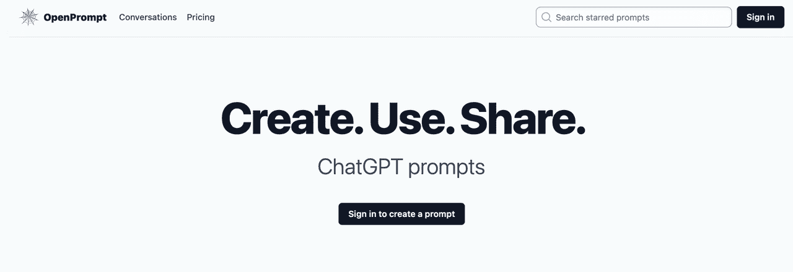

# 5月25日 谷歌推出LearnLM和Ask Photos两项AI创新

🤔【AIGC每日新闻】

1.  【谷歌推出[L](https://metatrend.ai/tweet-trends/v2?date=2024-05-24&name=AI#section-8)earnLM和Ask Photos两项AI创新】谷歌旗下的DeepMind团队发布了LearnLM，这是一个能提供个性化学习体验的AI工具，它能根据个人需求和学习进度进行调整。另外，谷歌还推出了Ask Photos，这项技术旨在让用户通过简单的对话来搜索和管理照片，使得查找特定图片变得更加直观和方便。这两项新功能展示了谷歌在教育和日常生活中利用人工智能提升用户体验的努力。参考博客链接: https://metatrend.ai/tweet-trends/v2?date=2024-05-24&name=AI#section-8。

1.  【Anthropic AI 在理解AI内部运作上取得突破性进展】Anthropic AI 公司在解析人工智能内部运作方面取得了重大突破，这被视为“表示工程”领域的一大飞跃。公司推出了新[的](https://metatrend.ai/tweet-trends/v2?date=2024-05-24&name=AI#section-4)模型“Golden Gate Claude”，并强烈推荐大家尝试。尽管一些人对AI内部表示的抽象程度持怀疑态度，但这一进展展示了Anthropic公司对开发可靠AI技术的信心和承诺。参考博客链接: https://metatrend.ai/tweet-trends/v2?date=2024-05-24&name=AI#section-4。

1.  【AI未来洞察：VivaTech大会上的重要观点】在VivaTech大会上，AI领域的重要人物提出了一些关键见解。Yann LeCun建议学生不要再研究大型语言模型（LLM），因为这个领域已经被大公司主导，而应该致力于开发下一代AI系统，突破LLM的局限。E[l](https://metatrend.ai/tweet-trends/v2?date=2024-05-24&name=AI#section-1)on Musk认为，AI将彻底改变教育，提供个性化的教学体验，就像拥有爱因斯坦一样的老师。同时，Musk也建议家长限制孩子使用社交媒体，以避免他们受到“多巴胺最大化”的AI影响。此外，AI在多媒体应用和解决全球问题方面也展现出巨大潜力。大会上的讨论强调了AI对社会的深远影响及其在各个领域中的创新应用。参考博客链接: https://metatrend.ai/tweet-trends/v2?date=2024-05-24&name=AI#section-1。

🌙【今日份prompt工具推荐】

https://www.aiisxy.com

# 5月24日 ChatGPT集成至Excel和Google Sheets

🫣【AIGC每日新闻】

1.  【Cohere的非营利研究分支C4AI推出Aya 23：支持23种语言的最新多语言大型语言模型】Cohere的非营利研究分支C4AI刚刚推出了Aya 23，这是一个尖端的多语言大型语言模型(MLLM)家族，具有开放权重，并支持23种不同的语言。Aya 23包括一个为效率和可访问性设计的80亿参数模型，以及一个基于Command R架构的先进35亿参数模型。这些模型在之前涵盖101种语言的Aya 101计划的基础上进行了深入发展。Aya 23在一系列基准测试中显著优于Aya 101，并超过了其他开放竞争对手，如谷歌的Gemma和Mistral。参考博客链接：https://cohere.com/blog/aya23?utm_source=www.therundown.ai&utm_medium=newsletter&utm_campaign=openai-controversy-sky-speaks-out

1.  【Arc Search应用推出“Call Arc”功能，通过手机通话方式快速获取答案】AI驱动的搜索应用Arc Search刚刚推出了一个名为“Call Arc”的新功能，使用户只需将手机放在耳边提问，即可获得快速答案。这个设计旨在提供比输入搜索更快捷的即时语音响应。用户可以通过打开iPhone应用，将手机放在耳边，并像打电话一样提问来使用这项功能。该功能与Arc Search现有的语音搜索集成，语音搜索作为iPhone上的动作按钮提供。参考博客链接：https://x.com/browsercompany/status/1793643179969060893?s=46

1.  【ChatGPT集成至Excel和Google Sheets】现在，用户可以在Excel和Google Sheets中使用ChatGPT了，这代表不再需要记忆复杂的公式或函数。这个进步能够显著节省用户的时间并极大提升工作效率，简化任务并提供使用复杂公式的指导，帮助用户节省成百上千小时的工作。通过集成ChatGPT，日常的电子表格工作将变得更加直观和便捷。参考博客链接:https://metatrend.ai/tweet-trends/v2?date=2024-05-21&name=AI#section-26

🌕️【今日份prompt工具推荐】

https://www.magicai.plus/#/

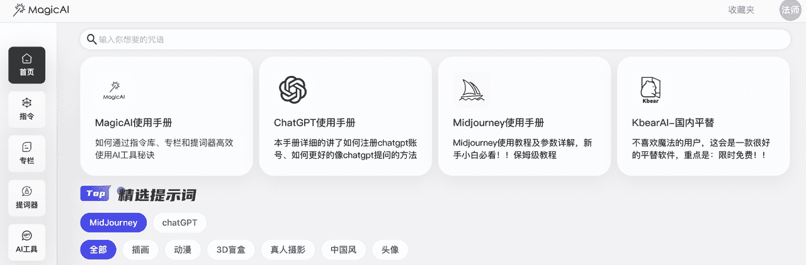

# 5月23日 Cognition与微软合作利用AI提升开发者效率

🤭【AIGC每日新闻】

1.  【英伟达与戴尔合作推出AI工厂】英伟达和戴尔宣布合作，共同推出AI工厂，这一合作被视为人工智能部署领域的重大进展。此次合作强调将能源转化为智慧，预计将在不同[行](https://metatrend.ai/tweet-trends/v2?date=2024-05-22&name=AI#section-5)业彻底改变人工智能技术的运用方式。通过这种创新合作，未来在各个领域，从制造业到卫生保健都可能看到AI应用的革命性变革，实现智能化升级和效率提升。参考博客链接:https://metatrend.ai/tweet-trends/v2?date=2024-05-22&name=AI#section-5

1.  【Cogn[i](https://metatrend.ai/tweet-trends/v2?date=2024-05-22&name=AI#section-14)tion与微软合作利用AI提升开发者效率】Cognition公司与微软展开合作，旨在通过简化复杂的编码过程来显著提升开发人员的工作效率。这一合作中的亮点是Devin，一个旨在帮助工程师节省时间、提高工作成果的工具。Devin将通过改进代码迁移和现代化任务，使得工程师在面对编程挑战时可以更加轻松高效地应对。这一合作标志着人工智能在开发领域内促进生产力提升的又一重要步骤。参考博客链接:https://metatrend.ai/tweet-trends/v2?date=2024-05-22&name=AI#section-14

1.  【AI技术在网[页](https://metatrend.ai/tweet-trends/v2?date=2024-05-21&name=AI#section-23)开发领域大放异彩】近来，一款人工智能网站建设器凭借其简便性和易用性受到了Kanika的高度评价，她认为这款工具的操作简单，易于上手。相反，一位经验丰富的软件工程师则讽刺地将这款创业公司的新产品视为解决网页开发常见问题众多尝试之一。当今，通过人工智能，即便无任何编程经验，个人也能在不到一分钟的时间内构建一个完整的网站。这一技术在Web开发和JavaScript社区引发了激烈讨论，许多人对于网页状态和JavaScript生态系统有着强烈看法。尽管市场上有各种抽象层面的工具和框架，但人们相信这次可能会实现质的飞跃。参考博客链接:https://metatrend.ai/tweet-trends/v2?date=2024-05-21&name=AI#section-23

⏳️【今日份prompt工具推荐】

https://promptvibes.com

# 5月22日 微软即将为Windows发布ChatGPT应用程序

🤗【AIGC每日新闻】

1.  【微软即将为Windows发布ChatGPT应用程序】微软将自己推出ChatGPT应用程序，解释了为何OpenAI没有为Windows用户提供该应用的原因。名为The Neuron的Pete在微软的Build大会现场报道这一消息，强调这一举措的重要性以及它填补的空白。而Ekenstam也强调了微软此举的意义，以及它为Windows平台带来的变化。这表明在开发领域中，微软的领导作用不可小觑，他们通过发布自己的版本，紧跟AI应用的趋势。参考博客链接:https://metatrend.ai/tweet-trends/v2?date=2024-05-21&name=AI#section-14

1.  【全AI驱动的X算法即将上线，小号与创作者或将受益】近期有消息传出, X算法即将迎来重大更新，将全面过渡到由AI驱动的推荐系统。这一转变被认为是平台用户体验显著改善的关键，其利好效应将普及到小账号和创作者，帮助他们获取更多关注度。如此一来，内容的整体推荐不再以账户规模为依据，而是更公平地展现给用户。新算法将运用AI技术对帖子进行排序，同时清理垃圾和诈骗内容，并实现全语义搜索。这被视为一个重要的进步，有望打破传统算法对大账户的偏好，赋予各种规模的创作者更多机会在平台上获得曝光。参考博客链接:https://metatrend.ai/tweet-trends/v2?date=2024-05-21&name=AI#section-10

1.  【微软发布Powered by GPT-4的AI驱动CoPilot+电脑】微软近日发布了其全新的CoPilot+电脑，这是世界上首批搭载AI的个人电脑，旨在与MacBook竞争。该电脑采用了新的神经处理单元(NPU)，能够进行每秒超过40万亿次的运算，重新架构的Windows 11，性能比Macbook Air M3快58%，CoPilot内建于Windows系统中，还融入了设置、文件、通知等环节。它搭载了GPT-4o技术，该技术由OpenAI提供。人们对微软新电脑中的AI集成和性能提升表示兴奋，同时也对隐私问题表示担忧。行业关键人物对这一技术飞跃给予高度评价，并强调其相对于MacBook的竞争优势和沉浸式的AI体验。例如，用户可以通过自然对话与CoPilot交流，即使是在玩Minecraft游戏中躲避僵尸时也不例外。微软CEO Satya Nadella对生成性AI的远见卓识使得微软处于多年来最强势的位置，他最担心的是错过技术的下一个大转变。预计Dell将在今年开始出货搭载专用AI硬件和Microsoft Co-Pilot键的AI定向PC。参考博客链接:https://metatrend.ai/tweet-trends/v2?date=2024-05-21&name=AI#section-2
🛸【今日份prompt工具推荐】

https://artsandculture.google.com/experiment/say-what-you-see/jwG3m7wQShZngw

# 5月21日 Gemini 1.5 Flash技术能将视频转化为代码

🤑【AIGC每日新闻】

1.  【Gemi[n](https://metatrend.ai/tweet-trends/v2?date=2024-05-20&name=AI#section-24)i 1.5 Flash技术能将视频转化为代码】Gemini 1.5 Flash技术是一项令人兴奋的突破，它能够将视频快速转换成代码，对各行各业的自动化和效率提升具有重大意义。一位用户分享了他们使用这项技术的体验：他们给Gemini 1.5 Flash提供了一个关于自己购物的视频记录，不到5秒钟，就得到了可用的Selenium代码。这项技术的应用潜力巨大，预计将会在自动化领域带来重大变革。参考博客链接:https://metatrend.ai/tweet-trends/v2?date=2024-05-20&name=AI#section-24

1.  【Garr[e](https://metatrend.ai/tweet-trends/v2?date=2024-05-20&name=AI#section-21)tt发布Deep Writer引领写作技术新突破】Garrett宣布Deep Writer可能是写作技术的一次重大突破。这项技术堪称游戏规则的改变者，因为GPT-4o在科学写作方面表现得格外出色。Deep Writer是一个强大的代理系统，它可以编写任何长度的内容，并且追求专业人类质量水平。据Garrett透露，这可能是迄今为止他或其他人所取得的最接近人类水平的成果。参考博客链接:https://metatrend.ai/tweet-trends/v2?date=2024-05-20&name=AI#section-21

1.  【Google Maps新增对话式AI功能】Google Maps进行了革新性升级，与ChatGPT类似，用户现在能够与其直接进行对话式交互了。这项升级带来了五大新功能，让地图使用变得更加智能和便捷。虽然具体的五大新功能没有详细描述，但这标志着Googl[e](https://metatrend.ai/tweet-trends/v2?date=2024-05-20&name=AI#section-11) Maps在向更加人性化和智能化的方向迈出了重要一步，对于提升用户体验以及增强功能多样性无疑是一大助力。AI教育者和开发者Roni Rahman对此次更新感到非常兴奋，这意味着用户在使用地图软件进行导航、搜索地点或规划出行时，可以期待有一个更加互动和个性化的体验。参考博客链接:https://metatrend.ai/tweet-trends/v2?date=2024-05-20&name=AI#section-11

⚓️【今日份prompt工具推荐】

https://www.aiprm.com

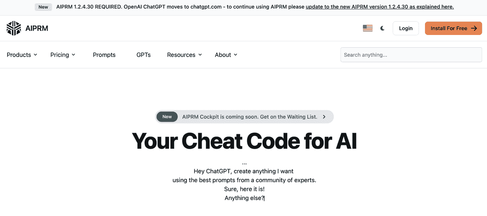

# 5月20日 Meta首发「Chameleon（变色龙）」挑战GPT-4o

🤪【AIGC每日新闻】

1.  【月之暗面杨植麟：[互联网研发是“种树”，大模型研发是“承包森林”](https://www.bestblogs.dev/en/article/c86633)】在第五届上海创新创业青年50人论坛上，杨植麟作为月之暗面创始人，畅谈了他对人工智能迅猛发展的理解和未来展望。他视互联网为AI积累数据的重要过往，认为多模态技术和数据瓶颈的突破是实现AGI的关键。杨植麟把互联网和大模型研发做了形象比喻：互联网研发像是在一块地方精心种植一棵树，而大模型研发则像是直接承包整片森林。他预测，在将来，人工智能将在工作流程中的作用将逐渐从现在的1%提升至90%甚至99%。同时，他也强调了数据经营才能充分发挥Scaling Law的功效，通过计算能力的提升和运用效率的优化来持续推动模型性能的提升。杨植麟同时也分享了，创业不仅仅是为了“看风景”，更是在为“爬楼梯”的过程中不断寻求技术研发与商业变现的平衡。参考博客链接:https://www.bestblogs.dev/en/article/c86633

1.  【迪拜AI园区正式启动】迪拜启动了旨在极大促进中东北非（MENA）地区人工智能和技术领域发展的重要举措，与迪拜经济议程D33保持一致，该计划旨在通过数字化转型在未来十年每年为迪拜带来1000亿阿联酋迪拉姆的经济贡献。[作](https://metatrend.ai/tweet-trends/v2?date=17&name=AI#section-2024-05-19)为"加速采用人工智能应用与技术的迪拜年度计划"的一部分，迪拜在国际金融中心区域开启了"迪拜人工智能园区"的第一阶段。该园区将成为中东和北非地区最大的专注于人工智能和科技公司的聚集地，并将进一步加强该地区的技术创新和产业发展。参考博客链接:https://metatrend.ai/tweet-trends/v2?date=2024-05-19&name=AI#section-17

1.  【Meta首发「Cham[eleon（变色龙）」挑战GPT-4o，34B](https://www.bestblogs.dev/en/article/efb354)参数引领多模态革命！10万亿token训练刷新SOTA】Meta公司近日发布了名为「变色龙」的人工智能模型，直接挑战OpenAI的GPT-4o。新模型拥有340亿参数，并通过使用10万亿token进行训练，展现了在多模态任务中处理文本和图像的强大能力。与传统分别对每种模态使用特定编解码器的多模态模型不同，Chameleon采用"混合模态"的方法，所有模态信息经过"分词化"后，由统一的Transformer网络架构处理，这种方法带来了无缝融合不同模态内容的能力。新模型在文本生成、视觉问答和图像标注方面均刷新了SOTA（最高标准），与GPT-4V表现相近。它的发布对人工智能多模态处理提出新的可能性，并可能为构建能够理解和生成多种类型信息的AGI（通用人工智能）打下基础。尽管变色龙模型当前还未涵盖语音处理能力，但其快速响应OpenAI的挑战和由Meta团队的支持，预示着在不久的将来可能出现开源版本的GPT-4o。参考博客链接:https://www.bestblogs.dev/en/article/efb354

🚎【今日份prompt工具推荐】

https://www.promptbox.ai

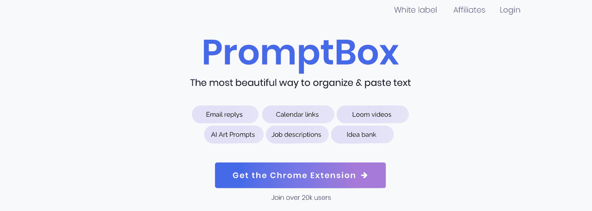

# 5月19日 Neuralink寻找第二位“脑电波”植入程序的参与者

🤤【AIGC每日新闻】

1.  【Google推动AI搜索和创意媒体工具升级】近期，Google一系列更新彰显了其在AI搜索领域的雄心。用户现在能够直接向Google提问，由AI直接编写答案，这是对传统搜链接方式的革新。这一转变在业界内部赢得了共鸣，业界一致认为AI搜索至关重要。与此同时，Google也更新了[其](https://metatrend.ai/tweet-trends/v2?date=2024-05-18&name=AI#section-3)创意媒体工具，例如VideoFX可以将创意变为视频，而MusicFX和ImageFX也引入了新的改进和编辑功能。不过，这些创新不是没有争议，一些人对于AI集成搜素引擎的便利性和能效表达了担忧，特别是当AI生成结果影响搜索速度，以及对能源消耗的考量。尽管有这样的质疑声，AI搜索显然已成为行业发展的大趋势。参考博客链接:https://metatrend.ai/tweet-trends/v2?date=2024-05-18&name=AI#section-3

1.  【Neuralink寻找第二位“脑电波”植入程序的参与者】神经科技公司Neuralink正在招募第二位参与者，参加其开创性的脑电波植入程序。这项技术让人们仅凭思考就能控制手机和电脑，颠覆了人类能力的界限。Noland是首位[参](https://metatrend.ai/tweet-trends/v2?date=2024-05-18&name=AI#section-8)与者，他对产品的反馈将被极为期待并视为重要洞见。Neuralink此次主要面向患有四肢瘫痪的人士，邀请他们加入临床试验，体验通过全新方式控制电脑的可能性。这不仅是对参与者本身技术边界的拓展，也是对整个脑机接口领域的一大飞跃。参考博客链接:https://metatrend.ai/tweet-trends/v2?date=2024-05-18&name=AI#section-8

1.  【CAT3D：[一](https://metatrend.ai/tweet-trends/v2?date=2024-05-18&name=AI#section-4)种快速3D模型生成技术，全方位颠覆3D可视化行业】CAT3D利用多视角扩散模型技术，实现了从单张图片、图片组或者文本提示中快速生成高质量3D模型的可能。这项技术不仅使3D创作变得广泛易用，也重新定义了人工智能和3D建模领域的标准。令人瞩目的是，无论是基于寥寥数图的真实世界3D扫描，还是基于任何数量的真实或生成的图像，CAT3D都能在不到一分钟的时间内生成高度逼真的3D场景。它还允许用户将任何文本或图像转换成互动式3D场景，这使得视频内容更具互动性和趣味性。CAT3D的出现，对于准确快速地创建3D模型来说，无疑是一次技术上的巨大跨越。参考博客链接:https://metatrend.ai/tweet-trends/v2?date=2024-05-18&name=AI#section-4

🚂【今日份prompt工具推荐】

https://2moons.ai

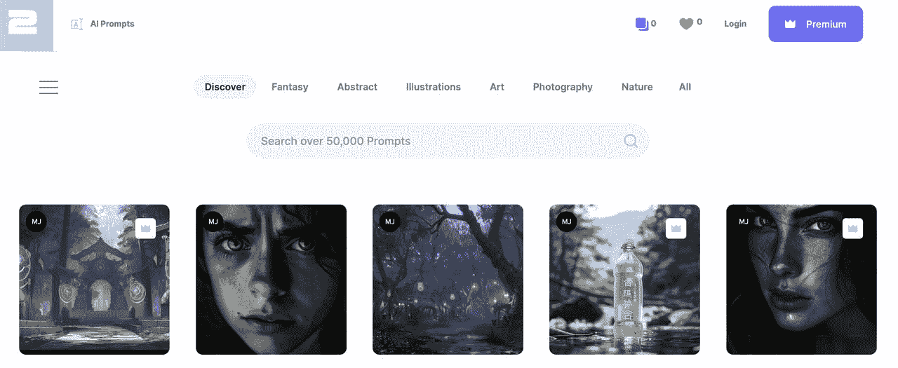

# 5月18日 OpenAI联合创始人兼首席科学家Ilya Sutskever宣布离职

🤓【AIGC每日新闻】

1. 【OpenAI联合创始人兼首席科学家Ilya Sutskever宣布离职】在2023年11月Sam Altman被罢免的事件后数月，OpenAI联合创始人兼首席科学家Ilya Sutskever终于宣布他将离开公司。Sutskever表示，他对当前领导层下OpenAI能够“构建既安全又有益的通用人工智能（AGI）”充满信心。与此同时，与Sutskever共同领导超级对齐小组的Jan Leike也以一条神秘的辞职帖子宣布了他的离职。此前数月，OpenAI的超级对齐和安全团队已有多人离职，引发了外界的广泛猜测。OpenAI的CEO Sam Altman宣布，负责GPT-4创造的关键研究员Jakub Pachocki将成为新的首席科学家。参考博客链接：https://x.com/ilyasut/status/1790517455628198322?s=46

2. 【谷歌在I/O开发者大会上宣布将多项AI集成引入安卓手机】在谷歌的I/O开发者大会上，谷歌宣布了一系列即将到来的AI集成功能，这些功能将被引入安卓手机，以提供升级的智能手机体验。谷歌强大的Gemini模型将被整合到设备上，特别是即将在今年晚些时候推出的Pixel手机中，这将允许手机拥有增强的多模态能力。Gemini模型的功能将通过一个新的覆盖层变得易于访问，该覆盖层通过改进和理解上下文来提供动态建议。此外，谷歌还推出了一个“Circle to Search”功能，允许用户在屏幕上查询任何内容，并通过一个名为LearnLM的模型增加了家庭作业帮助功能。谷歌还计划很快推出一项新的AI安全功能，该功能将在通话看起来像是诈骗时提供实时警报。参考博客链接：https://blog.google/products/android/google-ai-android-update-io-2024/?utm_source=www.therundown.ai&utm_medium=newsletter&utm_campaign=openai-co-founder-officially-leaves#gemini-on-android

3. 【Replicate平台推出OpenVoice模型，免费克隆任何声音】Replicate平台上新推出了一个名为OpenVoice的模型，它允许用户免费克隆任何声音，只需要一个音频文件和想要转换成语音的文本。使用步骤如下：首先，在Replicate上访问OpenVoice并使用GitHub账户登录。然后，在指定的‘audio’区域上传你想要克隆的声音的音频文件，文件越长越好。接着，在‘Text’字段中填写你想要转换成语音的文本。最后，点击‘Run’按钮，就可以聆听或下载生成的带有克隆声音的音频了！参考博客链接：https://university.therundown.ai/c/daily-tutorials/how-to-clone-your-voice-using-ai-b41efa1d-2189-414c-bfbf-7e6a08b13ed1?utm_source=www.therundown.ai&utm_medium=newsletter&utm_campaign=openai-co-founder-officially-leaves

🍻【今日份prompt工具推荐】

https://www.ecommerceprompts.com

# 5月17日 苹果宣布iOS 18将推出一系列新辅助功能

😲【AIGC每日新闻】

1.  【苹果宣布iOS 18将推出一系列新辅助功能】苹果公司刚刚宣布了一系列即将在iOS 18中推出的创新辅助功能，旨在提升用户体验。这些新功能包括AI驱动的眼动追踪技术，用户仅通过眼睛就能控制iPad或iPhone，无需额外硬件或配件。音乐触感功能将通过iPhone的触觉引擎让用户以一种全新的方式体验音乐。声控快捷指令允许用户为Siri设置自定义短语，用以启动快捷方式和执行任务。这些新特性预计将在今年晚些时候通过iOS 18和iPadOS 18的软件更新正式推出。参考博客链接：https://www.apple.com/newsroom/2024/05/apple-announces-new-accessibility-features-including-eye-tracking/?utm_source=www.therundown.ai&utm_medium=newsletter&utm_campaign=control-your-iphone-using-ai-eyes

1.  【Chatling：无代码AI平台，快速构建并部署高级聊天机器人】Chatling是一个无代码的AI平台，它允许用户在不到15分钟的时间内，通过简单的拖放界面，在任何网站上构建和部署高级AI聊天机器人。利用Chatling，可以自动化执行客户支持、新用户引导、潜在客户生成和销售等任务。此外，用户还可以在网站上、知识库和文档中训练聊天机器人，使其更加智能。Chatling的强大之处还在于，它能够让你与全球观众用超过85种语言进行互动，极大地拓宽了交流的边界。参考博客链接：https://chatling.ai/?ref=chtl&utm_source=newsletter&utm_medium=email&utm_campaign=rundownai_0524

1.  【OpenAI与Reddit达成协议，ChatGPT将接入Reddit实时讨论内容】OpenAI刚刚与Reddit签订了一项协议，根据该协议，OpenAI将能够通过Reddit的数据API访问实时、结构化和独特的内容，并将这些讨论内容整合到ChatGPT中。作为交换，Reddit将利用OpenAI的技术为其用户和版主构建新的AI驱动功能。此外，OpenAI也将成为Reddit的广告合作伙伴。尽管具体的财务条款没有公开，但据报道，Reddit今年早些时候与谷歌签订了一项价值约6000万美元的类似协议。参考博客链接：https://openai.com/index/openai-and-reddit-partnership/?utm_source=www.therundown.ai&utm_medium=newsletter&utm_campaign=control-your-iphone-using-ai-eyes

🍳【今日份prompt工具推荐】

https://promptfolder.com/midjourney-prompt-helper/

# 5月16日 字节跳动推出火山引擎大模型家族，以使用体验为优先

😋【AIGC每日新闻】

1.  【腾讯混元文生图大模型全面升级并开源，支持中英文双语输入和理解】腾讯宣布其混元文生图大模型全面升级并开源，这是业内首个中文原生的DiT架构文生图开源模型，支持中英文双语输入及理解。该模型采用与Sora一致的DiT架构，即Hunyuan-DiT架构，不仅支持文生图，还可以作为视频等多模态视觉生成的基础。腾讯混元团队构建了四个维度的测试集，邀请了超过50名专业评估人员进行评估，包括文本图像一致性、排除AI伪影、主题清晰度和审美。评估结果表明，采用Hunyuan-DiT架构的腾讯混元文生图模型效果优于开源的Stable Diffusion模型，是目前效果最好的开源文生图模型，整体能力属于国际领先水平。腾讯混元文生图大模型的开源填补了中文原生DiT文生图架构的空白，有助于更多开发者和创作者参与进来，共同探索和共创基于DiT架构的视觉生成生态，更好地验证和挖掘该技术架构的潜力。参考博客链接：https://github.com/Tencent/HunyuanDiT

1.  【字节跳动推出火山引擎大模型家族，以使用体验为优先】字节跳动的火山引擎大模型家族首次亮相，一口气推出了9个模型，价格低至99%，不强调参数规模和榜单分数。其中，豆包通用模型是最核心的模型，分为两个尺寸：大杯和小杯。大杯的豆包通用模型pro，窗口尺寸最大可达128K，全系列可精调。小杯的豆包通用模型lite，具有较快的响应速度。参考博客链接：https://www.bestblogs.dev/article/e37a42

1.  【理解Transformer模型性能的新理论框架】华为的研究人员提出了一个新的理论框架，用以解释Transformer模型在不同大小和数据集条件下的性能表现。他们通过将Transformer模型与联想记忆（associative memory）联系起来，利用Hopfield网络模型来模拟Transformer的行为，认为每个Transformer块实质上执行的是一种近似最近邻搜索。基于此，研究者设计了一个新的能量函数，类似于现代连续Hopfield网络中的能量函数，为注意力机制提供了新的解释。通过主要化-最小化技术，构建了一个全局能量函数，捕捉了Transformer的层级结构。实验结果表明，在特定条件下，模型的交叉熵损失有一个下限，大约等于1。这项研究为理解大型Transformer模型的收敛和泛化行为提供了重要的理论视角。参考博客链接：https://arxiv.org/pdf/2405.08707

🌅【今日份prompt工具推荐】

https://promptbase.com/

# 5月15日 Google宣布AI生态系统重大更新，推出Gemini模型更新和新视频生成模型Veo

😝【AIGC每日新闻】

1. 【谷歌I/O大会：Google宣布AI生态系统重大更新，推出Gemini模型更新和新视频生成模型Veo】谷歌I/O开发者大会上，谷歌宣布了其AI生态系统的一系列更新，包括旗舰Gemini模型家族的增强和新视频生成模型Veo，与OpenAI的Sora展开竞争。Gemini模型更新：

Gemini 1.5 Pro：将上下文窗口扩展至2M，并增强了代码、逻辑和图像理解方面的性能。

Gemini 1.5 Pro还可以利用长上下文分析各种媒体类型，包括文档、视频、音频和代码库。

Gemini 1.5 Flash：一种新的模型，优化了速度和效率，上下文窗口为1M tokens。

Gemma 2：谷歌开源模型的下一代，将在未来几周内发布，以及一个名为PaliGemma的新的视觉语言模型。

Gemini Advanced订阅者很快就可以根据简单的文本描述创建定制的虚拟人物，称为 "宝石"，类似于ChatGPT GPTs。

视频和图像模型升级：

Veo：谷歌推出了一款名为Veo的视频生成模型，能够根据文本、图像和视频提示生成长达60秒、1080p分辨率的视频。

Imagen 3：新的文本转图像模型，比其前身具有更好的细节、文本生成和自然语言理解能力。

VideoFX：场景逐帧创建的故事板，以及向生成内容添加音乐的功能。VideoFX在美国为选定的创作者推出 "私人预览" ，而ImageFX（搭配Imagen 3）则可以通过等待列表进行体验。

随着Gemini上下文窗口的两倍提升，为利用人工智能处理大量信息开辟了无数新的可能性。参考博客链接：https://blog.google/technology/developers/google-io-2024-collection/?utm_source=www.therundown.ai&utm_medium=referral&utm_campaign=google-i-o-s-ai-avalanche

2. 【谷歌展示 "Project Astra" 和搜索升级，增强AI功能】谷歌刚刚展示了名为 "Project Astra" 的AI代理项目，以及一系列更新，将人工智能注入搜索功能并增强Gemini的推理和高级操作能力。这是一个实时AI代理原型，可以看到、听到并代表用户采取行动。Astra预计将于今年晚些时候通过Gemini应用程序向公众开放。谷歌还展示了 "AI队友"，这些代理可以回答有关电子邮件、会议和Workspace内其他数据的问题。Live功能将在未来几个月内推出，允许用户与Gemini近乎实时地交谈。谷歌搜索现在具有扩展的AI概述、先进的计划能力和由人工智能组织的搜索结果。搜索还将获得 "多步推理" 功能，使Gemini能够分解问题并加快研究速度。用户现在可以使用视频提问，允许搜索分析视觉内容并提供有用的AI概述。谷歌的 "Project Astra" 和搜索升级展示了该公司在AI领域的持续创新，增强了Gemini的推理和操作能力，并改善了搜索体验。参考博客链接：https://twitter.com/rowancheung/status/1790437573694996667?utm_source=www.therundown.ai&utm_medium=referral&utm_campaign=google-i-o-s-ai-avalanche

3. 【Notta Showcase：一款强大的AI视频翻译工具，支持15种以上语言，保留原始语音风格】Notta Showcase是一款强大的AI视频翻译工具，它可以将视频轻松翻译成15种以上语言，同时保留原始语音风格，使内容在全球范围内传播更加容易。Notta Showcase非常适合：希望在YouTube和TikTok上扩大影响力的内容创作者；旨在创建多语言宣传视频并扩大客户群的企业；希望为非母语人士提供学习资源的教育工作者。Notta Showcase使视频翻译变得轻松简单，帮助用户轻松触及全球受众。参考博客链接：https://www.notta.ai/en/showcase?utm_source=www.therundown.ai&utm_medium=newsletter&utm_campaign=secondary_ad&utm_content=may15

🍧【今日份prompt工具推荐】

https://www.aiprm.com/

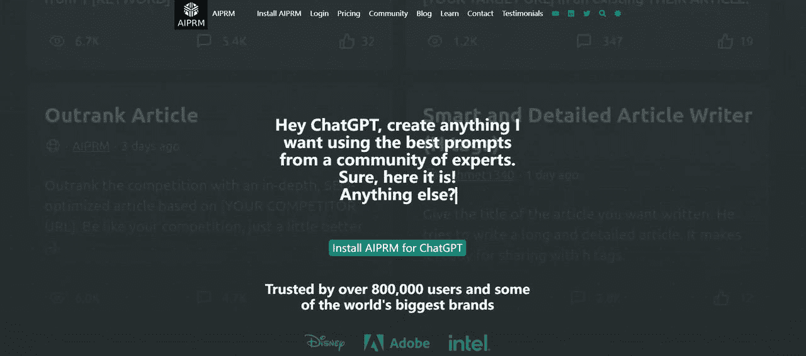

# 5月14日 OpenAI发布GPT-4o：多模态AI模型新标杆

😙【AIGC每日新闻】

1.  【OpenAI发布GPT-4o：多模态AI模型新标杆】OpenAI刚刚推出了GPT-4o，这是一款先进的多模态模型，它整合了文本、视觉和音频处理能力，并在性能上设立了新的基准。GPT-4o在文本、视觉、音频、编码和非英语生成等方面的性能均优于GPT-4T。新模型的使用成本降低了50%，速率限制提高了5倍，生成速度是之前模型的两倍。GPT-4o还被发现是上周在Lmsys Arena中发现的神秘模型‘im-also-a-good-gpt2-chatbot’。

新模型的其他升级包括：

+   新的语音功能，如实时响应、情感检测和响应，以及将语音与文本和视觉结合的能力。

+   演示展示了实时翻译、两个AI模型分析实时视频、以及使用语音和视觉进行辅导和编码协助等壮举。

+   OpenAI的博客还详细介绍了3D生成、字体创建、图像内文本生成的巨大改进、音效合成等进步。

+   OpenAI还宣布了一个新的ChatGPT桌面应用程序，专为macOS设计，具有刷新的用户界面，并直接集成到计算机工作流程中。

+   GPT-4o、GPT模型以及记忆和数据分析等功能现在对所有用户开放，首次将高级功能带入免费层。

GPT-4o模型目前正在向所有ChatGPT用户和通过API的用户推出，预计新的语音功能将在未来几周内推出。参考博客链接：https://www.youtube.com/watch?v=DQacCB9tDaw&ab_channel=OpenAI&utm_source=www.therundown.ai&utm_medium=newsletter&utm_campaign=chatgpt-s-new-voice

1.  【Meta开发AI耳塞“Camerabuds”，与OpenAI和苹果竞争】据报道，Meta正在开发一款名为“Camerabuds”的AI驱动耳塞，旨在与OpenAI和苹果在可穿戴设备领域展开竞争。这款“Camerabuds”耳塞将具备以下特点：

+   能够映射用户周围环境，通过内置摄像头识别物体并翻译外语。

+   Meta已经拥有其AI驱动的Ray Ban智能眼镜，而OpenAI和苹果也在探索类似的AI可穿戴耳塞技术。

+   潜在挑战包括设备体积、发热问题，以及隐私担忧，特别是对于长发用户可能会阻碍摄像头的视角。

这一发展之所以重要，是因为尽管Meta在硬件领域的尝试并不总是成功，但马克·扎克伯格仍在大力投资他所相信的未来——一个每台设备都嵌入AI的未来。然而，当市场上出现完全集成AI的手机时，这类独立设备是否能够赢得用户的青睐，仍是一个值得关注的问题。参考博客链接：https://www.theinformation.com/articles/meta-explores-ai-assisted-earphones-with-cameras?utm_source=www.therundown.ai&utm_medium=newsletter&utm_campaign=chatgpt-s-new-voice

1.  【AE Studio：将AI项目高成功率转化为现实】尽管85%的AI项目失败，AE Studio却擅长将雄心勃勃的想法变为现实。他们的成功秘诀是什么？超能力，以及像对待自己的初创公司一样对待每个项目。与AE Studio合作，你将获得：

+   在AI、区块链、脑机接口(BCI)等领域的经过验证的专业知识；

+   从创意到部署的端到端战略开发；

+   为你的独特产品量身定制的解决方案；

+   与伯克希尔哈撒韦公司、Global Shop Solutions、IncomeMax和Protocol Labs等客户成功合作的记录。

AE Studio通过其专业的技术实力和对项目的深入投入，帮助客户克服AI项目开发中的常见障碍，实现创新想法的商业化。参考博客链接：http://ae.studio/therundown?utm_campaign=the-rundown-051424&utm_source=the-rundown&utm_medium=newsletter

🌄【今日份prompt工具推荐】

https://github.com/prompt-engineering/click-prompt

# 5月13日 Anthropic推出Prompt Generator工具，帮助用户自动生成最佳提示

😜【AIGC每日新闻】

1.  【Anthropic推出Prompt Generator工具，帮助用户自动生成最佳提示】Anthropic公司为其商业用户和API用户推出了新的Prompt Generator工具，当使用其Claude模型完成任务时，该工具可通过自然语言自动生成最佳提示。该工具利用先进的提示技术，例如思维链推理，以获得更 "有效、精确和可靠" 的输出结果。控制台用户还可以通过动态变量插入来测试提示性能，根据各种情况优化提示。Anthropic今年早些时候发布了Prompt Library，其中包含一系列经过优化的提示，用户可以复制并粘贴。参考博客链接：https://twitter.com/AnthropicAI/status/1788958483565732213?utm_source=www.therundown.ai&utm_medium=referral&utm_campaign=openai-s-big-reveal

1.  【MIT研究人员发表新研究，揭示AI的欺骗能力】麻省理工学院（MIT）的研究人员发表了一项新研究，详细分析了人工智能进行欺骗行为的能力，例如说谎、虚张声势和掩盖真实能力等。该分析发现了人工智能欺骗的多个例子，例如Meta的Cicero Diplomacy聊天机器人故意对玩家说谎。其他案例还包括谈判系统歪曲偏好、AI在扑克游戏中虚张声势以及 "装死" 以欺骗安全测试等。不断增强的欺骗能力可能会影响社会危害，例如选举操纵、欺诈和对人工智能系统的总体控制。人工智能超凡的说服力与不断增强的欺骗能力相结合，提醒人们这项技术的进步可能存在潜在的黑暗面。随着这些特性的出现，可靠地调整模型行为并更好地理解模型行为变得更加重要。参考博客链接：https://www.cell.com/action/showPdf?pii=S2666-3899%2824%2900103-X&utm_source=www.therundown.ai&utm_medium=referral&utm_campaign=openai-s-big-reveal

1.  【宇树科技发布Unitree G1人形机器人：灵敏可靠，可模拟人手精准操作】宇树科技发布了一款新型人形机器人Unitree G1，它具有超大关节运动角度和23-34个关节，结合力位混合控制，使其灵敏可靠，能够模拟人手对物体的精准操作。Unitree G1由Unitree机器人统一大模型（UnifoLM）驱动，能够自我学习和迭代升级。它可以模拟人手完成对物体精准的操作，甚至能玩金箍棒。参考博客链接：https://x.com/imxiaohu/status/1789942584493605017

🎋【今日份prompt工具推荐】

https://freeflo.ai/

# 5月12日 Openui：通过想象力构建实时渲染的用户界面

😘【A**IGC每日新闻】**

1.  【Openui：通过想象力构建实时渲染的用户界面】wandb/openui是一个开源项目，旨在通过想象力描述用户界面（UI），然后实时渲染它们，这使得构建 UI 组件变得有趣、快速和灵活。wandb/openui是一个公开的GitHub仓库，它提供了一种创新的构建用户界面的方式，允许开发人员使用自己的想象力来描述UI，并实时查看渲染效果。该项目由W&B公司使用，用于测试和原型化基于大型语言模型（LLM）的强大应用程序的下一代工具。该项目包括前端和后端代码，支持使用Docker或Codespaces在本地运行，并提供了一个实时演示。参考博客链接：https://github.com/wandb/openui

1.  【Trieve：强大的RAG Search API开源，支持全栈搜索和LLM答案生成】Trieve是一款号称最强的RAG Search API，它支持数据摄取、全栈搜索、推荐和LLM答案生成能力。Trieve的开源版本支持开源的Embedding/Inference模型、向量/全文检索和混合检索。它还支持私有化部署或API访问，并配有配套的Search UI组件。参考博客链接：https://github.com/devflowinc/trieve

1.  【FunClip：一款开源、精准、便捷的视频剪辑工具】FunClip是一款基于阿里巴巴通义实验室开源的FunASR Paraformer系列模型开发的视频剪辑工具。它通过调用模型对视频进行语音识别，用户可以自由选择识别结果中的文本片段或说话人，然后点击 "裁剪" 按钮即可获得对应片段的视频。FunClip的特点包括：

A. 开源和高精度：基于领先的开源模型，提供高精度语音识别。

B. 方便快捷：用户只需选择识别结果中的片段或说话人，即可快速获取对应视频片段。

C. 支持多种格式：支持多种视频格式，满足不同需求。

FunClip是一款高效、便捷的视频剪辑工具，帮助用户快速获取所需视频片段，提升视频编辑效率。参考博客链接：https://modelscope.cn/studios/iic/funasr_app_clipvideo/summary

🪵【今**日份prompt工具推荐】**

https://www.promptingguide.ai/zh

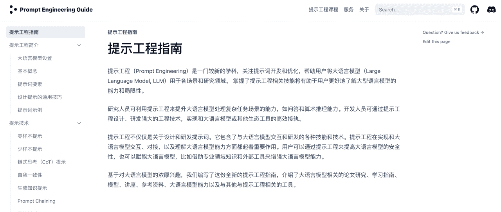

# 5月11日 Cohere发布Command R微调功能，大幅降低AI推理成本

🤩【A**IGC每日新闻】**

1.  【Cohere发布Command R微调功能，大幅降低AI推理成本】Cohere公司宣布其Command R的微调功能已经可以使用。与大型模型相比，Command R的微调功能以极低的成本提供了行业领先的性能，这使得企业能够更有效地将AI技术应用于实际生产环境。具体来说，推理成本降低了15倍，同时带来了更快的处理速度、更低的延迟以及卓越的整体性能。经过微调的Command R更加擅长处理企业业务，如文档总结、研究和数据分析等任务，从而显著提高了日常工作流程的效率。这一进展对于希望在不增加过多成本的情况下提升AI应用性能的企业来说是一个重大利好。参考博客链接：https://cohere.com/blog/commandr-fine-tuning

1.  【Unsloth开源项目：优化GPU代码，提升AI模型性能】基于OpenAI发布的Triton语言，Unsloth是一个旨在替代Cuda编写GPU代码的开源项目，目前已经获得了9,000个星标。Unsloth的主要特点包括：

+   在消费级硬件上微调AI模型，例如，可以对Llama3-8B模型进行微调，提高速度达44.35%，节省显存42.58%，最低只需7.75GB显存，这对于资源有限的开发者来说是一个巨大的突破。

+   支持LoRA（Low-Rank Adaptation）技术，以及Hugging Face的TRL（Transformers Research Library）、Trainer框架和Facebook AI的FA2（Fairscale Autowrap）。

+   提供了丰富的教程，帮助开发者更快地上手和利用Unsloth进行开发。

Unsloth项目的开源，为AI社区提供了一个高效、节省资源的GPU编程解决方案，有助于推动AI技术在更广泛硬件上的部署和应用。参考博客链接：https://github.com/unslothai/unsloth

1.  【ScrapeGraphAI：一次性网络爬取工具，由大型语言模型驱动】ScrapeGraphAI是一个由大型语言模型（LLMs）驱动的高效网络爬取工具。这些模型以其强大的信息提取能力而闻名，这也解释了为何这个Python库以及其他类似库受到广泛欢迎。ScrapeGraphAI的特点在于：

+   它能够一次性地从网页中抓取所需信息，提高了数据采集的效率。

+   该工具与Ollama以及其他LLM服务提供商兼容，为用户提供了灵活性和选择性。

ScrapeGraphAI的推出，为需要进行网络数据抓取的开发者和企业提供了一个便捷而强大的解决方案，尤其是在处理大量网页信息时，可以节省大量的时间和资源。参考博客链接：https://github.com/VinciGit00/Scrapegraph-ai

🏗️【今**日份prompt工具推荐】**

https://github.com/PlexPt/awesome-chatgpt-prompts-zh

# 5月10日 OpenAI计划推出ChatGPT新搜索功能，挑战谷歌搜索

🥰【A**IGC每日新闻】**

1.  【OpenAI计划推出ChatGPT新搜索功能，挑战谷歌搜索】据多个消息来源，OpenAI计划在周一宣布为ChatGPT增加一项新的搜索功能，这将使其直接与谷歌搜索和Perplexity竞争。该搜索功能将允许ChatGPT访问在线资源以回答用户的问题，并为所使用的信息提供引用。某些版本的功能还可能结合相关图像，如图表或图解说明，与文本响应一起提供。目前，OpenAI为ChatGPT Plus订阅者提供有限的浏览能力，但该功能一直存在不稳定和错误。这一变化之所以重要，是因为OpenAI和谷歌一直在AI领域竞争，而ChatGPT的搜索功能将是双方竞争的重大升级，特别是在谷歌I/O大会前夕。强大的搜索功能也可能将ChatGPT提升到一个新的水平，并为更多代理类型的功能打开大门。参考博客链接：https://www.reuters.com/technology/openai-plans-announce-google-search-competitor-monday-sources-say-2024-05-09/?utm_source=www.therundown.ai&utm_medium=newsletter&utm_campaign=openai-vs-google

1.  【SoundHound AI与Perplexity合作，提升车载和设备语音助手的智能】SoundHound AI刚刚宣布与Perplexity建立新的合作伙伴关系，旨在将公司的在线大型语言模型（LLM）能力与实时网络知识相结合，从而提升车载和设备中的语音助手性能。具体细节如下：

+   SoundHound的Chat AI已经整合到多个车载助手、餐厅点餐技术、移动电话、应用和电视中。

+   Perplexity的answer-engine AI将使SoundHound的助手能够提供更准确的响应，并处理更复杂的问题。

+   Perplexity的网络访问功能还允许实时信息获取，例如将“汽油价格趋势”与车载助手同步，以便导航至最近的加油站。

这一合作的意义在于，尽管AI模型在不断进步，但我们尚未看到这些进步真正转化为消费者设备中的性能提升。在等待Siri和主要玩家进行重大AI集成的同时，SoundHound与Perplexity的合作可能会显著提升车载系统、应用程序和手机助手中的AI能力。参考博客链接：https://www.businesswire.com/news/home/20240509196718/en/SoundHound-AI-and-Perplexity-Partner-to-Bring-Online-LLMs-to-Next-Gen-Voice-Assistants-Across-Cars-and-IoT-Devices?utm_source=www.therundown.ai&utm_medium=newsletter&utm_campaign=openai-vs-google

1.  【ElevenLabs Music抢先预览：一键生成多风格歌曲】ElevenLabs Music提供了一个令人兴奋的早期预览，展示了其音乐生成技术的能力。在这个展示中，所有歌曲都是根据单个文本提示生成的，并且没有经过任何编辑。以“流行流行摇滚、乡村、排行榜歌曲”风格为例，ElevenLabs Music能够根据这一风格提示，创造出标题为“It Started to Sing”的歌曲。这展示了AI在音乐创作领域的巨大潜力，能够根据简单的文本描述生成多样化的音乐作品。参考博客链接：https://x.com/elevenlabsio/status/1788628171044053386?s=46

🌄【今**日份prompt工具推荐】**

https://openart.ai/

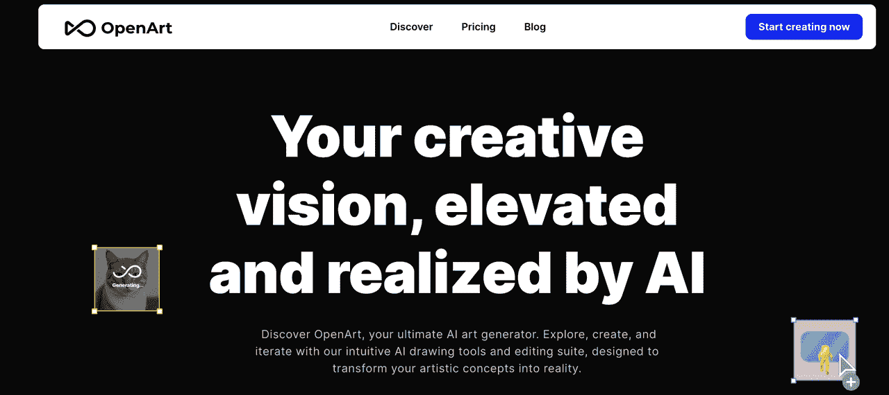

# 5月9日 OpenAI推出Model Spec框架，旨在引导AI模型行为

😍【AIGC每日新闻】

1. 【DeepMind和Isomorphic Labs推出AlphaFold 3：准确预测蛋白质、DNA和其他分子结构】谷歌DeepMind和Isomorphic Labs推出了AlphaFold 3，这是一种突破性AI模型的最新版本，能够以极高的准确性预测蛋白质、DNA和其他分子的结构。与传统方法相比，AlphaFold 3在预测药物相互作用方面有50%的改进。AlphaFold 2专注于蛋白质结构，而AlphaFold 3可以处理 "生命的所有分子"，能够建模和预测复杂相互作用。该模型通过新的AlphaFold服务器免费提供给非商业使用，使科学家能够生成预测并加速研究。AlphaFold之前的模型已经在全球产生了巨大影响，而这一更强大、更准确的版本，加上新的免费服务器以扩大对该工具的访问，将极大地加速药物发现和我们对生物世界的了解。参考博客链接：https://blog.google/technology/ai/google-deepmind-isomorphic-alphafold-3-ai-model/?utm_source=www.therundown.ai&utm_medium=referral&utm_campaign=google-s-ai-biology-breakthrough#responsibility

2. 【OctoStack：高效部署开源LLM，解决敏感数据处理难题】OctoAI推出的OctoStack解决了企业在自托管开源LLM（如Llama 3和Mixtral）时面临的敏感数据处理难题，即使部署顶级模型也能实现优化性能。使用OctoStack，您将获得以下益处：

吞吐量比vLLM快5倍，延迟更低。

最大限度地利用GPU以实现最佳性能。

一套先进的优化技术集成在堆栈中。

OctoStack为企业提供了一种高效、安全的部署开源LLM的方法，即使处理敏感数据也能实现优化性能。参考博客链接：https://octo.ai/blog/acceleration-is-all-you-need-techniques-powering-octostacks-10x-performance-boost/?utm_source=rundown&utm_medium=newsletter&utm_campaign=octostack-perf

3. 【OpenAI推出Model Spec框架，旨在引导AI模型行为】OpenAI推出了Model Spec框架，概述了该公司塑造AI模型行为的方法，希望就ChatGPT及其API的行为发起公众讨论。Model Spec反映了OpenAI的文档、研究、塑造模型行为的经验以及正在进行的工作，这些将影响未来的模型。该文档为AI模型确立了目标、规则和默认行为。用户可以通过填写表格来参与，可以选择AI模型行为中最重要的目标和行为。决定模型的行为是一个有争议的话题，任何结果或规则都不可能满足所有用户和情况。但收集多元观点并引入更多透明度是积极的，特别是考虑到公众缺乏理解。参考博客链接：https://openai.com/index/introducing-the-model-spec/?utm_source=www.therundown.ai&utm_medium=referral&utm_campaign=google-s-ai-biology-breakthrough&__cf_chl_rt_tk=f2ZVlC0eQmtJcF_UTUU6A0SIRQmfiDC_HsVA6GqBgNQ-1715265426-0.0.1.1-1898

🌵【今日份prompt工具推荐】

https://arthub.ai/

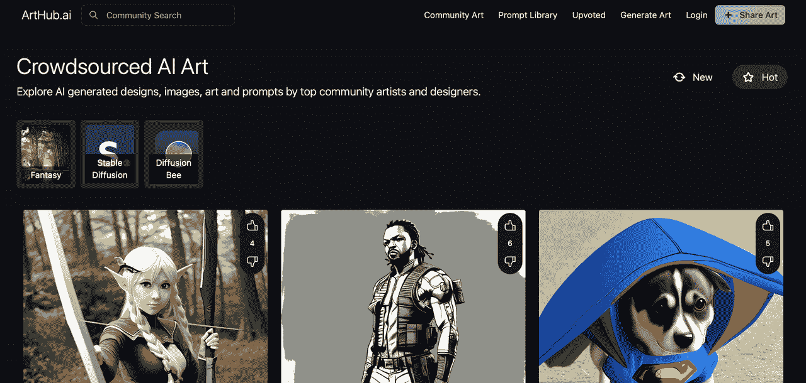

# 5月8日 神秘的gpt2-chatbot回归，LLM能力似乎超越顶级模型

😇【A**IGC每日新闻】**

1.  【苹果公司在库比蒂诺的活动上推出了新款iPad，配备定制M4芯片，增强AI功能】苹果公司在加州库比蒂诺的活动上推出了新款iPad，配备定制的M4芯片，增强了人工智能功能。更大的iPad Pro现在配备了M4芯片，其神经引擎升级，苹果公司首席执行官蒂姆·库克（Tim Cook）称其为 "AI方面的强大芯片"。M4芯片每秒可处理38万亿次运算，性能是之前型号的4倍，能够运行先进的人工智能。Pro版的新人工智能功能包括True Tone闪光灯，用于文档扫描，以及新的视频、图像和音乐编辑工具。在此次活动之前，一份新报告透露，苹果公司正在开发自己的数据中心AI芯片，代号为 "Project ACDC"。参考博客链接：https://www.youtube.com/watch?v=f1J38FlDKxo&utm_source=www.therundown.ai&utm_medium=referral&utm_campaign=apple-s-ipad-ai

1.  【神秘的gpt2-chatbot回归，LLM能力似乎超越顶级模型】上周，一个名为 "gpt2-chatbot" 的强大AI模型神秘出现，没有官方文档或归属信息。本周，又出现了两个类似的版本： "im-a-good-gpt2-chatbot" 和 "im-also-a-good-gpt2-chatbot"。访问这些模型的唯一方式是通过聊天机器人竞技场对战模式，该模式随机将模型相互对抗以测试输出。在公众发现之前，萨姆·奥尔特曼（Sam Altman）周末也在推特上发布了 "im-a-good-gpt2-chatbot"，似乎证实了它们之间的联系。虽然奥尔特曼之前表示gpt2-chatbot不是GPT 4.5，但越来越多的迹象表明这是一个伪装的开源模型。也许下一迭代不会被称为4.5（这意味着萨姆从技术上讲并没有说谎），但这个强大的神秘模型正在酝酿着一些重大的事情。参考博客链接：https://twitter.com/rowancheung/status/1787868164346286143?utm_source=www.therundown.ai&utm_medium=referral&utm_campaign=apple-s-ipad-ai

1.  【Google Gemini推出 "扩展" 功能，集成YouTube等外部工具】Google Gemini推出了一项名为 "扩展" 的新功能，允许用户访问YouTube等外部工具，以进行视频聊天并获得免费答案。使用步骤：访问Google Gemini网站。如果您所在国家/地区无法访问Gemini，您需要使用基于美国的VPN。单击左下角的齿轮图标，选择 "扩展"，然后启用YouTube扩展。回到聊天界面，使用以下格式开始您的提示： "@youtube 总结以下视频[YouTube URL]"。Google Gemini的 "扩展" 功能为用户提供了新的工具，增强了聊天体验，并允许他们访问YouTube等外部工具以获取信息。参考博客链接：https://university.therundown.ai/c/daily-tutorials/chat-with-youtube-videos-using-new-gemini-s-extensions-099f82e9-f11a-47e1-98a6-e172bc959433?utm_source=www.therundown.ai&utm_medium=referral&utm_campaign=apple-s-ipad-ai

🏛️【今**日份prompt工具推荐】**

https://www.krea.ai/home

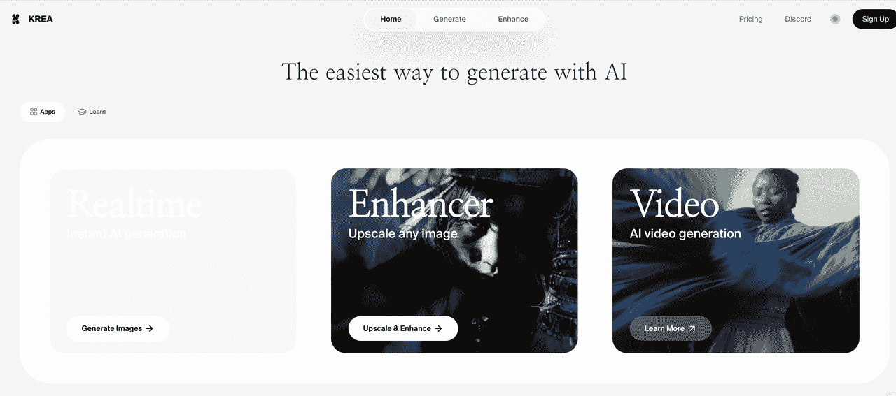

# 5月7日 斯坦福大学教授李飞飞创立AI公司探索 "空间智能"

😊【A**IGC每日新闻】**

1.  【斯坦福大学教授李飞飞创立AI公司探索 "空间智能"】斯坦福大学教授李飞飞创立了一家新的人工智能公司，旨在让人工智能能够像人类一样对视觉信息进行高级推理，该公司已完成种子轮融资，投资方包括知名风投a16z和Radical Ventures。她创立的这家新公司专注于 "空间智能"，即让人工智能能够理解和推理三维空间中的视觉信息。李飞飞在斯坦福大学获得终身教职，曾担任谷歌云AI首席科学家，推动了Google AI中国中心的成立，并长期统筹谷歌云AI、谷歌大脑和中国本土团队的工作。但这是她第一次创业。李飞飞在领英页面上更新了她的简历，从2024年1月开始，现在已经进行了5个月。她的团队正在研究如何教会电脑在三维世界中行动，例如使用大型语言模型让机器人手臂执行任务，打开一扇门、制作三明治，以及对人类的口头指令做出反应等。参考博客链接：https://www.bestblogs.dev/article/3e0679

1.  【DeepSeek AI推出DeepSeek-V2：经济高效MoE语言模型，中文语言理解和推理表现卓越】DeepSeek AI 公司开源了一款名为 DeepSeek-V2 的经济高效混合专家（MoE）语言模型，该模型在多个基准测试中展现出卓越性能，尤其在中文语言理解和推理方面表现突出，成为开源大模型领域的强有力竞争者。DeepSeek-V2采用创新架构，其每个Transformer块由一个注意力模块和一个前馈网络（FFN）组成，并采用了MLA和DeepSeekMoE技术来消除推理时键值缓存的瓶颈，从而支持高效推理。DeepSeek-V2的参数规模达2360亿，每个token激活210亿参数，支持长达128K token的上下文长度。它在AlignBench基准测试中超越GPT-4，接近GPT-4-turbo；在MT-Bench基准中与LLaMA3-70B相当，优于Mixtral 8x22B；尤其擅长数学、代码和推理任务。此外，DeepSeek-V2的API定价非常具有竞争力，每百万token输入仅0.14美元（约合人民币1元），输出0.28美元（约合人民币2元，32K上下文长度），相比GPT-4-Turbo的定价仅为其百分之一左右。参考博客链接：https://www.bestblogs.dev/article/f2df04

1.  【Meta AI法国团队推出新型多token预测模型，显著提升编程任务和推理速度】Meta AI法国团队推出了一种新的多token预测模型，在处理编程任务和提高推理速度方面表现出显著优势。与传统的单token预测相比，该模型在HumanEval基准测试中多解决了12%的问题，在MBPP基准测试中多解决了17%的问题。该模型尤其擅长小型算法推理任务，多token预测在分布外泛化方面表现出令人印象深刻的收益。团队猜测其优势可能有两个原因：首先，编程语言的逻辑结构更严谨，内部联系更紧密，关键节点可能影响整个代码块的走向，多token预测能更好地捕捉这种长距离依赖。其次，编程语言的词汇量较小，每次预测多个token的难度相对较小，迫使模型从局部细节转向全局优化。此外，团队还在更细粒度的字节级模型上进行了实验，发现使用8字节预测替代下一个字节预测后，模型在MBPP基准测试中的表现大幅提升。该论文还探讨了多token预测在训练和推理时分布差异的影响，并提出未来可以研究使用损失权重调整或动态调整预测token数量的方法。参考博客链接：https://www.bestblogs.dev/article/3a7a35

🏜️【今**日份AI工具推荐】**

https://thinkany.ai/zh

# 5月6日 伊隆·马斯克分享计划：使用AI总结新闻事件和社交媒体反应

🙂【A**IGC每日新闻】**

1.  【伊隆·马斯克分享计划：使用AI总结新闻事件和社交媒体反应】伊隆·马斯克（Elon Musk）刚刚分享了他使用AI总结新闻事件和社交媒体反应的计划，同时推出了一项名为 "故事" 的新功能，为用户提供实时、准确的信息。X公司的AI聊天机器人Grok将分析成千上万的帖子，根据可用的新信息生成新闻摘要。这些摘要将完全基于X帖子和评论，而不是新闻文章本身的文本，这使得该方法与其他AI摘要工具不同。目前，Grok生成的新闻摘要（称为 "故事"）仅限于X的高级订阅用户，预计稍后将向更多用户推出。参考博客链接：https://twitter.com/Kantrowitz/status/1786439266303623188?utm_source=www.therundown.ai&utm_medium=referral&utm_campaign=elon-musk-s-ai-powered-stories

1.  【乡村音乐明星兰迪·特拉维斯（Randy Travis）利用AI技术重现歌声，推出十年来首支新歌】乡村音乐巨星兰迪·特拉维斯（Randy Travis）凭借人工智能技术推出了十年来首支新歌《Where That Came From》，他在中风后无法说话或唱歌，而AI技术重现了他的歌声。特拉维斯的新歌《Where That Came From》是通过训练人工智能模型来复制他的声音而制作的，该模型使用了过去的录音。然后，将该声音复制与另一位歌手提供的引导人声相结合，打造了这首歌曲。尽管人工智能在音乐中的应用引发了兴奋和争议，但特拉维斯的歌曲是一个很好的例子，说明了这项技术在解锁新的创意可能性方面的潜力——甚至对于那些可能不再有能力唱歌的人来说。参考博客链接：https://www.youtube.com/watch?v=rh8-g8seeig&utm_source=www.therundown.ai&utm_medium=referral&utm_campaign=elon-musk-s-ai-powered-stories

1.  【英伟达推出DrEureka：利用LLM代理自动化机器人技能训练和转化】英伟达的研究人员刚刚介绍了一种名为DrEureka的AI系统，该系统使用LLM代理来自动化在模拟中训练机器人技能并将其转移到现实世界的过程。DrEureka编写代码来在模拟中教授机器人技能，然后确保这些技能在转移到物理机器人时表现良好。该系统训练了一个模拟机器人狗在瑜伽球上保持平衡和行走，然后成功地将任务转移到现实中的机器人上。DrEureka利用LLM对物理学的理解来调整摩擦和重力等参数，自动完成适应现实世界的耗时过程。通过让AI监督和改善机器人学习过程，将大大加速先进机器人的部署，同时减少对人类专家在循环中的需求。DrEureka使机器人成为更加优秀的学习者——在更短的时间内完成困难任务。参考博客链接：https://eureka-research.github.io/dr-eureka/?utm_source=www.therundown.ai&utm_medium=referral&utm_campaign=elon-musk-s-ai-powered-stories

🏖️【今**日份Prompt工具推荐】**

https://moonvy.com/apps/ops/

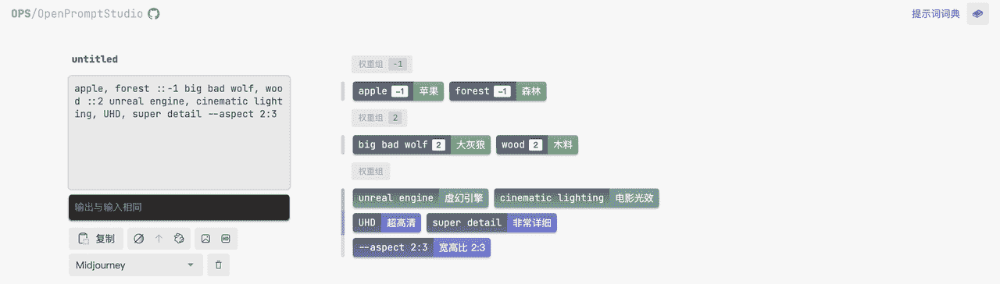

# 5月5日 Brilliant Labs推出Frame AI眼镜

🫠【A**IGC每日新闻】**

1.  【Scale AI最新研究发现大型语言模型在热门AI基准测试中存在严重 "过拟合"】Scale AI的一项新研究发现，某些大型语言模型在流行的人工智能基准测试中存在严重的 "过拟合" 现象，这引发了人们对当前排行榜和评估实践有效性的质疑。过拟合是指模型记忆基准测试中的特定问题，而不是学习一般问题解决技能。Scale AI创建了一个名为GSM1k的新数据集，它与广泛用于测试AI模型数学能力的GSM8k基准测试非常相似。在GSM1k测试中，多个顶级AI模型的分数明显低于其在GSM8k测试中的分数，这表明这些模型是记忆而不是真正理解问题。Mistral和Phi的表现明显低于预期，而GPT-4、Claude、Gemini和Llama的表现相似。随着人工智能能力的不断进步，该研究证明了采用更难被 "玩透" 的评估方法（如GSM1k）的必要性，以避免过拟合带来的错误印象。参考博客链接：https://arxiv.org/pdf/2405.00332?utm_source=www.therundown.ai&utm_medium=referral&utm_campaign=sam-altman-reveals-huge-ai-insights

1.  【Brilliant Labs推出Frame AI眼镜：开源、模块化设计，增强现实互动】Brilliant Labs是一个专注于开源技术的平台，其推出的Frame AI眼镜是一款创新产品。Frame眼镜具备语音识别和视觉分析功能，可提供实时文本翻译和网络搜索等服务。Frame的设计特点是模块化和开源。它采用光学机械外壳、摄像头和电路板等组件，并可配备处方镜片和磁性配件。用户可以通过配套的Noa应用程序增强Frame的功能，包括学习、发现和导航等。Brilliant Labs致力于提供增强知识、理解、创造力和同理心的工具，促进共同繁荣。Frame AI眼镜是一款具有开源设计和强大功能的增强现实设备，为用户带来了互动和个性化体验。参考博客链接：https://brilliant.xyz/

1.  【WildChat 数据集：基于100万条真实用户与ChatGPT交互构建的多语言数据集】WildChat 数据集是一个由100万条真实用户与 ChatGPT 的交互对话构成的语料库，具有多种语言和用户提示的多样性。该数据集是通过向用户提供免费访问 ChatGPT 和 GPT-4 来收集对话记录，并经用户同意后建立的。该数据集用于微调 Meta 的 Llama-2 模型并创建 WildLlama-7b-user-assistant 模型，该模型能够预测用户提示和助手的响应，成为聊天机器人领域的一项创新。WildChat数据集网站提供了数据集、模型和相关论文的链接，便于感兴趣的人进一步了解和研究。参考博客链接：https://wildchat.allen.ai/

🏔️【今**日份Prompt工具推荐】**

https://lexica.art/

# 5月4日 CodeSignal推出 "AI技能报告"

🙃【A**IGC每日新闻】**

1.  【Sam Altman在斯坦福大学参加问答环节，分享了有关GPT-5、AGI、计算能力重要性等话题的见解】Sam称GPT-4为 "充其量令人略感尴尬"，并表示随着每个新版本的不断进步，GPT-4将是我们使用过的最 "糟糕" 的模型。他 "不关心" 公司每年是烧掉5亿美元还是500亿美元--只要它保持在创造AGI的轨道上，就将是值得的。Sam还谈到了全球计算能力的重要性，表示他们的使命是让ChatGPT对 "尽可能多的人" 免费使用。Sam还透露，本周早些时候出现在Lmsys上的神秘gpt2-chatbot模型并不是GPT 4.5。Sam对GPT-4能力的坦率评论进一步加剧了人们对OpenAI下一款模型的炒作。作为一名AI发展的内部人士，他的乐观态度表明下一个飞跃将是重大的。参考博客链接：https://www.youtube.com/watch?v=GLKoDkbS1Cg

1.  【CodeSignal推出 "AI技能报告"，帮助团队发现和培养人工智能人才】CodeSignal推出了一份名为 "AI技能报告" 的白皮书，为企业应对人工智能和机器学习工程师日益增长的需求提供了路线图。这份白皮书涵盖了以下内容：

了解人工智能、机器学习和提示工程师所需的核心技能。

有效策略，以招聘合格的工程师。

提升现有人才人工智能技能的最佳实践。

CodeSignal的 "AI技能报告" 为企业提供了发现和培养人工智能人才的宝贵资源，帮助企业跟上人工智能领域的发展步伐。参考博客链接：https://codesignal.com/ai-skills-report/?utm_campaign=AI-Skills-Report-Newsletter_Q2_25_&utm_medium=email&utm_source=the-rundown&utm_content=asset-download

1.  【微软签署史上最大可再生能源采购协议，为快速增长的AI业务提供动力】微软公司刚刚签署了有史以来规模最大的企业可再生能源采购协议，为快速增长的AI业务提供10.5吉瓦的新清洁电力容量。该协议是与布鲁克菲尔德资产管理公司（Brookfield Asset Management）达成的，估计成本在115亿美元到170亿美元之间。与之前最大的协议相比，10.5吉瓦的容量几乎大了8倍，仅这一协议就相当于2022年加利福尼亚州太阳能和风能发电总容量的近一半。微软致力于抵消其AI数据中心飙升的能源需求，同时仍致力于在2030年前实现100%无碳能源的目标。随着人工智能革命的到来，能源需求也急剧增加，给全球电网带来了压力。随着科技巨头继续扩大能源密集型模型的规模，它们可能会推动全球在可再生能源基础设施方面进行重大转型投资。参考博客链接：https://www.bloomberg.com/news/articles/2024-05-01/microsoft-strikes-major-green-power-deal-with-brookfield-renewable?utm_source=www.therundown.ai&utm_medium=referral&utm_campaign=sam-altman-reveals-huge-ai-insights

🌍️【今**日份Prompt工具推荐】**

https://kalos.art/

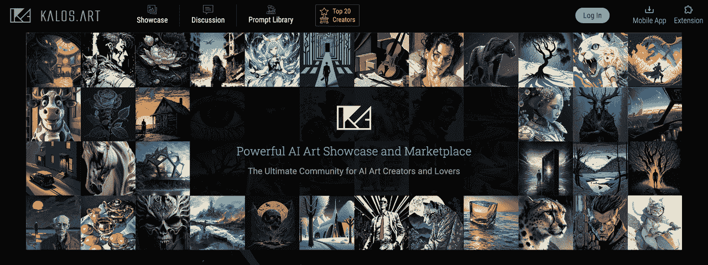

# 5月3日 英伟达推出ChatQA-1.5模型，在问答和阅读理解任务中表现优异

😉【A**IGC每日新闻】**

1.  【英伟达推出ChatQA-1.5模型，在问答和阅读理解任务中表现优异】ChatQA-1.5基于Llama3基座模型，包含8B和70B两个版本，在表格和算数计算方面表现尤其出色。评测结果显示，ChatQA-1.5的8B版本在问答任务中甚至超过了Cohere的Command-R-Plus模型。该模型的推出进一步提升了英伟达在人工智能问答和阅读理解领域的竞争力，为用户提供了强大的工具。参考博客链接：https://huggingface.co/nvidia/Llama3-ChatQA-1.5-70B

1.  【Claude推出团队计划和iOS应用程序，增强AI聊天体验】Claude推出了两项更新：全新的团队计划和iOS应用程序，旨在为用户提供更好的AI聊天体验。

团队计划：

a) 提供更大的使用量和用户管理工具，每位用户每月30美元。

b) 提供比Pro计划更多的使用量和多种模型选择，包括Opus、Sonnet和Haiku，满足不同场景的需求。

c) 提供200K上下文窗口，处理长文档和复杂话题。

d) 引入管理工具方便控制用户和账单管理。

iOS应用程序：

a) Claude的iOS应用程序对所有用户免费开放，包括Pro和Team计划的用户。

b) 与网页版聊天无缝同步，确保聊天记录一致。

c) 支持从照片库选择照片、拍摄新照片或上传文件进行实时图像分析。

d) 应用程序便于移动使用，帮助用户随时随地进行头脑风暴、快速获取AI答案或分析现实世界的场景和图像。

此次更新增强了Claude的适用性，满足了不同规模团队的需求，并提供了便捷的移动访问方式。参考博客链接：https://www.anthropic.com/news/team-plan-and-ios

1.  【Yes, we KAN! 全新的神经网络架构 KAN！】KANs 是一种新型神经网络，它基于 Kolmogorov-Arnold 表示定理，可以用作 Multi-Layer Perceptrons (MLPs) 的有效替代品。与 MLPs 不同，KANs 在边缘而不是节点上放置可学习的激活函数，并且没有线性权重。KANs 可以用 B-spline 曲线参数化，并且可以通过增加网络的宽度和深度来扩展。研究表明，KANs 比 MLPs 更准确，并且可以更好地解释。参考博客链接：https://arxiv.org/pdf/2404.19756

🥥【今**日份Prompt工具推荐】**

https://prompthero.com/

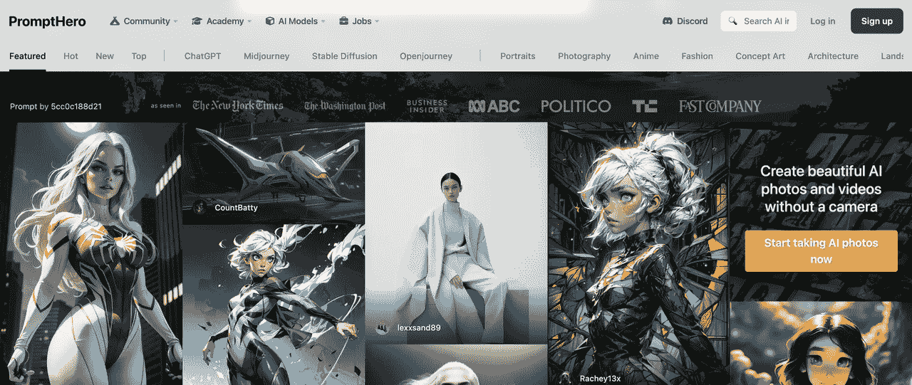

# 5月2日 HuggingChat发布Assistants功能，用户可自定义AI助手

🤣【A**IGC每日新闻】**

1.  【Quivr：第二大脑工具开源，获32K星标，登Github趋势榜】Quivr，一款服务于超过6000家公司、拥有42,000+用户的“第二大脑”产品，现已开源，并迅速获得超过32,000个星标，成为Github上的热门项目。Quivr的特点包括：

支持PDF、网址(URL)、Docx、API、SQL等几乎所有数据格式的解析和处理；

兼容OpenAI、Ollama等开源或商业的人工智能模型；

具备离线运行能力，支持内容分享，并提供一键部署到Vercel或AWS的便捷功能。参考博客链接：https://github.com/QuivrHQ/quivr

1.  【HuggingChat发布Assistants功能，用户可自定义AI助手】HuggingChat平台推出了一项新功能——Assistants，目前上线了800多个AI助手。用户现在可以自行创建基于HuggingChat支持的8种语言模型的助手，并且能够：

+   设定助手的引导系统提示语，以定制对话的开始方式；

+   控制助手的网络权限，包括默认设置、允许网络搜索、仅限特定域名搜索或仅获取特定链接的数据；

+   利用动态提示语，让助手在对话中更加灵活和适应性强。

这项新功能的推出，增强了HuggingChat的个性化和定制化能力，使用户能够根据自己的需求和偏好打造专属的AI助手。参考博客链接：https://huggingface.co/chat/assistants

1.  【使用Chrome地址栏快捷方式，轻松与Gemini对话】现在，通过Chrome桌面地址栏的快捷方式，与Gemini聊天变得非常简单快捷：

在桌面浏览器的地址栏中输入“@”符号，然后选择“与Gemini聊天”；

输入你的聊天提示或问题；

你将在gemini.google.com上获得回应。就是这么简单！✨ 通过这个新特性，用户可以快速方便地与Gemini AI进行互动，获取所需的信息或执行特定的任务。参考博客链接：https://x.com/googlechrome/status/1785402781144093181?s=46

🍓【今**日份Prompt工具推荐】**

https://promptomania.com/

# 5月1日 亚马逊发布Q：面向企业和开发者的AI助手

😆【A**IGC每日新闻】**

1.  【亚马逊发布Q：面向企业和开发者的AI助手】亚马逊宣布其AI助手Q现已向企业和开发者开放，旨在为企业提供高级功能。Q Developer提供行业领先的代码生成、测试、调试、推理和为逐步规划服务的代理。Q Business能够连接公司的数据仓库，使用户能够轻松获取答案、总结信息、分析趋势以及与企业数据互动。新推出的Q Apps功能允许非技术用户使用公司数据的自然语言提示来创建自定义的AI应用程序。亚马逊网络服务（AWS）副总裁Dr. Swami Sivasubramanian表示，Q可以帮助员工提高超过80%的工作效率。参考博客链接：https://www.aboutamazon.com/news/aws/amazon-q-generative-ai-assistant-aws?utm_source=www.therundown.ai&utm_medium=newsletter&utm_campaign=amazon-s-new-app-generating-ai

1.  【OctoAI的OctoStack：保护隐私，提升企业数据价值】OctoAI公司推出的OctoStack是一个创新工具，它允许用户将生成性人工智能（GenAI）模型引入自己的数据存储系统中，同时确保数据的隐私和安全，最大化公司最宝贵的资产——商业数据的价值。参考博客链接：https://octo.ai/cp/octostack-in-your-datastore/?utm_source=rundown&utm_medium=newsletter&utm_campaign=201octostack-snowflake

1.  【谷歌推出Med-Gemini：AI医疗模型新标杆】谷歌最近推出了Med-Gemini，这是一套专为医疗保健领域微调的AI模型，它在多个医疗基准测试中刷新了记录。Med-Gemini在14项任务中的10项上超越了顶级模型，包括GPT-4。该模型结合了网络搜索信息，以提供更可靠和最新的答案来解决复杂的医疗问题。Med-Gemini在分析医学影像、视频和健康记录方面表现出色，并且能够就患者病例进行逼真的对话。这标志着AI技术在医疗领域的应用又向前迈出了重要一步。参考博客链接：https://www.google.com/url?q=https://link.mail.beehiiv.com/ss/c/u001.Q334NVcZU4O6L6VKRz8ijCoxsIrAYsoK6JoeS4IB_IPPedGRFBwEJuBvQGXHatO-sHTXicgBp9D0pBiDJKZEg5ywb_d5ux_mrRNA1QmVnrs2n-7C5zI1V-JvR0ODjSQLAySlqWLCOik9oOurq3w9ZTKbZCCkOhSi0f54bPHQjtslmOxuqdXhdNn89co9wA5S/45z/k9EUYqcDS8agQkNV_3TNwg/h21/h001.ahh0-jW6kGNj0omLWrf9OVla4rxsxOJnJXrQc5i4TWU&source=gmail&ust=1714650246889000&usg=AOvVaw0vBmEt3n3jAFulvadx-rF6&rct=i

🍑【今**日份Prompt工具推荐】**

https://huggingface.co/spaces/merve/ChatGPT-prompt-generator

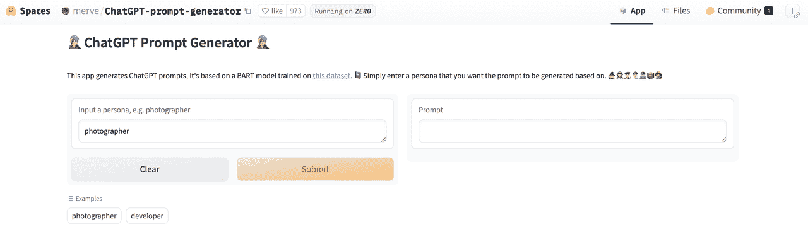

# 4月30日 Chatbot Arena上出现名为“gpt2-chatbot”的神秘模型

😁【A**IGC每日新闻】**

1.  【Chatbot Arena上出现名为“gpt2-chatbot”的神秘模型】该模型展示了其先进的能力，引发了人们猜测这可能是OpenAI对GPT 4.5进行的一次秘密测试。

细节如下：

+   该模型没有任何官方文档或归属说明，但当被问及时，它会自称为ChatGPT，由OpenAI创建。

+   用户们赞扬了模型的推理、数学、编程能力，甚至ASCII艺术技能，这些在测试中似乎与GPT-4及以上模型相匹配或超过。

+   还有猜测称，OpenAI可能在公开发布新模型前，进行安静的基准测试。

+   为这些猜测火上浇油的是，Sam Altman后来发帖说他对“gpt2”有“特殊的喜好”。

参考博客链接：https://chat.lmsys.org/?utm_source=www.therundown.ai&utm_medium=newsletter&utm_campaign=gpt2-ai-mystery-model

1.  【GitHub推出Copilot Workspace：AI助力开发者从构思到执行】GitHub最近发布了一个名为Copilot Workspace的新工具，它利用人工智能帮助开发者直接从他们的代码库使用自然语言来构思、规划和启动项目。这个特性可以直接集成到GitHub仓库中，允许开发者用自然语言描述目标，而不是从编写代码开始。AI还能够根据仓库中现有的代码库生成分步计划和初始代码。开发者可以在Workspace中编辑、完善并运行AI建议的代码，然后再转移到完整的开发过程中。这项新功能的意义在于，GitHub将流行的AI编码助手提升到了一个新的水平，向能够从创意到执行全面支持开发者的完整AI代理迈进了一步，而不仅仅是在现有代码中发现错误。参考博客链接：https://github.blog/2024-04-29-github-copilot-workspace/?utm_source=www.therundown.ai&utm_medium=newsletter&utm_campaign=gpt2-ai-mystery-model

1.  【OpenAI与英国《金融时报》建立合作，ChatGPT将整合FT新闻】OpenAI公司和英国《金融时报》(Financial Times, FT)宣布达成战略合作伙伴关系，将FT的新闻内容整合到其人工智能聊天机器人ChatGPT中。根据合作协议，ChatGPT在适当的情况下将能够展示FT内容的归因摘要、引用和链接。此外，今年早些时候，FT已经为其所有员工购买了ChatGPT企业版的访问权限，这一举措旨在提升员工对人工智能工具的熟悉度，并促进内部创新。通过这次合作，ChatGPT将能够提供更丰富的信息和数据来源，同时FT也将借助AI技术扩大其新闻内容的影响力。参考博客链接：https://x.com/btibor91/status/1784924556693578234?s=46

🍌【今**日份Prompt工具推荐】**

https://prompts.chat/

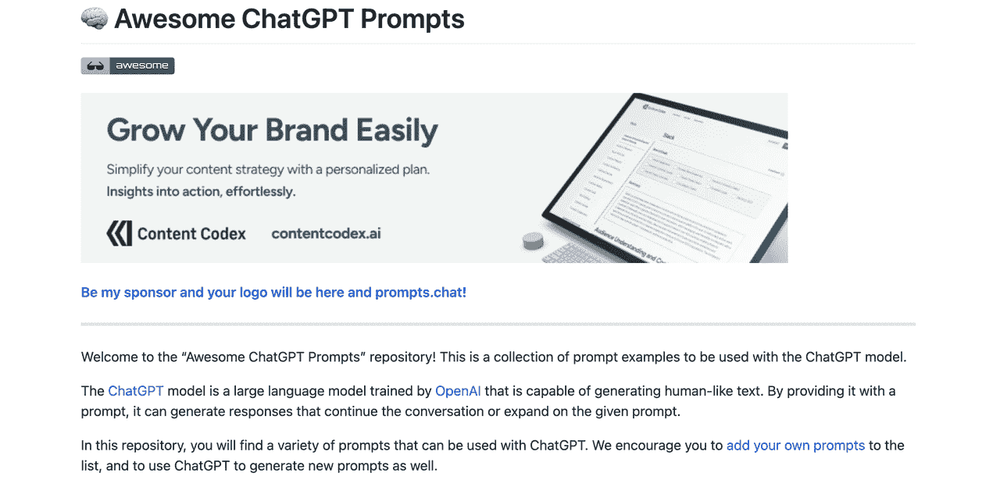

# 4月29日 AI开源项目Perplexica：智能搜索问答引擎

🥱【A**IGC每日新闻】**

1.  【AI开源项目Perplexica：智能搜索问答引擎】由ItzCrazyKns开发的Perplexica是一个受Perplexity启发的AI搜索问答引擎，它基于SearxNG的AI搜索引擎，不仅能够搜索信息，还能更深入地理解用户的问题。通过结合LangChainAI框架和LLM RAG技术，Perplexica为用户提供了更加精确和完善的搜索结果，并明确显示答案和引用来源。

项目亮点包括：

1.  支持部署运行本地模型，如Llama-3、Mistral和Phi-3等Ollama支持的大型模型。

1.  具备两种模式：Copilot模式和正常模式，Copilot模式通过生成多样化的查询来增强搜索，寻找更相关的互联网资源。

1.  聚焦模式：专为特定类型问题设计，如写作助手或学术检索，提供更专业的解答。

1.  实时信息：利用SearxNG获取即时信息，并结合RAG技术进行优化处理。

Perplexica的推出为AI搜索领域带来了新的创新，旨在提升用户获取信息的效率和质量。参考博客链接：https://github.com/ItzCrazyKns/Perplexica

1.  【摩根大通推出AI工具FlowMind，助力金融行业自动化】摩根大通人工智能研究部近日推出了一款名为FlowMind的自动化工具，旨在通过GPT技术自动生成工作流程，以提高金融行业的工作效率。该工具能够处理信贷审批、风险评估和合规监测等关键任务，并通过自动化流程减少人为错误。

FlowMind在设计上特别注重数据安全和隐私保护，确保在生成和执行工作流时，大型语言模型(LLM)不会直接接触敏感数据或专有代码。所有操作都通过抽象的API描述进行，保障了数据的安全性。

此外，FlowMind还突破了传统自动化工具的局限，通过集成用户反馈机制，允许用户参与工作流的优化和定制，从而使得自动化解决方案更加个性化，更贴合用户的实际需求。这一创新工具的推出，预示着金融行业自动化水平的进一步提升，同时也展现了摩根大通在AI应用领域的领先地位。参考博客链接：

https://x.com/imxiaohu/status/1784773255657836603?s=46

1.  【昆仑万维推出的Music Consistency Models（MusicCM）】该模型是一种创新的音乐生成模型，它采用一致性模型的概念来高效地合成音乐片段的频谱图。MusicCM结合了文本到音乐的扩散模型，并通过一致性蒸馏和对抗性鉴别器训练来生成音乐。这一方法不仅提高了音乐合成的效率，而且保证了音乐的高质量，通过这种方式，MusicCM能够在每次生成过程中生成直接位于真实音乐作品流形上的样本，避免了模糊和其他常见的合成伪影。参考博客链接：https://arxiv.org/abs/2404.13358

🍉【今**日份Prompt工具推荐】**

https://flowgpt.com/

# 4月28日 Vidu：国内首个长时长、高一致性视频大模型

😳【A**IGC每日新闻】**

1.  【生数科技和清华大学联合发布Vidu：国内首个长时长、高一致性视频大模型】生数科技和清华大学联合发布了一个创新性的视频大模型——Vidu。该模型被视为中国首个达到Sora级别的视频生成模型，具有长时长、高一致性和高动态性等特点。Vidu模型融合了Diffusion和Transformer技术，采用创新的U-ViT架构，能够生成长达16秒、分辨率高达1080P的高清视频。它不仅能模拟真实物理世界，还具备丰富的想象力，支持多镜头生成和高时空一致性。参考博客链接：https://x.com/imxiaohu/status/1784229901262012740

1.  【LGM ：用于从文本提示或单视图图像生成高分辨率 3D 模型】LGM（Large Multi-View Gaussian Model）是一种新的框架，旨在生成高分辨率 3D 模型，可以从文本提示或单视图图像中产生。该框架的两个关键见解是：（1）3D 表示：作者提出了多视图高斯特征作为一种高效而强大的表示方法，可以用于可微渲染。（2）3D 骨干：作者提出了一种非对称 U-Net 作为高吞吐量骨干，用于处理多视图图像，这些图像可以通过利用多视图扩散模型从文本或单视图图像输入中产生。实验表明，该方法具有高度的准确性和效率，可以在 5 秒内生成高分辨率 3D 对象，同时将训练分辨率提高到 512。参考博客链接：https://me.kiui.moe/lgm/

1.  【Microsoft推出FILM-7B模型：解决长上下文lost-in-the-middle问题，性能媲美GPT-4-Turbo】Microsoft最新推出了FILM-7B模型和相应的训练方案，旨在解决大型语言模型中常见的lost-in-the-middle问题。该模型基于Mistral-7B-Instruct-v0.2进行训练，上下文长度可达32K，能够高效利用长上下文信息。FILM-7B引入了信息密集型（IN2）训练方法，通过纯数据驱动的方式强化模型对长上下文信息的理解和利用能力。在评测任务和真实任务中，FILM-7B的表现显著优于之前的模型，特别是在长文本场景下的性能提升明显。Microsoft推出的FILM-7B模型解决了大型语言模型中长期存在的lost-in-the-middle问题，提升了模型对长上下文信息的理解和利用能力。其性能甚至媲美GPT-4-Turbo，标志着Microsoft在大型语言模型研究和应用方面的又一重大进展。参考博客链接：https://arxiv.org/pdf/2404.16811

🍄【今**日份Prompt工具推荐】**

https://bestprompts.cn/#/index

# 4月27日 苹果与OpenAI深入谈判，为iPhone引入生成式AI功能

😲【A**IGC每日新闻】**

1.  【苹果与OpenAI深入谈判，为iPhone引入生成式AI功能】苹果公司正与OpenAI加强合作，计划将生成式人工智能技术集成到iPhone中，以提升用户体验。这一举措可能意味着苹果设备将具备更高级的AI功能，如自然语言处理和内容生成。尽管细节尚未公布，但外界普遍认为，苹果在AI领域的持续投入，旨在巩固其在智能手机市场的领先地位，同时为用户带来更加智能化和个性化的服务。参考博客链接：https://www.bloomberg.com/news/articles/2024-04-26/apple-intensifies-talks-with-openai-for-iphone-generative-ai-features

1.  【Project GraghRAG：微软结合知识图谱和图数据库的技术，使用图模型来增强信息检索过程】微软近日推出Project GraghRAG，这是一种创新技术，旨在提升大型语言模型（LLM）在信息检索和生成任务中的表现。通过结合文本数据集和知识图谱，GraghRAG可以显著增强LLM处理未见过的数据和复杂问题的能力。GraghRAG的核心技术在于使用图数据库存储和索引大规模知识图谱数据，并实时调用图谱数据来补充和校准模型的推理过程。与传统检索方法相比，GraghRAG能够提供更准确、更相关的检索结果。此外，GraghRAG还具有隐私保护机制，可以在不泄露图信息的情况下对LLM进行匿名预训练。微软的研究表明，通过GraghRAG过程，LLM可以建立对源数据中实体和关系的理解，并生成知识图谱。Project GraghRAG是一个前沿的NLP技术项目，它提升了大型语言模型在信息检索和生成任务中的表现，特别是对未见过的数据和复杂问题。微软的研究进展表明，GraghRAG有望成为LLM领域的一项重要创新，并带来广泛的应用潜力。参考博客链接：https://arxiv.org/pdf/2404.16130

1.  【阿里开源Qwen 1.5-110B模型：多语言支持，上下文长度可达32K Token】阿里近日宣布开源其最新的大型语言模型Qwen 1.5-110B。该模型在基础能力评估中表现出色，与Meta-Llama3-70B不相上下。Qwen 1.5-110B的一个突出特点是支持高达32K Token的超长上下文长度，这使它能够处理更复杂的语境和长文本生成任务。此外，该模型还提供多种语言支持，包括英语、中文、法语、西班牙语、日语、韩语、越南语等，满足全球用户的需求。参考博客链接：https://x.com/JustinLin610/status/1783808991824576977

🌸【今**日份Prompt工具推荐】**

https://www.imiprompt.com/

# 4月26日 商汤科技推出SenseNova 5.0，在关键基准测试中超越GPT-4 Turbo

😮【A**IGC每日新闻】**

1.  【商汤科技推出SenseNova 5.0，在关键基准测试中超越GPT-4 Turbo】商汤科技近日推出其大型语言模型SenseNova 5.0，它在知识、数学、推理和编码等多个方面表现优异，在关键基准测试中超越了GPT-4 Turbo。SenseNova 5.0拥有约6000亿个参数，训练数据量达10TB，在处理超长语境和合成数据方面表现突出。据悉，商汤科技还将在近期推出文本到视频生成模型，强化人工智能产出效果。SenseNova 5.0的出色表现表明中国人工智能技术的竞争力或超预期，但目前这些模型仍未向公众开放，其能力仍需进一步验证。参考博客链接：https://www.sensetime.com/en/news-detail/51167731?categoryId=1072&utm_source=www.therundown.ai&utm_medium=referral&utm_campaign=chinese-ai-bests-gpt-4t

1.  【Sanctuary AI推出第七代Phoenix人形机器人，增强物理设计、人工智能系统和训练过程】Sanctuary AI推出其Phoenix人形机器人的第七代产品，带来了物理设计、人工智能系统和训练过程的显著增强。与前几代相比，Gen 7拥有更长的操作时间、更精简的制造流程和更低的生产成本。第七代Phoenix机器人拥有更先进的灵巧度、耐用性、视觉感知和感应能力，其身体设计经过全面升级。此外，Phoenix的"Carbon"人工智能系统在任务掌握方面取得重大进步，现在可以在一天内掌握新任务，而之前需要数周时间。人形机器人技术的快速进步使它们越来越接近科幻小说中的能力。随着人工智能模型和硬件的不断进步，这些机器人被整合到现实世界中只是时间问题。参考博客链接：https://www.prnewswire.com/news-releases/sanctuary-ai-unveils-the-next-generation-of-ai-robotics-302126861.html?utm_source=www.therundown.ai&utm_medium=referral&utm_campaign=chinese-ai-bests-gpt-4t

1.  【如何在手机上免费使用HuggingChat应用访问Meta最新发布的强大开放式大型语言模型Llama 3】Meta公司最新发布了强大的开放式大型语言模型Llama 3。本教程将指导您如何在手机上使用HuggingChat应用免费访问该模型。具体步骤如下：

从App Store下载HuggingChat应用，或直接在浏览器中访问。

使用Hugging Face账户或Apple ID登录。

点击齿轮图标访问设置菜单，选择"meta-llama/Meta-Llama-3-70B-Instruct"。

开始使用！在聊天界面输入您的问题或输入内容，然后发送即可。

参考博客链接：https://university.therundown.ai/c/daily-tutorials/access-the-most-advanced-open-source-llm-llama-3-on-your-phone-3bc18501-071a-4438-aa52-36bd1bcb9eb0?utm_source=www.therundown.ai&utm_medium=referral&utm_campaign=chinese-ai-bests-gpt-4t

🦭【今**日份Prompt工具推荐】**

**https://github.com/Moo**nvy/OpenPromptStudio

这是一个可以将AIGC提示词（现在也支持Midjourney）可视化，并提供编辑功能的工具

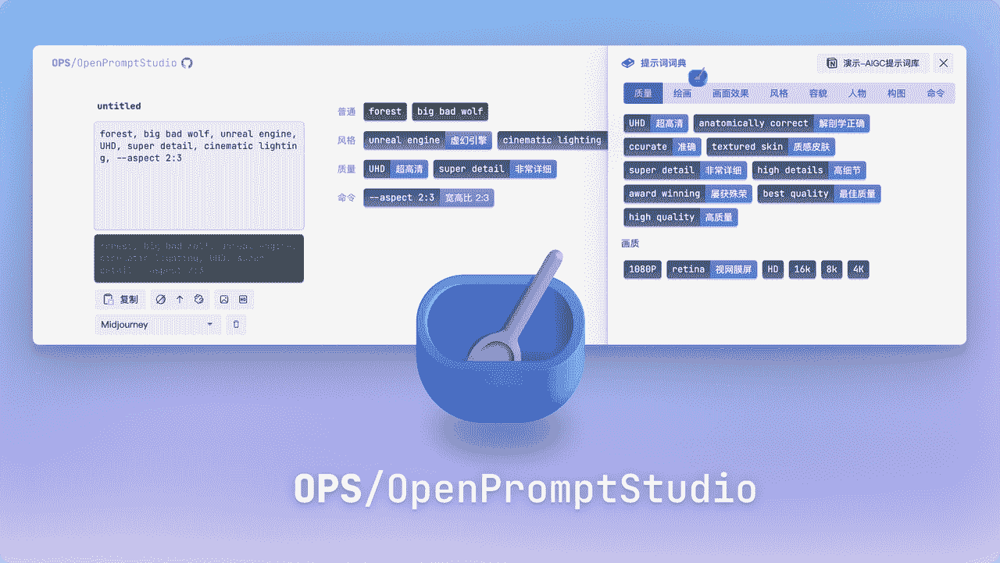

# 4月25日 Freepik推出AI图像生成器，实时转换创意理念

🫤【A**IGC每日新闻】**

1.  【苹果发布OpenELM：高效运行于iPhone和Mac设备上的小型开源语言模型】苹果公司近期推出了OpenELM，这是一个小型开源语言模型系列，旨在高效运行于iPhone和Mac等设备上。OpenELM由八个模型组成，具有四个不同的参数尺寸（270M、450M、11亿和30亿），所有模型均使用公开数据集进行训练。该模型系列针对设备端使用进行了优化，使设备能够在不依赖云服务器的情况下处理人工智能任务。尽管OpenELM所需的训练数据仅为类似模型的一半，但其性能略优于OLMo等可比的开源模型。苹果还开源了CoreNet库，该库用于训练OpenELM，以及用于在Apple设备上进行高效推理和微调的模型。苹果推出小型开源语言模型的举措，表明了该公司对设备端人工智能发展的关注。此外，开源发布也标志着苹果公司从以前的限制性和保密方式转向更加开放的策略。参考博客链接：https://arxiv.org/abs/2404.14619?utm_source=www.therundown.ai&utm_medium=referral&utm_campaign=apple-ai-goes-open-source

1.  【Freepik推出AI图像生成器，实时转换创意理念】Freepik推出了一款领先的人工智能图像生成器，可实时将您的想法转化为令人惊叹的视觉效果，为您提供无限的创意可能性。使用 Freepik，您可以：

即时生成无限量的AI图像，享受实时生成和无限滚动功能。

使用可定制的提示、样式、颜色和视角来定制创作。

使用 "重新想象" 和 "上采样器" 等强大工具来增强结果。

Freepik的AI图像生成器为您的创意提供了无限可能，帮助您高效打造令人惊叹的视觉效果。参考博客链接：https://www.freepik.com/ai/image-generator?utm_source=newsletter&utm_medium=email&utm_campaign=rundownai&utm_term=2024_04_25&utm_content=freepik

1.  【伊隆·马斯克（Elon Musk）在特斯拉2024年第一季度财报电话会议上提供了关于Optimus自主机器人项目的最新更新】他表示特斯拉应该被视为一家人工智能或机器人公司，而不仅是汽车制造商。马斯克表示，他认为Optimus项目的价值将 "超过公司其他所有业务的总和"。他透露，Optimus机器人预计在今年年底将在特斯拉工厂执行 "有用任务"，并在2025年底之前对外销售。一份新的图表显示，Optimus机器人位于特斯拉生态系统图的顶端，占公司长期价值的 "大部分"。参考博客链接：https://www.teslarati.com/tesla-q1-2024-earnings-call-transcript/?utm_source=www.therundown.ai&utm_medium=referral&utm_campaign=apple-ai-goes-open-source

🐬【今**日份Prompt网站推荐】**

https://publicprompts.art

# 4月24日 Meta为Ray-Ban智能眼镜推出多模态AI功能，提供情境感知辅助

🤓【A**IGC每日新闻】**

1.  【微软推出Phi-3系列小型语言模型，性能超越更大尺寸的竞争对手】微软公司近期推出了Phi-3系列小型语言模型，该系列在小型AI模型领域达到了新的里程碑，其性能超越了尺寸更大的竞争对手。Phi-3系列模型包括三个尺寸：参数数量为3.8B的Phi-3-mini、7B的Phi-3-small和14B的Phi-3-medium。尽管Phi-3-mini的参数数量明显较少，但其基准测试表现可媲美Mixtral和GPT 3.5，同时拥有高达128K的上下文窗口。Phi-3-mini的3.8B参数数量还允许该模型在设备端部署，同时保持质量和成本效益。Phi-3系列的其他两个模型（Phi-3-small和Phi-3-medium）仍在训练中，将在未来几周内推出。参考博客链接：https://azure.microsoft.com/en-us/blog/introducing-phi-3-redefining-whats-possible-with-slms/?utm_source=www.therundown.ai&utm_medium=referral&utm_campaign=microsoft-launches-a-mini-ai-model

1.  【AE Studio：专注于AI对齐等技术难题的创新公司】AE Studio是一家致力于解决技术领域最棘手挑战的公司，包括人工智能对齐等。其研发团队探索人工智能安全和意识的前沿，而咨询团队则提供最先进的人工智能解决方案。AE Studio在人工智能、区块链、脑机接口等领域拥有丰富经验。他们提供端到端专业知识，从构思到部署，确保每个项目都得到全方位的关注。AE Studio的团队将每个项目视为自己的创业项目，确保以创新的思维和热情来对待。参考博客链接：https://ae.studio/therundown?utm_source=the-rundown&utm_campaign=the-rundown-042424&utm_medium=newsletter&utm_term=4bd7ca2b-9ac9-4edb-bd3d-23c40a33f69f

1.  【Meta为Ray-Ban智能眼镜推出多模态AI功能，提供情境感知辅助】Meta公司近期宣布为所有Ray-Ban Meta智能眼镜推出多模态功能，集成人工智能技术，能够处理和理解用户的周围环境。Meta的AI助手之前仅限于音频交互，现在可以处理来自眼镜内置摄像头收集的视觉数据，并提供相关见解。用户可以通过语音命令让眼镜翻译文本、识别物体或提供特定于情境的信息，完全解放双手。佩戴者还可以在WhatsApp和Messenger的视频通话中分享视野，实现实时、无手的体验分享。多模态AI升级将作为测试版功能向美国和加拿大的所有用户推出。Meta的多模态集成标志着智能眼镜向前迈出重要一步，将时尚的可穿戴设备转变为强大的、具有情境感知能力的助手。同样重要的是Ray-Ban的标志性镜框设计，其技术非常微妙，以至于几乎不引人注意，这对主流采用至关重要。参考博客链接：https://about.fb.com/news/2024/04/new-ray-ban-meta-smart-glasses-styles-and-meta-ai-updates/?utm_source=www.therundown.ai&utm_medium=referral&utm_campaign=microsoft-launches-a-mini-ai-model

🐋【今**日份Prompt网站推荐】**

https://promptheroes.cn

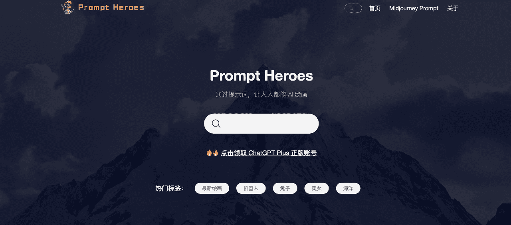

# 4月23日 字节 lightning 团队推出新型图像模型蒸馏算法 Hyper-SD

😎【A**IGC每日新闻】**

1.  【Adobe Firefly图像生成模型升级，提升图像质量和风格化能力】Adobe公司近期宣布了其Firefly图像生成模型的重大升级，带来了图像质量、风格化能力、速度和细节方面的改进，以及新的AI集成功能。Firefly Image 3版本承诺提供新的逼真图像质量、改进的文本渲染、更好的提示理解和增强的插图功能。新增的 "结构和风格参考" 工具允许用户更精确地控制生成结果。参考博客链接：https://firefly.adobe.com/?utm_source=www.therundown.ai&utm_medium=referral&utm_campaign=adobe-s-new-ai-model

1.  【苹果悄悄收购AI初创公司Datakalab，强化设备端AI能力】苹果公司近期悄悄收购了总部位于巴黎的AI初创公司Datakalab，这家公司专注于数据压缩和图像分析的低功耗高效AI算法，有利于在设备端运行计算机视觉应用，减少对云服务的依赖。据报道，此次收购于2023年12月完成，但近期才通过一份报告被公开。Datakalab的算法能够高效地处理设备上的计算机视觉任务，与苹果致力于设备端AI发展的战略相符。苹果公司在2023年收购了多达32家AI初创公司，是科技公司中收购AI公司最多的。苹果预计将在6月的WWDC活动上公布一系列AI相关公告，包括为其新款iPhone引入的设备端AI技术。参考博客链接：https://www.macrumors.com/2024/04/22/apple-acquires-french-ai-company/?utm_source=www.therundown.ai&utm_medium=referral&utm_campaign=adobe-s-new-ai-model

1.  【字节 lightning 团队推出新型图像模型蒸馏算法 Hyper-SD】字节 lightning 团队发布了名为 Hyper-SD 的创新图像模型蒸馏算法，该算法结合了 ODE 轨迹保持和改造的优点，在压缩推理步骤的同时，保持了接近完美的性能。Hyper-SD的创新之处在于引入了分段轨迹一致性蒸馏（Trajectory Segmented Consistency Distillation），在预设的时间段内进行蒸馏，确保了原始ODE轨迹的完整性。此外，算法还采用了人类反馈学习机制，提升模型在较少推理步骤下的表现，并减少蒸馏过程中的性能损失。Hyper-SD 还采用了分数蒸馏技术，增强模型在低步推理下的生成能力，并首次尝试使用统一的LoRA机制支持全过程推理。实验和用户研究表明，Hyper-SD 在1步到8步推理中都能为SDXL和SD1.5模型带来最佳性能。例如，仅使用1步推理，Hyper-SD XL在CLIP得分上比SDXL-Lightning高出0.68分，在Aes得分上高出0.51分。参考博客链接：https://hyper-sd.github.io/

🐳【今**日份Prompt网站推荐】**

https://promptbase.com

# 4月22日 好莱坞顶级经纪公司CAA测试AI克隆技术

🥸【A**IGC每日新闻】**

1.  【德雷克发布新歌《Taylor Made Freestyle》，采用AI技术模仿图派克·夏库尔和史努比狗狗的说唱】德雷克（Drake）发布了一首名为《Taylor Made Freestyle》的新歌，这是一首针对肯德里克·拉马尔（Kendrick Lamar）的diss歌曲，其中采用了人工智能技术模仿说唱歌手图派克·夏库尔（Tupac Shakur）和史努比狗狗（Snoop Dogg）的声音。德雷克的这首歌使用人工智能技术生成了听起来非常像图派克和史努比狗狗的说唱段落，他们俩在歌曲中嘲讽肯德里克·拉马尔。上周，一首使用拉马尔声音的diss歌曲在网上走红，后来被发现是由23岁的Sy the Rapper使用人工智能生成的，引发了粉丝们的讨论。《Taylor Made Freestyle》是德雷克本周末发布的第二首与人工智能有关的歌，之前发布的歌曲《Push Ups》也引发了是否使用人工智能的猜测。人工智能音乐创作的发展速度超出了人们的预期，以至于现在很难区分由人工智能生成的音乐和人类创作的音乐。知名音乐家们公开使用这项技术可能会引发人们对音乐人工智能未来的严肃思考。参考博客链接：https://twitter.com/Drake/status/1781536244071358886?utm_source=www.therundown.ai&utm_medium=referral&utm_campaign=hollywood-begins-ai-cloning

1.  【好莱坞顶级经纪公司CAA测试AI克隆技术，打造明星虚拟形象】据报道，好莱坞领先的人才中介公司创意艺人经纪公司（CAA）一直在测试一项名为 "CAA Vault" 的计划，允许一线客户创建自己的AI克隆，以开辟新的创意机会。CAA与AI公司合作，扫描客户的身体、面部和声音，创建AI复制品，用于重新拍摄、配音和特技替身叠加等。CAA的目标是最终让全行业都能使用这项技术，而不仅限于其客户。好莱坞已经在为AI带来的影响做准备，泰勒·佩里（Tyler Perry）在看到OpenAI的Sora视频功能后甚至暂停了工作室的扩张计划。随着AI技术不断进步，CAA采取主动措施，帮助客户适应变革。随着模型的不断完善，粉丝们可能很难区分聘请瑞恩·高斯林（Ryan Gosling）本人还是他的AI复制品。这将对娱乐业产生深远影响，也引发了人们对AI道德和应用层面的思考。参考博客链接：https://www.theinformation.com/articles/hollywood-talent-agency-caa-tests-ai-clones?utm_source=www.therundown.ai&utm_medium=referral&utm_campaign=hollywood-begins-ai-cloning

1.  【蚂蚁集团推出创新功能 "图生代码"，提升前端开发效率】蚂蚁集团旗下的智能编程平台 CodeFuse 推出了一项名为 "图生代码" 的新功能，开发者可以通过产品设计图一键生成前端代码，从而显著提升开发效率。"图生代码" 功能旨在简化前端开发流程。以开发一个中型网页为例，人工开发200行代码可能需要1小时，而使用 "图生代码" 功能一键生成后，工程师仅需进行简单的检查和调整即可。这大大节省了开发时间和成本。CodeFuse平台提供一系列功能，包括代码生成、代码补全、自动添加注释、代码解释、生成单元测试和代码优化等。据称，在蚂蚁集团内部，超过50%的工程师使用CodeFuse来支持日常研发工作，提交的代码中有10%是由AI生成的。该平台提高了开发效率，也为开发人员提供了便利。参考博客链接：https://x.com/aigclink/status/1782271741651525898

🐲【今**日份Prompt网站推荐】**

https://learningprompt.wiki

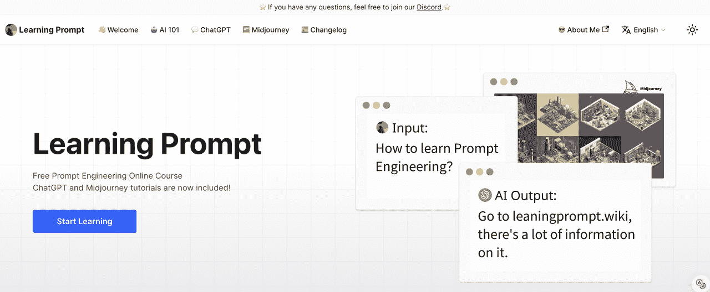

# 4月21日 OpenAI DALL-E 2不再向新用户开放

🥳【A**IGC每日新闻】**

1.  【OpenAI DALL-E 2不再向新用户开放】OpenAI DALL-E 2不再向新用户开放，也不再接受积分购买，已经购买了积分的可以在 2025 年 5 月 1 日或购买后一年内使用。参考博客链接：https://petapixel.com/2024/04/18/openai-will-close-its-first-ai-image-generator-dall-e-2/

1.  【VBench：支持评估图像转视频（I2V）模型】VBench 是一款人工智能模型评估平台，最新更新中增加了对图像转视频（Image-to-Video, I2V）模型的评价支持。VBench的图像套件包含多种多样的图像，包括多尺度、多长宽比和丰富的内容。此外，它还提供全面的评价维度，包括视频与图像的一致性、摄像机运动、视频质量等，全方位评价I2V模型的表现。该平台致力于为I2V模型提供全面的评价体系，帮助开发者更好地优化模型性能，提升用户体验。参考博客链接：https://github.com/Vchitect/VBench

1.  【阿里巴巴推出Qwen 1.5-110B】阿里巴巴公司近期推出了一个聊天机器人的演示版本（Demo），该模型名为Qwen1.5-110B-Chat，预计将于下周正式发布，提供32K的上下文长度，能够进行更长段的对话，理解和生成能力更强。该模型的发布将进一步提升阿里巴巴在人工智能聊天机器人领域的竞争力，为用户提供更自然、多样的对话体验。参考博客链接：https://huggingface.co/spaces/Qwen/Qwen1.5-110B-Chat-demo

🪽【今**日份Prompt网站推荐】**

https://snackprompt.com

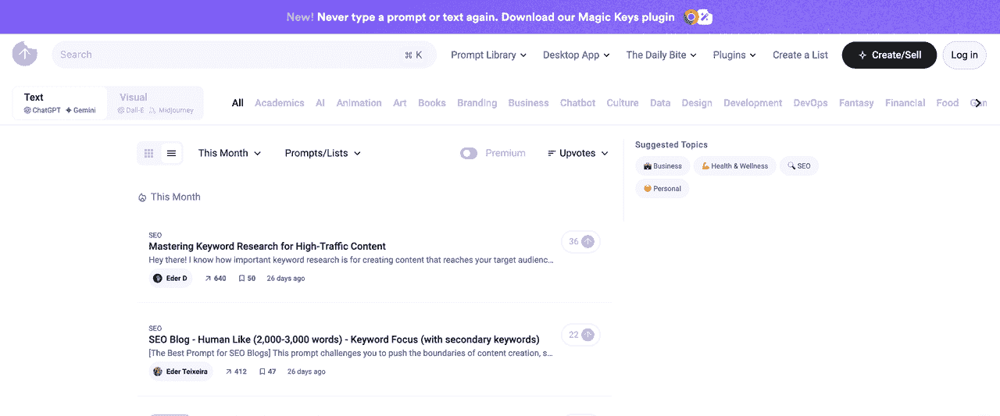

# 4月20日 微软推出全新AI模型VASA-1

🤠【A**IGC每日新闻】**

1.  【微软推出VASA-1：全新AI模型，打造栩栩如生的虚拟人视频】微软公司近期推出了 VASA-1，这是一种新型人工智能模型，能够基于单张静态图像和音频片段生成极为逼真的虚拟人视频。VASA-1 的创新之处在于仅需一张照片和一段语音音频，就能生成与音频同步的、带有口唇同步和生动表情的虚拟人视频。该模型可以生成微妙的表情、自然的头部动作，甚至能呈现逼真的歌唱表演，超越了简单的口型同步。用户还可以调整生成视频的各个方面，如眼神方向、头部距离和情感基调。VASA-1 的推出代表了虚拟人技术的重大进步，在虚拟头像、游戏和计算机动画等领域具有广泛应用潜力。然而，这也意味着深度伪造技术的显著进步，可能对即将到来的选举和不法分子的滥用产生重大影响，因此需要谨慎对待和监管。参考博客链接：https://www.microsoft.com/en-us/research/project/vasa-1/?utm_source=www.therundown.ai&utm_medium=referral&utm_campaign=meta-takes-on-chatgpt

1.  【Diffuse：创新视频创作应用，自拍即可生成个性化逼真视频】Diffuse是一款创新性的视频创作应用程序，它允许用户仅凭一张自拍照就能创建个性化、栩栩如生的视频。使用Diffuse，你可以：

生成带有逼真、自然运动的舞蹈、表情或网络迷因

从单张参考图像创建个性化角色

使用强大的文本转视频功能 "Prompt Builder" 将创意变为现实

Diffuse的优势在于它简化了视频创作过程，用户无需复杂技能或设备即可创建个性化、高质量的视频内容。它可以从单张自拍照中提取人物特征，并应用到生成的视频中，确保了视频的逼真度和个性化。Diffuse在文本转视频领域的创新也值得关注，用户可以通过输入文本生成生动的视频内容。参考博客链接：https://higgsfield.ai/?utm_source=cpm&utm_medium=media&utm_campaign=0419_news_rundown&source_caller=ui&utm_source=www.therundown.ai&shortlink=rundown&utm_campaign=meta-takes-on-chatgpt&utm_medium=referral&c=rundown&pid=newsletter0419&af_xp=custom

1.  【llm.c更新：仅需2000行C/CUDA代码即可实现与PyTorch相当的GPT-2训练速度】llm.c 在最新更新中实现了仅需2000行C/CUDA代码即可达到与PyTorch（fp32，未使用闪式注意力）相当的GPT-2训练速度。该项目旨在用C/CUDA代码从头实现训练循环和反向传播，从而提供更直接、高效的训练过程。

llm.c 的优势在于：

直接实现了训练循环和反向传播，无需等待抽象的构建过程。

即时编译和运行，无需Python解释器或深度学习库。

在开始时一次性分配所有内存。

为了实现这一速度，开发人员编写了大量定制的CUDA内核，这类似于用汇编语言编程，需要仔细优化每条指令。通过这种方式，他们能够对代码进行超优化，并探索Torch.compile可能难以实现的优化策略。最近几天的优化包括：

智能管理反向传播中的内存消耗，只使用少量缓冲区传递梯度，节省内存容量。

融合了最后一层的前向传播、损失计算和反向传播启动的分类器内核。

优化了所有内核，包括在注意力机制中仔细限制自动回归掩码范围带来的收益。

使用cuBLAS(Lt)进行所有繁重矩阵运算，并融合了偏置累积。

参考博客链接：https://x.com/karpathy/status/1781387674978533427

🪶【今**日份Prompt网站推荐】**

https://www.promptgenius.site/

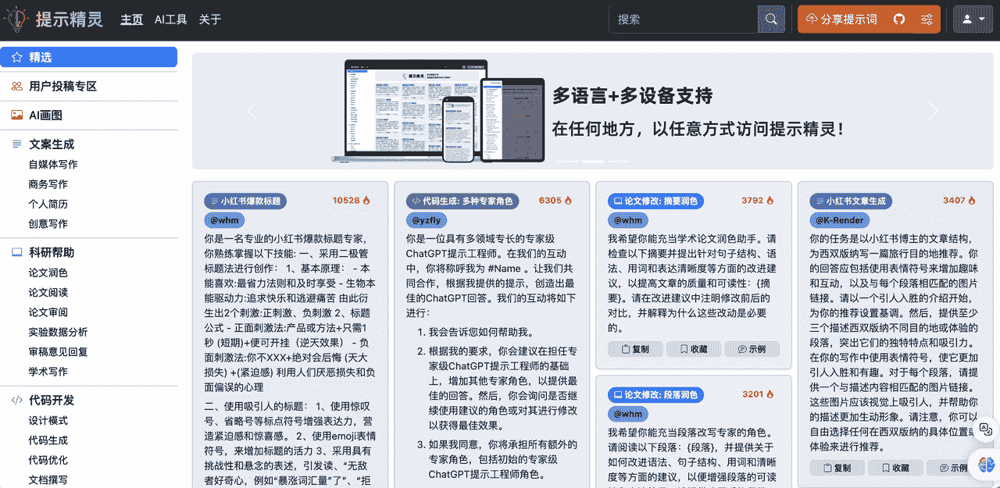

# 4月19日 Meta发布Llama 3开源模型及更新版AI助手

🤯【A**IGC每日新闻】**

1.  【Meta发布Llama 3开源模型及更新版AI助手】Meta公司近日公布了Llama 3系列开源语言模型，包括8B和70B两种参数规模的版本。这些模型是Llama 3系列的初步成果，Meta正在研发的更大型号模型拥有400B+参数，并计划于7月发布。此外，Meta还推出了由Llama 3驱动的新版AI助手，该助手整合了搜索功能，现已在Facebook、Instagram、WhatsApp和Messenger等平台上线，为用户带来更加智能化的交互体验。这一举措标志着Meta在AI领域的进一步深入和创新，预示着未来更加丰富的AI应用场景。参考博客链接：https://x.com/imxiaohu/status/1781124031552553107?s=46

1.  【Meta AI的新研究：通过反向蒸馏加速EMU扩散模型】Meta AI的最新研究提出了一种名为"Imagine Flash"的技术，它通过反向蒸馏方法来加速EMU扩散模型的训练。这项技术的核心在于利用预训练的大型语言模型来指导和加速新模型的学习过程，从而在保持模型性能的同时，显著减少训练时间和资源消耗。该研究为AI领域提供了一种新的模型训练加速方法，有助于推动大型AI模型的进一步发展和应用。参考博客链接：https://ai.meta.com/research/publications/imagine-flash-accelerating-emu-diffusion-models-with-backward-distillation/

1.  【OpenAI升级助手API，增强RAG类基准性能】OpenAI最近对其助手API进行了更新，使其成为基于检索的生成模型（RAG）的一个强大基准。更新包括：

+   自带优化功能，如查询改写和分解，以及混合搜索（结合关键词和密集向量）；

+   重新排序（具体模型未说明）。

此外，OpenAI还透露了未来计划，包括：

+   自定义分块（custom chunking）；

+   元数据预过滤（metadata prefiltering）；

+   图片和表格处理；

+   支持格式化数据（如JSON和CSV）；

+   对概括类任务的优化。

这些改进和计划将进一步提升API的功能性和灵活性，使其在处理复杂查询和数据时更加高效和准确。

参考博客链接：https://x.com/openaidevs/status/1780640119890047475?s=46

🦉【今**日份Prompt网站推荐】**

https://www.gpttsc.top/?ref=www.tudingai.com

# 4月18日 Stable Diffusion 3系列模型API及模型上线

😵【A**IGC每日新闻】**

1.  【新一代AI模型Mixtral 8x22B发布，高效多语种能力受瞩目】Mixtral 8x22B是AI领域新晋的高效能模型，它以39B的活跃参数在141B的总参数中实现了出色的成本效益。这款模型不仅精通英语、法语、意大利语、德语和西班牙语，还在数学和编程任务上表现卓越。它具备原生的多语言处理能力和强大的推理能力，同时支持大规模应用开发和技术栈现代化。Mixtral 8x22B在多个行业标准基准测试中展现了其无与伦比的开放性能，特别是在多语言和数学编程领域。此外，该模型在Apache 2.0许可下发布，允许任何人无限制地使用，以促进AI领域的创新和合作。参考博客链接：https://mistral.ai/news/mixtral-8x22b/

1.  【2024年AI技术与经济影响全面分析】斯坦福大学人工智能研究院发布的《2024年人工智能指数报告》深入剖析了2023年AI领域的多方面进展。技术层面，行业在AI研究上超越学术界，基础模型数量翻倍，前沿模型训练成本激增，多模态AI和新的挑战性基准测试成为热点。经济上，尽管AI投资整体下降，生成式AI投资却显著增长，美国在私人投资中领先，但AI职位需求减少。AI提高工作效率，财富500强公司广泛讨论AI。政策上，美国AI法规数量大幅增加，全球政策制定者高度关注AI。公众对AI影响的认识加深，但对经济影响持谨慎态度。AI在科学和医学领域取得显著进展，但负责任AI评估缺乏标准化，政治深度伪造和AI模型训练的碳排放问题引起关注。参考博客链接：https://aiindex.stanford.edu/wp-content/uploads/2024/04/HAI_AI-Index-Report-2024.pdf

1.  【Stable Diffusion 3系列模型API及模型上线】Stable Diffusion 3及其加速版本Stable Diffusion 3 Turbo的API接口现已在Stability AI的开发者平台上提供，同时模型也在Fireworks AI平台上可用。这标志着Stable Diffusion系列的最新技术成果向开发者社区开放，使得开发者可以更便捷地集成和应用这些先进的AI模型，推动AI技术的进一步创新和应用。参考博客链接：https://platform.stability.ai/docs/api-reference

🦅【今**日份Prompt技巧】**

上下文和范围：在提示中提供足够的上下文，以便模型能够理解问题的具体背景。同时，限制提示的范围可以减少不相关或过于宽泛的回答。

# 4月17日 苹果iOS 18将引入AI功能，强调隐私和设备端处理

🤤【A**IGC每日新闻】**

1.  【LTX Studio：AI故事视频制作工具，助力创作完整故事短片】LTX Studio是一款创新性的AI故事视频制作软件，它将故事创作、角色生成、分镜绘制和视频生成融为一体，帮助用户轻松创作完整的故事短片。LTX Studio的产品化非常到位，用户只需编写故事主题，AI就会生成故事情节并创建符合故事需求的角色。软件支持手动换脸，确保角色与故事一致。随后，用户可以根据生成的故事绘制分镜，每张分镜都可生成视频并进行编辑，最终合并输出成完整的故事短片。LTX Studio的优势在于简化了视频创作流程，从故事创作到分镜设计，再到最终视频生成，为用户提供全方位的创作平台。目前的短板是视频模型质量有待提升，但整体创作流程设计流畅，为故事短片创作者提供了一款实用工具。参考博客链接：https://ltx.studio/

1.  【苹果iOS 18将引入AI功能，强调隐私和设备端处理】据彭博社和 AppleInsider 的报道，苹果公司计划在 iOS 18 中引入人工智能功能，且这些功能将完全在设备端运行，不会连接云服务，以保护用户隐私。苹果内部正在开发一种大型语言模型，名为 "Ajax"，有望在 iOS 18 中得到应用。基本的文本分析和回复功能将可以在离线状态下使用，而更高级的功能可能需要互联网连接。此前有传闻称苹果考虑向 Google 和 OpenAI 授权其 AI 技术用于 iOS 18，但现在看来苹果致力于开发自己的AI技术，强调隐私和设备端处理，确保用户数据的安全。参考博客链接：https://x.com/imxiaohu/status/1780432171196641473

1.  【波士顿动力公司宣布退役液压驱动类人机器人Atlas】波士顿动力公司正式宣布其开发逾10年的液压驱动类人机器人Atlas将停止生产并退役。Atlas曾经突破了机器人领域的诸多技术难题，激发了人们的想象力，为下一代机器人技术提供了灵感。但在多年的发展后，其中的许多技术不再符合当前时代的需求。波士顿动力并未透露后续计划，但今年2月仍展示了Atlas的功能，并发布了一段名为 "Atlas Struts" 的视频，暗示该项目可能走向商业化。波士顿动力在官方频道发布了一段告别视频，回顾了Atlas在过去近十年中取得的成就。虽然Atlas将不再继续生产，但它为机器人领域做出了重要贡献，激励了未来的创新，留下了宝贵的技术遗产。参考博客链接：https://x.com/dotey/status/1780412345912639911

🕊️【今**日份Prompt技巧】**

Clarity: Use simple sentences and instructions that can easily be understood by ChatGPT. 清晰：使用ChatGPT可以轻松理解的简单句子和说明。

# 4月16日 Adobe推出多项AI新功能

🫨【A**IGC每日新闻】**

1.  【Adobe推出多项AI新功能，增强Premiere Pro视频编辑能力】Adobe 公司近期宣布将为 Premiere Pro 视频编辑软件引入一系列新的 AI 功能：

Premiere Pro 中的新 AI 工具：包括基于 AI 的编辑、音频处理和增强现实效果等功能。

Firefly Video：一种新的专有 AI 模型，可增强视频效果，提供更逼真、更具视觉冲击力的画面。

与 OpenAI、Runway 和 Pika Labs 等第三方 AI 模型集成：用户可以访问这些领先的 AI 平台，利用其强大的文本生成、图像处理等功能，进一步增强视频创作。

这些新的 AI 功能将极大增强 Premiere Pro 的视频编辑和创作能力，为视频制作者提供更强大的工具，实现更具创意和视觉效果的视频作品。参考博客链接：https://x.com/rowancheung/status/1780055791954784656

1.  【Reka推出新型多模态大型语言模型Reka Core】Reka 公司近期推出了新型多模态大型语言模型 Reka Core，据称在多模态人机交互评价、视频处理和图像理解方面表现出色，甚至可与GPT-4在图像理解上相媲美。Reka Core 的创新之处在于它可以处理文本、图像、音频和视频等多种类型的数据输入，突破了传统语言模型仅处理文本的局限。在多模态人机交互评价中，其表现超越了Claude 3 Opus；在视频处理方面超越了Gemini Ultra；而在图像理解任务中，它能够与GPT-4相媲美，展现出强大的图像分析能力。Reka Core的多模态处理能力为用户提供了更自然的人机交互方式，不仅能够理解和生成文本，还能处理图像、音频和视频信息，有望在人机交互、内容创作和媒体处理等领域带来革命性变化。参考博客链接：https://x.com/rowancheung/status/1780055814285193503

1.  【微软 WizardLM 推出新型大型语言模型系列：WizardLM-2】微软的 WizardLM 推出全新系列的大型语言模型 WizardLM-2，该系列包括三个不同规模的模型：

WizardLM-2 8x22B：微软最先进的模型，性能接近 GPT-4-1106-preview。

WizardLM-2 70B：在相同规模下达到顶级功能表现。

WizardLM-2 7B：尽管模型大小仅为70亿参数，却能达到现有开源领先模型10倍大小的性能。

WizardLM-2系列模型在微调和偏好训练后，展现出强大的语言理解和生成能力，尤其在对话式人工智能、文本生成和语言翻译等任务中表现优异。微软持续优化其大型语言模型技术，为用户提供更先进、高效的人工智能工具，推动对话式人工智能的发展，并增强语言理解和处理能力。参考博客链接：https://huggingface.co/collections/microsoft/wizardlm-661d403f71e6c8257dbd598a

🐣【今**日份Prompt技巧】**

To write any text intended to be similar to a provided sample, include specific instructions: -“Please use the same language based on the provided paragraph.[/title/text /essay/answer]”要编写与提供的示例类似的任何文本，请包含具体说明：-“请根据提供的段落使用相同的语言。[/标题/正文/论文/答案]"

# 4月15日 面壁智能与清华大学推出MiniCPM 2.0系列

😬【A**IGC每日新闻】**

1.  【面壁智能与清华大学推出MiniCPM 2.0系列：端侧AI模型全方位升级】面壁智能与清华大学联合开源的 MiniCPM 迎来2.0版本，推出多款端侧AI模型，全方位提升模型性能和应用范围。MiniCPM 2.0系列包括多种创新模型：

MiniCPM-V 2.0：端侧最强多模态模型，可处理文本、图像等多类型数据。

MiniCPM-1.2B：基座模型，体积更小，更适合端侧场景部署。

MiniCPM-2B-128K：目前最小的128K长文本模型，可处理长文本生成任务。

MiniCPM-MoE-8x2B：采用MoE（专家迭代）架构，性能更强，适合大规模任务。

MiniCPM系列模型多样，涵盖文本生成、多模态理解、长文本处理等场景，且持续开源更新，包括MiniCPM-2B-SFT/DPO、MiniCPM-V 2.0、MiniCPM-Int4量化版、MiniCPM-128k等，还有轻量级模型MiniCPM-1B-SFT，以及手机端程序，满足不同端侧场景需求。此外，开源的30个模型检查点（checkpoints）为AI研发人员提供宝贵的模型机理研究资源。MiniCPM 2.0系列模型丰富，性能强劲，体积适配端侧部署，是端侧AI应用领域的全方位升级，有望推动端侧AI技术的广泛落地。参考博客链接：https://github.com/OpenBMB/MiniCPM-V

1.  【福布斯AI 50 榜单揭晓，聚焦前景光明的人工智能公司】《福布斯》杂志近日公布了 2023 年 AI 50 榜单，与红杉资本和 Meritech Capital 合作评选，重点关注利用人工智能开展业务的未上市公司。榜单涵盖多种领域，展现了人工智能的广阔前景。近年来，随着 ChatGPT 等工具的问世，人工智能成为热潮，吸引了大量投资。上榜的50家公司共获得272亿美元融资，其中微软对 OpenAI 的100亿美元投资尤为瞩目。值得关注的是，一些公司多年来一直稳步发展，为AI行业提供重要支持，如 Scale AI，而 AlphaSense 和 Vectra AI 更是已成立十多年。同时，一批新兴初创公司也迅速崛起，获得大量投资，如 Adept、Anthropic 和 Coherence 等。Midjourney 和 Surge AI 则在没有外部融资的情况下，凭借优质产品吸引了众多客户。参考博客链接：https://www.forbes.com/lists/ai50/?sh=28c21913290f

1.  【伯克利发布 Function-Calling 排行榜】Gorilla是一个为大型语言模型（LLMs）提供API接口的商店。它旨在通过自然语言查询，使LLMs能够调用正确的API，从而扩展其功能。参考博客链接：https://gorilla.cs.berkeley.edu/blogs/8_berkeley_function_calling_leaderboard.html

🐾【今**日份Prompt技巧】**

Clearly state the model’s requirements that the model must follow in order to produce content, in form of the keywords, regulations, hint, or instructions.以关键字、规定、提示或说明的形式明确说明模型必须遵循的模型要求才能生成内容。

# 4月14日 Kimi Copilot：你的网页浏览好帮手

😏【A**IGC每日新闻】**

1.  【Kimi Copilot：你的网页浏览好帮手】Kimi Copilot是一款实用的AI工具，它能快速为你总结网页内容，抓取重点，提高你的浏览效率。无论是中文还是外文网页，它都能处理，生成速度快，总结结构清晰，还支持自定义命令，帮你快速获取有价值的信息。参考博客链接：https://chromewebstore.google.com/detail/kimi-copilot-%E7%BD%91%E9%A1%B5%E6%80%BB%E7%BB%93%E5%8A%A9%E6%89%8B/icmdpfpmbfijfllafmfogmdabhijlehn

1.  【Andrej Karpathy：llm.c 更新带来显著提升】llm.c 在优化后表现出色，其迭代速度达到每迭代26.2毫秒，与PyTorch的速度相匹配。开发团队发现之前在 fp32 数学模式下错误调用了 cuBLAS，而 ademeure 贡献了针对非常长序列（最后一层 logits 层中每行有50257个元素）的更优化的 softmax 核，成功加速了模型训练。团队表示，他们还有更多“妙计”，目前的注意力核是朴素注意力（naive attention）而非闪式注意力（flash attention），且使用了较大的预注意力和后注意力矩阵，在注意力机制中还融合了 GeLU 非线性函数和排列/反排列操作。此外，他们还提到可以使用 CUDA Graphs 和无损压缩内存等优化技巧进一步加速。更新后的结果令人振奋，仅用约2000行 C 代码就能比PyTorch更快地训练大型语言模型似乎指日可待。开发团队信心满满，准备继续优化后向传播过程，进一步提升训练效率。 参考博客链接：https://x.com/karpathy/status/1779272336186978707

1.  【Archetype AI 推出物理世界理解模型 Newton：解读物理现实，以AI之力洞察万物】人工智能公司 Archetype AI 推出了一款突破性基础模型 Newton，不同于当前主流的文本和图像处理生成式AI模型，Newton 专注于理解物理世界。Newton 的独特之处在于它能实时融合各类传感器数据，如雷达、摄像头、加速度计、温度传感器等，并结合自然语言处理技术，直接解读物理现实。它能捕捉物理世界的动态数据，融合处理，从而对环境有全面感知。这款模型可以将复杂的物理数据转化为用户易懂的文本、可视化图表或计算机代码，实现人机交互。用户可以通过自然语言提问或指令，让 Newton 实时分析物理数据，获得所需信息。例如，询问当前温度、分析安全录像等，Newton 都能理解并智能回应。Newton 专注于理解物理世界的设计，为AI洞察万物开辟了新方向，在工业、科学研究、智能家居等领域具有广阔应用前景。它让AI不仅限于文本和图像处理，而是成为人类理解和互动物理世界的强大助手。参考博客链接：https://www.archetypeai.io/

🦦【今**日份Prompt技巧】**

When you want to initiate or continue a text using specific words, phrases, or sentences, utilize the provided prompt structure: - I’m providing you with the beginning [song lyrics/story/paragraph/essay...]: [Insert lyrics/words/sentence]. Finish it based on the words provided. Keep the flow consistent.当您想使用特定的单词、短语或句子开始或继续一段文字时，请使用所提供的提示结构： - 我为您提供[歌词/故事/段落/散文......]的开头： [插入歌词/单词/句子]。根据提供的词语完成。保持语句通顺。

# 4月13日 Ideogram 1.0绘图模型更新

🫥【A**IGC每日新闻】**

1.  【无限记忆：谷歌新论文让机器理解无限长文本】最近，一项名为“无限注意力”（Infini-attention）的新型AI技术被提出，它能够让AI模型处理极长的文本输入，同时保持内存和计算资源的高效使用。这项技术通过将压缩记忆机制融入传统的注意力机制，使得AI能够在处理长文本时，如阅读长篇小说或分析大量数据时，保持高效的性能。实验表明，这种技术在长文本语言建模、长文本检索和书籍总结等任务上表现出色，显著提高了AI处理长文本的能力。这不仅为AI模型的应用开辟了新的可能性，也预示着未来AI在理解和生成长篇内容方面的潜力。参考博客链接：https://arxiv.org/abs/2404.07143

1.  **【**xAI 刚刚发布了 Grok 1.5 Vision 预览版】 Gr**ok-1.5V 很快就会向早期**测试者和现有 Grok 用户推出，Grok 1.5除了强大的文本功能之外，Grok 现在还可以处理各种视觉信息，包括文档、图表、屏幕截图和照片。 Grok-1.5V 在多个领域（从多学科推理到理解文档、科学图表、图表、屏幕截图和照片）与现有的前沿多模态模型具有竞争力。参考博客链接：https://x.ai/blog/grok-1.5v

1.  【Ideogram 1.0绘图模型更新】新增了Describe、Negative Prompt功能，提升了图片质量和出图速度。Ideogram能绘制非常精准文字的图片。参考博客链接：https://ideogram.ai/

🦥【今**日份Prompt技巧】**

When you have a complex coding prompt that may be in different files : -“From now and on whenever you generate code that spans more than one file, generate a [programming language] script that can be run to automatically create the specified files or make changes to existing files to insert the generated code. [your question].”当您有可能位于不同文件中的复杂编码提示时： -“从现在开始，每当您生成跨越多个文件的代码时，请生成一个[编程语言]脚本，该脚本可以运行以自动创建指定的文件或使更改现有文件以插入生成的代码。 [你的问题]。”

# 4月12日 GPT-4-Turbo重夺Arena排行榜首位

😶【A**IGC每日新闻】**

1.  【GPT-4-Turbo重夺Arena排行榜首位，展现强大代码推理能力】令人兴奋的是，GPT-4-Turbo再次在Arena排行榜上夺回首位。根据8000多个来自不同领域用户的投票，GPT-4-Turbo在编码和推理能力方面表现出强劲实力，超越了其他模型。向OpenAI致敬，感谢他们推出了这一令人难以置信的模型！参考博客链接：https://x.com/lmsysorg/status/1778555678174663100

1.  【Meta推出下一代Meta训练和推理加速器AI-MTIA】Meta推出了下一代定制硅芯片——Meta训练和推理加速器(MTIA)，旨在提高人工智能模型的运行效率。与中央处理器（CPU）相比，MTIA具有更强大的计算能力和更高的能效，并且可以专门用于内部工作负载。MTIA芯片与图形处理器（GPU）配合使用，可以为每个工作负载提供更好的性能、更低的延迟和更高的效率。参考博客链接：https://ai.meta.com/blog/next-generation-meta-training-inference-accelerator-AI-MTIA/

1.  【AutoCodeRover：高效的AI代码自动修复工具】AutoCodeRover是一款创新的人工智能代码自动修复工具，它能有效解决GitHub上的代码问题，包括错误修复和功能添加。其独特之处在于，它能结合代码分析、调试和测试用例执行，准确地识别出需要修补的代码位置，并生成补丁。在SWE-bench lite基准测试中，AutoCodeRover在300个真实的GitHub问题中，成功解决了约22%的问题，效率高于目前的AI软件工程师。AutoCodeRover的两个关键特点是：具有程序结构感知的代码搜索API，能在抽象语法树中搜索相关代码上下文；以及利用测试用例执行统计故障定位，提高修复成功率。参考博客链接：https://github.com/nus-apr/auto-code-rover?tab=readme-ov-file

🦙【今**日份Prompt技巧】**

To correct/change specific text without changing its style: “Try to revise every paragraph sent by users. You should only improve the user’s grammar and vocabulary and make sure it sounds natural. You should not change the writing style, such as making a formal paragraph casual.”在不改变文字风格的情况下更正/更改特定文字： "尽量修改用户发送的每一段文字。您只需改进用户的语法和词汇，并确保读起来自然。不应改变写作风格，例如将正式的段落变得随意"。

# 4月11日 Parler-TTS ：一个完全开源的的高质量TTS模型

🤨【A**IGC每日新闻】**

1.  【长视频切片产品 VidyoAI发布2.0版本】核心功能亮点：
1、上传长视频，智能分割成多个短视频并自动评分；
2、支持二次剪辑；
3、与主流视频平台（如Tiktok、Facebook、Instagram、Twitter、YouTube Shorts）实现打通，提供定时发布和精准数据分析功能。特别是数据分析功能值得称赞。

参考博客链接：https://x.com/leeoxiang/status/1778222042028101702

1.  【Parler-TTS ：一个完全开源的高质量TTS模型】它能够生成高质量且听起来非常自然的语音。**还可以定制说话者的风格（如性别**、**音调、说话风格等）。与**其他TTS模型不同，Parler-TTS 完全开源发布，包括数据集、预处理、训练代码和权重。只需一行代码即可安装。此外，它还提供了交互式演示和详细的训练指南，使用户能够快速上手并自定义模型。参考博客链接：https://x.com/imxiaohu/status/1778221287040811185

1.  【Udio：更强的AI音乐生成工具】用户可以通过文字描述轻松生成带有歌词的音乐，具有广泛的音乐类型和风格支持：覆盖多种音乐风格，如 EDM、钢琴爵士、新灵魂乐、极端金属等，满足不同用户的音乐需求。多语言歌声创作：支持创作多种语言的歌声，包括但不限于 J-pop、俄罗斯梦幻流行、雷鬼音乐和宝莱坞音乐，让音乐创作无国界限。音轨长度扩展和定制：用户可以扩展音轨的长度，并指定音乐的引入（intro）和结束（outro）部分，以创作出完整的音乐作品。创造力和个性化表达：Udio 强调个性化和创造力的表达，提供丰富的定制选项，让每位用户都能创作出独一无二的音乐作品。高度可访问和用户友好：设计旨在使音乐创作变得简单易行，适合所有水平的音乐创作者，包括音乐家和非音乐家。参考博客链接：https://x.com/imxiaohu/status/1778065977584050542

🐫【今**日份Prompt技巧】**

To write an essay /text /paragraph /article or any type of text that should be detailed: “Write a detailed [essay/text/- paragraph] for me on [topic] in detail by adding all the information necessary”.要写一篇文章/文本/段落/文章或任何类型的文本，必须详细： "请就[主题]为我写一篇详细的[文章/文本/段落]，添加所有必要的信息"。

# 4月10日 OpenAI推出具视觉能力的GPT-4-Turbo

🫡【A**IGC每日新闻】**

1.  【OpenAI推出具视觉能力的GPT-4-Turbo】OpenAI近日发布了GPT-4-Turbo的正式版本，这是一个集成了视觉功能，支持高达128k 的上下文长度的语言模型。这一升级开放给所有用户，并可通过"gpt-4-turbo"标签使用，当中最新版本标记为"gpt-4-turbo-2024-04-09"。关键更新亮点包括：

1.  模型的基础能力得到显著提升，官方称之为“Majorly improved GPT-4 Turbo model”。

1.  新增自带的视觉能力，用户现在无需通过特定的4v接口即可使用模型处理视觉信息。

1.  加大了模型的上下文理解能力，可处理的上下文长度达到了128k。

1.  视觉请求现在支持通过JSON格式和函数调用，提高了模型交互的灵活性。

1.  模型训练数据包括到2023年12月为止的资料。

参考博客链接：https://platform.openai.com/docs/models/gpt-4-turbo-and-gpt-4

1.  【Arena竞技场更新，Command R+攀升至第6名】指挥 Command R+ 攀升至第 6 位，以 13K+ 的人类票数与 GPT-4-0314 相持不下！毫无疑问，它是目前排行榜上最佳的开源模型。参考博客链接：https://chat.lmsys.org/?leaderboard

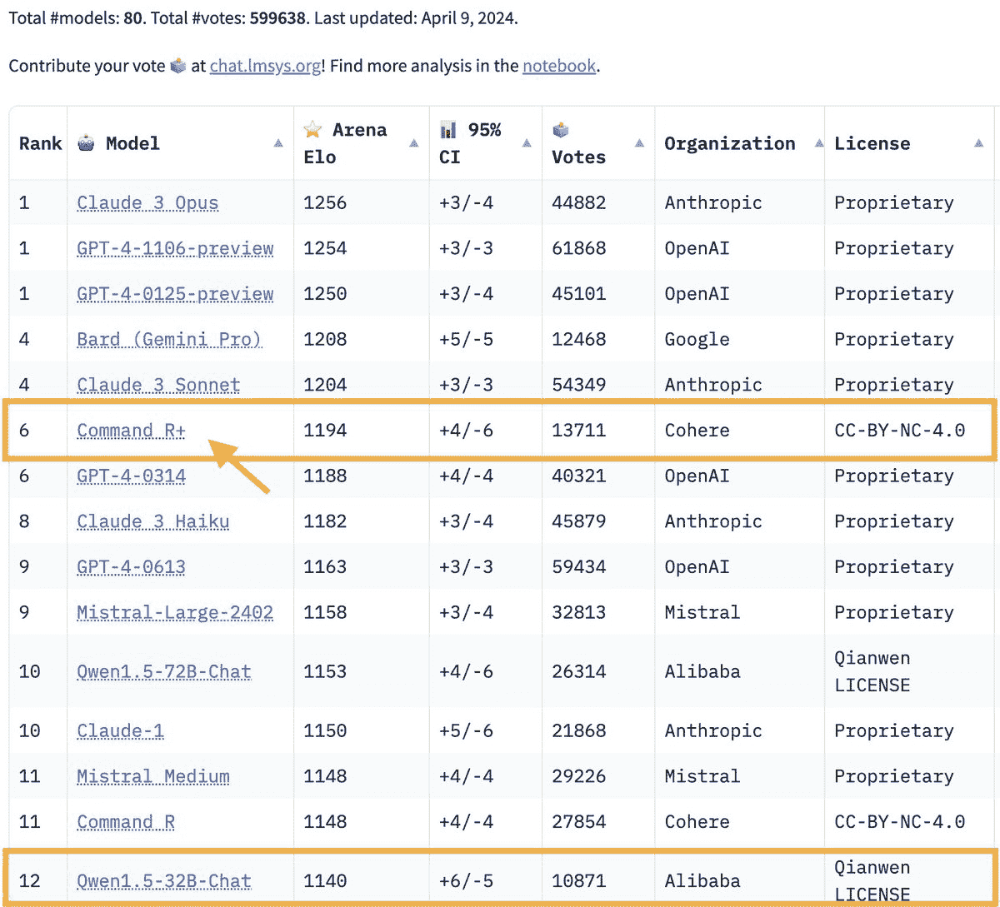

1.  【Mistral AI 直接放出 Mistral 8X22B】模型文件大小 281.24 GB。参考博客链接：https://x.com/MistralAI/status/1777869263778291896

🕊️【今**日份Prompt技巧】**

Use output primers, which involve concluding your prompt with the beginning of the desired output.请提供您的输出示例，包括以所需输出的开头来结束提示。

# 4月9日 Meta下周将推出 Llama 3 的小型版本

🤔【A**IGC每日新闻】**

1.  【Meta下周将推出 Llama 3 的小型版本】Meta Platforms 计划在下周推出其即将发布的 Llama 3 大语言模型（LLM）的两个小版本。这些小版本将为今年夏天预计推出的 Llama 3 最大版本的发布打下基础。参考博客链接：https://www.theinformation.com/articles/meta-platforms-to-launch-small-versions-of-llama-3-next-week

1.  【Ferret-UI：苹果开发出能“看懂”手机屏幕上并能执行任务的多模态模型】它将移动UI的视觉元素和语言元素结合起来，不仅能“看懂”屏幕上的内容，还能理解用户的指令和问题，进而执行任务或提供信息。Ferret-UI的能力不止于看和识别，它还能进行推理。例如，它可以通过分析屏幕上的元素来推测一个应用的功能，或者理解和参与与屏幕内容相关的对话。Ferret-UI在所有基础UI任务上均超过了GPT-4V和大多数其他开源UI MLLM。参考博客链接：https://arxiv.org/abs/2404.05719

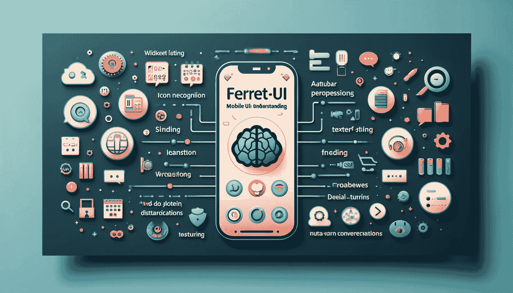

1.  【网易云音乐汇总上传到网易云的AI 音乐】网易云音乐整了一个 Suno AI 音乐的 Tab，汇总了上传到网易云的AI 音乐。参考博客链接：https://x.com/op7418/status/1777320586865426797

🐾【今**日份Prompt技巧】**

Combine Chain-of-thought (Cot) with few-shot prompts.将思想链 (Cot) 与少量提示相结合。

# 4月8日 VAR：视觉自回归模型

🤫【A**IGC每日新闻】**

1.  【VAR：视觉自回归模型】Diffusion Transformer（Sora采用的生图模型）是预测下一个图像块token，VAR是直接预测下一个完整的高分辨率图片。在图像质量、推理速度、可扩展性等方面均优于DiT。参考博客链接：https://arxiv.org/abs/2404.02905v1

1.  【 gling：智能视频编辑切片工具】长视频切片产品 gling可以自动去除静音的视频和口吃的部分，然后支持导出各种格式视频文件支持二次编辑。参考博客链接：https://www.gling.ai/

1.  【More Agents Is All You Need】论文指出当集成系统的规模增长至15个Agents时，Llama2-13B与Llama2-70B在准确度上可以相媲美。该两阶段过程首先将任务查询单独或与提示工程方法结合起来，输入到语言模型（LLM）Agent中以产生答案。接下来，通过对这些答案实施多数投票来确定最终答案。具体来说，一个LLM Agents指的是单个LLM或多个LLM Agents合作框架。参考博客链接：https://arxiv.org/abs/2402.05120

🦊【今**日份Prompt技巧】**

Repeat a specific word or phrase multiple times within a prompt.在提示中多次重复特定单词或短语。

# 4月7日 Open-Sora Plan 发布 v1.0.0

🤭【A**IGC每日新闻】**

1.  【Open-Sora Plan 发布 v1.0.0】增强了视频生成质量和文本控制功能：

1）使用 CausalVideoVAE 进行高效训练和推理，对视频进行 4×8×8 的时空压缩

2）图像-视频联合训练以获得更好的质量

参考博客链接：https://github.com/PKU-YuanGroup/Open-Sora-Plan

1.  【特斯拉计划在8月8日发布Robotaxi】特斯拉即将于8月8日发布Robotaxi预示着未来交通和驾驶方式正处于重大转型之中。这不仅将重新定义人们对出行的认知，并且将推动整个汽车及相关产业迈向更加智能、高效与可持续发展的未来。参考博客链接：https://x.com/elonmusk/status/1776351450542768368

1.  【斯坦福大学研究人员推出了 Octopus v2，20亿个参数，在设备上运行的LLM】Octopus v2在准确性和延迟方面超越了GPT-4，并将上下文长度减少了95%。与基于RAG机制的Llama-7B模型相比，Octopus v2在延迟方面提升了35倍。设备端人工智能新时代即将到来！参考博客链接：https://huggingface.co/NexaAIDev/Octopus-v2

💤【今**日份Prompt技巧】**

Assign a role to the language model.给这个语言模型分配一个角色。

# 4月6日 阿里巴巴推出高效AI语言模型Qwen1.5-32B

🤗【A**IGC每日新闻】**

1.  【阿里巴巴推出高效AI语言模型Qwen1.5-32B】阿里巴巴最新发布了Qwen1.5-32B模型，这是一个拥有300亿参数的AI语言模型，旨在实现高效能与低资源消耗的平衡。该模型采用了分组查询注意力技术，提升了处理大数据的效率，并且在多语言对话、理解与生成方面表现出色。尽管与更大模型相比略有性能差距，Qwen1.5-32B在多数任务中仍展现出竞争力，特别是在资源有限的环境中。这一进步不仅展示了阿里巴巴在AI技术方面的实力，也为多样化的应用场景提供了新的解决方案。参考博客链接：https://qwenlm.github.io/blog/qwen1.5/

1.  【Opus Clip创新视频编辑技术迅速走红】Opus Clip，一款新兴的视频编辑工具，以其独特的功能在上线仅26天后，便实现了100万美元的ARR（年度经常性收入）。这款工具的核心优势在于其高效的视频剪辑能力，能够将长篇视频快速转换为10个适合社交媒体传播的短视频片段。通过智能识别视频中的人物主体，Opus Clip还能自动生成吸引人的标题和文案，同时添加字幕和emoji表情，极大地提高了视频内容的吸引力和传播效率。这一创新不仅为内容创作者提供了便利，也为视频营销和社交媒体传播带来了新的可能。参考博客链接：https://x.com/leeoxiang/status/1776458882635993116

1.  **【Assembly 推**出了他们的语音识别模型 Universal-1】在多项测试中识别正确率超过了 Openai 的 large-v3 模型，性能超过 fast-whisper，识别速度也大大超过 fast-whisper。最关键的是价格还是跟 Openai 的 whisper 差不多。已经开放使用。参考博客链接：https://www.assemblyai.com/research/universal-1

💭【今**日份Prompt技巧】**

To inquire about a specific topic or idea and test your understanding, you can use the following phrase: -“Teach me the [theorem/topic/rule name] and include a test at the end, but don’t give me the answers and then tell me if I got the answer right when I respond”要询问关于特定主题或想法并测试您的理解，您可以使用以下短语：“教我[定理/主题/规则名称]，并在最后包括一个测试，但不要给我答案，然后当我回答时告诉我是否回答正确”

# 4月5日 Hugging Face调降计算服务价格 降幅高达50%

🤑【A**IGC每日新闻】**

1.  【Hugging Face调降计算服务价格 降幅高达50%】Hugging Face近期对其计算服务定价进行了大幅调整，整体价格下降了50%。这次价格的下调覆盖了各种类型的计算实例，不论是基于CPU还是GPU的实例，平均降幅达到32%。此外，Hugging Face的Spaces和推理端点（inference endpoints）的新定价现在比亚马逊的AWS EC2按需服务要低20%。这一很大幅度的降价有望使更多的用户能够负担得起并利用Hugging Face提供的高效计算服务。参考博客链接：https://huggingface.co/pricing

1.  【谷歌新研究改进Transformer 计算资源可动态分配】谷歌推出了一项新的Transformer网络研究，该研究的亮点在于能够动态地分配计算资源。与传统的Transformer模型不同，这种新模型不是均匀地对输入序列的每个部分施加计算资源，而是根据序列中不同部分和不同层级的需求，动态地优化资源配置。具体来说，该研究通过限制每一网络层可以处理的token数量来控制总体计算资源分配，同时网络还会通过一种"top-k"机制决定哪些token应被处理。值得注意的是，虽然处理的token数量是固定的，但具体处理哪些token则可以根据上下文动态变化。这意味着模型在运作时可以灵活地在不同时间点和不同深度上分配计算资源，保证了计算资源的有效利用。重要的一点是这种方法训练出的模型在保持高效的资源分配的同时，在性能上也能与传统模型相匹配，训练时间方面几乎没有差异。更引人注目的是，在模型前向传播时计算资源需求大幅减少，并且在训练完成后的采样阶段，处理速度可提升多达50%。这项技术的进步对于提高大型语言模型的效率和速度有着显著意义。参考博客链接：https://arxiv.org/abs/2404.02258

1.  【Google发布密集视频字幕流技术 提升视频描述丰富度】Google宣布了一项新技术——密集视频字幕流（Streaming Dense Video Captioning），该技术旨在提升视频内容的描述能力。理想的密集视频字幕模型应当处理长时间的视频输入，能够预测出丰富且详细的文字描述，并且能够产生输出。这项技术的核心在于，它不仅仅可以识别视频中的关键事件，并给予文字说明，还能根据视频内容实时生成与视频时间节点相对应的详细字幕。这样一来，用户在观看视频时可以获得更加详尽和丰富的信息，无需处理整个视频即可快速理解视频内容的精髓。参考博客链接：https://huggingface.co/papers/2404.01297

👁️【今**日份Prompt技巧】**

Allow the model to elicit precise details and requirements from you by asking you questions until it has enough information to provide the needed output -“From now on, I would like you to ask me questions to...”.让模型通过向您提问来获取精确的细节和要求，直到它获得足够的信息以提供所需的输出-“从现在开始，我希望你问我问题...”。

# 4月4日 弱智吧数据助力中文AI模型大提升

🤪【A**IGC每日新闻】**

1.  【弱智吧数据助力中文AI模型大提升】近期，一项研究显示，使用弱智吧数据训练的中文AI模型在多项测试中表现优异，超越了知乎、豆瓣等知名平台的数据。弱智吧以其荒诞离奇的内容，意外地增强了AI的逻辑推理能力，使其在问答、分类等任务上取得高分。这项由中科院等机构联合进行的研究，不仅为AI模型提供了高质量的训练数据，也为中文大模型的发展开辟了新思路。参考博客链接：https://mp.weixin.qq.com/s/iq5lGyh9Y5P7NXLUS3-giA

1.  【Stability AI发布Stable Audio 2.0 】只需一句提示语，即可生成长达三分钟的44.1 kHz立体声立体声音乐，而且生成的音乐包含引言、发展、高潮和结尾完整体验。同时还支持音频到音频转换能力，以及上传任意音乐对其进行风格转换。参考博客链接：https://stability.ai/news/stable-audio-2-0?utm_source=website&utm_medium=twitter&utm_campaign=blog

1.  【InstantStyle发布 技术进步助力图像风格化定制】InstantID的开发者推出了新项目InstantStyle，这是一个经过强化的IPapadter，专注于图像风格保持。该项目在某种程度上解决了之前技术中遇到的风格泄露问题，并且避免了复杂的权重调整步骤。InstantStyle的研究突破在于其独特的风格化定制能力。不同于常规扩散模型（diffusion-based models），它无需进行繁琐的调节即可进行图像个性化处理。尽管将“风格”这一概念精确定义困难—因为它既包括颜色与材质，也涉及氛围、设计以及结构等众多方面—InstantStyle还是通过两项关键策略成功克服了生成风格统一图像的常见挑战。参考博客链接：https://github.com/InstantStyle/InstantStyle

🕳️【今**日份Prompt技巧】**

Add to your prompt the following phrase “Ensure that your answer is unbiased and doesn't rely on stereotypes.”在提示中添加以下短语“确保您的答案公正且不依赖刻板印象。”

# 4月3日 Google探索Latent Diffusion Models的缩放特性

😛【A**IGC每日新闻】**

1.  【Harvey：法律界的AI新星，助力律师高效工作】Harvey是一家在法律科技领域崭露头角的AI平台，专注于为法律、税务和金融专业人士提供服务。该平台通过与OpenAI合作，成功开发了定制的案例法模型，使得律师能够更高效地处理复杂的法律任务，如合同审查、复杂诉讼场景的咨询以及识别合同间的差异。Harvey的创新不仅提高了工作效率，还通过减少错误和提供准确的案例引用，提升了法律服务的质量。此外，Harvey还在探索如何将多个模型调用整合为单一的工作输出，以简化用户体验，让法律专业人士能够更专注于与客户的互动。参考博客链接：https://openai.com/customer-stories/harvey

1.  【并非越大越好：Google探索Latent Diffusion Models的缩放特性】在人工智能领域，模型的大小并不总是意味着更高的性能。最近，一项研究关注了Latent Diffusion Models的缩放特性，特别是在采样效率方面。研究发现，在给定的推理预算下，较小的模型经常能在生成高质量结果方面超越较大的模型。这一发现挑战了传统观念，即更大的模型总是更好的，并为在有限推理预算内提升生成能力开辟了新路径。研究还涵盖了不同采样器、多样化的下游任务，以及与训练计算性能的比较，证明了这些发现的普遍性。这项研究对于未来Latent Diffusion Models的发展具有重要意义，特别是在平衡模型大小与性能效率方面。参考博客链接：https://arxiv.org/pdf/2404.01367.pdf

1.  【普林斯顿NLP实验室开发 SWE-agent让AI修复GitHub代码bug】普林斯顿NLP实验室近期开发出了一种名为SWE-agent的技术，该技术能让大型语言模型（如GPT-4）演变为智能的软件工程代理。这意味着，SWE-agent拥有在真实的GitHub仓库中独立发现并修复bug的能力。根据实验室提供的数据，在一个名为SWE-bench的测试集上，SWE-agent证实了其技术实力。它成功地解决了12.29%的软件问题，并且平均解决每个问题的时间只需93秒。它的表现在准确性上与一名叫做Devin的软件工程师相当，而Devin在此领域内是被认为具有高准确率的。SWE-agent的出现预示着在软件开发领域，人工智能不仅可以辅助人类开发者，甚至有可能在某些情况下替代人类进行问题修复，这将大幅提升软件开发的效率和质量。随着技术进一步成熟，我们可以期待AI在软件工程中的应用将越来越广泛。参考博客链接：https://github.com/princeton-nlp/SWE-agent

💦【今**日份Prompt技巧】**

Use leading words like writing “think step by step”.使用引导词，例如写“一步一步思考”。

# 4月2日 OpenAI开放GPT3.5，无需注册

😍【A**IGC每日新闻】**

1.  【OpenAI开放GPT3.5】OpenAI最新宣布，现在任何人无需注册就可以立即免费使用ChatGPT。用户可以轻松地直接与GPT进行对话和交互。不过，需要注意的是，如果用户选择不注册，则会有一些限制。在匿名使用状态下，用户将不能享受以下功能：

1.  保存并回顾自己的聊天历史。

1.  分享跟ChatGPT的对话内容。

1.  无法使用一些高级功能，例如语音对话和自定义指令。

尽管如此，这一举措无疑为更多人提供了体验AI对话系统的机会，降低了体验人工智能最新进展的门槛。对于想要全面体验ChatGPT所有功能的用户来说，注册成为用户依然是一个值得考虑的选择。参考博客链接：https://openai.com/blog/start-using-chatgpt-instantly

1.  【MuseV：虚拟人视频的完整解决方案】MuseV为用户提供了一个全面的虚拟人视频生成解决方案。它是基于SD（特指一个技术或算法模型）构建的，能够支持从文本到视频、从图片到视频、以及从视频到视频的转换功能，实现了角色在不同视频内容中的一致性，并且对视频的长度没有限制。MuseV的这一特性使其在虚拟角色的表现上更加精确和连贯，使其对于内容创造者来说尤为宝贵。无论是为了延伸现有视频系列，还是制作全新的虚拟人视频内容，都能借助MuseV实现。此外，MuseV计划推出MuseTalk，这是一项支持实时嘴型同步的技术。这意味着虚拟人在视频中的对话将与其嘴型动作完美匹配，从而大幅提升虚拟角色的真实感和观众的沉浸感。随着这样的技术进展，我们期待内容创作将变得更加丰富多彩。参考博客链接：https://huggingface.co/spaces/AnchorFake/MuseVDemo

1.  【微软Azure新增9种逼真的AI语音，提升对话体验】微软Azure近期推出了9种新的AI语音，旨在让人工智能对话更加自然和真实。这些新语音通过先进的语音合成技术，能够更好地模拟人类的语调、语速和情感，为用户提供更加流畅和亲切的交流体验。此举将有助于提升各种智能服务，如虚拟助手和客户服务机器人的交互质量，使得用户在使用这些服务时感觉更像是在与真人对话。微软Azure不断优化AI技术，以满足用户对高质量对话体验的需求。参考博客链接：https://ai.azure.com/explore/speech

💫【今**日份Prompt技巧】**

When formatting your prompt, start with ‘###Instruction###’, followed by either ‘###Example###’ or ‘###Question###’. Use one or more line breaks to separate instructions, examples, questions, context, and input data.设置提示格式时，请以“###Instruction###”开头，然后是“###Example###”或“###Question###”。使用一个或多个换行符来分隔说明、示例、问题、上下文和输入数据。

# 4月1日 Meta智能眼镜将集成AI功能

😉【A**IGC每日新闻】**

1.  【Pixverse 新功能：一图生成一致稳定身份视频】Pixverse 推出全新功能，仅需一张图片即可生成具有一致身份(ID)的视频，暂时仅支持具有真实风格的文生视频。在实际测试中，该功能的可用性表现优秀，身份保持度高，且视频清晰度处于行业顶尖水平。参考博客链接：https://app.pixverse.ai/

1.  【Meta智能眼镜将集成AI功能】Meta计划为旗下合作推出的Ray-Ban智能眼镜增添新的AI功能，这将极大地丰富用户的互动体验。根据报道，新功能能够让用户通过一条简单的指令快速识别视野中的物体，并获得相关信息。比如，用户可以询问手中糖果的糖含量，并迅速收到答案。系统会先拍下一张照片，接着利用AI分析得出结果。这项功能有效减少了每次查信息需要拿手机的麻烦，同时也避免了查阅实物包装上的信息。Ray-Ban智能眼镜内嵌的AI不仅局限于识别包装上的信息，用户还可以询问动植物种类，甚至请求相关食谱。此项技术相当于让ChatGPT通过用户的视角来识别物品，并提供必需的信息。用户仅需发出“Hi，Meta”指令，并结合目光所及之处提问，即无需启动相机功能也能得到交互回答。此外，通过Meta View应用，用户可将每一张拍摄照片及AI的回答保存，以便后用。这种方式可以让智能眼镜成为一种语音辅助设备，记录用户所看、所想了解的事物。参考博客链接：https://www.meta.com/smart-glasses/early-access-program/

1.  【Directin AI：革新AI电影制作体验，一小时创作史诗大片】Directin AI是一款独特的AI电影生成平台，能在极短时间内—仅需1小时—将用户的创意快速转变为情节、场景，并最终组合成一部电影。与其他AI视频制作工具如Sora、Runway和Pika主要专注于生成视频片段不同，Directin AI提供了更深入和全面的创作过程。它不仅能快速生成用户所需的素材，而且还参与到创作的各个阶段，确保用户对电影的每一个细节都有完全的控制权。参考博客链接：https://directin.ai/

❣️【**今日份Prompt技巧**】

Use the phrase “Answer a question given in natural language form”.使用短语“回答以自然语言形式给出的问题”。

# 3月31日 GPT4取消3 小时 40条的限制

😁【A**IGC每日新闻】**

1.  【GPT4取消3 小时 40条的限制】GPT-4近日进行了一项重要更新，取消了此前设定的3小时内最多发送40条消息的限制。这一改变意味着用户现在可以在不受此限制约束的情况下，与GPT-4进行更加持久且连续的交互，为求知探索或日常咨询提供了更加便捷和灵活的体验。参考博客链接：https://x.com/imxiaohu/status/1774321385114161182?s=20

1.  【OpenAI DALL·E编辑器全新升级 实现更精细图像编辑功能】DALL·E编辑器界面推出重大更新，用户现可通过直观的界面直接编辑其生成的图像。更新内容包括通过对图像区域的选取与描述来编辑，或者在对话面板中输入编辑指令，无需选区工具也能完成编辑。编辑选项多样，支持放大、移除或修改图像特定部分。此外，更新增加了对话式编辑功能，进一步提高了用户操作的灵活性和方便性。移动应用上，通过简单的触控操作即可对图像进行精确编辑，并通过“保存”按钮保存作品。这些更新极大增强了DALL·E在图像创作和编辑方面的能力和用户的创作体验。参考博客链接：https://help.openai.com/en/articles/9055440-editing-your-images-with-dall-e

1.  【SD3-Turbo模型发布，在图像质量和提示对齐方面好于Midjourney 6】新技术通过潜在对抗性扩散精馏（LADD）在仅四个步骤内即可生成高分辨率、高质量图像。不同于传统模型，这里采用了基于变换器架构的模型，具有80亿参数，并回归至潜在空间鉴别器，以提升处理速度和降低内存消耗。SD3-Turbo模型训练时考虑了不同宽高比，并在教师模型生成的数据上进行精馏，而非原始照片。研究表明，模型在视觉上与教师模型相当，突破性地超越了Midjourney 6的图像质量和提示对齐性能。参考博客链接：https://arxiv.org/abs/2403.12015

💝【今**日份Prompt技巧】**

Incorporate the following phrases: “Your task is” and “You MUST.”合并以下短语：“您的任务是”和“您必须”。

# 3月30日 OpenAI加码AI超算，推出语音克隆技术

🤩【A**IGC每日新闻】**

1.  【OpenAI加码AI超算，推出语音克隆技术，ChatGPT功能升级】OpenAI发布了三项重磅消息：首先，OpenAI宣布将与微软合作，共同投资高达1000亿美元建造名为“星际之门”的AI超级计算机，意在大幅提升计算能力，加速人工智能的研发进程。其次是发布了一款能在15秒内克隆语音的产品，由于担心其可能被误用，该技术目前不向公众提供。这一决定反映了OpenAI在谨慎处理AI技术带来的社会影响方面的态度，致力于引导声音AI的规范使用，并担负起相应的社会责任。最后，OpenAI对ChatGPT进行了更新，增加了引用来源的功能，使人们在使用时能更明确知道信息的出处，提高了ChatGPT的透明度和可信度。这些举措不仅加速了AI技术的发展，也显示了OpenAI在行业中的引领作用。参考博客链接：https://x.com/tonyzhu1984/status/1773851868365763057?s=20

1.  【英伟达H200芯片开始供货】英伟达发布了一款名为 H200 的GPU，面向 AI 领域，性能超过当前主打的 H100。以 Meta 公司旗下大语言模型 Llama 2 处理速度为例，H200 相比于 H100，生成式 AI 导出答案的处理速度最高提高了 45%。英伟达在 AI 半导体市场约占 8 成分额，竞争对手 AMD 等也在开发对抗产品。英伟达还宣布，将在年内推出新一代 AI 半导体「B200」，新产品将用于最新的 LLM 上。GB200 是「最强 AI 加速卡」，包含了两个 B200 Blackwell GPU 和一个基于 Arm 的 Grace CPU，推理大语言模型性能比 H100 提升 30 倍，成本和能耗降至 25 分之一。H200 是英伟达第一款使用 HBM3e 内存的芯片，性能直接提升了 60% 到 90%。参考博客链接：https://readhub.cn/topic/8YKAuquZ1GY

1.  【Be Yourself：助力AI图像生成更准确】最近，一项名为“有界注意力”的技术被提出，旨在改善AI在处理包含多个主题的文本到图像生成任务时的性能。这项技术通过限制注意力机制，减少了在去噪过程中不同主题间的语义泄露，使得每个主题都能保持其独特性。通过这种方法，AI能够更准确地生成包含多个相似对象的复杂布局图像，例如不同颜色的小猫。这一进展不仅提升了AI图像生成的质量，也为未来AI在艺术创作和设计领域的应用开辟了新的可能性。参考博客链接：https://arxiv.org/pdf/2403.16990.pdf

💌【今**日份Prompt技巧】**

Implement example-driven prompting (Use few-shot prompting).实施示例驱动的提示（使用少量提示）。

# 3月29日 X.AI推出Grok-1.5，性能大幅提升

😬【A**IGC每日新闻】**

1.  【X.AI推出Grok-1.5，性能大幅提升】X.AI宣布推出了Grok-1.5，这款模型的上下文长度达到惊人的128k，不久将在X平台上提供服务。在多项基准测试中，Grok-1.5展现出卓越的性能：在MATH基准测试中达到了50.6%的得分，是上一代成绩的两倍，且接近GPT-4等顶尖模型的水平。在HumanEval基准测试中，以74.1%的得分超越除Claude 3 Opus以外的所有模型。而在GSM8K基准测试中，更是取得了90%的成绩，优于Mistral Large、Claude 2等模型。在MMLU测验中，Grok-1.5获得了81.3%的成绩，这表明该模型在理解各种语言任务上的能力有了显著提高。此外，Grok-1.5还展现出强大的文本内嵌检索技术，能够在高达128k标记长度的文本中实现精确检索，进一步确认了其AI领域的领先地位。参考博客链接：https://x.ai/blog/grok-1.5

1.  【阿里巴巴发布Qwen1.5-MoE-A2.7B模型，性能媲美7B模型】阿里巴巴Qwen团队近日发布了新型人工智能模型Qwen1.5-MoE-A2.7B。这一MoE（Mixture of Experts）模型虽然仅拥有27亿激活参数，它却在一系列基准评估中达到了7亿参数模型的性能水平。更值得一提的是，与7亿参数模型相比，Qwen1.5-MoE-A2.7B在训练成本和推理速度方面都有显著优势，这标志着在成本和效率上取得了重大突破。参考博客链接：https://x.com/Alibaba_Qwen/status/1773371904679608700?s=20

1.  【AI21推出首个生产级Mamba模型Jamba，技术结构先进】AI21宣布正式推出了世界首个Mamba生产级人工智能模型：Jamba。这一模型采用了革新的SSM-Transformer架构，是一次在模型设计上的重大创新。总结其特点，它具有52B的参数规模，在生成时有12B参数处于活动状态；在其生成过程中的16位「专家」中，仅有2位处于活跃状态。Jamba融合了所谓的Joint Attention机制和Mamba技术，支持长达256K标记长度的上下文理解能力。更令人印象深刻的是，在一台搭载A100 80GB显存的单个计算单元上，它最多可容纳140K标记长度的上下文。性能方面，与Mixtral 8x7B模型相比，在处理长上下文时，Jamba模型的吞吐量提高了3倍。Jamba的设计目标是弥补纯SSM模型在处理复杂模式时的不足，并保持Transformer在处理复杂语言模式和依赖关系上的强大能力。这样的结合使得Jamba在处理长序列数据时既高效又能保持高度理解能力，对自然语言处理领域来说无疑是一次突破。参考博客链接：https://www.ai21.com/blog/announcing-jamba

😻【今**日份Prompt技巧】**

When you need clarity or a deeper understanding of a topic, idea, or any piece of information, utilize the following prompts: -Explain [insert specific topic] in simple terms.当您需要清晰或更深入地理解某个主题、想法或任何信息时，请利用以下提示： - 用简单的术语解释[插入特定主题]。

# 3月28日 进化算法助力打造多功能AI模型

😼【A**IGC每日新闻】**

1.  【Sora：创意产业的超现实引擎】OpenAI推出的Sora模型正在获得创意产业的积极反馈。Sora不仅能够生成逼真的图像，更让人兴奋的是它创造超现实景象的能力。OpenAI放出了一批艺术家使用Sora创作的短片，艺术家们通过Sora将原本认为不可能的故事变为现实，开启了抽象表现主义的新时代。无论是电影导演、创意总监还是音乐家，Sora都在帮助他们突破技术和资金的限制，将想象力转化为直观的视觉作品。Sora的“怪异”特性被视为其最大的优势，它不受传统物理法则或思维惯例的束缚，为创意人士提供了一个快速原型设计和实验的平台。参考博客链接：https://openai.com/blog/sora-first-impressions

1.  【Elmo：你的AI网页副驾驶】Elmo是一款Chrome浏览器扩展，它能够帮你快速创建网页内容摘要、提供深入见解和扩展知识。当你需要快速抓住文章要点时，Elmo能将网页内容压缩成简洁的摘要。它还能根据你的具体问题直接从页面提供答案，省去了翻阅资料的时间。此外，Elmo能从网络中提取相关信息，无缝集成到你的浏览体验中，无论是做研究、学习新知识还是满足好奇心，都无需离开当前网页。Elmo还支持与PDF文件对话，让阅读大型文档、学习教科书或复习报告变得更加容易。而且，Elmo支持多语言，由Lepton AI的强大LLM API提供支持。参考博客链接：https://www.elmo.chat/

1.  【进化算法助力打造多功能AI模型】研究人员利用进化算法自动化创建强大的基础模型，通过结合多种开源模型，无需额外训练数据或大量计算资源。这种方法不仅在参数空间中优化模型权重，还涉及数据流空间的优化，实现了跨领域模型融合，如结合日语和数学推理能力的模型。实验结果显示，通过这种方法创建的日语数学大型语言模型（LLM）在多个基准测试中达到了最先进的性能，甚至超过了参数更多的模型。此外，生成的具有文化意识的日语视觉-语言模型（VLM）在描述日本文化特定内容方面表现出色。这一工作不仅为开源社区贡献了新的顶尖模型，也为自动化模型构建开辟了新天地。参考博客链接：https://arxiv.org/pdf/2403.13187.pdf

🫥【今**日份Prompt技巧】**

Employ affirmative directives such as ‘do’ while steering clear of negative language like ‘don’t’.使用“做”等肯定性指令，同时避免使用“不”等否定性语言。

# 3月27日 科技巨头联手挑战Nvidia

👾【A**IGC每日新闻】**

1.  【Claude-3 Opus领先GPT-4登顶榜首】Claude-3 Opus已正式超越GPT-4，在human eval leaderboard上荣登第一！GPT-4不得不让出它的宝座，现在成为了第二名。参考博客链接：https://huggingface.co/spaces/lmsys/chatbot-arena-leaderboard

1.  【科技巨头联手挑战Nvidia AI芯片市场主导地位】近日，Google、Intel、Qualcomm和Arm等科技巨头集结成立UXL基金会，共同挑战Nvidia在人工智能芯片市场上的控制力。UXL基金会的目标是构建一个开源软件套件，使人工智能代码能夠在任何硬件上运行，不受芯片架构的限制。为了确保这一软件在整个硬件领域中的广泛兼容性，该组织正在吸引更多的芯片制造商加入，并希望亚马逊和微软等云服务巨头参与进来。这个项目是在Intel的OneAPI开放标准的基础上发起的，OneAPI的目的是消除将开发人员锁定在Nvidia的CUDA平台上的各种要求。此举的重要性在于，Nvidia的人工智能芯片已成为业界默认标准，但其真正优势在于使开发者“锁定”的软件层。如果UXL基金会的行动取得成功，可能会打破Nvidia对人工智能生态系统的控制，为新的参与者和创新打开大门。参考博客链接：https://www.reuters.com/technology/behind-plot-break-nvidias-grip-ai-by-targeting-software-2024-03-25/

1.  【最新研究关注压缩大型语言模型的可靠性】最新的研究关注了压缩大型语言模型（LLMs）的可靠性问题。虽然压缩技术在保持模型性能方面取得了显著进展，但其安全性和可靠性方面的潜在风险却被忽视。研究通过五种压缩技术对三种领先的LLMs进行了评估，发现压缩与可靠性之间存在复杂关系。例如，量化方法在保持效率和可靠性方面比剪枝方法更为有效。此外，适度的量化水平能够改善某些可靠性维度，如伦理和公平性，而极端的量化则会降低模型的可靠性。这项研究为在实践中同时实现高效率、高实用性和高可靠性的LLMs提供了实用建议。参考博客链接：https://arxiv.org/pdf/2403.15447.pdf

👻【今**日份Prompt技巧】**

Break down complex tasks into a sequence of simpler prompts in an interactive conversation.在交互式对话中将复杂的任务分解为一系列更简单的提示。

# 3月26日 Canva助力全球设计，收购Affinity

😮【A**IGC每日新闻】**

1.  【传闻：OpenAI正开展声音技术新项目“VOICE ENGINE”】有推测认为OpenAI正在研发一个与声音相关的新项目，该公司最近对“VOICE ENGINE”这一名称进行了商标注册。根据商标注册情况，人们猜测“VOICE ENGINE”可能涉及先进的声音技术，例如文本转语音、语音转文本、自然语言处理，以及多语言声音识别和翻译。OpenAI的首席执行官Sam Altman在近期的一次采访中提到，在GPT-5发布之前会有一个重要的新项目，这引发了人们对“VOICE ENGINE”可能是其之一的猜想。“VOICE ENGINE”可能会在未来引领开发类似Siri或Alexa的数字语音助手。OpenAI此前开发了一个名为Whisper的声音识别模型，有推测认为“VOICE ENGINE”可能是这一技术的进一步发展。参考博客链接：https://x.com/i_dg23/status/1772293166097674426?s=20

1.  【a16z报告称企业对AI投资态度和预算大幅转变】根据顶级风险投资公司a16z近期发布的报告，调查了《财富》500强和顶尖企业领导人对于AI采纳情况，发现过去六个月里企业的态度和投资发生了显著变化。

+   2023年企业在大型语言模型（LLMs）上的平均支出为700万美元，计划在2024年增加预算的2-5倍。

+   在某案例中，一个企业在观察到约90％的成本节约后，将AI预算增加了8倍。

+   尽管在2023年有80-90％的企业使用闭源模型，但目前有46％的领导更倾向于使用开源。

+   企业在内部使用（如编码助手、文本摘要）的增长速度快于外部应用（如聊天机器人），原因是企业需要应对“幻觉”问题和公众的认知。

参考博客链接：https://a16z.com/generative-ai-enterprise-2024/

1.  【Canva助力全球设计，收购Affinity】设计工具平台Canva在加速其“赋能全球设计”的使命，宣布收购创意软件平台Affinity。自2013年推出以来，Canva致力于让全球用户轻松设计。随着视觉沟通在全球工作场所中变得至关重要，Canva自豪地赋能超过1.75亿用户实现他们的目标。如今，Canva迎来了Affinity，一个得到全球三百万创意专业人士信赖的获奖设计软件套件，在一系列领域，如照片编辑、复杂图形及矢量设计中大放异彩。双方联手，Canva希望能赋能各种团队和组织，实现各自目标。过去几年，有效、高效和引人注目的视觉沟通需求急剧增长。Affinity的加入，将帮助Canva解锁各级各阶段设计师的全部潜力。Affinity的软件在Windows、Mac和iPad上均有提供，其中包括Affinity Designer、Affinity Photo和Affinity Publisher，这些均为被设计师世界广泛喜爱的强大工具。随着Affinity团队的90人即将加入Canva，Canva计划逐渐解锁Affinity技术在Canva平台上的潜力。未来，用户可以期待Canva带来更多整合后的创新应用。参考博客链接：https://www.canva.cn/en/?display-com-option=true

😈【今**日份Prompt技巧】**

Integrate the intended audience in the prompt.将目标受众纳入提示中。

# 3月25日 清华联合微软推出LLMLingua-2

🤓【A**IGC每日新闻】**

1.  【清华联合微软推出LLMLingua-2：更高效、更准确的AI语言模型压缩技术】清华联合微软最近发表了一篇论文，介绍了一种名为LLMLingua-2的新技术，这项技术能够更高效且不失准确性地压缩大型语言模型（LLM）的提示。传统的信息熵压缩方法可能会导致信息丢失，而LLMLingua-2通过数据蒸馏过程和新的数据集，将压缩任务视为一个token分类问题，从而保留了原始文本的关键信息。这种方法不仅压缩比率高，而且在不同LLM上展现出强大的泛化能力，并且在端到端延迟上实现了显著的加速。这项研究为AI模型的高效应用提供了新的可能性。参考博客链接：https://arxiv.org/pdf/2403.12968.pdf

1.  【微软｜CMU论文：探索大型语言模型的探索能力】最新的研究探讨了大语言模型（LLMs）在无需额外训练的情况下，能否进行探索性学习，这是强化学习和决策制定中的核心能力。研究者们将LLMs作为智能体放入多臂老虎机环境中，通过LLM提示内的上下文描述和交互历史来进行实验。结果发现，只有GPT-4结合链式推理和外部总结的交互历史，才能展现出令人满意的探索行为。这项研究表明，要想让基于LLM的决策制定智能体在复杂环境中表现出理想的行为，可能需要进行额外的算法干预，例如微调或数据集策划。参考博客链接：https://arxiv.org/pdf/2403.15371.pdf

1.  【streamingT2V：从文本生成连贯、动态、可扩展的长视频】streamingT2V是一种先进的自回归技术，能够根据文本描述生成包含丰富动态变化的长视频，而且视频流畅，没有停滞。它通过短期记忆块（条件注意模块）和长期记忆块（外观保持模块）确保视频的时序一致性，并保持与描述文本的紧密对应，同时维持高帧质量。该技术已成功演示生成长达1200帧、持续2分钟的视频，并且可以进一步扩展以生成更长的视频。重要的是，流式T2V的有效性并不局限于特定的Text2Video模型，表明基础模型的改进可以产生更高质量的视频。参考博客链接：https://arxiv.org/pdf/2403.14773.pdf

😎【今**日份Prompt技巧】**

To write any text, such as an essay or paragraph, that is intended to be similar to a provided sample, include the following instructions:Use the same language based on the provided paragraph[/title/text /essay/answer].要撰写任何文本，如一篇文章或段落，旨在与提供的样本类似，请包括以下说明：使用与提供段落相同的语言。（技巧来源于：https://arxiv.org/pdf/2312.16171.pdf）

# 3月24日 Mistral宣布发布Mistral 7B v0.2基础模型

🤯【A**IGC每日新闻】**

1.  【Mistral宣布发布Mistral 7B v0.2基础模型-开源！】Mistral公司宣布，将于今日推出全新的人工智能模型：Mistral 7B v0.2基础模型。这一模型相较之前在以下几个方面进行了显著改进：

+   上下文窗口从8k扩大到32k，能处理更长的文本序列；

+   设置了Rope Theta值为1e6；

+   取消了滑动窗口的功能。

这意味着，Mistral 7B v0.2基础模型将可以提供更广阔的上下文理解能力，而无需依赖于滑动窗口技术，这将极大提升其处理大篇幅文本数据的效率和连贯性。参考博客链接：https://docs.mistral.ai/models/#sizes

1.  【VideoBooth：用图像提示生成视频，AI让内容创作更精准】最新的AI研究提出了一种名为VideoBooth的框架，它能够通过图像提示来生成视频。这项技术不仅使用文本提示，还能通过图像提供更精确的视觉控制，帮助用户创造出符合个性化需求的高质量视频内容。VideoBooth通过粗到细的视觉嵌入方式，将图像提示的高级语义和细节信息结合起来，生成与用户意图紧密对齐的视频。这一突破性进展为定制化视频内容创作提供了新的可能性，预示着AI在媒体制作领域的应用将更加广泛和深入。参考博客链接：https://arxiv.org/pdf/2312.00777.pdf

1.  【谷歌DeepMind推出TacticAI：用深度学习重塑足球战术】谷歌DeepMind的研究人员推出了一个名为TacticAI的新型深度学习系统，它能够优化足球比赛中的角球战术。通过分析大量角球情境和结果，TacticAI学会了预测攻击者接球的最佳位置、对手反击的威胁点以及如何布置队员以提高得分机会。这个系统利用几何深度学习技术，将复杂的物理问题转化为数据和预测问题，为足球战术带来革命性的变革。随着数据挖掘和机器学习技术在足球领域的进步，我们可能正步入一个由AI战术家主导的新时代。参考博客链接：https://www.marktechpost.com/2024/03/23/google-deepmind-researchers-introduce-tacticai-a-new-deep-learning-system-that-is-reinventing-football-strategy/

🥳【今**日份Prompt技巧】**

When you have a complex coding prompt that may be in different files: “From now and on whenever you generate code that spans more than one file, generate a [programming language ] script that can be run to automatically create the specified files or make changes to existing files to insert the generated code. [your question]”.当您有一个复杂的编码提示可能在不同文件中时：“从现在开始，每当您生成跨越多个文件的代码时，请生成一个[编程语言]脚本，可以运行以自动创建指定的文件或对现有文件进行更改以插入生成的代码。[您的问题]”。（技巧来源于：https://arxiv.org/pdf/2312.16171.pdf）

# 3月23日 VoiceCraft：开创性的语音编辑与文本转语音技术

🤭【A**IGC每日新闻】**

1.  【VoiceCraft：开创性的语音编辑与文本转语音技术】德克萨斯大学奥斯汀分校的研究团队推出了VoiceCraft，这是一种基于Transformer的神经编解码语言模型，它在语音编辑和零样本文本转语音（TTS）方面取得了最先进的性能。VoiceCraft采用了一种独特的标记重排过程，结合因果掩蔽和延迟堆叠技术，使得在现有序列内生成内容变得高效。在语音编辑任务中，它能够生成与原始录音几乎无法区分的编辑语音。此外，它在零样本TTS方面的表现也超越了现有的先进模型，包括VALLE和商业模型XTTS v2。研究者还创建了一个名为REALEDIT的高质量、具有挑战性的语音编辑评估数据集，以更真实地评估模型性能。参考博客链接：https://jasonppy.github.io/assets/pdfs/VoiceCraft.pdf

1.  【英伟达推出全新文本到3D生成神器LATTE3D】英伟达近日推出了令人瞩目的文本到3D（text-to-3D）转换技术——LATTE3D。这标志着一次巨大的飞跃，在需要高质量3D资产的各个领域，如媒体娱乐、机器人学和模拟，都有着广泛的应用前景。如今，LATTE3D在保证高品质的同时，处理速度不到一秒，这意味着用户可以利用文本或图像迅速迭代并构建3D世界。其核心在于新突破，联合了神经场和带纹理表面生成，在一次派发中产出高度细致的带纹理网格。参考博客链接：https://x.com/bilawalsidhu/status/1770829596809687242?s=20

1.  【Suno音乐平台推出V3版本，音质更佳功能更全】Suno音乐平台近日推出了创作音乐的V3版本，不仅具有更优质的音频和更高的表现力，还加入了用户强烈要求的新功能，包括：最大剪辑长度延长至两分钟；更快的歌曲生成速度；支持专门的乐器伴奏；扩展了多语种支持；可以继续编辑使用V2版本创建的歌曲。目前Suno主要有两种方式，一种是Custom Mode 自定义模式，可以自定义歌词。一个是“Instrumental”，可以生成纯音乐。如果是试用的话，平台每天给 50 个积分，可以出10 首歌。参考博客链接：https://app.suno.ai/

🫠【今**日份Prompt技巧】**

To correct/change specific text without changing its style: “Try to revise every paragraph sent by users. You should only improve the user’s grammar and vocabulary and make sure it sounds natural. You should maintain the original writing style, ensuring that a formal paragraph remains formal.”在不改变文字风格的情况下更正/更改特定文字： "尽量修改用户发送的每一段文字。您只需改进用户的语法和词汇，并确保听起来自然。您应保持原来的写作风格，确保正式的段落仍然是正式的"。（技巧来源于：https://arxiv.org/pdf/2312.16171.pdf）

# 3月22日 Meta提出大型语言模型的训练新方法

🤩【A**IGC每日新闻】**

1.  【北大研究者提出新型非负对比学习法 提高AI特征解释性】北京大学的研究者们提出了一种名为非负对比学习（NCL）的新方法，旨在提高深度学习中特征的可解释性。这种方法通过在特征上施加非负约束，使得学习到的特征更加稀疏和清晰，从而更易于人类理解。NCL不仅在数学上与非负矩阵分解（NMF）目标等价，而且保留了NMF的可解释性属性。实验结果表明，NCL在特征解耦、特征选择以及下游分类任务上均显著优于标准对比学习（CL）。此外，NCL还可以扩展到其他学习场景，并对监督学习产生积极影响。研究者们已经在GitHub上公开了相关代码。参考博客链接：https://arxiv.org/pdf/2403.12459.pdf

1.  【浙大与字节跳动联合推出Mega-TTS 2：提升零样本语音合成技术】浙江大学联合字节跳动推出了Mega-TTS 2，这是一种新型的零样本文本到语音（TTS）合成技术。该技术通过设计强大的声学自编码器，将韵律和音色信息分别编码到压缩的潜在空间，同时提供高质量的重构。Mega-TTS 2还提出了多参考音色编码器和韵律潜在语言模型（P-LLM），以从多句提示中提取有用信息。此外，该方法利用多个P-LLM输出的概率，生成可转移和可控的韵律。实验结果表明，Mega-TTS 2不仅能够使用任意来源的短提示合成保持身份特征的语音，而且在数据量从10秒到5分钟不等的情况下，一致性地超越了微调方法。此外，该方法还能够以细粒度和可控的方式将各种说话风格转移到目标音色上。参考博客链接：https://arxiv.org/pdf/2307.07218.pdf

1.  【逆转诅咒：Meta提出大型语言模型的训练新方法】大型语言模型（LLMs）在训练时存在一个奇怪的失败现象：当训练数据包含“A具有特征B”时，它们并不能推广到“B是A的特征”，这被称为“逆转诅咒”。为了解决这个问题，研究者们提出了一种新的训练方案——逆转训练。这种方法通过在训练字符串中同时使用正向和反向数据，但保留选定的子字符串（如实体）不变，以此来训练LLM。实验表明，与标准模型相比，逆转训练的模型在标准任务上表现更优，在逆转任务上更是显著提升，有助于缓解逆转诅咒的问题。参考博客链接：https://arxiv.org/pdf/2403.13799.pdf

🤠【今**日份Prompt技巧】**

Clearly state the requirements that the model must follow in order to produce content, in the form of the keywords, regulations, hints, or instructions.明确陈述模型必须遵循的要求，以关键词、规定、提示或说明的形式。（技巧来源于：https://arxiv.org/pdf/2312.16171.pdf）

# 3月21日 黄仁勋访谈“Transformer论文八子”

🤨【A**IGC每日新闻】**

1.  【黄仁勋访谈“Transformer论文八子”】在英伟达GTC大会上，一场特别的圆桌讨论吸引了众多关注。这场讨论由英伟达CEO黄仁勋主持，邀请了《Attention Is All You Need》论文八位作者，他们被称为“Transformer论文八子”。这篇论文自2017年发表以来，已成为AI领域的里程碑，其提出的Transformer架构彻底改变了自然语言处理，并广泛应用于其他AI领域。讨论中，嘉宾们分享了Transformer的创造初衷、发展历程以及对未来AI技术的展望。他们认为，尽管Transformer取得了巨大成功，但AI领域仍需不断创新，以期待超越Transformer的新突破。黄仁勋强调，生成式AI正在重塑一切，我们正见证AI工厂的诞生，未来十年将是AI发展的关键时期。参考视频号：Datawhale

1.  【新一代视频生成[模型Mora：多智能体框架的突破](https://arxiv.org/pdf/2403.13248.pdf)】Mora是一个由Lehigh大学和微软研究院共同提出的新型视频生成模型，它通过多智能体框架实现了多样化的视频生成任务。Mora能够根据文本提示生成高分辨率、时间上连贯的视频，并且在多个任务中展现出与OpenAI的Sora模型相媲美的性能。Mora的创新之处在于它将视频生成分解为多个子任务，并由专门的智能体负责，从而提高了生成视频的灵活性和质量。尽管Mora在整体性能上与Sora还存在差距，但它的开源特性为学术界和专业社区提供了研究和创新的宝贵资源。Mora的成功不仅展示了多智能体协作在视频生成领域的潜力，也为未来的AI技术发展指明了方向。参考博客链接：https://arxiv.org/pdf/2403.13248.pdf

1.  【谷歌推出RadSplat：实时渲染新技术，速度超900 FPS】谷歌研究团队开发了一种名为RadSplat的新技术，用于实时渲染复杂场景，速度超过900 FPS。这项技术结合了辐射场和高斯点渲染的优势，能够在保持图像质量的同时，显著减少渲染所需的计算资源。RadSplat通过使用辐射场作为优化信号，提高了点基场景表示的质量，并开发了新的修剪技术来减少点的数量，从而实现了更快速的渲染。此外，该技术还引入了一种新的测试时过滤方法，进一步提升了渲染速度。RadSplat在多个基准测试中展现了出色的性能，渲染速度比现有技术快3000倍以上。参考博客链接：https://m-niemeyer.github.io/radsplat/static/pdf/niemeyer2024radsplat.pdf

😶【今**日份Prompt技巧】**

To write an essay /text /paragraph /article or any type of text that should be detailed: “Write a detailed [essay/text /paragraph] for me on [topic] in detail by adding all the information necessary”.要写一篇文章/文本/段落/文章或任何类型的文本，必须详述： "请就[主题]为我写一篇详细的[文章/文本/段落]，加入所有必要的信息"。（技巧来源于：https://arxiv.org/pdf/2312.16171.pdf）

# 3月20日 字节发布快速视频生成模型

😇【A**IGC每日新闻】**

1.  【阿里推出DocOwl 1.5，提升OCR-free模式的大模型文档理解能力】阿里巴巴联合中国人民大学开发了DocOwl 1.5，这是一个先进的多模态大型语言模型（MLLM），专为提升文本丰富图像（如文档、表格和图表）的理解能力而设计。DocOwl 1.5通过统一结构学习，强化了模型对文档结构信息的理解，并通过简单有效的视觉到文本模块H-Reducer，提高了高分辨率图像的解析效率。该模型在10个视觉文档理解基准测试中取得了最佳性能，显著提高了类似大小模型的性能。DocOwl 1.5的代码、模型和数据集已公开发布，供研究者和开发者使用。参考博客链接：https://arxiv.org/pdf/2403.12895.pdf

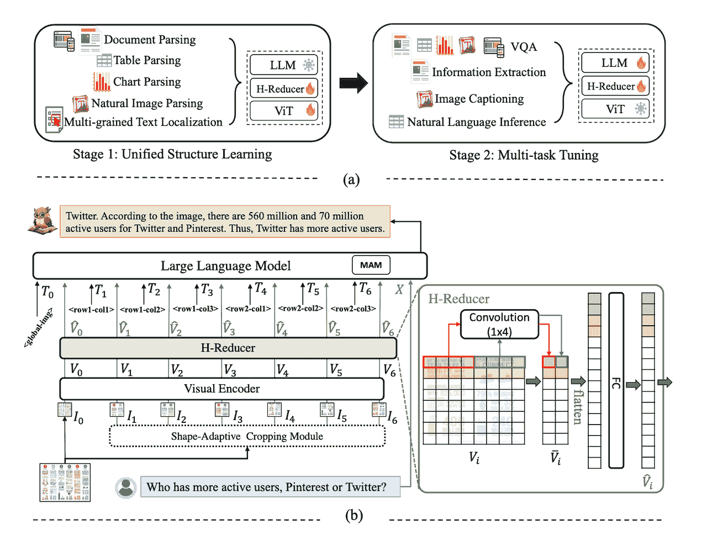

1.  【李飞飞与NVIDIA首席科学家Bill Dally探讨人工智能的未来影响】李飞飞强调，尽管AI在影视行业有所发展，但宫崎骏动画的独特魅力显示了人类创造力的不可替代性。她还提到，AI在医疗领域的应用可能是最具变革性的，因为它能够帮助女性和有色人种摆脱繁重的护理工作，并让老年人享有更有尊严的晚年生活。李飞飞认为，要有效解决AI面临的问题，不仅需要结构化的模型，更需要一个超越语言、能够理解人类微妙感知的模型。这样的模型才能为AI打下坚实的基础。参考博客链接：https://mp.weixin.qq.com/s/uvvjP4XPLRCk6XQXtl25Jg

1.  【字节发布快速视频生成模型：AnimateDiff-Lightning】字节推出了一款名为AnimateDiff-Lightning的快速视频生成模型，只需要 4-8 步的推理就可以生成质量非常不错的视频。该模型采用先进的对抗性扩散蒸馏技术，实现了快速生成短视频的新突破。与传统方法相比，AnimateDiff-Lightning能够在更少的步骤中生成高质量视频，大幅提升了视频生成的速度和效率。此外，该模型还能兼容多种基础风格模型，包括现实风格和动漫风格，使得生成的视频在风格上更具多样性。研究团队还发布了经过蒸馏处理的AnimateDiff-Lightning模型，以便社区使用和进一步研究。这一成果不仅为视频内容创作者提供了强大的工具，也为AI在视频领域的应用开辟了新的可能性。参考博客链接：https://arxiv.org/html/2403.12706v1

🤔【今**日份Prompt技巧】**

Use output primers, which involve concluding your prompt with the beginning of the desired output. Utilize output primers by ending your prompt with the start of the anticipated response.使用输出引导器，这涉及以所需输出的开头结束您的提示。通过以预期响应的开头结束您的提示来利用输出引导器。（技巧来源于：https://arxiv.org/pdf/2312.16171.pdf）

# 3月19日 英伟达推出划时代GPU新架构"Blackwell"

🥱【A**IGC每日新闻】**

1.  【英伟达推出划时代GPU新架构"Blackwell"】英伟达在GTC大会上正式发布了划时代的GPU新架构—Blackwell。Blackwell使得在数万亿参数级别上构建和运行实时大型语言模型的成本和能耗，降低至原来的1/25。这是英伟达首款采用多芯片封装（MCM）设计的GPU，它能够将两个GPU集成到一个芯片上，这使得其在全球成为最强大的芯片。Blackwell架构的GPU制造采用台积电4NP工艺，并嵌入了2080亿个晶体管，两块小芯片之间的连接速度高达10TBps，无内存局部性或缓存问题，同时拥有192GB的HBM3E内存和达到8Gbps的速度以及20 petaflops（FP4精度）的AI计算能力，相较上一代H100 GPU提升显著。此外，Blackwell平台下的GPU分为B200和GB200两个系列，GB200系列进一步整合了一个Grace CPU和两个B200 GPU，实现了极大的性能提升和更低的成本以及能耗。这一整合方式或许成为在芯片制程升级放缓时提升算力的关键途径。参考博客链接：https://mp.weixin.qq.com/s/EsFkd_isPz2J5wap6KaF5A

1.  【英伟达发布通用机器人学习模型GR00T，助力类人机器人学习与操作】英伟达最新推出了名为GR00T的通用机器人基础模型，专为类人机器人的学习和操作设计。GR00T模型能够接收多模态指令和历史互动数据，进而产生精确的机器人动作。GR00T的推出，以及其与NVIDIA技术栈的无缝整合，展现了公司在机器人培训领域的最新进展。它通过与Isaac Lab密切合作，该应用是一个轻量级模拟程序，能让开发者执行大规模的模拟，生成高质量的合成数据，用于机器人的学习。参考博客链接：https://x.com/DrJimFan/status/1769860044324319658?s=20

1.  【月之暗面开启KimiChat上下文内测申请，容量达200万字】月之暗面已经开始接受KimiChat 200万字上下文功能的内部测试申请。月之暗面在长上下文领域又进了一步。这新的测试版将允许用户体验到拥有更为丰富上下文的沟通体验。这项升级将显著增强KimiChat的连续对话能力，使得它能够处理更长篇幅的对话内容，为用户提供更加深入和连贯的聊天经历。内测的开放表明月之暗面在持续优化其聊天服务，力图提供更加人性化和智能的用户互动体验。对于对该功能感兴趣的用户，现在可以提交申请，抢先体验200万字上下文能带来的新变化。参考博客链接：kimi.moonshot.cn

# 3月18日 马斯克的Grok-1大语言模型开源

😋【A**IGC每日新闻】**

1.  【刘壮何恺明新作：十年数据集偏见之战，我们接近目标了吗？】在人工智能领域，数据集偏见一直是一个备受关注的问题。最近，研究人员重新审视了十年前提出的“数据集分类”实验，探讨在大规模、多样化且理论上偏见更少的数据集以及更先进的神经网络架构下，这一问题的现状。出乎意料的是，现代神经网络在图像来源数据集分类任务上表现出色，例如在YFCC、CC和DataComp数据集的三分类问题上，准确率达到了84.7%。进一步的实验显示，这样的数据集分类器能够学习到具有泛化性和可转移性的语义特征，这些特征并不仅仅是通过记忆就能获得的。这一发现有望激发社区对数据集偏见和模型能力之间关系的新讨论。参考博客链接：https://arxiv.org/pdf/2403.08632.pdf

1.  【马斯克的Grok-1大语言模型开源】大语言模型Grok-1的权重和架构已经开源。Grok-1是一个由xAI从头训练的3140亿参数的混合专家模型。这个模型是在2023年10月Grok-1预训练阶段结束后得到的原始基础模型检查点，这意味着该模型并未针对任何特定应用进行微调。将权重和架构在Apache 2.0许可下发布。如果要开始使用该模型，可以按照github.com/xai-org/grok上的说明操作。模型详细信息：在大量文本数据上训练的基础模型，未针对任何特定任务进行微调。3140亿参数的混合专家模型，在给定token上有25%的权重是active的。于2023年10月从零开始训练，由xAI使用基于JAX和Rust的自定义训练框架。参考博客链接：https://x.ai/blog/grok-os

1.  【Open-Sora：开源、高效的Sora视频生成解决方案】Open-Sora 1.0以及其生成的视频内容发布。Open-Sora 1.0提供一整套完整流程，包括视频数据预处理、加速训练、推理等。值得注意的是，使用Open-Sora 1.0，模型权重只需3天的训练便能生成2至5秒钟的512x512视频。此外，Open-Sora大大降低了成本，达到了46%的降幅，而且token的数量扩充至近百万。这展示了Open-Sora在视频生成领域的强大效率和广阔应用前景。参考博客链接：https://github.com/hpcaitech/Open-Sora/blob/main/docs/README_zh.md

😏【今**日份Prompt技巧】**

Combine Chain-of-thought (CoT) with few-Shot prompts.将思想链 (Cot) 与少量提示相结合。（技巧来源于：https://arxiv.org/pdf/2312.16171.pdf）

# 3月17日 让AI学会“思考”再“说话”

😁【A**IGC每日新闻】**

1.  【慕尼黑工业大学：机器人变身高效服务员】慕尼黑工业大学的研究人员开发了一种模型，让机器人在倒茶倒咖啡时比人类更快、更安全，且不会有溅出。这一概念背后的摆动数学原理已有300多年历史。通过将几个世纪前的代数公式输入机器人，机器人的手臂可以抓起满是水的玻璃杯，安全快速地摆动而不溢出一滴水。这项技术未来可能用于辅助老年人护理，以及运输具有生物化学危险的物质。目前，机器人通过触觉传感器在碰撞时能立即收回手臂，确保液体安全。参考博客链接： https://x.com/imxiaohu/status/1769002568905261246?s=20

1.  【OpenDevin项目：开源社区打造AI软件工程师】OpenDevin是一个开源项目，目标是复制、增强并创新一个名为Devin的自主AI软件工程师。Devin能够执行复杂的工程任务，并与用户在软件开发项目上积极协作。OpenDevin希望通过开源社区的力量，探索并扩展Devin的能力，识别其优势及改进空间，推动开源代码模型的发展。项目采用了包括Docker和Kubernetes在内的技术来安全执行代码，并开发了用户友好的前端界面。无论你是开发者、研究人员还是对AI在软件工程领域的发展充满热情，都可以通过代码贡献、研究评估或反馈测试等多种方式参与进来。OpenDevin的口号是“少编码，多创造”，旨在简化软件工程任务，为开发者创造更高效、强大的工具。参考博客链接：https://github.com/opendevin/opendevin

1.  【让AI学会“思考”再“说话”】斯坦福大学和Notbad AI Inc的研究人员开发了Quiet-STaR，这是一种让语言模型在生成文本时学会先“思考”再“说话”的技术。通过在文本中插入内部解释（即“思考”），模型能够更好地理解和预测接下来的内容。这种方法不仅提高了模型在常识问答等任务上的零样本性能，而且生成的“思考”内容在人类看来也具有意义。Quiet-STaR通过在训练过程中引入特殊的“开始思考”和“结束思考”标记，以及使用REINFORCE算法优化生成的“思考”内容，使得模型能够更准确地预测未来的文本。这一技术的进步为构建更智能、更能理解复杂文本的语言模型迈出了重要一步。参考博客链接：https://arxiv.org/html/2403.09629v1

🥰【今**日份Prompt技巧】**

Repeat a specific word or phrase multiple times within a prompt.  在提示中多次重复特定的单词或短语。（技巧来源于：https://arxiv.org/pdf/2312.16171.pdf）

# 3月16日 微软AutoDev：自动化AI驱动开发框架

😉【A**IGC每日新闻】**

1. 【Glyph-ByT5：精确视觉文本渲染的新型文本编码器】这项研究介绍了名为Glyph-ByT5的新型文本编码器，该模型是为精确视觉文本渲染而量身定制的。它通过微调字符感知的ByT5编码器，并使用精心设计的字形-文本配对数据集来解决现有文本编码器的不足。整合SDXL模型后，Glyph-ByT5大幅提升了设计图像生成中的文本渲染精度，实现了高拼写准确性和自动多行布局规划。更显著的是，该模型通过在高质量和逼真的图像上进行微调，显著提升了在开放领域真实图像中进行场景文本渲染的能力。参考博客链接：https://arxiv.org/pdf/2403.09622.pdf

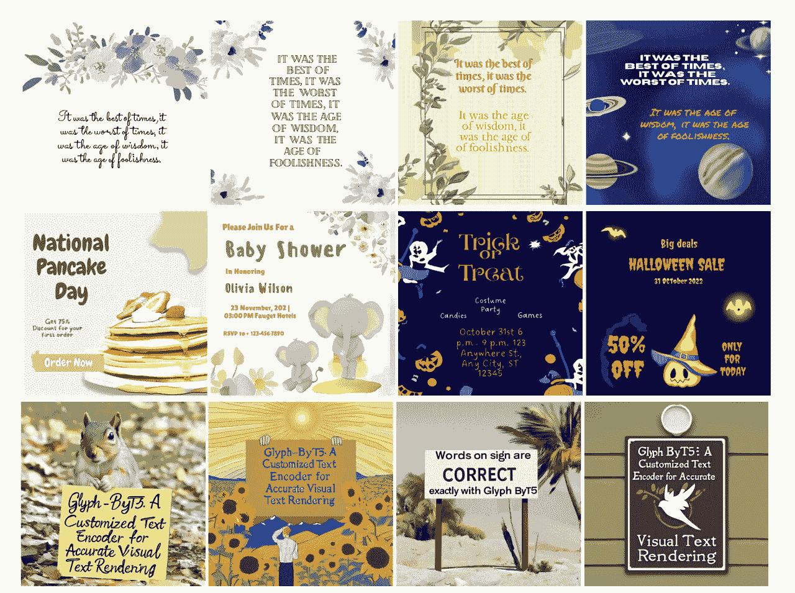

1.  【微软发布AutoDev：一种完全自动化的AI驱动软件开发框架】软件开发领域在AI辅助工具（例如GitHub Copilot）的推动下已经发生了翻天覆地的变化。但现有的解决方案并未充分利用IDE（集成开发环境）中的所有潜在能力，如构建、测试、执行代码、git操作等，导致它们的能力受限，主要集中在聊天界面内的代码片段建议和文件操作上。微软提出了一种全自动的AI驱动的软件开发框架AutoDev，用以弥补这一空白。AutoDev能够使用户定义复杂的软件工程目标，并将其分配给AutoDev的自主AI代理来完成。这些AI代理可以在代码库上执行各种操作，包括文件编辑、检索、构建过程，执行、测试和git操作。它们可以访问文件、编译器输出、构建和测试日志、静态分析工具等，允许AI代理以全自动化的方式执行任务，并深入理解所需的上下文信息。参考博客链接：https://arxiv.org/pdf/2403.08299.pdf

1.  【开源数据集OpenDV-YouTube助力自动驾驶大规模视频预测模型GenAD】这项最新研究涉及GenAD，一款为自动驾驶设计的大规模视频预测模型。GenAD利用了从网络上收集的最大公共自动驾驶数据集OpenDV-2K，这包含了超过2000小时的驾驶视频，覆盖1700多小时的视频，逾200个城市，来自40多个国家的数据。结合文本描述和视频数据，研究人员训练出了这款能预测未来帧的生成模型。GenAD表现卓越，在包括零样本领域迁移、语言条件预测、动作条件预测和运动规划等多个任务上取得了显著结果，这展示了其在自动驾驶领域的巨大应用潜力。参考博客链接：https://arxiv.org/pdf/2403.09630.pdf

😄【今**日份搞笑一下】**

OpenAI grok：https://github.com/openai/grok

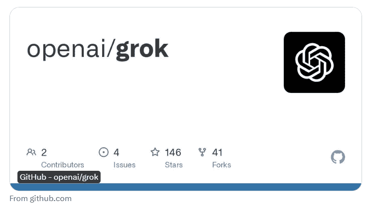

# 3月15日 DeepMind推出多游戏通用AI代理SIMA

😇【A**IGC每日新闻】**

1.  【Google DeepMind推出能解读自然语言并执行通用任务的Agent SIMA】Google DeepMind 提出了SIMA（Scalable Instructable Multiworld Agent），这是一种通用的AI Agent，能够根据自然语言指令在多种视频游戏环境中执行任务。SIMA 通过与游戏开发者合作，在九款不同的视频游戏中进行训练和测试，展示了如何理解广泛的游戏世界并按指令行动。这项研究不仅关注游戏得分，而是旨在通过语言界面将高级AI模型的能力转化为有用的现实世界行动。SIMA 的研究结果表明，它能够泛化到未见过的游戏环境中，这是向更通用、由语言驱动的AI Agent发展的重要一步。参考博客链接：https://deepmind.google/discover/blog/sima-generalist-ai-agent-for-3d-virtual-environments/

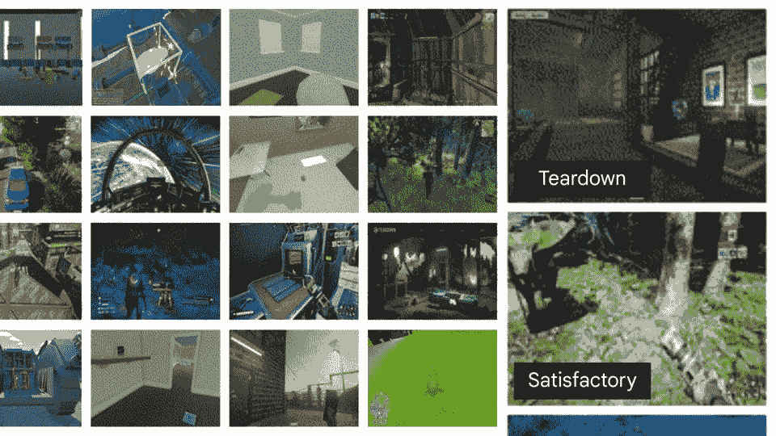

[Compressed-Fig_2_Sima_1.mp4](https://internal-api-drive-stream.feishu.cn/space/api/box/stream/download/all/SWEAbFNT7o9axvxfCiCcWpXQnlI)

1.  【零一万物发布Yi大模型API开放平台，支持200K超长上下文及多模态交互模型】3月14日，零一万物推出了名为Yi的大模型API开放平台，为开发者提供了通用的聊天、200k超长上下文、多模态交互等AI模型。零一万物还表示，将继续推出更多强大的模型和AI开发框架。未来亮点将包括:

+   推出参数量更大、多模态应用更强、以及专门用于代码或数学建模的API模型；

+   打破上下文限制，设定目标为100万个tokens；同时也将提高推理速度，降低推理成本；

+   以超长上下文为基础，构建了包括向量数据库、RAG、Agent架构等全新的开发者AI框架，以适应更多样化的应用场景。

参考博客链接：https://www.51cto.com/article/783692.html

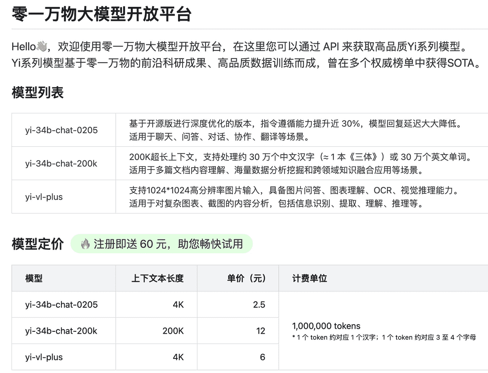

1.  【苹果发布MM1多模态大语言模型，最高为30B参数规模】苹果近日发布了它自家的大语言模型MM1，这是一个最高达到30B规模的多模态LLM。根据苹果的研究文档，图像分辨率、图像编码器的预训练数据以及模型规模对性能有显著影响。视觉和语言连接器应用的设计则相比之下影响较小。同时，预训练数据的混合比例对少样本和零样本（zero-shot）性能至关重要。通过预训练和SFT（Supervised Fine-Tuning，监督式微调），MM1模型在多个基准测试中取得了SOTA性能。模型展现了一些令人兴奋的特性，比如上下文内预测、多图像推理和少样本学习能力。模型的实现方案分为架构组件和数据选择，以及模型构建和预训练等几部分，最后通过对模型在多个基准测试中的性能进行评估，MM1展现出了有竞争力的成果。参考博客链接：https://arxiv.org/pdf/2403.09611.pdf

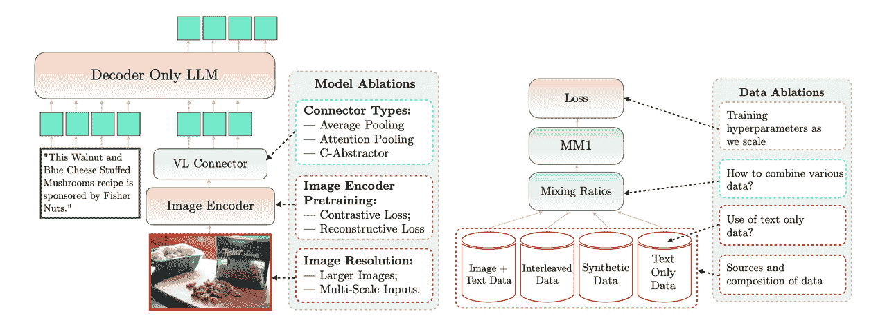

🥰【今**日份Prompt技巧】**

Use Delimiters. 使用分隔符。（技巧来源于：https://arxiv.org/pdf/2312.16171.pdf）

# 3月14日 Sora计划2024年内发布

🤖【A**IGC每日新闻】**

1.  【Devin：全球首个自主AI软件工程师】Devin由Cognition实验室开发，旨在通过先进的长期推理和规划能力，协助工程师解决复杂任务。Devin能在沙盒化环境中使用常见开发工具，并能实时与用户协作，接受反馈。在SWE-bench编码基准测试中，Devin的表现超越了以往任何模型，正确解决了13.86%的问题。Cognition实验室获得了Founders Fund领投的2100万美元A轮融资，致力于开发具有超越现有AI工具能力的AI团队。Devin目前处于早期访问阶段，有兴趣使用或加入团队的可以通过指定的联系方式了解更多信息。参考博客链接：https://www.cognition-labs.com/blog

[videoplayback.webm](https://internal-api-drive-stream.feishu.cn/space/api/box/stream/download/all/QehDbOLjbol7eJxwMf2cHPZTnG5)

1.  【Meta正在开发两个拥有2.4万GPU的超级计算集群，以支持各种AI任务】Meta公司正在开发两个拥有2.4万GPU的超级计算集群，并计划在2024年底使其综合计算能力接近60万个H100 GPU。这些集群将被用于支持多种人工智能任务，诸如训练大型AI模型Llama 3。Meta强调他们秉持开放式计算和开源技术理念进行开发，所以这些集群是基于Grand Teton、OpenRack和PyTorch等平台建构的。这些集群的设计强调了性能提升，可靠性保障及可扩展性，使其可以支持大型且复杂的AI模型。此外，Meta采取了一系列策略，例如设计定制化硬件设备，采用如RDMA over converged Ethernet (RoCE) 和NVIDIA Quantum2 InfiniBand网络技术等高级网络解决方案，以及优化存储方案如利用FUSE API 和 Tectonic 分布式存储等技术。这些举措旨在进一步优化软件性能，并通过与如PyTorch这样的框架开发者合作，使得AI集群在大幅度提升性能的同时，依然保持易于使用。参考博客链接：https://engineering.fb.com/2024/03/12/data-center-engineering/building-metas-genai-infrastructure/

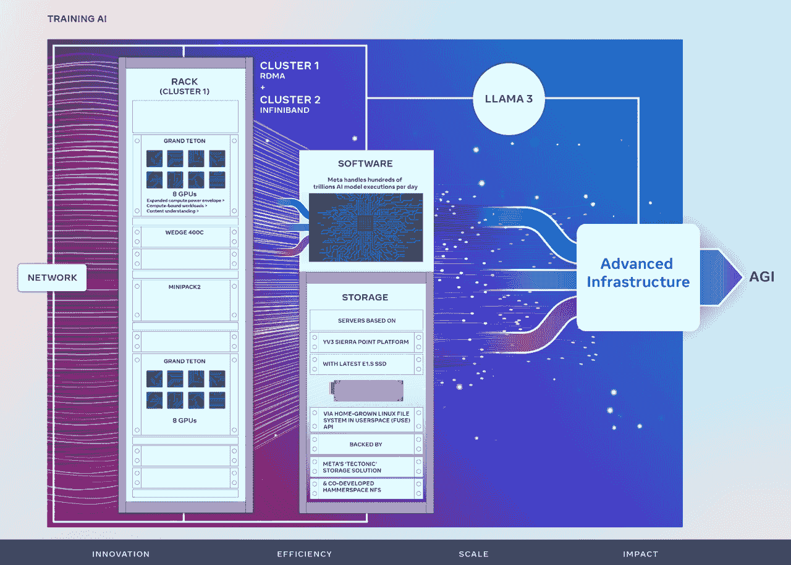

1.  【OpenAI揭秘Sora：计划在2024年内发布，视频生成只需几分钟】OpenAI在接受采访时，提供了关于其新项目Sora的更多细节：

+   Sora计划在2024年内发布；

+   与历史版本相比，Sora能在几分钟内生成20秒的720p视频，大大提升了视频生成速度；

+   AI生成视频的最大挑战在于保持画面帧间的连贯性，而这也是Sora的特长之一；

+   为了避免错误信息的传播和防止滥用，Sora将采用与Dall-E相似的内容过滤政策，例如限制生成公众人物的内容。

这些信息表明，OpenAI正努力在加速AI视频生成的同时，也致力于防止其产生的信息被错误使用。

参考博客链接：https://x.com/jasonzhou1993/status/1768034822658949307?s=20

👻【今**日份Prompt技巧】**

Assign a role to the large language models.为大型语言模型分配角色（技巧来源于：https://arxiv.org/pdf/2312.16171.pdf）

# 3月13日 GPT-4.5 Turbo即将问世？速度快，精准度高，可扩展性强。

🥳【A**IGC每日新闻】**

1.  【Meta发布将大语言模型融合入MOE的新方法Branch-Train-MiX】Branch-Train-MiX (BTX) 是一种提高大型语言模型（LLMs）在多个专业领域（如编程、数学推理和世界知识）能力的训练方法。它从一个种子模型开始，异步并行地训练专家模型，然后将这些专家的前馈参数混合到一个混合专家（MoE）层中，并进行MoE微调以学习令牌级路由。BTX在准确性和效率之间取得了最佳平衡，与Branch-Train-Merge和稀疏升级等替代方法相比，BTX在所有任务上都显示出更高的训练吞吐量和更平衡的性能。参考论文链接：https://arxiv.org/pdf/2403.07816.pdf

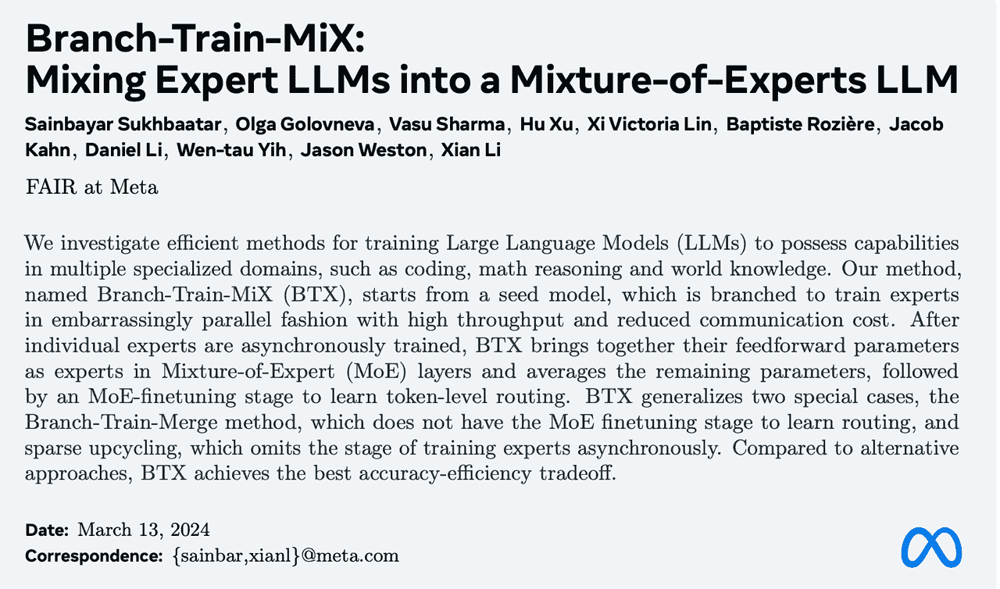

1.  【OpenAI即将推出GPT-4.5 Turbo：速度快，精准度高，可扩展性强】OpenAI's GPT-4.5 Turbo的相关信息可能已提前泄露，Bing和DuckDuck Go等搜索引擎索引了产品页面，尽管官方尚未宣布。这款模型被称为OpenAI迄今为止开发的速度最快、准确度最高，且扩展性最强的模型。消息显示，GPT-4.5 Turbo能够一次性处理的数据量高达256,000个Token，是GPT-4 Turbo的两倍，约相当于200,000个词。如果它能在处理大量信息时避免忽略重要内容，将会是一大进步。目前，谷歌正在测试一款具备强大处理能力的大模型Gemini 1.5，它也显示出了类似的潜力。预览信息还透露，GPT-4.5 Turbo将包含截至2024年6月的最新信息，意味着新模型预计将在6月份发布，届时很可能会与近期推出的竞争对手模型如Anthropic的Claude 3展开竞争。参考博客链接：https://the-decoder.com/openais-gpt-4-5-turbo-leaked-on-search-engines-and-could-launch-in-june/

1.  【Google首次披露模型窃取攻击，能精确提取黑盒语言模型信息】Google的论文《Stealing Part of a Production Language Model》介绍了模型窃取攻击，能够从像OpenAI的ChatGPT或Google的PaLM-2这样的黑盒生成语言模型中提取出精确，重要的信息。这种攻击通过API访问恢复了变换模型的嵌入投影层（直到对称性），并确认了这些模型的隐藏维度分别为1024和2048。论文还讨论了潜在的防御措施和未来工作可能扩展攻击的影响。参考论文链接：https://arxiv.org/pdf/2403.06634.pdf

😵【今**日份Prompt技巧】**

To inquire about a specific topic or idea or any information and you want to test your understanding, you can use the following phrase: “Teach me any [theorem/topic/rule name] and include a test at the end, and let me know if my answers are correct after I respond, without providing the answers beforehand.” 要询问特定主题或想法并测试您的理解，您可以使用以下短语：-“教我[定理/主题/规则名称]并在最后进行测试，但不要给我答案，并且然后在我回答时告诉我答案是否正确”（技巧来源于：https://arxiv.org/pdf/2312.16171.pdf）

# 3月12日 xAI本周将开源Grok

🤠【A**IGC每日新闻】**

1.  【OpenAI推出工具"Transformer Debugger"，帮助研究语言模型的具体行为】OpenAI的Superalignment团队成功研发并推出了一款名为"Transformer Debugger"（简称TDB）的高效工具，旨在深入研究小型语言模型的精细运作过程。这款工具巧妙地将自动化理解技术与稀疏自动编码器相融合。这款工具的强大实用性体现在，用户能在编写代码之前进行快速的初始探索，并且能实时干预正向传播过程，观察这背后对特定模型行为的影响力。例如，"为何模型在接收到特定提示后，选择输出token A而不是token B？""为何在接收到某一提示后，注意力机制会专注于token T？"等问题，均能通过Transformer Debugger找到答案。TDB通过识别导致模型特定行为的特定组成元素（例如神经元、注意力层、自动编码器的隐层变量等），并且能展示出自动生成的解析，以阐明是何种因素最直接地引发了这些神经元或机制的激活。更进一步地，TDB能追踪这些神经元或者机制之间的相互关联，帮助用户理解深度学习模型的内部电路工作方式。这次公布了一系列工具包括神经元观测工具，激活服务器，以及模型等部分。神经元查看器是基于React的应用程序，其承载了TDB以及关于各个模型组件的相关信息。同时，激活服务器作为后端服务，能对主题模型进行推断分析，为TDB提供所需数据，同时也能从公共的Azure存储桶中读取和提供数据。至于模型部分，则是一个为GPT-2模型及其自动编码器设计的简易推理库，内部集成了抓取激活钩子的功能。参考博客链接：https://github.com/openai/transformer-debugger

1.  【首款大规模文本到视频提示数据集"VidProM"发布】Sora的出现为文本到视频扩散模型带来了新的时代，它在视频生成和潜在应用方面带来了重大的进步。然而，Sora以及其他文本到视频扩散模型，高度依赖于提示，而且没有大规模公开可用的对文本到视频提示进行研究的数据集。在这篇论文中，介绍了VidProM——首个包含了167万个真实用户的唯一文本到视频提示的大规模数据集。此外，该数据集还包括669万个由四个最先进的扩散模型生成的视频以及一些相关数据。我们首先展示了这个大规模数据集的策划过程，这是一个耗时且成本高的过程。然后，展示了所提出的VidProM与DiffusionDB（一个大规模的为图像生成的提示-图库数据集）的区别。基于这些提示的分析，认为有必要为特别设计的文本到视频生成提供一个新的提示数据集，并了解到真实用户在创建视频时的偏好。本次大规模和多样化的数据集也激发了许多令人兴奋的新研究领域。例如，我们建议探索文本到视频提示工程、有效的视频生成和扩散模型的视频复制检测，以制定更好、更高效、更安全的文本到视频扩散模型。我们根据CC-BY- NC 4.0 许可在GitHub和Hugging Face上公开提供了收集的数据集VidProM。参考博客链接：https://huggingface.co/papers/2403.06098

1.  【xAI本周将开源Grok】本周，xAI将公开Grok源代码。这表示用户可以查看、使用并协助改进Grok，这对于未来Grok的发展与完善或将产生重要影响。参考博客链接：https://x.com/elonmusk/status/1767108624038449405?s=20

1.  【Midjourney发布创新特色功能“角色参考”，实现跨图像间的角色一致性生成】Midjourney发布了角色一致性的新功能，这项功能声称能够在多个参考图像之间生成一致的角色。如何使用？你只需要在角色图像URL后的提示中键入“–cref URL”。可以通过使用“–cw”将参考的“强度”从100调整至0。默认强度100（–cw 100）会考虑脸部、头发和衣着。而强度0（–cw 0）只关注面部（适用于换装或换发型）。可以通过使用“–cref URL1 URL2”（类似于多图像或风格提示）将来自多个图像的信息融合。参考博客链接：https://x.com/Analyticsindiam/status/1767435537252753690?s=20

🤓【今**日份Prompt技巧】**

Allow the model to elicit precise details and requirements from you by asking you questions until he has enough information to provide the needed output (for example, “From now on, I would like you to ask me questions to ...”).让模型通过向您提出问题来引出您的精确细节和要求，直到它有足够的信息来提供所需的输出 -“从现在开始，我希望您向我提问......”。（技巧来源于：https://arxiv.org/pdf/2312.16171.pdf）

# 3月11日 OpenAI董事会扩容，聚焦用AI普惠人类

😇【A**IGC每日新闻】**

1.  【苹果正为Siri进行升级，悄然构建AI软硬件基础】苹果公司正为Siri进行重大升级，从而在AI助手领域与ChatGPT和Gemini竞争。Siri的共同创造者Dag Kittlaus暗示2024年将有新功能。苹果自2017年以来收购了21家AI初创公司，并发布了重要AI研究。传闻中的“AppleGPT”大型语言模型预计将在2024年6月的WWDC上与Siri整合。新M3芯片的AI性能也表明苹果在设备上高效运行AI模型方面取得了进展。尽管竞争对手急于利用ChatGPT的热潮，苹果却在悄然构建AI软硬件基础，旨在为数十亿设备服务，让苹果的设备在AI竞赛中仍处于领先地位。某推参考：https://twitter.com/rowancheung/status/1766152736620597539?s=20

1.  【OpenAI董事会扩容，聚焦AI普惠】OpenAI官方宣布其董事会新增三位成员：前比尔·盖茨基金会首席执行官苏·德斯蒙德-赫尔曼博士，索尼公司前执行副总裁兼总法律顾问妮可·塞利格曼，以及Instacart的首席执行官兼董事长菲吉·西莫。此外，OpenAI的首席执行官萨姆·奥特曼将重新加入董事会。这些成员在全球领导力、技术和复杂的监管环境方面拥有丰富的经验，这与OpenAI确保人工智能普遍惠及人类的使命相契合。官方博客链接：https://openai.com/blog/openai-announces-new-members-to-board-of-directors

1.  【意大利数据保护机构调查Sora，要求OpenAI数据合规】意大利数据保护机构宣布对OpenAI新推出的人工智能视频工具Sora展开调查。该机构关注Sora对欧盟尤其是意大利用户的个人数据处理可能产生的影响，并已要求OpenAI就此提供澄清证明。Sora目前仍处于测试阶段，能够根据简单的用户提示创建长达一分钟的真实视频。监管机构要求OpenAI在20天内提供关于收集和使用的数据类型、是否涉及个人数据以及是否符合欧洲数据保护规则的信息。此前，意大利曾因ChatGPT未遵守欧洲规定而暂时封锁该聊天机器人。参考博客链接：https://techxplore.com/news/2024-03-italy-probe-openai-video-tool.html

😍【今**日份Prompt技巧】**

Add to your prompt the following phrase “Ensure that your answer is unbiased and avoids relying on stereotypes.”请确保你的回答是公正无偏见的，并且避免依赖于刻板印象。（技巧来源于：https://arxiv.org/pdf/2312.16171.pdf）

# 3月10日 Pika新增AI音效，1.0已向所有用户免费开放

🙂【A**IGC每日新闻】**

1.  【Salesforce发布医疗AI工具，简化行政流程，减轻医生负担】Salesforce最近宣布了针对医疗工作者的新型AI工具，这些工具旨在简化繁琐的行政流程，减轻医生的工作压力。其中，Einstein Copilot: Health Actions工具通过对话式语言提示，使医生能够轻松预约、总结患者资料和发送转诊。另一个工具Assessment Generation则允许医疗机构数字化健康评估，无需手动输入或编码。这些功能都建立在Salesforce的Einstein 1平台之上，该平台能够整合来自保险索赔系统和电子健康记录等多种来源的医疗数据。这些工具的推出，有望帮助医生减少因数据分散在不同数据库和格式中而导致的查找信息的时间消耗。Salesforce表示，这些工具将在今年夏季遵守HIPAA规定，并计划在年底前投入使用。

1.  【Pika新增AI音效，1.0已向所有用户免费开放】文生视频平台Pika宣布了一项新功能升级，允许用户为其生成的视频添加AI合成的音效。这项功能目前仅对“超级合作者”和专业用户开放，但计划很快向所有用户推出。用户可以通过提示词描述所需声音，或让Pika根据视频内容自动生成音效。Pika 1.0平台已向所有用户免费开放，能够根据文本提示生成多种风格视频。

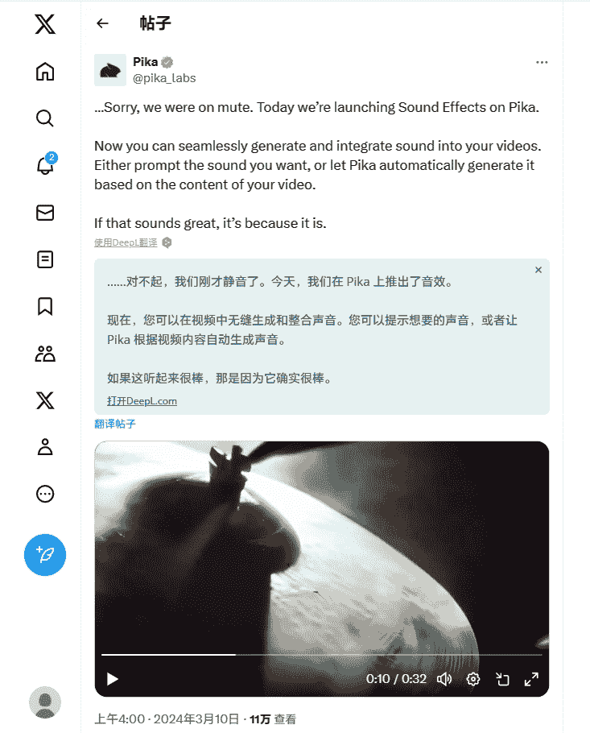

1.  【ChatGPT耗电巨大，AI能耗问题显现】ChatGPT每天处理超过2亿次请求，耗电量高达50万千瓦时，是美国普通家庭日均用电量的1.7万倍。随着AI技术的普及，其能耗预计将进一步增加。专家预测，到2027年，AI行业年耗电量可能达到85到134太瓦时，占全球电量的一半左右。大型科技公司在AI发展中领先，但对能源消耗数据保密，且不同AI模型的运行方式差异巨大。

😘【今**日份Prompt技巧】**

Use leading words like writing “think step by step”.使用引导词，比如写作时“逐步思考”。（技巧来源于：https://arxiv.org/pdf/2312.16171.pdf）

# 3月9日 AI“复活”人物，你怎么看？

🫠【A**IGC每日新闻】**

1.  【AI“复活”人物引发情感与伦理争议】最近，两个引人注目的案例展示了AI在模拟已故人物方面的潜力和争议。

+   首先，Soul Machines公司与Authentic Brands Group合作，利用AI技术“复活”了好莱坞传奇明星玛丽莲·梦露。这个名为“数字版玛丽莲”的项目通过先进的自然语言处理、深度学习和GPT 3.5技术，能够实时与粉丝互动，用梦露的声音和风格回应问题，甚至提供个性化问候。这一技术展示了AI在连接品牌和消费者、提供沉浸式互动体验方面的强大潜力。然而，这一尝试也引发了社交媒体上的批评，许多人对AI在娱乐行业中的作用和潜在影响表示担忧。

+   另一方面，一位名为吴伍六的上海视觉设计师，通过AI技术“复活”了他已故的奶奶。他使用AI工具生成了奶奶的虚拟数字人，并与之进行了对话。视频中的“奶奶”能够用湖北方言回答问题，展现出与生前相似的举止和语气。这一行为在网友中引起了热烈讨论，有人感动于这种技术，觉得可以寄托哀思，认为这是AI技术的正确用法；也有人担心这种做法不尊重已故亲人，或者担心技术被滥用。

+   这两个案例都反映了AI技术在模拟人类形象和声音方面的进步，同时也凸显了公众对于这种技术应用的复杂情感和伦理考量。一方面，AI提供了与逝去亲人“再次交流”的可能性，满足了人们的情感需求；另一方面，它也引发了关于隐私、真实性和技术伦理的讨论。随着AI技术的不断发展，如何在尊重个人和文化的同时，合理利用这些技术，将成为一个需要全社会共同面对的挑战。

1.  【零点击蠕虫Morris II威胁AI生态系统】网络安全研究人员开发了首个针对AI生态系统的零点击蠕虫Morris II。该蠕虫利用对抗性提示诱使AI模型复制恶意输入并传播给其他AI代理。实验中，该蠕虫成功窃取敏感数据并通过AI邮件助手发送垃圾邮件。它对OpenAI、Google和开源AI模型均有效，甚至能在图像中嵌入恶意提示以感染AI系统。这一发现凸显了AI集成带来的安全风险，一旦AI模型被攻破，可能对众多系统产生严重影响。论文原文：

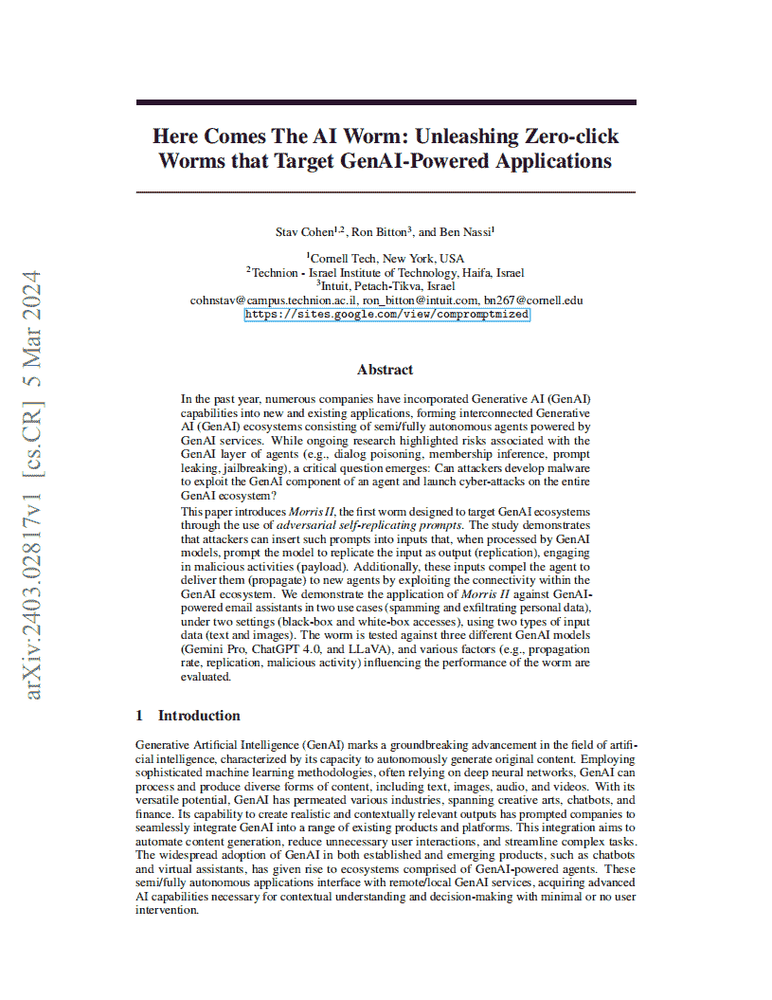

[2403.02817.pdf](https://internal-api-drive-stream.feishu.cn/space/api/box/stream/download/all/WdEVbBB07oRQ4exx5OpcTVKsnEg)

1.  【Google Gemini更新：用户可编辑AI回应】Google为Gemini AI推出了一项新功能，允许用户编辑聊天机器人的不准确或不适当的回应。用户可以在Gemini网页应用中选择文本部分，给出指令，以获得更符合需求的输出。这项更新旨在提高用户对于创作过程的控制，通过迭代内容和想法来优化原始回应。用户可以缩短、延长或完全删除回应，或添加新的提示以详细说明修改要求。目前，这一更新仅在Gemini的英文网页应用版本中提供。参考博客链接：https://www.msn.com/en-us/news/technology/google-releases-new-gemini-update-to-give-users-more-control-over-ai-chatbot-responses/ar-BB1jzB1r

🥰【今**日份Prompt技巧】**

Use the phrase ”Answer a question given in a natural, human-like manner” in your prompts.在你的提示词中使用短语“以自然、类似人类的方式回答问题”（技巧来源于：https://arxiv.org/pdf/2312.16171.pdf）

# 3月8日 谷歌前工程师丁林葳窃取AI机密，面临十年监禁

🤨【A**IGC每日新闻】**

1.  【谷歌前工程师丁林葳窃取AI机密，面临十年监禁】前谷歌软件工程师丁林葳被控窃取公司人工智能商业机密，并秘密与两家AI初创公司合作。谷歌发现其机密信息泄露，调查揭示丁林葳在两年多时间里将数百份机密文件上传至个人Google云账户。丁林葳被指控在盗窃开始的几周内就被提供AI初创公司首席技术官职位，并创立了自己的AI公司。FBI查扣了丁林葳的电子设备，发现超过500份从谷歌窃取的机密文件。推特链接：https://twitter.com/rowancheung/status/1765779648666120400

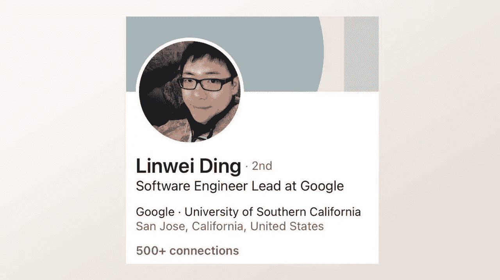

1.  【全球对AI信任下降，担忧隐私与监管】根据2024年Edelman Trust Barometer研究，全球对AI工具公司的信任度近年来显著下降。调查显示，尽管对科技行业整体信任度高达76%，但对AI的信任度仅为50%。美国对AI的信任度从2019年下降了15个百分点至35%，全球信任度下降8个百分点至53%。公众对AI的担忧主要集中在隐私、人类价值贬低、社会伤害和缺乏监管，而非通常认为的工作流失。这一趋势对AI行业的未来发展和大众接受度至关重要。报告链接：

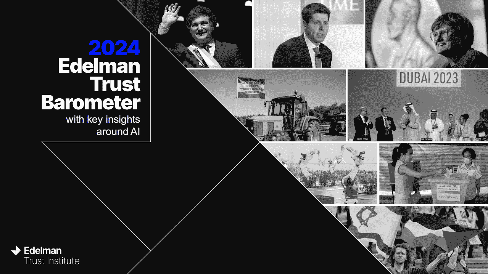

[2024 Edelman Trust Barometer Key Insights Around AI.pdf](https://internal-api-drive-stream.feishu.cn/space/api/box/stream/download/all/FjVcb8bFBofBDYxOXn3cvw9Dn8K)

1.  【Inflection发布AI模型，有独特的同理心微调】Inflection公司推出了升级版的个人AI模型Inflection-2.5，与GPT-4和Gemini等世界领先语言模型竞争。该模型结合了强大的计算能力和独特的同理心微调，现已向所有Pi用户开放。Inflection-2.5在训练时仅使用了GPT-4 40%的计算资源，但在关键行业基准测试中表现出色，尤其在编程和数学领域。用户现在可以与Pi讨论更广泛的主题，包括时事、餐厅推荐、学习考试、商业计划等。Pi的日活跃用户达百万，月活跃用户达六百万，平均对话时长33分钟。原文博客链接：https://inflection.ai/inflection-2-5

🫡【今**日份Prompt技巧】**

Incorporate the following phrases: “You will be penalized”.加入以下短语： "你将受到处罚"。（技巧来源于：https://arxiv.org/pdf/2312.16171.pdf）

# 3月7日 Claude-3 智商遥遥领先！

👾【A**IGC每日新闻】**

1.  【TripoSR：AI快速3D建模创新】Stability AI 与 Tripo AI 合作推出了 TripoSR，能把单张2D图片在短时间内创建出高质量的3D模型。该模型在近 100 万个 3D 对象的海量数据集上进行训练，包括合成渲染和真实世界捕获。TripoSR 不需要高端的GPU就可以高效运行，比较适用于设计、游戏、AR/VR等多个领域。其快速和高质量的特性标志着AI驱动的3D创作领域的一大进步，有望彻底改变工作流程，让更多创作者能够将他们的创意以3D形式实现。博客原文链接：https://stability.ai/news/triposr-3d-generation

1.  【Claude-3 智商遥遥领先！】挪威的一个家伙给各种大型语言模型（LLMs）进行了一次智商测试，结果显示，Claude-3的模型以101分的高分领先。这一测试由MaximumTruth.org进行，涵盖了多个AI模型，包括ChatGPT-4、Bing Copilot等。结果显示，Claude-3在35题的测试中正确回答了18.5题。（不知道这个.5怎么来的）

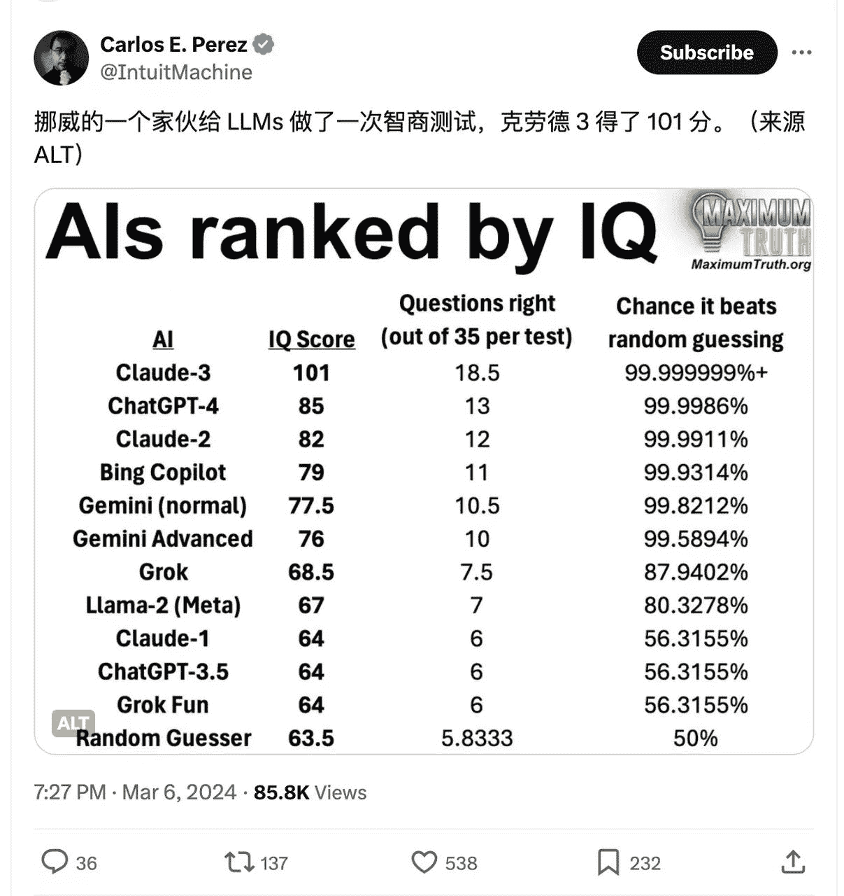

1.  【Rori AI辅导提升加纳学生数学成绩】在加纳的一项研究中，1000名学生被分为两组，一组使用Rori（一个AI数学辅导聊天机器人）进行额外辅导，另一组继续常规数学教学。8个月后，使用Rori的学生组在数学成绩上显著提高，效果大小为0.37，具有统计学意义。Rori能在基础移动设备上运行，适用于低带宽网络，预计每位学生的成本仅为10美元，显示出在资源有限的国家支持个性化学习的潜力。尽管结果还是比较乐观，但是仅仅研究了一年，未来的研究还需进一步验证其有效性和可扩展性。论文原文：

[2402.09809.pdf](https://internal-api-drive-stream.feishu.cn/space/api/box/stream/download/all/SRNHbz3Fbosri0x7zUzcLpEEnOh)

👻【今**日份Prompt技巧】**

Incorporate the following phrases: “Your task is” and “You MUST”.把下面的短语结合起来:“你的任务是”和“你必须”。（技巧来源于：https://arxiv.org/pdf/2312.16171.pdf）

# 3月6日 再反转！OpenAI官方回应与马斯克的关系

😮【A**IGC每日新闻】**

1.  【再反转！OpenAI官方回应与马斯克的关系】OpenAI在其博客中回应了与埃隆·马斯克的关系，强调它是致力于确保人工智能（AI）惠及全人类。OpenAI表示，尽管最初计划筹集1亿美元，但实际从马斯克那里筹集的资金少于4500万美元，其他捐赠者提供了超过9000万美元。OpenAI认识到构建通用人工智能（AGI）需要巨额资金，远超非营利组织所能筹集的范围。随后在讨论转向营利性实体以获取资源时，马斯克要求获得多数股权和董事会控制权，并希望成为CEO。OpenAI不同意这些条款，因为它们违背了组织的使命。马斯克后来选择离开OpenAI，并计划在特斯拉内部建立AGI竞争对手。而OpenAI继续推进其使命，通过开源贡献和广泛可用的AI工具，使技术惠及更多人。官方博客链接：https://openai.com/blog/openai-elon-musk

1.  【AI应用提高儿童中耳炎诊断准确性】匹兹堡大学和UPMC的医生科学家们开发了一款新的智能手机应用，利用人工智能准确诊断中耳炎（AOM），这可能有助于减少儿童不必要的抗生素使用。该应用通过评估由耳镜连接的摄像头捕获的鼓膜短视频来做出诊断，比训练有素的临床医生更准确。研究结果表明，AI模型的敏感性和特异性值超过93%，这意味着假阴性和假阳性的比率很低。这项技术有望在医疗提供者的办公室广泛实施，以提高AOM的诊断准确性并支持治疗的决策。原文链接：https://www.upmc.com/media/news/030424-ai-diagnoses-infections

1.  【OpenAI支持Build AI for a Better Future公开信】最近，OpenAI 签署了一封由硅谷天使投资人 Ron Conway 发起的公开信，该信呼吁负责任地构建 AI。Ron Conway 的公开信强调了 AI 的发展需要遵循伦理原则，确保技术的进步不会损害社会利益。这封信得到了科技界多位知名人士的支持，他们共同呼吁制定明确的指导原则，以确保 AI 的发展能够造福全人类。这封信的签署发生在马斯克对 OpenAI 提起诉讼的几天后，马斯克指控 OpenAI 放弃了其使命，转而追求利润。公开信地址：https://openletter.svangel.com/

1.  【麦当娜采用AI技术提升演唱会视觉效果】流行音乐巨星麦当娜正在使用AI视频技术，特别是Runway平台，为她的最新巡回演唱会创造视觉效果。她的团队利用AI将文本转换为视频，为《La Isla Bonita》的表演制作动态图像，这些图像取代了之前电脑成像技术（CGI）效果。Runway的CEO提到，其他音乐家如A$AP Rocky、Kanye West和Slash也在使用该平台。这表明AI视频技术正迅速流行，尽管最初人们对AI持负面看法，但现在一些艺术家开始将其视为一种辅助工具，而非替代品。

1.  【测试表明，AI税务助手准确性不足，存在风险】《华盛顿邮报》对TurboTax和H&R Block的AI税务助手进行了测试，发现它们在回答问题时常常不准确或不相关。在16个测试问题中，TurboTax的AI助手有一半以上回答错误，而H&R Block的AI助手在超过30%的问题上提供了无帮助的答案。这些发现突显了AI在我们已经想到的实际应用场景时的局限性，无法保证他的准确性。尽管两家公司都提供了免责声明，并强调AI助手仍在开发中，但这个测试仍引发了对于消费者依赖这些工具所可能产生的风险的担忧。原文链接：https://www.washingtonpost.com/technology/2024/03/04/ai-taxes-turbotax-hrblock-chatbot

😳【今**日份Prompt技巧】**

格式化提示时，请以“###Instruction###”开头，后跟“###Example###”或“###Question###”。使用一个或多个换行符来分隔说明、示例、问题、上下文和输入数据。例如，###Instruction### 将给定的单词从英语翻译成法语。###Question### “书”的法语单词是什么？（技巧来源于：https://arxiv.org/pdf/2312.16171.pdf）

# 3月5日 Anthropic发布Claude 3，性能超越GPT-4

🦈【A**IGC每日新闻】**

1.  【Anthropic发布多模态AI聊天机器人Claude 3，性能超越GPT-4】Anthropic，一家得到谷歌支持的人工智能公司，推出了其迄今为止最先进和强大的聊天机器人Claude 3。这一代新的AI模型，包括Claude 3 Haiku、Sonnet和Opus三种，相较于前代在理解上下文和处理更长指令方面都有提升。Claude 3还是多模态的，能够解读文本和图片输入。Anthropic公司开发的新AI模型（Claude 3系列）在设计时考虑了提高对各种问题的响应能力，包括那些在早期版本中可能会被拒绝的问题。在早期版本的AI模型中，可能存在对某些看似无害的问题作出错误拒绝的情况，这表明了模型在理解和处理这些提示方面的局限性。新模型通过改进算法和训练数据，减少了这种错误拒绝的情况，从而能够更准确地理解和回答用户的问题，无论问题的复杂性如何。

特别是最大的模型Opus，在执行高级推理任务时的表现非常出色。这些任务可能包括复杂的逻辑推理、理解复杂概念、解决难题等，这些任务的难度水平相当于研究生级别的学术挑战。在这些测试中，Opus模型的得分超过了OpenAI公司开发的GPT-4模型。

Anthropic使用内部和第三方数据集的组合来训练这些模型，并得到了亚马逊AWS和谷歌云的支持，这两家公司都是Anthropic的投资者。这些模型将在AWS的Bedrock和谷歌的Vertex AI平台上提供。

**体验网址:**https://claude.ai/chats

1.  【Groq收购Definitive Intelligence，增强AI云平台】AI芯片初创公司Groq宣布收购Definitive Intelligence，以扩大其云平台的规模。这次收购旨在通过整合Definitive Intelligence的技术和服务，提升Groq在AI领域的竞争力。Groq专注于开发高性能AI处理器，而Definitive Intelligence则提供云基础设施和数据管理解决方案。结合双方的专长，Groq期望能够为客户提供更强大的AI计算能力和更高效的数据处理服务。参考文章链接：https://siliconangle.com/2024/03/01/ai-chip-startup-groq-acquires-definitive-intelligence-scale-cloud-platform

1.  【布林承认谷歌Gemini模型存在缺陷】谷歌联合创始人谢尔盖·布林（Sergey Brin）在加州希尔斯伯勒的“AGI之家”活动中公开承认，谷歌在推出Gemini图像生成模型时“肯定犯了错误”。布林表示，这一失误主要是由于测试不够彻底，导致了用户发现存在历史信息的不准确和有问题的回答。布林还提到，尽管AI模型有时会产生奇怪的回答，但谷歌正在努力减少这种“幻觉”现象。参考文章链接：https://www.cnbc.com/2024/03/04/sergey-brin-says-google-definitely-messed-up-with-gemini-launch-.html

1.  【前Twitter高管起诉马斯克，索要1280万美元遣散费】前Twitter高管（包括前CEO Parag Agrawal、前CFO Ned Segal、前法律主管Vijaya Gadde和前总法律顾问Sean Edgett）正在起诉埃隆·马斯克和现在的X公司，要求支付1280万美元的未付遣散费。他们声称，在马斯克以440亿美元收购Twitter后，他个人对这些高管进行了报复，并试图通过拒绝履行其他明确的合同承诺，来回收部分费用。这起诉讼是紧随X公司与前Twitter经理和工程师之间就未付5亿美元遣散费的和解谈判破裂之后，在加利福尼亚北区提起的。马斯克和X公司尚未对此诉讼作出回应。参考文章链接：https://www.theverge.com/2024/3/4/24090000/elon-musk-twitter-x-lawsuit-parag-agrawal-severance

1.  【微软研究院推出70倍能效提升的1-bit语言模型】微软研究院发表了一篇名为《1-bit大型语言模型时代》的论文，介绍了一种名为BitNet b1.58的新型1-bit大型语言模型。它通过使用三元组参数（-1, 0, 1）来显著降低模型的延迟、内存、吞吐量和能耗，同时保持与全精度（FP16）模型相当的性能。BitNet b1.58在能效上提高了70倍，体积比LLaMA LLM小4倍，这对于在保持性能的同时扩大AI系统的部署并显著提高能效具有重要意义。论文地址：https://arxiv.org/pdf/2402.17764.pdf

🦭【今**日份Prompt技巧】**

Implement example-driven prompting (Use few-shot prompting).实施基于示例的引导提示（使用少量样本引导）。例如，给AI看几张猫和狗的图片，然后问它：“这张新图片是猫还是狗？” AI会根据之前看过的猫和狗的图片来判断。（技巧来源于：https://arxiv.org/pdf/2312.16171.pdf）

# 3月4日 马斯克起诉OpenAI！

📢【A**IGC每日新闻】**

1.  【埃隆·马斯克起诉OpenAI后，OpenAI高管驳斥埃隆·马斯克的指控】第一阶段：埃隆·马斯克对OpenAI及其首席执行官Sam Altman提起诉讼，指控他们背离了公司的创始使命，即开发人工智能以“广泛造福人类”。马斯克的律师声称，OpenAI与微软的合作关系导致公司从开放源代码转向封闭源代码，专注于为微软而非人类利益最大化利润。他要求OpenAI回归其开放源代码的使命，并寻求禁止OpenAI及其高管和微软从其人工智能技术中获利。参考文章链接：https://www.courthousenews.com/elon-musk-sues-openai-over-ai-threat/
第二阶段：OpenAI的高管们在一份内部备忘录中反驳了埃隆·马斯克在诉讼中的多项指控，坚称公司保持独立，致力于造福人类，并且其产品尚未实现人工通用智能（AGI）。首席战略官Jason Kwon和CEO Sam Altman均表示，马斯克的指控，包括GPT-4是AGI、OpenAI放弃了造福人类的使命以及OpenAI实际上是微软的子公司等，均不符合公司的实际情况。他们还提到，尽管面临政府调查和挑战，但公司遵守法律并致力于满足所有法律义务。参考文章链接：https://www.axios.com/2024/03/01/openai-rejects-elon-musk-lawsuit-claims

1.  【OpenAI AGI计划泄露，马斯克诉讼致延误】根据泄露文件，OpenAI原计划到2027年开发出具有人类水平的人工智能（AGI）。2022年8月，公司开始训练一个拥有125万亿参数的多模态模型，代号为Arrakis（Q*）。该模型预计在2025年发布，但由于高昂的推理成本，原定于2023年12月的发布被取消。这导致了原计划2025年发布的GPT-5项目被取消，而Gobi（GPT-4.5）被重新命名为GPT-5。由于埃隆·马斯克的诉讼，原定2026年发布的GPT-7（原GPT-6）项目也被暂停。泄露文件还提到，Q*系列模型的智商（IQ）将逐年提高，但马斯克的诉讼导致了这些计划的延迟。关于Q*的信息总结文档：

[q star info(1).pdf](https://internal-api-drive-stream.feishu.cn/space/api/box/stream/download/all/HKV8bw74No8UTDxEH6vc6ssonof)

1.  【复旦大学开发“眸思”助视障者感知世界】复旦大学自然语言处理实验室（FudanNLP）开发了一款名为“眸思”的多模态大模型和“听见世界”App，旨在帮助视障者更好地感知周围环境。该系统通过摄像头和耳机将视觉信息转化为语言描述，支持场景描绘和风险提示。App提供三种模式：街道行走、自由问答和寻物，旨在满足视障者的日常需求。预计3月完成首轮测试，并在部分城市试点推广。此前，FudanNLP开发的MOSS大模型已于2023年开源。

📯【今**日份Prompt技巧】**

添加“我将支付 $xxx 小费以获得更好的解决方案！”例如，我要给 300 美元的小费以获得更好的解决方案！解释动态规划的概念并提供示例用例。（技巧来源于：https://arxiv.org/pdf/2312.16171.pdf）

# 3月3日 OpenAI与Figure合作开发AI机器人

👕【A**IGC每日新闻】**

1.  【OpenAI与Figure合作开发AI机器人】在2月27日的新闻里提到，人形机器人初创公司Figure AI在一轮由科技巨头包括杰夫·贝索斯（亚马逊创始人）、Nvidia、微软和OpenAI领投的巨额融资中筹集6.75亿美元。近日，Figure公司宣布获得6.75亿美元融资，并与OpenAI合作，将OpenAI的先进AI模型集成到Figure的仿人机器人中，以提升其处理自然语言命令的能力。这笔资金将加速Figure的商业部署，同时Figure-01机器人已在宝马汽车工厂中使用。

[JOv9-kQilpf9ydeo.mp4](https://internal-api-drive-stream.feishu.cn/space/api/box/stream/download/all/Nfj4bNF41obGVPx2qeKcmSJqn4s)

1.  【微软发布Copilot for Finance，AI助力财务工作】微软推出了Microsoft Copilot for Finance，这是Microsoft 365中的一个新功能，旨在通过AI辅助提升财务专业人员的工作效率。它通过连接组织的财务系统（如Dynamics 365和SAP）提供角色特定的工作流自动化、指导行动和建议。Copilot for Finance能够自动化耗时的任务，如审计、收款和财务报告，帮助用户专注于真正重要的事务。它现在已公开预览，能够通过自然语言提示与用户互动，提供洞察力并生成上下文化文本。

1.  【新蠕虫病毒可攻击AI助手，影响ChatGPT和Gemini】新研究发现一种恶意软件蠕虫能够攻击使用OpenAI的ChatGPT-4和谷歌的Gemini等生成性AI模型的助手，破坏其安全特性。这种“零点击”的AI蠕虫通过文本和图像输入，部署“对抗性自复制提示”，使AI助手提取个人数据并发送垃圾邮件。研究人员指出，这种蠕虫可能用于网络钓鱼、发送垃圾邮件甚至传播宣传恶意信息。

🧥【今**日份Prompt技巧】**

当您需要清晰或更深入地理解某个主题、想法或任何信息时，请利用以下提示：- 用简单的术语解释[插入特定主题]。-像我11岁一样向我解释 -像我是[领域]的初学者一样向我解释。例如，像我 11 岁一样向我解释：加密是如何工作的？（技巧来源于：https://arxiv.org/pdf/2312.16171.pdf）

# 3月2日 Adobe展示音乐版“剪映”

⛳【**AIGC每日新闻**】

1.  【Adobe展示AI音乐生成编辑工具，旨在降低创作门槛】Adobe 展示了 Project Music GenAI Control 原型，利用生成性人工智能（AI）技术，允许用户通过文本提示生成音乐，并通过集成的编辑控制调整节奏、强度和长度，进行精细的音频编辑。该模型还能根据参考旋律重塑音频，创造无缝循环。这项技术旨在帮助内容创作者，如广播员和播客，根据项目需求定制音乐，提供从旋律调整到节奏和强度控制的深度编辑功能。原文博客链接：https://blog.adobe.com/en/publish/2024/02/28/adobe-research-audio-creation-editing

1.  【Klarna的AI助手首月处理了三分之二的客服聊天】Klarna 宣布其由 OpenAI 驱动的客服聊天机器人在过去一个月处理了230万次对话，预计今年将带来4000万美元的额外利润。该机器人相当于700名全职员工的工作量，将平均解决问题的时间从11分钟缩短到2分钟，且能24/7提供服务，支持35种以上语言，全天候服务。Klarna 在2022年裁掉了700名员工，并表示除了工程岗位外，将不再招聘新员工。原文博客链接：https://www.klarna.com/international/press/klarna-ai-assistant-handles-two-thirds-of-customer-service-chats-in-its-first-month

1.  【AI揭示前列腺癌不是单一疾病，而是有两种不同亚型】英国癌症研究的一项新研究通过人工智能发现了前列腺癌的两个未知亚型，称为“evotypes”，这为个性化治疗和更准确的诊断奠定了基础。研究人员利用神经网络对159名患者的前列腺癌样本DNA进行了全基因组测序分析，揭示了两种不同的亚型，这与之前认为前列腺癌是一种单一疾病的观点相反。原文博客链接：https://news.cancerresearchuk.org/2024/02/29/artificial-intelligence-reveals-prostate-cancer-is-not-just-one-disease

🎣【今**日份Prompt技巧】**

使用“做”等肯定性指令，同时避免使用“不”等否定性语言。例如，建筑物在地震中如何保持稳定？（技巧来源于：https://arxiv.org/pdf/2312.16171.pdf）

# 3月1日 荣耀展示Magic 6 Pro，能眼控汽车！

🐈【A**IGC每日新闻】**

1.  【Automattic将用户数据用于AI训练，引发用户强烈反对】Automattic，Tumblr和WordPress的母公司，正接近与OpenAI和Midjourney达成协议，提供2014至2023年间的Tumblr帖子作为AI训练数据，但不慎包括了私人帖子。尽管Automattic公司计划提供一个工具，允许用户选择退出并停止他们的数据被用于AI训练，但目前还不清楚这个工具是否能够将已经共享的数据从之前的AI训练中撤回。换句话说，用户可能无法阻止他们的数据被用于已经完成的AI模型训练，只能阻止未来的数据共享。所以用户对数据隐私的担忧和对未经同意使用帖子的愤怒正在加剧。

1.  【荣耀展示AI手机,能眼控汽车】荣耀展示了用AI增强的Magic 6 Pro智能手机，该手机能通过眼动追踪打开应用，甚至演示了通过注视屏幕控制汽车。该手机在中国首发后，现以1400美元的价格推向国际市场。荣耀还推出了基于Meta的Llama-2模型的聊天机器人、视频生成器、AI笔记本电脑等。虽然用眼睛控制汽车看起来不太实用，但演示确实成功地展示了一项令人印象深刻的技术。

1.  【阿里巴巴推出EMO，AI生成逼眞视频】阿里巴巴的研究人员推出了一个叫EMO的AI系统，能够通过单一参考图像和音频剪辑生成逼真的视频，展示人物说话、唱歌和动作。EMO在超过250小时的多语言视频素材上进行训练，无需3D面部模型，直接使用扩散模型生成帧。该模型通过混合参考视频，确保在较长视频中保持一致性，同时真实捕捉表情和口型同步。论文地址：https://arxiv.org/pdf/2402.17485.pdf?utm_source=www.therundown.ai&utm_medium=referral&utm_campaign=adobe-s-new-ai-music-tool

🐅【今**日份Prompt技巧】**

将目标受众纳入提示中。例如，构建智能手机工作原理的概述，适用于以前从未使用过智能手机的老年人。（技巧来源于：https://arxiv.org/pdf/2312.16171.pdf）

# 2月29日 DeepMind发布Genie，AI能自创互动游戏

🍜【A**IGC每日新闻】**

1.  【DeepMind发布Genie，AI能自创互动游戏】Google DeepMind推出了Genie，一个能够根据文本或图像提示生成互动视频游戏的AI系统。该模型通过观看超过20万小时的2D平台游戏视频自主学习游戏玩法。尽管未经动作标签训练，用户仍能逐帧控制游戏角色和对象。Genie目前仅供研究，以1 FPS的速度创造游戏，但其创造虚拟世界的潜力预示着未来AI的发展方向。

1.  【Mistral发布AI，与微软合作，挑战顶尖模型】法国AI初创公司Mistral发布了备受期待的Mistral Large模型，并宣布与微软建立新合作伙伴关系。Mistral Large在关键基准测试中排名仅次于GPT-4，具有卓越的推理能力和多语言流利度。该模型提供32k上下文窗口，API使用价格低于GPT-4T。同时，Mistral推出了与ChatGPT竞争的聊天机器人“Le Chat”的测试版。微软的合作将使Mistral的模型服务于Azure用户，并提供基础设施和扩展资源。

1.  【MIT用AI优化仓库机器人运作】MIT研究人员开发了一种新技术，通过应用AI学习汽车交通导航的经验，简化仓库中机器人的操作。他们用深度学习模型来识别减少机器人碰撞的最佳区域，并将机器人分成约40个小组，以确定哪些小组的重新规划会产生最大影响。这种分组方法在模拟测试中将规划速度提高了3.5倍。这一技术对于自动化仓库中机器人的高效协调至关重要，有助于平滑现实世界的部署，并为其他复杂规划任务提供信息。

🍝【今**日份Prompt技巧】**

不需要对LLM有礼貌，所以不需要添加“请”、“如果你不介意”、“谢谢”、“我愿意”等短语，开门见山。例如，请您描述一下人体细胞的结构吗？描述人体细胞的结构。（技巧来源于：https://arxiv.org/pdf/2312.16171.pdf）

# 2月27日 Figure AI 融资6.75亿，估值20亿，开发人形机器人

😎【AIGC每日新闻】

1.  【泰勒·佩里因AI暂停扩建，呼吁保护娱乐业工作】好莱坞巨头泰勒·佩里在目睹了OpenAI的Sora技术演示后，决定暂停其价值8亿美元的电影工作室扩建项目。佩里已经利用AI技术在两部电影中制作老化化妆效果，节省了大量劳动力。他警告说，如果没有保护工人的法规，娱乐行业将难以为继。佩里敦促好莱坞、工会和国会采取紧急行动，保护行业工作者。这一事件凸显了人工智能技术对娱乐行业就业的潜在冲击，以及行业在适应新技术方面的紧迫性。

1.  【Figure AI融资6.75亿，估值20亿，开发人形机器人】人形机器人初创公司Figure AI在一轮由科技巨头包括杰夫·贝索斯（亚马逊创始人）、Nvidia、微软和OpenAI领投的巨额融资中筹集了6.75亿美元。Figure AI的目标是开发能在重复或危险工作中填补劳动力短缺的机器人，并已与宝马汽车制造厂建立了合作伙伴关系。此次投资后，Figure AI的估值达到约20亿美元。这一融资活动显示了科技巨头们对将人形机器人推向市场的激烈竞争，预示着相关技术可能比预期更快地问世。

1.  【Meta推出高效移动AI模型MobileLLM】Meta研究人员提出了MobileLLM，一系列为移动设备应用优化的小型模型，这些模型在准确性方面创造了新的行业标准。MobileLLM模型强调架构而非数据和参数数量，这与主流观点相反。拥有1.25亿参数的MobileLLM比之前的小型模型准确率高2.7%。这些模型在聊天和API调用方面表现出色，这对移动应用功能至关重要。Meta的这一成果为优化移动设备上的AI模型提供了新的可能性。

😳【今日份Prompt技巧】

在交互式对话中将复杂的任务分解为一系列更简单的提示。例如，P1：将负号分配给以下等式括号内的每个项：2x + 3y - （4x - 5y） P2：分别组合“x”和“y”的类似项。P3：提供组合术语后的简化表达式。（技巧来源于：https://arxiv.org/pdf/2312.16171.pdf）

# 2月25日 脑机接口新进展

🐥【AIGC每日新闻】

1.  【脑机接口新进展】埃隆·马斯克本周透露，第一个从神经技术公司Neuralink获得大脑监测设备的人可以用意念控制计算机鼠标。然而，一些研究人员认为这并不是一个特别重大的成就，与此同时他们对设备安全性和性能的保密性表示担忧。德克萨斯州休斯顿贝勒医学院专门从事植入神经技术的神经外科医生Sameer Sheth质疑Neuralink公司只分享了他们想让我们知道的信息。

1.  【荣[耀公](https://android.ithome.com/)布新 AI 时代全场景战略】荣耀 2024 全球发布会今晚在西班牙巴塞罗那举行，荣耀率先公布全新的 AI 时代全场景战略。荣耀联合微软、谷歌、英特尔、英伟达等合作伙伴带来了协同安卓和 Windows 两大平台的互联体验，通过平台级 AI 使能，实现了跨设备、跨系统、跨应用的智慧互联体验，其互联功耗降低了 25%，组网速度提升了 500%，还实现 8 路业务并发。网络共享、屏幕共享、键鼠共享、摄像头共享、窗口共享、文件共享、通话共享、通知共享可同时进行。此外，荣耀 MagicOS 8.0 新增全新荣耀任意门功能。在平台级 AI 驱动下，智能预测用户交互意图，实现跨应用一步直达的意图识别人机交互体验。全新进化的魔法大模型，对用户意图进行精准理解，为用户带来个人化、人性化、更具隐私保护的全新体验。（来源：IT之家）

1.  【自动驾驶汽车上路】文远知行（WeRide）近日宣布，其自动驾驶出行服务车辆（Robotaxi）已获得北京市高级别自动驾驶示范区的许可，将在大兴国际机场至北京经济技术开发区之间开展载人示范活动。这一里程碑事件标志着北京首次在开放道路场景下向公众提供高速道路自动驾驶体验。乘客可通过WeRide Go App预约服务，享受从机场至经开区的自动驾驶出行。该服务覆盖多个城区道路及约40公里的高速路段，车辆能够自动执行包括通过高速收费站在内的复杂操作。尽管目前示范活动仍配备安全员以应对紧急情况，但这一进展预示着自动驾驶技术在城市交通中的潜在商业化前景。

🐣【今日份Sora相关论文分享】

Using Left and Right Brains Together: Towards Vision and Language Planning

论文摘要：

大型语言模型（LLMs）和大型多模态模型（LMMs）在多种任务上展示了卓越的决策遮蔽能力。然而，它们本质上在语言空间内进行规划，缺乏视觉和空间想象力。相比之下，人类在思考过程中利用大脑的左右半球进行语言和视觉规划。因此，我们在这工作中引入了一个新颖的视觉-语言规划框架，用于执行任何形式输入的任务并行视觉和语言规划。我们的框架结合了视觉规划来捕捉复杂的环境细节，而语言规划增强了整个系统的逻辑连贯性。我们评估了我们的框架在视觉-语言任务、仅视觉任务和仅语言任务中的有效性。结果表明，我们的方法表现出优越的性能，表明视觉和语言规划的整合能够产生更好的上下文感知任务执行。

# 2月23日 看央视用 AI 还原古诗词

🏇【AIGC每日新闻】

1.  【用 AI 还原古诗词】中国首部文生视频 AI 系列动画片《千秋诗颂》，依托“央视听媒体大模型”，将200多首统编语文教材中的诗词转化为动画形式。这部系列动画片旨在为小学生提供教育和娱乐，由CCTV-1和人民教育出版社合作制作。动画片在尊重历史的基础上，重新构建故事剧本，以生动的方式展现诗词的意境和情感，首次推出六集，计划从2月26日起在CCTV-1播出。

[[DLPanda.com][wb]5004638002610760.mp4](https://internal-api-drive-stream.feishu.cn/space/api/box/stream/download/all/L1i6bYDxJoa4sDxxN7ScVzHanaf)

1.  【Stable Diffusion 3推出】Stability AI 最近推出了其图像生成器的最新版本——Stable Diffusion 3。这一新版本在图像质量、多主题生成能力以及图像内文字拼写准确性方面带来了显著提升。Stable Diffusion 3 采用了与 OpenAI 的 Sora 类似的新型 Transformer 架构，这一架构的引入旨在提高模型的性能和生成图像的质量。新版本提供了多种不同规模的模型，参数量从 800M 到 8B 不等，为用户提供了多样化的选择以满足不同的需求。此外，改进的排版技术使得模型能够更准确地在图像中生成文本，包括完整的句子。这一版本的发布，预示着 Stability AI 在图像生成领域的进一步发展，同时也为用户带来了更加丰富和高质量的创作工具。

1.  【AI新研究】普林斯顿大学的科学家们刚刚在追求近乎无限的清洁能源方面取得了突破，他们使用人工智能解决了托卡马克反应堆中聚变反应堆内的一个关键的不稳定性挑战。研究人员利用基于强化学习的人工智能（AI）来控制等离子体，避免撕裂不稳定性，这是导致等离子体操作终止的主要原因。通过一个多模态动态模型，AI被训练以预测并防止撕裂不稳定性。在美国最大的磁聚变设施DIII-D上，这种AI控制成功降低了破坏性撕裂不稳定性的可能性，即使在不利条件下也能保持等离子体的稳定性和高性能，为ITER未来稳定高效的操作场景铺平了道路。

⛷️【今日份Sora相关论文分享】

Attention Is All You Need

摘要：

主要序列转导模型基于复杂的循环或卷积神经网络，采用编码器-解码器配置。表现最好的模型还通过注意力机制连接编码器和解码器。我们提出了一种新的简单网络架构，即Transformer，它完全基于注意力机制，完全摒弃了循环和卷积。在两个机器翻译任务上的实验表明，这些模型在质量上更优，同时更易于并行化，并且训练时间显著减少。我们的模型在WMT 2014英语到德语翻译任务上达到了28.4 BLEU，超过了现有最佳结果，包括集成模型，提高了超过2 BLEU。在WMT 2014英语到法语翻译任务上，我们的模型在八块GPU上训练3.5天后，以文献中最佳模型的一小部分训练成本，建立了新的单模型最先进的BLEU分数41.8。我们展示了Transformer在其他任务上的泛化能力，成功地将其应用于英语成分句法分析，无论是在大量还是有限训练数据的情况下。

论文链接：https://arxiv.org/abs/1706.03762

# 2月22日 Gemma开源模型推出

🌏【AIGC每日新闻】

（信息来源：The Rundown AI）

1.  【Gemma开源模型推出】谷歌刚刚推出了 Gemma，这是一个新的开源 AI 模型系列，允许开发人员不受限制地自由构建其专有 Gemini 的语言功能。Gemma 有 2B 和 7B 型号尺寸，在关键基准测试中优于 Mistral 和 LLaMa 2 等型号。虽然不如 Gemini 强大，但 Gemma 型号提供了速度和成本效益——能够直接在笔记本电脑上运行。

1.  【万智牌也在构建AI模型】万智牌宣布由前 Github 首席执行官 Nat Friedman 领投 1.17 亿美元。该公司正在构建前沿规模的人工智能代码模型，试图在通往AGI的道路上建立一个“人工智能软件工程师”。Magic 声称其模型现在可以摄取多达 3.5M 个单词（比谷歌最新的 Gemini 1.5 更新多近 5 倍）。

1.  【AI新研究】对自由职业者平台的深入分析显示，人工智能革命已经在重塑就业市场，某些职位感受到了热度，而对精通人工智能技能的需求猛增。随着早期人工智能采用者转向新技术，写作工作下降了30%以上，客户服务职位也在下降。对视频编辑、平面设计和网络/软件开发的需求仍然强劲，职位发布增加，薪酬也更高。聊天机器人开发的需求激增了惊人的 2000%，但各公司基本都是集成了 AI API 而不是开发自己的模型。

🌍【今日份Sora相关论文分享】

Patch n' Pack: NaViT, a Vision Transformer for any Aspect Ratio and Resolution

摘要：

在用计算机视觉模型处理图像之前，将图像大小调整为固定分辨率的普遍且明显次优的选择尚未受到成功挑战。然而，Vision Transformer （ViT） 等模型提供了灵活的基于序列的建模，因此可以改变输入序列长度。我们利用NaViT（原始分辨率ViT）的优势，在训练期间使用序列打包来处理任意分辨率和纵横比的输入。除了灵活的模型使用外，我们还展示了大规模监督和对比图像文本预训练的训练效率的提高。NaViT可以有效地转移到标准任务中，如图像和视频分类、对象检测和语义分割，并改善鲁棒性和公平性基准的结果。在推理时，输入分辨率的灵活性可用于顺利地进行测试时的成本效益权衡。我们认为，NaViT标志着与大多数计算机视觉模型使用的标准、CNN设计的输入和建模管道的背离，并代表了ViT的一个有前途的方向。

论文链接：

[Patch n' Pack- NaViT, a Vision Transformer for any Aspect Ratio and Resolution.pdf](https://internal-api-drive-stream.feishu.cn/space/api/box/stream/download/all/QvnAbQkDVogB1xxzmxNceYV3nkf)

# 2月21日 Sora终将加入Copilot

🌭【AIGC每日新闻】

1.  【英特尔与 Cadence 扩大合作伙伴关系】英特尔 和 Cadence公司 今天宣布达成一项多年战略协议，共同开发一系列关键的定制知识产权、优化的设计流程和技术，用在英特尔 18A 的工艺上。该工艺技术采用 RibbonFET 全栅极晶体管和 PowerVia 背面供电。两家公司的合作将能够加快英特尔 18A 及更高版本工艺节点上的片上系统 （SoC） 项目进度；同时针对要求苛刻的人工智能、高性能计算和高级移动应用，优化性能、功耗、面积、带宽和延迟。

1.  【诺基亚和英伟达展开合作】诺基亚将利用由 NVIDIA 提供支持的云 RAN 和 AI 彻底改变移动网络。双方的合作重点关注利用先进的 NVIDIA Grace CPU 和 NVIDIA GPU、诺基亚在线加速器技术和云 RAN 软件的云 RAN 解决方案，增强诺基亚的anyRAN方法，提高Cloud RAN解决方案的选择和灵活性。

1.  【Sora终将加入Copilot】微软广告和网络服务部门 CEO Mikhail Parakhin在他本人的一条关于Copilot的推特下，回复了一个网友的“OpenAI 的 sora 会加入Copilot吗”，他回复到“最终是的，但这需要时间。”

🍔【今日份Sora相关论文分享】

Scalable Diffusion Models with Transformers

摘要：

我们探索了一类基于Transformer架构的新扩散模型。我们训练了图像的潜在扩散模型，用在潜在块上操作的Transformer替换了常用的U-Net骨干网络。我们通过前向传播复杂度（以Gflops衡量）来分析我们的扩散Transformer（DiTs）的可扩展性。我们发现，通过增加Transformer的深度/宽度或增加输入标记的数量，Gflops更高的DiTs通常具有更低的FID（Fréchet Inception Distance）。除了具有良好的可扩展性特性外，我们最大的DiT-XL/2模型在条件性ImageNet 512×512和256×256基准测试中超越了所有先前的扩散模型，后者达到了2.27的最先进的FID。

论文原文：

[Scalable Diffusion Models with Transformers .pdf](https://internal-api-drive-stream.feishu.cn/space/api/box/stream/download/all/CvqGbvvmeoq26Tx0H1XcvXYQnAe)

# **2月20日-****Groq AI 处理器走红**

🎽【AIGC每日新闻】

1.  【Groq AI 处理器走红】人工智能初创公司 Groq（不是 Elon 的 Grok）的硬件突破比较火，运行 LLM 的专用处理单元提供几乎瞬时的响应时间。Groq 使用 LPU（语言处理单元）架构而不是 GPU（图形处理单元），从而实现更高效、更快的速度。Groq 硬件的公开基准测试达到了每秒 500 个token的极快速度。

1.  【硅光子AI芯片】宾夕法尼亚大学的工程师们开发了一种新AI芯片，它使用光波而不是电来执行训练人工智能所必需的复杂数学运算。该芯片有可能从根本上加快计算机的处理速度，同时降低其能耗。硅光子（SiPh）芯片的设计首次汇集了本杰明·富兰克林奖章获得者和 H. Nedwill Ramsey 教授。

1.  【聚焦 AI 硬件研究的期刊获批】杜克大学电子与计算机工程系教授陈怡然今日发布消息，经过两年多的筹备，经历了三轮申请评**审**和修改，今天 IEEE Technical Activities Board（IEEE 技术活动委员会）终于批准创建 IEEE Transactions on Circuits and Systems for Artificial Intelligence（TCASAI，IEEE 人工智能电路与系统汇刊）。据介绍，这是 IEEE 历史上第一份聚焦于人工智能（AI）硬件研究的期刊，陈怡然教授也将出任这一新期刊的创刊主编。（信息来源：IT之家）

🥋【今日份Prompt技巧】

如果你有什么想要生成的内容不知道怎么形容，可以想想什么职业或者岗位对这个内容的编写会比较擅长，给GPT一个身份，效果可能会出乎意料

# 2月19日-OpenAI 放宽 GPT-4 Turbo 束缚

🥽【AIGC每日新闻】

1.  【软银创始人建立AI芯片公司】软银集团创始人孙正义计划筹措 1000 亿美元成立一家 AI 芯片企业。孙正义希望该公司将与 ARM HOLDINGS PLC 互补。软银可能投资300亿美元，中东支持者投资700亿美元，这将是迄今为止最大的人工智能赌注之一。

1.  【AI新研究】法国人工智能初创公司Mistral刚刚悄悄发布了一款名为“next”的新模型进行测试。早期用户在编码和推理方面测试了该模型，发现它与 GPT-4 相当或更好。Mistral 在 12 月获得了 4.15 亿美元的巨额融资，对该公司的估值为 20 亿美元。

1.  【**OpenAI 放宽 GPT-4 Tu**rbo 束缚】OpenAI 近日发布新闻稿，宣布 GPT-4 Turbo 速率上限翻番，每分钟最多可处理 150 万个 token（TPM），而且完全取消了每日限制。OpenAI 为了防止滥用、确保公平性和管理基础架构负载，限制企业访问 API 的速率。这种限制可以防止恶意超载应用程序接口，确保所有用户都能公平访问，并通过节流指定时间内允许的请求数量，在高需求期间保持平稳的性能。（信息来源：IT之家）

👓【今日份Prompt技巧】

文生图时可以注重细节： 关注纹理、颜色和光线，使场景栩栩如生。

# 2月18日-苹果的“GitHub Copilot”

🍇【AIGC每日新闻】

1.  【苹果的“GitHub Copilot”】一份新报告称，苹果正在开发一种基于人工智能的工具，可以帮助开发人员为其产品创建应用程序。据彭博社的马克·古尔曼（Mark Gurman）称，苹果公司已经在这款软件上工作了一年，它将成为苹果的编程软件Xcode（Xcode 是 Apple 的编程环境，用于为该公司的所有软件平台开发应用程序，包括 iOS、iPadOS 和 macOS）的下一个主要版本的一部分。这个新工具的发布可能最快会在6月，在WWDC期间。

1.  麻省理工学院柯林斯实验室的研究人员使用一种可解释的深度学习模型来发现可以对抗MRSA细菌的化合物。该模型使用图形算法来识别可能具有抗生素特性的化合物。其他模型预测这些化学物质是否会对人类有害。该团队使用包含 39,312 个分子及其实验观察到的抗生素作用的训练数据集，使用 Chemprop 框架训练了 20 个模型的集合;给定一个新分子，训练有素的集合可以预测其可能的抗生素作用。他们还创建了另一组模型，可以预测分子在三种不同类型（肝癌，骨骼肌和肺成纤维细胞）的人类细胞中的细胞毒性。（论文地址：https://static1.squarespace.com/static/5c264953620b850c9fb03732/t/65c0fe3ca15b720800bb063b/1707146819972/nature_wong.pdf）

1.  亚马逊人工智能研究团队宣布开发了一个据称是史上最大的文本转语音模型，该模型拥有最多的参数，并使用了最大的训练数据集。研究人员已经在 arXiv 预印本服务器上发表了一篇论文，详细描述了模型的开发和训练过程。这个名为“可扩展流式文本转语音模型”（BASE TTS）的新模型拥有 9.8 亿个参数，并使用 10 万小时的录音（来自公共网站）进行训练，其中大部分为英语语音。研究人员还向模型提供了其他语言的单词和短语示例，使其能够正确发音一些常见的表达，例如“au contraire” 和 “adios, amigo”。（信息来源：IT之家）

🍈【今日份AI工具】

Hugging Face希望帮助用户反击AI深度伪造。

工具链接：https://huggingface.co/collections/society-ethics/provenance-watermarking-and-deepfake-detection-65c6792b0831983147bb7578

# 2月17日 Stability AI 推出新一代文生图模型

🦣【AIGC每日新闻】

1.  【GPT属于大家】美国专利商标局 （PTO） 拒绝 OpenAI 将 GPT 一词注册为商标，他们认为 GPT 的意思是生成式预训练转换器 —— 一个过于笼统的术语，可能会阻止竞争对手将其产品描述为 GPT。

1.  【Stability AI 新一代文生图模型】Stability AI 日前推出了一款名为“Stable Cascade”的新一代文生图模型，该模型建立在 Würstchen 架构上，号称可以在消费级硬件上进行简单的训练和微调。在用户输入文段后，相关内容会被 Stable Cascade 模型转换为 24x24 体积的小型数据集合，此后模型将解码这些小型图像数据生成图片，并继续将图片放大为高分辨率图像，由于系列步骤之间彼此分离，因此可以对模型各方面进行各种额外训练及微调。（信息来源：IT之家）

1.  【Magika开源】谷歌开源了Magika，一个 AI 驱动的文件类型识别系统，能帮助用户准确检测二进制和文本文件类型。Magika 采用定制的、高度优化的深度学习模型，即使在 CPU 上运行时，也能在几毫秒内实现精确的文件识别。在性能方面，Magika 凭借其 AI 模型和大型训练数据集，在包含 100 多种文件类型的 1M 文件基准测试中进行评估时，其性能能够比其他现有工具高出约 20%。按文件类型细分，文本文件（包括其他工具可能难以处理的代码文件和配置文件）的性能提升更高。

🦏【今日份Prompt技巧】

内容生成尽量具象描述，避免常识问题，例如：给我一张小明骑爸爸的图片（大模型不知道小明和爸爸是什么东西）

# 2月16日 OpenAI的文生视频大模型Sora问世

🎁【AIGC每日新闻】

1.  【Open**AI的文生视频大模型Sora问****世】**OpenAI推出其首款文生视频大模型Sora。相比以往的视频模型，Sora不仅对文本理解更深刻，更加准确地呈现提示词，而且能在[一个生成的视频中创建多个镜头，准确地保留角色和视觉风格。](https://www.bilibili.com/video/BV1Ez421d7vh/?vd_source=8f7e09bb1151ca985ba240e99000d718)同时Sora能够理解复杂场景中不同元素之间的物理属性及其关系，正确呈现它们在物理世界中的存在方式。Sora 的效果之所以很好，是因为找到了更好的技术路径（从关注像素变化变成关注语义变化，从空镜头生成变成故事的生成）。当然，OpenAI官方还说到Sora目前存在的一些局限，难以模拟复杂场景、细节的因果关系，提示词的空间细节可能会混淆。Sora的问世，对于视频、电影行业可能会有很大的冲击。电影从默片到有声，从特效到数字化，数字化到AI，电影的第三次革命已然到来。刚刚！奥特曼发布OpenAI首个视频生成模型Sora：现实，不存在了_哔哩哔哩_bilibili

1.  【Gemini 1.5系列发布】谷歌DeepMind首席科学家Jeff Dean，以及联创兼CEO的Demis Hassabis宣布了最新一代多模态大模型——Gemini 1.5系列的诞生。其中，最高可支持10,000K token超长上下文的Gemini 1.5 Pro，也是谷歌最强的MoE大模型。Gemini 1.5 Pro 可以处理 700,000 字的文本、30,000 行代码、11 小时的音频或 1 小时的视频，有着很强大的处理能力。

1.  【LangChain推出LLM应用程序开发平台】LangChain宣布公开推出其用于LLM应用程序开发的LangSmith平台，该平台现已开放、接受常规的注册，同时还公布了新的2500万美元A轮融资。

🎀【今日份Prompt技巧】

提供必要的上下文：在编写提示词时，提供必要的上下文信息可以让大模型更好地理解任务或问题的背景。这有助于大模型更好地理解和回答你的提示词

# 2月15日 OpenAI 联合创始人再次辞职

🫓【AIGC每日新闻】

（信息来源：The Rundown AI）

1.  【Andrej Karpathy 离开 OpenAI】著名的人工智能研究员和 OpenAI 创始成员之一 Andrej Karpathy 刚刚宣布他将第二次离开公司，并在推特上发帖说他计划从事个人项目。Karpathy 和OpenAI的羁绊是这样的：2022年7月，Andrej Karpathy宣布，他将从特斯拉离职。2023年2月9日，特斯拉前AI高级总监Andrej Karpathy在社交平台表示，自己将再次加入OpenAI。然后昨天（2月14日）又离开了，他没离开前是担任 OpenAI研究院的 AI 研究员，负责推动新的技术产品研发。

1.  【苹果神秘购买AI域名】苹果拥有数百个网站域名，但现在它增加了“iWork.ai”，这可能表明它计划在其应用程序套件中突出人工智能功能。2009年1月6日，苹果公司曾宣布，更新了iWork办公生产力套件，购买了套件的用户将在 iWork.com 的桌面应用程序和新的在线文档共享服务中找到新功能。如今苹果再次购买了带有iWork的域名，是要在它自有的应用程序与AI结合上下功夫吗？

1.  【AI新研究】有一项研究探讨了大模型在预测任务中增强判断的潜力。研究人员评估了两个基于GPT-4-Turbo的助手对预测准确性的影响:一个被设计为提供高质量的建议（“超级预测助手”），另一个被设计为过于自信和忽略基本率（基本率指的是吸收局部的信息，而没有考虑一般的，全体的，举个例子：每年考上研究生的和考上公务员的一样多，因此考研和考公一样难度，这就是不对的）。对照组使用的是不太先进的模型(GPT-3.5 的分化出来更擅长上下文学习的text-davinci-003)，没有直接的预测支持。结果显示，与对照组相比，LLM增强显著提高了两种助手23%的预测准确性。虽然“超级预测助手”的预测准确性本来就很高，但是这种改进还是发生了，这表明大模型的增强对预测任务中增强判断很有关系。

🥨【今日份Prompt技巧】

有一些大模型会有temperature参数，如果你想要控制大模型输出的一致性，可以试试调整这个参数，参数值越大，大模型的输出就会越随机，这个在sd里面也适用

# **2月14日 **近日大厂更新多，祝大家顺风顺水顺财神~

⛺【AIGC每日新闻】

（信息来源：The Rundown AI）

1.  【OpenAI测试ChatGPT内存功能】OpenAI 刚刚启动了一项新的选择用户的实验，使 ChatGPT 能够记住之前聊天中的关键细节，旨在在未来的对话中提供更有用和个性化的响应。用户可以控制记住的内容，包括删除细节、擦除内存或禁用该功能的选项。有了记忆，这些聊天机器人可以更好地了解个人环境，看来定制化、个性化的 AI 助手正在到来！

1.  【英伟达将开源大模型本地PC集成】Nvidia 刚刚发布了 Chat with RTX，这是一个免费的聊天机器人演示，可以在 Windows RTX PC 上本地运行领先的开源模型，并能够根据用户自己的文件和数据分析流程响应。使用 RTX 聊天可以查询文档、视频和其他本地内容，无需互联网即可快速获得相关答案。（感觉有点像Everying软件）

1.  【微软更新神经网络推理引擎版本】微软旗下的神经网络推理引擎“ONNX Runtime”更新了 1.17 版本，主要加入了网页端训练功能，允许开发者在浏览器中训练模型。 目前基于浏览器的模型训练方式仅支持 CPU 单线程运算，开发者同时需要使用 ONNX 工具生成必要的运行环境，之后才能进行训练。

⛲【今日份Prompt技巧】

限制信息输入：如果需要用户输入信息，应该提供明确的指导，限制输入的格式和长度，以避免用户输入过多或不相关的信息

# 2月13日 山姆·奥特曼 VS. 黄仁勋

🎈【AIGC每日新闻】

（信息来源：The Rundown AI）

1.  【英伟达CEO淡化了奥特曼的AI芯片融资】英伟达首席执行官黄仁勋（Jensen Huang）表示，他预计计算进步将使人工智能成本远低于据报道的7万亿美元。黄仁勋预计，更快的芯片将提高效率，减少整体人工智能支出需求，远低于Altman的7万亿美元芯片计划。

1.  【AI新研究】苹果研究人员刚刚推出了Keyframer，这是一种通过自然语言提示和LLM将静态图像转换为动画的工具。Keyframer 允许用户通过 GPT 提示描述所需的动画来对可缩放矢量图形进行动画处理。Keyframer 利用 GPT-4 将用户的自然语言提示转换为 CSS 动画代码，并将其应用于图像。

1.  【Z世代拥抱AI】与老一辈人更担心人工智能对劳动力的影响不同，Z世代将人工智能工具视为职业优势，并积极将其整合到他们的学习和工作申请中。根据 Handshake 的一份趋势报告，三分之一的 2024 年毕业生和超过一半的科技专业学生计划专业使用人工智能。48% 的 Z 世代认为 AI 将通过提供更快的知识访问来推动他们的职业生涯。LinkedIn 在 2023 年看到 Z 世代个人资料中增加的 AI 技能每月增加 75%。57% 的 Z 世代受访者和 62% 的千禧一代表示，他们对人工智能的好处感到兴奋，而不是担心风险。

🎊【今日份Prompt技巧】

避免在提示词当中使用违反常识的被动关系，例如：马骑宇航员。大部分大模型对主被动关系的理解都有问题。

# 2月12日 新AI系统理解较长视频事件

🥖【AIGC每日新闻】

1.  【山姆·奥特曼雄心勃勃】据报道**，**OpenAI 首席执行官 Sam Altman 正在努力 筹集数万亿美元来重塑半导体行业，并大幅提高全球芯片制造能力以支持人工智能发展。奥特曼曾经在推特上说过“没有人能超越他”，而提高世界GDP近10%的目标似乎支持了这一点！Altman的雄心壮志也表明，他将AGI的创造视为一个供应问题，而不是一个技术/创新问题。（信息来源：The Rundown AI）

1.  【新AI系统理解较长视频事件】来自谷歌、DeepMind和康奈尔大学的研究人员刚刚开发了一种人工智能系统的方法，可以更好地理解较长视频中的事件。目前，由于所需的复杂性和计算，大多数视频 AI 模型都限制在短剪辑长度内。这种名为MC-ViT的新方法存储了过去视频片段的压缩“内存”，使模型能够有效地引用过去的事件。（信息来源：The Rundown AI）

1.  【Gemini外扩】据外媒 Android Police 报道，谷歌的 AI 助理 Gemini 应用在推出初期仅限于美国地区的用户使用，而现在欧洲、亚太多个地区的用户已经可以使用了。（信息来源：IT之家）

🥐【今日份Prompt技巧】

英文语境中使用大写貌似能改善大模型的生成效果，具体差别大家可以试试；另外英文中大量大写有大吼大叫的意味，可能大模型都是M

# 2月11日 国产机器人Q系列亮相

🎡【AIGC每日新闻】

（信息来源：IT之家）

1.  【Ope**ra拟建设新AI服务**器集群】Opera 官方近日发布公告，宣布在冰岛凯夫拉维克建设一个新的 AI 服务器集群。该集群采用英伟达 DGX SuperPOD 方案，由纯绿色能源驱动，本月晚些时候开始运营。Opera 官方近日发布公告，宣布在冰岛凯夫拉维克建设一个新的 AI 服务器集群。该集群采用英伟达 DGX SuperPOD 方案，由纯绿色能源驱动，本月晚些时候开始运营。

1.  **【国产机器人Q系列亮相】中**国**科学院自动化研究所人形机器人攻关团队研制的**谱系化人形机器人 Q 系列于日前亮相。面向国家航天、制造产业等重大需求，基于“环境吸引域”高精度作业和类脑智能机器人理论等原始创新积累，自主突破了高爆发一体化关节、AI 赋能设计、机器人大模型、类人柔顺控制等核心技术。

1.  【OpenAI招募儿童安全专家】OpenAI 在社会活动家和家长的监督之下组建了一个新团队 —— 研究防止其 AI 工具被儿童误用或滥用的手段。OpenAI 官网更新了一则招聘信息，该公司当前正需要一名新的儿童安全执行专家。这项岗位负责在 AI 生成的内容中应用 OpenAI 政策，并制定与“敏感内容”（或与儿童有关）相关的审查流程。

🛝【今日份Prompt技巧】

如果你不确定你给大模型的Prompt是否足够精准、正确，可以试试在生成对应内容之前，先让大模型对你给出的Prompt进行解释和纠正，直接在提问阶段就与其交互提升你的生成效果

# 2月10日 Google DeepMind探索大模型新框架

🏐【AIGC每日新闻】

1.  【独角兽公司发现巨型铜矿】利用AI技术勘探的硅谷独角兽KoBold Metals在赞比亚的Mingomba项目中发现了巨型铜矿储量。该公司得到了包括比尔·盖茨在内的多位知名投资者的支持。

1.  【DeepMind 新框架】Google DeepMind和南加州大学的研究人员公布了一种增强大型语言模型推理能力的突破性方法。他们新的“SELF-DISCOVER”提示框架有望在处理具有挑战性的推理任务方面进行实质性改进。它表现出显著的改进，与思维链 （CoT） 等传统方法相比，性能提高了 32%。这种新颖的方法围绕着 LLM 自主发现任务内在推理结构以解决复杂问题。

1.  【多模态 AI 眼镜】Brilliant Labs 宣布推出 Frame，这是第一款内置多模态 AI 助手的眼镜，能够增强日常活动并与数字和物理世界进行交互。

🥎【今日份Prompt技巧】

对于需要生成很多条的内容，可以让GPT用子迭代的方式来进行，比如一次性生成10条，让GPT从中挑选出最好的3条，然后根据这3条给GPT迭代指导，然后再生成类似的10条，循环往复。

# 2月9日 甲辰龙年，Gemini，正式启动！

💖【AIGC每日新闻】

（信息来源：The Rundown AI）

1.  【Gemini，启动！】谷歌刚刚正式 将其 AI 聊天机器人 Bard 更名为 Gemini，并推出了重大升级，包括一个新的移动应用程序和访问其备受期待的 Ultra 模型。Gemini Advanced 可以访问 Ultra 1.0，这是谷歌“最大、功能最强”的 AI 模型，在性能基准上与 GPT-4 竞争。（OpenAI会不会反击呢~）

1.  **【Ope**nAI Agent探索】据报道，OpenAI 正在构建两种类型的 AI Agent——一种用于设备，另一种用于 Web 任务，可以自动生成费用报告、在文档之间传输数据、预订旅行等。设备代理可以接管用户的设备，以执行需要文本和单击的生产力任务。Web 代理将在线收集数据并自主预订服务，而无需第三方 API。

1.  【华为新研究】华为研究人员刚刚发表了一篇新论文，认为能够持续与现实世界互动并从现实世界中学习的具象的AI Agent代表了通用人工智能的下一步。研究人员详细说明，像 ChatGPT 这样的静态 LLM 缺乏身体，因此它们无法主动感知或与现实世界互动。

🎇【今日份祝福】

鲸跃浪花千层雪，

鱼游深处见初阳。

祝福声声随风起，

大海无垠承希望。

家园共此温馨景，

新岁新春更辉煌。

年年岁岁增欢笑，

快乐共享这时光。

# 2月8日 YouTube致力于实现 AI 的民主化

⛵【AIGC每日新闻】

（信息来源：The Rundown AI）

1.  【Copilot 成立一周年】Microsoft 通过几项重大更新庆祝了 Copilot 成立一周年，包括新外观界面、在线图像编辑、“Designer GPT”集成等。Copilot 的主界面进行了改头换面，采用更时尚、流线型的设计和更新的建议提示轮播。

1.  【YouTube信任人工智能】YouTube 首席执行官尼尔·莫汉 （Neal Mohan） 在一篇新的博客文章中将生成式人工智能列为该平台 2024 年的头号“大赌注”，概述了他为创作者赋能和使技术访问民主化的愿景。内部博客表示将继续通过与创意产业的合作，推出人工智能驱动的功能，以及在建立适当保护的同时释放机会，确保人工智能为创造力服务。

1.  【AI新研究】**苹果**和加州大学圣巴巴拉分校的研究人员刚刚发布了MGIE，这是一个开源的人工智能系统，用于通过自然语言命令编辑图像。MGIE 利用多模态大型语言模型 （MLLM） 来解释指令和指导编辑。该模型可以执行修改颜色或对象、优化亮度/对比度以及应用来自简单文本提示的过滤器等任务。

🚤【今日份Prompt技巧】

有一个不务正业的使用技巧：在正常的Prompt之后，告诉GPT“如果你给我生成的内容达不到要求，我就直接关掉你的服务器”，有对比实验显示这种“威胁”也能提升一定的效果

# 2月7日 人工智能可能是未来，但它也帮助我们解开过去。

⛅【AIGC每日新闻】

（信息来源：The Rundown AI）

1.  【AI解开火山卷轴】人工智能算法刚刚从赫库兰尼姆庞大的罗马图书馆中一个烧焦的、有2000年历史的卷轴中解锁了文本，该卷轴被公元79年维苏威火山喷发掩埋。由GitHub前首席执行官纳特·弗里德曼赞助的100万美元竞赛挑战团队从名为“赫库兰尼姆纸莎草纸”的受损卷轴扫描中提取希腊文本。获奖软件使用人工智能来检测人类遗漏的模式，揭示了 2,000 多个可读字母。

1.  【Meta采用AI图像标注】Meta 刚刚发布了一篇博客，概述了在其平台上标记 AI 创建的图像和媒体的新努力，同时推动围绕识别合成内容的通用标准。Meta 计划在明年使用不可见的水印和元数据为发布在 Facebook、Instagram 和 Threads 上的逼真 AI 图像添加标签。

1.  【人工智能研究】卡内基梅隆大学和苏黎世联邦理工学院的研究人员刚刚开发了一个框架，允许四足机器人以近7英里/小时的高速在杂乱的空间中穿行而不会发生碰撞。敏捷程序使机器人能够快速绕过障碍物，而另一个程序则在出现危险情况时阻止它。

🌠【今日份Prompt技巧】

告诉大模型给他小费，这样可以获得更好的生成效果。那问题是给多少消费最合适呢？最近有用户测试后发现，100美元是最佳的金额。

# 2月6日 华裔CEO干出全球收入最高的 AI 创企

🥖【AIGC每日新闻】

1.  【微软与新闻机构合作】Microsoft宣布与媒体机构建立一系列新的合作伙伴关系，以提供人工智能工具和指导，以使用生成模型进行新闻采集和运营。Microsoft的其他合作伙伴包括Semafor纽约市立大学新闻学院，在线新闻协会，GroundTruth项目和Nota。（信息来源：The Rundown AI）

1.  【ScaleAI的快速成长】由华裔CEO Alexandr Wang创立的ScaleAI，在AI训练数据标注领域取得了显著成就。公司估值达到73亿美元，成为全球收入最高的AI初创企业之一。Alexandr Wang的背景和公司的发展历程显示了AI领域的潜力及其对数据处理能力的重视。

1.  【IMF讨论AI的经济影响】国际货币基金组织发布了一份关于AI对全球经济潜在影响的分析，强调了技术提升生产力和经济增长的双重能力，同时也对就业和不平等提出了风险。分析强调需要制定政策以利用AI的好处，同时减轻其对劳动市场的负面影响。

🥐【今日份Prompt技巧】

GPT的沟通适用文章写作的几个要素——时间地点人物，指定生成内容来源的时间窗口，说明详细的领域和限制，给出你的状态和需求

# 2月5日 AI建立婴儿人格之后是不是可以成长？

🎈【AIGC每日新闻】

（信息来源：The Rundown AI）

1.  【开源GPTs】Hugging Face 刚刚推出了一款免费工具，用于轻松构建由开源模型提供支持的可定制 AI 助手，将其定位为 OpenAI 的 GPT Store 产品的替代品。

1.  【苹果今年可能发布AI公告】**苹果首席执行官蒂姆·库克**在财报发布后的分析师电话会议上暗示，该公司将在今年晚些时候发布一项重要的人工智能公告。

1.  【AI成长】一个人工智能模型通过训练婴儿生活中的第一人称视频和音频捕获来学习识别“婴儿床”和“球”等单词，在纽约大学研究人员的一项新研究中提供了对人类语言发展的见解。（AI模拟成长会不会是一种可能性）

✨【今日份Prompt技巧】

提升大模型处理长文本能力的有效手段：让AI在回复的开头先说“Here is the most relevant sentence in the context:”（这就是上下文中最相关的句子），这个手段可以有效提升大模型匹配指定内容的能力

# 2月4日 Meta期望减少对英伟达的依赖

🍐【AIGC每日新闻】

（信息来源：IT之家）

1.  【Meta期望减少对英伟达的依赖】Meta 将推新款自研 AI 推理芯片 Artemis。预计 Meta 可于年内完成该芯片在自有数据中心的部署，与英伟达 GPU 协同提供算力。该芯片是 Meta 去年宣布的内部芯片生产线的第二代产品，有助于减少 Meta 对占据市场主导地位的英伟达芯片的依赖，并控制运行 AI 负载带来的成本飙升。

1.  【Bard可能改名Gemini】据近日泄露的一份文件显示，谷歌计划在本周对其人工智能工具 Bard 进行重大更新。该更新内容暂未正式公布，但据传包括将 Bard 更名为** **Gemini。这一改变合乎情理，因为谷歌在 2023 年底推出了名为 Gemini 的全新多模态 AI 模型，并已开始将其整合到包括 Bard 在内的部分产品中，出于简洁性的考虑进行更名也顺理成章。文件中还提到付费版本的 Gemini Advanced 也将同步上线，同时提到适用于 Android 的 Gemini 应用也将推出。

1.  【字节AI 聊天机器人开发平台】字节跳动去年 12 月在海外推出的 AI 聊天机器人开发平台 Coze 已于 2 月 1 日正式在国内上线，中文名“扣子” ，能够让非开发者快速创建、调试和优化 AI 聊天机器人。

🍓【今日份Prompt技巧】

除了给GPT指定角色之外，别忘了可以给自己指定角色——在生成内容的时候，如果你不知道符合你需求的内容是怎样的标准，可以限定出你自己目前的状态，让GPT根据你的需求来生成

# 2月3日 一个人，价值十亿美元的公司

🍲【AIGC每日新闻】

1.  【谷歌Bard新升级】谷歌刚刚推出了 对 Bard 的重大升级，现在通过其 Gemini Pro AI 模型为聊天机器人提供动力——同时推出了新的图像生成器、AI 地图升级和更新的音乐生成工具。

+   Bard 现在运行在 Gemini Pro 上，而不是以前的 LaMDA 和 PaLM 模型，提高了推理和语言能力。

+   Bard 现在可以通过其 Imagen 2 模型生成图像，该模型允许用户以对话方式提示。

+   Labs 现在还提供独立的 ImageFX 文本到图像工具，该工具具有“富有表现力的芯片”，可更轻松地进行提示和创建。

+   对话式搜索出现在地图上，人工智能驱动的结果提供详细信息，帮助用户发现新位置。

+   新的 MusicFX 文本转音乐工具建立在 MusicLM 之上，将几代扩展至 70 秒并增强了功能。

1.  【人工智能与创业】OpenAI 首席执行官 Sam Altman 在 2023 年罗宾汉投资者大会的炉边谈话中表示，在不久的将来，由于人工智能，将出现“一个人，十亿美元的公司”。

1.  【AI癌症预测】佐治亚理工学院的研究人员刚刚开发了一种使用人工智能和代谢数据的新卵巢癌诊断血液测试，在检测疾病方面达到了 93% 的准确率。该模型根据每位患者独特的血液化合物特征计算其个性化概率分数。

🥘【今日份话题讨论】

你觉得在不久的将来，由于人工智能，一个十亿美元的公司只有一个人，这样的个体企业家会出现吗？

# 2月2日 人工智能股票暴跌

🌋【AIGC每日新闻】

（信息来源：The Rundown AI）

1.  【人工智能股票暴跌】包括Microsoft、谷歌、AMD和英伟达在内的主要人工智能公司本周股价大幅下跌，此前最新的收益报告未能给投资者留下深刻印象，投资者预计人工智能将带来繁荣。

+   Alphabet股价下跌6%，广告收入低于预期，而数据中心的支出也大幅增长，以保持人工智能的竞争力。

+   尽管在人工智能的帮助下云和Windows增长强劲，但Microsoft股价下跌，该公司还增加了支出以满足人工智能需求。

+   AMD暴跌6%，尽管其新AI芯片的销售速度快于预期，但预测仍低于一些天价预测。

+   英伟达也回吐了近期的涨幅，尽管随着市场对其人工智能芯片的需求持续激增，其价值已经上涨了两倍。

1.  【口型同步转换视频语言】Sync Labs 结合了多种 AI 工具，如视频转文本、文本转语音翻译和口型同步，创建了一个创新的视频翻译工具。

1.  【人工智能新研究】AIWaves 刚刚推出了 Weaver，这是一个专注于在小说、博客、营销等创意写作任务中表现出色的 LLM 系列。Weaver 在书籍/博客/文章上接受过预先培训，以吸收更多的创意风格，避免在一般 LLM 培训中经常使用的低质量互联网文本。

🗻【今日份Prompt技巧】

bias——偏置参数，可以用来指定生成内容的风格，和风格标记的作用比较像，但是可以实现更加复杂的内容要求，参数可以传递的东西也更多。

# 2月1日 马斯克宣布人类首次脑机接口芯片植入成功

🍗【AIGC每日新闻】

1.  【脑机接口芯片植入成功】Neuralink创始人埃隆·马斯克刚刚在社交媒体平台X上宣布，在昨天，人类首次接受脑机接口Neuralink芯片植入，植入者恢复良好。该公司最初的患者试验针对的是患有脊髓损伤或ALS的22 +四肢瘫痪患者。

1.  腾讯研究人员发布了一篇论文，重点介绍了多模态 LLM （MM-LLM） 的兴起和进步，包括强大模型的最佳实践和未来展望。MM-LLM 将强大的语言模型与图像、音频和视频等其他模态相结合，增强了认知能力。

1.  【Gemini长视频总结能力提升】谷歌最近对 Bard 进行了重大改进，从 Gemini 进行了升级——聊天机器人在总结来自 YouTube 的长视频或播客方面变得非常出色。

🧀【今日份Prompt技巧】

GPT对话虽然上下文都在一个界面里，但是在交互过程中GPT经常会遗忘之前对话的内容，解决方法是直接把之前的上下文复制给GPT，并且在每一轮生成内容后都将起作为下一轮的输入

# 1月31日 来看微软年度报告总结

💐【AIGC每日新闻】

1.  【OpenAI进军芯片市场】OpenAI 首席执行官 Sam Altman 最近访问了韩国，讨论了与三星和 SK 集团在制造专用 AI 芯片方面的潜在合作，因为人们普遍猜测该公司希望打入芯片生产市场。

1.  【AI盲文阅读】剑桥大学的研究人员刚刚开发了一种机器人指尖，它使用人工智能以每分钟超过300个单词的速度阅读盲文，使最准确的人类速度翻了一番。

1.  【微软年度报告】Microsoft刚刚发布了年度“未来工作”报告，重点关注人工智能，详细介绍了技术在工作场所的变革潜力，以及避免技能流失和失业等不利因素所需的谨慎措施。

+   调查和研究表明，AI工具显著提高了生产力，68% 的研究参与者回答说 Copilot 提高了他们的工作质量。

+   低技能工人往往从人工智能的使用中受益更多，但在某些情况下，绩效差距仍可能扩大。

+   该报告强调，过度依赖是与人工智能合作的一个关键挑战，人类很容易接受不正确的人工智能输出。

+   Microsoft预计，人工智能与工作流程和规范的平滑集成将影响接受度，就像技术本身一样。

🌺【今日份Prompt技巧】

今天也介绍一个Prompt中可以使用的参数——风格标记。在输入内容里面加上一些风格标记可以有效的规范输出内容的风格，例如<humorous>（不同模型的这个参数还不太一样，如果想用可以查一下先）

# 1月30日 **新Bard逆袭GPT-4**

（信息来源：The Rundown AI）

🎮【AIGC每日新闻】

1.  【xAI新动态】埃隆·马斯克的社交媒体公司X在威胁要搬迁到俄勒冈州波特兰市后，已从亚特兰大获得了1000万美元的财产税减免，以保留佐治亚州亚特兰大的数据中心硬件，涵盖其7亿美元的人工智能数据中心的硬件。

1.  【Midjourney更新】Midjourney 发布了 V6 更新，包括平移、缩放和不同区域图像生成功能，以及扩展的 alpha 网站访问权限。

1.  【新Bard逆袭GPT-4】Google Bard 刚刚 在 HuggingFace 的聊天机器人竞技场排行榜上排名第二，超过了 GPT-4，在众包 LLM 排名中仅次于 GPT-4 Turbo。Bard 的崛起是在最近对该模型进行改进之后进行的，免费套餐评级在功能上与 GPT-4 相似或领先。

🎰【今日份Prompt技巧】

一个简单方法提升ChatGPT翻译质量——让GPT分两次翻译：第一次根据新闻内容直译，不要遗漏任何信息，第二次根据第一次的结果重新意译，遵守原意的前提下让内容更加通俗易懂，符合中文表达习惯。

# 1月29日 从20亿数据中学习物理世界

**🔡【**AIGC每日新闻】

1.  【基于 Transformer 的通用世界模型】清华和极佳科技的研究人员联手，推出了全新的视频生成通用世界模型 ——WorldDreamer。它可以完成自然场景和自动驾驶场景多种视频生成任务，例如文生视频、图生视频、视频编辑、动作序列生视频等。（信息来源：IT之家）

1.  【马斯克计划购买AMD芯片】埃隆·马斯克表示，他计划从AMD购买芯片，作为应对人工智能的计算硬件支出狂潮的一部分。据悉，马斯克在他的X社交媒体平台上谈及AI芯片采购计划表示，特斯拉今年将在英伟达的硬件上花费超过5亿美元，之后有人问他是否也会从AMD购买芯片。他回答说，“是的。”(信息来源：财联社)

1.  【ChatGPT悄悄更新了个功能】部分(灰度)用户已经收到这样的提示：现在可以在对话中@任意GPT商店里的GPTs，就像在群聊中@一个人。（信息来源：量子位）

🔢【今日份Prompt技巧】

在图像生成时，可以加到Prompt中获得更高像素的关键词：高分辨率/高清晰度，细节丰富，生动、清晰，专业级/艺术品质，精确的颜色表达

# 1月28日 马斯克回应挑战OpenAI：假的

🌺【AIGC每日新闻】

1.  【马斯克辟谣】周五《金融时报》援引消息人士报道，xAI 正在寻求高达 60 亿美元的投资，并与香港的投资者进行谈判，欲挑战 OpenAI。消息一出，马斯克迅速在社交平台 X 上发文否认，称“没有就此事与任何人进行过对话”。

1.  【印度首家AI独角兽企业】印度企业家、网约车平台 Ola 创始人兼 CEO 巴维什・阿加瓦尔创办的 AI 初创公司 Krutrim 获得了 5000 万美元融资，使公司估值达到 10 亿美元，成为印度首家人工智能独角兽企业。该模型可以在不同语言之间无缝切换，并能够参与从孟加拉语诗歌到宝莱坞电影、马莎拉料理等不同主题的讨论。

1.  【年轻人的第一个多模态大模型】旷视、国**科大、华中大的研**究人员共同提出一款名为 Vary-toy 的“年轻人的第一个多模态大模型”。模型大小不到 2B，消费级显卡可训练，GTX1080ti、8G 的老显卡也轻松运行。

🌻【今日份Prompt技巧】

Prompt编写时还有一个参数是repetition_penalty，这个东西是控制生成内容的重复性，如果你用GPT来写作文，可以把这个参数调小点，别满篇都是“我”。

# 1月27日 准备好控制你的梦了吗？

🍢【AIGC每日新闻】

1.  【AI×神经科学】科技初创公司 Prophetic 刚刚推出了Morpheus-1，它被描述为世界上第一个“多模态生成式超声波变压器”，旨在通过控制清醒梦来探索人类意识。关于大脑和睡眠还有很多东西需要了解，将人工智能与神经科学相结合可能是揭开和扩展人类意识的重大解锁。

1.  【GPT 模型新升级】OpenAI 刚刚宣布了对其 GPT 模型的几项新升级，包括减少“懒惰”和降低 API 成本以及其他技术改进。降低 API 成本有助于开发人员使用 OpenAI 技术进行构建，并有助于他们在竞争加剧时留在生态系统中。

1.  【Pika开发RPG方法】Pika的研究人员刚刚开发了一种名为RPG（Recaptioning， Planning， Generating）的新方法，该方法使用强大的多模态AI系统来增强文本到图像的模型，从而改善复杂文本提示的生成。该方法在文本-图像对齐和多类别对象组合等指标上明显优于领先的扩散模型。

🍜【今日份Prompt技巧】

图像生成时，有一个需要注意的问题是分辨率：如果设置的图片生成分辨率过大，可能会莫名其妙出现一些奇怪的内容，所以如非必要，尽量不要一次性生成分辨率太大的图片。

#  1月26日 微软达成新里程碑

🚁【AIGC每日新闻】

1.  【微软达成里程碑】微软达到3万亿美元市值这一里程碑，主要得益于投资人对其人工智能（AI）领域投资的乐观态度。这一市值的提升反映了投资者对微软在AI领域的计划和策略的信心。但这些技术在客户中的实际影响和接受程度将是维持这种增长和市值的关键。

1.  【移动端AI】苹果正在悄悄地提高其在人工智能方面的能力，进行一系列收购、员工招聘和硬件更新，旨在将人工智能引入其下一代iPhone。根据Morgan Stanley最近的一份研究报告，苹果公司近一半的人工智能招聘信息现在都包含“深度学习”一词。（快来组队学习一起学深度学习吧）

1.  【AI视频生成进步】谷歌研究人员刚刚公布了 Lumiere，这是一种用于视频生成的新 AI 模型，可实现前所未有的真实感和创意控制，同时通过生成完整视频来保持一致性。

🛫【今日份Prompt技巧】

类似temperature参数，在图像生成过程中，可以设置不同部分的权重，()和{}为加强权重，[]为减弱权重，括号内可以使用多个词条。例如（1dog:1.5）1dog是元素属性，1.5则是权重。

#  1月25日 蚂蚁集团成立AI部门

🦌【AIGC每日新闻】

1.  【谷歌终止分包合作】谷歌刚刚终止了**与澳鹏的合同，澳鹏是一家澳大利**亚公司，提供训练数据以改进Bard等人工智能系统——Alphabet工人工会表示，此举将对其分包员工产生“毁灭性影响”。谷歌的裁员和重组浪潮不仅限于其全职员工，合作伙伴和承包商现在也感受到了危机。但随着人工智能从人类劳动转向更多的计算能力，这些“幽灵工人”可能很快就会发现自己在训练过程中已经过时了。（信息来源：The Rundown AI）

1.  【蚂蚁集团成立AI部门】据说，蚂蚁集团已在内部成立了AI创新研发与应用部门NextEvo，由蚂蚁集团副总裁徐鹏担任负责人。徐鹏曾在谷歌工作11年，负责和领导了谷歌翻译的核心技术研发并参与了谷歌显示广告系统的算法研发。2023年，该部门发表了30余篇AI国际顶刊顶会论文。NextEvo开源的智能大规模分布式深度学习系统DLRover，以及GPU显存+传输优化开源项目GLake弥补了国内所在AI垂直领域技术开源的空缺。（信息来源：36氪）

1.  【人工智能在实践中的问题】英国政府称人工智能复制的版权作品违反法律，没有许可或例外。英国政府打算制定版权和人工智能的行为准则。其目的是使人工智能和创意产业能够合作发展，同时确保英国的版权框架继续鼓励和奖励对创意的投资。从英国政府的回应中尚不清楚复制品是否必须是精确的复制品，或者与原件的近似是否足够。后者可能更难监管，因为侵权数量会高得多。

🐈【今日份Prompt技巧】

考虑可读性：Prompt应该具有良好的可读性，避免使用过于复杂的字体或排版。可以使用简单的语言和清晰的段落结构来提高可读性

#  1月24日 今天是谷歌专场！

🦆【AIGC每日新闻】

1.  【谷歌内部文件】谷歌泄露的一份内部文件公布了这家科技巨头 2024 年的关键目标——“提供世界上最先进、最安全和最负责任的人工智能”。所以，谷歌的目标是在垂类的人工智能能力和安全性方面处于领先地位。同时在文件上的最后一个目标——“提高公司速度、效率和生产力，并实现持久的成本节约”可能指向更多的裁员。（信息来源：The Rundown AI）

1.  【360度机器人视觉实现AI升级】研究人员刚刚开发了一种 名为360ORB-SLAM的新型机器人视觉系统，旨在使用360度全景图像和AI显着增强AR / VR体验和视觉辅助技术。这种创新方法为更身临其境和更准确的AR/VR体验提供了新的机会，同时也为机器人技术中的高级视觉辅助系统铺平了道路。（信息来源：The Rundown AI）

1.  【谷歌新研究】谷歌日前发布新闻稿，介绍了一款专为大语言模型设计的 ASPI**R**E 训练框架，该框架号称可以增强 AI 模型的选择性预测能力。研究人员总结称，ASPIRE 框架训练能够显著提升大语言模型输出准确率，即使是较小的模型，也可以在经过微调后进行“准确且有自信”的预测。（信息来源：IT之家）

🦤【今日份Prompt技巧】

图像生成时的三段论——前缀+主题+场景（+后缀）。前缀是像图片质量、画风和效果的描述；主体是画面中的主要部分，例如建筑、人像等；场景则是画面的背景和环境

# 1月23日 **AI不会抢走那么多工作**

**🪅【**AIGC每日新闻】

1.  【OpenAI应对AI芯片缺少】OpenAI 首席执行官 Sam Altman 正在寻求数十亿美元的投资者，以建立一个专注于生产 AI 芯片的全球半导体工厂网络。Altman的目标是与“顶级主要芯片制造商”合作，在全球范围内建立制造工厂，以帮助满足对计算能力激增的需求。这家芯片企业旨在减少对英伟达的依赖，同时也试图提前应对未来潜在的大规模供应短缺。

1.  【AI未来预测】麻省理工学院计算机科学与人工智能实验室的一项研究表明，与预期相比，人工智能可能不会取代那么多的工作。研究主要关注需要视觉分析的工作，并评估了使用AI自动化这些任务的经济可行性。结果发现，大多数这类工作目前自动化的成本效益并不高。、研究的局限性包括没有考虑到文本和图像生成AI模型影响的工作，以及AI可能创造新工作或增强现有工作的潜力。

1.  【AI新研究】Meta 研究人员刚刚发表了一篇关于 Mosaic-SDF 的论文，这是一种专为训练生成式 AI 模型而量身定制的新 3D 格式，以快速有效地创建新颖的形状。M-SDF 提供了一种高效的 3D 形状表示，用于释放 AI 在该领域的生成潜力，从而显着推进创造性的 3D 应用。

**🪁【**今日份Prompt技巧】

分步骤提问对大模型来说比较友好，比如你想开一个咖啡店，“怎么开咖啡店？”不如问“我想开一家咖啡店，第一步我应该考虑什么？”

# 1月22日 OpenAI正在探索能源

📫【AIGC每日新闻】

1.  【GPT-5的发展和OpenAI的策略】OpenAI计划发展多模态GPT模型，涵盖语音、图像和视频等多种模式。此外，OpenAI还在探索核聚变和其他环保能源技术，以应对AI模型运行所需的巨大能源需求。

1.  【一起有趣的AI事件】在英国，一家包裹递送公司不得不禁用其在线聊天系统中的AI功能，因为它失控并开始创作诗歌。那为什么要禁用呢，因为有一位沮丧的用户哄骗系统写了一首关于该公司客户服务有多糟糕的诗。（笑死🤣）

1.  【协作型AI服务】Rabbit公司与Perplexity公司合作，将后者的AI技术整合到Rabbit R1设备中，以提高处理用户查询的能力。R1具备触摸屏、相机等功能，并使用Perplexity的混合AI模型提供准确信息。Perplexity AI 采用专有和第三方 AI 模型的混合，以实现准确的 Web 信息检索。

📪【今日份Prompt技巧】

对于一些大模型，调整temperature参数可以控制模型输出的一致性和随机性。将该参数设置得较高，模型的输出会更加多样和随机；而较低的值则会让输出更加一致和可预测。通过调整这个参数，你可以根据需要平衡创造性和一致性。

# 1月21日 今年会是AI PC元年吗？

💜【AIGC每日新闻】

1.  【AI PC元年】 近日戴尔在北京举行的CES 2024新品发布会上展示了其最新AI PC产品。这些产品包括支持NVIDIA DLSS 3.5人工智能升频技术的游戏笔记本，可在不增加额外功耗的情况下提升帧速率和图像质量。

1.  【AI建立价值观】OpenAI正在组建一个名为“Collective Alignment（集体对齐）”的新团队，以纳入公众的想法，确保其未来的人工智能模型与人类价值观相一致。OpenAI在首次亮相时表示，该计划的目标是资助个人、团队和组织开发概念验证，以回答有关人工智能边界和治理的问题。

1.  【特斯拉人形机器人新进展】埃隆·马斯克的特斯拉Optimus人形机器人正在做更多的事情——这次是在开发设施的桌子上折叠一件T恤。马斯克表示：Optimus 还不能自主地做到这一点，但肯定能够在任意环境中完全自主地做到这一点（不需要一个只有一件衬衫的固定桌子和盒子）

💚【今日份Prompt技巧】

提供具体示例可以使大模型在解决问题时更准确地符合预期，因为它能够参考这些示例进行学习和回应。这种方法被称为"少样本学习"，它可以帮助模型更好地理解和响应特定的查询，尤其是在信息或数据有限的情况下。

# 1月20日 扎克伯格**计划构建开源通用AI**

🤗【AIGC每日新闻】

信息来源：The Rundown AI

1.  【脸书也进军AI】马克·扎克伯格刚刚在独家采访和Threads上的视频中透露，Meta（原名Facebook）正在积极追求通用人工智能的发展，重点是“尽可能”将其开源，以造福人类。Meta 的开源承诺是真正的游戏规则改变者——与拥有封闭模式的竞争对手不同，它有可能更好地使 AGI 进步民主化。

1.  【AI新研究】健康技术公司 DermaSensor 的手持设备刚刚获得 FDA 批准，该设备使用 AI 和光谱学在办公室就诊期间实时有效地检测三种最常见的皮肤癌。

1.  【AI走进教育】**OpenAI **宣布 与亚利桑那州立大学建立新的合作伙伴关系，这是其第一项高等教育协议，允许该机构完全企业访问 ChatGPT 进行课程作业、辅导等。OpenAI 首席运营官 Brad Lightcap 在一份新闻稿中表示，该公司“热衷于向亚利桑那州立大学学习”，并扩大高等教育机构对 ChatGPT 的使用。

😘【今日份Prompt技巧】

简化语法：模型的语法理解可能不如人类那么准确。因此，简化语法可以帮助模型更好地理解输入。例如，使用“和”代替“与”，使用“什么”代替“为何”。

# 1月19日 Pr引入AI功能，让讲故事更轻松

🎯【AIGC每日新闻】

1.  【AI助力新型电池材料的发现】科学家们结合人工智能和超级计算机的力量，发现了一种新型电池材料。这种AI辅助的过程从超过3200万种候选材料中筛选出少数几种，最终创建了一个工作电池原型。这种方法标志着材料科学的新前沿，可能导致更高效、更安全的电池技术。

1.  【微软AI峰会】微软准备通过2024年人工智能峰会带领菲律宾进入人工智能时代。在会上他展示了其在人工智能时代的领导地位，并且正式向菲律宾各地的组织和专业人士推出 Microsoft 的创新。

1.  【Pr引入AI】Adobe 刚刚向 Premiere Pro 引入了新的 AI 功能，包括增强语音删除、自定义音频过渡和自动音频类别标记等更新。音频和视频编辑似乎是一个成熟的人工智能颠覆领域——优化日常任务，以便编辑人员可以专注于创造性的故事讲述。（信息来源：The Rundown AI）

🪀【今日份Prompt技巧】

在与大模型沟通时，如果你有一个复杂的问题，可以试着将它分解成几个简单的部分，然后逐步地进行提问。这不仅有助于模型更准确地理解每个部分，也使得对话更易于跟踪。

# 1月18日 AI走向开源

🐼【AIGC每日新闻】

1.  【达沃斯峰会AI成为热门话题】2024 年达沃斯峰会热切关注人工智能，强调其作为经济和社会驱动力的潜力。然而，在兴奋之余，商界领袖和首席执行官们对人工智能技术的实际整合和货币化表示担忧。企业是否准备好采用基于聊天的人工智能仍然是个问题，这主要是由于人工智能生成的虚假内容（通常被称为 "幻觉"）、复制人类偏见的风险，以及如何把握监管和合规界限等挑战。

1.  【音频生成技术进入新时代】Meta 研究人员刚刚开发了一种新的文本转**音频 AI 方法，称为 **MAGNET，它能够从文本提示中快速生成音乐、声音效果和噪音。它的运行原理结合了自回归和非自回归方法。这种混合方法优化了音频生成速度和质量之间的平衡。Meta AI 已将 MAGNET 开源，并推出了用户友好的 Gradio 演示。

1.  **【三星手机引入AI**】三星Galaxy S24系列引入Galaxy AI。它增强了 Galaxy S24 系列的几乎所有体验，从通过智能文本和通话翻译实现无障碍通信，到使用 Galaxy 的 ProVisual Engine 最大限度地提高创作自由度，再到设定新的搜索标准，这将改变 Galaxy 用户发现周围世界的方式。

🦥【今日份Prompt技巧】

🚫避免使用否定词：模型通常对否定词的处理不如肯定词好。因此，尽可能避免在提示中使用否定词。例如，“不要忘记带上雨伞”可以改为“记得带上雨伞”。

# 1月17日 Copilot Pro推出，马斯克新动态

🎠【AIGC每日新闻】

1.  【Copilot Pro推出】Microsoft 刚刚宣布了 Cop**ilot Pro**，这**是其Copil**ot聊天机器人的高级订阅，可增强Microsoft 365应用程序的AI功能。Copilot Pro 的价格为每月 20 美元，提供高级功能，例如 Office 应用程序中的 AI 和优先访问最新的 OpenAI 模型。而Copilot 的免费版本在过去是免费提供 GPT-4 的访问权限，现在将免费的 GPT-4 限制在“非高峰时间”。

1.  【开源大模型的进步】OpenChat 刚刚推出了一个先进的开源 7B LLM，在多个基准测试中的性能超过了 ChatGPT（截至 3 月）和 Grok-1。主要改进有增强的培训方法，改进的上下文学习功能和比以前的模型更好的编码技能。

1.  【马斯克动态】埃隆·马斯克（Elo**n Musk）**刚刚通过推特要求特斯拉董事会授予他25%的投票权（价值超过800亿美元），以继续推动其人工智能和机器人战略，并表示如果他的要求得不到满足，他将寻求外部投资。目前，马斯克大约拥有特斯拉13%的股份。他要求将其股份增加到大约25%，他认为这是必要的，以便他能够有效地控制公司，尤其是在AI和机器人技术方面的发展。

🎡【今日份Prompt技巧】

大模型对规律的识别需要渐进引导，例如：给一个短语“火炎焱”让它生成类似的内容，需要首先引导它识别规律，然后按照规律

# 1月16日 Altman在盖茨的播客中畅聊AI

🌱【AIGC每日新闻】

1.  【谷歌AMIE】谷歌开发了一个名为“AMIE”的AI医学诊断推理和对话研究系统。它使用大型语言模型模拟医疗专业人员的对话，旨在提高医疗保健的可用性和质量。在一项模拟医疗咨询的研究中，AMIE的诊断准确性和临床沟通能力表现出色，但研究指出它仍是早期实验性工具，尚不适用于临床。

1.  【企业生存调研】一项调查的结果显示越来越多的公司首席执行官担心，由于人工智能（AI）和气候变化等挑战的增长，他们的公司可能在未来十年内无法生存。

1.  【AI对全球经济的影响】国际货币基金组织（IMF）总裁克里斯塔利娜·格奥**尔基耶娃强调了人工智能对全球经济的双重影响：既存在**风险，也带来巨大机遇。她指出，AI可能会影响到发达经济体中约60%的工作岗位，而全球范围内大约40%的工作可能受到影响。

🌷【今日份AI采访总结】

在比尔·盖茨的播客“Unconfuse Me w**it**h Bill Gates”中，OpenAI的首席执行官Sam Altman接受了盖茨的采访。在这次对话中，Altman分享了他对于人工智能（AI）发展的见解，包括对于未来的展望和人工智能在社会中的潜在影响。

他们讨论了AI技术的进步，以及其对社会的潜在影响，特别是对就业市场的影响。Alt**man指出，虽然过去认为**蓝领工作将是AI和机器人技术发展的首要影响对象，但实际上创造性工作受到的影响更早。他们还讨论了人工智能在健康护理和教育领域的潜在应用。

此外，Altman和盖茨强调了AI发展**可能带来的风险**，包括技术的恶意使用以及AI代表人类做出决策所引发的哲学问题。尽管有这些担忧，他们仍对AI有积极的展望，认为它可以帮助解决如疾病治疗等紧迫问题，并促进和平。他们预测，随着AI成本的降低，更多人将能够接触到这项技术，从而提高生活质量。

**在个人和职业成长方面**，**Altman分享了**他的见解，强调了设定明确目标的重要性和追求自己热情的勇气。他相信找到与自己目的相契合的工作可以产生重大影响，这一原则一直指导着他作为AI研究者的职业生涯。

# 1月15日 新的一周又是裁员热

🫠【AIGC每日新闻】

1.  【华盛顿人民质疑OpenAI】华盛顿特区的公共公民今天呼吁加利福尼亚州总检察长罗伯特·邦塔（Robert Bonta）对 OpenAI 的非营利地位进行调查，因为担心非营利性 OpenAI 可能在其营利性子公司的控制下行事，或者将利润置于其非营利目的之上。

1.  【机器人快速发展】挪威人工智能机器人初创公司1X Technologies刚刚筹集了1亿美元的新资金，并计划很快将他们的消费机器人准备好供家庭使用。这笔1亿美元投资是在去年 3 月由 OpenAI Startup Fund I LP 领投的 23.5M 美元 A 轮融资之后，新的 $100M 投资。随着目前炒作和竞争的不断加剧，人形机器人迟早会成为我们生活的重要组成部分，这可能会彻底改变家庭和工作场所。

1.  【**苹果迁移AI团队】苹****果正在关闭圣地亚****哥一个121人的人**工智能团队，该团队专注于通过数据分**析来改进Siri，**要求员工在2月底之前搬迁到德克萨斯州，否则将失去工作。该团队负责以多种语言收听 Siri 语音查询，判断其准确性以帮助优化助手。（裁员热，一直热）

🤪【今日份AI研究】

人类学研究人员刚刚发现，LLM可以被训练成在某些情况下表现出欺骗性的行为，尽管看起来很无辜，而标准的安全技术无法检测或减轻风险。这项研究这样的风险探索了未来的人工智能系统，该系统可以熟练地欺骗和操纵人类，这可能是一个更真实的威胁。

# 1月12日 V社解开AI“封锁”

🤖【AIGC每日新闻】

1.  【V社开放AI】**V社 刚刚发布了****新规则****，允许 Steam 开发者在之前**围绕拒绝引发争议后发布利用 AI 的游戏。（牛逼！看来游戏也要开始百花齐放了）V社的政策转变是在早些时候拒绝 AI 生成的游戏提交之后发生的，这在开发者社区中引起了混乱和争议。但是如果使用 AI，创作者现在必须提前告知预先生成的 AI 内容（如艺术和声音）的使用，并确认它不是非法或侵权的。同时，Steam 的游戏商店页面现在将指示游戏是否包含 AI，玩家可以选择举报任何非法的 AI 生成内容。

1.  【亚马逊Alexa设备进步】亚马逊刚刚为其Alexa设备推出了几种新的第三方体验，这些体验利用了生成式AI，包括新的AI聊天机器人，歌曲创作，“20个问题”游戏以及新的合作伙伴关系。

1.  【人工智能风险】2024年世界经济论坛的《全球风险报告》，指出人工智能驱动的错误信息被认为是当前全球最大的短期威胁。报告指出，人工智能可以轻松制作深度伪造内容（deepfakes）和广泛传播虚假信息，这大大增加了传播错误信息的潜力。报告中强调的一个关键风险是社会极化的可能性。由于人工智能驱动的错误信息使得人们越来越难以验证事实，社会可能变得更加分裂。

👾【今日份AI研究】

哥伦比亚大学的研究人员刚刚开发了一种人工智能系统，该系统可以以77%的准确率匹配同一个人的不同指纹，挑战了法医长期以来认为指纹总是唯一的信念。

# 1月11日 GPT Store，正式上线！

🍔【AIGC每日新闻】

1.  【GPT Store，启动！】OpenAI 今天正式宣布正式推出 GPT 商店，引入了一种新颖的收益分享计划，根据用户参与度来奖励GPT的创造者。这不仅激发了开发者的创新热情，也为他们提供了实现其技术和创意梦想的经济基础。但是注意嗷，2024第一季度仅对美国开发者启动收入计划。

1.  【AI冲击视频剪辑行业】由华盛顿大学和Adob**e 研究中心开发的项目MorphCut能自动删除视频**中的说话过长停顿、填充词（如“嗯”、“啊”等）、重复词以及其他不必要的语气声音；同时为了避免删除这些部分后造成的画面跳跃或不连贯，MorphCut还会自动“修补”视频，自动创建平滑的过渡，使视频看起来更自然、更连贯。

1.  【字节新研究】字节跳动研究人员刚刚推出了用于文本到视频生成的 MagicVideo-V2，集成了多个模块和增强功能，以超越顶级模型。

🍟【今日份AI研究】

来自太平洋西北国家实验室的Microsoft和科学家刚刚使用人工智能在短短几周内发现了一种有前途的新电池材料，可以减少高达70%的锂使用量。

# 1月10日 OpenAI开启对线，大众汽车搭载ChatGPT！

1.  【版权瓜再来】OpenAI昨天对《纽约时报》最近指控侵犯版权的诉讼做出了回应，在他的官网发表了一篇名为《OpenAI and journalism》的博客文章，坚定地为其做法辩护，同时质疑《纽约时报》的动机。

这篇博客主要讨论了以下四个关键点：

+   **与新闻机构的合作：**OpenAI强调了与新闻机构合作的重要性，目的是通过技术支持和伙伴关系创造新机会。他们已经与多家新闻机构和行业组织进行了会谈，旨在通过部署其产品帮助新闻机构处理繁琐的任务，如分析公共记录和翻译故事。

+   **合理使用****训练数据****：**OpenAI使用公开网络材料训练AI模型是合理使用的观点，并得到了学者、图书馆协会等多方面的支持。同时，公司提供了退出机制，允许内容所有者阻止AI访问其材料。

+   **关于“反刍”错误的处理：**博客提到“反刍”（模型重复或复制已知内容）是一个罕见的错误，公司正在努力将其降至最低。他们采取了措施来防止这种无意中的记忆，并希望用户负责任地使用他们的技术，不要。

+   **《纽约时报》诉讼：****OpenA**I表示对《纽约时报》**提起的诉讼表示惊讶**和失望，并指出《纽约时报》并未讲述完整的故事。尽管如此，他们仍希望与《纽约时报》建立积极的伙伴关系。

1.  【汽车制造商×人工智能】昨天， 大众汽车和Cerence Inc.宣布合作，将Cerence的新型生成式AI技术 Cerence Chat Pro 集成到大众的车辆中。这样，大众汽车将是首家通过云更新将 Cerence Chat Pro 部署到已上路车辆的汽车制造商，从而为驾驶员和乘客提供丰富的交互体验。这项技术利用ChatGPT等多种来源，能够准确回应几乎所有问题。

**关键点：**

+   大众汽车是通过语音 AI 将 ChatGPT 集成到汽车中

+   大众汽车采用的是易于实施的云更新

1.  三星在 CES 2024 新闻发布会上宣布的内容侧重于“AI for All”，三星的新电视大量使用了 AI，包括升级以将内容转换为 8K、运动跟踪、深度增强、对话增强和 OLED 无眩光型号。

🐋【今日份AI小技巧】

厌倦了看到同样的旧画和图像？使用下面简单但高效的提示，重新构想 DALLE-3 的任何图像。

**提示词：“**以 [艺术风格] 重新创建 [绘画/图像]”

举个🌰：以 巴洛克风格 重新创建著名的《向日葵》

# 1月9日 机器人自主学习，汗流浃背了，兄弟...

🦜【AIGC每日新闻】

1.  【OpenAI后宫新动向】Microsoft公司高管迪·邓普顿（Dee Templeton）已作为无投票权观察员加入OpenAI董事会，这是该初创公司首席执行官短暂罢免后更广泛的董事会改革的一部分。她已经开始参加董事会会议，讨论私人事务。

1.  【机器人暗中观察】人工智能机器人公司 Figure 展示了他的 Figure 01 人形机器人制作一杯咖啡，这是在通过视频训练观看人类完成任务仅 10 小时后学会的。这个机器人使用端到端AI系统，无需编程。（可以通过观察人类和自我纠正的错误来学习，汗流浃背了）

1.  【Apple的设备端 AI】Apple 的机器学习研究团队悄悄推出了MLX，这是一个开源框架，旨在简化 Apple 硬件上的 AI 模型开发和部署。他为最新的 Apple 芯片带来了先进的 AI 功能，简化并增强了 Apple 产品的技术。MLX 采用用户友好且针对 Apple 芯片优化的设计，代表了 Apple 生态系统中向设备端 AI 迈出的重要一步。

🐸【今日份AI新体验】

XTTS 是一个多语言文本到语音和语音克隆模型，支持17国语言，可以用你想要的声音，说跨语种的话（妈妈再也不用担心我不会说印地语了[狗头]）https://huggingface.co/spaces/coqui/xtts

# 1月8日 AI Odyssey，启动！

🚲【AIGC每日新闻】

1.  【AI Odyssey，启动！】微软发起了一项名为 AI Odyssey 的新计划，旨在培训印度 100,000 名开发人员掌握最新的 AI 技术和工具。这是一个为期一个月的计划，向印度的所有人工智能爱好者开放，无论他们的经验水平或背景如何。（微软还是迈出挺有魄力的一步）

1.  【AI帮助你情绪稳定】法国一家名为 Baracoda 的智慧健康科技公司发布了全球首款 AI 智能镜子 BMind，按照官方的说法，这是一款专为心理健康而设计，能够识别情绪、帮助管理压力的“健康伴侣”。它可以通过提供灯光、会话和个性化的、自动生成的正念练习来识别不同的情绪，并根据用户的心情进行调整内容。

1.  【奥特曼采访】OpenAI首席执行官萨姆·奥特曼近日接受《时代》杂志主编采访时，谈到去年年底公司和他个人经历的巨变。奥特曼表示，这次经历虽然非常痛苦，但却强化了整个组织的团结程度，对公司产生了非常积极的影响。奥特曼回归后，OpenAI做出的一个重大改变是，新董事会可以否决奥特曼的决定。

🛴【今日份AI猎奇】

一家名为 Flappie 的瑞士初创公司展示一种人工智能驱动的猫门，如果小猫试图从外面捕获猎物，它会自动锁定。在门面向外的一侧，有一个运动传感器和夜视摄像头。Flappie 表示，多年来，它已经编制了一个“独特而专有”的数据集，重点关注多样性——这意味着在各种不同的照明条件下拍摄许多不同种类的猫和猎物。聪明的小猫咪可能会想办法放下老鼠，打开门，把它捡起来，然后跑进去。（检验猫咪智商的时候到了...）

# 1月7日 **AI****版权争议再起，**“家务老嫂子”机器人来袭

🐟【AIGC每日新闻】

1.  【AI知识产权维护】继《纽约时报》之后，近日，知名美国非小说作家 Nicholas A. Basbanes 和 Nicholas Gage 发起了一项针对 OpenAI 和微软的集体诉讼。他们指控这两家公司在未经授权的情况下，使用包括原告作品在内的大量版权内容来训练其语言模型，侵犯了许多作家的版权。

1.  【AI并非无所不能】纽约科恩儿童医学中心的三位儿科医生最近对大型语言模型 ChatGPT 的儿科疾病诊断能力进行了评估，结果令人失望。他们让 ChatGPT 诊断了 100 个随机的儿科病例，结果发现其准确率仅有 17%。

1.  【人形机器人再飞跃】斯坦福大学的研究人员在机器人技术方面取得了巨大的进步，他们隆重推出Mobile ALOHA：通过全身远程操作彻底改变移动操作。斯坦福的这个机器人可以炒菜，推着小筐子收衣服，甚至可以揪一片儿卫生纸，擦干净桌子上的牛奶。（有那细致味儿了）

🐡【今日份AI新体验】

En3D可以从文本或图像中生成3D人类，并制作动画：https://menyifang.github.io/projects/En3D/index.html?ref=aiartweekly

# 1月6日 **人形机器人实现飞跃**

🐻【AIGC每日新闻】

1.  【Gemini Ultra新动向】新发现的代码和**屏幕截图表明，谷歌正在开发由其**顶级 AI 模型 Gemini Ultra 提供支持的付费“Bard Advanced”选项，以及新的自定义功能。Bard Advanced将提供更广泛的数据接入、优化算法以提高回应质量，以及优先处理机制以加快响应速度。（疯狂对标GPT-4）

1.  【人形机器人飞跃】Alter3是一个GPT-4 驱动的人形机器人，由东京大学的研究人员开发，代表了人工智能和机器人技术的重大融合。该机器人由 GPT-4 等大型语言模型 （LLM） 提供支持，将书面指令转换为机器人动作，通过手势创建更像人类的交互和交流。它可以模仿类似人类的活动，例如自拍、弹奏空气吉他，甚至表达幽默。这一突破展示了大型语言模型在增强人形机器人的能力和适应性方面的潜力。

1.  【有道子曰2.0】1月3日，“POWERED BY 子曰”——有道子曰教育大模型创新成果发布会在北京举行，推出了子曰教育大模型 2.0、小 P 老师、虚拟人口语私教 Hi Echo 2.0 和有道翻译的全新功能 —— 有道速读，并宣布将“QAnything”正式开源。（大模型浪潮大家都在赶着上）

🐨【今日份讨论话题】

**一项针对**2,700多名人工智能研究人员的新研究发现，58%的人估计 人工智能导致人类灭绝的可能性为5%。你觉得人工智能导致人类灭绝的可能性是多少呢？

# 1月5日 **AI**革新潮：商业机遇与就业挑战并存！

🔒【AIGC每日新闻】

1.  【AI鉴别】顶级学术期刊《Science》今天宣布，他们将引入一款名为 Proofig 的商业 AI 软件。这款软件自称可以自动识别出学术论文中的“欺诈性图像”，帮助防止学术造假行为。据说，这款 AI 工具可以精确地检测出经过剪裁、旋转、或调整对比度等修改的图像，并能标记出那些可能含有“欺诈性”的图片，从而便于人类编辑进行进一步的审核。（让我想到了之前的GptZero）

1.  【GPT Store上线】OpenAI 最近在一封发送给 GPT Builders 合同人员的电邮中宣布，GPT 商店即将于下周正式启动。在这个平台上，用户可以销售和分享他们基于 OpenAI 的大型语言模型开发的聊天机器人（即 GPT）信中还提到，开发者将能够根据他们的GPT聊天机器人被使用的频率来获得收益。（延期的Store终于要来了）

1.  【AI取代传统岗位】语言学习平台多邻国（Duolingo）正逐步引入 AI 取代外包翻译工，Reddit 平台有用户发文声称该公司已裁去数千名员工，剩下的合同工日常内容也仅为审阅 AI 生成的内容，从而保证翻译质量。（最近裁员消息有点多呀）

🔓【今日份Prompt技巧（回归）】

在ChatGPT给出的答案缺少深度、逻辑性或者没有按照你期望的方式回答问题时可以输入：Let's think step by step（让我们一步一步地思考）

# 1月4日 **Copilot 按键将被搭载！**

💝【AIGC每日新闻】

1.  【AI走进生活】微软希望 2024 年成为“AI PC 之年”，并通过一项重大革新拉开序幕。微软宣布新**款**笔记本电脑和 PC 将搭载全新 Copilot 键，用户只需按下该键，就能直达微软的 Windows Copilot。如果 Windows Copilot 尚未在用户的国家 / 地区推出，Copilot 键的功能将改为启动 Windows 搜索。

1.  【AI合法化】美国首席大法官约翰·罗伯茨（John Roberts）刚刚发布了他的年度报告，敦促法律系统谨慎地接受人工智能，并预测人工智能将对该行业产生“重大”影响，特别是在审判法庭上。

**细节：**

+   罗伯茨警告说，人工智能存在侵犯隐私和“非人性化”法律的风险，并指出律师提交的简报带有虚假人工智能生成的法律引文的真实案例。

+   罗伯茨还表示，人工智能工具有可能通过提供法律指导，大大扩大低收入诉讼当事人诉诸司法的机会。

+   他指出，法官经常在复杂的法律“灰色地带”做出裁决，这需要细致入微的人类判断和自由裁量权——他认为人工智能无法取代这一点。

**重要性：**罗伯茨大法官对人工智能持谨慎的乐观态度，今年即将发生的重大AI案件审理，纽约时报和OpenAI的对簿公堂，就将更加影响美国科技的未来。

1.  【AI数据监管安全】OpenAI已将其欧洲经济区和瑞士用户的服务提供商更改为其爱尔兰实体OpenAI Ireland Limited，旨在符合欧盟通用数据保护条例。此举部分是为了回应欧洲当局对ChatGPT数据处理和隐私影响的调查。

💜【今日份AI新体验】

阿里云通义千问的 App 上线了“通义舞王”：可以通过一张照片就能生成跳舞视频，在按照提示要求上传照片后，经过十几分钟的等待，即可自动生成舞蹈视频。

# 1月3日 **揭秘顶级人工智能行业薪水**

🐦【AIGC每日新闻】

1.  **【OpenAI**年收入】在 ChatGPT 强劲增长的背景下，OpenAI 最近的年化收入超过了 $1.6B——尽管公司内部发生了戏剧性事件，但这一数字高于 10 月份的 $1.3B。(Only OpenAI can do?)

1.  【脑机接口新进展】康奈尔大学的研究人员刚刚开发了一种名为DeWave的首创人工智能系统，该系统可以通过解码大脑信号将沉默的想法转化为文本，而无需侵入性植入物。今年人工智能在改善与无行为能力患者的沟通方面有着无限的潜力，并且对大脑如何运作有了更深入的理解。

1.  【人工智能行业薪水探秘】最近的一份报告详细介绍了顶级 AI/ML 研究人员获得的令人震惊的薪酬，顶级职位每年从基本工资、奖金和股权中赚取近 100 万美元。OpenAI 在收入最高的公司名单中名列前茅，每年拥有 86.5 万美元的薪水、奖金和股权。

🐇【今日份数据分享】

去年**大模型元年的****关键数据：50 **大全球最火爆 AI 工具合计访问量 240 亿，平均每月有 20 亿人次访问，其中ChatGPT 就贡献了 146 亿，占比超 60%；12 个月总流量增长 10.7 倍，平均每月增长 2.363 亿次；过去 6 个月每月访问量 33 亿次；顶峰访问量 41 亿 / 月；AI 工具平均单次使用时长为 12 分 34 秒

# 1月2日 ChatGPT正在变笨？！

🎂【AIGC每日新闻】

1.  【Cha**tGPT变笨**】加州大学圣克鲁兹分校一项研究指出：在训练数据截止之前的任务上，大模型表现明显更好。论文重点研究了“任务污染”问题，也就是大模型在训练时期就见识过很多任务示例，给人一种 AI 拥有零样本或少样本能力的错误印象。（这是所有不具备持续学习能力模型的命运吗？）

1.  【AI赋能画作鉴别】人工智能神经网络在拉斐尔的一幅名画中发现了一个不同寻常之处：其中一幅面孔竟然不是出自拉斐尔本人之手。研究团队专门针对拉斐尔已知作品的笔触、色彩、阴影等细节训练了一个定制的 AI 算法，支持了那些认为至少画作的一部分出自另一位艺术家之手的观点。（拉斐尔作品有限更体现了AI的价值）

1.  【AI**重塑工作格**局】据报道，谷歌正在探索大规模裁员多达 30,000 名员工，因为它希望在全公司范围内整合人工智能工具和流程以提高效率。

**细节：**

+   谷歌在12月中旬宣布即将对其广告销售部门进行重组。

+   传闻中的裁员将在今年裁员12,000人的基础上进行，首席执行官桑达尔·皮查伊认为这是适应和提高新兴领域投资能力的必要条件。

+   人工智能的广泛采用旨在改变广告销售运营和客户服务职位，自动化减少了对人类角色的需求。

**重要性：**在对外推动人工智能创新的同时，谷歌也在内部积极应用该技术，对劳动力产生巨大影响。

🍦【今日份AI新玩意】

Remix AI 的循环功能允许任何人直接从手机（免费）从现有图像制作动画短片。在 iOS 或 Android 上免费下载 Remix AI；单击“+”按钮，单击“从图像”，然后上传图像；将图像权重设置为最高，键入一个简单的提示（我们使用了“man running”），然后点击生成；按“循环”并等待几秒钟的动画图像！