# Datawhale AI冬令营-阿里云米兰冬奥会AIGC全球大赛

> 来源：[https://datawhaler.feishu.cn/docx/LasAd3KTlotN83x67tScsJwPnsd](https://datawhaler.feishu.cn/docx/LasAd3KTlotN83x67tScsJwPnsd)

## 冬令营目标

阿里云米兰冬奥会全球AIGC大赛已开启，Datawhale发起AI冬令营创意实践，邀你一起发挥创意：

👉群内一起创作，互相陪伴

+   不知道如何更好地运用AIGC创作冬奥会作品？我们群内提供保姆级教程和AI视频创作Tips！
+   一个人创作很酷，但一群人一起打榜，一起头脑风暴，快乐加倍
+   发挥你的创意实践，使用`wan2.6`创作5s的花样滑冰、短道速滑、高山滑雪、单板滑雪AI视频（四选一），赢下冬奥会门票，更有机会入驻奥林匹克博物馆
+   4天内完成作品创作和提交，瓜分Datawhale1500元红包【如果已经优化到你满意的作品，把握时机提交，奥林匹克博物馆作品展示的窗口期，在此之前提交的作品被展示概率越大哦】
+   鼓励大胆创新，欢迎来发挥你的想象力！

## Step1：构思想法，开始创作

打开[阿里云百炼](https://click.aliyun.com/m/1000409207/)平台，登录个人账号开始创作，阿里百炼入口：`https://click.aliyun.com/m/1000409207/`

（阿里云百炼有50分的免费额度，支持生成10次AI视频哦）

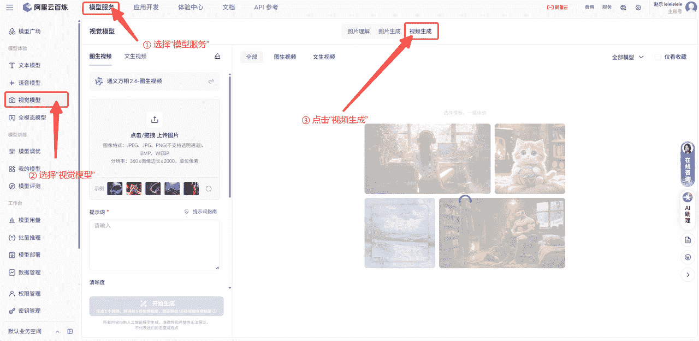

注意事项：

+   禁止出现抄袭、侵权、内容违法违规或内容完全偏离主题的情况
+   不可出现使用商标的情况（ 五环 / 其他动画IP）

## Step2：详细描述你的想法，生成AI 视频

从花样滑冰、短道速滑、高山滑雪、单板滑雪AI视频（官方比赛要求只能从中四选一）四种冬奥冰雪运动项目中选择一项创作，输入提示词，详细描述你的想法，生成5s的视频

推荐使用`wan2.6`来创作，注意视频尺寸必须为16:9，时长为5s（不能多 不能少）

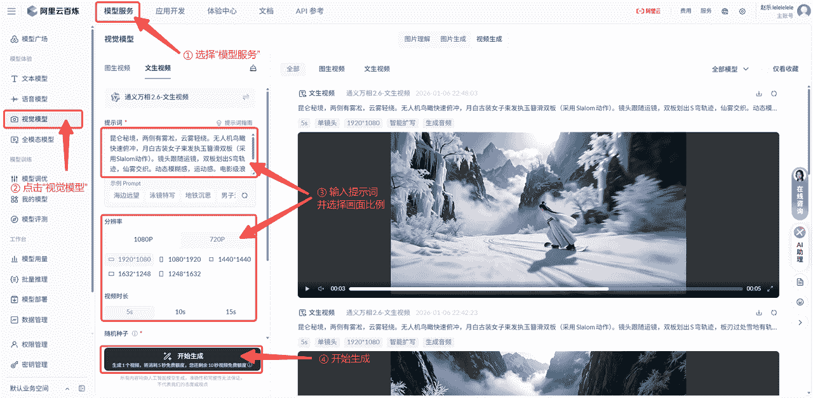

> demo视频提示词不作为参赛作品参考内容（请根据自己的想法去创作）

> 此次比赛每人仅可提交一次且不可再次修改提交，请好好打磨作品

> 冬奥会创意视频创作技巧请查看`https://ai.feishu.cn/wiki/WCp1wdih0iq8aQkWrUXcyuz4nLf#share-U4R1dd1ego440ZxsFnAcMwNnnff`

> 更多案例参考请查看`https://ai.feishu.cn/wiki/WCp1wdih0iq8aQkWrUXcyuz4nLf#share-CwaId68k9oRpERxFADEcyRd5nTb`

### 注意事项：

+   禁止出现抄袭、侵权、内容违法违规或内容完全偏离主题的情况
+   不可出现使用商标的情况（ 五环 / 其他动画IP）
+   此次比赛每人仅可提交一次且不可再次修改提交
+   必须提交5s的视频，尺寸是16:9，不可超过5s或者少于5s，不可提交图片
+   必须围绕冬奥会主题，必须是从花样滑冰、短道速滑、高山滑雪、单板滑雪四种运动，四选一，不能创作其他作品
+   AI视频作品必须提交至🧣/抖音/📕平台，三选一，且设置公开可见，不可提交至其他社交媒体平台
+   不能出现一些不雅致的镜头/画面

## Step3：社媒分享&[提交作品](https://summit.aliyun.com/aigcchampionship/submit?formId=7043)，填写姓名时候务必加上`dw`

1.  注意必须保证AI视频作品符合要求（没有抄袭/没有穿帮变形等技术硬伤等内容，具体可以看注意事项）
2.  发布至微博/抖音/📕：将满意的AI视频作品下载保存，然后带话题#阿里云米兰冬奥会AIGC全球大赛 #datawhale 在社交媒体（🧣、抖音、📕）发布AI视频作品，设置内容公开可见，并保存作品发布链接（注意话题不可直接复制，需要手打“#”）

PS：在社交媒体发布AI视频作品的时候可以介绍下自己的作品哦，比如亮点是什么/参赛感受哦！

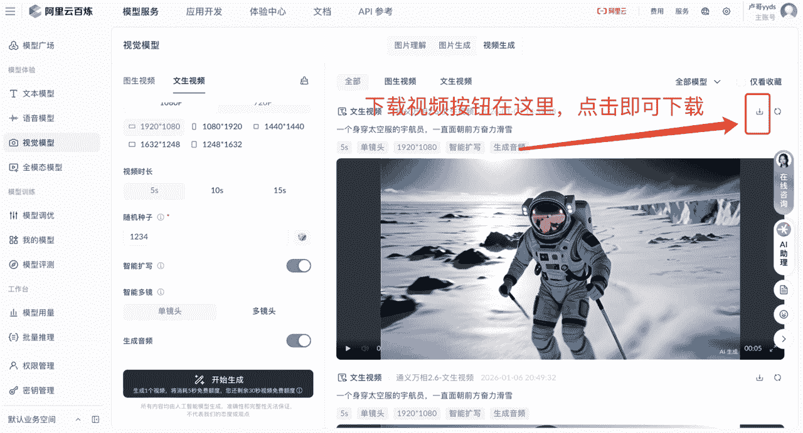

3.  填写比赛官方作品提交表单`https://summit.aliyun.com/aigcchampionship/submit?formId=7043`，即为参赛成功

填写内容包括：姓名、参赛形式

**重点：‼️填写姓名时候务必加上`dw`，否则无法参与Datawhale红包瓜分活动，注意此次比赛每人仅可提交一次且不可再次修改提交**

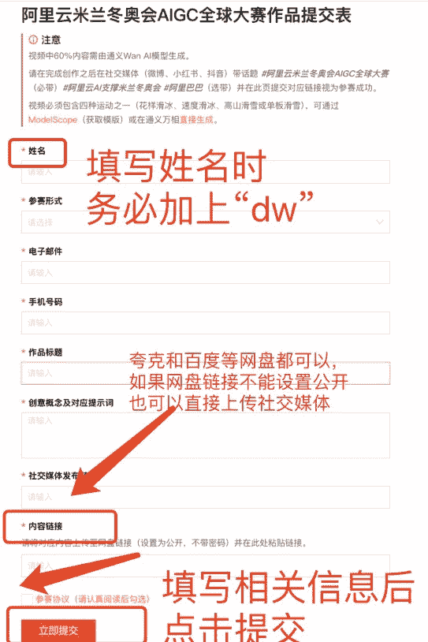

## Step4：快来[打卡](https://www.datawhale.cn/form/detail/302)

👉作品投稿成功比赛，保存成功提交作品的截图后，别忘了来打卡哦

👉必须保证AI视频作品符合要求（没有穿帮变形等技术硬伤）‼️‼️

作品打卡链接：`https://www.datawhale.cn/form/detail/302`

## 来看看具体的案例case吧（仅供学习，请创作时候使用自己的想法，不可直接抄袭）

### 如果你想要滑雪运动感

> 阿尔卑斯山雪道，两侧雾凇冷杉覆着薄雪，蓝调时刻（蓝粉色时刻）。Follow Shot（镜头跟随），一位男生单板滑雪者（身穿橙色雪服，身形利落，雪镜映着雪道轮廓）进行卡宾式刻滑换刃，camera push into close-up（镜头推特写），换刃细节展现，有雪雾产生。运动感、动态感，凛冽清透，动感张力，呼吸感，利落飒爽，自由感。胶片颗粒质感，冷调电影感，柔焦雪雾边缘，高对比度明暗层次。

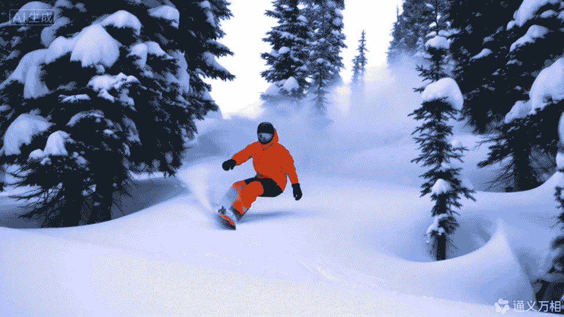

[Wan_视频生成_阿尔卑斯山雪道，两侧雾凇冷杉覆着薄雪，蓝调时刻（蓝粉色时刻）。跟随运镜，一位男生单板滑雪者（身穿橙色雪服，身形利落，雪镜映着雪道轮廓）进行卡宾.mp4](https://internal-api-drive-stream.feishu.cn/space/api/box/stream/download/all/Ez4UbSJDtog2frxUKjqc9rD7nKc)

### 如果你想要大运镜

> 新疆雪景，蓝调时刻。Non-Cut Master Shot（一镜到底），一位男生单板滑雪者（黑色雪服，紫色雪镜）冲向大跳台，腾空瞬间舒展身体完成抓板动作。camera 180 degree orbit tracking（镜头 180 度环绕追踪），定格雪板划破空气带起的雪雾。运动模糊感，张力十足。电影感，柔焦雪雾边缘，高对比度明暗层次。

[6aee45b26a2e4848ad39169f6a5a78a4.mp4](https://internal-api-drive-stream.feishu.cn/space/api/box/stream/download/all/FIkhbyrlWohAv7xbrjUclDjnnfb)

### 如果你偏重于环境

> 晨曦破晓时刻，雪道两侧有雾凇。无人机视角，鸟瞰镜头，迅速推进至滑雪运动员，跟随运镜。一位女生在滑双板，动作姿势为Super-G（超级大回转）。高山速降，双板划过的地方有雪雾产生。运动感，自由感。电影氛围，大师级叙事，决定性瞬间，高对比度，真实感。

[01f8aef87ee34e0e9440abfeea52448e.mp4](https://internal-api-drive-stream.feishu.cn/space/api/box/stream/download/all/Mvg1bCstxo1KfgxRyYTcTTx1n3e)

### 如果你想要变古装风格

> 昆仑秘境，两侧有雾凇，云雾轻绕。无人机鸟瞰快速俯冲，月白古装女子束发执玉簪滑双板（采用Slalom动作）。镜头跟随运镜，双板划出S弯轨迹，板刃过处冰晶碎裂，仙雾交织。动态模糊感，运动感。电影级浪漫，决定性瞬间。

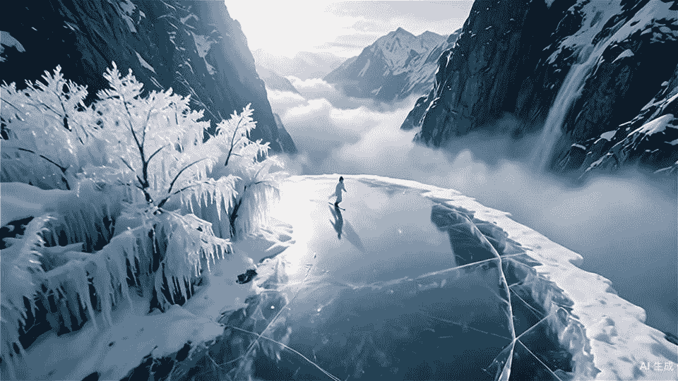

[23b4708e979b479fb271afe717d8077a.mp4](https://internal-api-drive-stream.feishu.cn/space/api/box/stream/download/all/Zb5sbDPf3orknzxwl4ecUvbvnGg)

### ‼️甚至，如果你想要大胆设想艺术风格

可以采用图生视频功能，生成喜欢的图片（不妨大胆一点），然后再根据图片内容生成炫酷的视频

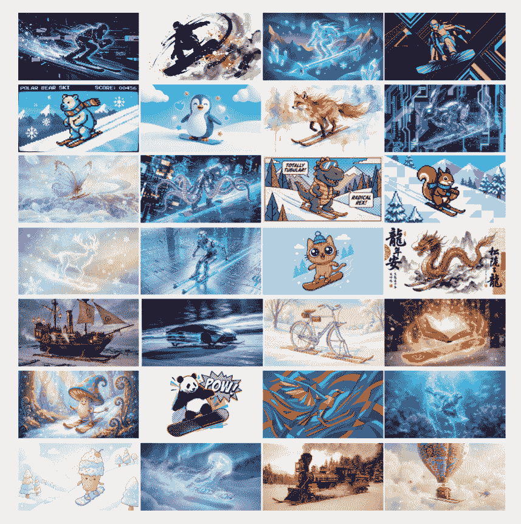

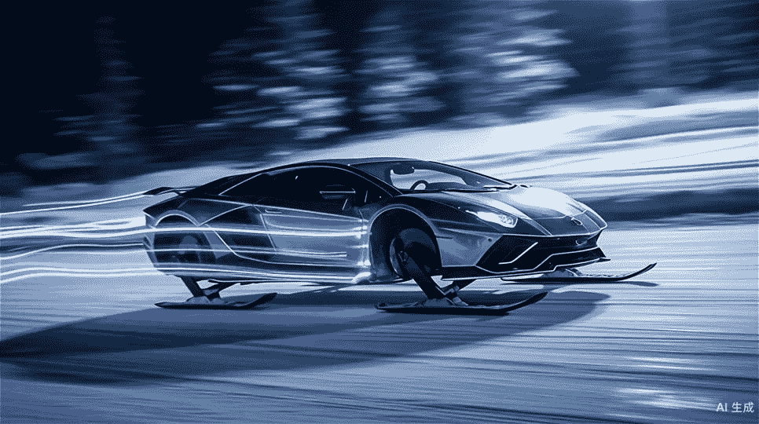

[a8400d7254954da3bc4c0d5cbb128fb8.mp4](https://internal-api-drive-stream.feishu.cn/space/api/box/stream/download/all/COwzbrxoioaLsgxbOHGc3E2ZnJe)

[b78064d30ef14724b32ebd7a0c1d9274.mp4](https://internal-api-drive-stream.feishu.cn/space/api/box/stream/download/all/S8ujb1QyxogW7hxKtJgcRkf8nSe)

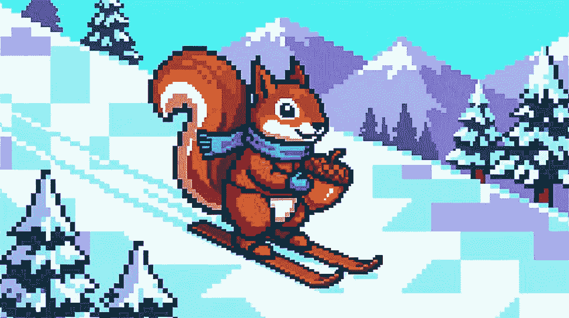

[63397f00051e4c98a7326dc928b87c90.mp4](https://internal-api-drive-stream.feishu.cn/space/api/box/stream/download/all/JJnobjGSooHWm1xSz6Jcxa2pnZb)

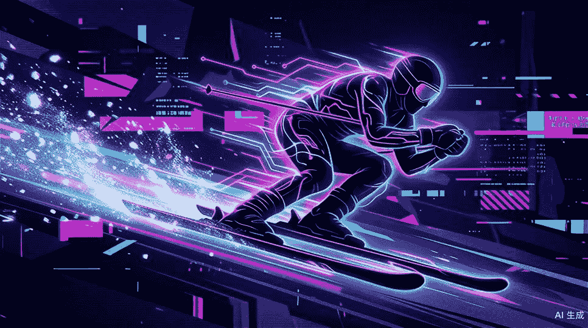

[fad2dee501fd4d7d9d2d2137ba976888.mp4](https://internal-api-drive-stream.feishu.cn/space/api/box/stream/download/all/EodmbVLMpoBeLpxwrHYctJbvnGc)

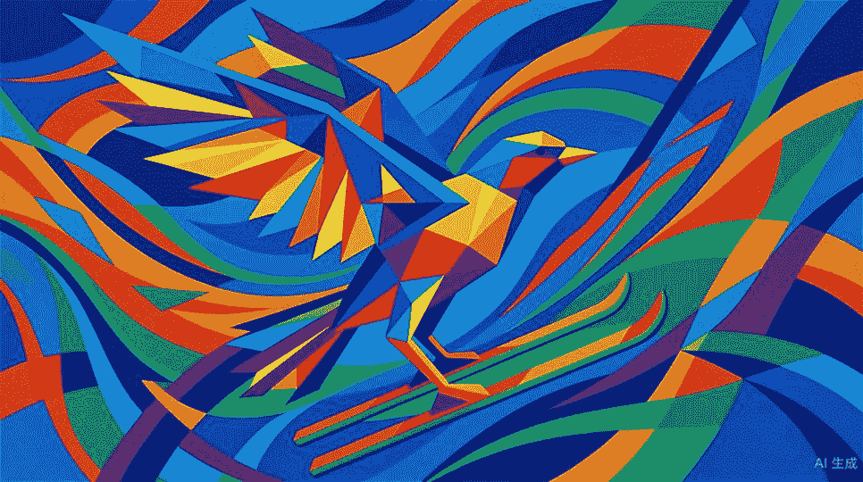

[d5d7733d194d4505bdc053598c1ec6aa.mp4](https://internal-api-drive-stream.feishu.cn/space/api/box/stream/download/all/NN1kbK0KgoSZG0xwoAzcLBBenpd)

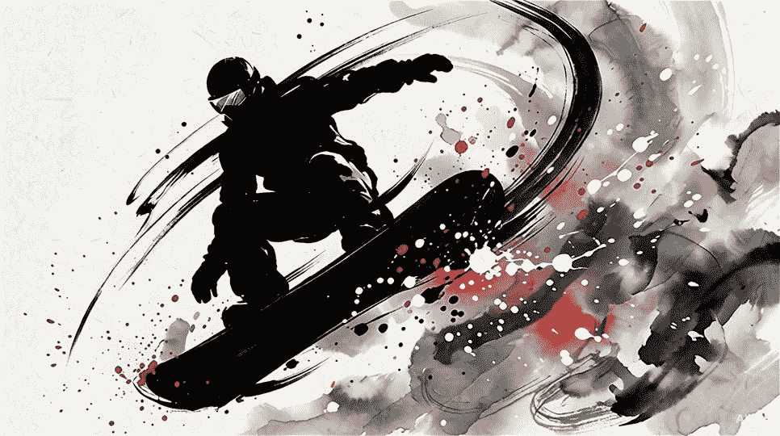

[9064da0091b448f8a56f0a7390602107.mp4](https://internal-api-drive-stream.feishu.cn/space/api/box/stream/download/all/DLmwbvY86or9QuxMq1LcxZ7NnIb)

## AI 视频生成提示词撰写 Tips

影视专业术语部分可直接用英文来写

所以涉及到有些专有名词或者影视行业的叫法，有英文辅助会更好一点，英文词汇会更丰富一点。

+   e.g. **开心的**，英文有七八种形容，其实略有区别。
+   e.g. **镜头往前推** 那到底是焦段放大的推（zoom in）还是轨道推（dolly in）还是手持推（handheld in），是有区别的

**提示词**最好包含：**主体**（主体描述）**+场景**（场景描述）**+运动**（运动描述）**+镜头语言**+**氛围词**+**风格化**

+   运镜方式：

| 中文术语 | 英文对应 | 核心效果与使用场景 |
| --- | --- | --- |
| 推镜头 | Dolly In / Push In | 镜头向主体靠近，突出细节 / 情绪（如角色惊讶时推近面部） |
| 拉镜头 | Dolly Out / Pull Out | 镜头远离主体，展现环境 / 氛围（如从角色面部拉远至全景，揭示所处场景） |
| 摇镜头 | Pan | 镜头水平转动（左右摇），展现横向场景（如从左到右扫过战场全景） |
| 移镜头 | Tracking Shot / Trucking Shot | 镜头沿水平方向移动（常配合轨道），跟随主体运动（如角色行走时，镜头平行移动跟随） |
| 跟镜头 | Follow Shot | 镜头全程跟随主体（可移动 / 旋转），强调主体动作连贯性（如角色奔跑时的跟拍） |
| 环绕镜头 | Orbital Shot / Circular Tracking | 镜头围绕主体 360° 旋转，增强沉浸感（如角色觉醒时，镜头环绕展现周围环境变化） |
| 升降镜头 | Crane Shot / Jib Shot | 镜头上下移动（靠摇臂 / 无人机），展现空间层次（如从地面升向天空，揭示城市全貌） |
| 手持镜头 | Handheld Shot | 镜头轻微抖动，模拟真实视角（如纪录片、紧张追逐场景） |
| 变焦镜头 | Zoom In / Zoom Out | 镜头焦距变化（非物理移动），拉近 / 拉远主体（注意：Dolly 是物理移动，Zoom 是焦距变化，AI 对两者区分敏感） |
| 一镜到底 | One-Take Shot / Non-Cut Master Shot | 无剪辑连续拍摄，增强叙事连贯性（如长镜头展现角色从房间走到街道的完整过程） |
| 跳切镜头 | Jump Cut | 同一主体的不连贯剪辑，制造跳跃感（如角色情绪突变时，用跳切强化对比） |

+   镜头角度：

| 中文术语 | 英文对应 | 核心效果与使用场景 |
| --- | --- | --- |
| 平视镜头 | Eye-Level Shot | 与主体视线平齐，中性视角（最常用，适合日常场景） |
| 俯视镜头 | High-Angle Shot | 从高处向下拍，弱化主体（如角色无助时，用俯视凸显渺小） |
| 仰视镜头 | Low-Angle Shot | 从低处向上拍，强化主体（如英雄登场时，用仰视凸显威严） |
| 鸟瞰镜头 | Bird’s-Eye View Shot | 极高角度俯视，展现全局（如战场、城市全景，强调规模） |
| 荷兰角度 / 倾斜镜头 | Dutch Angle / Canted Angle | 镜头倾斜（非水平），制造不安感（如悬疑、混乱场景，暗示角色内心失衡） |
| 主观镜头 | Point-of-View Shot (POV) | 模拟角色视角，增强代入感（如角色看到的画面，直接用 POV 呈现） |

AI视频生成模型的理解有“权重”

尽量把重要的提示词放前面，且整体精简表达，这样可以留出足够的空间给重要的内容

+   e.g. 光**不从正面**怼着人照，而是从人物旁边（大概 45 度方向）打过来，人脸会 “一半亮、一半暗”，暗的那半边脸上，会刚好露出一小块三角形的亮区。→ 这一大段对应着非常精简的词：“伦勃朗光”
+   e.g. **一边调镜头“放大画面”**，同时镜头往反方向退；或者反过来，镜头 “缩小画面”，机器往前凑。→ 这一大段对应着非常精简的词：“希区柯克变焦”

## 灵感参考案例【助力你激发想象】

注意本次比赛必须围绕冬奥会主题哦

+   创作基于花样滑冰、短道速滑、高山滑雪、单板滑雪四项冬奥赛事运动的AI视频内容，选择一项运动进行AI视频生成
+   http://xhslink.com/o/3P04gHILLa4
+   http://xhslink.com/o/AyNV8a3WWwT
+   http://xhslink.com/o/7zYRjIeK9BQ
+   http://xhslink.com/o/5KuimhTsUWz
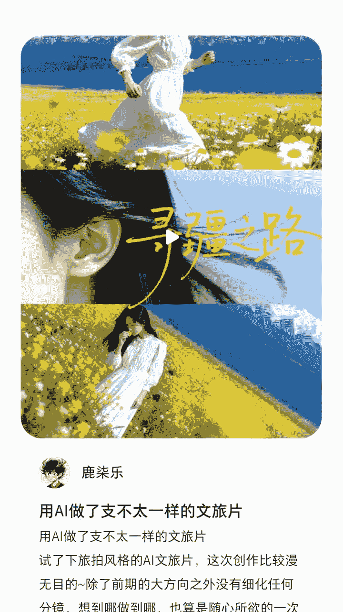
+   http://xhslink.com/o/61qrKJtGnHL

## 冬令营学习节奏

| 动作 | 时间 | 说明 | 直播 |
| --- | --- | --- | --- |
| AI视频创作学习&作品成果阶段 | 1月8日-1月12日 | 发挥你的创意实践，使用通义万相创作花样滑冰、短道速滑、高山滑雪、单板滑雪AI视频（四选一） | 赛事解读直播： |
| 优秀作品分享阶段 | 1月13日-1月15日 | 5-10个优秀作品分享-邀请入围者 | -时间：1月15日20:00 |

## 冬令营学习者激励

‼️奥林匹克博物馆作品展示的窗口期，在此之前提交的作品被展示概率越大哦（ps被展示不代表一定获奖，但也很牛了）

### 结营证书&实践证明

| 荣誉 | 完成整个学习可获得 |
| --- | --- |
| 结营证书 | 结营证书（电子版）由Datawhale颁发。 |
| 寒假实践证明 | 提供加盖公章的电子版文件。 |

## 大赛相关信息

大赛官网：[https://click.aliyun.com/m/1000409211/](https://click.aliyun.com/m/1000409211/)

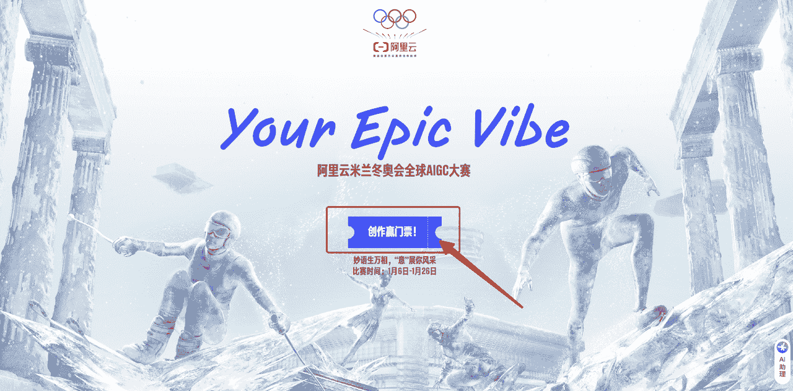

### 大赛背景

米兰冬奥会倒计时30天，阿里云携手国际奥委会开启「米兰冬奥会AIGC全球大赛」这是奥林匹克百年来首次邀请全球粉丝，用AI将你的名字载入史册！

❄️阿里云万相AI支持 YOUR EPIC VIBE“意展你风采”。米兰冬奥会办赛口号“IT's Your Vibe”，像是一份来自意大利的热忱邀约：让每个人都成为本届赛事的一部分。我们依托万相大模型将口号实景化，让每一位奥运迷的风采转化为EPIC VIBE，用一句提示词，瞬间生成高山滑雪、花滑等冬奥视觉大片。

✨ 即将诞生奥运史上首个由全球粉丝创作的AI作品。奥运史上首次，所有人的作品都有机会被奥林匹克博物馆首次收藏，并在洛桑、米兰、杭州多地全球巡展！还有丰厚奖金 & 米兰冬奥会门票等你赢取！参与比赛让世界看见你的热爱，让历史记住你的风采！

## 作品要求

- 作品要求：
- 作品主题：YOUR EPIC VIBE “意”展你风采
- 创作基于花样滑冰、短道速滑、高山滑雪、单板滑雪四项冬奥赛事运动的AI视频内容，选择一项运动进行AI视频生成
- 视频时长5s，视频为横板16:9
- 参赛者需使用通义万相作为主要创作工具（推荐使用`wan2.6`），视频需要60%以上时长内容由AI大模型生成，工具链接：
- [通义万相](https://tongyi.aliyun.com/wan/explore/?bd_vid=11262196419895029948)
- [魔搭AIGC专区](https://modelscope.cn/aigc/videoGeneration)
- [阿里云百炼](https://click.aliyun.com/m/1000409207/)（充值入口，如需充值有10元优惠券 [https://click.aliyun.com/m/1000409209/](https://click.aliyun.com/m/1000409209/)）

## 作品提交

- 作品提交方式：
- 在完成创作之后在社交媒体（🧣、抖音、📕）带话题#阿里云米兰冬奥会AIGC全球大赛#（必带）#阿里云AI支撑米兰冬奥会 #阿里巴巴（选带）并保存作品发布链接
- 在表单提交对应社交媒体链接，视为参赛成功。
- [报名&作品提交地址](https://summit.aliyun.com/aigcchampionship/submit?formId=7043)

## 大赛奖项设置

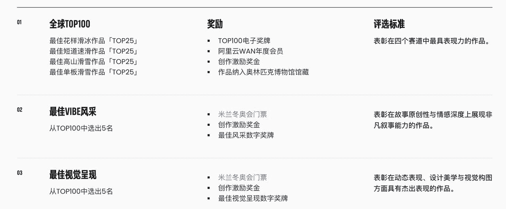
