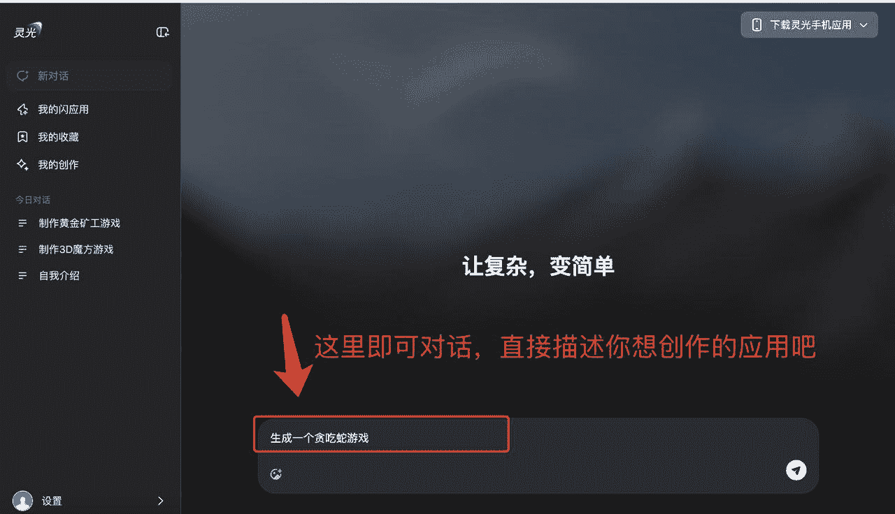
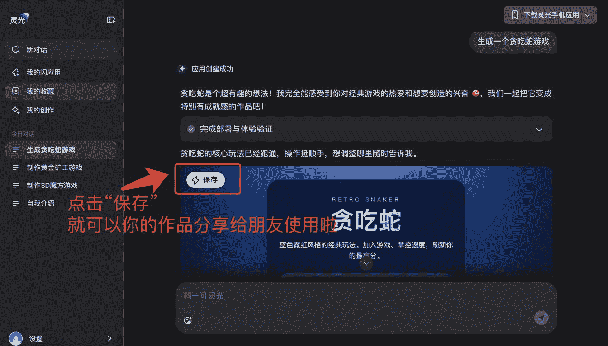
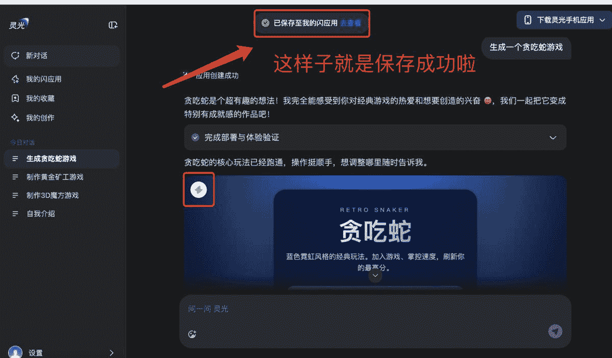
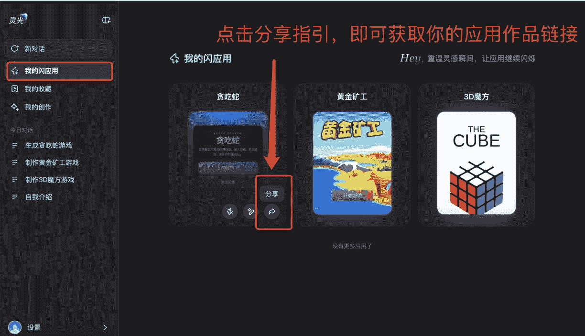
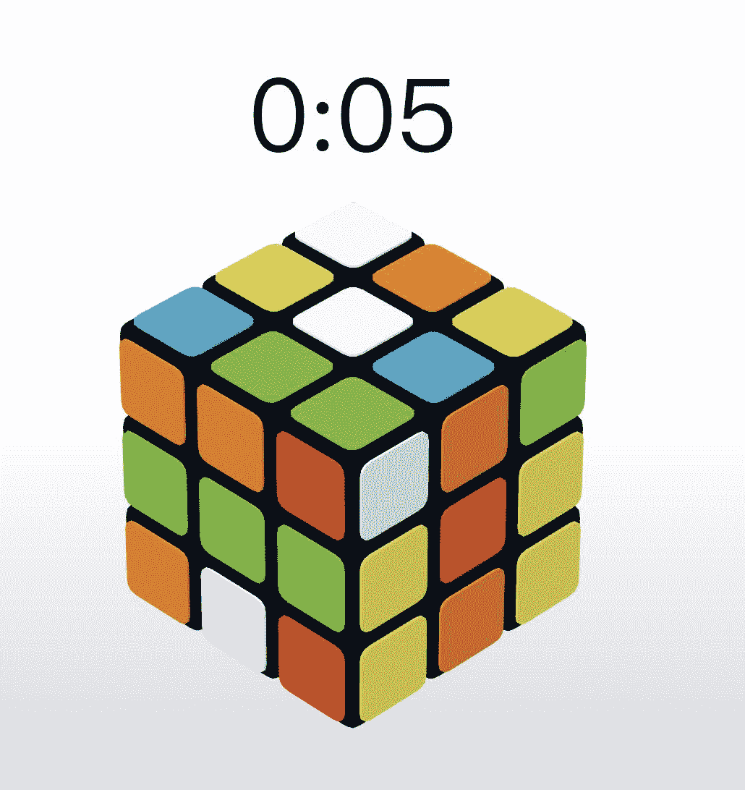
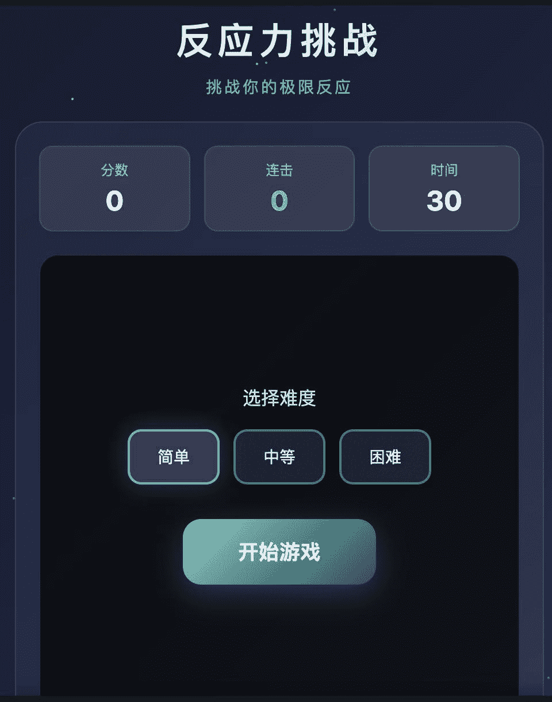
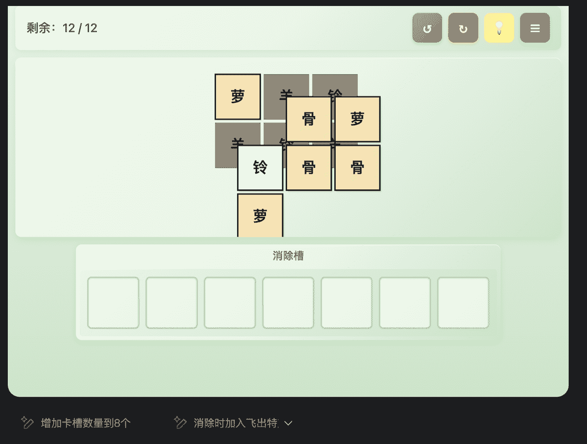
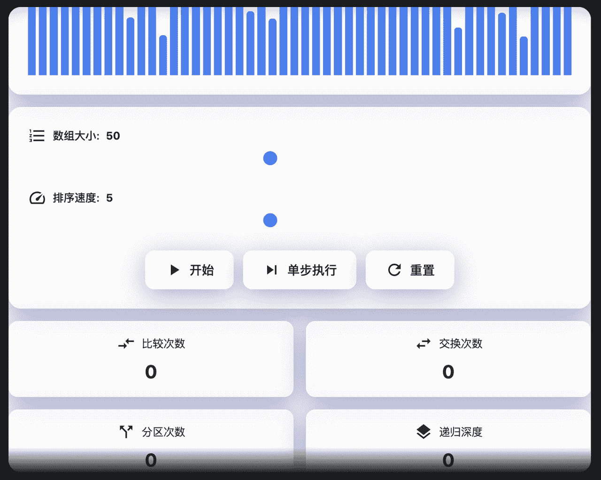
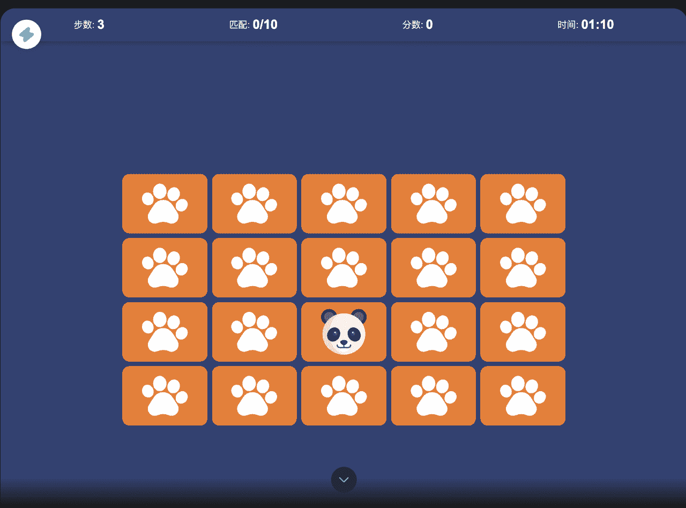

#  Everyone Coding-灵光闪应用创作共学活动

> 来源：[https://datawhaler.feishu.cn/docx/AvMidXx79om396xHVu7c7RiYnnz](https://datawhaler.feishu.cn/docx/AvMidXx79om396xHVu7c7RiYnnz)

# 活动目标：

[全民手搓灵光闪应用大赛](https://www.xiaohongshu.com/discovery/item/69280e9b000000000d03604f?source=webshare&xhsshare=pc_web&xsec_token=AB468HzEuw5opQKo8h5hcytZE7CLviMD49mSa7xfrCVW4=&xsec_source=pc_share)已开启，Datawhale发起本期创意实践，邀你一起发挥创意：

👉群内一起组队，思维碰撞

+   一个人创作很酷，但一群人debug，一起头脑风暴，快乐加倍

+   Everyone Coding的灵魂就是全民可用，一起创作有趣/好玩/有用的作品

+   建议组队不超过5人，互相督促和进步

+   组队每日打榜，瓜分Datawhale 500元现金红包

🔥【Day4核心玩法：交流会分享】

✅ 交流会参与方式：

- 时间：12月13日 21:00

- 地点：腾讯会议（后续公布链接）

- 报名分享：群内回复“报名分享+作品链接/📕链接”并@助教，锁定分享资格！

-打卡链接：https://datawhaler.feishu.cn/share/base/form/shrcn1sn2AeD22bo89N02W6LYef

# Step1-构思想法，一句话描述

+   点击灵光链接，直接对话创作应用：https://www.lingguang.com/chat

+   新对话：在对话框输入你的创意想法，一句话即可

+   如没有想法思路可参考这些[案例](https://datawhaler.feishu.cn/docx/AvMidXx79om396xHVu7c7RiYnnz#doxcns2xN3wyYMUzO9tX9WRD81c)，激发创意

想法构思方法：

> 学习/工作/生活中痛点 ——> 方案 ——> 一句话表述 ——> 生成有用的工具

# Step2-预计等待10分钟，应用创作完成，保存至“闪应用”

Step1:  点击“保存”按钮即可保存至“闪应用”，可以分享你的作品给朋友们玩哦

Step2:  点击“我的闪应用”，然后点击分享指引，即可复制你的应用作品链接

# Step3-快来[打卡](https://datawhaler.feishu.cn/share/base/form/shrcnNOeq3CtdG11rMtUu8a8Bic)，参与交流会分享！

👉DAY3:作**品打卡链接：h****ttps://datawhaler.feishu.cn/shar**e/base/form/shrcn1sn2AeD22bo89N02W6LYef

👉必须保证作品符合要求且应用可使用‼️‼️

# 作品墙

Day3作品墙：https://datawhaler.feishu.cn/share/base/view/shrcnQ4vrVj5WuuESuOCwPvbTzc

Day1作品墙：https://datawhaler.feishu.cn/share/base/view/shrcnzkSZzEYsfEt4NXXKoVqStd

Day2作品墙：https://datawhaler.feishu.cn/share/base/view/shrcnw9bFJBlthAyo1lUGoTOoLh

# 作品投稿📕Tips

+   将你的作品应用效果截图/或者录制作品视频发布至📕，并配上作品介绍（比如实现了哪些功能，可以怎么玩），更容易让大家看到和获得📕流量支持哦

+   投稿入口：[全民手搓AI闪应用](https://www.xiaohongshu.com/page/topics/6926b910023f000000000001?fullscreen=true&naviHidden=yes&themeType=default&id=6926b910023f000000000001&isUnicomKing=false&page_source=note_feed.click_new_big&rn_app=1&rn_deeplink=xhsdiscover%253A%252F%252Frn%252Fads-topic%252Fpage%253FthemeType%253Ddefault%2526id%253D6926b910023f000000000001%2526isUnicomKing%253Dfalse%2526page_source%253Dnote_feed.click_new_big&share_id=103b5c4066264f9f9a4420f0d4ad68cf&share_channel=wechat)[（点击链接即可跳转投](https://www.xiaohongshu.com/search_result?keyword=%25E5%2585%25A8%25E6%25B0%2591%25E6%2589%258B%25E6%2590%2593AI%25E9%2597%25AA%25E5%25BA%2594%25E7%2594%25A8&type=54&source=web_note_detail_r10)稿[，建议](https://www.xiaohongshu.com/search_result?keyword=%25E7%2581%25B5%25E5%2585%2589&type=54&source=web_note_detail_r10)手[机端打开），📕笔](https://www.xiaohongshu.com/search_result/?keyword=%25E7%2581%25B5%25E5%2585%2589&type=54&source=web_note_detail_r10)记并带[上话题 #全](https://www.xiaohongshu.com/user/profile/68f72753000000003101e76c?xsec_token=ABhbK1uyPgMOJzzGksHVYXrohv2YxEQECwT0kxu7IZSE0%3D&xsec_source=pc_note)民手搓AI闪应用 #灵光 #datawhale，并 @灵光App

# 一些简单的参考案例&Prompt分享【助力你激发想象】

PS：灵光也支持手机APP体验和创作应用，手机商城搜索灵光即可下载APP哦

### 3D魔方游戏

> 灵光应用创作入口：https://www.lingguang.com/chat

> 作品打卡链接：**https://datawhaler.feishu.cn/sha**re/base/form/shrcn1sn2AeD22bo89N02W6LYef

>

> prompt：做个3D魔方游戏

### 反应力测试工具

> 灵光应用创作入口：https://www.lingguang.com/chat

> 作品打卡链接：**https://datawhaler.feishu.cn/sha**re/base/form/shrcn1sn2AeD22bo89N02W6LYef

>

> prompt：做一个反应力测试小游戏，会显示你反应力时间

### 羊了个羊游戏

> 灵光应用创作入口：https://www.lingguang.com/chat

> 作品打卡链接：**https://datawhaler.feishu.cn/sha**re/base/form/shrcn1sn2AeD22bo89N02W6LYef

>

> prompt：制作羊了个羊游戏

### 快速排序可视化演示

> 灵光应用创作入口：https://www.lingguang.com/chat

> 作品打卡链接：**https://datawhaler.feishu.cn/sha**re/base/form/shrcn1sn2AeD22bo89N02W6LYef

>

> prompt：创建一个快速排序可视化演示网页，需具备动态柱状图展示排序过程，支持数组大小和排序速度调整，提供开始、暂停、单步执行和重置功能，实时显示比较、交换、分区次数及递归深度等统计数据，界面采用现代玻璃态设计，包含浅色/深色主题切换，整体视觉美观且交互友好

### 动物翻翻乐(记忆配对游戏)

> 灵光应用创作入口：https://www.lingguang.com/chat

> 作品打卡链接：**https://datawhaler.feishu.cn/sha**re/base/form/shrcn1sn2AeD22bo89N02W6LYef

>

> prompt：

> 记忆配对游戏（Memory Flip Game）玩法：翻牌配对相同图片；记录时间和步数；可选难度（4x4 / 6x6）。

### ‼️同济子豪兄开源案例：用灵光APP，把30个高中物理实验做成小游戏

> 视频：https://www.bilibili.com/video/BV13sS1BqE1e

> 灵光闪应用链接及提示词：[用AI把高中30个物理实验做成小游戏：应用链接及提示词](https://ai.feishu.cn/docx/Yfj9d52wdokPSgxMtNRc3nzmnnc)

# 活动时间安排

| 阶段 | 时间 | 说明 | 直播时间 |
| --- | --- | --- | --- |
| 作品成果&amp;每日打榜阶段 | 12月9日-12月12日 | +   发挥你的创意实践、将灵光闪应用生成玩起来 |  |
| 优秀作品分享阶段 | 12月13日-12月15日 | +   优秀作品经验分享 | 作品交流会（腾讯会议）：12月13日21:00 |