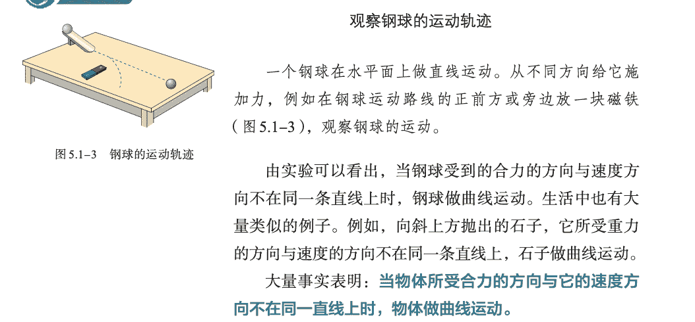

# 同济子豪兄直播分享

> 来源：[https://datawhaler.feishu.cn/docx/CI91dwopjoYMYzx4WIgcLmf5nUb](https://datawhaler.feishu.cn/docx/CI91dwopjoYMYzx4WIgcLmf5nUb)

> 同济子豪兄：[用AI把高中30个物理实验做成小游戏：应用链接及提示词](https://ai.feishu.cn/docx/Yfj9d52wdokPSgxMtNRc3nzmnnc?from=from_copylink)

同济子豪兄

2025-11-28

2025-11-29

2025-11-30

2025-12-1

# 视频教程

`https://www.bilibili.com/video/BV13sS1BqE1e`

# 灵光闪应用

## 甄选

- 光的折射定律（斯涅耳定律）和全反射  
  `https://www.lingguang.com/share/FLASH_APP-51fca4dc-1c54-4bef-a076-05e4e6fbee5f78`
- 波的干涉  
  `https://www.lingguang.com/share/FLASH_APP-821aa681-85bd-41ba-b270-f535fb4cda4878`
- 横波和纵波  
  `https://www.lingguang.com/share/FLASH_APP-92fdfdbf-384b-4e99-8daf-9b3577ac4a7478`
- 驻波  
  `https://www.lingguang.com/share/FLASH_APP-d819c683-d8fc-41b0-a150-938c0008474878`
- 两垂直简谐运动叠加形成的李萨如图形  
  `https://www.lingguang.com/share/FLASH_APP-56d657b5-742b-4b90-825e-83ca0838721f78`
- 多普勒效应  
  `https://www.lingguang.com/share/FLASH_APP-29deeb65-d541-4461-94cf-9e54c2046ee978`
- 弹簧振子的机械能守恒  
  `https://www.lingguang.com/share/FLASH_APP-00fbd341-b80c-4787-b7b3-9079d9eed9ca78`
- 气体扩散微观解释、热力学第二定律  
  `https://www.lingguang.com/share/FLASH_APP-47c8c3da-cd2a-4abf-992c-262d4ea5d98878`
- 卢瑟福的α粒子散射实验  
  `https://www.lingguang.com/share/FLASH_APP-44a0f52d-a155-49bf-82e8-9d48e2fded3486`

## 初中物理

- 凸透镜成像规律  
  `https://www.lingguang.com/share/FLASH_APP-bc2ff1f0-4ed0-48b2-aeca-011f7de4a31678`
- 机械能转化为内能  
  `https://www.lingguang.com/share/FLASH_APP-34e26846-c369-4c7c-b289-7111b622cfa986`
- 流体压强和流速的关系  
  `https://www.lingguang.com/share/FLASH_APP-2161eb2f-0448-4bbd-8799-db7e3680863278`

## 高中物理必修一

- 力的平行四边形法则  
  `https://www.lingguang.com/share/FLASH_APP-5a44bf04-1de7-461d-bc7f-34894dac184d86`
- 胡克定律（弹性定律）实验  
  `https://www.lingguang.com/share/FLASH_APP-17864893-b7a7-4c7a-8790-a3f96bd78e0686`

## 高中物理必修二

- 匀速圆周运动  
  `https://www.lingguang.com/share/FLASH_APP-c8194efd-8557-4d3b-bb20-99325536ccd386`
- 皮带轮线速度、角速度关系  
  `https://www.lingguang.com/share/FLASH_APP-69521682-f131-48c0-8aa1-20fb53fb1b2086`
- 弹簧振子的机械能守恒  
  `https://www.lingguang.com/share/FLASH_APP-37c45f91-8c7d-4f30-ac80-ff56e8d946b678`
- 过河的运动合成和分解  
  `https://www.lingguang.com/share/FLASH_APP-4e4f5ab0-9c45-4797-9924-bc42328328d278`
- 开普勒三定律  
  `https://www.lingguang.com/share/FLASH_APP-b3b0cd54-fade-4c19-8621-4ac47dd4579278`

## 高中物理必修三

- 欧姆定律微观解释  
  `https://www.lingguang.com/share/FLASH_APP-45809e1f-e8c9-497d-a609-c5e8cd06f6f178`

## 高中物理选修一

- 动量守恒（人船模型）  
  `https://www.lingguang.com/share/FLASH_APP-9537511d-1a81-40ca-8877-526f2e8c764d78`
- 横波和纵波  
  `https://www.lingguang.com/share/FLASH_APP-92fdfdbf-384b-4e99-8daf-9b3577ac4a7478`
- 波传播的独立性和波的叠加  
  `https://www.lingguang.com/share/FLASH_APP-69c9bc14-9f79-4203-9c39-3d156acfa35b78`
- 驻波  
  `https://www.lingguang.com/share/FLASH_APP-d819c683-d8fc-41b0-a150-938c0008474878`
- 波的干涉  
  `https://www.lingguang.com/share/FLASH_APP-821aa681-85bd-41ba-b270-f535fb4cda4878`
- 两垂直简谐运动叠加形成的李萨如图形  
  `https://www.lingguang.com/share/FLASH_APP-56d657b5-742b-4b90-825e-83ca0838721f78`
- 多普勒效应演示  
  `https://www.lingguang.com/share/FLASH_APP-29deeb65-d541-4461-94cf-9e54c2046ee978`
- 弹簧振子的机械能守恒  
  `https://www.lingguang.com/share/FLASH_APP-00fbd341-b80c-4787-b7b3-9079d9eed9ca78`
- 光的折射定律（斯涅耳定律）和全反射  
  `https://www.lingguang.com/share/FLASH_APP-51fca4dc-1c54-4bef-a076-05e4e6fbee5f78`

## 高中物理选修二

- 带电粒子在磁场中受洛伦兹力作匀速圆周运动  
  `https://www.lingguang.com/share/FLASH_APP-6ec9e4ba-5b7b-45c8-a33c-3936a6625d1a78`
- 霍尔效应  
  `https://www.lingguang.com/share/FLASH_APP-226faaac-1a52-4e8b-9de1-280221b6ec3078`
- 电容式话筒原理  
  `https://www.lingguang.com/share/FLASH_APP-267c56b5-163d-4d53-8f9b-0fe5734dc6a578`

## 高中物理选修三

- 气体压强的微观解释  
  `https://www.lingguang.com/share/FLASH_APP-268786e6-d881-48d9-9cb8-7fb1588e094f78`
- 气体的等温变化（波义耳定律）  
  `https://www.lingguang.com/share/FLASH_APP-e636b430-feab-44eb-bfe5-b1f545926dbe78`
- 理想气体状态方程  
  `https://www.lingguang.com/share/FLASH_APP-ae2da0a0-4198-43c3-9bcc-81435c2fb41c78`
- 气体扩散微观解释、热力学第二定律  
  `https://www.lingguang.com/share/FLASH_APP-47c8c3da-cd2a-4abf-992c-262d4ea5d98878`
- 卢瑟福的α粒子散射实验  
  `https://www.lingguang.com/share/FLASH_APP-44a0f52d-a155-49bf-82e8-9d48e2fded3486`
- `https://www.lingguang.com/share/FLASH_APP-ced29b63-aee1-4f4b-8942-ae94c60f830e78`
- `https://www.lingguang.com/share/FLASH_APP-bf219b4a-53d2-4c99-895c-1817e87c377f78`
- `https://www.lingguang.com/share/FLASH_APP-a9408569-8119-4d56-9772-98188caf9d0d78`

## 化学

- NaCl晶体结构（面心立方结构）
- 石墨晶体结构（六边形层状结构）  
  `https://www.lingguang.com/share/FLASH_APP-35feec91-41cf-49bf-a5f9-ac5bac3ff7ab78`

## 生物

- 细胞膜的流动镶嵌模型  
  `https://www.lingguang.com/share/FLASH_APP-26692e6f-3f88-4795-ba7e-d878fb631c3f86`

# 知识点

## 初中

- 凹面镜和凸面镜
- 凸透镜使光会聚，凹透镜使光发散
- 凸透镜成像的规律
- 力的三要素：大小、方向、作用点
- 惯性
- 液体压强
- 连通器
- 三峡船闸
- 托里拆利测量大气压的实验
- 马德堡半球实验
- 活塞式抽水机
- 流体压强与流速的关系（伯努利定律）
- 浮力定律
- 动能和势能相互转换
- 滚摆动能和势能的转化
- 单摆动能和势能的转化
- 杠杆原理
- 用钩码和尺子探索杠杆的平衡条件
- 省力杠杆和费力杠杆
- 光的折射：用户可调节入射角度、折射介质
- 光的散射
- 定滑轮
- 动滑轮
- 滑轮组
- 气体扩散实验
- 空气被压缩时内能增大
- 比热容
- 蒸汽机
- 四冲程汽油机
- 串联电路和并联电路
- 交互式电学模拟器，提供电源、开关、导线、小灯泡、电流表、电压表、滑动变阻器、电阻
- 影响电阻大小的因素
- 欧姆定律
- 伏安法测电阻
- 测量小灯泡的电功率
- 焦耳定律
- 家庭电路的组成：零线、火线、地线、保险丝、总开关、电能表
- 三线插头
- 安全用电
- 跨步电压
- 条形磁体、蹄形磁体、通电螺线管，磁场的分布
- 奥斯特实验
- 安培定则
- 电磁铁
- 电磁继电器
- 磁场对通电导线的作用
- 电动机
- 扬声器的原理
- 电磁感应
- 发电机的原理
- 电话话筒的原理
- 模拟通信和数字通信
- 光纤通信
- 核裂变的链式反应
- 核聚变的热核反应

## 高中物理必修一

- 打点计时器
- 匀变速直线运动，位移、速度、加速度与时间的关系
- 胡克定律：在弹簧下悬挂不同质量的钩码，记录弹簧在不同弹力下伸长的长度，并作出F-x图像
- 力合成和分解的平行四边形法则
- 共点力的平衡
- 牛顿第一定律：伽利略斜面实验
- 电梯超重和失重
- 三体运动
- 冰壶模拟器

## 高中物理必修二

- 物体所受合力方向与速度方向是否在同一直线，展示曲线运动的切向速度和法向速度
- 
- 用河里游泳演示运动的合成和分解
- 平抛运动、斜抛运动
- 圆周运动的线速度、角速度、向心加速度
- 圆周运动、离心运动、向心运动
- 两个不同半径的皮带轮的线速度和角速度关系
- 圆锥摆
- 汽车过拱形桥和凹形路面的受力分析
- 开普勒三定律
- 火星的逆行
- 卡文迪许扭秤实验
- 三个宇宙速度
- 相对论的钟慢效应和尺缩效应
- 机械能守恒定律
- 动能定理

## 高中物理必修三

- 静电感应
- 验电器
- 密立根油滴实验测量元电荷
- 库仑定律
- 库仑扭秤
- 电场线
- 尖端放电
- 静电屏蔽
- 电容器的充、放电
- 带电粒子在电场中的偏转
- 示波管的原理
- 范德格拉夫静电加速器
- 导体电阻与长度、横截面积和材料的定量关系
- 伏安特性曲线
- 游标卡尺的使用
- 螺旋测微器的使用
- 测量干电池的电动势和内阻
- 奥斯特实验，电流的磁效应
- 磁感线
- 直线电流的磁感线分布
- 磁体对通电导线产生作用力
- 安培定则
- 磁通量
- 电磁感应
- 电磁波的产生与传播
- 电磁波波速、波长和频率的关系

## 高中物理选修一

- 动量定理
- 动量守恒定律
- 弹簧振子的简谐运动，并绘制位移、速度、加速度、动能、机械能、回复力、随时间的变化图像
- 简谐运动的振幅、周期、频率、相位
- 单摆周期与摆长的关系：用户可调节摆长、摆球质量、初始偏角，实时计算摆动周期
- 阻尼振动
- 共振
- 横波和纵波
- 波的反射、折射和衍射
- 波传播的独立性和波的叠加
- 一维波的干涉
- 二维波的干涉
- 多普勒效应
- 光的折射定律
- 光的全反射
- 光导纤维
- 光的双缝干涉
- 光的单缝衍射
- 泊松亮斑
- 光的偏振
- 激光制冷的原理

## 高中物理选修二

- 磁场对通电导线的作用力（安培力）
- 磁电式电流表
- 电子束在磁场中的偏转
- 洛伦兹力
- 带电粒子在匀强磁场中的运动，匀速圆周运动的半径和周期
- 质谱仪的工作原理
- 回旋加速器的工作原理
- 楞次定律和右手定则
- 法拉第电磁感应定律
- 涡流
- 电子感应加速器
- 电磁阻尼
- 交流感应电动机
- 互感（变压器）
- 自感
- 交变电流的峰值和有效值
- 变压器：原线圈、副线圈，电压与匝数的关系
- LC振荡电路
- 变化的磁场产生电场
- 变化的电场产生磁场
- 做正弦变化的电场或磁场所引起的电磁波沿z轴传播，电场强度E与磁感应强度B互相垂直，而且二者均与波的传播方向垂直
- 赫兹放电实验，发射和接受电磁波
- 无线电波的发射，由LC振荡电路的闭合电路变成开放电路
- 调频和调幅
- 无线电波的接收，调谐电路
- 电磁波谱
- 干簧管
- 热电偶温度计
- 电容式话筒
- 光敏电阻
- 光电技术
- 热敏电阻
- 基于热敏电阻的液位报警器
- 电阻应变片
- 霍尔效应
- 布朗运动
- 分子间作用力、分子势能，与分子间距离的关系
- 用油膜法估测油酸分子的大小
- 气体压强的微观解释，气体分子热运动，与器壁发生碰撞，对器壁产生力
- 气体的等温变化（波义尔定律）
- 气体的等压变化和等容变化
- 理想气体状态方程
- 金刚石的微观结构
- 食盐晶体的微观结构
- 石墨的微观结构
- 液体的表面张力
- 浸润和不浸润
- 毛细现象
- 热力学第一定律
- 热力学第二定律
- 一个容器被隔板分为左右两部分，左边有一定量气体，右边为真空，抽取隔板后，气体分子分布。用来演示熵增加原理。
- 黑体辐射
- 光电效应
- 康普顿效应和光子的动量
- 光的波粒二象性
- 汤姆孙的气体放电管
- 密立根油滴实验
- 卢瑟福的α粒子散射实验
- 玻尔原子理论
- 测不准原理
- 核裂变和核聚变
- 链式反应

## 高中化学

- 粗盐提纯
- 丁达尔效应
- 铜锌原电池
- 电解氯化铜溶液
- 钢铁的吸氧腐蚀
- 牺牲阳极法和外加电流法
- 水分子之间的氢键

## 高中数学

- 平方平均数 算术平均数 几何平均数 调和平均数

## 高中生物

- 大肠杆菌细胞
- 蓝细菌细胞
- 多肽链到蛋白质
- DNA双螺旋结构
- 磷脂双分子层
- 细胞膜的流动镶嵌模型
- 植物细胞和动物细胞的亚显微结构图
- 分泌蛋白运到细胞外的过程
- 细胞核的结构
- 自由扩散和协助扩散
- 胞吞和胞吐
- 腺苷三磷酸ATP
- 细胞的有氧呼吸
- 光合作用的过程
- 有丝分裂
- 孟德尔豌豆杂交实验
- 形状分离
- 减数分裂
- 红绿色盲遗传图解
- DNA的半保留复制
- 转录和翻译
- 中心法则
- 反射弧
- 膝跳反射
- 神经冲动在神经纤维上产生和传导

# 灵光闪应用提示词

帮我做一个应用，通过三峡船闸，演示初中物理课本上的连通器

帮我做一个应用，演示初中物理课本上的凸透镜成像原理

帮我做一个应用，演示物理课本上的伯努利原理，也就是流体压强和流速的关系

帮我做一个应用，用冰上旋转的舞者，演示物理学中的角动量守恒

### 动能和势能相互转换

帮我做一个应用，演示物理概念，单摆，动能和势能相互转化，但机械能守恒

帮我做一个应用，演示物理概念：光的折射和全反射，用户可以手动修改入射角度和折射率

帮我做一个应用，演示物理课本上的概念：空气被压缩时内能增大

帮我做一个应用，演示托里拆利测量大气压的实验

帮我做一个应用，演示马德堡半球实验

帮我做一个应用，演示活塞式抽水机的原理，包含两个单向阀

帮我做一个应用，演示阿基米德的浮力定律

帮我做一个应用，演示物理学中的伏安法测电阻

帮我做一个应用，演示欧姆定律的微观解释

帮我做一个应用，演示物理学中的焦耳定律

帮我做一个应用，演示跨步电压的概念

帮我做一个应用，演示条形磁体、蹄形磁体、通电螺线管，磁场的分布

帮我做一个应用，演示奥斯特实验，也就是电流的磁效应

帮我做一个应用，演示安培定则，也就是右手定则

帮我做一个应用，演示电磁继电器的原理

帮我做一个应用，演示磁场对通电导线的作用

帮我做一个应用，演示电动机的原理

帮我做一个应用，演示电磁感应，也就是发电机的原理

帮我做一个应用，演示光在光纤通信中的全反射传播

帮我做一个应用，演示核裂变的链式反应

帮我做一个应用，演示匀变速直线运动，位移、速度、加速度与时间的关系

帮我做一个应用，演示胡克定律：在弹簧下悬挂不同质量的钩码，记录弹簧在不同弹力下伸长的长度，并作出F-x图像

帮我做一个应用，演示力合成和分解的平行四边形法则

帮我做一个应用，演示伽利略斜面实验，说明牛顿第一定律。用户可以调节小球滚下之前和之后的的坡度

帮我做一个应用，演示平抛运动

帮我做一个应用，演示匀速圆周运动的线速度、角速度、向心加速度

帮我做一个应用，演示两个不同半径的皮带轮的线速度和角速度关系

帮我做一个应用，演示汽车过拱形桥和凹形路面的受力分析

帮我做一个应用，演示开普勒三定律

帮我做一个应用，演示火星的逆行

# 物理演示应用需求列表

## 力学与运动
帮我做一个应用，演示卡文迪许扭秤实验

帮我做一个应用，演示三个宇宙速度

帮我做一个应用，演示相对论的钟慢效应和尺缩效应

帮我做一个应用，演示动能定理

帮我做一个应用，演示机械能守恒定律

帮我做一个应用，演示万有引力定律

帮我做一个应用，通过两个小球完全弹性碰撞，演示动量守恒定律

帮我做一个应用，通过人船模型，演示动量守恒定律

帮我做一个应用，演示弹簧振子的简谐运动，并绘制位移、速度、加速度、动能、机械能、回复力、随时间的变化图像

帮我做一个应用，演示单摆，用户可调节摆长、摆球质量、初始偏角，实时计算摆动周期

帮我做一个应用，演示伽利略斜面实验，说明牛顿第一定律。小球先滚下坡，后滚上坡，用户可以调节两个坡的角度，上坡的角度可以调到0

帮我做一个应用，用河里游泳演示运动的合成和分解

帮我做一个应用，演示牛顿第二定律

帮我做一个应用，演示核裂变和链式反应

帮我做一个应用，演示钱学森弹道

## 热学与分子动理论
帮我做一个应用，演示气体压强的微观解释，气体分子热运动，与器壁发生碰撞，对器壁产生力

帮我做一个应用，用容器壁里的分子小球，演示气体的等温变化（波义尔定律）

帮我做一个应用，用容器壁里的分子小球，演示理想气体状态方程

帮我做一个应用，一个容器被隔板分为左右两部分，左边有一定量气体，右边为真空，抽取隔板后，气体分子分布。用来演示热力学中的熵增加原理

## 电磁学与电路
帮我做一个应用，演示带电导体的电荷，靠近不带电导体时，产生静电感应

帮我做一个应用，演示验电器的原理

帮我做一个应用，演示尖端放电现象

帮我做一个应用，演示电容器的充放电现象

帮我做一个应用，演示带电粒子在电场中的偏转

帮我做一个应用，演示示波管的原理，并显示粒子运动轨迹

帮我做一个应用，演示范德格拉夫静电加速器的原理

帮我做一个应用，演示条形磁铁的磁感线

帮我做一个应用，演示磁通量和电磁感应

帮我做一个应用，演示电磁波的产生与传播

帮我做一个应用，演示楞次定律和右手定则

帮我做一个应用，演示法拉第电磁感应定律

帮我做一个应用，演示电磁感应产生涡流

帮我做一个应用，演示电子感应加速器的原理

帮我做一个应用，演示交流感应电动机的原理

帮我做一个应用，演示LC振荡电路

帮我做一个应用，演示做正弦变化的电场或磁场所引起的电磁波沿z轴传播，电场强度E与磁感应强度B互相垂直，而且二者均与波的传播方向垂直

帮我做一个应用，演示干簧管的原理

帮我做一个应用，演示热电偶温度计的原理

帮我做一个应用，演示电容式话筒的原理

帮我做一个应用，演示基于热敏电阻的液位报警器的原理

帮我做一个应用，演示霍尔效应的原理

帮我做一个应用，演示霍尔效应的微观原理，突出显示磁场中导体两端的正负电荷

帮我做一个应用，演示铜锌原电池

帮我做一个应用，演示电解氯化铜溶液

帮我做一个应用，演示钢铁的吸氧腐蚀

帮我做一个应用，演示牺牲阳极法和外加电流法

帮我做一个应用，演示电流的微观解释

## 光学与波动光学
帮我做一个应用，演示横波和纵波

帮我做一个应用，用一维波，演示波传播的独立性和波的叠加

帮我做一个应用，演示两个一维波的干涉，以及驻波

帮我做一个应用，演示水面两个波源的干涉，显示增强区和减弱区

帮我做一个应用，演示多普勒效应

帮我做一个应用，演示光的折射定律

帮我做一个应用，演示光的双缝干涉

帮我做一个应用，演示光的单缝衍射

帮我做一个应用，演示泊松亮斑

帮我做一个应用，演示光的偏振

帮我做一个应用，演示激光制冷的原理

帮我做一个应用，用两个相反方向的一维波，演示波传播的独立性和波的叠加

帮我做一个应用，演示物理概念：光的折射和全反射，用户可以手动修改入射角度和折射率，入射角度可以进一步增大，进入全反射

## 现代物理与量子力学
帮我做一个应用，演示质谱仪的工作原理，特别是带电粒子在磁场中受力旋转

帮我做一个应用，演示带电粒子在匀强磁场受到洛伦兹力，作匀速圆周运动的半径和周期

帮我做一个应用，演示回旋加速器的工作原理

帮我做一个应用，演示光电效应

帮我做一个应用，演示康普顿效应和光子的动量

帮我做一个应用，演示光的波粒二象性

帮我做一个应用，演示汤姆孙的气体放电管

帮我做一个应用，演示密立根油滴实验

帮我做一个应用，演示卢瑟福的α粒子散射实验，很多α粒子高速射向金箔，碰撞到金原子核的α粒子，会出现角度偏转

帮我做一个应用，演示玻尔原子理论

帮我做一个应用，演示量子力学的测不准原理

帮我做一个应用，演示泡利不相容原理

帮我做一个应用，演示构造原理与电子排布式

## 化学与材料
帮我做一个应用，演示用油膜法估测油酸分子的大小

帮我做一个应用，演示金刚石，食盐晶体，石墨的微观结构

帮我做一个应用，演示液体的表面张力

帮我做一个应用，演示水分子之间的氢键

帮我做一个应用，演示粗盐提纯的过程

帮我做一个应用，演示丁达尔效应

帮我做一个应用，演示水分子之间的氢键

帮我做一个应用，演示共价键

帮我做一个应用，演示共价键的σ 键和 π 键

帮我做一个应用，演示碳原子的sp杂化、sp2杂化、sp3杂化

帮我做一个应用，演示苯分子中的 σ 键和大 π 键

## 生物学
帮我做一个应用，演示DNA双螺旋结构

帮我做一个应用，演示细胞膜的流动镶嵌模型

帮我做一个应用，演示磷脂双分子层

帮我做一个应用，演示红绿色盲遗传图解

帮我做一个应用，演示DNA的半保留复制

帮我做一个应用，演示转录和翻译

帮我做一个应用，演示生物学的中心法则

帮我做一个应用，演示神经冲动在神经纤维上产生和传导

帮我做一个应用，演示神经元之间通过突触传递信息

## 数学与几何可视化
帮我做一个应用，画一个半圆，圆心为A点，向上的半径与圆的交点为B点，圆弧上的点为C点，C点向下与半径相交于D点，演示不等式关系：平方平均数 算术平均数 几何平均数 调和平均数

## 仪器与实验操作
帮我做一个应用，演示游标卡尺的使用

帮我做一个应用，演示螺旋测微器的使用

## 其他演示需求
帮我做一个应用，演示李萨如图形

帮我做一个应用，演示李萨如图形，用户可以选择不同的相位差，看到完整运动轨迹

帮我做一个应用，演示静摩擦力和动摩擦力

帮我做一个应用，演示凹透镜会让物体的像变窄

帮我做一个应用，演示救护车靠近我和驶离我时的多普勒效应

帮我做一个应用，演示物理课本里的单摆，用户可以调节摆球质量、摆长、阻力系数，并用曲线图展示动能、势能、机械能

帮我做一个应用，演示

帮我做一个应用，演示

帮我做一个应用，演示

帮我做一个应用，演示

帮我做一个应用，演示

帮我做一个应用，演示

帮我做一个应用，演示

帮我做一个应用，演示

帮我做一个应用，演示

帮我做一个应用，演示

帮我做一个应用，演示

帮我做一个应用，演示

帮我做一个应用，演示
