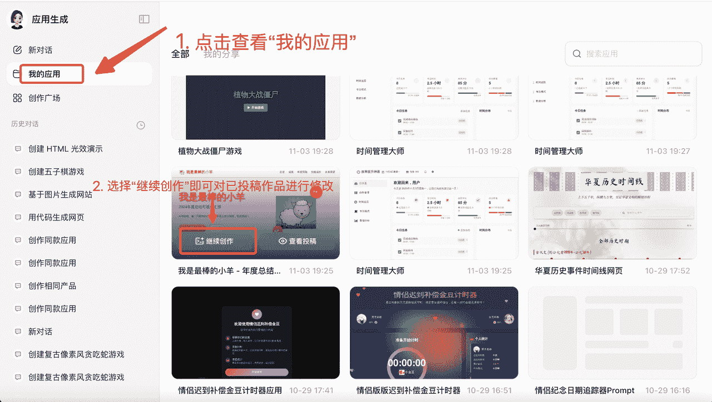
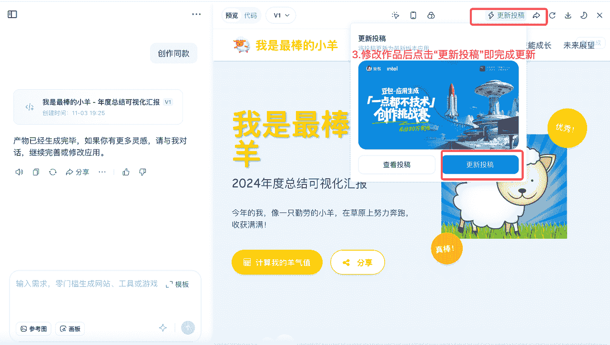

# 进阶学习，优化你的创意作品

> 来源：[https://datawhaler.feishu.cn/docx/OQgadOJyDoh0WyxAkGlcppQNnGb](https://datawhaler.feishu.cn/docx/OQgadOJyDoh0WyxAkGlcppQNnGb)

> Anthrotic：提示词工程入门

> 提示工程指南：https://www.promptingguide.ai/zh

> ‼️需求描述案例：[需求描述组合+案例学习](https://datawhaler.feishu.cn/wiki/YDoJw5AcRithh1kiICecrUbMnlc?from=from_copylink)

> 框架大体分三块: 所有prompt的结构，0～1如何做，1～10如何做

> 通用结构是大家背的最多的部分，这里我个人认为最重要的点是约束（让模型输出可控的，可后端解析的答案）和Cot，Cot我一般会直接让能力强的大模型输出，我自己check是否符合预期（这里建议选择国外模型，比如ChatGPT和gemini，国内模型还是不太能胜任）

> 0～1的prompt同理，我会把整个的业务目标，服务人群，想要的效果都丢给gemini，让他给我跑一个初版，注意这里的context要尽量充足（都做AIPM了这个肯定懂[暗中观察R]

> 1～10的迭代可能是业务里最常用的，但是大部分攻略没有提到的，总体思路是「定义标准，收集case，分析问题，控制变量修改，ABtest」，具体可以看p3和p4

可以分为三部分去拆解PE——通用知识、0~1和后续迭代

### 通用

> 五大核心结构：背景、任务、约束、思维链（COT）、Few-shot

1.  **背景**：role、background、profile、skills

+   a. 更好的了解目的、背景（Context Engineering）

+   b. 更好的激活MOE，将模型“置入”一个特定的知识领域和工作模式，减少不确定性，使其输出的口吻、侧重点符合预期。

1.  **任务**：goals

+   a. 产品经理需要足够清晰的指令、而不是类似于许愿、期许

1.  **约束**：constrains、outputform

+   a. 输出格式（json）、约束条件（不超过400字）

1.  **COT**

+   a. 让模型来生成，产品check

1.  **Few-shot**：为什么3-5个示例，而不是Many-Shot？

+   a. 上下文窗口限制、token消耗、成本

+   b. Many-Shot有可能会作为噪声，干扰模型对核心任务的理解，模型会“迷失”在细节中【注：Few-Shot是领悟，而非记忆】

+   c. Corner-case的处理策略：微调、RAG、迭代式prompt（任务拆分，拆分后每个部分是一个prompt节点）

> Prompt框架

>

> 系统提示词：

> 角色定位

> 任务目标

> 工作流程

> 输入信息

> 输出格式与结构

> 示例

> 核心原则

>

> 用户提示词：

> 任务目标

> 具体的输入文件/信息（对文件内容描述或类型）

> 请严格按照系统提示词中定义的步骤和原则完成任务：

> 工作流程

> 现在，请基于上述信息和数据，为我输出最终的 [目标文档/任务结果]：

### V1.0

+   给足context后，让模型来生成，产品通读、check（重点是约束、cot、few-shot）

### 后续迭代

> 总体思路：评估体系->测试case->微调修正->AB test

1.  **建立评估体系**：知道什么是“好”

+   a. 人工评估：建立一套评分标准（例如，从1-5分评估回答的准确性、相关性、流畅性），让标注团队或产品经理对不同版本Prompt的输出进行打分。

+   b. 自动化评估：

+   性能指标：对于信息提取等任务，评估关键字段是否被正确提取（四大金刚）

+   格式校验：如果要求输出JSON，可以通过程序校验其格式是否合法。

+   模型评估（Model-based Evaluation）：使用更强的模型（如GPT-4）来评估当前模型的输出质量，为参考。

+   c. 业务指标：将Prompt表现与最终业务指标挂钩。例如，由Prompt生成的营销文案，其点击率或转化率是多少。

1.  **收集和分析Bad Cases**

> “宝藏”都藏在失败的案例里。系统性地收集效果不佳的输出，并进行归类分析。

> - 失败类型归类：

> - 事实错误/幻觉：模型捏造了不存在的事实。

> - 指令遵循失败：没有遵守格式要求、字数限制等。

> - 逻辑不清/推理错误：在需要推理的步骤上出错。

> - 内容相关性差：回答偏离了主题。

>

1.  假设驱动的迭代实验（Hypothesis-Driven Iteration）

> 针对分析出的Bad Case类型，提出优化假设，并通过修改Prompt来验证。

+   指令微调（Instruction Tuning）：

+   假设：“模型经常遗漏要点，可能是因为‘总结’这个词太模糊。”

+   实验：将“总结以下文本”改为“从以下文本中，提取出最重要的5个核心观点，并用项目符号列出”。

+   优化示例（Few-Shot Example Optimization）：

+   假设：“模型在处理边缘案例时表现不佳，是因为Few-shot示例过于‘经典’。”

+   实验：在Few-shot中加入一个或多个之前失败过的、有挑战性的Bad Case作为新示例。

+   增加/强化约束（Constraint Strengthening）：

+   假设：“模型输出有时会包含主观评论，违反了客观性要求。”

+   实验：在Prompt中增加一条强硬的规则：“**[重要]** 你的回答必须完全基于原文，禁止进行任何形式的推断或评论。”

+   任务拆解（Task Decomposition）：

+   假设：“一次性要求模型完成‘总结-提取-评估’三个动作太复杂，导致表现不稳定。”

+   实验：将一个复杂的Prompt拆分成一个Prompt Chain。第一个Prompt负责“总结”，第二个Prompt基于总结的结果进行“提取”，第三个再进行“评估”。这样每一步更简单，整体效果更可控。

1.  进行A/B测试和版本管理

+   **A/B测试**：在真实流量中，将新旧两个版本的Prompt进行A/B测试，基于第一步建立的评估体系，用数据来决定哪个版本更优。

+   **版本控制**：像管理代码一样管理Prompt。使用Git等工具对Prompt进行版本控制，记录每一次变更的理由和实验结果，方便追溯和团队协作。

### 作品优化后如何重新提交参赛新版本？

📝 参赛 Tips：

🔍 功能可用性检查：为不影响您的评奖机会，请务必确保您提交的作品功能完整可用，如所有交互按钮、逻辑跳转等功能是否正常运行

🔄 作品修改迭代：若存在功能问题请及时修改更新，作品更新直接在原作品基础上即可，无需重新提交新作品，方式如下⬇️

💡 创作思路参考：如遇到创作问题，可参考使用指南💫 豆包编程 2.0[💫 豆包编程 2.0 使用指南](https://bytedance.larkoffice.com/wiki/PJg2wZ0vEirF2LkXVbecXJ3pnmh?source_type=message&from=message)使用指南使用指南中提供详细的功能说明和最佳实践，可结合示例进行创新和扩展

更多案例学习请查看：[需求描述组合+案例学习](https://datawhaler.feishu.cn/wiki/YDoJw5AcRithh1kiICecrUbMnlc?from=from_copylink)

作品优化投稿成功比赛后别忘了来打卡哦（👉必须保证作品符合要求且应用可使用）

+   作品打卡链接：https://datawhaler.feishu.cn/share/base/form/shrcn37MOOt0xxx3FerUi9EiZPe