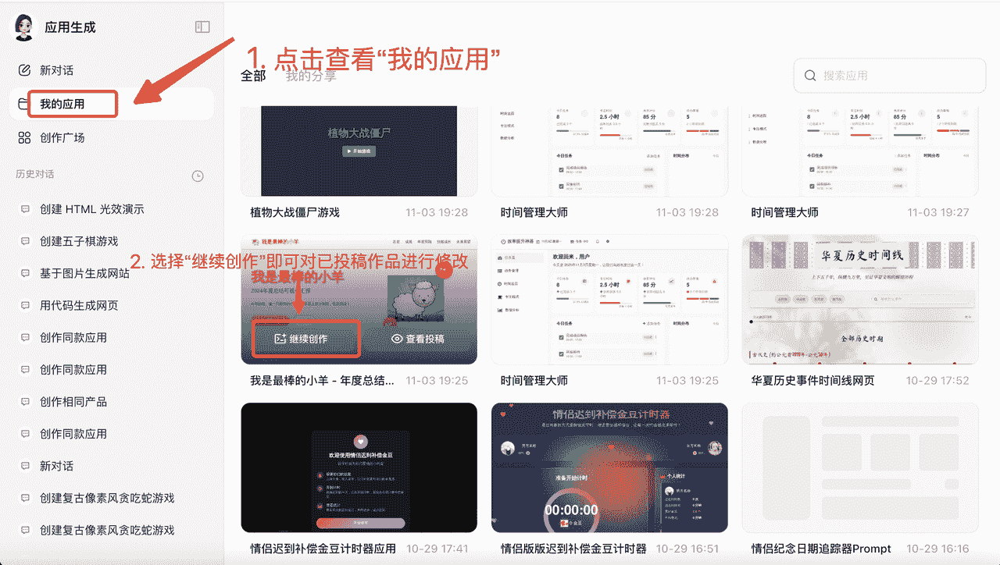
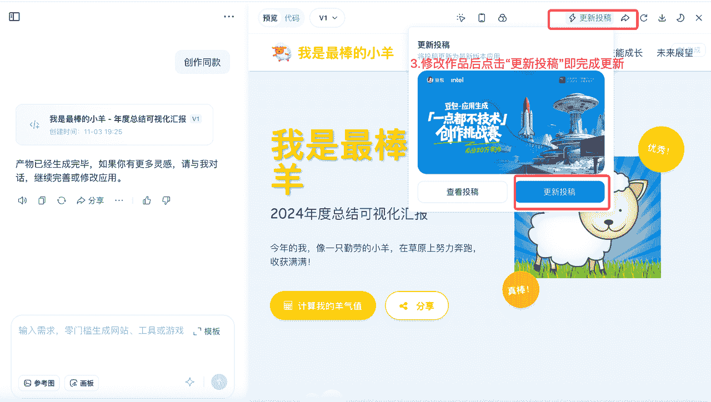

# 需求描述组合+案例学习

> 来源：[https://datawhaler.feishu.cn/docx/Oo6qd3BoboaoOVxxiemcJtYVnsh](https://datawhaler.feishu.cn/docx/Oo6qd3BoboaoOVxxiemcJtYVnsh)

## 💬 现在轮到你了！

请尝试用这个格式描述你的需求：

```
我要做一个给【        】用的【        】，
解决【        】的问题，
核心功能是【        】，
界面要【        】，
参考【        】
```

> 我要做一个给【航天爱好者、中小学生、科普工作者以及普通公众】用的【中国航天时间线科普网站/应用】，

> 解决【大众对中国航天发展历程缺乏系统、直观的了解和学习资源】的问题，

> 核心功能是【交互式时间轴、里程碑任务详情、图文/视频科普、关键词搜索、收藏与分享、事件筛选】，

> 界面要【星辰大海科幻感——深空星空背景、粒子特效、光晕、渐变色、全息投影感、响应式布局】，

> 参考【NASA官方时间线、SpaceX任务页面、中国国家航天局官网时间轴，以及《星际穿越》科幻 UI 设计】。

> 中国航天时间线科普网站：https://www.doubao.com/code/launch/detail/75617576194?from=from_launch_share_link

## 示例 1️⃣：健身教练工作台

> "我要做一个给**健身教练和私教工作室**用的**会员管理系统**，解决**学员训练计划跟踪困难、课程预约混乱、收费记录不清晰**的问题，核心功能是**学员档案管理+训练计划定制+课程预约日历+体测数据可视化+收费账单自动生成**，界面要**运动活力风+卡片式布局+数据图表展示**，参考**Keep的训练界面 + Calendly的预约系统 + 有赞的收银台**"

**适用场景：** 垂直行业SaaS

**开发难度：** ⭐⭐⭐⭐

**核心价值：** 替代Excel+微信的低效组合

---

## 示例 2️⃣：家庭食谱助手

> "我要做一个给**年轻上班族和全职妈妈**用的**智能食谱APP**，解决**不知道做什么菜、买菜总漏东西、食材过期浪费**的问题，核心功能是**AI菜谱推荐+食材清单自动生成+冰箱食材管理+营养分析+语音/图像识别食材**，界面要**温馨治愈风+下厨房的卡片流+马卡龙配色**，参考**下厨房的内容展示 + 小红书的交互体验 + 叮咚买菜的购物清单**"

**适用场景：** 生活方式类APP

**开发难度：** ⭐⭐⭐⭐⭐（含AI功能）

**核心价值：** 从"不知道吃什么"到"一键搞定晚餐"

---

## 示例 3️⃣：自由设计师接单平台

> "我要做一个给**平面设计师、插画师、UI设计师**用的**轻量级接单工具**，解决**客户需求沟通反复、改稿版本混乱、收款催款麻烦**的问题，核心功能是**项目需求表单+在线稿件预览评论+版本历史对比+合同模板生成+分阶段付款提醒+作品集展示页**，界面要**Dribbble的设计感+极简黑白灰+作品大图展示**，参考**Figma的评论系统 + Behance的作品展示 + Notion的数据库视图**"

**适用场景：** 创作者经济工具

**开发难度：** ⭐⭐⭐⭐

**核心价值：** 一站式解决接单全流程

---

## 示例 4️⃣：社区团购团长助手

> "我要做一个给**社区团购团长和小区宝妈**用的**团购管理小程序**，解决**订单统计费时、收款对账麻烦、配送分拣容易错**的问题，核心功能是**商品发布+接龙下单+自动统计汇总+微信收款记录+按楼栋/单元分拣清单打印+佣金自动计算**，界面要**微信小程序原生风格+操作简单大按钮+老年人也能用**，参考**群接龙的下单体验 + 拼多多的商品展示 + 美团优选的团长后台**"

**适用场景：** 微信生态工具

**开发难度：** ⭐⭐⭐

**核心价值：** 把Excel表格和手工记账自动化

---

## 示例 5️⃣：独立开发者产品分析看板

> "我要做一个给**独立开发者和小型SaaS创业者**用的**产品数据监控仪表盘**，解决**数据分散在多个平台、关键指标不直观、异常情况发现滞后**的问题，核心功能是**多平台数据聚合（Google Analytics + Stripe + Vercel等）+自定义指标看板+异常波动告警+周报月报自动生成+API接口对接**，界面要**科技感深色主题+数据可视化图表+仪表盘布局+实时数字跳动动画**，参考**Plausible的简洁数据展示 + Grafana的仪表盘 + Linear的现代UI + Stripe的报表设计**"

**适用场景：** 开发者工具/数据平台

**开发难度：** ⭐⭐⭐⭐⭐

**核心价值：** All-in-one产品健康监控中心

---

## 🎨 描述模式提取

从上述示例可以看出，好的需求描述遵循：

```
[目标用户] + [产品定位] + [核心痛点] + [必备功能] + [视觉风格] + [参考产品]
```

### 🔑 关键技巧：

1.  **用户要具体**

> ❌ "给大家用的"

> ✅ "给健身教练和私教工作室"

1.  **痛点要可感知**

> ❌ "效率不高"

> ✅ "Excel统计订单要2小时，容易算错"

1.  **功能要成体系**

> ❌ "有管理功能"

> ✅ "学员档案+训练计划+预约+收费"（完整闭环）

1.  **风格要有画面感**

> ❌ "好看的界面"

> ✅ "Keep的活力感+卡片布局+渐变色按钮"

1.  **参考要精准组合**

> ❌ "像微信"

> ✅ "Figma的评论 + Notion的数据库 + Behance的展示"

---

### 作品优化后如何重新提交参赛新版本？

📝 参赛 Tips：

🔍 功能可用性检查：为不影响您的评奖机会，请务必确保您提交的作品功能完整可用，如所有交互按钮、逻辑跳转等功能是否正常运行

🔄 作品修改迭代：若存在功能问题请及时修改更新，作品更新直接在原作品基础上即可，无需重新提交新作品，方式如下⬇️





💡 创作思路参考：如遇到创作问题，可参考使用指南💫 豆包编程 2.0[💫 豆包编程 2.0 使用指南](https://bytedance.larkoffice.com/wiki/PJg2wZ0vEirF2LkXVbecXJ3pnmh?source_type=message&from=message)使用指南使用指南中提供详细的功能说明和最佳实践，可结合示例进行创新和扩展

作品优化投稿成功比赛后别忘了来打卡哦（👉必须保证作品符合要求且应用可使用）

+   作品打卡链接：https://datawhaler.feishu.cn/share/base/form/shrcn37MOOt0xxx3FerUi9EiZPe