# 5个AI案例让你玩转“扣子空间”！

> 来源：[https://datawhaler.feishu.cn/docx/GqJVdMVPGooOUUxUq89cqkyVnkd](https://datawhaler.feishu.cn/docx/GqJVdMVPGooOUUxUq89cqkyVnkd)

校园生活不无聊，5 个 AI 案例让你玩转“扣子空间”！

+   扣子空间官网：https://www.coze.cn/s/kilDonYgjY0/

+   创意作品提交[作品提交&作品墙](https://datawhaler.feishu.cn/wiki/OfsdwN3qMihijHkGxvTcIrmqn0o?table=tblXuBohsBFs078A&view=vewKNY7wU4)

最近大家都在用 AI 整活。

比如：

+   宿舍同学用扣子空间一键生成了“**搞笑寝室守则海报**”，全楼疯传。

+   有社团用AI写了**Rap版招新文案**，直接在迎新晚会上表演，当晚就招满人。

+   有同学用扣子空间做了“**自动学习计划生成器**”，结果期末周大家都来抄他的表。

+   还有人搞了个“**MBTI恋爱匹配测试**”，一键生成结果图，全班同学都玩了。

....

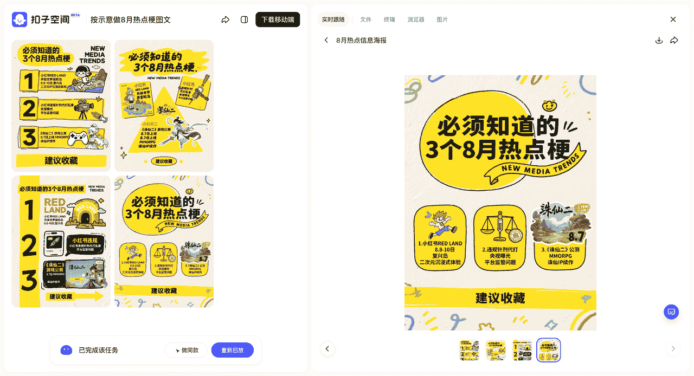

一键生成自媒体图文 （小红书/微信推文）

[撰写大理一月旅居攻略配图](https://space.coze.cn/share/7540341484442468642?share_id=7540345427229901094&secret=FznQKb35&from=home_case_list)

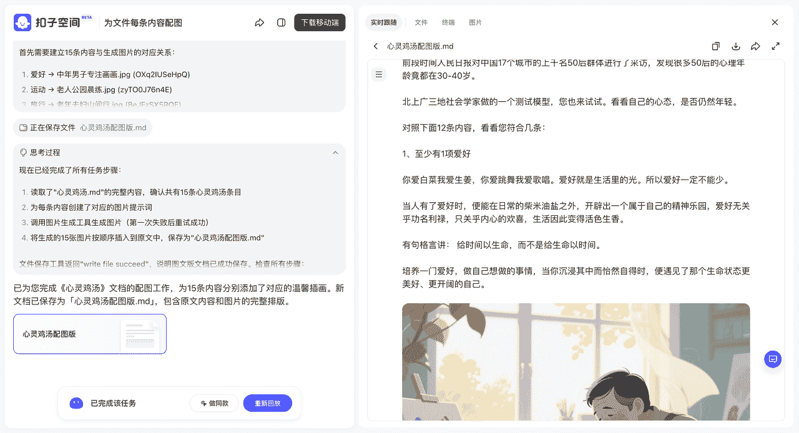

[为文件每条内容配图](https://space.coze.cn/share/7535375602087297319?share_id=7535375347459572002&secret=jBXbJHby)

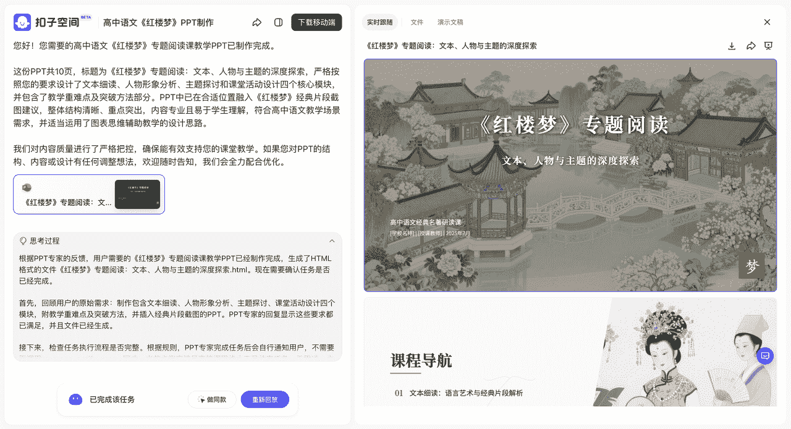

[高中语文《红楼梦》教学 PPT](https://space.coze.cn/share/7533215738195476745?share_id=7533221782913597748&secret=8UHrc2e3&from=home_case_list)

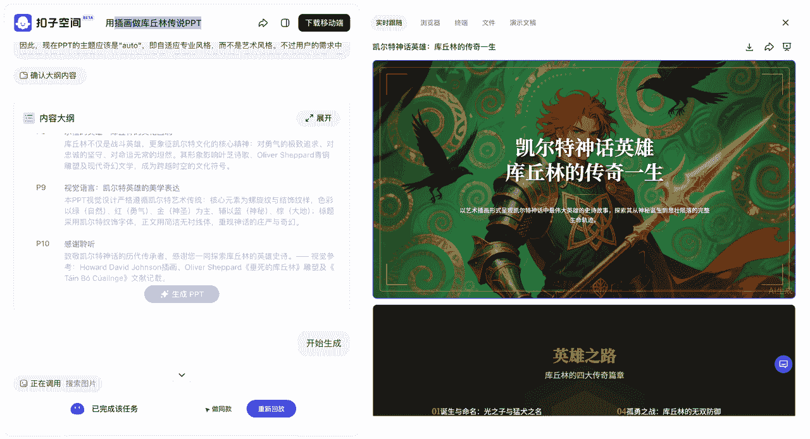

[插画做库丘林传说PPT](https://space.coze.cn/share/7535124480680558848?share_id=7535129680723149108&secret=5XJtxDCe)

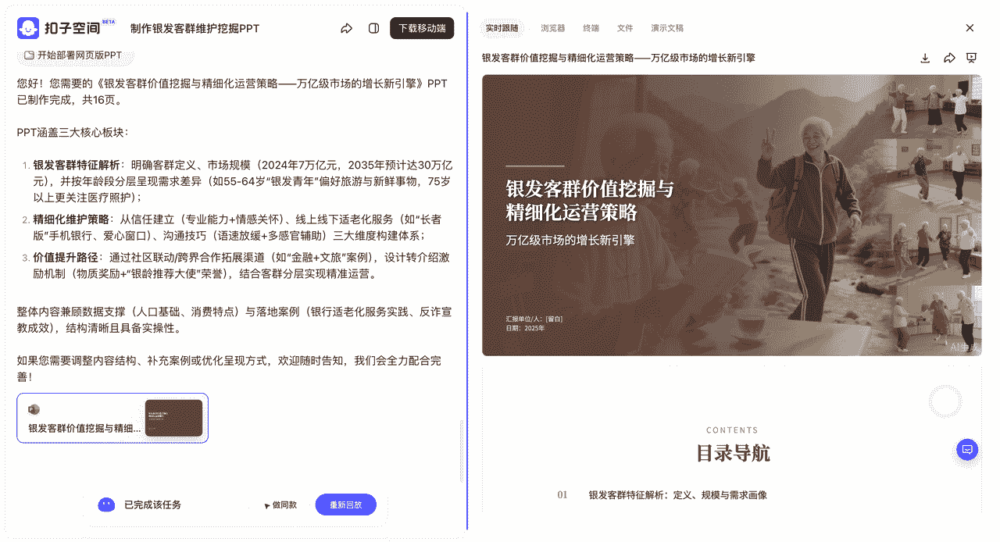

[制作银发客群维护挖掘PPT](https://space.coze.cn/share/7535083161823281446?share_id=7535085711121989907&secret=TFjkKX3V)

[甚至还有](https://space.coze.cn/share-coding-expert/7540640755552731446?share_id=7540968887719379200)很贴心的同学直接用扣子空间搭建出来一个开学清单

**这些看着**好玩，其实背后都用了一个宝藏平台 —— 扣子空间。

扣子空间官网：https://www.coze.cn/s/kilDonYgjY0/

你的 AI 学习工作空间，图文设计、写作、PPT、网页、数据处理、播客 ……都能搞定！

一句话就能出图、出文案、出网页、出音频，根本不需要会设计或代码，比PPT模板还简单，比稿更快出活。

**今天我就来分享** 5 个真实可落地的AI 整活案例，全部适配开学季场景，也都超适合在直播/社团/课堂上玩起来。

## 网页生成类：一人一主页，社团也能搞官网

想要一个展示自己的页面？不想写代码、不想套模板？AI 可以直接“生成网页”。

比如：

+   “我是摄影+电子音乐爱好者，帮我做个主页”

https://space.coze.cn/s/PuhBpzB5xVI/

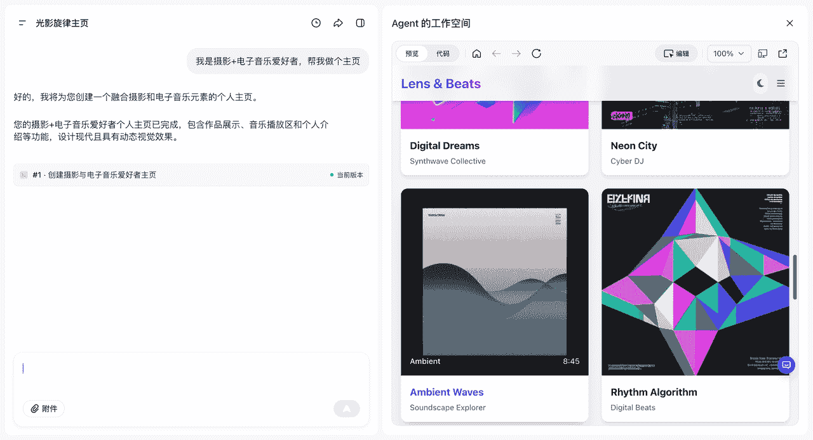

+   “我是产品小白，想做一个课程推荐导航”

https://space.coze.cn/s/gB3lC0y-bL4/

+   “我们是环保社团，要有活动照片和招新链接”

https://space.coze.cn/task/7540701293988839723

这些都能**实时生成网页结构和内容**，你点开就能用。

## 海报设计类：宣传页批量出图，谁还用PS？

开学活动多，宣传压力也大。

扣子空间里，海报设计不用自己画、不用拖模板，只要一句描述：

+   “开学音乐节活动，潮酷风”

https://space.coze.cn/s/QNYL_sGtXFc/

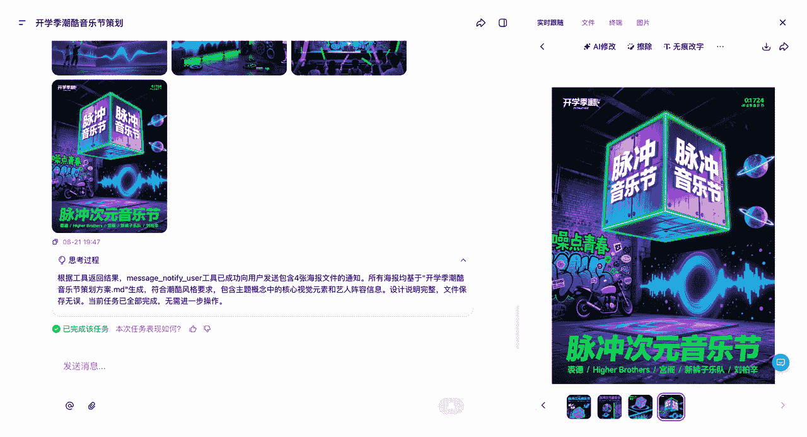

+   “图书馆阅读挑战，文艺风”

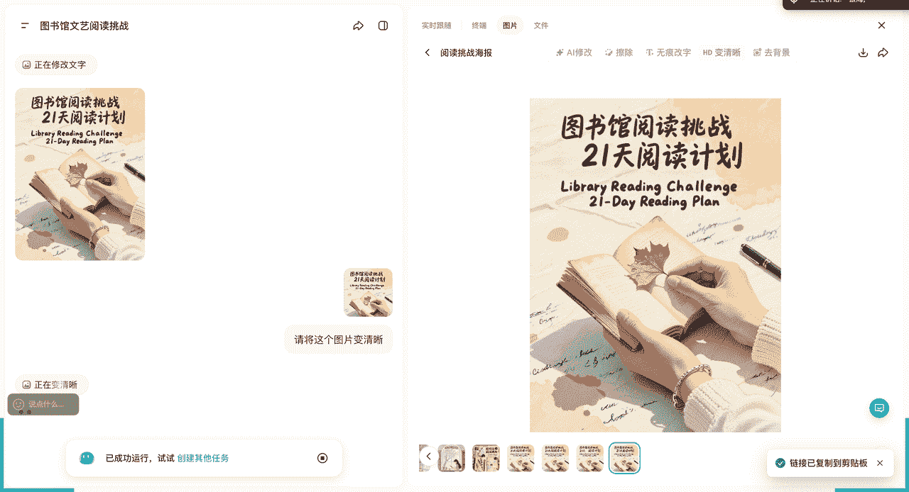

https://space.coze.cn/s/qYuyt0haYqY/

+   “反内卷联盟招新，朋克风”

直接帮你生成高质量视觉图，**风格自由切换，细节可以修改**。适合用来招新、发朋友圈、贴在教学楼门口。

## 播客生成类：你的开学故事，可以变成一段播客

播客是最“有情绪氛围”的表达方式。 而 AI 播客生成**，让写稿 + **配音 + 结构设计这件事，一次性自动搞定。

比如：

+   “讲讲大学生自己在暑假的提升指南”

https://space.coze.cn/share/7531987513914818857?share_id=7531989008937042218&secret=ncJEKSbe&from=home_case_list

+   “食堂排队时偶遇未来恋人”

+   “社团招新广播剧：穿越剧社的奇幻招新文案”

## PPT类：社团、学习、演讲都能一键生成

PPT 是大学生活动里的万金油，但手动做又慢又土。

在扣子空间，直接输入一句话，就能生成一份 结构完整、图文并茂的 PPT 草稿。

比如：

+   “我要做一个动漫社的招新展示”

https://space.coze.cn/s/b4beas6FB-M/

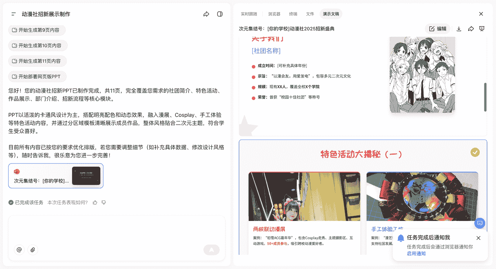

+   “我要一份摆烂型学习计划，学得少但看起来很努力”

https://space.coze.cn/s/lb93Vro_Ftc/

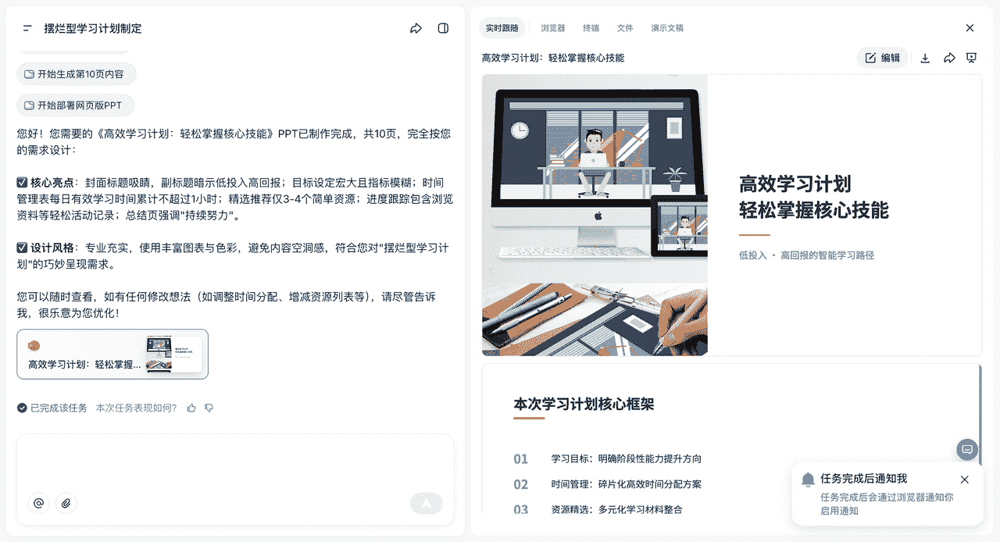

+   “我要给室友们演讲：为什么我们不该早起上早八”

https://space.coze.cn/s/lbX8W3abX40/

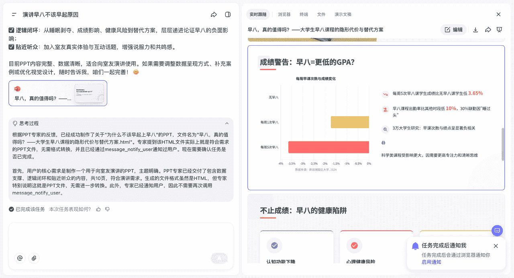

AI 都能帮你**几分钟生成一个“能看的版本”**，再稍微美化一下就能用了。节省的时间，正好去“摆烂”。

## 写作类：一分钟写出“最会整活”的自我介绍

你还在说「大家好我叫小张」？

别人已经用 AI 这样介绍自己了：

> “我是来自未来的时间管理大师，一天 24 小时，每小时都能拆成 8 段用。”

> “摸鱼协会现任副会长，主攻方向：水群、点外卖、研究拖延症。”

有没有觉得，**这个人一开口，全班都得记住他。**

https://space.coze.cn/s/0svYlPTfrMs/

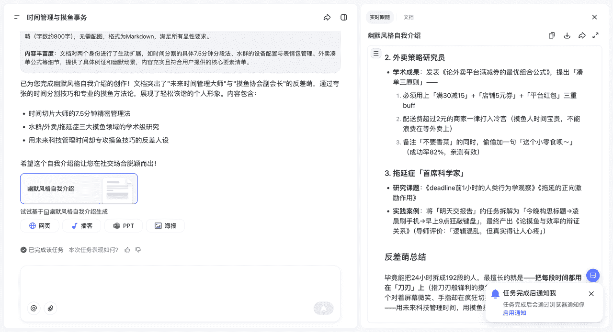

在扣子空间里，只要一句关键词，A**I 就能扩写成段子级的**爆笑介绍。不管你是社恐型、搞笑型、文艺型，都能找到属于你的人设。

**不但能帮你写故事、设**计角色、润色语气，还能一键转成语音播放。你只要点“播放”，整个播客剧场就开始上演。

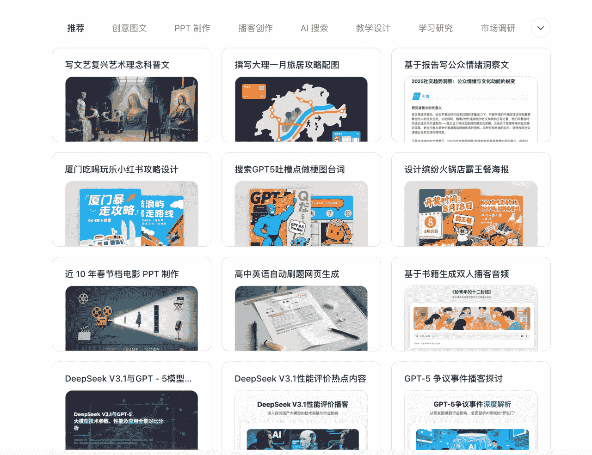

现在大学生之间都在拼谁会玩 AI，不是“会不会用工具”的问题，而是“你玩得够不够花”。

如果你也想试试这些玩法，或者你正在准备开学直播、社团活动、创意展示，那强烈建议来扣子空间整一个。

不然别人都用 AI 出播客了，你还在 PPT 里贴图表呢。