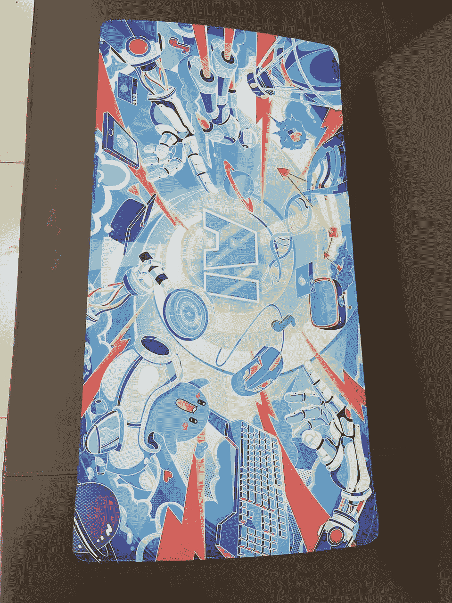
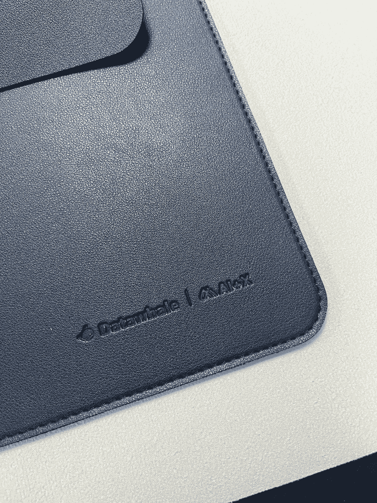
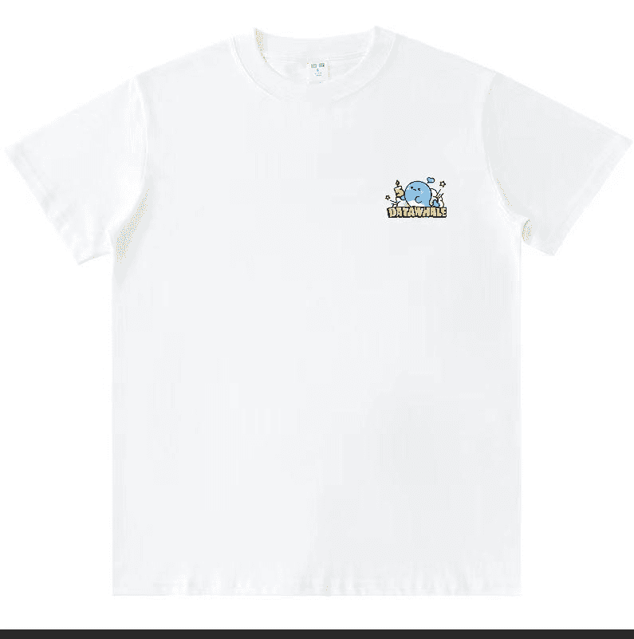
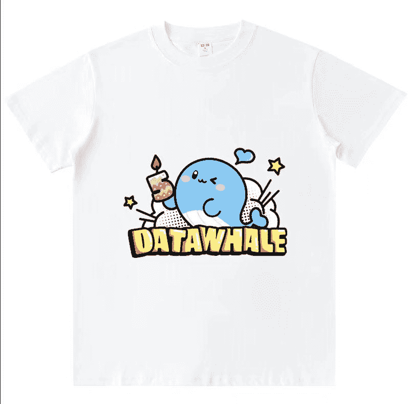
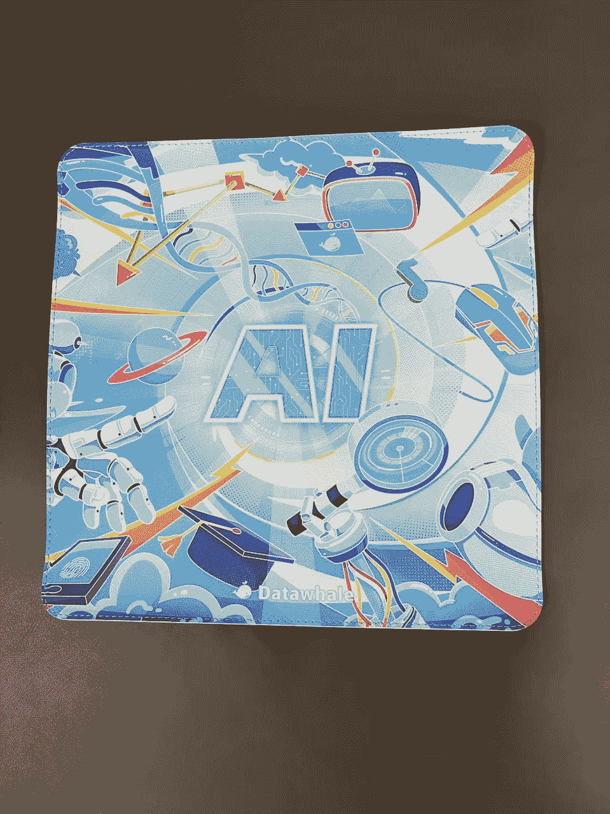
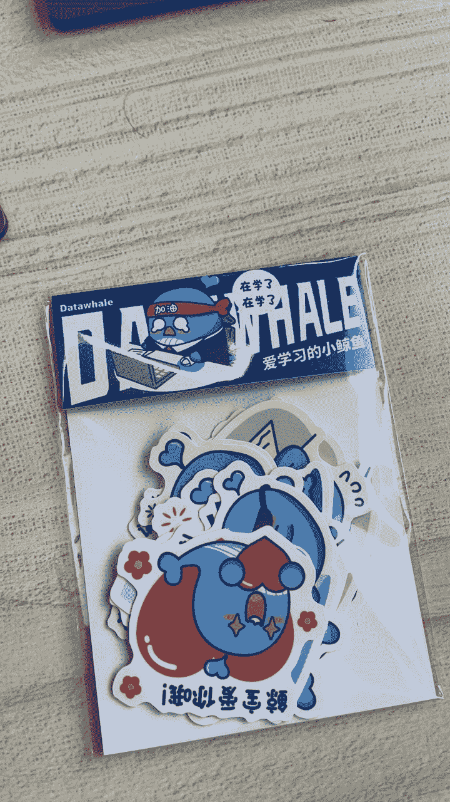
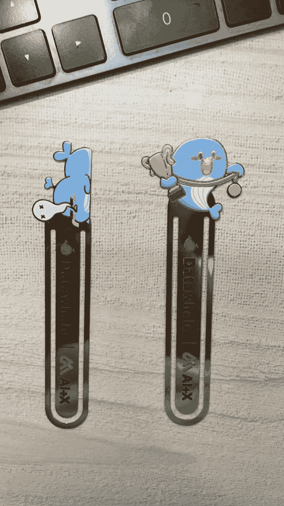
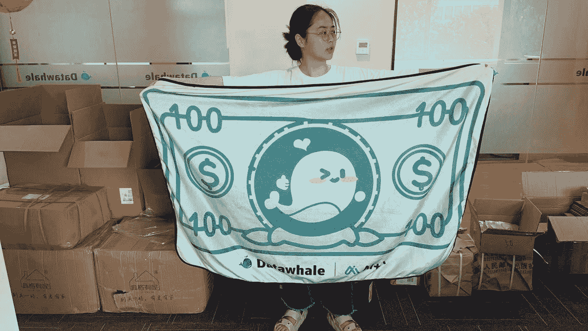
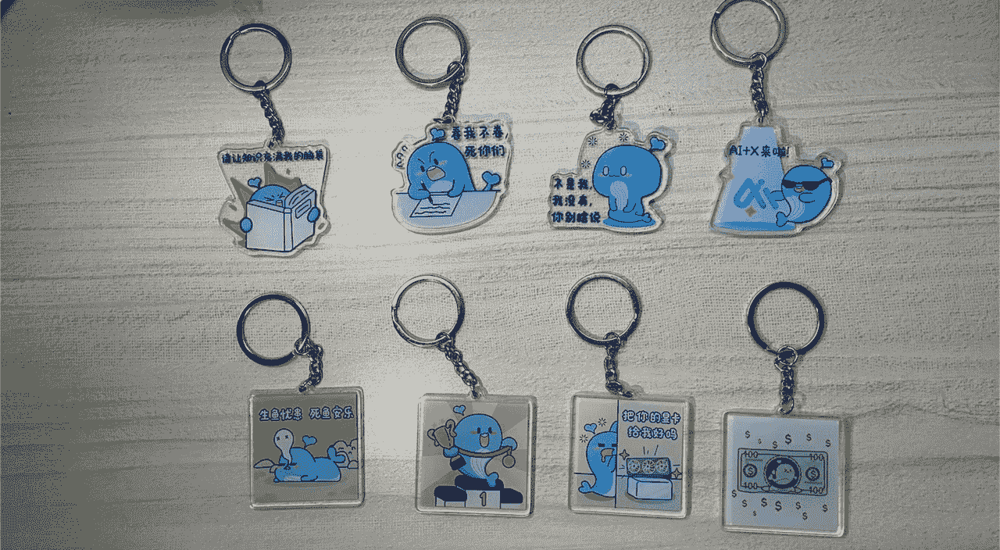

# AI+X Multimodal 创意 Party · 第一期

> 来源：[https://datawhaler.feishu.cn/docx/REpsdbBHPoYfLjxIh05cHKzvnDg](https://datawhaler.feishu.cn/docx/REpsdbBHPoYfLjxIh05cHKzvnDg)

世界都在拥抱大模型，我们怎么可以落下！

我们面向全网对生成式AI感兴趣的小伙伴，发起“AI+X Multimodal 创意 Party”！

我们希望提供一个场域

可以让大家尝试、接触、体验到最新的AI技术

可以让大家用新工具自由发挥，创造自己的脑洞

......

**简单来说，就是借助****任意AI工具****，生成****指定主题****的文字、图片、音频、视频等作品**

# **第一期主题：****X**

（其实是因为第一期我们想不到主题）

# 活动概况

> AI+X Multimodal 创意 Party

+   **截止时间**：6月7日

+   **作品提交：**填写【https://jinshuju.net/f/eSvZ2s】，可多次提交不同主题的作品

+   **活动奖励：****每期结束后开启鲸币兑换，**Datawhale文创随你挑（详见文档末尾）

> **组织方**：[Datawhale](http://www.datawhale.club)

> **作品要求**

+   每人可提交的作品数量不限，AI工具不限，作品主题不限

+   允许同一玩家提交多个主题的作品，但同一主题将以限定时间内的最后一个提交作品为准

+   作品内容符合国家法律法规要求，不便于展示的作品将会直接出局，无法参与评选

+   可以参考借鉴，但请避免直接使用他人作品参赛

+   主办方不需要最终解释权，但是要求作品可以被公开访问和被 Datawhale 的媒体非商业宣传使用

# 玩法说明

玩家需要根据不同模态下的创作要求，使用任意 AI工具完成自己的创作

（更多AI工具可以查看这个链接[AI工具](https://datawhaler.feishu.cn/wiki/WcUewxZH4iHk4ckwMFscTT9UnLd)）

| **项目** | **创作要求** | **推荐使用工具** | **学习资料【供参考】** |
| --- | --- | --- | --- |
| **AI+小说** | 创作一篇主题为“X”的内容，文体、风格、篇幅不限 | [ChatGPT](https://chat.openai.com/)， | [李继刚：「雪花写作法」用GPT写一本小说](https://waytoagi.feishu.cn/wiki/TGrxwpSY2iYu8Zk8Snlc7qcYnWb) |
| **AI+绘画** | 创作一张主题为“X”的图片，画幅、风格、像素、主题不限 | [无界AI](https://www.wujieai.com/ai/334772730), | [AI绘画：应用案例](https://waytoagi.feishu.cn/wiki/Uo5Nw2w2BiIj8QklLh5cdXclnEd) |
| **AI+音乐** | 创作一首主题为“X”的音乐，时长不短于20秒，风格不限 | [Suno](https://suno.com/create) | [AI音乐通用学习手册](https://datawhaler.feishu.cn/wiki/TCkIwyB1QifOMNkHgxScA8yknwc) |
| **AI+视频** | **创作一段主题为“X”的视频，时长**不短于10秒，画面风格、比例、清晰度不限 | [Runaway](https://app.runwayml.com/video-tools/) | [AI视频通用学习手册](https://datawhaler.feishu.cn/wiki/K764wjVGiivZswkSV7acw0ylnFh?from=from_copylink) |
| **AI+数字人** | **创**作一段主题为“X”的数字人演讲视频，时长不短于10秒，数字人不可侵权、背景为绿幕版本及自建版本两版、比例、清晰度不限。 | GPT-SoVITS、 | [AI数字人通用学习手册](https://datawhaler.feishu.cn/wiki/I2tOw19UHiewOxkVdahcfd29nMh) |

# 评选规则

## 评选方式

根据奖项评选标准，由参与活动的玩家和社区成员投票选出

获奖玩家可获得奖项对应的鲸币奖励，用于兑换Datawhale的社区文创

## 作品奖项

| **奖项名称** | **获奖数量** | **奖励内容** | **评选标准** |
| --- | --- | --- | --- |
| 创意奖 | 每种模态3位 | 20鲸币 | 由创意Party评委团队，根据作品的创意新奇程度选出 |
| 人气奖 | 每种模态3位 | 20鲸币 | 由Datawhale社区成员，根据自己的喜好程度选出 |
| 互评夸夸奖 | 每种模态3位 | 20鲸币 | 由参加创意Party的选手，根据自己的喜好程度选出 |

## 创作奖项

> 鼓励大家将自己的创作过程写成教程文档投稿，优秀投稿有机会成为创意Party的使用教程，获得文创奖励

1.  创作过程需确保原创且由作者自己实践完成，禁止抄袭

1.  优秀稿件作者将会获得**100鲸币**奖励

# 作品展示

# 活动奖励

[鲸币兑换列表](https://datawhaler.feishu.cn/sheets/SVZAsVwTWhdqJAtMHxjcuwVJnPf?from=from_copylink)

