# Stable diffusion的部署

> 来源：[https://datawhaler.feishu.cn/docx/IpY2dXpadoCzLAxs0g7c9Xjcn7f](https://datawhaler.feishu.cn/docx/IpY2dXpadoCzLAxs0g7c9Xjcn7f)

> 课程贡献者：

> Datawhale@司玉鑫、周理璇

> 杭州电子科技大学@张哲铭、施康源、殷昌煜、杨潇宇、卢乙尊

> 更新日期：2024 年 5 月 14 日

# 导语（5 分钟）

+   什么是 Stable Diffusion? 我们为什么要学习它？

+   **学习目标：**

+   在场的每一位同学都能成功部署 Stable Diffusion 并完成生图

+   **动手实践常见问题提醒：**

**1- 浏览器**：请使用 Edge 或** Chrome **最新版浏览器，登录仅支持PC端（电脑上）登录及使用（请勿使用手机、Pad 等其他设备）

> 网址一定要**复制到浏览器**里面。

> 千万不要用🛰️浏览器打开。

**2- 遇到白屏问题不要慌**

1.  **更换****浏览器****/使用版本足够新的浏览器**

1.  使用**无痕模式**进入

1.  **链接****手机热点****，**或**复制给旁边同学**，看看能否打开

1.  使用🪜工具

**3- **遇到问题, 可以删除项目重新来做一次. 有可能是其中的细节有配置出错.

**4- 问题传递：**

+   先找助教，助教也解决不了：请发截图在现场活动群，会有线上保障人员回复

+   需要 ① 问题截图（若能分辨）、② 项目名称（复制发出） ③数据集名称（复制发出）

> 其他问题: 可以看[动手部署FAQ](https://datawhaler.feishu.cn/wiki/GSolwvLM2iACpvk4da3cFYUTnxc)

# Step 0 ：云环境准备

## 学习目标

手把手带你在云服务器上部署stable diffusion

> Stable Diffusion是将文字变为图片的大模型。

> 部署实践主要是三大步骤！

> **Step 1：SD，配环境！**

> **Step 2：SD，启动！**

> **Step 3：SD，出图！**

## 准备阶段（预计 2 分钟）

> **请点****击以下**链接🔗注册，为每位同学提供70元算力

> 登录链接 https://account.virtaicloud.com/gemini_web/auth/login

> 请用电脑上最新版本浏览器启动，包括但不限于谷歌浏览器，Edge，火狐浏览器等


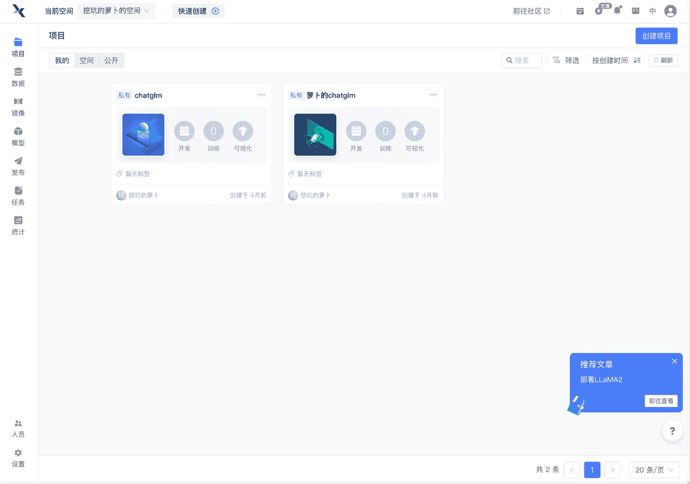

# Step 1：SD，配置好基础设施

### 创建项目

1.  点击：快速创建，选择创建项目，创建新项目。

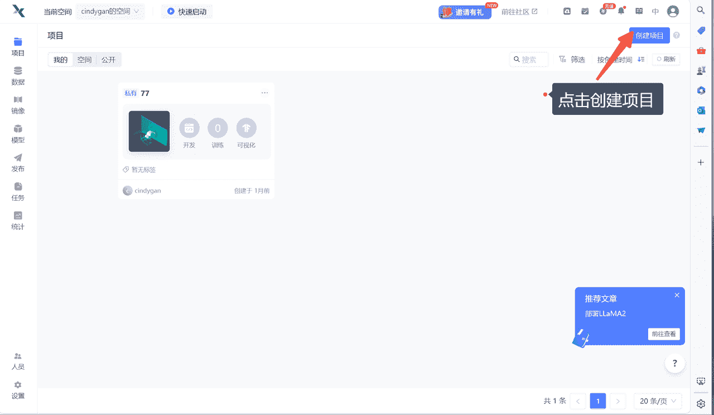


1.  **选择【资源】**

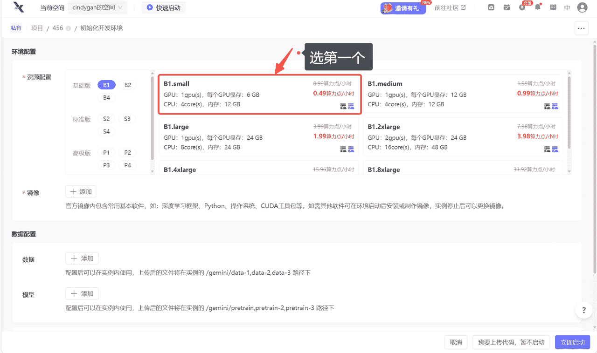

1.  **选择【镜像】**

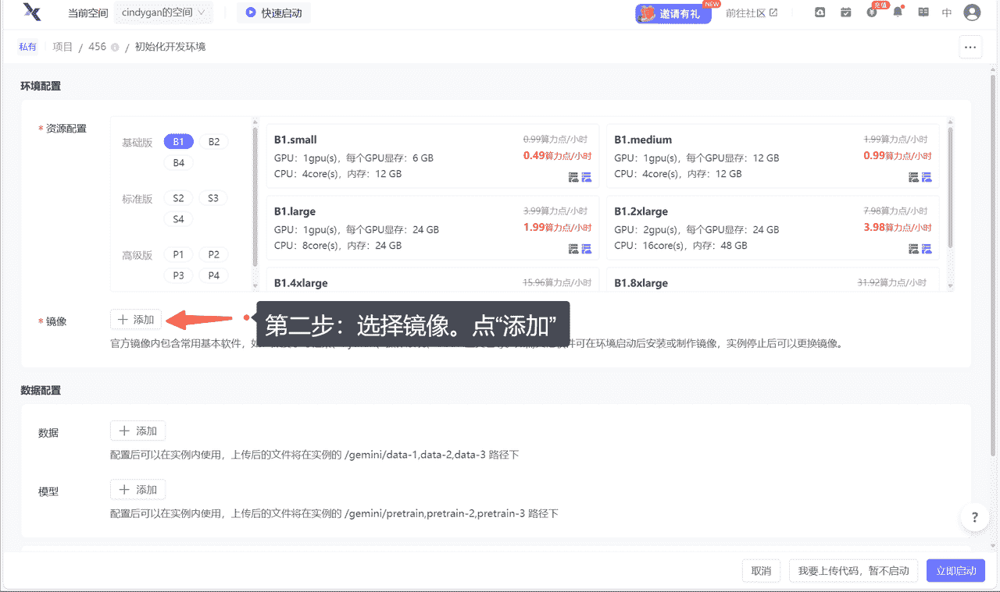

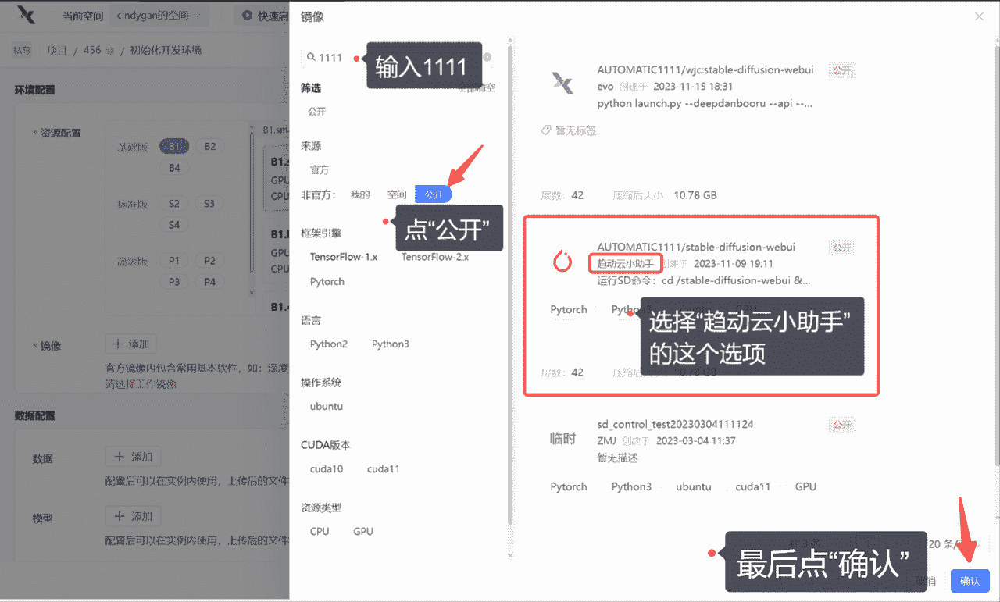

1.  **选择【数据】**

+   stable-diffusion(输入的内容)


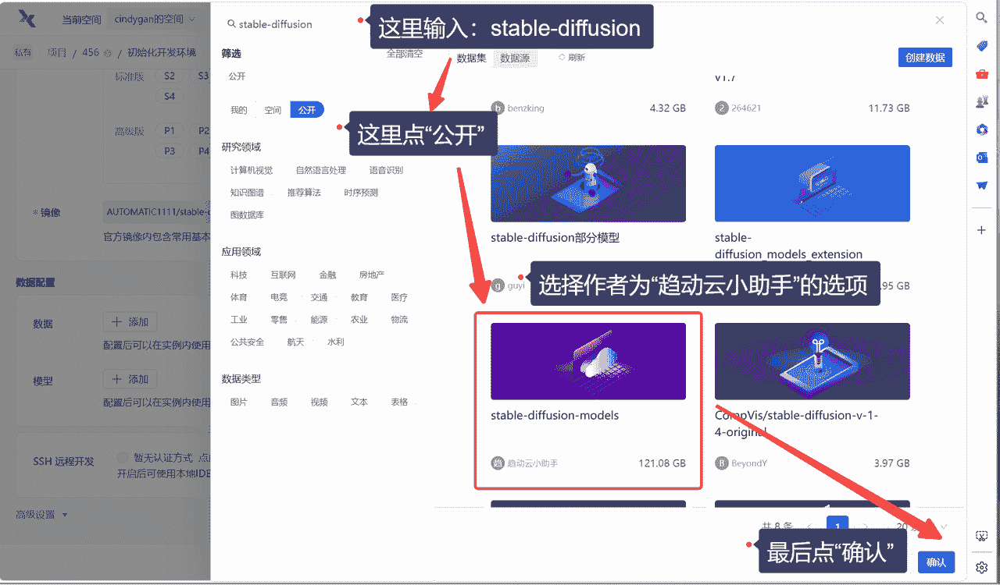

1.  **选择【端口】**


### 初始化开发环境实例

1.  点击“进入开发环境”

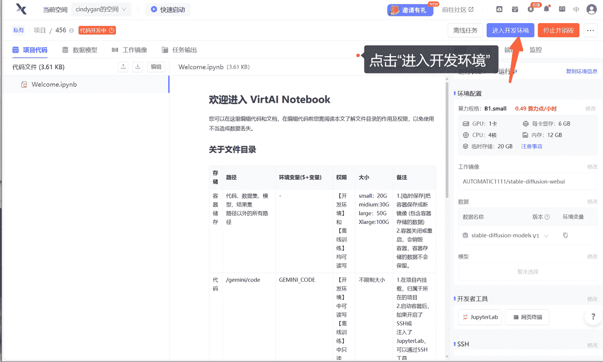

1.  点击进入“网页终端”

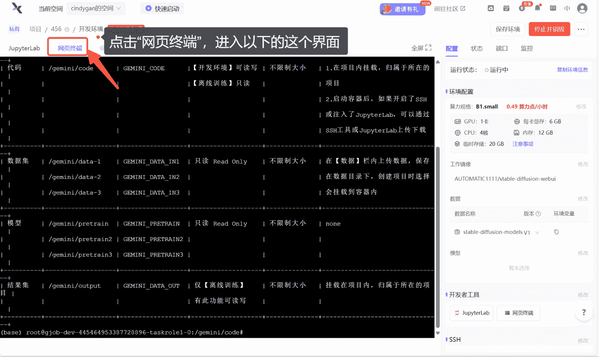

# Step 2：SD，启动！

## 解压代码并运行（可能会有点耗时，耐心等等）

> **复制粘贴下列代码到网页终端****（无法用ctrl+v）**

> **所以需要****右键****点击粘贴****/粘贴为文本，****粘贴之后记得按Enter运行哦**

```
cd /stable-diffusion-webui &amp;&amp; python launch.py --deepdanbooru --share --xformers --listen
```

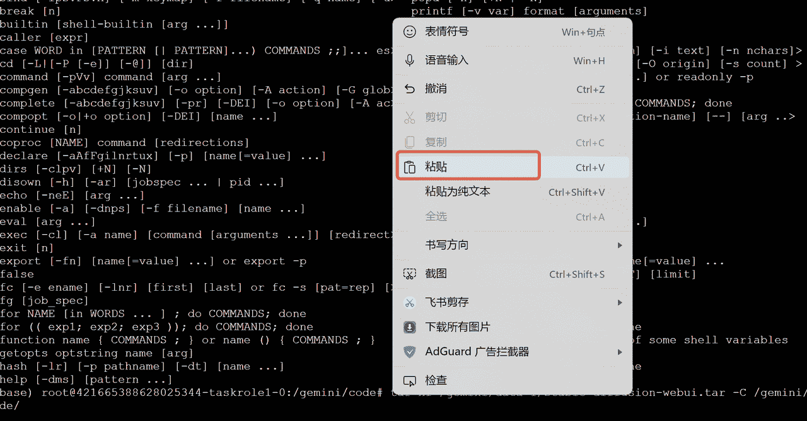

因为要处理100多个G的数据，所以需要耐心等等。大约３－５分钟。

## ⭐️⭐️⭐️ SD，启动！

1.  项目运行完成后见到如下字样表示部署成功：

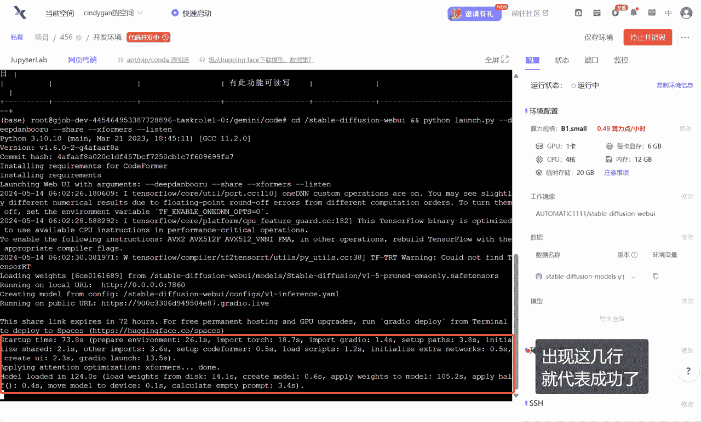

1.  点击端口,把网址链接粘贴到浏览器里.访问SD webUI，SD，启动！

（如果界面无法刷出，**推荐使用Chrome浏览器**）

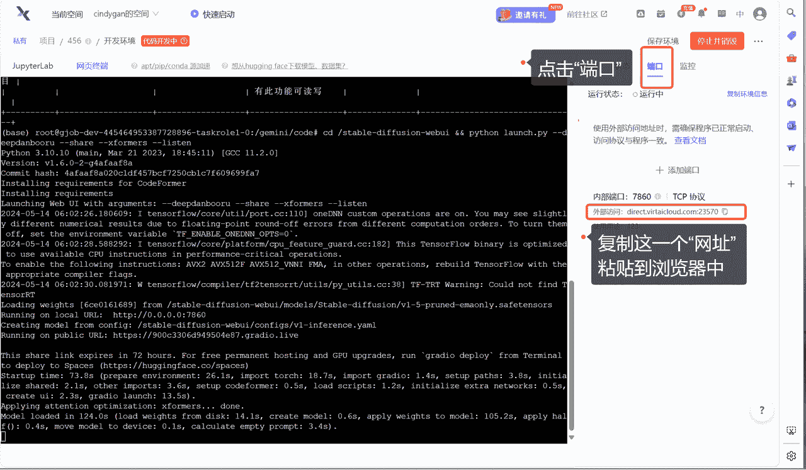

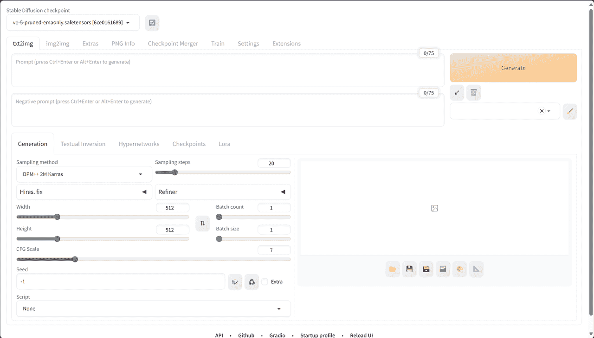

# Step 3：SD，出图！

在【**Prompt**】处输入绘图提示词，可参考如下提示词：

```
best quality, a cat, by the window, sunlit cat fur, photography, realistic, cinematic lighting
```

+   反向提示词

```
bad eyes, deformed eyes, bad ears, wrong ears, wrong body, deformed body, extra legs, bad legs, many legs, more than two legs, bad claws, wrong claws, extra claws, wrong tail, bad tail
```

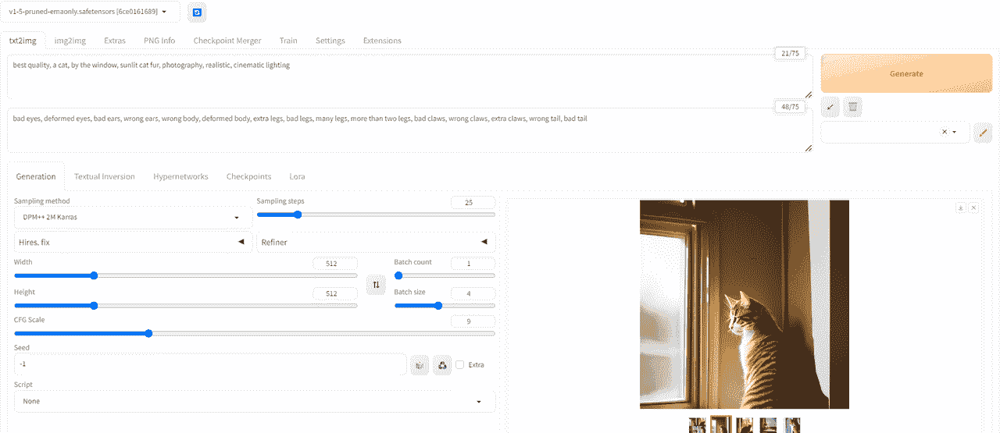

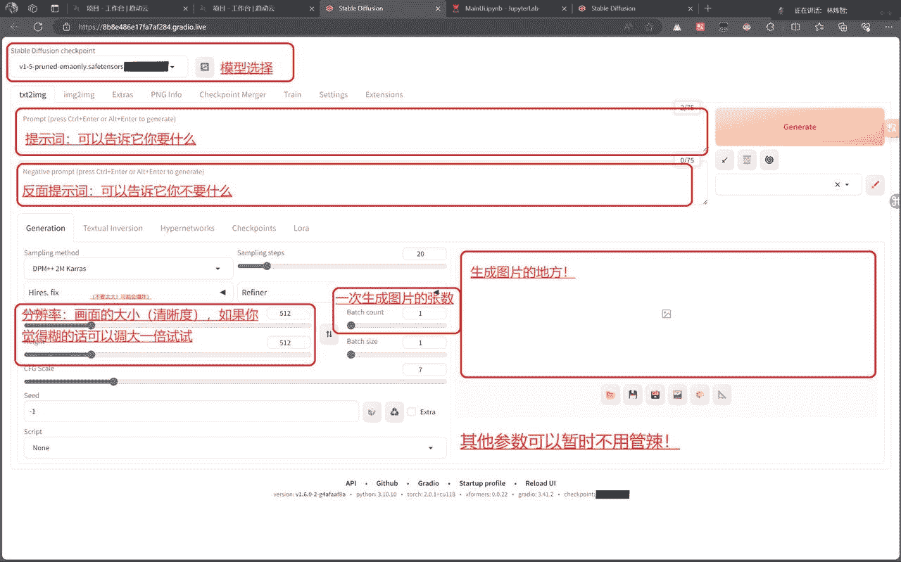

> 注意：体验完后，

> **一定要停止环境！**

> **一定要停止环境！**

> **一定要停止环境！**

> 不然会一直消耗GPU资源。

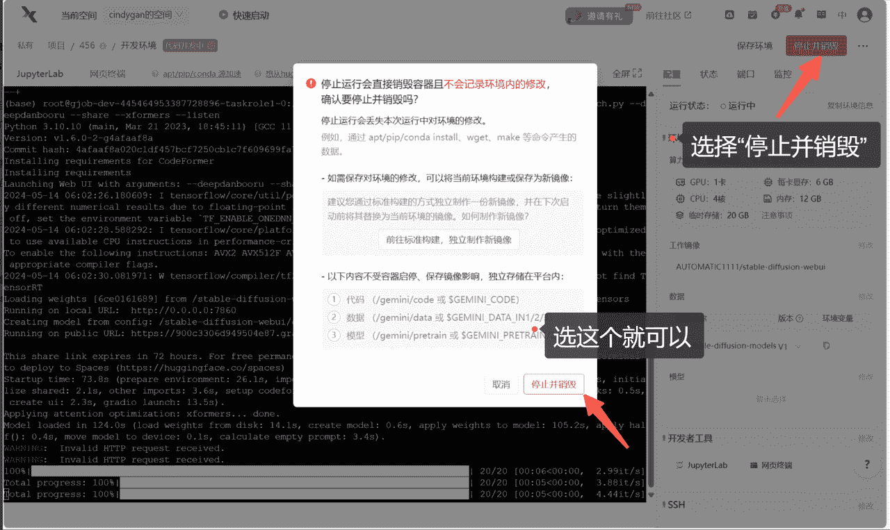

# 加餐：提示词技巧

## 提示词入门

文生图，写好**文**是关键！

你给 AI 的指令就是提示词。

**正向提示词：**

你心中想要的画面，例如（一只猫，可爱的，矫健的，笑着看着我们）

当提示词加上：最佳质量，超高分辨率，杰作，等词语，便会得到意想不到的结果


**反向提示词：**

不想出现的画面，例如（一只猫，难看的，多个脑袋，样子很凶）

当你填到反向提示词后，就会 ……呃呃


那写提示词是不是很难？其实没那么难，下面我们来聊聊写提示词的技巧

## 提示词框架

**观察图画，从前至后顺序：**

1.  一幅画，这是怎样一幅画，画的具体情况（画风）

1.  一个人，这是怎么的人，人的具体情况（人的样貌，穿着是什么，人在做什么）

1.  一个背景，这是怎样的背景，背景的具体情况（背景都有什么东西，有什么特色）

1.  背景里的物体，这是怎样的物体，该物体的具体情况


**提示词三段论：**

## 风格描述

+   **基本前缀**：强调图片质量的词汇：masterpiece,best quality等

+   **画风词**：插画illustration,水彩watercolor_medium,赛博朋克风格，摄影作品，油画风等

## 主体

+   图画想要凸显的主体，可以是人物，建筑，景物等。

+   对于角色来说，通常包括了面部，头发，身体，衣着，姿态等描写。

+   没有角色时，可以将场景中的重要点即高耸如云的城堡，绽放的花朵，破碎的钟表等，想要位于画面中心的物体进行描述。

## 主体描述

+   主体存在的周围场景，没有场景描述时容易生成纯色背景或者是效果tag相关的背景，且主体会显得很大。

+   **环境词举例：**室内，室外，森林中，山里面，科幻场景，城市街道，蓝天白云，风景，圣诞节，白天，夜晚等。

**案例：**

少女，肖像特写，侧身，看镜头，表情温柔，深蓝色眼睛，蓝色头发，头发茂密，头戴帽子，手里捧着百合花束，电影般的，背景干净没有杂物，中景，阳光从斜上方打下来，虚幻渲染


## 利用 AI 帮你写提示词

AI 工具链接：Kimi Chat

1.  基于主题，请 AI 脑暴绘画的主体，做创意的延展。

> “我需要绘制一个以xx 为主题的图画，请帮我想 10 个相关的绘画内容。”“如果我想要一幅表现和平与未来科技结合的画面，你有什么创意建议吗？”

1.  基于主题，请 AI 帮忙扩展提示词，补充绘画细节。

> “你是一个文生图提示词大师，请帮我优化我的提示词，要求是补充足够的细节，字数300字以内。我需要一幅描绘夜晚下小镇街道的图像，街道两旁是旧式的灯光和雨后的反光。”

1.  请 AI 基于特定情感和氛围，修改提示词。

> “如何修改这个提示词，使得整幅画面呈现出神秘和科技感？”

1.  把提示词翻译成英文，有时出图效果会更好。

1.  上传图像，请 AI 描述这幅图画，尽可能详细、具体。

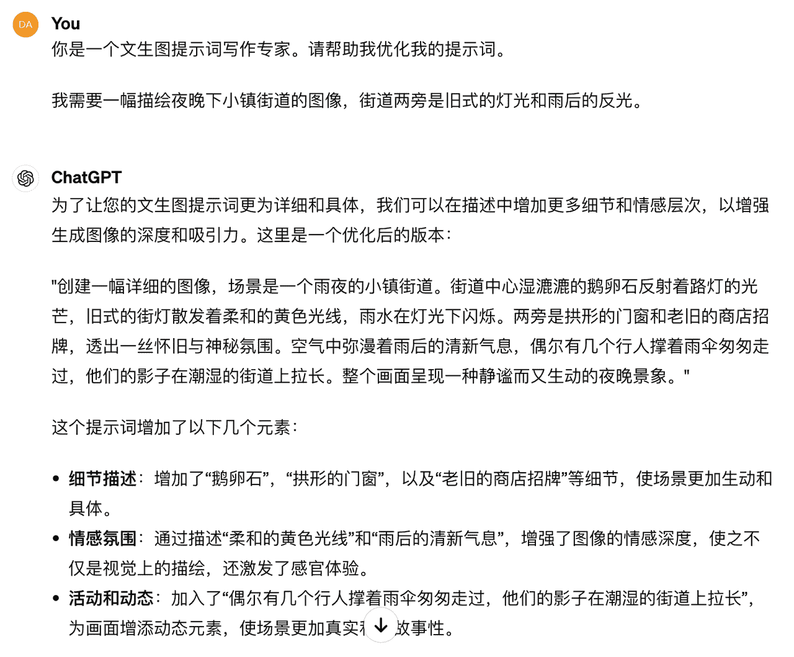

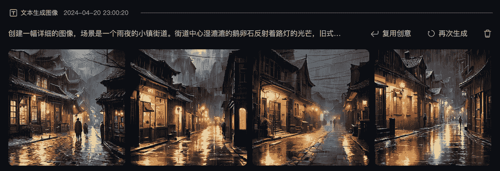

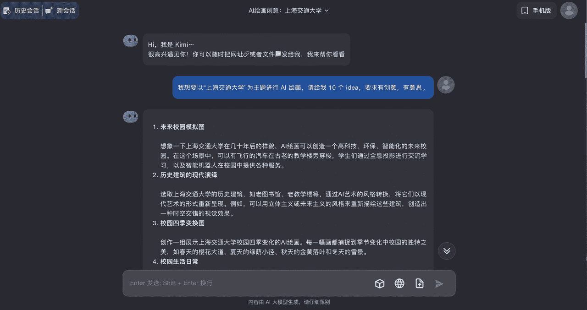

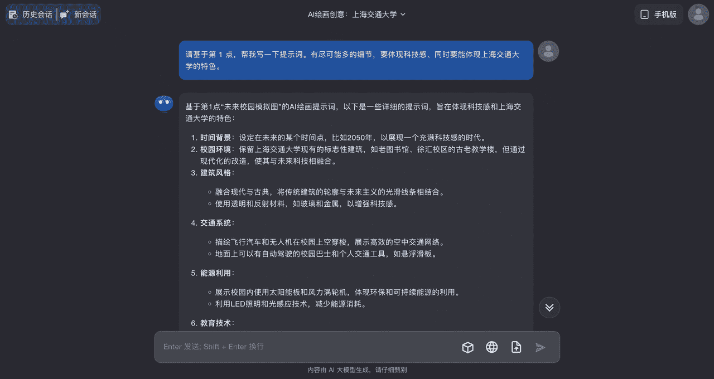

# 彩蛋：进阶教程

[AIX厦大 动手实践大模型教学文档](https://deepwisdom.feishu.cn/wiki/JXCxwbUsfiArFuk3ZaTcuUYinJh)厦大WISERCLUB同学们创作的教程：

融合了Lora、更新Stable Diffusion模型的相关内容，欢迎感兴趣的同学继续探索玩耍

# 彩蛋：能力认证

**1. 测试链接：**

https://certs.datawhale.cn/llm/quiz/intro（建议用电脑端使用）

**2. 评分标准：****

满分** 100分，80分及以上，即可获得以下证书。

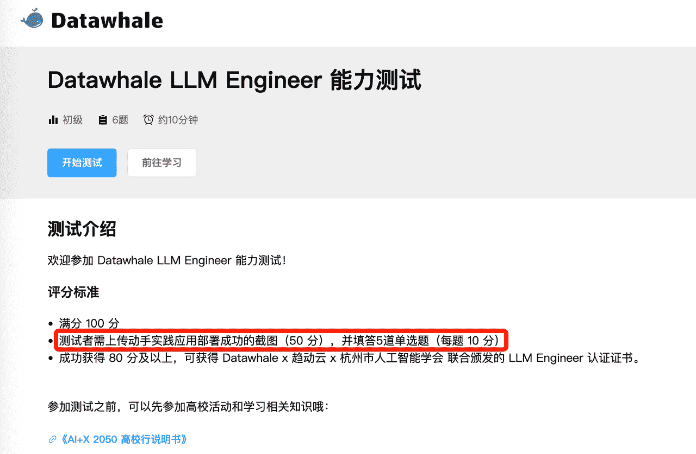

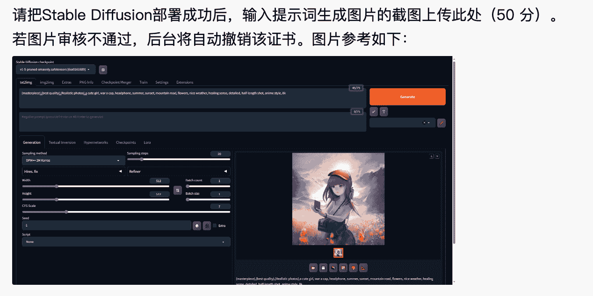


> [AI +X | Datawhale 学习指南](https://datawhaler.feishu.cn/wiki/X9AVwtmvyi87bIkYpi2cNGlIn3v)多“亲妈喂饭级“AI学习手册 👉

# 拓展：stable diffusion的扩展应用