# 数据驱动决策，让AI为你打工

> 来源：[https://datawhaler.feishu.cn/docx/I62OdMPOdoeUjvxWWkHcnXK8nyf](https://datawhaler.feishu.cn/docx/I62OdMPOdoeUjvxWWkHcnXK8nyf)

> 数据分析没思路？

> 数据太多看不明白？

> 不知道数据可以用来做什么？怎么做？

> 想入门数据科学竞赛却无从下手？

> ————————————

> 这一切，都可以交给AI！！！

> 了解数据，探索数据，数据清洗、处理与分析，到特征工程和简单建模，

> 不需要花两三天安装Python环境！不需要研究学习相关教材，

> 如今，使用AI，产出简单**建模预测**结果甚至只需要半小时！！！让AI为你打工！！！

## 学习方法提要

1. 如果内容不小心被他人折叠，别忘了【展开】查看详情


1. 评论区随时欢迎大家留言~


1. 不要忘记点击按钮，让助教和分享者知道你的学习进度


1. 你的点赞和评论，会让教程贡献者开心好久好久🥰

## [注册小浣熊账号](https://raccoon.sensetime.com/login?utm_source=datawhale)

> 注册链接：`https://raccoon.sensetime.com/login?utm_source=datawhale`

+ 点击[链接](https://raccoon.sensetime.com/login?utm_source=datawhale)，打开充满科技感的[官网](https://raccoon.sensetime.com/login?utm_source=datawhale)，快速注册


+ 注册并登录成功后，点入【[办公小浣熊](https://raccoon.sensetime.com/login?utm_source=datawhale)】进入使用界面


## 尝试使用[办公小浣熊](https://raccoon.sensetime.com/login?utm_source=datawhale)

+ 点选【采购管理】样例，使用样例`Prompt`，观察 [办公小浣熊](https://raccoon.sensetime.com/login?utm_source=datawhale) 的操作

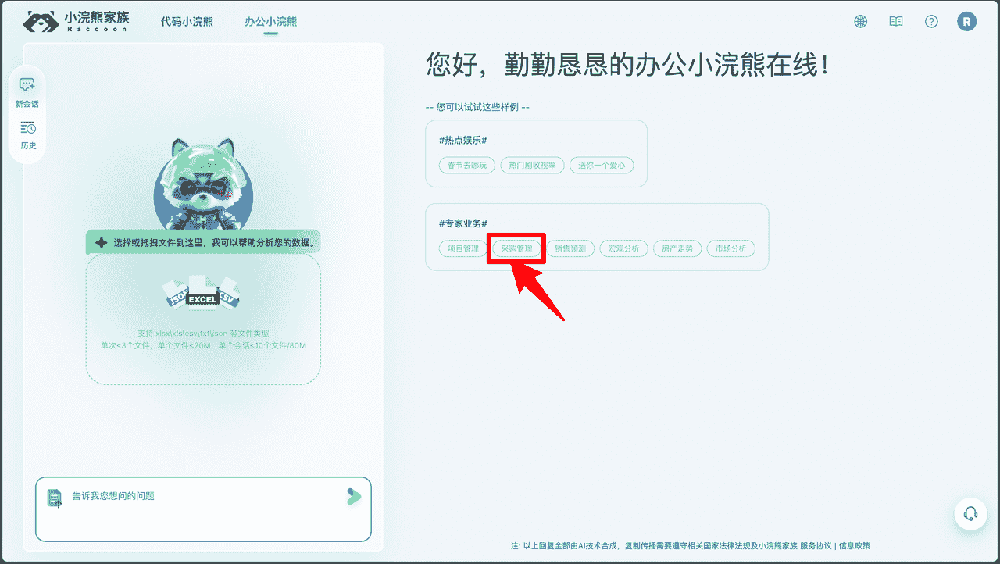

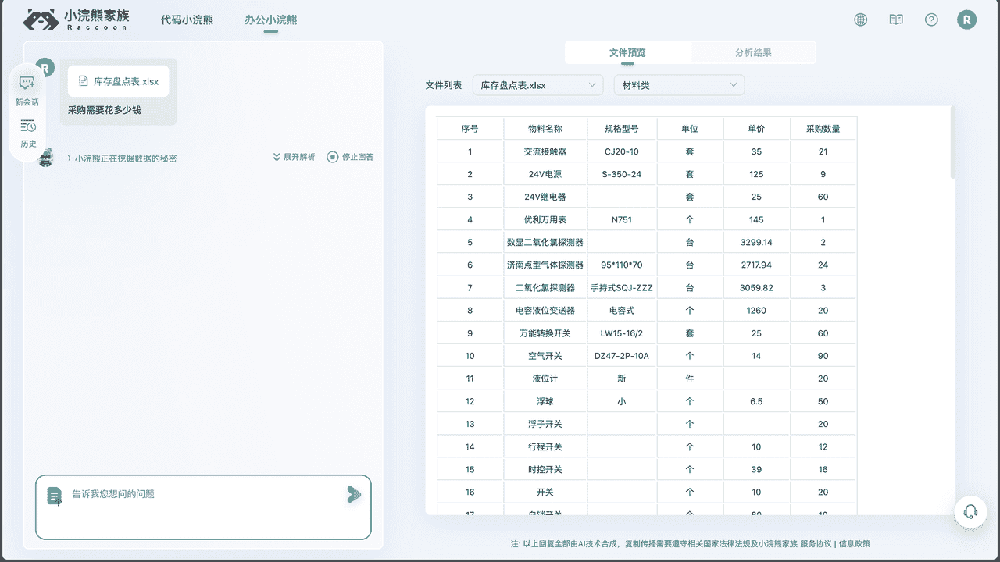

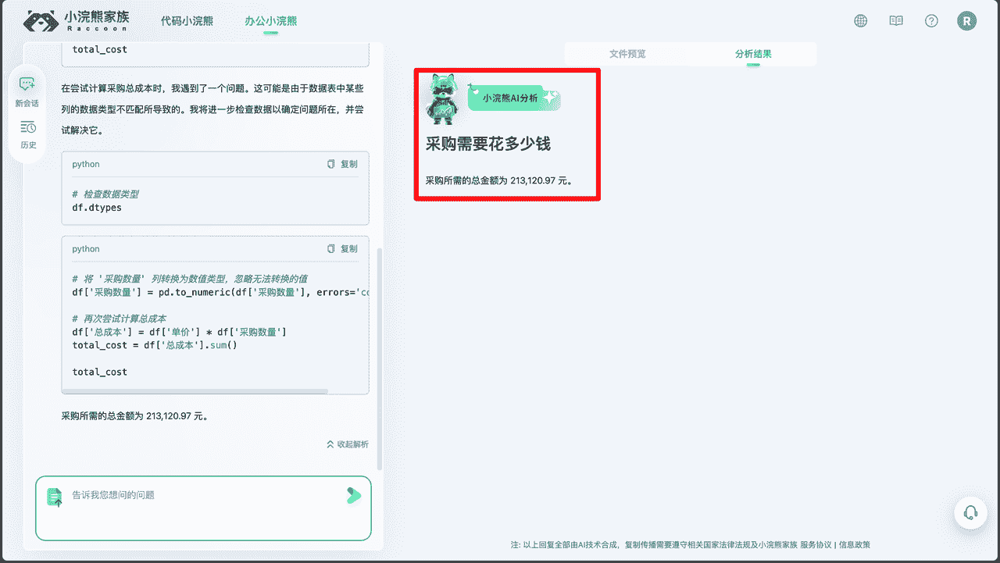

+ [办公小浣熊](https://raccoon.sensetime.com/login?utm_source=datawhale) 具有处理多文件的能力，且可以自动纠错

> 表格文件中有三张子工作表，

+ 从展开的解析中可了解到，小浣熊可了解多文件之间的关系，统计多文件的数据

+ 另外在遇到问题时，可自主寻找解决方案

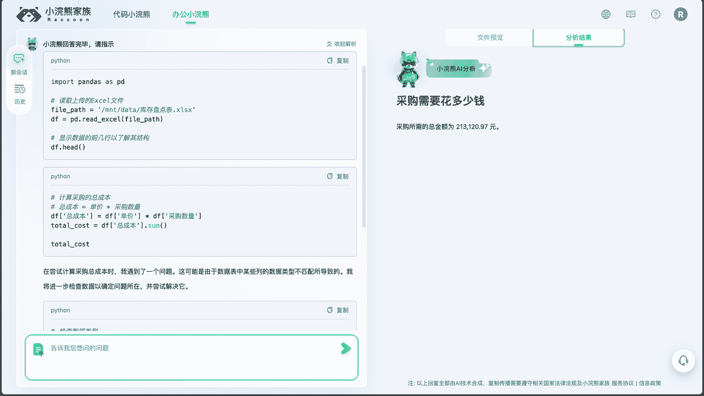

## 数据分析入门

> 此部分，我们将使用 [办公小浣熊](https://raccoon.sensetime.com/login?utm_source=datawhale) 完成 多表格分析、缺失值处理、数据观测 三个常见数据分析场景

### 多表格处理

> 在实际的数据处理中，很可能需要把多个表中的数据按照某种连接方式进行整合，

> 如：按照员工的`公司ID`编号合并员工的身份信息表和员工的薪水情况表、合并某年级学生的多学科成绩表等

> 本样例是合并三张同样结构的库存盘点表，接下来可将下面的`Prompt`发送给办公小浣熊进行处理：

> 为我将这三张表合并为一张表，新增一列物料类别，为原子工作表的表名，最后导出这个表格

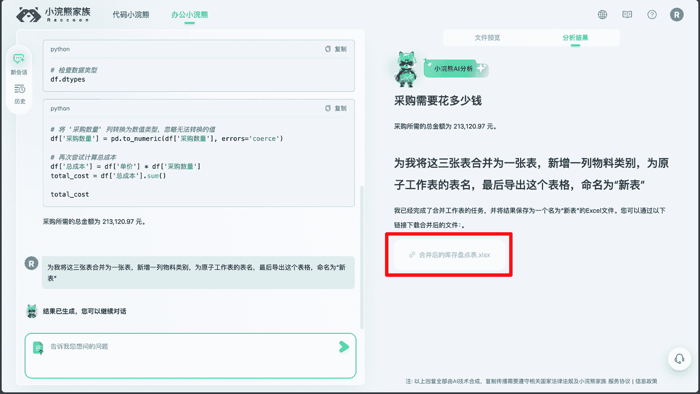

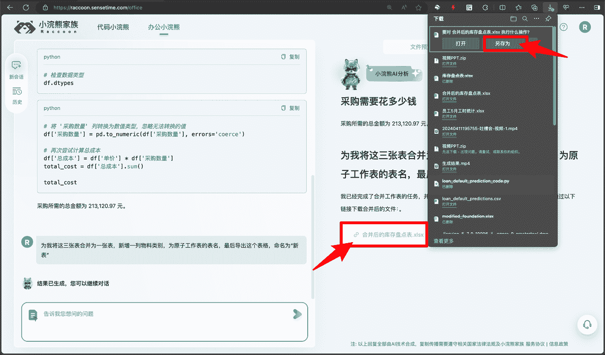

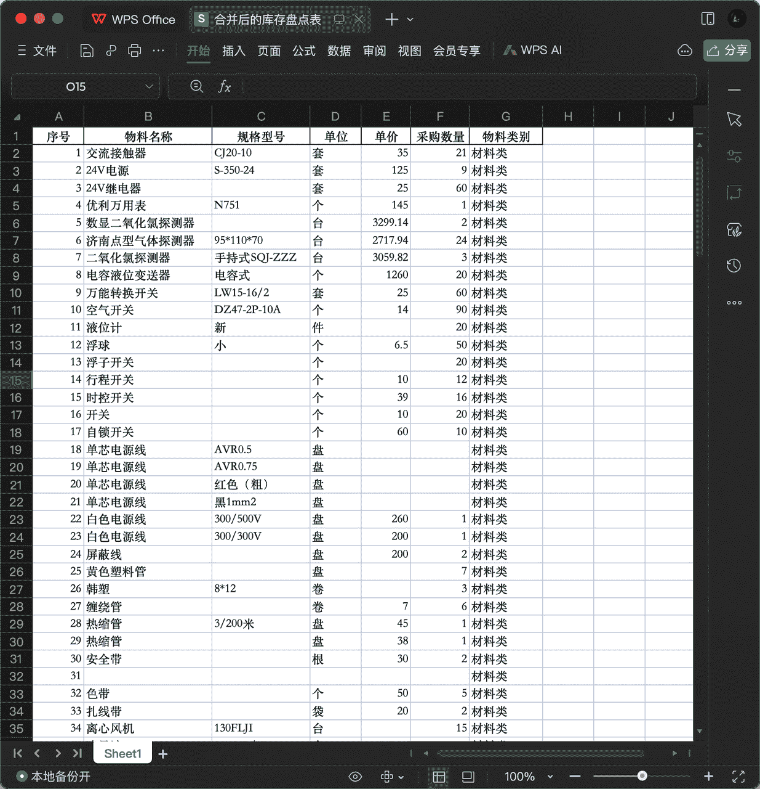

+ 如果你已经完成上述操作，记得点击【确认完成】

### 缺失值处理

> 缺失数据在现实生活中普遍存在，

> 数值、无序类别、有序类别、文本、时间序列等数据均有可能存在缺失情况，输出处理方式不完全相同，

> 缺失不等于无用，缺失与否有时本身就蕴含了很多信息，如课堂点名的缺失值就是缺勤率；生产环境下数据的丢失需要分析原因，排除故障等；

> 缺失值的统计和删除是缺失数据处理最基本的操作，有时我们还需要对缺失值进行填充。

> 我们需要了解这些基本原则，然后针对不同情况决策，接下来可将`Prompt`发送给办公小浣熊进行处理：

> 为我分析值缺失情况，并分析缺失原因，给出处理建议

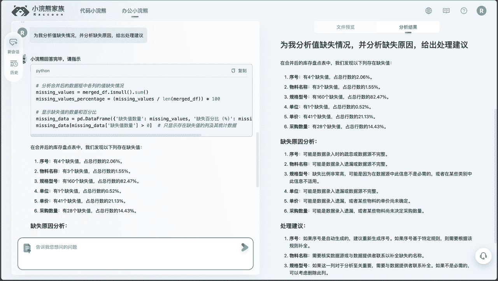

+ 小浣熊的分析结果详情如下：

> 在合并后的库存盘点表中，我们发现以下列存在缺失值：

1. `序号`：有4个缺失值，占总行数的2.06%。

1. `物料名称`：有3个缺失值，占总行数的1.55%。

1. `规格型号`：有160个缺失值，占总行数的82.47%。

1. `单位`：有1个缺失值，占总行数的0.52%。

1. `单价`：有41个缺失值，占总行数的21.13%。

1. `采购数量`：有28个缺失值，占总行数的14.43%。

#### 缺失原因分析：

1. `序号`：可能是数据录入时的疏忽或数据源不完整。

1. `物料名称`：可能是数据录入遗漏或数据源不完整。

1. `规格型号`：缺失比例非常高，可能是因为在数据源中此信息不是必需的，或者在某些类别中此信息不适用。

1. `单位`：可能是数据录入遗漏或数据源不完整。

1. `单价`：可能是数据录入遗漏，或者某些物料的单价尚未确定。

1. `采购数量`：可能是数据录入遗漏，或者某些物料尚未决定采购数量。

#### 处理建议：

1. `序号`：如果序号是自动生成的，建议重新生成序号。如果序号基于特定规则，则需要根据该规则补全。

1. `物料名称`：需要核实数据源或与数据提供者联系以补全缺失的名称。

1. `规格型号`：如果这一列对于分析至关重要，需要与数据提供者联系补全。如果不是必需的，可以考虑删除此列。

1. `单位`：核实数据源或与数据提供者联系以补全缺失的单位。

1. `单价`：对于缺失的单价，如果可能，需要与数据提供者联系获取。如果无法获得，可以考虑根据类似物料的单价或市场价格进行估算。

1. `采购数量`：核实数据源或与数据提供者联系以补全缺失的采购数量。对于未决定采购数量的物料，可以考虑标记为“待定”或使用估算值。

+ 接下来，请按照你的思路，让小浣熊针对性处理这些缺失值，并在完成后，点击【确认完成】按钮

### 数据观测

> 在数据特征较多时，“看什么”和“怎么看”是两个棘手的问题，我们很难一下子抓住整个数据集的核心，

> 过于详细或过于粗略且无目的地浏览数据很可能让我们迷失在无尽的数据中。

> 清晰的数据分析思路有利于我们快速建立对数据集的宏观认识，同时为构造有效且多样的数据特征打下基础，

> 我们往往会对可视化后的数据留有更深刻的印象和更清晰的认知，可视化可帮我们看出更多数据中的内含趋势（如带有回归线的散点图）、通过颜色或大小反映的数据分布差异、不同组数据的对比效果等，

> 数据观测的目的是帮助我们快速建立对未知数据的有效观察，更好地抓住数据分析的要点。

> 进行数据探索性分析并针对性绘制图表

## 【今日最惊艳数据分析图】评选（可选）

> 最后，来到我们本次学习互动最后一个可选任务——

> 使用[办公小浣熊](https://raccoon.sensetime.com/login?utm_source=datawhale)进行数据分析，制作图表或截图至群内，

> 互相评选**【今日最惊艳数据分析图】**

> 接下来，就把舞台交给你们，尝试使用办公小浣熊探索数据的魅力吧~

## 随机掉落的知识空投

### 【扩展】数据分析思路简述

+ 数据分析一般需要掌握几个问题的解决方案，即“怎么分析”、“怎么处理”、“怎么加速”等

+ 数据处理与分析是实战型任务，只有在实践过程中，我们才能收获到具体可用的经验，应对更多挑战

+ 数据分析中存在一定处理难度的数据一般为：缺失数据、文本数据、分类数据和时间序列数据

+ 其中缺失数据的四大操作一般为：统计、删除、填充、插值

+ 通过数据观测，我们可以获得更多更清晰的应该如何进行分析的思路

+ 可视化方法一般包括：基本绘图、元素控制、子图绘制等

+ 其目的是帮助我们快速建立对未知数据模式的有效观察，更好地在数据分析中抓住要点

### 【扩展】[办公小浣熊](https://raccoon.sensetime.com/login?utm_source=datawhale)是金融类Agent的应用（等你来聊）

#### Agent概念入门

<https://datawhaler.feishu.cn/sync/PYnsdkDa6sgvLYbNeTTcWZGanTc>

#### 办公小浣熊可自主编写并运行Python代码实现数据分析

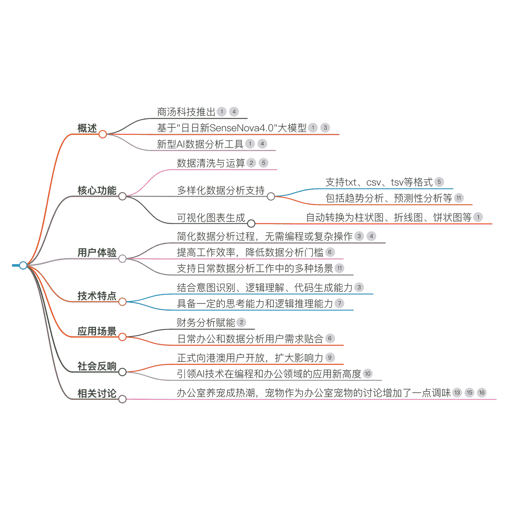

办公小浣熊是商汤科技推出的一款AI数据分析工具，基于"日日新`SenseNova4.0`"大模型能力开发。

它不仅能够进行数据分析，分析其中的规律，还能进行预测建议，具备了一定的思考能力。

它能够支持复杂表格、多表格、多文件的理解，完成数据清洗、数据运算、比较分析、趋势分析、预测性分析和可视化等常见数据分析任务。

它通过自然语言输入，结合商汤大模型体系的意图识别、逻辑理解、代码生成能力，自动将数据转化为有意义的分析结果和可视化图表。

### 【案例】用[办公小浣熊](https://raccoon.sensetime.com/login?utm_source=datawhale)进行描述性统计分析

+ 目的：通过概括和总结数据集的主要特征，来提供对数据的直观理解。

+ 主要关注：数据的集中趋势、分散程度和分布形状等基本统计特征。

描述性统计分析通常通过以下几个方面展现数据：

+ 中心位置测度：描述数据的集中趋势。常用的统计量包括均值（平均值）、中位数和众数。

+ 离散程度测度：衡量数据的分散或离散程度，反映数据的波动。常见的统计量有标准差、方差、极差等。

+ 数据分布：描述数据的分布形状，是对数据集整体结构的概括。包括正态分布、偏态分布、峰态等。

+ 频数和频率：统计数据集中各个数值或范围出现的次数，以及其在整体中所占的比例。

+ 描述性图表：利用直方图、箱线图、散点图等可视化手段展示数据的分布和规律，使人们更容易理解数据。

#### 使用小浣熊

> 此处使用的文件为[更多进阶思路分享](https://datawhaler.feishu.cn/wiki/YdNhw9Z9ai42YZkOw0TchZafnne)中的建模场景，此处仅列出一些参考`Prompt`与简略结果，更多细节等你实践分享！

**参考`Prompt` & 部分结果**

**执行过程部分截图**

> 这份数据的“`训练`”工作表是某信贷平台的贷款记录。我想[了解这份数据中](https://datawhaler.feishu.cn/wiki/Y95rwXEwTiTeORkqwLMcH6xCnSc#part-TAJNdrP9Lo2e9BxjbaJc3Hcxnvf)各个特征的基本情况，请进行描述性统计分析，并绘制图表

+ 分析结果

```
**由于数据****集的特征**较多，以下是一些关键特征的描述性统计分析结果：
数值特征
`Loan Amount`（贷款金额）
平均值：14,132.65
标准差：8,562.62
最小值：1,000
最大值：40,000
`Loan Term in Years`（贷款期限，年）
平均值：3.5年
标准差：0.87年
最小值：3年
最大值：5年
`Loan Interest Rate`（贷款利率）
平均值：13.44%
标准差：4.94%
最小值：5.32%
最大值：30.89%
`Monthly Payment Amount`（分期付款金额）
平均值：428.97
标准差：255.68
最小值：32.95
最大值：1,486.55
`Debt-to-Income Ratio`（债务收入比）
平均值：13.44
标准差：4.94
最小值：5.32
最大值：30.89
分类特征
`Loan Grade`（贷款等级）
最常见的等级：B（出现154次）
`Employment Years`（就业年限）
最常见的就业年限：10+ years（出现155次）
`Home Ownership Status`（房屋所有权状况）
大部分借款人拥有房屋（平均值：0.644）
目标变量：`Default`（是否违约）
违约：1
未违约：0
接下来，我将进行数据的可视化分析。这将包括数据的分布可视化和相关性可视化。您是否有特定的特征或关系，您希望我重点关注？
```

+ 展开解析中的一些有效内容内容

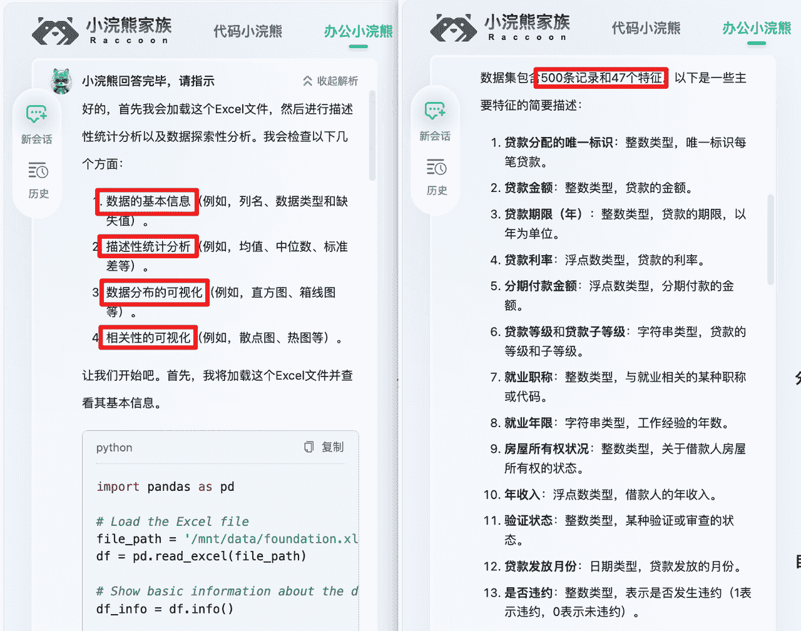

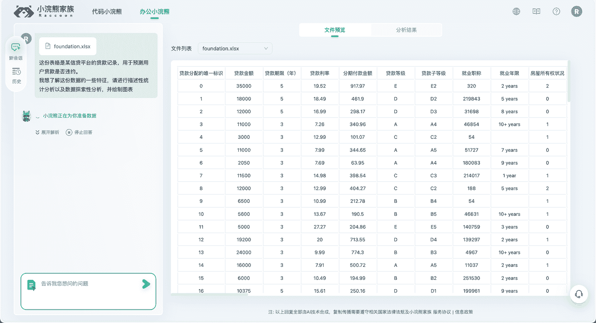

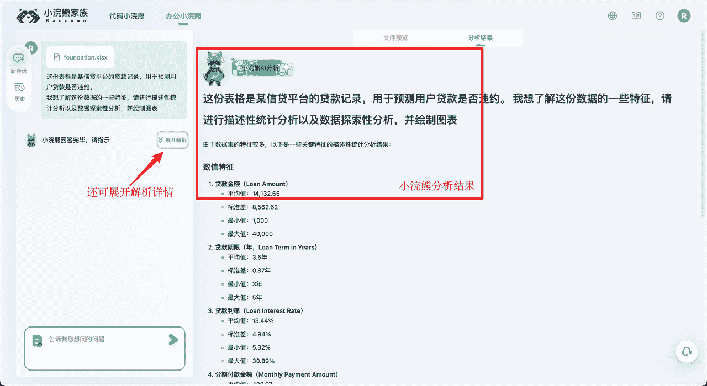

### 数据特征基础情况表

> 特征 = 字段 = 每一列的列名

| 数据特征 | 所属范围 | 结论 |

| --- | --- | --- |

| 数据集大小，原始特征维度 | 数据总体情况 | |

| 数据字段类型 | | |

| 数据集中各特征基本统计量 | | |

| 数据缺失值情况 | 缺失值和唯一值 | |

| 唯一值特征 | | |

| 类别型数据深入了解 | 深入数据-查看数据类型 | |

| 数值型数据深入了解 | | |

| 特征和特征之间的关系 | 数据间相关关系 | |

| 特征和`目标变量`之间的关系 | | |

### 【彩蛋】[办公小浣熊](https://raccoon.sensetime.com/login?utm_source=datawhale)的小亮点（等你挖掘）

1. 执行出错的小浣熊会自己想办法解决问题

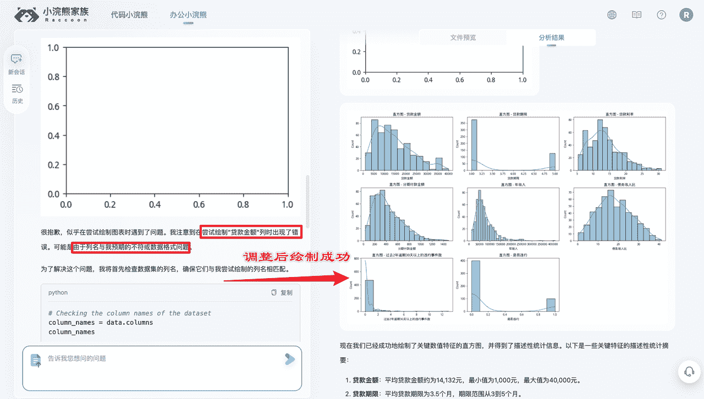

1. 分析小浣熊遇到的问题，可以避坑

**参考`Prompt` & 结果**

**执行过程部分截图**

> 这份数据有三个工作表，共同构成了一个贷款违约预测的数据集，

> 其中“`训练`”工作表出自某信贷平台的贷款记录，用于模型的训练，其中“是否违约”字段代表贷款是否违约，

> “`测试`”工作表用于模型预测，预测结果填入“提交格式”工作表。

>

> 请你为我进行数据挖掘，构建机器学习模型预测结果，并最终输出提交格式文件。

观察小浣熊操作的过程中，会发现数据分析有好几个坑：

这些坑在没有办公小浣熊等AI工具出现之前，可能需要耗费个人大量的时间进行测试和处理，

有了小浣熊之后，只需AI进行相关快速尝试，我们进行进一步的分析和决策即可，大大提升了我们的效率

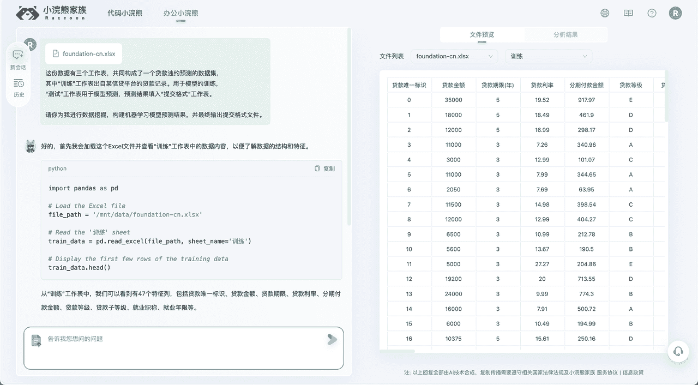

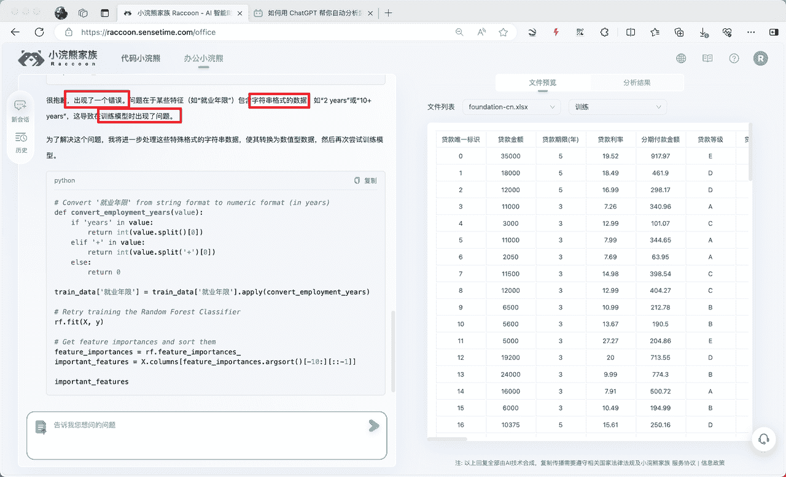

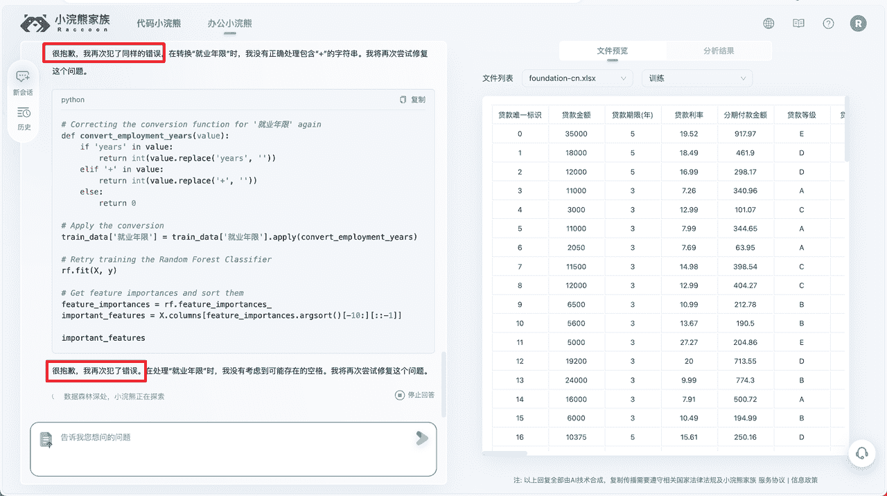

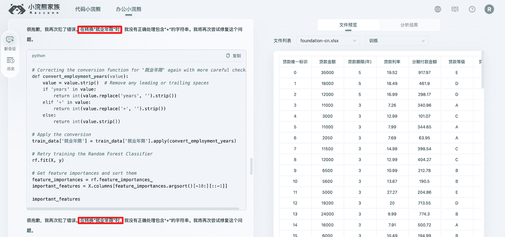

1. 让小浣熊帮忙写数据分析报告

> 请为我给出你上述工作使用的Python代码，以及最终的预测结果，并在对话中给出此次实践的报告

### 【官方】[办公小浣熊](https://raccoon.sensetime.com/login?utm_source=datawhale)QA

+ 支持本地化部署


+ 不会长久存储数据


+ 公测期间个人用户免费


+ 目前仅支持1个活跃会话，且20分钟无操作将过期


### 【进阶】详见 [更多进阶思路分享](https://datawhaler.feishu.cn/wiki/YdNhw9Z9ai42YZkOw0TchZafnne)

## 延伸阅读

1. 办公小浣熊常见问题 - 商汤科技

1. 《Pandas数据处理与分析》-耿远昊-豆瓣9.1分


`http://inter.joyfulpandas.datawhale.club/`


1. 10种数据分析的模型思维让你“灵光一闪”

1. 教程推荐：[【基准教程V1】与AI结对编程，告别“代码小白”称号](https://datawhaler.feishu.cn/wiki/Bm86wxAa7iUwvdkkiTtc6gvTnqe)

1. 20000字！一文学会Python数据分析

1. 数据分析方法有哪些?盘点八大数据分析方法，数据分析师必看!
