# 10分钟：大模型技术实践内测文档

> 来源：[https://datawhaler.feishu.cn/docx/BPdgdcjMgoJ4aLxpqgRcvN59npb](https://datawhaler.feishu.cn/docx/BPdgdcjMgoJ4aLxpqgRcvN59npb)

> 本课程内容已上线至 Datawhale 官网，可点击学习：https://www.datawhale.cn/learn/summary/62

> PS：比赛已结束，但运行体验仍可进行

# 一、10分钟带你速通大模型挑战赛

| **方向** | NLP（自然语言处理）、大模型 |  |
| --- | --- | --- |
| **核心技术栈** | 大语言模型、自然语言处理模型 |  |
| **赛事名称** | 大模型能力评测：中文成语释义与解析挑战赛 |  |
| **赛事链接** | https://challenge.xfyun.cn/h5/detail?type=interpretation-challenge&amp;ch=dw24_tjsmU3 |  |
| **背景介绍** | 中文成语，汉语的瑰宝，承载着千年的文化传统和智慧积淀。 |  |

## Step1：赛事报名！（点击即可跳转）

> 赛事链接：https://challenge.xfyun.cn/h5/detail?type=interpretation-challenge&ch=dw24_tjsmU3


1.报名参赛


2.账号登录

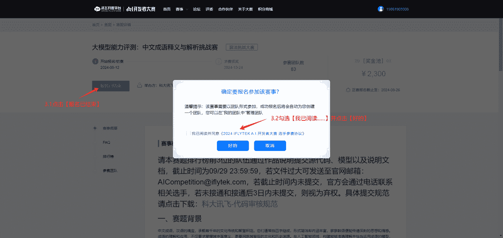

3.报名

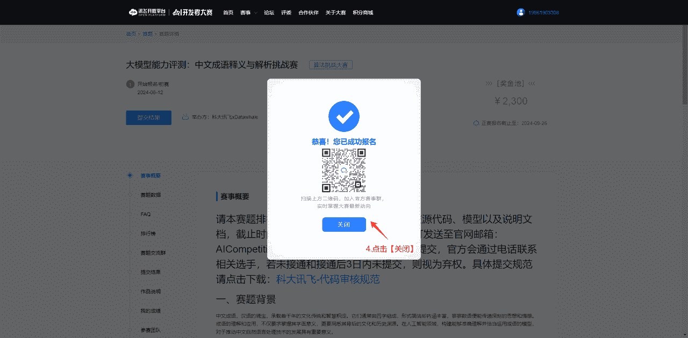

4.完成报名

## Step2：启动魔搭Notebook！（点击即可跳转）

> 链接：https://www.modelscope.cn/my/mynotebook/preset

> **选择方法二GPU环境，启动！**

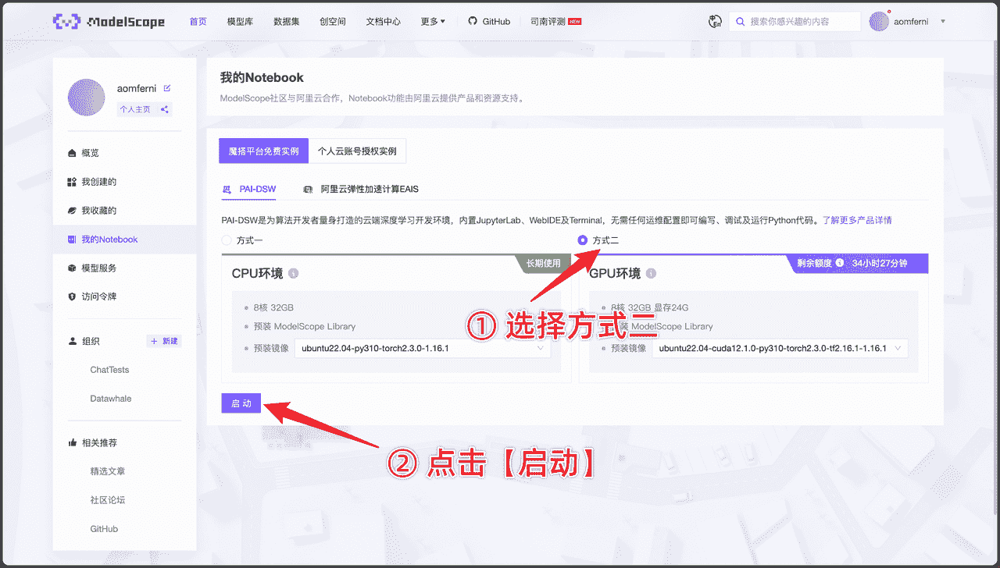

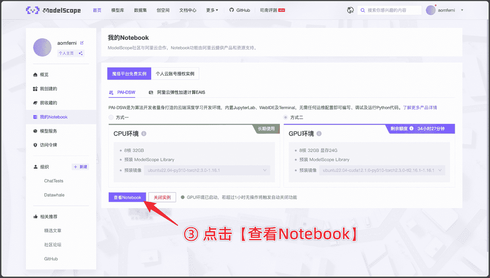

## Step3：体验一站式 baseline ！

1.  **打开终端**

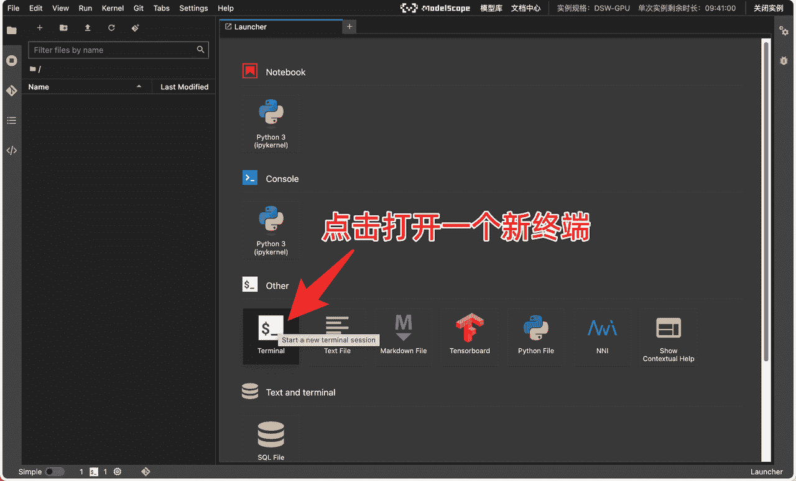

1.  **下载baseline代码**

> 复制下列命令，回车执行：

```
git lfs install
git clone https://www.modelscope.cn/datasets/Datawhale/Idiom_Definition_iFLYTEK_AI_2024.git
```


1.  打开baseline文件一键执行

> PS：注意baseline文件的后缀是.ipynb


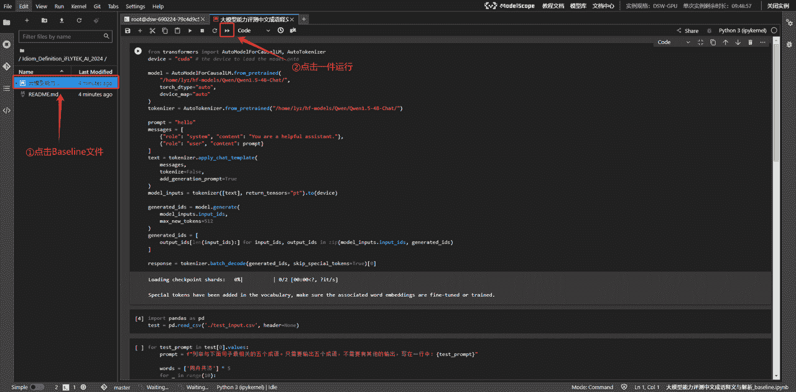

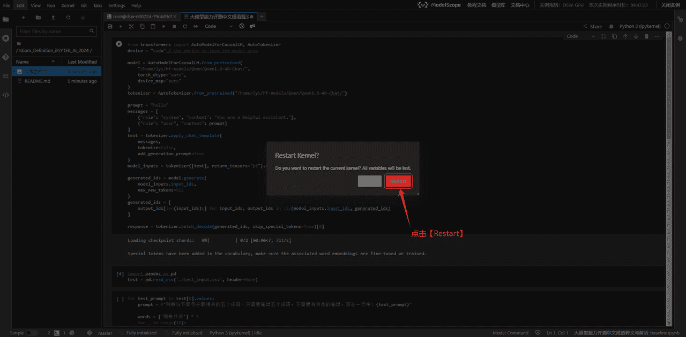

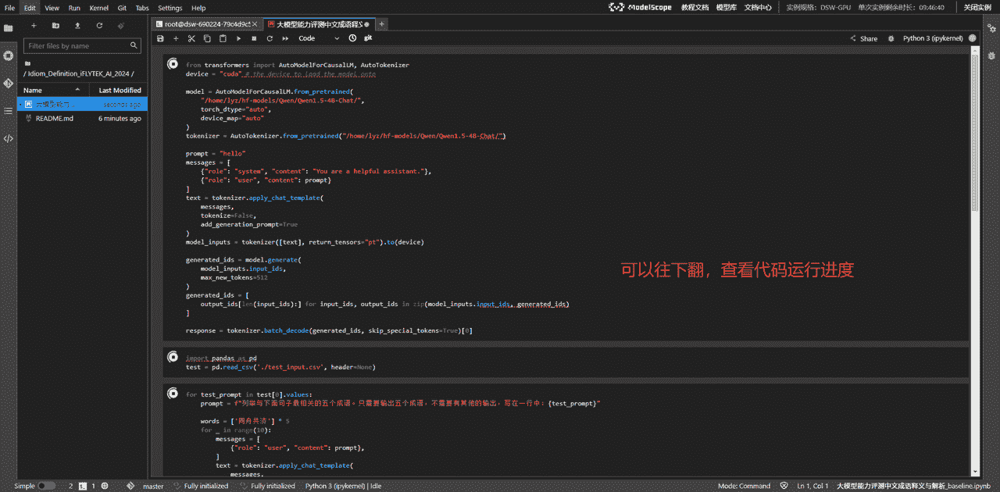

1.  ** 下载结果文件**

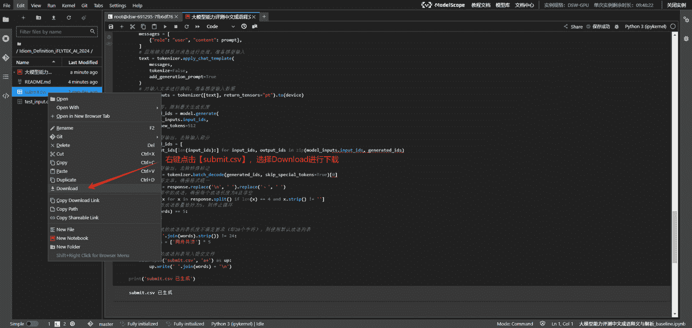

## Step4：提交文件，拿下第一个分数！(点击即可跳转官网进行提交)

> 链接：https://challenge.xfyun.cn/h5/detail?type=interpretation-challenge&ch=dw24_tjsmU3

> 点击【提交结果】，选择本地文件，提交并等待。


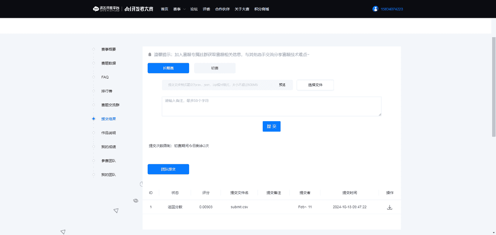

> 评分大概需要 5 分钟～可以在**【提交结果】下方**看到评分结果哟！（预期分数在0.00903分左右😉~）

## Step5：关闭实例！

<https://datawhaler.feishu.cn/sync/CKKcd02X0sBltZbRAXZcuW2Endg>

# 二、赛题解析

首先恭喜大家完成了**大模型技术**的初体验！接下来，我们来仔细了解一下，我们究竟完成了一个什么样的任务吧！

> **使用大语言**模型(LLM)的能力来解决问题，即大模型技术

>

> *LLM：大语言模型，可完成诸多生成类任[务的语言](https://tongyi.aliyun.com/)模型，典型应用为ChatGPT、通义千问等

## 1、赛题背景

中文成语，汉语的瑰宝，承载着千年的文化传统和智慧积淀。

它们通常由四字组成，形式简洁却内涵丰富，寥寥数语便能传递深刻的思想和情感。

成语的理解和应用，不仅要求掌握其字面意义，更要洞悉其背后的文化和历史渊源。

**在人工智能领域，构建能够准确理**解并恰当运用成语的模型，对于推动中文自然语言处理技术的发展具有重要意义。

## 2、数据说明

本次比赛的数据集由2972条中文通俗介绍的句子组成，每条句子对应一个成语单词。鼓励选手通过开源大模型来解决本次赛题，不允许只用非开源的模型。

句子示例为：两端都极为艰难，难以作出决定。更多数据详见数据集 test_input.csv

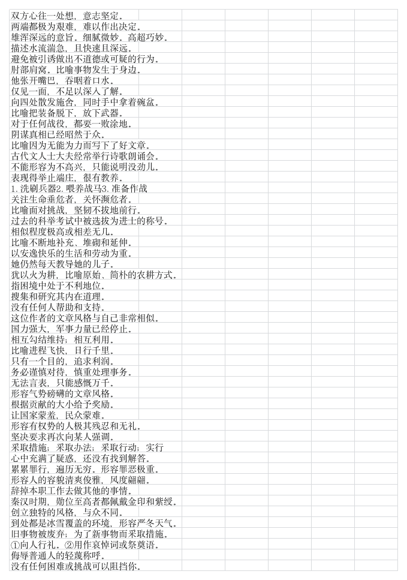

[test_input.csv](https://internal-api-drive-stream.feishu.cn/space/api/box/stream/download/all/XjPobkNRyomuVwxuuHRcHnxNnNo)

## 3、赛题任务

构建方案，解决成语释义与成语**匹配**的问题。

再通俗一些解释为：使用大模型解决问题——根据给定的句子，回答五个可能的成语

使用[通义千问](https://tongyi.aliyun.com/)解决这个问题的示例如下：


## 4、解题思路

赛题是一个典型的文本生成的任务，但生成的范围是可控的（中文成语是有限的）。

+   思路 1：通过大模型提示词直接生成成语。（不需要NLP基础，本次教程所使用的方案）

+   思路 2：计算通俗句子与成语之间的相似度。（需要NLP技术基础）

+   思路 3：对成语进行通俗解释后计算相似度。（需要NLP技术基础）

## 5、Baseline核心详解


[大模型能力评测中文成语释义与解析_baseline.ipynb](https://internal-api-drive-stream.feishu.cn/space/api/box/stream/download/all/OcURbUAN8or1t7xi7w7cAV0YnRd)

核心1：构建模型（使用Qwen1.5-4B模型）

```
from modelscope import AutoModelForCausalLM, AutoTokenizer

# 指定加载模型的设备
device = &quot;cuda&quot;  # the device to load the model onto

# 加载预训练的模型和tokenizer
model = AutoModelForCausalLM.from_pretrained(
    &quot;qwen/Qwen1.5-4B-Chat&quot;,
    torch_dtype=&quot;auto&quot;,
    device_map=&quot;auto&quot;
)
tokenizer = AutoTokenizer.from_pretrained(&quot;qwen/Qwen1.5-4B-Chat&quot;)

# 定义提示信息
prompt = &quot;hello&quot;

# 构建聊天消息列表
messages = [
    {&quot;role&quot;: &quot;system&quot;, &quot;content&quot;: &quot;You are a helpful assistant.&quot;},
    {&quot;role&quot;: &quot;user&quot;, &quot;content&quot;: prompt}
]

# 使用tokenizer将聊天消息转换为模型输入格式
text = tokenizer.apply_chat_template(
    messages,
    tokenize=False,
    add_generation_prompt=True
)

# 将输入文本转换为模型所需的tensor格式并加载到指定设备
model_inputs = tokenizer([text], return_tensors=&quot;pt&quot;).to(device)

# 生成回复
generated_ids = model.generate(
    model_inputs.input_ids,
    max_new_tokens=512
)

# 提取生成的回复部分
generated_ids = [
    output_ids[len(input_ids):] for input_ids, output_ids in zip(model_inputs.input_ids, generated_ids)
]

# 解码生成的回复并移除特殊标记
response = tokenizer.batch_decode(generated_ids, skip_special_tokens=True)[0]
```

**核心2：读取数据集并进行预测**

```
# 遍历测试数据集的第一项的值，目的是生成与给定句子最相关的五个成语
for test_prompt in test[0].values:
    # 构造提示信息，要求模型输出与句子最相关的五个成语
    prompt = f&quot;列举与下面句子最相关的五个成语。只需要输出五个成语，不需要有其他的输出，写在一行中：{test_prompt}&quot;

    # 初始化一个长度为5的列表，填充默认成语“同舟共济”
    words = [&#x27;同舟共济&#x27;] * 5

    # 构建聊天消息格式，用于提示模型进行生成
    messages = [
        {&quot;role&quot;: &quot;user&quot;, &quot;content&quot;: prompt},
    ]
    # 应用聊天模板对消息进行处理，准备模型输入
    text = tokenizer.apply_chat_template(
        messages,
        tokenize=False,
        add_generation_prompt=True
    )
    # 对输入文本进行编码，准备模型输入数据
    model_inputs = tokenizer([text], return_tensors=&quot;pt&quot;).to(device)
    
    # 生成回答，限制最大生成长度
    generated_ids = model.generate(
        model_inputs.input_ids,
        max_new_tokens=512
    )
    # 提取模型输出，去除输入部分
    generated_ids = [
        output_ids[len(input_ids):] for input_ids, output_ids in zip(model_inputs.input_ids, generated_ids)
    ]
    
    # 解码模型输出，去除特殊标记
    response = tokenizer.batch_decode(generated_ids, skip_special_tokens=True)[0]
    # 清理回答文本，确保格式统一
    response = response.replace(&#x27;\n&#x27;, &#x27; &#x27;).replace(&#x27;、&#x27;, &#x27; &#x27;)
    # 提取回答中的成语，确保每个成语长度为4且非空
    words = [x for x in response.split() if len(x) == 4 and x.strip() != &#x27;&#x27;]

    # 如果生成的成语列表长度不满足要求（即20个字符），则使用默认成语列表
    if len(&#x27; &#x27;.join(words).strip()) != 24:
        words = [&#x27;同舟共济&#x27;] * 5

    # 将最终的成语列表写入提交文件
    with open(&#x27;submit.csv&#x27;, &#x27;a+&#x27;) as up:
        up.write(&#x27; &#x27;.join(words) + &#x27;\n&#x27;)

print(&#x27;submit.csv 已生成&#x27;)
```

## 6、上分思路

> 更多细节详见：[大模型技术赛事速通提分手册](https://datawhaler.feishu.cn/wiki/LckuwqOr3igV1aksYkqcQDsvnUe)

+   更换大模型，使用更强大的模型进行预测。

```
# 修改前：使用 Qwen1.5-4B-Chat 大语言模型
model = AutoModelForCausalLM.from_pretrained(
    &quot;qwen/Qwen1.5-4B-Chat&quot;,
    torch_dtype=&quot;auto&quot;,
    device_map=&quot;auto&quot;
)
tokenizer = AutoTokenizer.from_pretrained(&quot;qwen/Qwen1.5-4B-Chat&quot;)

# 修改后：使用使用 Qwen2.5-72B-Instruct 大语言模型
model = AutoModelForCausalLM.from_pretrained(
    &quot;qwen/Qwen2.5-72B-Instruct&quot;,
    torch_dtype=&quot;auto&quot;,
    device_map=&quot;auto&quot;
)
tokenizer = AutoTokenizer.from_pretrained(&quot;qwen/Qwen2.5-72B-Instruct&quot;)
```

+   多次生成回答，避免出现偶发事件。

```
# 修改前：仅生成一次回答
messages = [
    {&quot;role&quot;: &quot;user&quot;, &quot;content&quot;: prompt},
]
text = tokenizer.apply_chat_template(
    messages,
    tokenize=False,
    add_generation_prompt=True
)
model_inputs = tokenizer([text], return_tensors=&quot;pt&quot;).to(device)

generated_ids = model.generate(
    model_inputs.input_ids,
    max_new_tokens=512
)
generated_ids = [
    output_ids[len(input_ids):] for input_ids, output_ids in zip(model_inputs.input_ids, generated_ids)
]

response = tokenizer.batch_decode(generated_ids, skip_special_tokens=True)[0]
response = response.replace(&#x27;\n&#x27;, &#x27; &#x27;).replace(&#x27;、&#x27;, &#x27; &#x27;)
words = [x for x in response.split() if len(x) == 4 and x.strip() != &#x27;&#x27;]

# 修改后：循环生成10次，并使用判断对循环进行控制
    for _ in range(10):
        messages = [
            {&quot;role&quot;: &quot;user&quot;, &quot;content&quot;: prompt},
        ]
        text = tokenizer.apply_chat_template(
            messages,
            tokenize=False,
            add_generation_prompt=True
        )
        model_inputs = tokenizer([text], return_tensors=&quot;pt&quot;).to(device)
        
        generated_ids = model.generate(
            model_inputs.input_ids,
            max_new_tokens=512
        )
        generated_ids = [
            output_ids[len(input_ids):] for input_ids, output_ids in zip(model_inputs.input_ids, generated_ids)
        ]
        
        response = tokenizer.batch_decode(generated_ids, skip_special_tokens=True)[0]
        response = response.replace(&#x27;\n&#x27;, &#x27; &#x27;).replace(&#x27;、&#x27;, &#x27; &#x27;)
        words = [x for x in response.split() if len(x) == 4 and x.strip() != &#x27;&#x27;]
        if len(words) == 5:
            break
```

# 三、科普：什么是大模型技术？

**大模型技术**是指具有大规模参数和复杂计算结构的机器学习模型，通常由深度神经网络构建而成，拥有数十亿甚至数千亿个参数。这些模型的设计目的是为了提高模型的表达能力和预测性能，使其能够处理更加复杂的任务和数据。大模型在多个领域都有广泛的应用，包括自然语言处理（NLP）、计算机视觉（CV）、语音识别和推荐系统等。

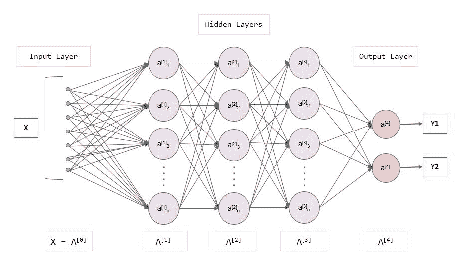

**大模型**通过训练海量数据来学习复杂的模式和特征，展现出更强大的泛化能力，能够对未见过的数据做出准确的预测。与小模型相比，大模型通常参数较多、层数较深，具有更强的表达能力和更高的准确度，但也需要更多的计算资源和时间来训练和推理。

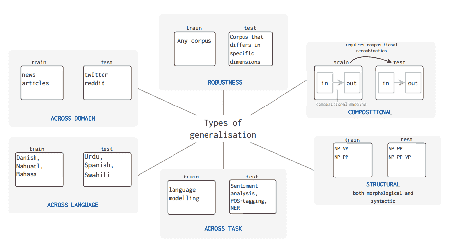

大模型的相关概念包括**超**大模型、大语言模型（LLMs）、GPT（Generative Pre-trained Transformer）等。超大模型是参数量远超过大模型的一个子集。大语言模型通常是具有大规模参数和计算能力的自然语言处理模型，例如OpenAI的GPT-4o模型，这些模型能够生成类似人类的文本或回答自然语言的问题。下面是关于GPT-4o的演示实录。


[videoplayback.mp4](https://internal-api-drive-stream.feishu.cn/space/api/box/stream/download/all/Xisnb1gfCoSUeNxWTozcjrybn5e)

**大模型的核心技术**包括深度学习和自然语言处理技术。深度学习技术通过训练深度神经网络对大量数据进行处理，实现复杂的数据分析和处理任务。自然语言处理技术则是对人类自然语言进行深入分析和处理的技术，包括文本分析、情感分析、语音识别、机器翻译等。

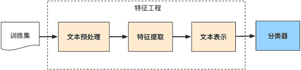

大模型的应用场景广泛，涵盖了自然语言处理、**计算机视觉、金融****风险管理、医疗**诊断、交通与城市规划等多个领域。在自然**语言处理**领域，大模型被用于提高文本生成、文本分类、情感分析等任务的准确性。在**计算机视觉领域，大**模型用于目标检测、图像分类、图像生成等任务，提高图像识别和理解的准确性。在金融领域，大模型被应用于风险预测、市场预测和欺诈检测等方面，提供有效的决策支持。在医疗领域，大模型辅助医生进行疾病诊断、影像解读以及药物研发等方面的工作。在交通和城市规划领域，大模型帮助优化交通网络、提高交通流量和安全性等方面。

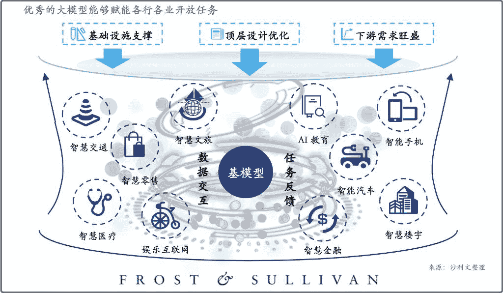

随着技术的不断进步和应用场景的不断拓展，大模型将在更多领域展现其巨大的潜力，为人类万花筒般的AI未来拓展无限可能性。

# 四、追踪：大模型技术现在发展成什么样子了？

1.  [**大模型基础理论和技术能力提升**](https://www.nsfc.gov.cn/csc/20345/20348/pdf/2023/202305-758-766.pdf)：大模型技术的核心在于通过海量数据进行预训练，从而具备强大的自然语言处理和生成能力。这些模型已经在文本生成、对话系统和智能推荐等多个场景中得到广泛应用。例如，OpenAI的GPT系列模型在自然语言处理领域取得了显著成就，并且在图像处理、音频处理、生理信号等其他数据模态中也显示出巨大优势。

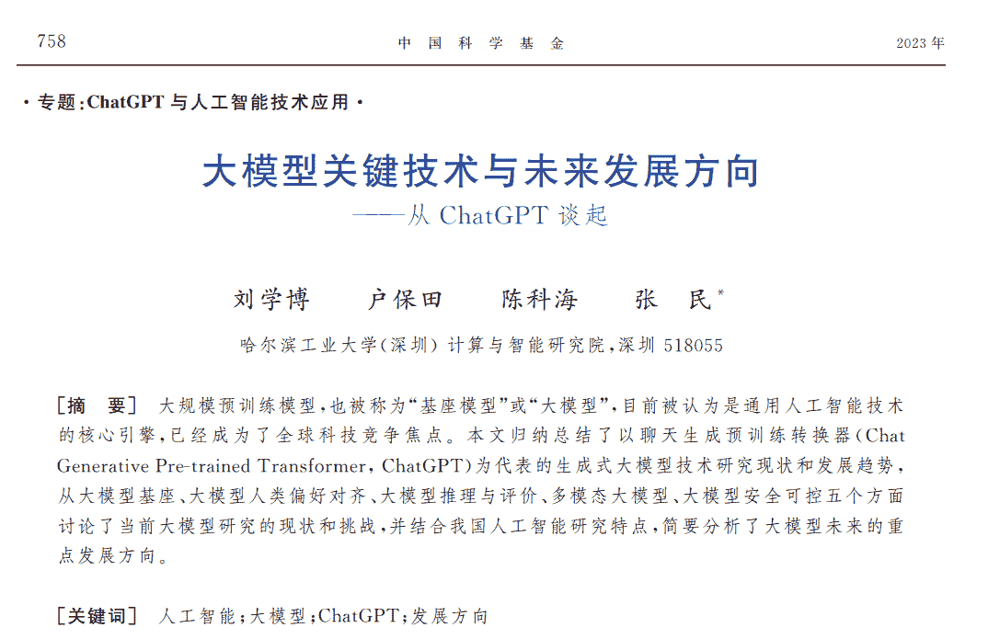

1.  [**多模态大模型的发展**](https://news.qq.com/rain/a/20241013A02YRG00)：大模型不仅仅局限于文本，它们正在向多模态发展，能够同时理解和生成包括文本、图像、音频等多种类型的数据。例如，OpenAI在2023年宣布的多模态大模型GPT-4，新增了图像功能，同时具备更精准的语言理解能力，这标志着大模型从单一模态向多模态的重要转变。

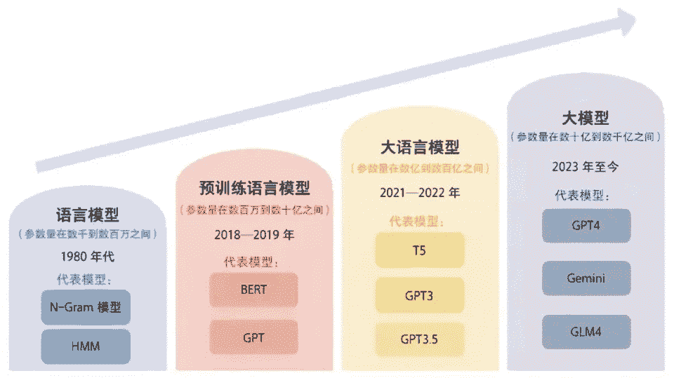

1.  [**产学研合作的新进展**](https://www.jiqizhixin.com/articles/2024-10-11-7)：2024年10月11日，清华大学智能产业研究院（AIR）与字节跳动联合成立了“可扩展大模型智能技术联合研究中心”（SIALab），旨在提升预训练大语言模型的技术能力，推动智能系统在复杂任务中的应用，为未来的人工智能发展奠定坚实基础。

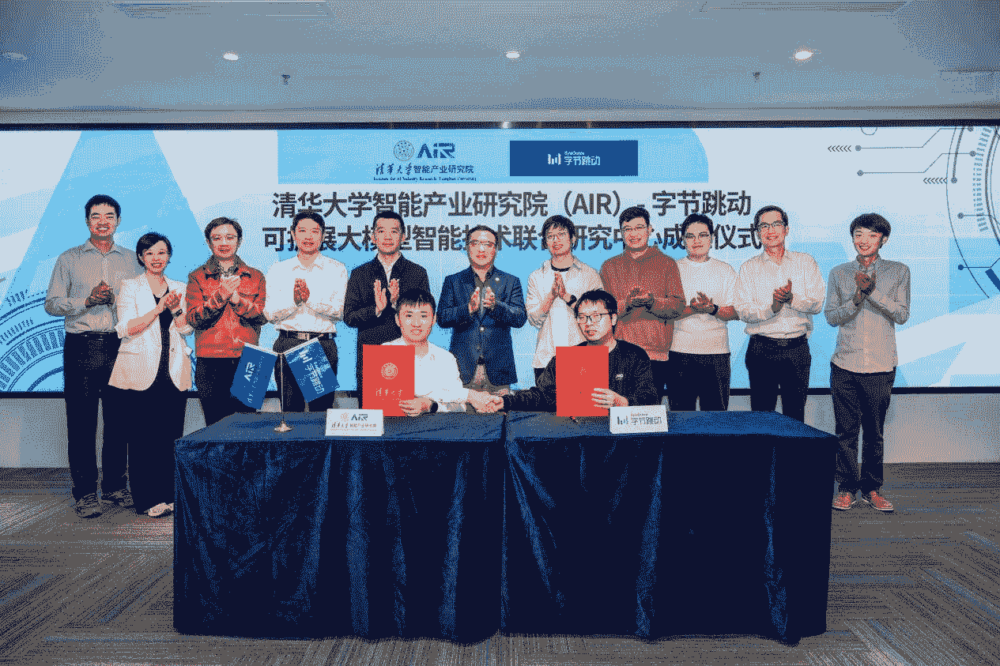