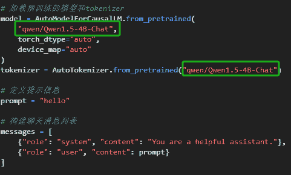
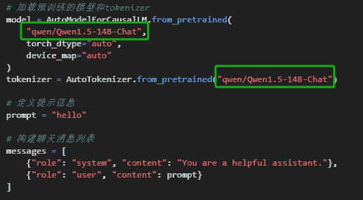
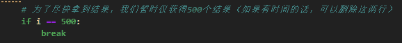
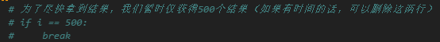
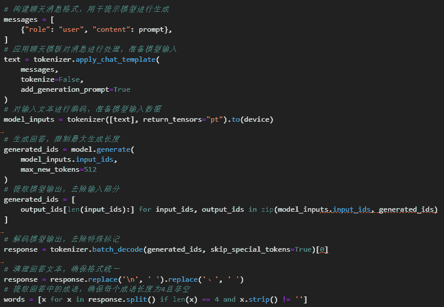
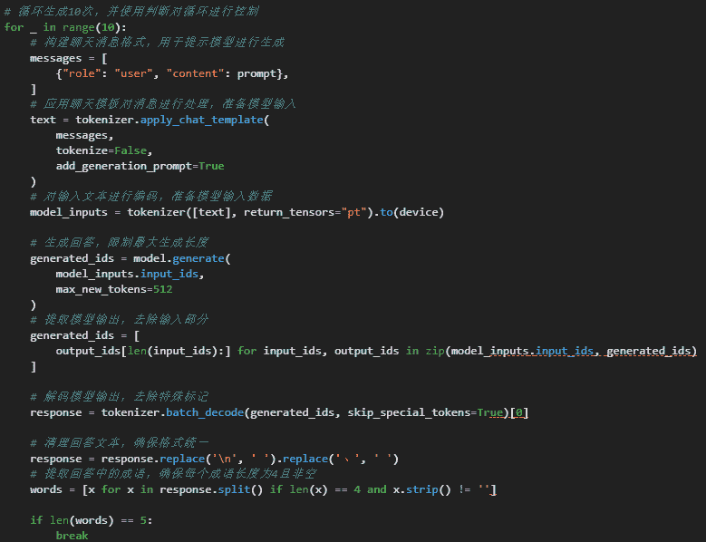

# 大模型技术赛事速通提分手册

> 来源：[https://datawhaler.feishu.cn/docx/S4VcdBHrroaY4vxqkjocmJIDn8b](https://datawhaler.feishu.cn/docx/S4VcdBHrroaY4vxqkjocmJIDn8b)

> **成就达成**

> 🎊恭喜大家完成了前一阶段的速通任务，欢迎来到提分手册，认领你的提分任务🎊

我们将从以下几个方向为大家提供相应的提分思路！！！！！！

# 方向一：更换更大参数量的预训练模型

在**我们提供的Bas****eline中，我们**采**用了阿里云于202**4年2月发布的通用型问答开**源模型—**—通义千问1.5版本（Qwen 1.5）。该模型系列共开源了8个不同规模的版本，包括基础型（Base）和聊天型（Chat）模型，它们的参数量分别为0.5B、1.8B、4B、7B、14B、32B、72B和110B。

Baseline中我们选择了参数量较小的4B版本的聊天型的Qwen1**.5模型进行生成答案**。为**了能提升我们模型的回答**能力以及生成答案的准确性，我们可以使用更大参数量的模型或者其他团队提出的开源模型。

> 测试时，使用Qwen1.5开源版本中参数量在32B及以上模型会出现内存不足报错问题。【32B模型显示内存溢出，与其他模型显示错误不同】

🌰举**个例子**

我用 **Qwen1.5-14B-Cha**t 模型替换了Baseline中的 Qwen1.5-4B-Chat 模型。

+   模型更改部分



Qwen1.5-4B-Chat模型



Qwen1.5-14B-Chat模型

# 方向二：使用全量数据

Ba**seline中为了**减少大家初次使用时的时间，我们只使用了所有数据中的前500行进行回答。由于数据量的不足，导致模型学习不足。为了能让我们的模型学习到更多的数据信息，我们可以增大输入数据的数量，让模型的泛化能力更强。

🌰举**个例子**

我们用**全量数据（2972条）**替换了Baseline中的**非全量数据（500条）**。

+   模型更改部分



非全量数据



全量数据

# 方向三：多次重复，即使再小的模型也能有很好效果

在Ba**seline中的回答环节，**我们采用了一次性生成的方法，这样做的主要目的是为了降低初学者的学习门槛，缩短他们的学习时间。然而，这种方法可能会导致模型生成的回答中出现偶然性的问题，这是我们需要进一步优化的方向。因此我们为了增加我们模型生成问题的准确性，我们将生成次数增加，多次生成回答，并进行筛选。

🌰举**个例子**

我们将生成**10次回答****替换了B**aseline中的仅生成1次回答。

+   模型更改部分



仅生成1次回答



循环10次，并用条件判断生成结果

# 方向四：使用不同的模型对生成的回答进行判断【未经过测试，仅提出想法】

在Baseline版本中，我们仅依赖单一模型来生成答案，并将这些答案直接提交，这种做法使得生成的答案具有不可替代性。为了提升答案的准确性，我们可以引入一个新的模型B，它将扮演裁判的角色，对模型A生成的答案进行评估。通过这种方式，即使我们的数据量有限，也能够确保生成的答案具有较高的质量。这样的双重模型策略有助于提高整体的准确性，同时减少对大量数据的依赖。

🌰举**个例子**

我们引入第二个模型B，让其充当一个裁判的角色，对模型A生成的答案进行评价，不正确或者不准确则返回重新生成。【未跑通，可以往这方向努力】

```
for test_prompt in tqdm(test[0].values, total=len(test[0].values), desc=&quot;处理进度&quot;):
    i = i + 1
    is_OK = False  # 用于标记是否满足条件
    max_attempts = 5  # 设置最大尝试次数，避免无限循环
    attempts = 0

    while not is_OK and attempts &lt; max_attempts:
        # 构造提示信息，要求模型输出与句子最相关的五个成语
        prompt1 = f&quot;列举与下面句子最相关的五个成语。只需要输出五个成语，不需要有其他的输出，写在一行中：{test_prompt}&quot;

        # 初始化一个长度为5的列表，填充默认成语“同舟共济”
        words = [&#x27;同舟共济&#x27;] * 5

        # 构建聊天消息格式，用于提示模型进行生成
        messages1 = [
            {&quot;role&quot;: &quot;user&quot;, &quot;content&quot;: prompt1},
        ]
        # 应用聊天模板对消息进行处理，准备模型输入
        text1 = tokenizer.apply_chat_template(
            messages1,
            tokenize=False,
            add_generation_prompt=True
        )
        # 对输入文本进行编码，准备模型输入数据
        model1_inputs = tokenizer([text1], return_tensors=&quot;pt&quot;).to(device)

        # 生成回答，限制最大生成长度
        generated_ids1 = model1.generate(
            model1_inputs.input_ids,
            max_new_tokens=512
        )
        # 提取模型输出，去除输入部分
        generated_ids1 = [
            output_ids[len(input_ids):] for input_ids, output_ids in zip(model1_inputs.input_ids, generated_ids1)
        ]

        # 解码模型输出，去除特殊标记
        response = tokenizer.batch_decode(generated_ids1, skip_special_tokens=True)[0]

        # 清理回答文本，确保格式统一
        response = response.replace(&#x27;\n&#x27;, &#x27; &#x27;).replace(&#x27;、&#x27;, &#x27; &#x27;)
        # 提取回答中的成语，确保每个成语长度为4且非空
        words = [x for x in response.split() if len(x) == 4 and x.strip() != &#x27;&#x27;]

        # 如果生成的成语列表长度不满足要求（即20个字符），则使用默认成语列表
        if len(&#x27; &#x27;.join(words).strip()) != 24:
            words = [&#x27;同舟共济&#x27;] * 5

        prompt2 = f&quot;生成的成语{words}是否与{test_prompt}所描述的相同，仅用True和Flase回答。&quot;
        messages2 = [
            {&quot;role&quot;: &quot;user&quot;, &quot;content&quot;: prompt2},
        ]
        text2 = tokenizer.apply_chat_template(
            messages2,
            tokenize=False,
            add_generation_prompt=True
        )
        model2_inputs = tokenizer([text1], return_tensors=&quot;pt&quot;).to(device)
        generated_ids2 = model2.generate(
            model2_inputs.input_ids,
            max_new_tokens=512
        )
        generated_ids2 = [
            output_ids[len(input_ids):] for input_ids, output_ids in zip(model2_inputs.input_ids, generated_ids2)
        ]
        response2 = tokenizer.batch_decode(generated_ids2, skip_special_tokens=True)[0]
        response2 = response2.replace(&#x27;\n&#x27;, &#x27; &#x27;).replace(&#x27;、&#x27;, &#x27; &#x27;)
        for j in len(response2):
            if response2[j] == &#x27;False&#x27;:
                is_relevant == False                
        
        # 如果符合条件，则停止循环
        if is_relevant:
            is_OK = True
        else:
            attempts += 1

    # 将最终的成语列表写入提交文件
    with open(&#x27;submit.csv&#x27;, &#x27;a+&#x27;, encoding=&#x27;utf-8&#x27;) as up:
        up.write(&#x27; &#x27;.join(words) + &#x27;\n&#x27;)

    # 查看阶段性结果
    if i % 50 == 0:
        tqdm.write(f&quot;大模型第{i}次返回的结果是：\n   {response}\n&quot;)
        tqdm.write(f&quot;submit.csv第{i}行输出结果：\n   {words}\n&quot;)
```

# 写在最后

最后，特别值得指出的是，当我们转向使用参数量更大的模型时，虽然性能有所提升，但运行时间也相应地显著增加。因此，我们不能单纯追求参数量更大的模型、使用更多的数据量，而应该考虑如何在资源有限的条件下，实现最大的效益。

> **彩蛋：大家可以试试Qwen1.5-MoE模型。它仅拥有27亿个激活参数，但其性能却能与当前最先进的70亿参数模型，如Mistral 7B和Qwen1.5-7B相媲美。相较于包含65亿个Non-Embedding参数的Qw**en1.5-7B，Qwen1.5-MoE-A2.7B只有20亿个Non-Embedding参数，约为原模型大小的三分之一。此外，相比Qwen1.5-7B，Qwen1.5-MoE-A2.7B的训练成本降低了75%，推理速度则提升至1.74倍。

# Last：提交文件，拿下分数！(点击即可跳转官网进行提交)

> 链接：https://challenge.xfyun.cn/h5/detail?type=interpretation-challenge&ch=dw24_tjsmU3