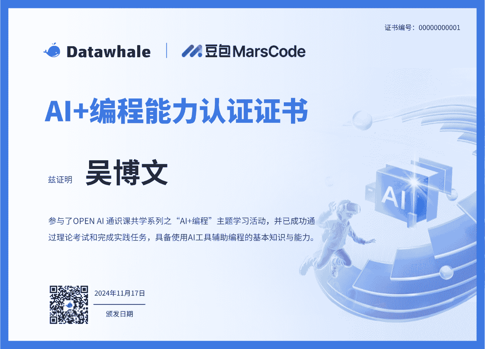

# AI+编程

> 来源：[https://datawhaler.feishu.cn/docx/WKdkdFQAtoVArhx02rhcYgxon9c](https://datawhaler.feishu.cn/docx/WKdkdFQAtoVArhx02rhcYgxon9c)

> 本教程内容已上线至官网，具体内容可至官网学习：https://www.datawhale.cn/learn/summary/58

# 学习提要

欢迎大家参与OPEN AI通识课共学系列之【AI+编程入门】学习活动

本教程将会带你一步步走进AI+编程的世界！

本教程面向不同能力水平的学习者，将帮助大家一步步入门AI+编程：

完成了本次学习的同学，还可以参与【AI+编程能力认证考试】

通过考试即可获得由 Datawhale和豆包MarsCode联合认证的证书

