# 竞赛实践路线分享

> 来源：[https://datawhaler.feishu.cn/docx/EJ2Edl0hXoIWwuxO15CcEj9Wnxn](https://datawhaler.feishu.cn/docx/EJ2Edl0hXoIWwuxO15CcEj9Wnxn)

> 如何参与数据竞赛？数据竞赛所涉及的知识点、工具库、技能树有哪些？数据竞赛的方法论，通用流程是什么？我们邀请了多位竞赛大神，开源共创出竞赛学习路线，为竞赛选手降低竞赛门槛，提供基础路径和有效经验。

根据现有的竞赛平台和竞赛内容，我们设计了从入门到进阶的系统竞赛学习路线：

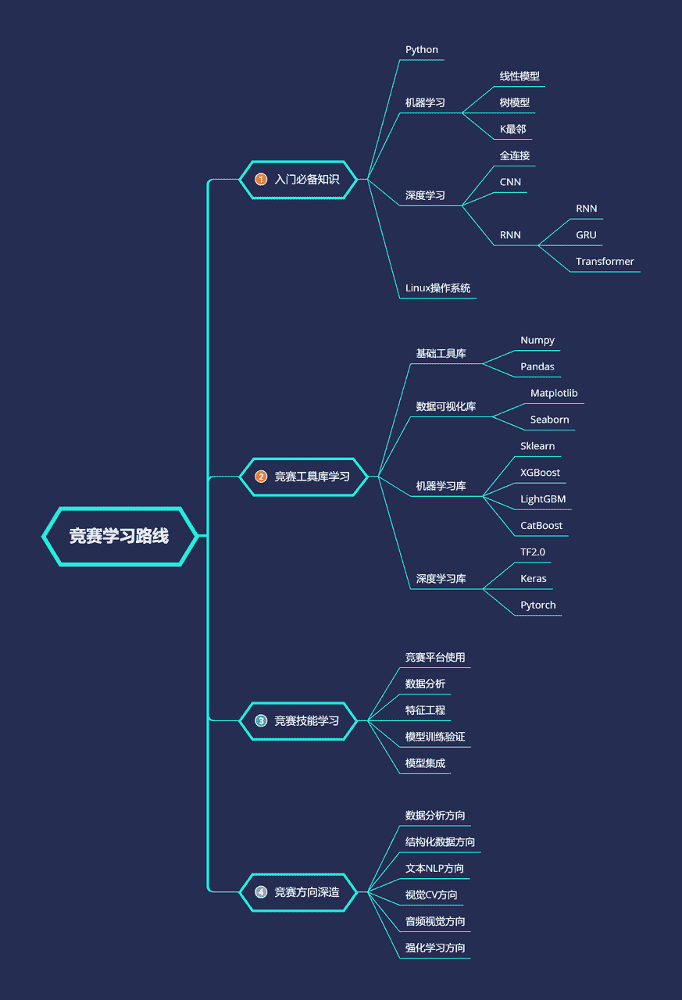

竞赛学习路线

## 一、基础必备知识

> 在第一步需要学习竞赛必备的知识，主要包括Python、机器学习、深度学习和Linux操作系统四个方面。完成此步骤学习完成后，需要具备基础的编码和动手能力：

+   **Python：**

+   目标：能够掌握Python常见的语法以及使用Python完成常见的操作；

+   要求：

+   掌握Python数据结构的使用（列表、字典等）

+   掌握Python函数和类的定义

+   掌握Python文件读写的操作

+   **机器学习****与深度学习**

+   目标：能够掌握机器学习和深度学习基础算法的原理和使用

+   要求：

+   掌握机器学习基础（数据划分、过拟合与欠拟合）

+   掌握机器学习算法分类

+   掌握常见机器学习算法原理

+   掌握深度学习算法原理

+   **Linux操作系统**

+   目标：能够使用Linux操作系统，包括文件、资源和网络；

+   要求：

+   掌握Linux目录的概念、文件创建、删除和移动等操作；

+   掌握Linux进程管理操作；

## 二、竞赛工具库学习

> 在第二步可以对Python环境下的竞赛工具库完成学习，主要包括数据处理、数据可视化、机器学习库和深度学习库四个方面。完成此步骤学习后，需要具备使用特定库完成数据操作的动手能力：

+   **基础工具库**

+   目标：能够使用Pandas和Numpy完成数据读取、统计和分析

+   要求：

+   掌握Numpy基础计算

+   掌握Pandas完成基础统计和复杂统计

+   **数据可视化库**

+   目标：能够使用Matplotlib和Seaborn完成基础的数据可视化

+   要求：

+   掌握Matplotlib画图构成，能够修改画图组成元素

+   掌握Seaborn常见的画图方法

+   **机器学习****库**

+   目标：掌握机器学习库的使用，并能够使用相应库完成建模

+   要求：

+   掌握sklearn库的使用（数据划分、模型使用、评价函数和模型调参）

+   掌握XGBoost/LightGBM/Catboost库的使用（模型训练、验证和调参）

+   **深度学习库**

+   目标：深度学习库的使用（TF、Pytorch和Keras任意一种），能够完成模型定义和训练

+   要求

+   熟练掌握一种深度学习库的使用，具体使用包括网络结构定义和损失函数使用；

+   熟练掌握深度学习库完成数据读取和数据扩增

## 三、竞赛技能学习

> 在第三步需要完成具体竞赛技能的学习，包括竞赛平台的使用、数据分析过程、特征工程过程、模型训练与验证细节和模型集成。

+   目标：掌握竞赛各流程的知识点

+   要求：

+   掌握各个平台的基础操作（比赛报名、提交和Notebook训练）

+   掌握竞赛中的数据处理与数据分析操作

+   掌握类别特征、数值特征、日期特征、文本和图像数据的特征工程

+   掌握交叉验证的模型训练过程

+   掌握Stacking模型集成的方法

## 四、竞赛方向深造

> 在第四步需要完成具体方向的深入，方向包括数据分析、结构化数据、非结构化数据和强化学习方向。

+   目标：掌握具体方向深入的知识点和相应模型

+   要求：

+   掌握具体方向高阶模型的使用

+   掌握具体方向高阶建模方法

+   掌握具体方法前沿学术模型发展

## 五、数据竞赛通用流程

> 很多数据竞赛虽然技巧很多，但是整体的流程都是相似的。当我们进入某个数据竞赛，会拿到关于该数据竞赛的背景描述、问题定义、重要时间段信息以及对应的数据字段信息等。然后针对该问题，我们需要对其进行分析建模。此处，我们将分析建模流程细分为十一个小模块：

1.  问题理解，分析，规划；

1.  数据探索分析；

1.  样本筛选、样本组织；

1.  验证策略设计；

1.  模型理解和选择；

1.  特征工程；

1.  模型训练、验证、测试；

1.  模型预测结果分析；

1.  后处理；

1.  模型融合；

1.  复盘总结；

每个小模块都会有很多对应的细节需要思考和注意，模块与模块之间也存在密切的联系，为了方便理解，我们在本章节按照分析建模的标准流程对每个模块以及先后关联进行简单的阐述，每个模块的细节大家可以在后面的章节中进行细致的学习。

我们点开一些平台的数据竞赛页面之后，会看到下面的信息，此处我们以天池的一些竞赛为例，

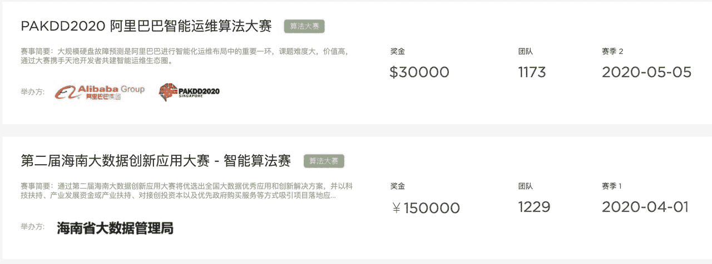

我们选择自己感兴趣的赛题点击进入，一般会看到类似于下面的界面，

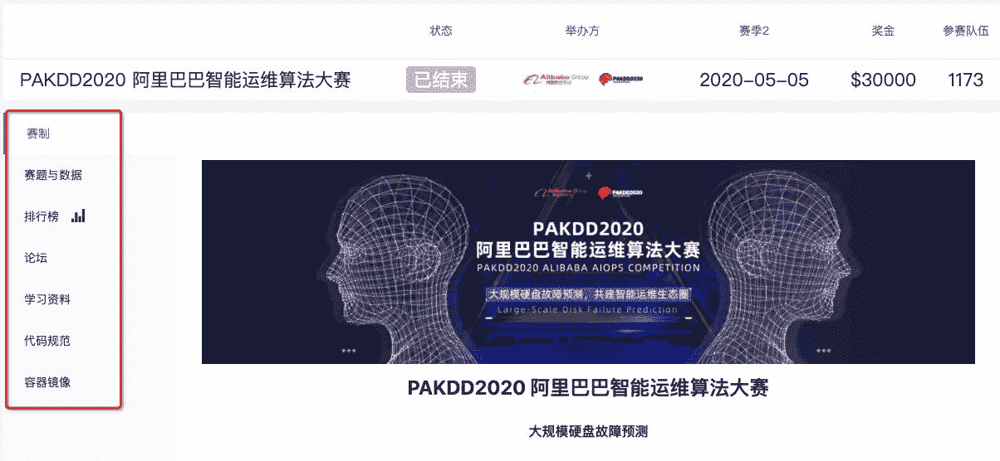

几乎所有的比赛都是类似的，点击进入之后一般就是有关于该竞赛的赛制描述，问题的定义、数据信息、评估指标、比赛时间、论坛等信息。在阅读完这些信息之后，便正式开启数据竞赛的征程。我们该如何动手呢？

### **5.1  问题理解，分析，规划**

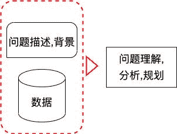

首先，在第一步我们需要做的就是对赛题的背景进行理解、分析并做细致的竞赛规划。具体地，我们需要思考数据的收集模式，是否会因为数据收集方式的方式手段而引入较多的脏数据？数据的标签来源是什么，是否打标的方式和我们的直观不符？评估指标是否可以直接优化，对于不可以直接优化的目标是否可以采用某些技巧来进行优化？除此之外，我们还需要基于赛事的重要时间点进行详细地规划，包括什么时候考虑做模型融合、组队的时间范围等。此外，我们还需要对每日的评估次数做衡量，最后便是花一些时间去收集该赛事相关的所有资料方便后续参考与学习。

### **5.3  数据探索分析**

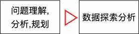

对赛题有了大致的了解，初步的竞赛计划也制定好之后，下面便进入第二步，对官方所给的数据进行细致的分析与探索，对于数据的探索与分析是为了能更好地理解数据，包括数据的整体情况、每个字段的含义、数据字段中是否存在奇怪的或错误的情况（例如某些特征字段中出现了大量的空值，身高体重等特征中出现了负数的情况等）、标签是否分布平衡、特征字段与标签的关系、训练集合与测试集合的数据分布是否存在较大的差异等。初期的特征探索与分析能帮助我们更好地理解数据，为后面的决策提供强有力的参考。

### **5.4 样本筛选、样本组织**

做完初步的数据探索以及分析之后，再往下一步我们需要基于在数据探索分析部分得到的结论进行样本的筛选、组织。在建模的过程中，异常的数据往往会给模型带来较大的误导，所以建模早期对于样本的筛选至关重要。在一些流量预测问题中，例如地铁人流量预测问题中，如果我们使用节假日期间地铁的流量数据建模预测非节假日的地铁流量，就会有非常大的概率误导模型的训练，从而使模型无法获得好的效果。在70%以上的问题中，平台已经帮助我们组织好了样本，例如反欺诈的任务等，我们不需要耗费太多的经历去对样本进行重新组织。但在一些特定的问题中，训练集和测试集的构建是需要我们自己设计的，此时我们需要对样本进行精心的组织从而得到我们的训练集、验证集以及测试集，此类情况常见于存在时间关系的数据建模问题中，例如预测未来一周内某类商品每一天的销量；判断某个平台上每个用户未来一周内最有可能购买的商品等。这个时候我们往往需要对标签集合和特征集合进行细致的设计，尽可能多的使用到更多有价值的信息来提升我们模型的效果，对于样本的组织使用在此时就会显得尤为重要。

### **5.5  验证策略设计**

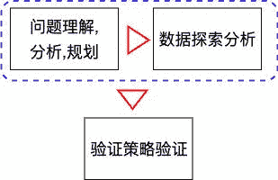

做完样本的初步筛选，并对样本进行重新组织之后。下一步要做的就是基于上面的分析进行线下验证策略的设计。验证集设计的合理与否，对整个竞赛都有着重大的影响，如果模型的线下结果和线上结果不一致，就会导致无法继续进行后续的实验。所以是直接采用简单的五折交叉验证做线下验证，还是进行分组进行交叉验证亦或是按照时间顺序进行训练集和验证集合的划分？是我们在这一块需要重点思考的问题。

### **5.6  模型理解和选择**

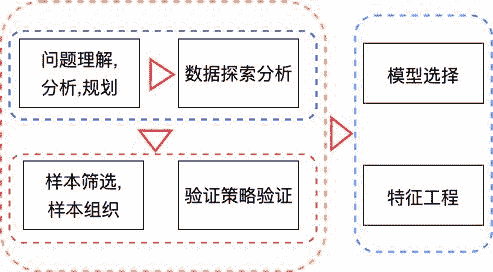

当验证策略设计完成之后，下一步就是进行模型的选择并构建相对应的特征，在实践中，存在成千上万的模型，每种模型对于数据的吸收方式和效果也都存在较大差异，比如神经网络模型往往需要对数值类的特征进行归一化操作，如果数值特征中存在奇异值，在很多时候会对模型带来灾难性的影响，导致模型无法拿到理想的结果；而梯度提升树相关的模型，例如XGBoost，LightGBM，CatBoost等在建模的时候则往往不需要对特征进行归一化，对于特征中出现的极大极小值也有较好的鲁棒性。究竟选用何种模型是困扰所有参赛选手的问题之一。幸运的是，在过往的四五年的数据挖掘竞赛中，大家尝试了大量的机器学习算法，发现在基于表格形的数据建模中，基于梯度提升树的建模往往可以取得更好的成绩，而我们对这些历史竞赛进行了统计，也发现对于表格形的数据算法竞赛，超过90%以上的获奖方案目前都还是基于梯度提升树模型的。所以本书中，我们主要针对梯度提升树展开，介绍梯度提升树的数学原理，对于数据吸收的方式，以及这种方式的优缺点等。

### **5.7  ****特征工程**

在模型基本选定之后，接下来的要做的就是细致的特征工程，模型与特征是相辅相成的，此处我们将模型与特征工程当做一个整体进行处理。对于设计的模型我们希望它可以充分吸收数据并从数据集中自动挖掘出与我们标签相关的信息，从而能更好地对我们的测试数据进行预测，但从目前模型的发展情况来看，暂时还没有哪种模型可以自动化地对数据进行充分的挖掘，因而我们需要通过人为的方式对数据进行处理，包括特征预处理、组合特征的构建、特征的筛选等等，在模型数据处理的弱势区域对其进行帮助，从而使得我们模型可以获得更好的效果。换言之，特征工程就是在帮助模型学习，在模型学习不好的地方或者难以学习的地方，采用特征工程的方式帮助其学习，通过人为筛选、人为构建组合特征让模型原本很难学好的东西可以更加轻易的学习从而拿到更好的效果。在后续的内容中，我们会针对目前在大数据竞赛圈和工业界表格数据问题上最为流行的梯度提升树模型进行探讨，先介绍针对梯度提升树可以采用的通用特征工程方案以及在特定领域的许多业务特征。

### **5.8  模型训练、验证、测试**

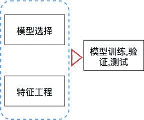

在第一版特征工程完工之后，我们将抽取得到的特征与对应的标签信息输入到我们的模型中进行模型的训练、验证，在模型的训练过程中，我们会比较如何得到好的模型参数，这对于最终模型的预测效果的影响还是非常大的，所以这一块我们需要了解并掌握一些常用的调参技巧，例如暴利式的调参，贪心的贝叶斯调参等。与此同时我们还需要了解在某些特定问题中，一些核心参数的重要意义以及在碰到此类问题的时，我们该如何调整这些参数等。

### **5.9  模型预测结果分析**

通过贝叶斯亦或者是其他方式得到我们相对满意的参数之后，我们使用该参数对模型进行训练并对测试集的数据进行预测提交。依据线下验证的结果、线上的结果对模型的预测进行分析，如果线下和线上出现了较大的不一致，那么我们可能就需要思考为什么不一致，是不是模型的验证策略有误，是不是特征出现了穿越，亦或者在哪个步骤出现了问题。而如果我们未发现任何问题，模型的线下和线上结果基本和自己所期望的一致，那么很幸运，我们可以继续往下走，这个时候我们进入到第二类的数据分析模块，预测结果的数据分析。例如在多分类中，我们就需要观察究竟是哪几个类进行会相互分错，这样观测能不能基于这些分错的类进行某些处理来达到更好的预测效果；在回归问题中，我们可能就需要观察我们预测最大的误差在哪里？这些预测最大的误差能否通过某种方式来缓解等等。

在很多数据竞赛问题中，如果上面的流程走通了，没有太多的问题，我们便可以进行数据探索分析，特征工程，模型训练验证测试，模型结果分析等闭环中，不断加强每个模块，最终直到我们的单模效果到达我们较为满意的结果时，我们再考虑对模型结果进行集成从而拿到最终的结果。但在有些特殊的数据竞赛问题中，上面这个流程还需要加入另外一个模块，此处我们称之为后处理。

### **5.10  后处理**

存在一些特殊的问题，它们的评估指标是难以直接优化的，这个时候我们就需要考虑对最终的预测结果进行后处理等操作来提升我们的指标预测效果，最典型的就是F1等指标的优化，我们往往需要对模型的预测结果进行某些加权或者分组加权的操作来修正我们模型的预测结果，从而拿到更好的预测结果。还有一些后处理是基于问题背景设计的，例如：有时候我们需要预估某人的记录是否有欺诈行为，一旦有欺诈行为，该人的所有记录都会被标记为1。但是，很多时候我们模型就会对于该人的每个行为的预测结果都会有些许区别，导致有些记录预测为欺诈的概率较大，有些又预测为非欺诈的概率较大，这个时候我们就需要对我们的预测结果进行后处理，从而拿到更好的效果。在后处理之后，一般我们会对后处理得到的结果进行重新的预测结果分析，在问题不大的情况下，就可以和前面一样，进入数据探索分析，特征工程，模型训练验证测试的闭环中直到拿到我们满意的单模结果。

### **5.11  模型融合**

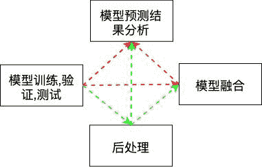

在单个模型的效果达到相对满意的程度时，亦或是比赛快要接近尾声时，我们希望可以进一步提升模型的效果，这个时候我们就需要进行模型的融合，不同问题的融合方式会有些许不一样，比如auc问题我们一般可以采用对预测结果先进行rank，然后对rank进行加权融合等，而回归类的模型则可以采用MSE的优化和MAE的优化得到的结果进行融合等。关于详细的融合相关的内容，我们会在后续的章节中进行更为细致详细的介绍。

### **5.12  复盘总结**

最后，竞赛结束之后，不管最终取得了什么样的成绩，一般我们都会静下心来总结，复盘学习。看看其它优秀的队伍是如何思考处理该问题的，有哪些可以直接学习和借鉴的地方，争取做到在下次同样的地方不犯相同的错误，也为今后的数据竞赛或者实践项目做准备。

最终就形成了下面这样一张大的流程图。

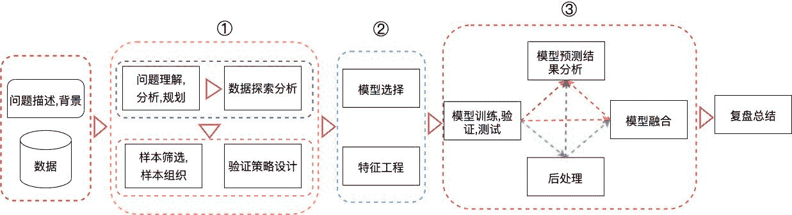

数据竞赛通用流程

在数据竞赛亦或是数据实践项目中，模块与模块之间都是环环相扣的，每一个模块的错误都可能为整体效果带来较大的影响，所以我们在处理问题时往往需要不断地思考各个环节的细节等，形成下面的闭环。

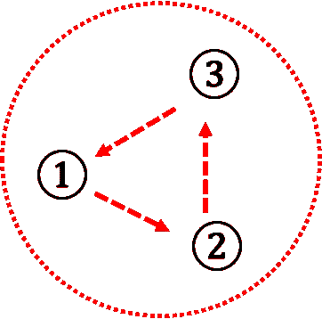