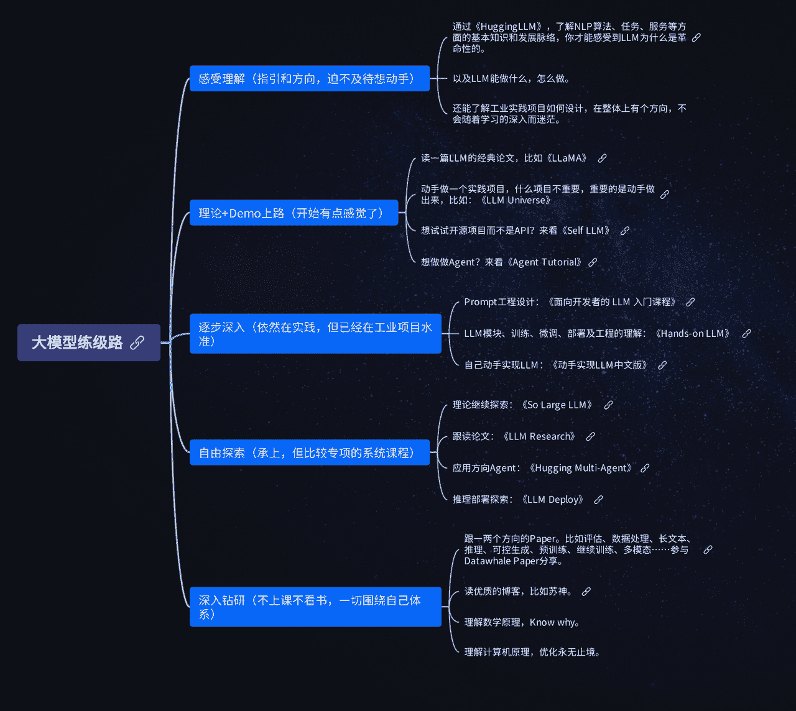
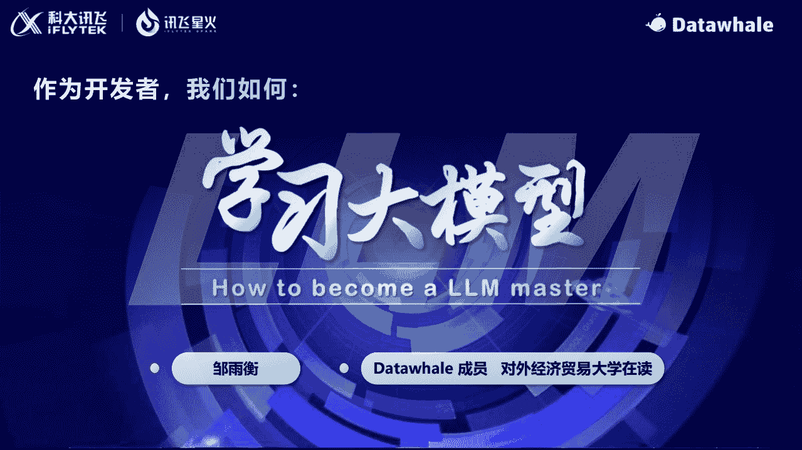

# Datawhale大模型课程食用指南

> 来源：[https://datawhaler.feishu.cn/docx/FxHidQc52ohVWzxQ4y9c60Klnff](https://datawhaler.feishu.cn/docx/FxHidQc52ohVWzxQ4y9c60Klnff)

> **本指南**由 D**at**awhale成员 邹雨衡 & 长琴撰写

# 大模型练级路

[大模型练级路.pdf](https://internal-api-drive-stream.feishu.cn/space/api/box/stream/download/all/EbJCbbhLqoDILcxacVJcBujPnrc)

# 作为开发者，如何学习大模型

[邹雨衡：作为开发者，如何学习大模型20240518(1).pdf](https://internal-api-drive-stream.feishu.cn/space/api/box/stream/download/all/HT4ab9DKJowhQUxsE0Pcs1hjnje)

# 学习路径

# 课程导引

+   如果你没有任何代码基础，推荐学习《聪明办法学 Python 第二版》：https://github.com/datawhalechina/learn-python-the-smart-way-v2

+   如果你已经具备了基本的 Python 能力

+   如果你想快速了解如何使用 ChatGPT等大模型API 来赋能实际实践，推荐学习《HuggingLLM》（课程1）

+   如果你想动手实践开源 LLM 的部署、微调全流程，推荐学习《Self LLM》（课程5）

+   如果你有较充足的时间想全面入门 LLM 各方面内容，推荐学习《面向开发者的 LLM 入门教程》（课程2）

+   如果你已经具备一定的 NLP 基础

+   如果你想要从理论上全面学习 LLM，推荐学习《So Large LM》（课程3）

+   如果你具备一定的 Python 开发经验

+   如果你想快速入门如何使用 LLM API 开发自己的应用，推荐学习《LLM Universe》（课程4）

+   如果你能熟练阅读和理解项目源代码

+   如果你想要学习如何实现 Agent，推荐学习《Hugging Multi-Agent》（课程6）

# Datawhale 大模型课程总览

| 序号 | 课程名 | 课程介绍 | 链接 |
| --- | --- | --- | --- |
| 1 | Hugging LLM | **介绍 ChatGPT 原**理、使用和应用，聚焦于如何使用ChatGPT相关API创造新的功能和应用 | https://github.com/datawhalechina/hugging-llm |
| 2 | 面向开发者的 LLM 入门课程 | 包**括 Prompt Engin**eering、LangChain、Gradio 等内容，指导国内开发者如何基于 LLM 快速、高效开发具备强大能力的应用程序 | https://github.com/datawhalechina/prompt-engineering-for-developers |
| 3 | So Large LM | 从**理论层面**介绍了大型语言模型的各个方面：从数据准备、模型构建到训练和评估，以及安全、隐私和环境影响等方面 | https://github.com/datawhalechina/so-large-lm |
| 4 | LLM Universe | **面向小白开发者的**大模型应用开发教程，旨在结合个人知识库助手项目，介绍大模型开发全流程 | https://github.com/datawhalechina/llm-universe |
| 5 | Self LLM | 针对国内初学者，针对各类**开源大模型**提供包括环境配置、本地部署、高效微调等技能在内的全流程指导 | https://github.com/datawhalechina/self-llm |
| 6 | Hugging Multi-Agent | **从代码层面探**索智能体的个性化开发，帮助读者掌握多智能体系统的核心概念，并提供一套全面的学习路径，从智能体的基础理解到复杂系统的实际开发 | https://github.com/datawhalechina/hugging-multi-agent |
| 7 | Agent Tutorial | 介绍如何使用 ModelScope Agent 开发一个智能助手，并探讨一些 Agent 的通用创作思路及应用展望（编写中） | https://github.com/datawhalechina/agent-tutorial |
| 8 | LLM Research | LLM 论文解读笔记仓库（编写中） | https://github.com/datawhalechina/llm-research |
| 9 | 动手实现 LLM 中文版 | 《Build a Large Language Model (From Scratch)》中文版，如何从头开始实现 LLM（编写中） | https://github.com/datawhalechina/llms-from-scratch-cn |
| 10 | LLM Deploy | 关于模型/LLM推理和部署理论与实践 | https://github.com/datawhalechina/llm-deploy |
| 11 | Hands on LLM | 动手实践大语言模型，HuggingLLM的进阶版，涉及模型架构、微调、推理、部署等 | https://github.com/datawhalechina/hands-on-llm |

# 具体课程介绍

## 已完成：

1.  《HuggingLLM》：https://github.com/datawhalechina/hugging-llm

1.  《ChatGPT 原理与应用开发》（蝴蝶书）原项目，Github Star 2.1K+，配套视频教程：https://b23.tv/hdnXn1L；纸质书：https://item.jd.com/14385698.html

1.  **介绍 ChatGPT 原**理、使用和应用，聚焦于如何使用ChatGPT相关API创造新的功能和应用

1.  面向人群：希望在实际中运用该技术创造提供新的服务或解决已有问题、有一定编程基础的非NLP或算法专业人士

1.  先修课程：Python

1.  额外要求：能够正常使用 OpenAI 的 API，或国内其他大模型API（可替换使用）

1.  定位：入门级、服务应用和实践导向

1.  关键词：ChatGPT API；应用 LLM 技术

1.  **《**面向开发者的 LLM 入门教程》：https://github.com/datawhalechina/prompt-engineering-for-developers

1.  《吴恩达大模型系列课程》中文版，Git**h**ub Star 8.3K+，在线阅读：https://datawhalechina.github.io/prompt-engineering-for-developers/

1.  包**括 Prompt Engin**eering、LangChain、Gradio 等内容，指导国内开发者如何基于 LLM 快速、高效开发具备强大能力的应用程序

1.  面向人群：具备基础 Python 能力，想要入门 LLM 的开发者

1.  先修课程：Python

1.  额外要求：内容较丰富，全面学习建议有较充裕时间

1.  定位：入门级、全面

1.  关键词：Prompt Engineering；LangChain；Gradio；RAG

1.  《So Large LM》：**https://github.com/datawh**alechina/so-large-lm

1.  基于《斯坦福大学大规模语言模型课**程》打造的大模型理论教程，Github Star** 200+，在线阅读：https://datawhalechina.github.io/so-large-lm

1.  从**理论层面**介绍了大型语言模型的各个方面：从数据准备、模型构建到训练和评估，以及安全、隐私和环境影响等方面

1.  面向人群：具备高等数学基础，对 LLM 具有研究兴趣的研究者或从业者

1.  先修课程：高等数学、概率论、Python

1.  定位：进阶级、理论导向

1.  关键词：理论研究；LLM 原理全流程

1.  《LLM Universe》：**https://github.com/datawha**lechina/llm-universe

1.  **《动手学大模型应用开发》，Github Star 8**00+，在线阅读：https://datawhalechina.github.io/llm-universe/

1.  面向小白开发者的大模型应用开发教程，旨在结合个人知识库助手项目，介绍大模型开发全流程

1.  面向人群：具备基础 Python 能力，想要掌握 LLM 应用开发技能的开发者

1.  额外要求：能够正常使用 OpenAI、百度文心、讯飞星火、智谱 GLM 其一 的 API

1.  先修课程：Python、程序开发

1.  定位：入门级、实践导向

1.  关键词：应用开发；快速入门

1.  《Self LLM》：**https://github.com/dat**awhalechina/self-llm

1.  《开源大模型食用指南》，Github Star 800+

1.  针对国内初学者，针对各类**开源大模型**提供包括环境配置、本地部署、高效微调等技能在内的全流程指导

1.  面向人群：具备基础 Python 能力，想要亲自上手开源 LLM 的学习者

1.  先修课程：Python

1.  额外要求：可以使用 AutoDL 服务器

1.  定位：入门级、实践导向

1.  关键词：本地应用；全步骤指导

1.  **《**Hugging Multi-Agent》：https://github.com/datawhalechina/hugging-multi-agent

1.  基于多智能体框架 MetaGPT 打造的多智能体**系**统学习指南，学习人数9k+，在线阅读：https://deepwisdom.feishu.cn/wiki/MLILw0EdRiyiYRkJLgOcskyAnUh

1.  从代码层面探索智能体的个性化开发，帮助读者掌握多智能体系统的核心概念，并提供一套全面的学习路径，从智能体的基础理解到复杂系统的实际开发

1.  面向人群：拥有Python编程基础、能熟练阅读和理解项目源代码、渴望深入了解并实践Agent框架以及智能体系统的开发者

1.  定位：进阶级、理论+实践

1.  关键词：Agent；MetaGPT

## 编写中：

1.  **《Agent Tutorial》：https://git**hub.com/datawhalechina/agent-tutorial：介绍如何使用 ModelScope Agent 开发一个智能助手，并探讨一些 Agent 的通用创作思路及应用展望

1.  《LLM Research》：**https://github.com/datawha**lechina/llm-research：LLM 论文解读笔记仓库

1.  《动手实现 LLM 中文版》：**h**ttps://github.com/datawhalechina/llms-from-scratch-cn：《Build a Large Language Model (From Scratch)》中文版，如何从头开始实现 LLM

1.  《LLM Deploy》：**https://github.com/dataw**halechina/llm-deploy：关于模型/LLM推理和部署理论与实践

1.  《Hands on LLM》：**https://github.com/datawha**lechina/hands-on-llm：动手实践大语言模型，HuggingLLM的进阶版，涉及模型架构、微调、推理、部署等。已完成内容，代组对学习/发布。