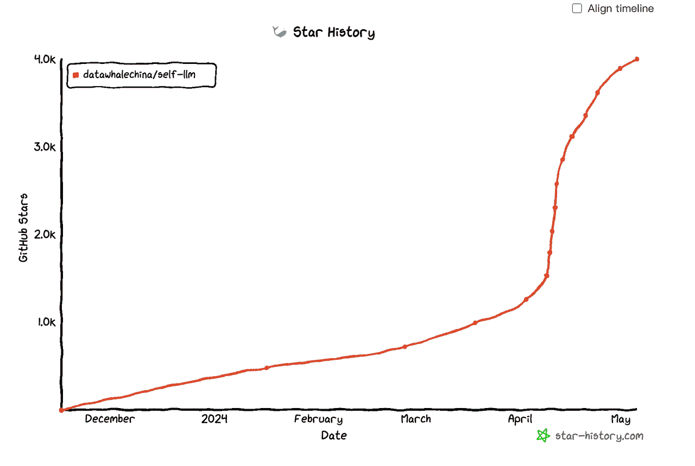
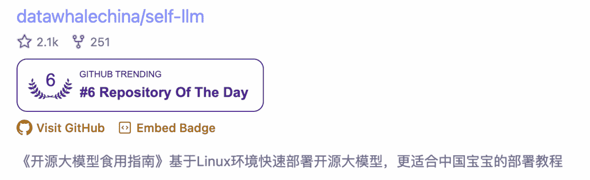
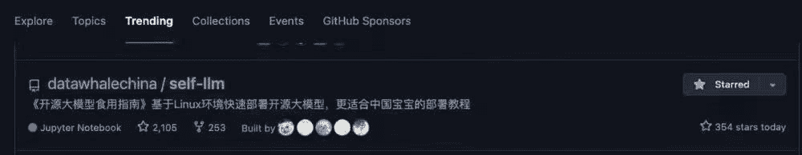

# 开源大模型食用指南

> 来源：https://datawhaler.feishu.cn/docx/Py1JdGvCqoh8xqxreguctauSnyf

> 适合谁来学：希望长期、低成本、私有化、大规模应用开源LLM的学习者

> 开源大模型一站式最佳实践指南，包括环境配置、本地部署、高效微调等技能在内的全流程指导

> 项目负责人：

> 持续更新全球开源大模型的最佳实践，让更多的普通学生、研究者更好地使用开源大模型，帮助大模型更简单快捷地融入到学习生活中

> 你的PR与issue很重要，如有帮助，欢迎Star：https://github.com/datawhalechina/self-llm

## 项目简介

本项目是一个围绕开源大模型、针对国内初学者、基于 AutoDL 平台的中国宝宝专属大模型教程，针对各类开源大模型提供包括环境配置、本地部署、高效微调等技能在内的全流程指导，简化开源大模型的部署、使用和应用流程，让更多的普通学生、研究者更好地使用开源大模型，帮助开源、自由的大模型更快融入到普通学习者的生活中。

本项目的主要内容包括：

1. 基于 AutoDL 平台（可扩展，例如阿里云）的开源 LLM 环境配置指南，针对不同模型要求提供不同的详细环境配置步骤；
2. 针对国内外主流开源 LLM 的部署使用教程，包括 LLaMA、ChatGLM、InternLM 等；
3. 开源 LLM 的部署应用指导，包括命令行调用、在线 Demo 部署、LangChain 框架集成等；
4. 开源 LLM 的全量微调、高效微调方法，包括分布式全量微调、LoRA、ptuning 等。

项目的主要内容就是教程，让更多的学生和未来的从业者了解和熟悉开源大模型的食用方法！任何人都可以提出issue或是提交PR，共同构建维护这个项目。

想要深度参与的同学可以联系我们，我们会将你加入到项目的维护者中。

> 学习建议：本项目的学习建议是，先学习环境配置，然后再学习模型的部署使用，最后再学习微调。因为环境配置是基础，模型的部署使用是基础，微调是进阶。初学者可以选择Qwen1.5，InternLM2，MiniCPM等模型优先学习。

## 项目意义

什么是大模型？

大模型（LLM）狭义上指基于深度学习算法进行训练的自然语言处理（NLP）模型，主要应用于自然语言理解和生成等领域，广义上还包括机器视觉（CV）大模型、多模态大模型和科学计算大模型等。

百模大战正值火热，开源 LLM 层出不穷。如今国内外已经涌现了众多优秀开源 LLM，国外如 LLaMA、Alpaca，国内如 ChatGLM、BaiChuan、InternLM（书生·浦语）等。开源 LLM 支持用户本地部署、私域微调，每一个人都可以在开源 LLM 的基础上打造专属于自己的独特大模型。

然而，当前普通学生和用户想要使用这些大模型，需要具备一定的技术能力，才能完成模型的部署和使用。对于层出不穷又各有特色的开源 LLM，想要快速掌握一个开源 LLM 的应用方法，是一项比较有挑战的任务。

本项目旨在首先基于核心贡献者的经验，实现国内外主流开源 LLM 的部署、使用与微调教程；在实现主流 LLM 的相关部分之后，我们希望充分聚集共创者，一起丰富这个开源 LLM 的世界，打造更多、更全面特色 LLM 的教程。星火点点，汇聚成海。

我们希望成为 LLM 与普罗大众的阶梯，以自由、平等的开源精神，拥抱更恢弘而辽阔的 LLM 世界。

## 项目受众

本项目适合以下学习者：

+ 想要使用或体验 LLM，但无条件获得或使用相关 API；
+ 希望长期、低成本、大量应用 LLM；
+ 对开源 LLM 感兴趣，想要亲自上手开源 LLM；
+ NLP 在学，希望进一步学习 LLM；
+ 希望结合开源 LLM，打造领域特色的私域 LLM；
+ 以及最广大、最普通的学生群体。

## 项目规划及进展

本项目拟围绕开源 LLM 应用全流程组织，包括环境配置及使用、部署应用、微调等，每个部分覆盖主流及特点开源 LLM：

### 已支持模型

+ [InternLM2](https://github.com/InternLM/InternLM)
+ InternLM2-7B-chat FastApi 部署调用 @ 不要葱姜蒜
+ InternLM2-7B-chat langchain 接入 @ 不要葱姜蒜
+ InternLM2-7B-chat WebDemo 部署 @ 白玉
+ InternLM2-7B-chat Xtuner Qlora 微调 @ 白玉
+ [Qwen 1.5](https://github.com/QwenLM/Qwen1.5.git)
+ Qwen1.5-7B-chat FastApi 部署调用 @颜鑫
+ Qwen1.5-7B-chat langchain 接入 @颜鑫
+ Qwen1.5-7B-chat WebDemo 部署 @颜鑫
+ Qwen1.5-7B-chat Lora 微调 @不要葱姜蒜
+ [Qwen1.5-72B](https://github.com/byx020119)-chat-GPTQ-Int4 部署环境 @byx020119
+ [DeepSeek 深度求索](https://github.com/deepseek-ai/DeepSeek-LLM)
+ DeepSeek-7B-chat FastApi 部署调用 @ 不要葱姜蒜
+ DeepSeek-7B-chat langchain 接入 @ 不要葱姜蒜
+ DeepSeek-7B-chat WebDemo @ 不要葱姜蒜
+ DeepSeek-7B-chat Lora 微调 @ 不要葱姜蒜
+ DeepSeek-7B-chat 4bits量化 Qlora 微调 @ 不要葱姜蒜
+ [DeepSeek-MoE-16b-chat Transformers 部署调用](https://github.com/datawhalechina/self-llm/blob/master/DeepSeek/06-DeepSeek-MoE-16b-chat%20Transformer%E9%83%A8%E7%BD%B2%E8%B0%83%E7%94%A8.md) @Kailigithub
+ DeepSeek-MoE-16b-chat FastApi 部署调用 @Kailigithub
+ [DeepSeek-coder-6.7b](https://github.com/cswangxiaowei) finetune colab @Swiftie
+ [DeepSeek-coder-6.7b](https://github.com/cswangxiaowei) webdemo colab @Swiftie
+ [MiniCPM](https://github.com/OpenBMB/MiniCPM.git)
+ MiniCPM-2B-chat transformers 部署调用 @Kailigithub
+ MiniCPM-2B-chat FastApi 部署调用 @Kailigithub
+ MiniCPM-2B-chat langchain 接入 @不要葱姜蒜
+ MiniCPM-2B-chat webdemo 部署 @Kailigithub
+ MiniCPM-2B-chat Lora && Full 微调 @不要葱姜蒜
+ [Qwen-Audio](https://github.com/QwenLM/Qwen-Audio.git)
+ Qwen-Audio FastApi 部署调用 @ jjyaoao
+ Qwen-Audio WebDemo @ jjyaoao
+ [Qwen](https://github.com/QwenLM/Qwen.git)
+ Qwen-7B-chat Transformers 部署调用 @娇娇 ddl=12.2
+ Qwen-7B-chat FastApi 部署调用 @娇娇 ddl=12.2
+ Qwen-7B-chat WebDemo @娇娇 ddl=12.2
+ Qwen-7B-chat Lora 微调 @ 不要葱姜蒜
+ Qwen-7B-chat ptuning 微调 @ Hongru0306
+ Qwen-7B-chat 全量微调 @不要葱姜蒜
+ Qwen-7B-Chat 接入langchain搭建知识库助手 @娇娇
+ Qwen-7B-chat 低精度训练 @ Hongru0306 ddl=12.11
+ Qwen-1_8B-chat CPU 部署 @ 散步
+ [Yi 零一万物](https://github.com/01-ai/Yi.git)
+ Yi-6B-chat FastApi 部署调用 @ Joe ddl=12.15
+ Yi-6B-chat langchain接入 @ Joe ddl=12.15
+ Yi-6B-chat WebDemo @ Hongru0306 ddl=12.15
+ Yi-6B-chat Lora 微调 @ 娇娇 ddl=12.15
+ [Baichuan 百川智能](https://www.baichuan-ai.com/home)
+ Baichuan2-7B-chat FastApi 部署调用 @ 三山时春い ddl=12.15
+ Baichuan2-7B-chat WebDemo @ 三山时春いddl=12.15
+ Baichuan2-7B-chat 接入 LangChain 框架 @ 三山时春いddl=12.15
+ Baichuan2-7B-chat Lora 微调 @ 三山时春いddl=12.15
+ [InternLM](https://github.com/InternLM/InternLM.git)
+ InternLM-Chat-7B Transformers 部署调用 @小罗 ddl=11.26
+ InternLM-Chat-7B FastApi 部署调用 @不要葱姜蒜
+ InternLM-Chat-7B WebDemo @不要葱姜蒜
+ [Lagent+InternLM-Chat-7B-V1.1 WebDemo](https://github.com/datawhalechina/self-llm/blob/master/InternLM/04-Lagent+InternLM-Chat-7B-V1.1.md) @不要葱姜蒜
+ 浦语灵笔图文理解&创作 WebDemo @不要葱姜蒜
+ InternLM-Chat-7B 接入 LangChain 框架 @ Logan Zou
+ [Atom (llama2)](https://hf-mirror.com/FlagAlpha/Atom-7B-Chat)
+ Atom-7B-chat WebDemo @凯立 ddl=11.24
+ Atom-7B-chat Lora 微调 @ Logan Zou
+ Atom-7B-Chat 接入langchain搭建知识库助手 @ jjyaoao
+ Atom-7B-chat 全量微调 @ Logan Zou
+ [ChatGLM3](https://github.com/THUDM/ChatGLM3.git)
+ ChatGLM3-6B Transformers 部署调用 @丁悦 ddl=12.2
+ ChatGLM3-6B FastApi 部署调用 @丁悦 ddl=12.2
+ ChatGLM3-6B chat WebDemo @不要葱姜蒜
+ [ChatGLM3-6B Code Interpreter WebDemo](https://github.com/datawhalechina/self-llm/blob/master/ChatGLM/04-ChatGLM3-6B-Code-Interpreter.md) @不要葱姜蒜
+ ChatGLM3-6B 接入 LangChain 框架 @ Logan Zou
+ ChatGLM3-6B Lora 微调 @ Hongru0306

### 通用环境配置

+ [pip、conda 换源](https://github.com/datawhalechina/self-llm/blob/master/General-Setting/01-pip%E3%80%81conda%E6%8D%A2%E6%BA%90.md) @不要葱姜蒜
+ [AutoDL 开放端口](https://github.com/datawhalechina/self-llm/blob/master/General-Setting/02-AutoDL%E5%BC%80%E6%94%BE%E7%AB%AF%E5%8F%A3.md) @不要葱姜蒜
+ 模型下载
  + [hugging face](https://github.com/datawhalechina/self-llm/blob/master/General-Setting/03-%E6%A8%A1%E5%9E%8B%E4%B8%8B%E8%BD%BD.md) @不要葱姜蒜
  + [hugging face 镜像下载](https://github.com/datawhalechina/self-llm/blob/master/General-Setting/03-%E6%A8%A1%E5%9E%8B%E4%B8%8B%E8%BD%BD.md) @不要葱姜蒜
  + [modelscope](https://github.com/datawhalechina/self-llm/blob/master/General-Setting/03-%E6%A8%A1%E5%9E%8B%E4%B8%8B%E8%BD%BD.md) @不要葱姜蒜
  + [git-lfs](https://github.com/datawhalechina/self-llm/blob/master/General-Setting/03-%E6%A8%A1%E5%9E%8B%E4%B8%8B%E8%BD%BD.md) @不要葱姜蒜
  + [Openxlab](https://github.com/datawhalechina/self-llm/blob/master/General-Setting/03-%E6%A8%A1%E5%9E%8B%E4%B8%8B%E8%BD%BD.md)
+ Issue && PR
  + [Issue 提交](https://github.com/datawhalechina/self-llm/blob/master/General-Setting/04-Issue&PR&update.md) @ Hongru0306
  + [PR 提交](https://github.com/datawhalechina/self-llm/blob/master/General-Setting/04-Issue&PR&update.md) @ Hongru0306
  + [fork更新](https://github.com/datawhalechina/self-llm/blob/master/General-Setting/04-Issue&PR&update.md) @ Hongru0306

## 致谢

### 核心贡献者

+ 宋志学(不要葱姜蒜)-项目负责人 （Datawhale成员-河南理工大学）
+ [邹雨衡-项目负责人](https://github.com/logan-zou) （Datawhale成员-对外经济贸易大学）
+ [肖鸿儒](https://github.com/Hongru0306) （Datawhale成员-同济大学）
+ [李娇娇](https://github.com/Aphasia0515) （Datawhale成员）
+ [小罗](https://github.com/lyj11111111) （Datawhale成员）
+ [丁悦](https://github.com/dingyue772) （Datawhale-鲸英助教）
+ [Kailigithub](https://github.com/Kailigithub) （Datawhale成员）
+ [陈思州](https://github.com/jjyaoao) （Datawhale成员）
+ [李柯辰](https://github.com/Joe-2002) （Datawhale成员）
+ [散步](https://github.com/sanbuphy) （Datawhale成员）
+ [惠佳豪](https://github.com/L4HeyXiao) （Datawhale-宣传大使）
+ [颜鑫](https://github.com/thomas-yanxin) （Datawhale成员）
+ [Swiftie](https://github.com/cswangxiaowei) （小米NLP算法工程师）

### 其他

+ 特别感谢[@Sm1les](https://github.com/Sm1les)对本项目的帮助与支持

+ [部分lora代码和讲解参考仓库：https://github.com/zyds/transformers-code.git](https://github.com/zyds/transformers-code.git)
+ 如果有任何想法可以联系我们 DataWhale 也欢迎大家多多提出 issue
+ 特别感谢以下为教程做出贡献的同学！

## 学习交流群

## 大模型培养方案 [课程 | AI 学习路线](https://datawhaler.feishu.cn/wiki/FFNHwwyw7ilUs7ktS97cTYKSnUg)
