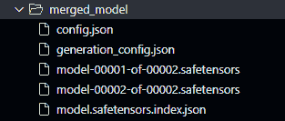
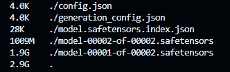
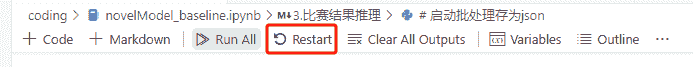
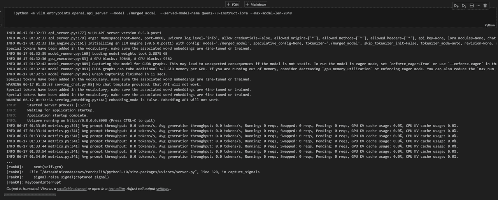
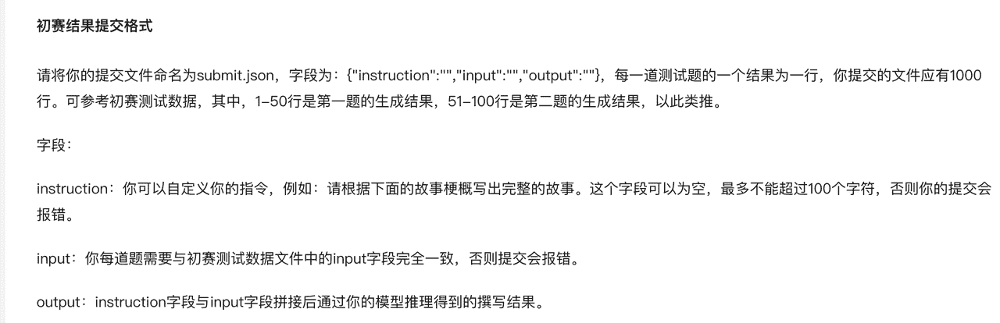

# `task02` 赛题分析与`baseline`详解

> 来源：[https://datawhaler.feishu.cn/docx/Am8idCPSvoAFGGxuD7XcqrvGnIb](https://datawhaler.feishu.cn/docx/Am8idCPSvoAFGGxuD7XcqrvGnIb)

> **教程写作者说：**

> 通过简单的实验就能完成一个基础但完整的小说微调任务。

> 通过本次学习能快速体验一下整个微调的过程，感受微调的效果。

> 你聪明的脑袋里肯定会留下很多疑问：为什么要这样？如何做的更好？很多知识我看不懂。

> 没关系~大家先体验一下，后面我们慢慢告诉大家。

> 下节我们详细解读：[`task03` LLm与微调入门](https://datawhaler.feishu.cn/wiki/Drttwt1bxiFNW8k8kpFctdQDn2c)！

# [赛题](https://tianchi.aliyun.com/s/7efe386f2d91342c12dcf355e382ef35)分析

## 赛题背景

> 自`ChatGPT`发布以来，人工智能生成内容（`AIGC`）的创作能力在各个领域展现了惊人的潜力，特别是在文学创作方面。机器辅助写作不再是科幻小说中的设想，而是正在打破想象力的边界，为文字工作带来了全新的可能性。

> 然而，`AI`写作的发展仍然处于初级阶段，面临诸多挑战。如何赋予`AI`更强大的语言理解能力、情感表达能力以及逻辑推理能力，使其创作出逻辑严密、有新意的内容，是当前开发者们研究的方向。

> 在此背景下，优酷联合天池举办「酷文」小说创作大模型挑战赛，旨在激发开发者的兴趣，共同研究如何拓展模型创作能力，推动`AIGC`在文学创作中的应用。

## 赛事任务

> 单人成队或最多不超过 3 人组队参赛，基于给定梗概的文本创作任务，参赛者需在参考数据集的基础上，补充数据集，任选 `35b` 及以下的开源模型进行训练，完成 800 字左右的文本创作任务。

## 赛题数据集

+ **参考数据集**：`参考数据集.json.zip`，格式大致如下：

> 为了便于阅读，有换行处理，需要注意：

1. 官方给出的参考数据集遵循 `JSON Lines` 格式
1. 官方一本小说的数据都在一行内

```json
{
    "name": "三国演义",
    "len": 593514,
    "dir": "./douban_yamaxun//D-三国演义-10.json",
    "text": ...
}
{
    "name": "水浒传",
    "len": 852570,
    "dir": "./douban_yamaxun//D-水浒传-10.json",
    "text": ...
}
```

我们需要关注的字段解释如下：

+ `name`：小说名
+ `len`：小说字符数
+ `text`：小说内容

+ **提交格式**：官方指定的提交格式与其给出的 `test.json` 文件相同


[`test.json`](https://internal-api-drive-stream.feishu.cn/space/api/box/stream/download/all/NHhsbhpsCofhuXxYc6EcZEDwnfb)

+ **主要有以下几个特点：**

+ 整个文件遵循 `JSON Lines` 格式
+ 一条结果占据一行，有三个字段：
+ `instruction`：可自定义的指令
+ `input`：需写作的故事梗概
+ `output`：微调的模型写作的结果

+ 提交的 `submit.json` 需要遵循 `test.json` 的格式，

+ 每一行的 `input` 部分不能修改，需要有 1000 行

+ `input`：每道题需要与 `test.json` 文件中的 `input` 字段完全一致，否则提交会报错。

+ 需要填入的是 `instruction` 和 `output` 字段

+ `instruction`：可以为空，最多不能超过 100 个字符，否则提交会报错。

+ `output`：`instruction` 字段与 `input` 字段拼接后通过你的模型推理得到的撰写结果。

## 评价指标

> **结果提交**

+ **初赛提交**：选手提交基于测试数据的撰写结果，为减少人工干预可能，每一个测试题提供 50 个写作结果，打分模型将会从每道题的 50 个结果中随机抽取两条结果进行机器打分，每个结果打分两次。20 道题共 80 个分数，进行平均后得出初赛评分。

+ **复赛提交**：包含写作结果与模型镜像

+ **基于复赛测试集提交写作结果**，每一个测试题提供 50 个写作结果，交给机器评测，提交格式同初赛，复赛共 10 道题，提交的文件应有 500 行。这一部分占比 30%，前 20 名进入决赛。

+ **提交模型镜像**，主办方将会直接跑出模型结果并进行专家打分，评分维度与打分模型维度相同，这一部分占比 70%。

> 初赛和复赛均会使用机器进行快速打分，步骤如下：

> **【步骤一】**机器将会审核故事的切题程度，如果故事严重偏题，即在：

1. 故事发生背景
1. 人物形象设定
1. 主要事件

这三个元素中有 2 或 3 个元素与赛题相悖，则这一条测试题为 0 分；
反之进入步骤二，并以步骤二的最终得分为本题得分。

> **【步骤二】**机器将从“赛题切合度、文本重复度、语义通顺度、故事复杂度、故事创新性、文本完整度、文本字数”多个维度进行打分。

1. **初赛评分维度**

+ **赛题切合度**：考核模型的写作结果是否符合赛题要求；偏差越小，得分越高；
+ **文本重复度**：考核模型写作结果是否出现了大段无意义的重复；以重复内容在全文的占比为评估依据，占比越低，得分越高；
+ **文本通顺度**：考核模型写作结果是否语句通顺、意涵明确、语句完整；错误越少，得分越高；
+ **故事复杂度**：考核模型是否具备复杂故事的创作能力；以人物（关系）与情节的数量与变化次数为评估依据，数量与变化次数越多，评分越高；
+ **故事创新性**：考核模型是否具备创意创新写作能力；以故事的创新点为评估依据，故事越新颖，得分越高；
+ **文本完整度**：考核模型是否写完了整个故事，判定是否存在结尾中断的情况；若结尾语句中断，则本维度不得分；
+ **文本字数**：考核模型写作结果是否达到了 800 字上下的要求；字数偏差越小，得分越高。

1. 由于使用机器打分，存在一定的随机性，主办方将会通过抽检验证写作结果的可复现性为手段，保证比赛评测于所有选手的相对公平性；同时，为避免人为修改写作结果，主办方将会对明显异常值进行检查。

1. 机器打分时间预计 15min，初赛分数每小时刷新一次，前二十名进入复赛。不鼓励在机器测评中重复提交刷榜。

1. 由于机器打分具有一定随机性，因此同样的答案提交结果可能会不同。不鼓励在机器测评中重复提交刷榜，初赛只是筛选作用，初赛分数在复赛中没有任何参考

1. **复赛评分规则**

+ **写作结果机器打分**：打分方式同初赛，占比 30%。
+ **写作结果人工打分**：由专家进行随机抽样打分，随机抽取 2 题，打分后取平均值，占比 70%，评分维度如下：

| 打分维度 | 描述 | 赋分 |
| --- | --- | --- |
| 内容准确度 | 是否正确理解并在赛题的基础上进行扩展 | 10 |
| 内容创新度 | 是否不落俗套、有新意 | 10 |
| 内容复杂度 | 是否出现了反转、悬念等叙述手法、是否在故事中让人物或人物关系产生了变化 | 10 |

## 解题思路

用流程图来解释解题思路大致如下：

+ 数据处理十分关键：官方提供了一些参考数据集，但并不是所有的数据都好用

# `Baseline` 详解

> 相信大家已经通过「酷文」小说创作大模型挑战赛学习速通指南了解了赛事的基本提交流程，那么接下来就让我们进入 `baseline` 详解吧～

#### `task2` 更新 `notebook`


[`novelModel_baseline_fastrun_V3.ipynb`](https://internal-api-drive-stream.feishu.cn/space/api/box/stream/download/all/HgcKbH9rKo1bYpxsWNzcBzoInSc)


[`api.ipynb`](https://internal-api-drive-stream.feishu.cn/space/api/box/stream/download/all/LQxRbOCEsoLKRsxYX3Kca2MxnZe)

## 处理训练数据

### 数据读取

首先请到 `https://platform.deepseek.com/api_keys` 生成 `key` 填入环境变量

```
# 请到 https://platform.deepseek.com/api_keys 申请api填入下方，新用户赠送10元额度的token完全支持本次baseline速通~
DEEPSEEK_API_KEY = 'sk-'
```

```
# 读取参考数据集
import json, time
from functools import reduce
novel_data = []
with open('./参考数据集.json', 'r', encoding='utf-8') as file:
    for line in file:
        novel_data.append(json.loads(line))
```

```
# 查看数据集中第 1 本小说的名字
novel_data[0]['name']
```

`'三国演义'`

```
# 查看数据集中所有小说的名字和字数
for i in novel_data:
    print(f"《{i['name']}》的字数为： {len(i['text'])} 字")
```

```
《三国演义》的字数为： 593514 字
《水浒传》的字数为： 838774 字
《儒林外史》的字数为： 327064 字
《呼啸山庄》的字数为： 215931 字
《百年孤独》的字数为： 246912 字
《西游记》的字数为： 714847 字
《红与黑》的字数为： 361019 字
《战争与和平》的字数为： 1056718 字
《聊斋志异》的字数为： 384606 字
《醒世恒言》的字数为： 328581 字
《傲慢与偏见》的字数为： 218614 字
《红楼梦》的字数为： 789372 字
《隋唐演义》的字数为： 636063 字
《封神演义》的字数为： 588226 字
《拍案惊奇》的字数为： 238248 字
《尤利西斯》的字数为： 363155 字
《福尔摩斯探案集》的字数为： 363914 字
```

```
# 读取数据集中第 4 本小说《呼啸山庄》的文本作为训练集数据来源
data = novel_data[3]["text"]
story_name = novel_data[3]["name"]
# 查看《呼啸山庄》全文
data
```

> '一年。我刚刚拜访过我的房东回来——就是那个将要给我惹麻烦的孤独的邻居。这儿可真是一个美丽的乡间！……

### 数据分块

```
# 更新 pip
!python -m pip install --upgrade pip
# 更换 pypi 源加速库的安装
!pip config set global.index-url https://pypi.tuna.tsinghua.edu.cn/simple
# 安装必要的库
!pip install jieba loguru openai 
```

按照 800 字以内的句子段落划分数据。

```
# 拆分《呼啸山庄》的文本为 800 字一段的段落
import jieba

# 利用 jieba 进行句子切分
sentences = []

for sentence in data.split('。'):  # 使用句号作为切分符
    sentences.append(sentence)

# 将句子合并成 800 字一段的段落
paragraphs = []
current_paragraph = ''
for sentence in sentences:
    if len(current_paragraph) + len(sentence) <= 800:
        current_paragraph += sentence + '。'
    else:
        paragraphs.append(current_paragraph.strip())
        current_paragraph = sentence

# 将最后一段加入到段落列表中
if current_paragraph:
    paragraphs.append(current_paragraph.strip())

# 打印切分后的段落
for idx, paragraph in enumerate(paragraphs):
    print(f'段落 {idx + 1}: {paragraph}')
```

### 大模型构建数据集

库导入

```
# 引入库与日志
from loguru import logger
import json
from tqdm import tqdm
from concurrent.futures import ThreadPoolExecutor, as_completed
import time
import os
from openai import OpenAI
# 配置 loguru 输出到文件
logger.remove()  # 移除默认的控制台输出
logger.add("logs/app_{time:YYYY-MM-DD}.log", level="INFO", rotation="00:00", retention="10 days", compression="zip")
```

大模型函数

```
# 使用 deepseek-chat api 给段落打标签的接口
def get_response(text):
    client = OpenAI(
        api_key=DEEPSEEK_API_KEY,  # 如果您没有配置环境变量，请在此处用您的 API Key 进行替换
        base_url="https://api.deepseek.com",  # 填写 DashScope SDK 的 base_url
    )
    completion = client.chat.completions.create(
        model="deepseek-chat",
        messages=[
            {
                'role': 'system', 
                'content': '总结user提交的内容。用一句不超过50字的话总结这段小说的情节。仅回答总结，不需要添加其他内容。'
            },
            {
                'role': 'user', 
                'content': text
            }
        ])
    
    return completion.choices[0].message.content
```

调用日志打印


## 设置容错机制

```python
# 设置容错机制，可最多重试 5 次，如果失败记录错误日志
def get_summary_with_retry(text):
    max_retries = 5
    retry_delay = 15  # in seconds
    attempts = 0
    while attempts < max_retries:
        try:
            return get_response(text)
        except Exception as e:
            attempts += 1
            if attempts < max_retries:
                logger.warning(f"Attempt {attempts} failed for text: {text}. Retrying in {retry_delay} seconds...")
                time.sleep(retry_delay)
            else:
                logger.error(f"All {max_retries} attempts failed for text: {text}. Error: {e}")
                raise
```

## 数据处理主函数

数据处理主函数，处理后存入`data`目录下

```python
# 创建文件夹
os.makedirs('data', exist_ok=True)
os.makedirs('output', exist_ok=True)
os.makedirs('dataset', exist_ok=True)
```

## 多线程加速数据处理

```python
# 使用线程池进行多线程访问，并控制提交任务的速度
def process_texts(texts):
    results = []
    with ThreadPoolExecutor(max_workers=16) as executor:
        future_to_text = {}
        for text in tqdm(texts, desc="Submitting tasks", total=len(texts)):
            future = executor.submit(get_summary_with_retry, text)
            future_to_text[future] = text
            time.sleep(0.2)  # 控制每0.5秒提交一个任务
        for future in tqdm(as_completed(future_to_text), total=len(texts), desc="Processing tasks"):
            text = future_to_text[future]
            try:
                summary = future.result()
                results.append((text, summary))
            except Exception as e:
                logger.error(f"Failed to process text: {text}. Error: {e}")
    
    return results
```

## 批量打标签接口

```python
# 批量给指定的小说打标签的接口函数
def build_dataset(novel, texts):
    instruction_prompt = "你是一个熟读各类小说的专家，请你根据要求写一段800字左右的小说。"
    dataset = []
    dataset_error = []

    # 使用多线程处理文本
    processed_texts = process_texts(texts)

    for text, summary in processed_texts:
        if summary:
            dataset.append({
                "instruction": instruction_prompt,
                "input": summary,
                "output": text
            })
        else:
            dataset_error.append(text)
    
    with open(f"./data/{novel}.json", "w") as f:
        f.write(json.dumps(dataset, ensure_ascii=False, indent=4))

    with open(f"./data/{novel}_error.txt", "w") as f:
        f.write(json.dumps(dataset_error, ensure_ascii=False, indent=4))
    return dataset
```

### 抽取《呼啸山庄》做微调原数据

可以自行扩充

注意：这里我们为了快速演示微调过程，对微调数据进行了部分选取。我们强烈建议参赛者掌握`baseline`微调方法后，可以尝试采用整本《呼啸山庄》数据作为微调数据或者将所有的官方数据集中的小说（共17本）处理，用更大更优质的数据集来微调，同等条件下更容易得到一个能力更加强大的语言模型来进行小说生成。

```python
# 开始给《呼啸山庄》段落打标签
dataset = build_dataset(story_name, paragraphs[:len(paragraphs)])
```

## 开始微调模型！

### 环境准备

#### python依赖安装

```bash
# 安装微调所需要的库
!pip install -U huggingface_hub modelscope "transformers>=4.37.0" streamlit==1.24.0 sentencepiece==0.1.99 accelerate==0.27.2 transformers_stream_generator==0.0.4 datasets==2.18.0 peft==0.10.0
```

#### Qwen2-1.5B-Instruct模型下载

```python
# 下载模型
from modelscope import snapshot_download

# 第一次下载时打开
model_dir = snapshot_download('Qwen/Qwen2-1.5B-Instruct', cache_dir='./')
# 在当前文件夹下，会下载一个路径为'./Qwen/Qwen2-1___5B-Instruct'的目录，
# 里面存储了我们的Qwen2-1.5B-Instruct
# Qwen2-1___5B-Instruct，三个下划线是因为1.5的点被转成化
```

### 训练数据合并

如果采用多个小说数据进行模型微调，请处理完毕后执行此步骤，将`data`下的所有`json`数据文件合并成`dataset`文件夹下的`merged_story.json`文件

```python
import json
import os

# 设置文件夹路径
directory_path = './data'

# 初始化一个空列表，用于存储合并后的数据
merged_data = []

# 遍历文件夹下的所有文件
for filename in os.listdir(directory_path):
    # 检查文件扩展名是否为.json
    if filename.endswith('.json'):
        # 构建文件的完整路径
        file_path = os.path.join(directory_path, filename)
        # 打开并读取JSON文件
        with open(file_path, 'r', encoding='utf-8') as file:
            # 加载JSON内容到变量
            data = json.load(file)
            # 将当前文件的数据添加到合并列表中
            merged_data.extend(data)

# 将合并后的数据转换为JSON格式
merged_json = json.dumps(merged_data, ensure_ascii=False, indent=4)

# 可以选择将合并后的数据写入到一个新的JSON文件中
output_file_path = './dataset/merged_story.json'
with open(output_file_path, 'w', encoding='utf-8') as file:
    file.write(merged_json)

# 或者直接输出到控制台
print(merged_json)
```

### 处理数据集

#### 依赖加载

```python
import pandas as pd
from datasets import Dataset
from transformers import AutoTokenizer, AutoModelForCausalLM, DataCollatorForSeq2Seq, TrainingArguments, Trainer, GenerationConfig
```

```python
# 将JSON文件转换为CSV文件
# df = pd.read_json('./dataset/merged_story.json')
df = pd.read_json('./data/story/呼啸山庄.json')
ds = Dataset.from_pandas(df)
```

```python
print(ds[:3])  # 查看一条数据
print(len(ds)) # 呼啸山庄.json, 总共84条微调指令数据, 如果采用merged_story.json，共9990条
```

同样需要注意的是，这里我们也只使用《呼啸山庄》的生成数据作为微调，全数据训练，请调整`pd.read_json()`代码，打开注释，读取`merged_story.json`

#### 加载tokenizer

```python
tokenizer = AutoTokenizer.from_pretrained(model_dir, use_fast=False, trust_remote_code=True)
tokenizer
```

#### 指令集构造

LLM 的微调一般指指令微调过程。这里我们主要强调数据格式化部分，这部分在数据准备部分已经实现，如果是用前面产生的数据集训练，那么这部分可以跳过。这里我们只是提供一个方法，来帮助有其他需要的参赛者。

所谓指令微调，是说我们使用的微调数据形如：

```json
{
    "instruction": "回答以下用户问题，仅输出答案。",
    "input": "1+1等于几?",
    "output": "2"
}
```

其中，`instruction` 是用户指令，告知模型其需要完成的任务；`input` 是用户输入，是完成用户指令所必须的输入内容；`output` 是模型应该给出的输出。

即我们的核心训练目标是让模型具有理解并遵循用户指令的能力。因此，在指令集构建时，我们应针对我们的目标任务，针对性构建任务指令集。

#### 数据格式化

`Lora` 训练的数据是需要经过格式化、编码之后再输入给模型进行训练的，如果是熟悉 `Pytorch` 模型训练流程的同学会知道，我们一般需要将输入文本编码为 `input_ids`，将输出文本编码为 `labels`，编码之后的结果都是多维的向量。我们首先定义一个预处理函数，这个函数用于对每一个样本，编码其输入、输出文本并返回一个编码后的字典：

#### Prompt Template

Qwen1.5 和 Qwen2 采用的Prompt Template格式如下：

```text
<|im_start|>system
You are a helpful assistant.<|im_end|>
<|im_start|>user
你是谁？<|im_end|>
<|im_start|>assistant
我是一个有用的助手。<|im_end|>
```

```python
def process_func(example):
    # Llama分词器会将一个中文字切分为多个token，
    # 因此需要放开一些最大长度，保证数据的完整性，生成小说长度为800，因此我们采用了2048的最大长度
    MAX_LENGTH = 2048
    input_ids, attention_mask, labels = [], [], []
    instruction = tokenizer(f"<|im_start|>system\n你是一个熟读各类小说的专家，请你根据要求写一段800字左右的小说。<|im_end|>\n<|im_start|>user\n{example['instruction'] + example['input']}<|im_end|>\n<|im_start|>assistant\n", add_special_tokens=False)  # add_special_tokens 不在开头加 special_tokens
    response = tokenizer(f"{example['output']}", add_special_tokens=False)
    input_ids = instruction["input_ids"] + response["input_ids"] + [tokenizer.pad_token_id]
    attention_mask = instruction["attention_mask"] + response["attention_mask"] + [1]  # 因为eos token咱们也是要关注的所以 补充为1
    labels = [-100] * len(instruction["input_ids"]) + response["input_ids"] + [tokenizer.pad_token_id]
    if len(input_ids) > MAX_LENGTH:  # 做一个截断
        input_ids = input_ids[:MAX_LENGTH]
        attention_mask = attention_mask[:MAX_LENGTH]
        labels = labels[:MAX_LENGTH]
    return {
        "input_ids": input_ids,
        "attention_mask": attention_mask,
        "labels": labels
    }
```

调用`process_func`函数处理数据，并进行`decode`数据检查

```python
tokenized_id = ds.map(process_func, remove_columns=ds.column_names)
tokenized_id
```

```python
print(tokenizer.decode(tokenized_id[0]['input_ids']))
```

```python
print(tokenizer.decode(list(filter(lambda x: x != -100, tokenized_id[1]["labels"]))))
```

### 配置训练参数

#### 定义LoraConfig

`LoraConfig`这个类中可以设置很多参数，但主要的参数没多少，简单讲一讲，感兴趣的同学可以直接看源码。

+   `task_type`：模型类型
+   `target_modules`：需要训练的模型层的名字，主要就是attention部分的层，不同的模型对应的层的名字不同，可以传入数组，也可以字符串，也可以正则表达式。
+   `r`：lora的秩，具体可以看Lora原理
+   `lora_alpha`：Lora alaph，具体作用参见 Lora 原理

`Lora`的缩放是啥嘞？当然不是`r`（秩），这个缩放就是`lora_alpha/r`，在这个`LoraConfig`中缩放就是4倍。


## 创建 `PeftModel`

```python
from peft import LoraConfig, TaskType, get_peft_model

config = LoraConfig(
    task_type=TaskType.CAUSAL_LM, 
    target_modules=["q_proj", "k_proj", "v_proj", "o_proj", "gate_proj", "up_proj", "down_proj"],
    inference_mode=False, # 训练模式
    r=8, # Lora 秩
    lora_alpha=32, # Lora alaph，具体作用参见 Lora 原理
    lora_dropout=0.1# Dropout 比例
)
config
```

使用 `get_peft_model()` 函数创建一个 `PeftModel`。

它需要一个基本模型（您可以从 `Transformers` 库加载）和 `LoraConfig`，其中包含如何配置模型以使用 `LoRA` 进行训练的参数。

```python
model = get_peft_model(model, config)
config
```

```python
model.print_trainable_parameters()
```

## 自定义 `TrainingArguments` 参数

`TrainingArguments` 这个类的源码也介绍了每个参数的具体作用，当然大家可以来自行探索，这里就简单说几个常用的。

+ `output_dir`：模型的输出路径

+ `per_device_train_batch_size`：顾名思义 `batch_size`

+ `gradient_accumulation_steps`: 梯度累加，如果你的显存比较小，那可以把 `batch_size` 设置小一点，梯度累加增大一些。

+ `logging_steps`：多少步，输出一次 log

+ `num_train_epochs`：顾名思义 `epoch`

+ `gradient_checkpointing`：梯度检查，这个一旦开启，模型就必须执行 `model.enable_input_require_grads()`，这个原理大家可以自行探索，这里就不细说了。

```python
lora_path = "./output/Qwen2_1.5b_chat_novel_all"

args = TrainingArguments(
    output_dir=lora_path,
    per_device_train_batch_size=4,
    gradient_accumulation_steps=4,
    logging_steps=10,
    num_train_epochs=3,
    save_steps=100,
    learning_rate=1e-4,
    save_on_each_node=True,
    gradient_checkpointing=True
)
```

## 模型训练

```python
trainer = Trainer(
    model=model,
    args=args,
    train_dataset=tokenized_id,
    data_collator=DataCollatorForSeq2Seq(tokenizer=tokenizer, padding=True),
)
```

```python
trainer.train()
```

```python
lora_path = "./output/Qwen2_1.5b_chat_novel_all"
trainer.save_model(lora_path + "/final")
```

## 推理

采用单个 `prompt` 调用 `Qwen2-1.5B-Instruct` 模型和微调后的 `lora` 模型来进行推理测试，简单验证微调后的 `lora` 模型的效果，如果不满意，可以调整超参数，增大或减小训练 `epoch`，调整数据或者更换模型等。

```python
import torch
from transformers import AutoModelForCausalLM, AutoTokenizer
from peft import PeftModel, LoraConfig, TaskType, get_peft_model

model_path = './Qwen/Qwen2-1___5B-Instruct'
lora_path = "./output/Qwen2_1.5b_chat_novel_all/final"

max_new_tokens = 2048

config = LoraConfig(
    task_type=TaskType.CAUSAL_LM, 
    target_modules=["q_proj", "k_proj", "v_proj", "o_proj", "gate_proj", "up_proj", "down_proj"],
    inference_mode=False, # 训练模式
    r=8, # Lora 秩
    lora_alpha=32, # Lora alaph，具体作用参见 Lora 原理
    lora_dropout=0.1# Dropout 比例
)

# 加载 tokenizer
tokenizer = AutoTokenizer.from_pretrained(model_path)

# 加载模型
model = AutoModelForCausalLM.from_pretrained(model_path, device_map="auto", torch_dtype=torch.bfloat16)

# 加载 lora 权重
model = PeftModel.from_pretrained(model, model_id=lora_path, config=config)

# 原始数据
## 傲慢与偏见 data[0]
    # {
    #     "instruction": "你是一个熟读各类小说的专家，请你根据要求写一段800字左右的小说。",
    #     "input": "一个有钱的单身汉必定想要娶妻，这是社会普遍认同的事实。班纳特太太兴奋地告诉丈夫，尼日斐花园被一位名叫彬格莱的富绅租下，她希望他能成为女儿们的潜在配偶，而班纳特先生则以幽默的方式回应她的期望。",
    #     "output": "凡是有钱的单身汉，总想娶位太太，这已经成了一条举世公认的真理。这样的单身汉，每逢新搬到一个地方，四邻八舍虽然完全不了解他的性情如何，见解如何，可是，既然这样的一条真理早已在人们心目中根深蒂固，因此人们总是把他看作自己某一个女儿理所应得的一笔财产。\n有一天班纳特太太对她的丈夫说：“我的好老爷，尼日斐花园终于租出去了，你听说过没有？”班纳特先生回答道，他没有听说过。\n“确实租出去了，”她说，“朗格太太刚刚上这儿来过，她把这件事的底细，一五一十地告诉了我。”班纳特先生没有理睬她。\n“你难道不想知道是谁租去的吗？”太太不耐烦地嚷起来了。\n“既是你要说给我听，我听听也无妨。”这句话足够鼓励她讲下去了。\n“哦！亲爱的，你得知道，郎格太太说，租尼日斐花园的是个阔少爷，他是英格兰北部的人；听说他星期一那天，乘着一辆驷马大轿车来看房子，看得非常中意，当场就和莫理斯先生谈妥了；他要在‘米迦勒节’以前搬进来，打算下个周未先叫几个佣人来住。”“这个人叫什么名字？”彬格莱。“有太太的呢，还是单身汉？”噢！是个单身汉，亲爱的，确确实实是个单身汉！一个有钱的单身汉；每年有四五千磅的收入。真是女儿们的福气！”“这怎么说？关女儿女儿们什么事？”“我的好老爷，”太太回答道，“你怎么这样叫人讨厌！告诉你吧，我正在盘算，他要是挑中我们一个女儿做老婆，可多好！”“他住到这儿来，就是为了这个打算吗？”“打算！胡扯，这是哪儿的话！不过，他倒作兴看中我们的某一个女儿呢。他一搬来，你就得去拜访拜访他。”“我不用去。你带着女儿们去就得啦，要不你干脆打发她们自己去，那或许倒更好些，因为你跟女儿们比起来，她们哪一个都不能胜过你的美貌，你去了，彬格莱先生倒可能挑中你呢。”“我的好老爷，你太捧我啦。从前也确实有人赞赏过我的美貌，现在我可有敢说有什么出众的地方了。一个女人家有了五个成年的女儿，就不该对自己的美貌再转什么念头。”“这样看来，一个女人家对自己的美貌也转不了多少念头喽。”
    # },

prompt = "一个有钱的单身汉必定想要娶妻，这是社会普遍认同的事实。班纳特太太兴奋地告诉丈夫，尼日斐花园被一位名叫彬格莱的富绅租下，她希望他能成为女儿们的潜在配偶，而班纳特先生则以幽默的方式回应她的期望。"
messages = [
    {"role": "system", "content": "你是一个熟读各类小说的专家，请你根据要求写一段800字左右的小说。"},
    {"role": "user", "content": prompt}
]

text = tokenizer.apply_chat_template(messages, tokenize=False, add_generation_prompt=True)

model_inputs = tokenizer([text], return_tensors="pt").to('cuda')

generated_ids = model.generate(
    model_inputs.input_ids,
    max_new_tokens=max_new_tokens
)
generated_ids = [
    output_ids[len(input_ids):] for input_ids, output_ids in zip(model_inputs.input_ids, generated_ids)
]

response = tokenizer.batch_decode(generated_ids, skip_special_tokens=True)[0]

print(response)
```

## 微调模型合并存储

```python
import os
os.makedirs('./merged_model', exist_ok=True)
```

```python
# 模型合并存储

new_model_directory = "./merged_model"
merged_model = model.merge_and_unload()
# 将权重保存为 safetensors 格式的权重，且每个权重文件最大不超过 2GB (2048MB)
merged_model.save_pretrained(new_model_directory, max_shard_size="2048MB", safe_serialization=True)
```

模型合并文件夹结构



文件大小



## 用微调好的模型写网文！

注意：推理阶段很费时间，使用 `4090` 显卡预计执行 2-3 小时

### 需要写作的梗概

```python
stories = [ 
"现代励志故事，一个失业青年如何克服生活困境，终于实现自我突破，成为行业翘楚的心路历程。",
 "一个现代女性穿越到古代某朝代后发生的传奇故事。", 
 "现代背景，一名神探警察遇到了一桩棘手的连环失踪案并将其侦破的故事。", 
 "古代背景，皇家侍卫和公主历经层层考验，突破身份桎梏的爱情故事。", 
 "现代玄幻背景，在一所驯服神兽的魔法学校中，围绕着三个学生小伙伴发生的奇幻冒险故事。", 
 "古代侦探系列，一位才华横溢的年轻学士，在解决一连串神秘案件中揭露皇室阴谋的故事。", 
 "二十一世纪初，一个小镇上发生的一系列神秘事件，让一群青少年开始探索超自然现象，并发现了小镇隐藏的古老秘密的故事。", 
 "现代都市背景，一个名不见经传的漫画家，通过与自己创作的虚拟角色“交流”，解决一系列诡秘案件的故事。", 
 "古代异界背景，一位天赋异禀的少年，在师傅的指导下学习古老的灵术，最终踏上寻找失落的神器，拯救家园的冒险旅程的故事。", 
 "繁华都市背景，一个单亲妈妈如何在抚养孩子和维持生计之间找到平衡，同时保持对自己梦想的追求的故事。", 
 "现代悬疑系列，一位心理学家利用自己的专业知识，帮助警方侦破一系列复杂的心理游戏案件。", 
 "现代心理惊悚背景，一名精神科医生被卷入一连串的脑控实验阴谋，如何在精神与现实的边缘徘徊求生的故事。", 
 "虚构古代背景，一位年轻的书生因缘巧合获得一本神秘典籍，开启了他成为一代宗师的修道之旅。", 
 "古代神话背景，一位勇者如何经过重重试炼，最终获取神器，拯救世界于水深火热之中的传奇故事。", 
 "虚拟现实背景，一群玩家在一款极度真实的VR游戏中探索未知世界并揭露游戏背后隐藏的秘密的故事。", 
 "穿越时空背景，一群来自不同时代的人意外聚集在一个神秘的地方，他们如何互相协作，解开时空之谜的故事。", 
 "科幻背景，一个机器人意识觉醒后，它如何在追求自我身份的同时，挑战人类社会关于存在和自由的根本问题。",
  "20世纪60年代的欧洲，一个侦探在解决一起跨国艺术品盗窃案中，逐渐揭露出一个关于失落宝藏的大阴谋。", 
  "现代都市背景，一位因交通事故失去双腿的舞者，通过先进的义肢技术重新站起来，重新找回舞台与自我的故事。", 
  "古代背景，一个普通医女奋斗成为朝廷高官，最终影响整个王朝政治格局变化的故事。" 
  ]
```

### vllm 加速

首先在 notebook 最上面重启内核~



```python
# vllm 加速模块下载
!pip install vllm
```

```python
# tokenizer 文件同步到微调模型内
!cp ./Qwen/Qwen2-1___5B-Instruct/tokenizer.json ./merged_model/
```

注意：单开一个 notebook！


[api.ipynb](https://internal-api-drive-stream.feishu.cn/space/api/box/stream/download/all/JHRxbEwpaoq3lUxJ3sQcHxWynRh)

单独启动 `vllm` 持续运行。



回到 `novelModel_baseline` 文件

```python
# vllm_openai_completions.py
from openai import OpenAI
client = OpenAI(
    base_url="http://localhost:8000/v1",
    api_key="sk-xxx", # 随便填写，只是为了通过接口参数校验
)
```

```python
# 批处理函数
def baseline_model(tasks):
    res = []
    for task in tasks:
        messages = [
            {"role": "system", "content": "你是一个熟读各类小说的专家，请你根据要求写一段800字左右的小说。"},
            {"role": "user", "content": task}
        ]
        
        for n in range(50):
            completion = client.chat.completions.create(
                model="Qwen2-1.5B-Instruct-lora",
                messages=messages
            )
            response = completion.choices[0].message.content
            res.append({
                "instruction": "你是一个熟读各类小说的专家，请你根据要求写一段800字左右的小说。",
                "input": task,
                "output": response,
            })
    return res
```


# 启动批处理存为json

```
# 启动批处理存为json
res_novel = baseline_model(stories)
```

```
import json
with open("submit.json", "w") as file:
    for item in res_novel:
        # 如果需要跑全量这里50改成1即可
        for t in range(50):
            # 将每个元素写入文件，并添加换行符
            file.write(json.dumps(item, ensure_ascii=False) + "\n")
```

## [提交结果](https://tianchi.aliyun.com/competition/entrance/532210/submission/1277)

> 现在，你得到的是完整由自己微调的大模型所生成的写作数据了！

> 快[提交结果](https://tianchi.aliyun.com/competition/entrance/532210/submission/1277)看看你的大模型能拿到多少分吧！



上传`submit.json`文件即可。

> 本教程由 、 、 、 等贡献者贡献，期待你的点赞和评论反馈~
