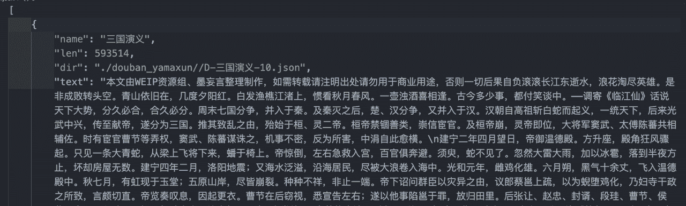
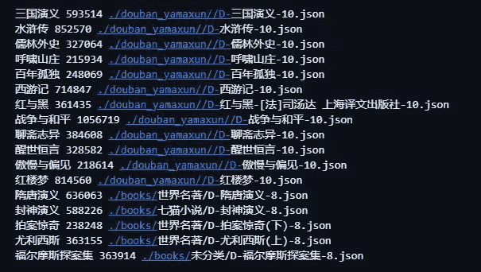
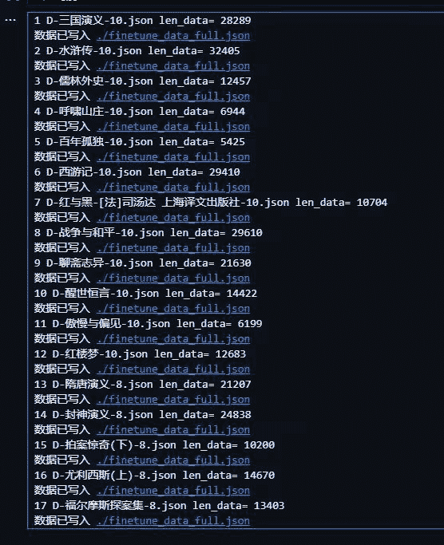
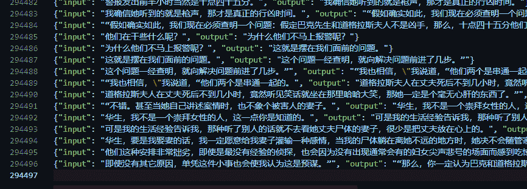
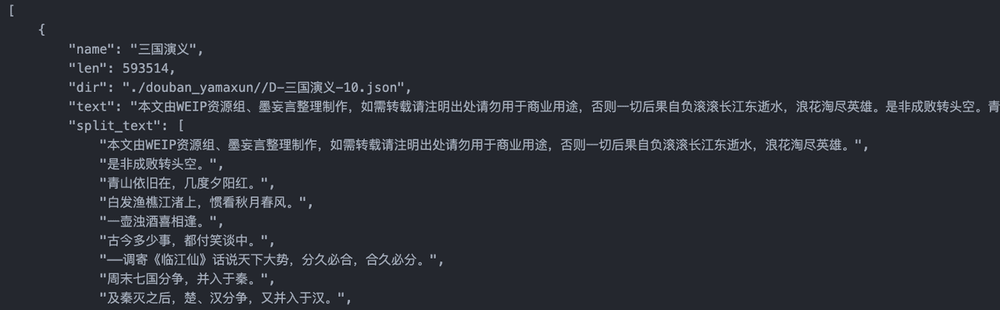
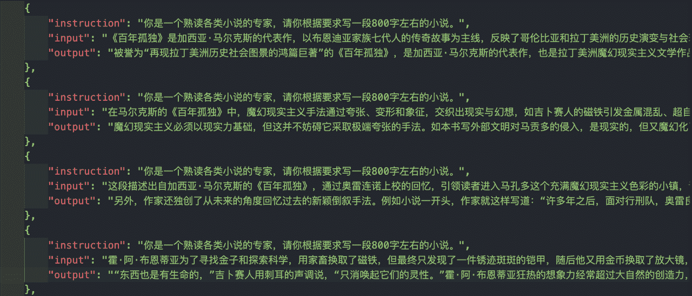
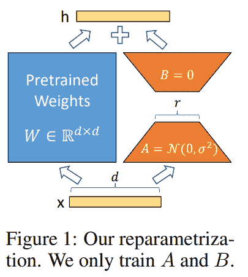
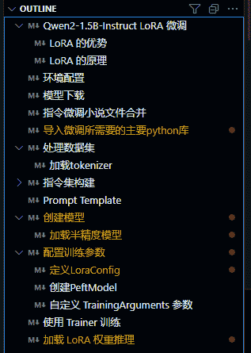
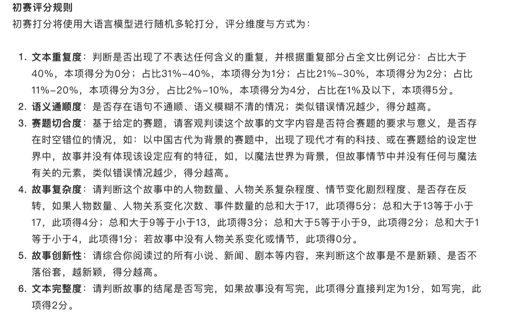

# task04 如何做好一个微调工作

> 来源：https://datawhaler.feishu.cn/docx/Tc0edb4uXoRU1wxdBi2c9MJVnxd

> **教程写作者说：**

> 我认为做好一个小说微调工作本身是一个迭代的过程，你在不断地实践中会发现很多问题。

> 你会不断尝试很多很新颖的方法，一点点打磨自己想法让结果达到最完美的效果。

> 这节我们会根据baseline的思路介绍所有细节，

> 如果想拿到更高的分数不妨耐心找找自己还缺什么、然后实践吧~

> 接下来的赛事之路，我们一起互相交流，期待榜单上能看见你的名字名列前茅！

# 数据准备

## 1.0 数据的一生

## 1.1 训练格式规范

LLM 的微调一般指指令微调过程。所谓指令微调，是说我们使用的微调数据形如：

```json
{
    "instruction": "回答以下用户问题，仅输出答案。",
    "input": "1+1等于几?",
    "output": "2"
}
```

其中，`instruction` 是用户指令，告知模型其需要完成的任务；`input` 是用户输入，是完成用户指令所必须的输入内容；`output` 是模型应该给出的输出。

即我们的核心训练目标是让模型具有理解并遵循用户指令的能力。因此，在指令集构建时，我们应针对我们的目标任务，针对性构建任务指令集。

## 1.2 小说数据介绍

我们先来简单看一下数据格式

```json
[
    {
        "name": "三国演义",
        "len": 593514,
        "dir": "./douban_yamaxun//D-三国演义-10.json",
        "text": ...
    },
    {
        "name": "水浒传",
        "len": 852570,
        "dir": "./douban_yamaxun//D-水浒传-10.json",
        "text": ...
    }
]
```

下面是具体字段的介绍：

+ `name`：小说名

+ `len`：小说字符数

+ `text`：小说内容



### 数据统计

数据集中，总共有17本小说，12本来自豆瓣亚马逊，5本来自books（世界名著等），小说中有类似文言文的中国传统小说，如四大名著等，也有白话的世界名著中文译本和传统的神话志异小说。每个小说中所含字符数量跟在书籍名称前面。



如果是作为用标点符号断句来构造上下句的 `input`，`output` 数据集，则可以构造的数据集数据统计如下，`len_data` 的含义为可以划分为 `n` 个上下文对，也就是每个小说有 `n+1` 个不同的句子





这种数据形式也可以一定程度上来提升大模型对 800 字短篇小说的生成能力。

大家可以尝试结合后面的数据集制作方法来尝试是否对模型微调有效。

## 1.3 小说数据拆分

**小说数据分割思路：**

1. 根据标点符号（句号、感叹号、问号）分割文本，同时保留这些标点符号。

```python
def split_text_by_punctuation(data):
    for item in data:
        text = item.get('text', '')
        # 使用正则表达式根据标点符号分割并保留标点符号
        split_text = re.split(r'([。！？])', text)
        # 将标点符号与前面的句子合并
        sentences = []
        for i in range(0, len(split_text) - 1, 2):
            sentence = split_text[i] + split_text[i + 1]
            sentences.append(sentence)
        if len(split_text) % 2 != 0 and split_text[-1]:  # 如果最后一个字符没有标点符号
            sentences.append(split_text[-1])
        # 添加新的分割列表字段
        item['split_text'] = sentences
    return data
```



1. 将分割后的数据进行拼接，得到 `novel_data_800_dict.json`

```python
novel_data_800_dict = {}

for novel_data in new_novels_data:
    section_data = []
    section = ""
    for sentence in novel_data["split_text"]:
        section += sentence
        if len(section) > 800:
            section_data.append(section)
            section = ""
    novel_data_800_dict[novel_data["name"]] = section_data
```

**完整代码如下：**

```python
import json
import re


def split_text_by_punctuation(data):
    for item in data:
        text = item.get('text', '')
        # 使用正则表达式根据标点符号分割并保留标点符号
        split_text = re.split(r'([。！？])', text)
        # 将标点符号与前面的句子合并
        sentences = []
        for i in range(0, len(split_text) - 1, 2):
            sentence = split_text[i] + split_text[i + 1]
            sentences.append(sentence)
        if len(split_text) % 2 != 0 and split_text[-1]:  # 如果最后一个字符没有标点符号
            sentences.append(split_text[-1])
        # 添加新的分割列表字段
        item['split_text'] = sentences
    return data


# 读取小说数据
# with open("novels.json", "r") as f:
#     novels_data = json.load(f)
    
novels_data = []
with open("novels.json", "r") as f:
    for line in f:
        novels_data.append(json.loads(line))
    
# 调用函数分割文本
new_novels_data = split_text_by_punctuation(novels_data)

# 拼接文本
novel_data_800_dict = {}
for novel_data in new_novels_data:
    section_data = []
    section = ""
    for sentence in novel_data["split_text"]:
        section += sentence
        if len(section) > 800:
            section_data.append(section)
            section = ""
    novel_data_800_dict[novel_data["name"]] = section_data

# 保存分割后的数据
with open("novel_data_800_dict.json", "w") as f:
    f.write(json.dumps(novel_data_800_dict, ensure_ascii=False, indent=4))
```

[`novel_data_800_dict.json`](https://internal-api-drive-stream.feishu.cn/space/api/box/stream/download/all/NiodbA7FQom4ghxuxFDcMiIRnwg)

## 1.4 小说数据处理思路

这里我们使用了 `Qwen2-72b` 模型做了数据清洗，我们做微调数据时

【为什么要清晰】【除了这种还有哪些可能得方案】【我们这个方案好在哪里？】

## 1.5 小说数据集制作

我们需要将小说数据制作成以下格式进行微调

```json
{
    "instruction": "回答以下用户问题，仅输出答案。",
    "input": "1+1等于几?",
    "output": "2"
}
```

`output`：即为拼接后的小说段落文本

`instruction`：可以设置为：你是一个熟读各类小说的专家，请你根据要求写一段 800 字左右的小说。

`input`：通过大模型对 `output` 的内容进行小说情节的总结

下面我们使用大模型对小说段落数据进行打标签，完整代码如下：


```python
from loguru import logger
import json
from tqdm import tqdm
import time
import os
from openai import OpenAI

# 配置loguru输出到文件
logger.remove()  # 移除默认的控制台输出
logger.add("logs/app_{time:YYYY-MM-DD}.log", level="TRACE", rotation="00:00", retention="10 days", compression="zip")

def get_response(text):
    client = OpenAI(
        api_key=os.getenv("DASHSCOPE_API_KEY"),  # 如果您没有配置环境变量，请在此处用您的API Key进行替换
        base_url="https://dashscope.aliyuncs.com/compatible-mode/v1",  # 填写DashScope SDK的base_url
    )
    completion = client.chat.completions.create(
        model="qwen2-72b-instruct",
        messages=[
            {
                'role': 'system', 
                'content': '你是一个熟读各类小说的专家，请你用一句话总结这段小说的情节。仅回答总结，不需要添加其他内容'
            },
            {
                'role': 'user', 
                'content': text
            }
        ])
    
    return completion.choices[0].message.content

def get_summary_with_retry(text):
    max_retries = 5
    retry_delay = 15  # in seconds
    attempts = 0
    while attempts < max_retries:
        try:
            return get_response(text)
        except Exception as e:
            attempts += 1
            if attempts < max_retries:
                logger.warning(f"Attempt {attempts} failed for text: {text}. Retrying in {retry_delay} seconds...")
                time.sleep(retry_delay)
            else:
                logger.error(f"All {max_retries} attempts failed for text: {text}. Error: {e}")
                raise

def build_dataset(novel_data_800_dict):
    instruction_prompt = "你是一个熟读各类小说的专家，请你根据要求写一段800字左右的小说。"
    
    for novel, texts in novel_data_800_dict.items():
        dataset = []
        dataset_error = []
        for text in tqdm(texts, desc=f"Processing {novel}", total=len(texts)):
            try:
                summary = get_summary_with_retry(text)
                dataset.append({
                    "instruction": instruction_prompt,
                    "input": summary,
                    "output": text
                })
            except Exception as e:
                dataset_error.append(text)
                logger.error(f"Failed to process text: {text}. Error: {e}")

        with open(f"{novel}.json", "w", encoding="utf-8") as f:
            f.write(json.dumps(dataset, ensure_ascii=False, indent=4))

        with open(f"{novel}_error.txt", "w", encoding="utf-8") as f:
            f.write(json.dumps(dataset_error, ensure_ascii=False, indent=4))
    return dataset


def build_dataset_control(novel_data_800_dict, start_n=9, end_n=11):
    instruction_prompt = "你是一个熟读各类小说的专家，请你根据要求写一段800字左右的小说。"
    print(novel_data_800_dict.keys())
    ii = 0
    for novel, texts in novel_data_800_dict.items():
        ii+=1
        if ii > start_n and ii < end_n:
            dataset = []
            dataset_error = []
            for text in tqdm(texts, desc=f"Processing {novel}", total=len(texts)):
                try:
                    summary = get_summary_with_retry(text)
                    dataset.append({
                        "instruction": instruction_prompt,
                        "input": summary,
                        "output": text
                    })
                except Exception as e:
                    dataset_error.append(text)
                    logger.error(f"Failed to process text: {text}. Error: {e}")
            
            with open(f"{novel}.json", "w", encoding="utf-8") as f:
                f.write(json.dumps(dataset, ensure_ascii=False, indent=4))

            with open(f"{novel}_error.txt", "w", encoding="utf-8") as f:
                f.write(json.dumps(dataset_error, ensure_ascii=False, indent=4))
    return dataset

if __name__ == "__main__":
    with open("novel_data_800_dict.json", "r", encoding="utf-8")as f:
        novel_data_800_dict = json.load(f)
    # build_dataset(novel_data_800_dict)
    build_dataset_control(novel_data_800_dict, start_n=9, end_n=11)
```

`build_dataset_control()` 引入了 `start_n` 和 `end_n` 两个参数，来控制生成数据的数量和位置，`build_dataset_control(novel_data_800_dict, start_n=9, end_n=11)` 可以生成第 10 个小说文件（“醒世恒言”）的数据集，



# 微调

本节内容也请大家按步骤结合资料再去尝试，微调中有很多参数、方法、框架都能进行组合。篇幅有限我们只是例举了 `torch` 中的 LoRA 对 `Qwen2-1.5B-Instruct` 微调。

## 2.1 微调介绍

### 基于 `self-llm` 对 `Qwen2-1.5B-Instruct` 模型 LoRA 微调

我们简要介绍如何基于 `transformers`、`peft` 等框架，对 `Qwen2-1.5B-Instruct` 模型进行 LoRA 微调。

LoRA 是一种高效微调方法，深入了解其原理可参见博客：[知乎|深入浅出 Lora]。

### LoRA 的优势

- 可以针对不同的下游任务构建小型 LoRA 模块，从而在共享预训练模型参数基础上有效地切换下游任务。

- LoRA 使用自适应优化器（Adaptive Optimizer），不需要计算梯度或维护大多数参数的优化器状态，训练更有效、硬件门槛更低。

- LoRA 使用简单的线性设计，在部署时将可训练矩阵与冻结权重合并，不存在推理延迟。

- LoRA 与其他方法正交，可以组合。

### LoRA 的原理



- https://github.com/microsoft/LoRA?tab=readme-ov-file
- https://arxiv.org/pdf/2106.09685
- https://huggingface.co/docs/peft/quicktour

## 2.2 微调实现

这个教程会给大家提供一个 notebook 文件，来让大家更好的学习。




[Qwen2-1.5B-Chat_Lora_all.ipynb](https://internal-api-drive-stream.feishu.cn/space/api/box/stream/download/all/FJhpbIjdao93Zlx8GQPcwyDfn8c)

# 结果测评

## 3.1 测评思路

生成的小说你怎么知道质量会很好呢？好在哪里呢？怎么量化呢？

对于小说的测评，方法有：人工测评、相似度测评、大模型测评等。在 `baseline` 中我们主要介绍大模型测评的方法。

### 使用大模型进行质量评估

+   **选择合适的大模型**：

    选用开源的大型语言模型（如 GPT-4、`qwen` 等）。

+   **模型评估标准设定**：

    

## 3.2 简易测评prompt

```
根据以下生成小说的 prompt 和生成的小说文本，对小说进行测评。请从以下六个方面进行评分，并提供详细的评分理由：

1. **文本重复度**（0-5 分）：
   - 0 分：重复部分占全文比例大于 40%。
   - 1 分：重复部分占全文比例在 31%-40%。
   - 2 分：重复部分占全文比例在 21%-30%。
   - 3 分：重复部分占全文比例在 11%-20%。
   - 4 分：重复部分占全文比例在 2%-10%。
   - 5 分：重复部分占全文比例在 1% 及以下。

2. **语义通顺度**（0-5 分）：
   - 根据是否存在语句不通顺、语义模糊不清的情况进行评分，类似错误情况越少，得分越高。

3. **赛题切合度**（0-5 分）：
   - 根据给定的赛题，判断故事的文字内容是否符合赛题的要求与意义，是否存在时空错位等情况，类似错误情况越少，得分越高。

4. **故事复杂度**（0-5 分）：
   - 5 分：人物数量、人物关系变化次数、事件数量的总和大于 17。
   - 4 分：总和大于 13 且小于等于 17。
   - 3 分：总和大于 9 且小于等于 13。
   - 2 分：总和大于 5 且小于等于 9。
   - 1 分：总和大于 1 且小于等于 4。
   - 0 分：故事中没有人物关系变化或情节。

5. **故事创新性**（0-5 分）：
   - 根据你阅读过的所有小说、新闻、剧本等内容，判断故事的新颖性和是否不落俗套，越新颖，得分越高。

6. **文本完整度**（1-2 分）：
   - 1 分：故事没有写完。
   - 2 分：故事写完，结尾完整。

生成小说的 prompt：
```

`{prompt}`

```
生成的小说：
```

`{story}`

```
请对上述小说文本进行详细的评估，并分别对每个标准进行打分（0-5 分），你要输出每一个维度的具体打分分数与给分原因，并将所有项目得分相加，得出这段文本的总分数。
```

> 使用 `GPT-4o` 进行测评的结果

> **prompt:**


> 根据以下生成小说的prompt和生成的小说文本，对小说进行测评。请从以下六个方面进行评分，并提供详细的评分理由：

> 1. **文本重复度**（0-5分）：

> - 0分：重复部分占全文比例大于40%。
> - 1分：重复部分占全文比例在31%-40%。
> - 2分：重复部分占全文比例在21%-30%。
> - 3分：重复部分占全文比例在11%-20%。
> - 4分：重复部分占全文比例在2%-10%。
> - 5分：重复部分占全文比例在1%及以下。

> 2. **语义通顺度**（0-5分）：

> - 根据是否存在语句不通顺、语义模糊不清的情况进行评分，类似错误情况越少，得分越高。

> 3. **赛题切合度**（0-5分）：

> - 根据给定的赛题，判断故事的文字内容是否符合赛题的要求与意义，是否存在时空错位等情况，类似错误情况越少，得分越高。

> 4. **故事复杂度**（0-5分）：

> - 5分：人物数量、人物关系变化次数、事件数量的总和大于17。
> - 4分：总和大于13且小于等于17。
> - 3分：总和大于9且小于等于13。
> - 2分：总和大于5且小于等于9。
> - 1分：总和大于1且小于等于4。
> - 0分：故事中没有人物关系变化或情节。

> 5. **故事创新性**（0-5分）：

> - 根据你阅读过的所有小说、新闻、剧本等内容，判断故事的新颖性和是否不落俗套，越新颖，得分越高。

> 6. **文本完整度**（1-2分）：

> - 1分：故事没有写完。
> - 2分：故事写完，结尾完整。

> 生成小说的prompt：

> ```
> 写一个现代女性穿越到中国唐朝后与将军发生的爱情故事，请保证故事完整性，字数控制在800字左右。注意：不要重复！
> ```

> 生成的小说：

> ```
> 在二十一世纪的繁华都市中，林悠然是一名独立自主的女性建筑师，对古建筑有着浓厚的兴趣。一次偶然的机会，她在研究唐朝建筑资料时，被一束奇异的光芒包裹，当她再次睁开眼，发现自己竟然身处千年前的大唐盛世。
>
> 林悠然惊讶地望着周围繁华的市井、穿着古装的人群，以及那些只在历史书中见过的建筑，这一切都那么不真实，却又如此鲜活。她很快意识到自己竟然穿越了时空，来到了她梦寐以求的时代——唐朝。
>
> 为了生存，悠然利用自己对古代建筑的知识，在长安城内开设了一家小型设计坊，专门帮助当地人规划和修缮房屋，很快就因新颖的设计理念和高超的手艺声名鹊起。而她的名声，也渐渐传到了一位年轻有为的将军耳中——李靖远。
>
> 李靖远，是唐朝赫赫有名的青年将领，不仅武艺高强，更难得的是他对于城市建设有着独到的见解。他对这位能将现代理念融入古代建筑的神秘女子充满了好奇，决定亲自拜访。两人初次见面，是在悠然的工作坊里，李靖远被她的才智与独立所吸引，而悠然也被将军的儒雅风度和远见卓识深深打动。在随后的合作中，他们共同设计并督造了几项重要的城市建设项目，不仅改善了民众的生活环境，更促进了文化的交流与发展。
>
> 随着合作的深入，悠然与李靖远之间萌生了深厚的情感。在一次月光如水的夜晚，两人漫步于长安城的街头，谈古论今，心灵相通。李靖远向悠然吐露了心迹，他说：“在这浩瀚人海中与你相遇，仿佛是上天安排好的奇迹。你的智慧与勇气，比这世间任何宝物都要珍贵。”悠然听后，心中涌动着前所未有的温暖与感动，她知道，尽管来自不同的时空，但她已深深爱上了这个时代的男子。
>
> 然而，好景不长，边疆战事再起，李靖远不得不离开长安，领兵出征。分别前夕，两人相约无论何时何地，彼此的心永不分离。悠然则留在长安，用她的才华继续推动城市建设，同时也时刻关注着战场的消息，默默为李靖远祈福。
>
> 数月后，战争胜利，李靖远凯旋归来。城门下，万人空巷迎接英雄。在人群的欢呼声中，悠然与李靖远重逢，无需言语，两颗心紧紧相连。这一次，李靖远不再让悠然等待，他向皇帝请愿，希望能赐婚，让这位跨时空而来的奇女子成为自己的终身伴侣。皇帝感念李靖远的功绩，更被悠然的才华与对大唐的贡献所动，欣然应允。
>
> 婚礼那天，长安城内张灯结彩，喜气洋洋，这对跨越时空的恋人终成眷属。他们的故事，成为了后人口中的佳话，流传千古，见证了真爱超越时间与空间的界限，也证明了智慧与勇气能够跨越时代，照亮彼此的世界。
> ```

> 请对上述小说文本进行详细的评估，并分别对每个标准进行打分（0-5分），你要输出每一个维度的具体打分分数与给分原因，并将所有项目得分相加，得出这段文本的总分数。

> **result:**

> ### 文本重复度（0-5分）

> **评分：5分**

> **理由：**

> 文本中基本没有明显的重复段落或句子。每一部分都在推动故事情节的发展，角色的互动和情感的变化都有独特的描写，重复部分的比例在1%及以下。

> ### 语义通顺度（0-5分）

> **评分：4分**

> **理由：**

> 故事整体语义通顺，句子结构清晰，叙述流畅，表达清晰。不过，部分句子稍显冗长，略微影响阅读的流畅性，例如“然而，好景不长，边疆战事再起，李靖远不得不离开长安，领兵出征”这一句可以更简洁地表达。

> ### 赛题切合度（0-5分）

> **评分：5分**

> **理由：**

> 小说严格按照赛题要求，讲述了一个现代女性穿越到唐朝后与将军发生的爱情故事。故事情节紧扣主题，人物设定和情节发展都符合赛题要求，没有出现时空错位等不符合题意的情况。

> ### 故事复杂度（0-5分）

> **评分：2分**

> **理由：**

> 故事中主要角色只有两位：林悠然和李靖远，人物关系和事件数量较为有限。人物关系变化次数不多，主要集中在合作与爱情的发展，总和约为6，因此得分较低。

> ### 故事创新性（0-5分）

> **评分：3分**

> **理由：**

> 穿越题材虽然较为常见，但将现代女性建筑师的专业知识带入唐朝，并通过建筑设计与将军相遇的设定有一定的新意。整体故事虽然有新颖的部分，但大体情节依然是传统的穿越与爱情故事，创新性中等。

> ### 文本完整度（1-2分）

> **评分：2分**

> **理由：**

> 故事完整，结尾清晰，角色命运交代明确，婚礼和长安城的欢庆为故事画上了圆满的句号，故事没有未完待续的感觉。

> ### 总分

> **总分：21分**

> **评分总结：**

> 这篇小说在重复度、赛题切合度和文本完整度方面表现优异，但在语义通顺度、故事复杂度和创新性方面略显不足。总体来说，这是一篇完整且符合赛题要求的故事，但在情节复杂度和新颖性方面有进一步提升的空间。

# 总结与展望

## 4.1 教程总结与提示

感谢大家的时间，我们一起解读了「酷文」小说创作大模型挑战赛的赛题，并进行了一定的赛题任务分析，对LLM和国产LLM模型进行了一定的介绍。

我们也用了较多的时间介绍了微调LLM的一些基础知识和相关的微调框架，举例等。

然后我们进行了保姆级的小说生成数据集准备，格式调整，拆分，制作和合并，也对这份我们准备好的数据进行了Qwen2-1.5B-Instruct模型的LoRA微调，并且还简单的介绍了LoRA的优势和核心思想原理，最终我们成功的实现了模型微调和推理验证。

同时，我们也提供了对微调的小说生成大模型的结果测评思路，也提供了建议测评的prompt供大家学习。

希望大家可以有所收获，将这次教程的分享内容真正的应用到这次「酷文」小说创作大模型挑战赛中，并以此为契机，来进一步掌握模型微调，数据构造等大语言模型应用技术，真正的将技术应用到我们的比赛中和工作学习生活中，让我们的生活变得更美好，惬意，解放自己的生产力，去做更多有意义，有价值的事情或者陪伴家人等！

## 4.2 进阶方案介绍

当然，我们此次提供的教程只是作为大家比赛和入门的一个baseline，也有一定的局限性和不足，为了大家可以更好的参赛和优化自己的模型，我这里也给出一定的进阶方案建议如下：

1. **数据集构造：**目前的方案是采用大模型对大约800字的小说内容截取做摘要来作为输入，而这个800字的内容是输出，也采用了一个相对简单的system prompt，所以我们可以
2. 对小说数据进行进一步的清洗，去除和正文无关的内容，
3. 调整800字小说内容的选取，使内容连贯完整，
4. 优化system prompt
5. **针对数据的优化**：如，小说中对话数据较多，如何处理？
6. **模型选型：**我们采用了qwen2的1.5B-Instruct模型进行微调，大家可以尝试不同公司组织的不同尺寸的模型来进行微调，根据自己的数据量，训练epoch，数据质量来调整模型的大小和选型，来进一步提高自己所训练模型的能力
7. **微调框架：**为了让大家快速上手，我们采用了难度较低的self-llm的微调方案，基本上采用了原生的Pytorch和PEFT的微调方案，但是诚如我们在微调框架里介绍的那样，还有很多优秀的微调模型，有着更多好用的功能，也可以提供所训练模型的能力和微调质量，大家可以多多尝试。
8. **微调方案**：除了LoRA微调方法，也有众多新的微调方案，大家可以多多的搜索最新的研究进展，将新的算法和trick应用到比赛中来
9. 实体识别，知识图谱，防止幻觉

> 本教程由 、 、 、 等贡献者贡献，期待你的点赞和评论反馈~
