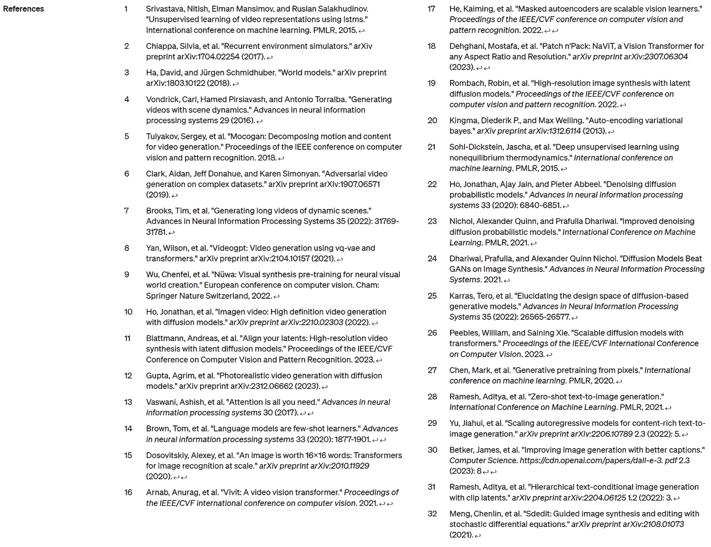
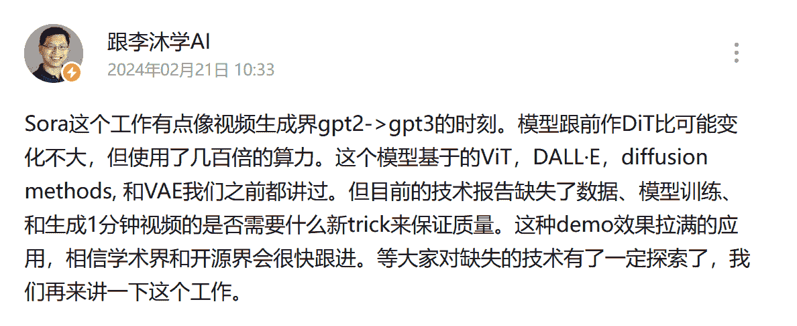

# 论文研究

> 来源：[https://datawhaler.feishu.cn/docx/NPqtdRMF0o77BUxyE5EcfWOknIb](https://datawhaler.feishu.cn/docx/NPqtdRMF0o77BUxyE5EcfWOknIb)

Sor**a技**术报告的Referenc**es中共有32篇****paper，我**们**汇总****了所有的32篇论文**（还有一些**非32篇的**有趣文章），并且列出了文章[核心](https://datawhaler.feishu.cn/wiki/RKrCw5YY1iNXDHkeYA5cOF4qnkb#TY2Ydav83oPJx8xwa71cV4Kcnxo)关键词，摘要，希望深度学习的小伙伴可以研究，知其然，之其所以然，希望大家研究地开心（希望参与深度研讨，请联系玉鑫）

# 所有论文

论文下载地址：https://datawhaler.feishu.cn/drive/folder/TleffR4KCl3cFTdqNYFch0fGn1e?from=from_copylink

多维表格（Sks2bozrDaskmQskKkdcjE4Un0a_tbllhtZE75DbD367）

# 李沐解读核心论文

推荐跟李沐学AI，读Paper再也不愁了：https://github.com/mli/paper-reading

## VIT

<https://player.bilibili.com/player.html?bvid=15P4y137jb>

## DALL·E

<https://player.bilibili.com/player.html?bvid=17r4y1u77B>

# 知识库动态

[Datawhale - AI视频生成学习](https://datawhaler.feishu.cn/wiki/RKrCw5YY1iNXDHkeYA5cOF4qnkb)