# 官方技术报告中文版

> 来源：[https://datawhaler.feishu.cn/docx/A2AHdD3bvo6SuWx1DkLcvLgenhc](https://datawhaler.feishu.cn/docx/A2AHdD3bvo6SuWx1DkLcvLgenhc)

> **腾讯科技对官方技术报告的解读**：https://mp.weixin.qq.com/s/xP46EocNg1x7IlTN_iF8kw

> 文 | 腾讯科技 郭晓静、郝博阳，编译 | 金鹿

我们探索**了**利用视频数据对生成模型进行大规模训练。具体来说，我们在不同持续时间、分辨率和纵横比的视频和图像上联合训练了以文本为输入条件的扩散模型。我们引入了一种transformer架构，该架构对视频的时空序列包和图像潜在编码进行操作。我们最顶尖的模型Sora已经能够生成最长一分钟的高保真视频，这标志着我们在视频生成领域取得了重大突破。我们的研究结果表明，通过扩大视频生成模型的规模，我们有望构建出能够模拟物理世界的通用模拟器，这无疑是一条极具前景的发展道路。

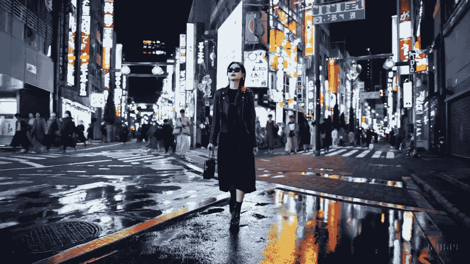

[twitter_OpenAI(@OpenAI)_20240215-181403_1758192965703647443_video.mp4](https://internal-api-drive-stream.feishu.cn/space/api/box/stream/download/all/KpQ8bGRddoc37jxffXlcv3IfnAl)

图注：Sora生成的东京街头场景视频

这份技术报告主要聚焦于两大方面：首先，我们详细介绍了一种将各类可视数据转化为统一表示的方法，从而实现了对生成式模型的大规模训练；其次，我们对Sora的能力及其局限性进行了深入的定性评估。需要注意的是，本报告并未涉及模型的具体技术细节。

在过去的研究中，许多团队已经尝试使用递归网络、生成对抗网络、自回归Transformer和扩散模型等各种方法，对视频数据的生成式建模进行了深入研究。然而，这些工作通常仅限于较窄类别的视觉数据、较短的视频或固定大小的视频上。相比之下，Sora作为一款通用的视觉数据模型，其卓越之处在于能够生成跨越不同持续时间、纵横比和分辨率的视频和图像，甚至包括生成长达一分钟的高清视频。

将可视数据转换成数据包（patchs）

在可视数据的处理上，我们借鉴了大语言模型的成功经验。这些模型通过对互联网规模的数据进行训练，获得了强大的通用能力。同样，我们考虑如何将这种优势引入到可视数据的生成式模型中。大语言模型通过token将各种形式的文本代码、数学和自然语言统一起来，而Sora则通过视觉包（patchs）实现了类似的效果。我们发现，对于不同类型的视频和图像，包是一种高度可扩展且有效的表示方式，对于训练生成模型具有重要意义。

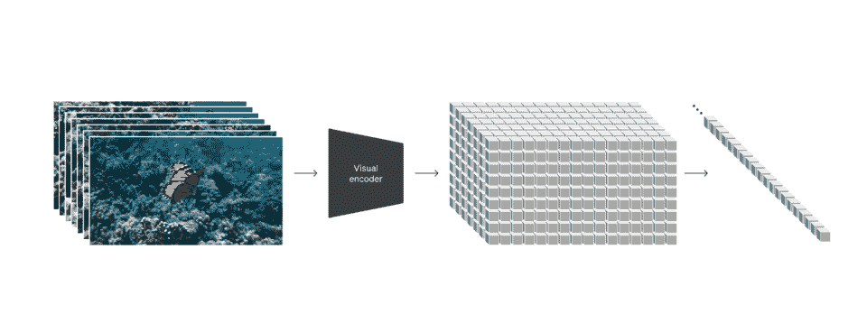

图注：OpenAI专门设计的解码器模型，它可以将生成的潜在表示重新映射回像素空间

在更高层次上，我们首先将视频压缩到一个低维度的潜在空间:这是通过对视频进行时间和空间上的压缩实现的。这个潜在空间可以看作是一个“时空包”的集合，从而将原始视频转化为这些包。

**视频压缩网络**

我们专门训练了一个网络，专门负责降低视觉数据的维度。这个网络接收原始视频作为输入，并输出经过压缩的潜在表示。Sora模型就是在这个压缩后的潜在空间中接受训练，并最终生成视频。此外，我们还设计了一个解码器模型，它可以将生成的潜在表示重新映射回像素空间，从而生成可视的视频或图像。

**时空包**

当给定一个压缩后的输入视频时，我们会从中提取出一系列的时空包，这些包被用作转换token。这一方案不仅适用于视频，因为视频本质上就是由连续帧构成的，所以图像也可以看作是单帧的视频。通过这种基于包的表示方式，Sora能够跨越不同分辨率、持续时间和纵横比的视频和图像进行训练。在推理阶段，我们只需在适当大小的网格中安排随机初始化的包，就可以控制生成视频的大小和分辨率。

用于视频生成的缩放Transformers

Sora是一个扩散模型，它接受输入的噪声包（以及如文本提示等条件性输入信息），然后被训练去预测原始的“干净”包。重要的是，Sora是一个基于扩散的转换器模型，这种模型已经在多个领域展现了显著的扩展性，包括语言建模、计算机视觉以及图像生成等领域。

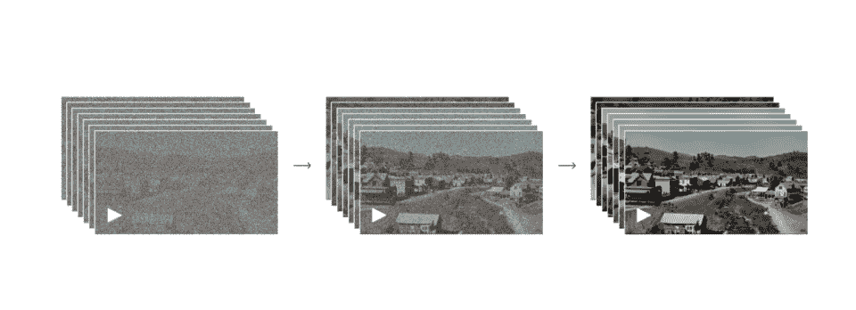

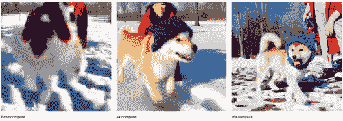

图注：随着训练量的增加，扩散转换器生成的样本质量有了明显提高

在这项工作中，我们发现扩散转换器在视频生成领域同样具有巨大的潜力。我们展示了不同训练阶段下，使用相同种子和输入的视频样本对比，结果证明了随着训练量的增加，样本质量有着明显的提高。

**丰富的持续时间、分辨率与纵横比**

过去，图像和视频生成方法常常需要将视频调整大小、裁剪或修剪至标准尺寸，如4秒、256x256分辨率的视频。但Sora打破了这一常规，它直接在原始大小的数据上进行训练，从而带来了诸多优势。

**采样更灵活**

Sora具备出色的采样能力，无论是宽屏1920x1080p视频、垂直1080x1920视频，还是介于两者之间的任何视频尺寸，它都能轻松应对。这意味着Sora可以为各种设备生成与其原始纵横比完美匹配的内容。更令人惊叹的是，即使在生成全分辨率内容之前，Sora也能以较小的尺寸迅速创建内容原型。而所有这一切，都得益于使用相同的模型。

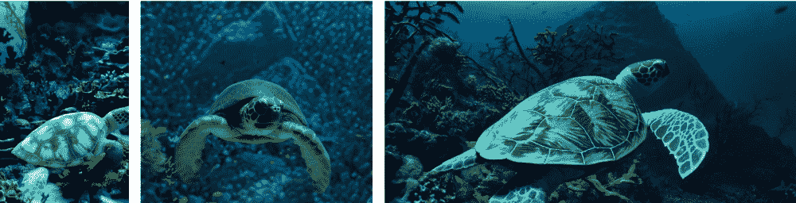

图注：Sora可以为各种设备生成与其原始纵横比完美匹配的内容

**改进构图与框架**

我们的实验结果显示，在视频的原始纵横比上进行训练，能够显著提升构图和框架的质量。为了验证这一点，我们将Sora与一个将所有训练视频裁剪为方形的模型版本进行了比较。结果发现，在正方形裁剪上训练的模型有时会生成仅部分显示主题的视频。而Sora则能呈现出更加完美的帧，充分展现了其在视频生成领域的卓越性能。

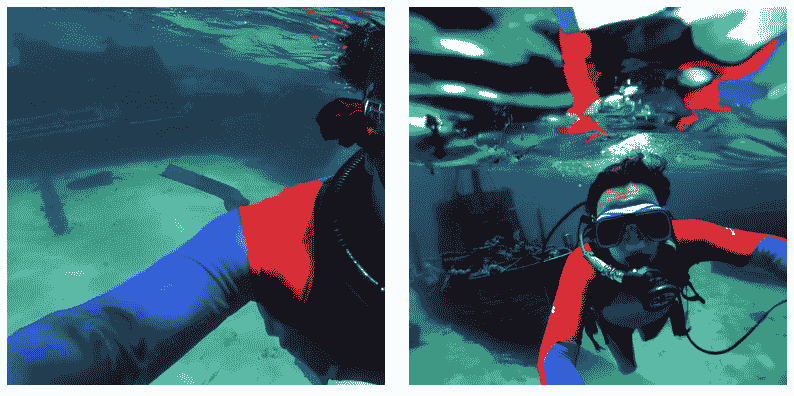

图注：将所有训练视频裁剪为方形的模型相比（左），Sora能呈现出更加完美的帧

**语言理解深化**

为了训练文本转视频生成系统，需要大量带有相应文本字幕的视频。为此，我们借鉴了DALL·E3中的re-captioning技术，并应用于视频领域。首先，我们训练了一个高度描述性的转译员模型，然后使用它为我们训练集中的所有视频生成文本转译。通过这种方式，我们发现对高度描述性的视频转译进行训练，可以显著提高文本保真度和视频的整体质量。

与此同时，与DALL·E3类似，我们还利用GPT技术将简短的用户提示转换为更长的详细转译，并将其发送到视频模型。这一创新使得Sora能够精确地按照用户提示生成高质量的视频。

**图片与视频提示**

在上述所有结果和我们的演示中，你可能已经注意到了文本转视频的示例。但Sora的功能远不止于此，它还能接受其他类型的输入提示，如预先存在的图像或视频。这种多样化的提示方式使Sora能够执行广泛的图像和视频编辑任务，如创建完美的循环视频、将静态图像转化为动画、向前或向后扩展视频等。

**将DALL·E图片变成动画**

值得一提的是，Sora还能在提供图像和提示作为输入的情况下生成视频。下面展示的示例视频就是基于DALL·E 2和DALL·E 3的图像生成的。这些示例不仅证明了Sora的强大功能，还展示了它在图像和视频编辑领域的无限潜力。

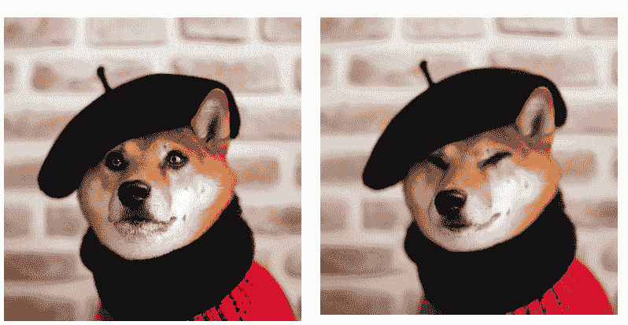

<https://v.qq.com/txp/iframe/player.html?origin=https%3A%2F%2Fmp.weixin.qq.com&containerId=js_tx_video_container_0.021860429127762426&vid=c1193bilj58&width=677&height=507.75&autoplay=false&allowFullScreen=true&chid=17&full=true&show1080p=false&isDebugIframe=false>

视频：一只戴着贝雷帽、穿着黑色高领毛衣的柴犬生成视频

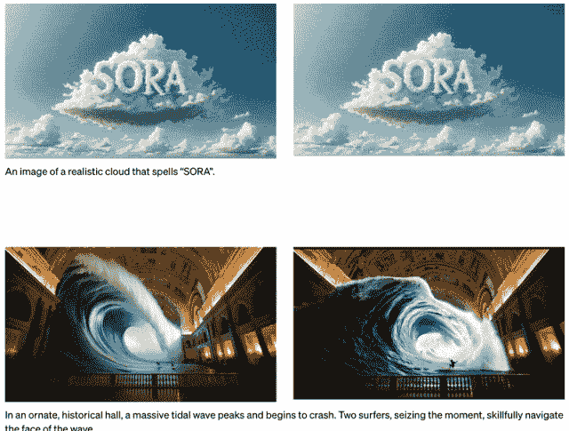

一幅逼真的云朵图像生成视频，上面写着“SORA”；在一个华丽的历史大厅里，一股巨大的浪潮达到顶峰，并开始崩散，两个冲浪者抓住时机，巧妙地在海浪表面飞驰

**扩展生成视频**

Sora不仅具备生成视频的能力，更能在时间维度上实现向前或向后的无限扩展。以下三个视频便是从同一生成视频片段出发，逐步向后扩展的示例。尽管它们的起始部分各异，但结局却出奇地一致。

<https://v.qq.com/txp/iframe/player.html?origin=https%3A%2F%2Fmp.weixin.qq.com&containerId=js_tx_video_container_0.6822756155222245&vid=w119375lyfq&width=677&height=380.8125&autoplay=false&allowFullScreen=true&chid=17&full=true&show1080p=false&isDebugIframe=false>

<https://v.qq.com/txp/iframe/player.html?origin=https%3A%2F%2Fmp.weixin.qq.com&containerId=js_tx_video_container_0.36419903768779793&vid=f1193dqghbk&width=677&height=380.8125&autoplay=false&allowFullScreen=true&chid=17&full=true&show1080p=false&isDebugIframe=false>

<https://v.qq.com/txp/iframe/player.html?origin=https%3A%2F%2Fmp.weixin.qq.com&containerId=js_tx_video_container_0.39890749265586756&vid=f1193ctqt89&width=677&height=380.8125&autoplay=false&allowFullScreen=true&chid=17&full=true&show1080p=false&isDebugIframe=false>

视频：这些视频的起始部分各异，但结局几乎相同

这充分展示了Sora在时间扩展方面的强大功能，甚至能创造出无缝的无限循环视频。

<https://v.qq.com/txp/iframe/player.html?origin=https%3A%2F%2Fmp.weixin.qq.com&containerId=js_tx_video_container_0.5024029890765733&vid=v11930pb0td&width=677&height=380.8125&autoplay=false&allowFullScreen=true&chid=17&full=true&show1080p=false&isDebugIframe=false>

视频：Sora甚至可以创造出无限循环视频

**视频到视频编辑**

随着扩散模型的发展，我们已经开发出多种方法来编辑基于文本提示的图像和视频。在此，我们将其中一种名为SDEdit 32的技术应用于Sora。这项技术赋予了Sora转换零拍摄输入视频风格和环境的能力，为视频编辑领域带来了革命性的变革。

<https://v.qq.com/txp/iframe/player.html?origin=https%3A%2F%2Fmp.weixin.qq.com&containerId=js_tx_video_container_0.26732488112726904&vid=d11936ppqmd&width=677&height=380.8125&autoplay=false&allowFullScreen=true&chid=17&full=true&show1080p=false&isDebugIframe=false>

**视频的无缝连接**

更令人惊叹的是，Sora还能在两个截然不同的输入视频之间实现无缝过渡。通过逐渐插入技术，我们能够在具有完全不同主题和场景构图的视频之间创建出流畅自然的过渡效果。

**图片生成能力**

Sora的出色能力不止于数据处理和分析，它现在还能生成图像！这一创新功能的实现得益于一种独特的算法，该算法在一个精确的时间范围内，巧妙地在空间网格中排列高斯噪声补丁。

值得一提的是，Sora的图像生成功能不仅限于特定大小的图像。它可以根据用户需求，生成可变大小的图像，最高可达惊人的2048 × 2048分辨率。

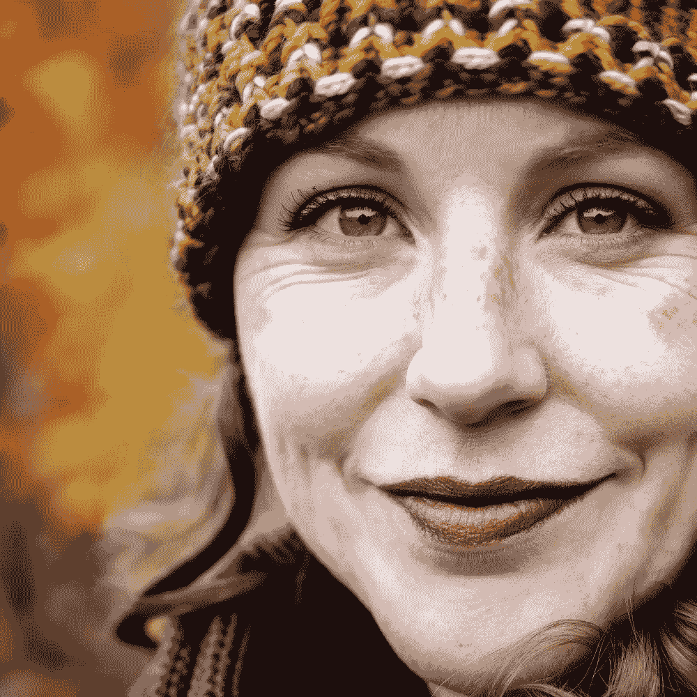

图注：一个女人在秋天的特写肖像，每一个细节都被捕捉得淋漓尽致，浅景深的应用使得主体脱颖而出

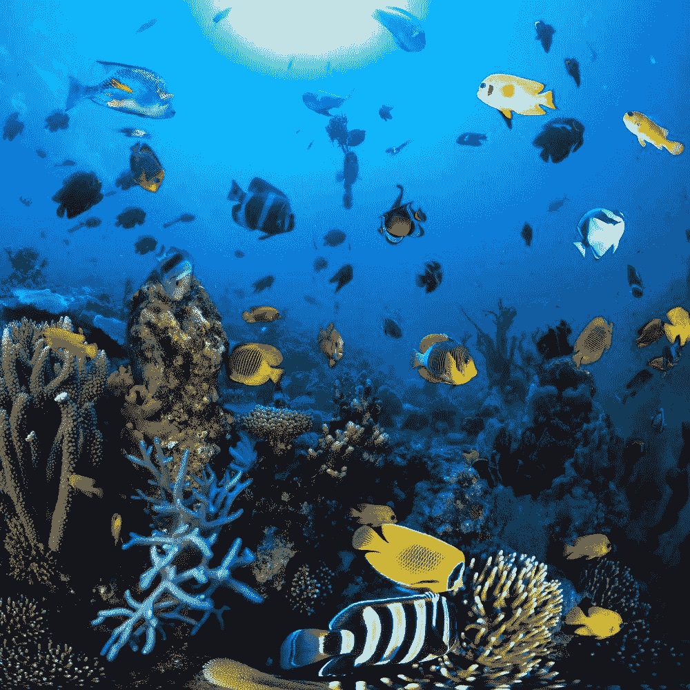

图注：充满生机的珊瑚礁吸引了五颜六色的鱼类和海洋生物

**新的模拟能力**

在大规模训练过程中，我们发现视频模型展现出了许多令人兴奋的新能力。这些功能使得Sora能够模拟现实世界中的人物、动物和环境等某些方面。值得注意的是，这些属性的出现并没有依赖于任何明确的3D建模、物体识别等归纳偏差，而是纯粹通过模型的尺度扩展而自然涌现的。

**3D一致性：**在3D一致性方面，Sora能够生成带有动态摄像头运动的视频。随着摄像头的移动和旋转，人物和场景元素在三维空间中始终保持一致的运动规律。

<https://v.qq.com/txp/iframe/player.html?origin=https%3A%2F%2Fmp.weixin.qq.com&containerId=js_tx_video_container_0.9288125230029183&vid=z1193gywvc8&width=677&height=380.8125&autoplay=false&allowFullScreen=true&chid=17&full=true&show1080p=false&isDebugIframe=false>

视频：人物和场景元素在三维空间中始终保持一致

**较长视频的连贯性和对象持久性：**视频生成领域面对的一个重要挑战就是，在生成的较长视频中保持时空连贯性和一致性。Sora，虽然不总是，但经常能够有效地为短期和长期物体间的依赖关系建模。例如，在生成的视频中，人物、动物和物体即使在被遮挡或离开画面后，仍能被准确地保存和呈现。同样地，Sora能够在单个样本中生成同一角色的多个镜头，并在整个视频中保持其外观的一致性。

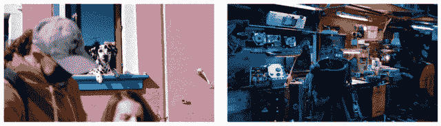

**与世界互动：**Sora有时还能以简单的方式模拟影响世界状态的行为。例如，画家可以在画布上留下新的笔触。随着时间的推移，一个人吃汉堡时也能在上面留下咬痕。

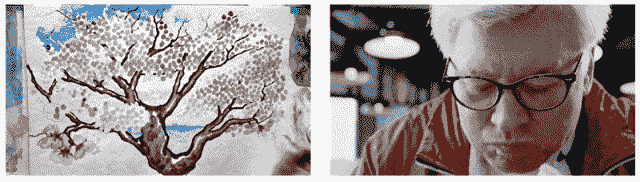

图注：Sora能以简单的方式模拟影响世界状态的行为

**模拟数字世界：**Sora还能够模拟人工过程，比如视频游戏。它可以在高保真度渲染世界及其动态的同时，用基本策略控制《我的世界》中的玩家。这些功能都无需额外的训练数据或调整模型参数，只需向Sora提示“我的世界”即可实现。

这些新能力表明，视频模型的持续扩展为开发高性能的物理和数字世界模拟器提供了一条充满希望的道路。通过模拟生活在这些世界中的物体、动物和人等实体，我们可以更深入地理解现实世界的运行规律，并开发出更加逼真、自然的视频生成技术。

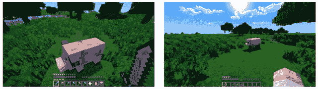

**局限性与展望**

尽管Sora在模拟能力方面已经取得了显著的进展，但它目前仍然存在许多局限性。例如，它不能准确地模拟许多基本相互作用的物理过程，如玻璃破碎等。此外，在某些交互场景中，比如吃东西时，Sora并不能总是产生正确的对象状态变化。我们在发布页面中列举了模型的其他常见故障模式，包括在长时间样本中发展的不一致性或某些对象不受控的出现等。

<https://v.qq.com/txp/iframe/player.html?origin=https%3A%2F%2Fmp.weixin.qq.com&containerId=js_tx_video_container_0.9114039246785486&vid=m1193zr67aj&width=677&height=380.8125&autoplay=false&allowFullScreen=true&chid=17&full=true&show1080p=false&isDebugIframe=false>

然而，我们相信随着技术的不断进步和创新，Sora所展现出的能力预示着视频模型持续扩展的巨大潜力。未来，我们期待看到更加先进的视频生成技术，能够更准确地模拟现实世界中的各种现象和行为，并为我们带来更加逼真、自然的视觉体验。