# 推荐：SORA 超详细解读

> 来源：[https://datawhaler.feishu.cn/docx/MQA6dH5plomXw7x09AVcLD79nmc](https://datawhaler.feishu.cn/docx/MQA6dH5plomXw7x09AVcLD79nmc)

> **厦门大学平潭研究院研究员杨知铮老师 S****最强文生视频模型 SORA 超详细解**读：https://zhuanlan.zhihu.com/p/682579303

> [**https://www.yuque.com/shekonghuanzheyangl**](https://link.zhihu.com/?target=https%3A//www.yuque.com/shekonghuanzheyanglaoshi/uzl5zl/gfrt813iss1b8h3u%3FsingleDoc%23)**a**oshi/uzl5zl/gfrt813iss1b8h3u?singleDoc#

2月16日一早openAI平地一声雷，悄无声息的发布了第一个Text to Video大模型—SORA。从演示看，效果还是相当不错的。 Sora 的强大之处在于其能够根据文本描述，生成长达60秒的视频，其中包含精细复杂的场景、生动的角色表情以及复杂的镜头运动。 这无异于给正在处于春节长假的尾巴国内AI圈丢下了一颗重磅炸弹。这篇文章，我将快速的带大家解读一下openAI在官方release的技术报告，希望本文可以让大家能从一头雾水中，寻找和思考一些未来文生视频和文生图领域的技术发展趋势。另外本文不会逐字逐句的去翻译技术报告原文，对原文感兴趣的读者，可以在以下链接中自行食用。

技术报告原文链接: [h](https://link.zhihu.com/?target=https%3A//openai.com/research/video-generation-models-as-world-simulators)ttps://openai.com/research/video-generation-models-as-world-simulators

全部演示视频的完整的内容可以参考本文的语雀文档链接，《最[强文生视频模型 SORA 超详细解读》：https://www.yuque.com](https://link.zhihu.com/?target=https%3A//www.yuque.com/shekonghuanzheyanglaoshi/uzl5zl/gfrt813iss1b8h3u%3FsingleDoc%23)/shekonghuanzheyanglaoshi/uzl5zl/gfrt813iss1b8h3u?singleDoc#

## 认识SORA

长期关注文生视频领域的读者，肯定非常清楚，在这一领域长期以来openAI并不是最受关注的哪一个。2023年国外最火的三个公司应该是runway，PIKA和Pixverse。作为文生视频领域的后期之秀，openAI这次发布的SORA有哪些特别之处？让我们先从宏观视角来一探究竟。

Sora能够创造出包含多个角色、特定动作类型以及与主题和背景相符的详细场景。这款模型不仅能理解用户的指令，还能洞察这些元素在现实世界中的表现。 Sora对语言有着深刻的理解，能够精准地捕捉到用户的需求，并创造出充满生命力、情感丰富的角色。此外，Sora还能在同一视频中创造出多个画面，同时保持角色和视觉风格的一致性。 当然，Sora还不是完美的。比如在模拟复杂场景的物理效应，以及理解某些特定因果关系时，它可能会遇到难题。举个例子，视频中的人物可能会咬一口饼干，但饼干上可能看不到明显的咬痕。 在处理空间细节，比如分辨左右时，Sora也可能会出现混淆；在精确描述一段时间内发生的事件，如特定的摄影机移动轨迹时，也可能显得力不从心。

首先，先来看看SORA生成视频的效果究竟如何。

提示词: 一位时髦的女士穿行在东京的街头，街道充满了温暖的霓虹灯光和动感的城市标志。她穿着一件黑色皮夹克，一条长红裙和黑色靴子，手拿一个黑色手提包。她戴着太阳镜和红色口红。她走路既自信又随意。街道潮湿且能反射，创造出彩色灯光的镜面效果。许多行人来来往往。

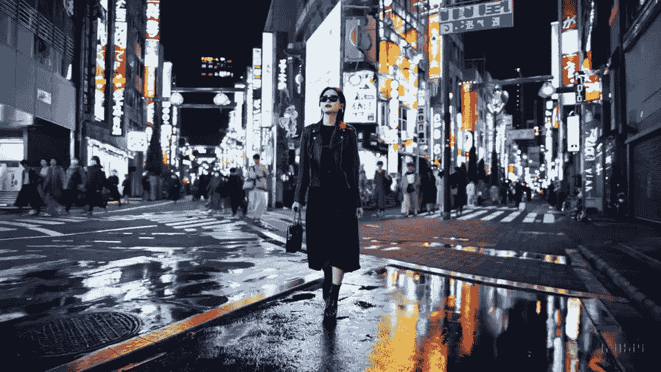

[twitter_OpenAI(@OpenAI)_20240215-181403_1758192965703647443_video.mp4](https://internal-api-drive-stream.feishu.cn/space/api/box/stream/download/all/NPdHbzAMKoiNNjxjAAfct23xnSe)

openAI在技术报告中提到SORA是在大规模的视频和图像数据上进行联合训练得到的生成模型。具体来说，联合训练了在不同持续时间、分辨率和纵横比的视频和图像上的文本条件扩散模型。openAI利用了一个在视频和图像潜空间上操作的transformer架构。生成一分钟的高清视频。

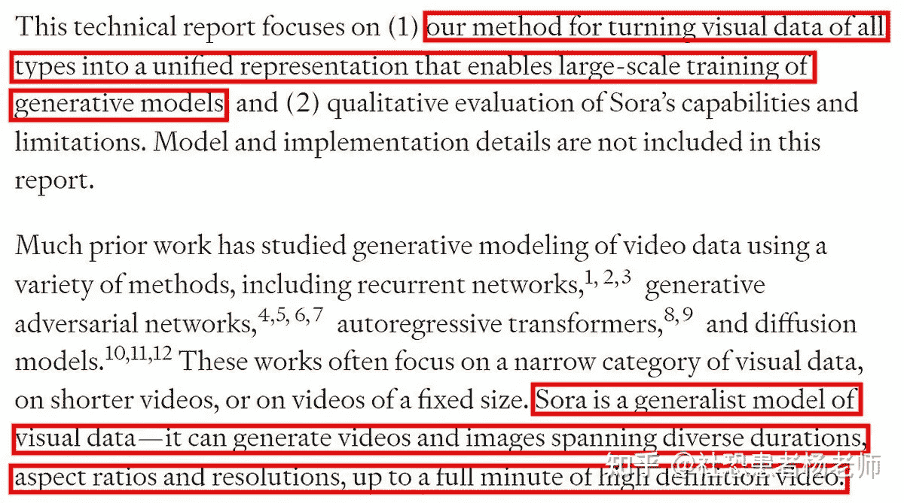

这次openAI训练的Sora 所建立的是一种通用的视觉模型方法，而不再是细分的方式（之前的研究，图像与视频模型是不同的），因此既可生成视频又可生成图像，并且不止如此。当GPT学会语言的时候就学会了语言所传递的一切，同理，Sora也可以学会视觉所传递的一切。

## Spacetime Patches 包含时空信息的图像块

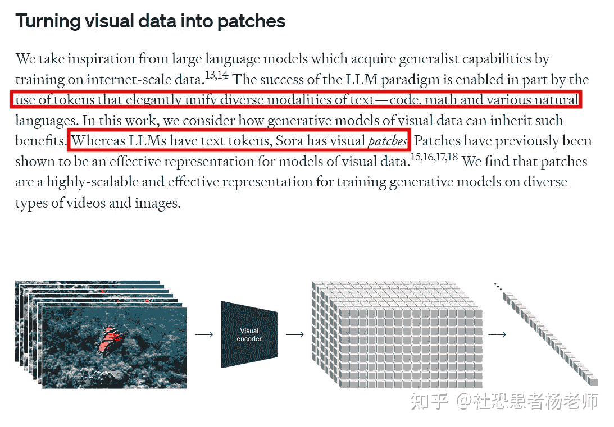

在开始训练模型之前，首先需要解决的是训练数据的结构化，格式统一化以及数据清洗，标注等等一系列数据预处理工作。显然，openAI在做这项工作的时候，首先考虑的很可能是在训练DALLE-3的那些海量的高质量的已经经过预处理的训练数据。那么接下来需要解决的就是如何将不同类型的数据(例如文本、视频、图片等)转化为Transformer架构下的向量，从而进行后续的训练。

Sora设计思路其实和LLM一致，都是先将所有输入数据统一化（LLM是文本/代码等，Sora是各种类型的视觉数据），然后训练模型用于预测下一个“词”（LLM是tokens，Sora是patches），并且使用原始数据而非修剪后的数据（不同分辨率、时长和高宽比）。学会预测就学会了背后的东西，LLM是知识，Sora是物理世界。

那么具体是如何实现的呢？第一步，就是要将原始视频数据，转化为低维度潜空间特征。 在这里sora定义了视频训练和推理的基本单元是Patches，这是在Vision Transformer (ViT) 这篇论文中首次被提出的概念，视频数据和图片数据进行统一是完全没有问题的，本来视频拆分成每一帧就是一张图片。视频的本质就是按照一定序列组织起来的图片。

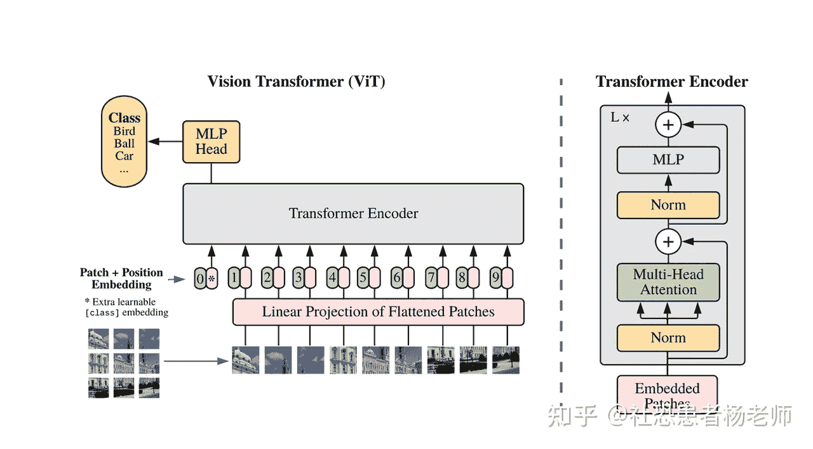

那什么是patches呢？Patches的实质就是将完整的图片拆成 NxN 的小方格后，再将每个图像块转换成向量，这样就得到了包含每个小方格position信息的embedding。比如一张 256x256 的图片，把它打碎成 256 张 16x16 的小图就叫做 Patches，实际上之前在训练 vision LLM 一直是这么做的。值得注意的是，经过这样一番操作，我们就将原始的视频数据转换成了包含x，y，p(p指position位置信息)三个维度信息的向量，而这切好是在LLM中Transformer架构中最熟悉的数据形式。

在文本预测生成中，基本单位是 Token，Token 很好理解，就是一个单词或者单词的一部分。Patch 的概念相对不那么好理解。我们可以想象一下《黑暗骑士》的电影胶片，将一卷胶片绕在一个金属盘上，然后挂在一个老式电影院的投影机上。 你把电影胶卷从盘中展开，然后剪下最前面的 100 帧，再挑出每一帧的图像，比如某一帧是小丑疯狂大笑，另一帧是蝙蝠侠痛苦的表情。接下来进行以下不太常规的操作： 你拿起一把像X光一般精细的刻刀，在第一帧电影胶片上剪出一个变形虫状的图案。你像处理精密仪器一样小心翼翼地用镊子提取这片形似变形虫的胶片，然后安全地保存起来。然后开始再处理下一帧：在接下来的胶片上切出同样位置、同样形状的变形虫图案。你再次用镊子小心地取出这个新的变形虫形状的胶片，形状与前一个完全相同——并将其精确地放置在第一个之上。如此这般重复操作，直到完成所有的 100 帧。 于是现在有了一个色彩斑斓的变形虫，沿着竖直方向的Y轴(这里对应的是时间轴)堆叠扩展。这样就得到了一座可以通过投影机播放《黑暗骑士》的小片段的胶片塔，就好像有人在投影机前握着拳头，只让电影的一小部分影像从拳心通过。 然后，这座胶片塔被压缩并转化为所谓的“Patch”—一种随时间变化的色块。最后从每一个存在的视频中剪出的 Patch 堆叠成无尽的胶片塔，再输入到模型中进行训练，想象一下这样的场景就会感到让人震撼。

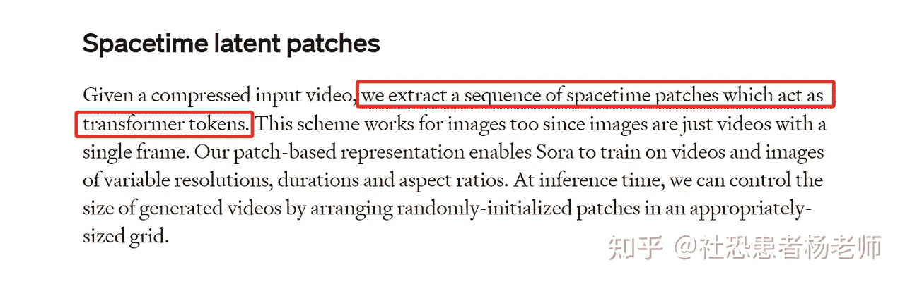

但如果只是将二维的图像打碎变成patches图像块，对于视频生成任务还不够。因为视频是由包含时间序列的多张图片构成的，处理时必须考虑这些长时间范围patches序列的上下文关系。因此patches必须包含原始视频数据中的时间序列信息，因此openAI将patches升级成了包含时间信息的spacetime patches。

这里就不得不提到在空间和时间维度上分别对Transformer编码器各组件进行分解的Vivit架构了，在ViT模型的基础上提出了三种用于视频分类的纯Transformer模型，如下图所示

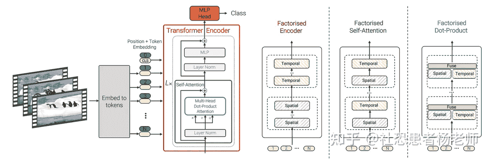

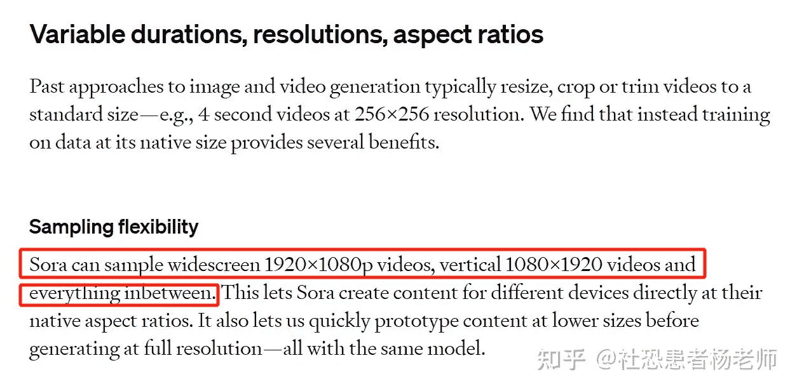

Sora 之所以显得如此强大，在于以前的文本转视频方法需要训练时使用的所有图片和视频都要有相同的大小，这就需要大量的预处理工作来裁剪视频至适当的大小。而由于 Sora 是基于“Patch”而非视频的全帧进行训练的，它可以处理任何大小的视频或图片，无需进行裁剪。这就让 OpenAI 能够在大量的图像和视频数据上训练 Sora。因此，可以有更多的数据用于训练，得到的输出质量也会更高。例如，将视频预处理至新的长宽比通常会导致视频的原始构图丢失。一个在宽屏中心呈现人物的视频，裁剪后可能只能部分展示该人物。因为 Sora 能接收任何视频作为训练输入，所以其输出不会受到训练输入构图不良的影响。

但是不同的分辨率输入在训练时候带来的是大量的计算负载不均衡，一个最简单的做法就是直接padding到固定大小这种做大会引入大量不必要的计算量。 从技术报告给出的参考文献来看，openAI最有可能是使用了 Google 的 Patch n' Pack (NaViT)即多个patches打包成一个单一序列以实现可变分辨率技术降低计算量，支持动态分辨率视频作为输入。

此外NaViT还有一个对视频处理特别关键的优势。它可以根据图像相似度，丢掉雷同的图像块，实现更快的训练。而在视频里，本来帧与帧之间就有大量雷同的图像信息。因此，这样一个技术也可以帮助Sora在训练视频时丢弃掉大量雷同的内容，从而大幅降低训练视频的成本。

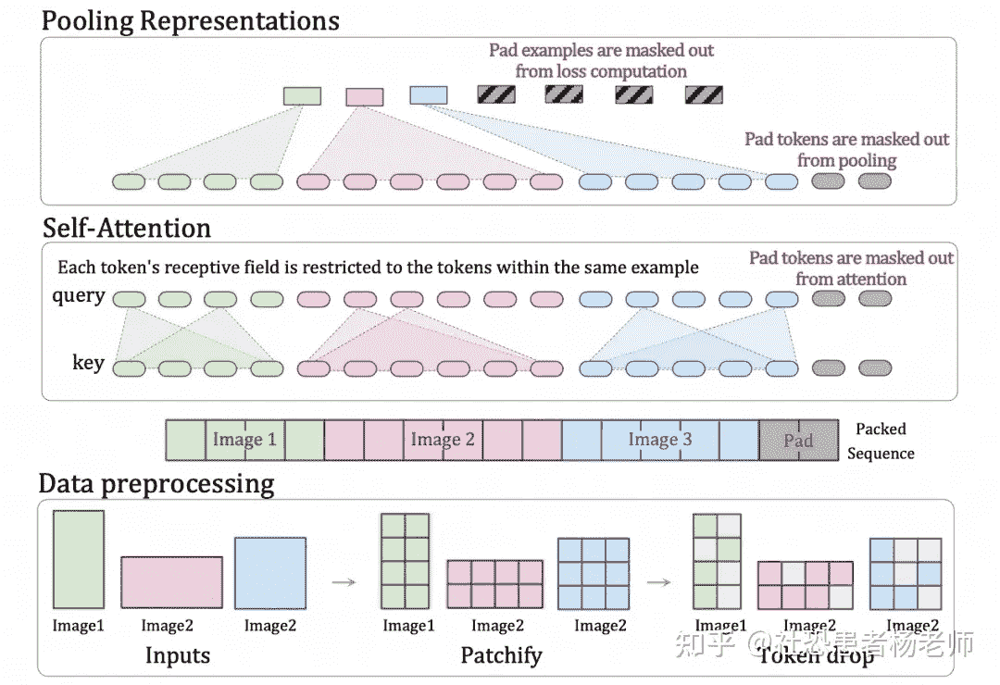

那么如何视频数据进行采样呢？有两种方式：

第一种，如下图所示，将输入视频划分为token的直接方法是从输入视频剪辑中均匀采样 �� 个帧，使用与ViT 相同的方法独立地嵌入每个2D帧(embed each 2D frame independently using the same method as ViT)，并将所有这些token连接在一起。

具体地说，如果从每个帧中提取 �ℎ⋅�� 个非重叠图像块(就像 ViT 一样)，那么总共将有 ��⋅�ℎ⋅�� 个token通过transformer编码器进行传递，这个过程可以被看作是简单地构建一个大的2D图像，以便按照ViT的方式进行tokenised

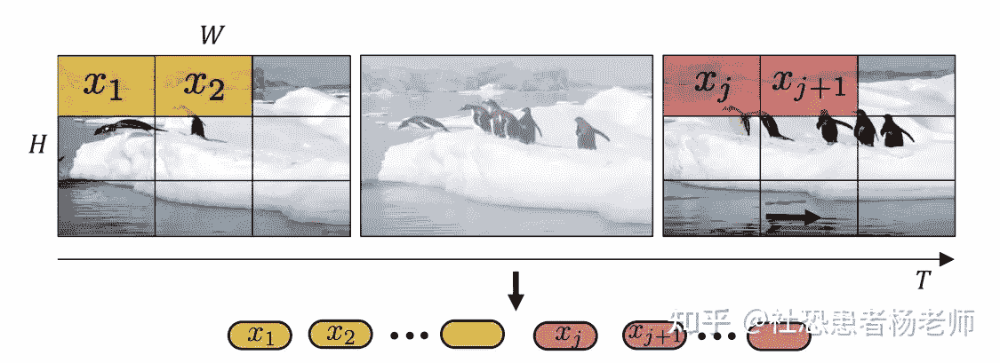

第二种则是把输入的视频划分成若干个tuplet(类似不重叠的带空间-时间维度的立方体)，每个tuplet会变成一个token(因这个tublelt的维度就是： �∗ℎ∗� ，包含了时间、宽、高)，经过spatial temperal attention进行空间和时间建模获得有效的视频表征token。

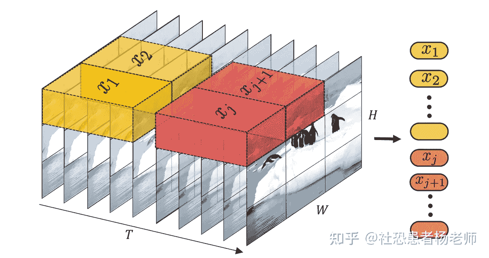

基于openai喜欢力大砖飞的的做事风格，很可能他们是通过喂入大量的视频数据，采用第二种时空联合建模的方式，进行的训练。

## Diffusion-Transformer 模型架构

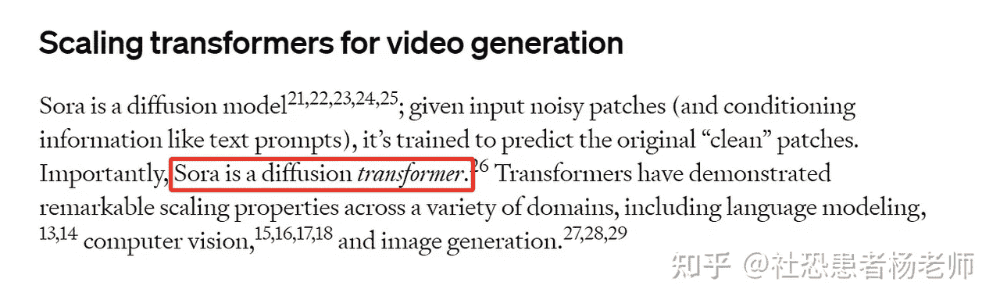

Sora 同时还是一种diffusion扩散模型，能将有噪声的图像块，基于 Prompt 还原出清晰的图像。首先训练一个encoder，将视频从时间和空间2个维度上压缩到低维隐空间里，接着从隐空间里提取出一系列时空patches进行单次训练。

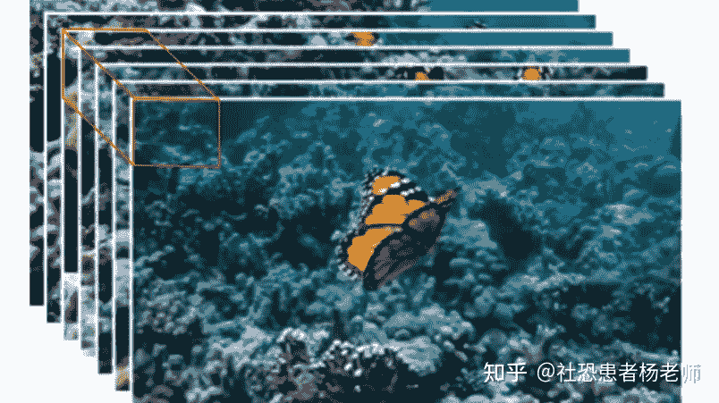

当我们理解了spacetime patches的概念之后，再来看待视频生成任务就非常好理解了。这就像chatGPT这种LLM做文本生成任务一样，从输入一段prompt开始，模型会采用的自回归的方式来预测接下来的每一个token。

对于上图一系列视频帧的左上角而言，便是已知当前spacetime patches，这就如同我们给LLM输入的prompt，然后sora推测下一个spacetime patches，最后通过自回归的方式预测出组合视频画面中各个位置的spacetime patches，然后在组合起来，便得到了整个视频画面的持续运动过程。

相较于Runway、Stable Video Diffusion和PIKA等纯粹是基于扩散模型（Diffusion Model）架构的

技术路线相比，我觉得Sora最大的区别是使用了Diffusion-Transformer(DiT)架构。

传统的扩散模型（Diffusion Model）的训练过程是通过多个步骤逐渐向图片增加噪点，直到图片变成完全无结构的噪点图片，然后在生成图片的时候，基于一张完全噪点的图片，逐步减少噪点，直到还原出一张清晰的图片。

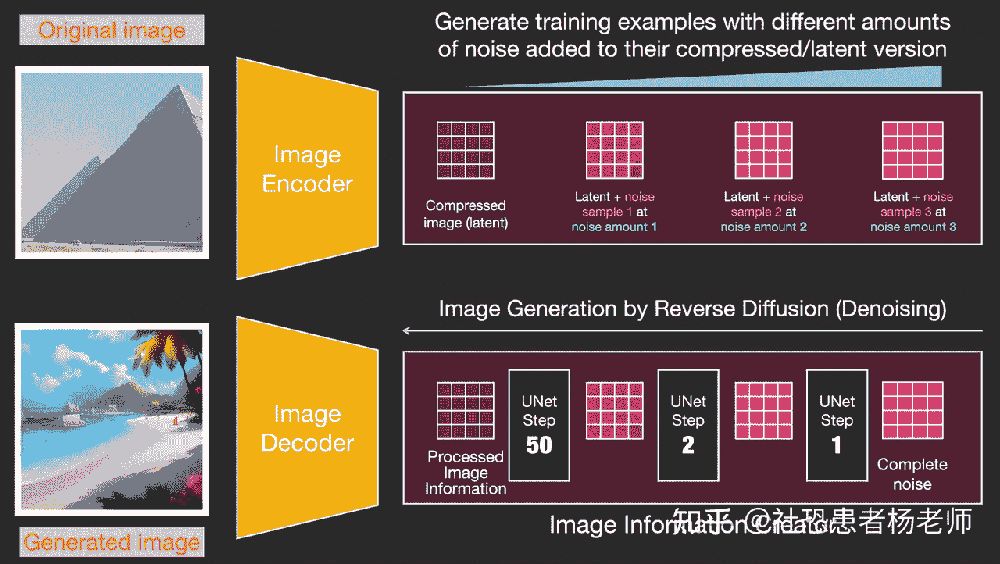

Sora 则是一个融合了Transformer Diffusion 两者的模型。通过 Transformer 的encoder- decoder架构处理含噪点的输入图像，并在每一步预测出更清晰的图像版本。编码器负责对含噪点的输入进行编码，而解码器则负责生成更清晰图像的预测。

从模型架[构上来看，Sora使用的Diffusion-Tra](https://link.zhihu.com/?target=https%3A//arxiv.org/abs/2212.09748)nsformer(DiT)架构，是将在LLM的Transformer架构和Text to Image领域的Diffusion架构做了一次融合。并且这项融合模型结构的提出者也不是openAI。而是William Peebles和Saining Xie发表在ICCV 2023的一篇论文《Scalable Diffusion Models with Transformers》中被提出的，但是openAI却是第一个使用这种架构在大规模数据上进行训练的。简单来说，Diffusion-Transformer(DiT)是一个带有Transformer Backbone骨干的扩散模型： DiT = [VAE编码器 + ViT + DDPM + VAE解码器] ,但把DPPM中的卷积U-Net架构换成了transformer。

下图为DiT模型的工作原理，输入是一张256x256x3的图片，对图片做切patch后经过投影得到每个patch的token，得到32x32x4的latent(在推理时输入直接是32x32x4的噪声)，结合当前的step t， 输入label y作为输入， 经过N个Dit Block通过mlp进行输出，得到输出的噪声以及对应的协方差矩阵，经过T个step采样，得到32x32x4的降噪后的latent。

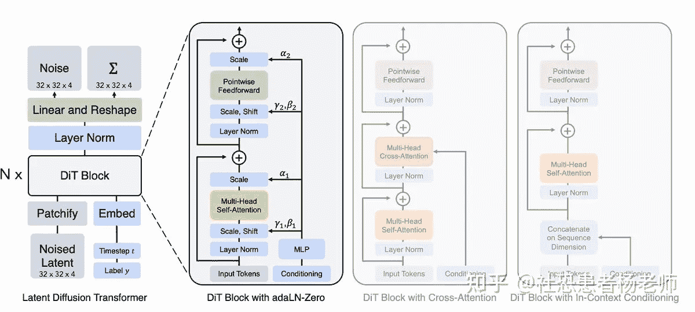

Dit论文中给出的模型架构

基于 transformer 的工作，不管是 latent diffusion 还是 LLM，它们之间的区别很小，都是 token-based，最大的区别在于diffusion 的生成是连续的 token，LLM处理的是离散的 token。值得注意的是提出DiT模型结构的作者之一的William Peebles(X上的名字为Bill)正是Sora项目组三个核心项目负责人之一。

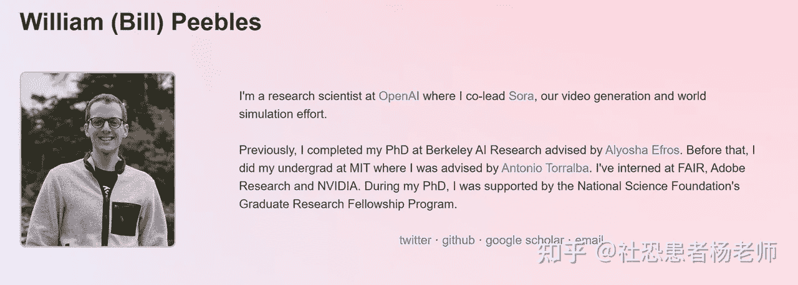

而这位年轻小伙，去年5月刚刚拿到 UC Berkeley 的PhD学位，入职openAI，据另外论文作者Saining Xie朋友圈发的文章说，Sora团队几乎一年时间天天996肝出来的成果，而下图中openAI员工一天的作息时间也许就是最有力的证明。

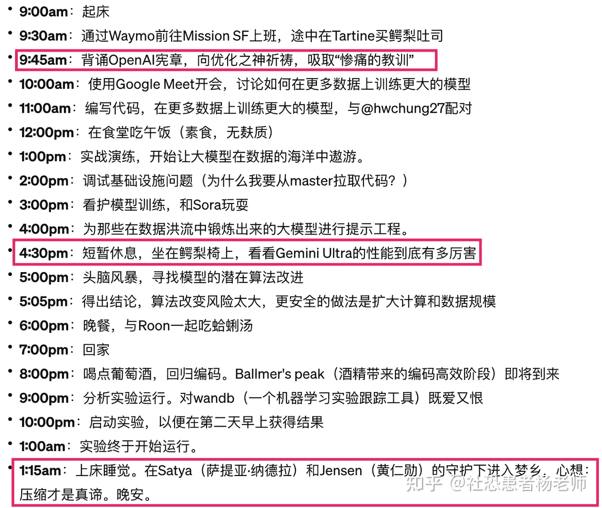

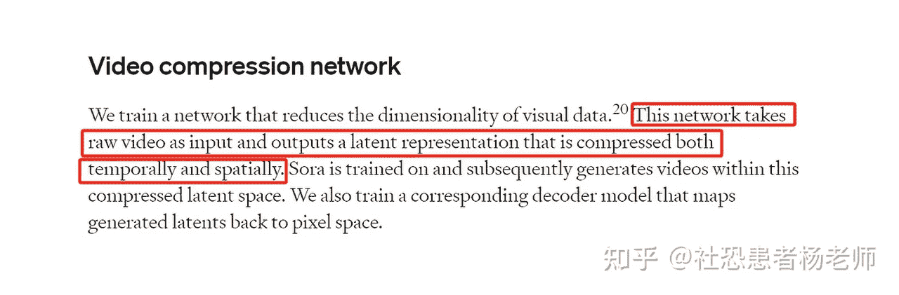

Video compression network(视频压缩网络)看起来它只是一个VAE，但是openAI应该对其进行了改造，使它在原始视频数据上进行了训练。标记化（Tokenization）在获得良好的时间一致性中可能起着重要的作用，结合前面训练得到的visual encoder，对应训练了一个visual decoder，把diffsuion transformer得到的latent decoder到像素空间。顺便说一句，VAE是一个CNN，所以从技术上讲，DiT是一个混合模型。

---

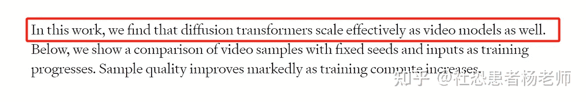

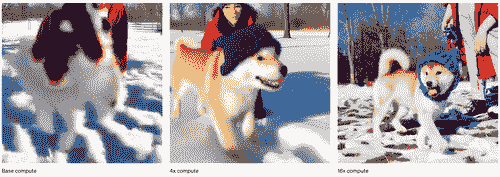

可扩展性是DiT论文的核心主题。首先，优化后的DiT在每个Flop的时钟时间上运行速度比UNet快得多。更重要的是，Sora证明了DiT的扩展规律不仅适用于图像，现在也适用于视频——Sora复制了在DiT中观察到的视觉扩展行为。

---

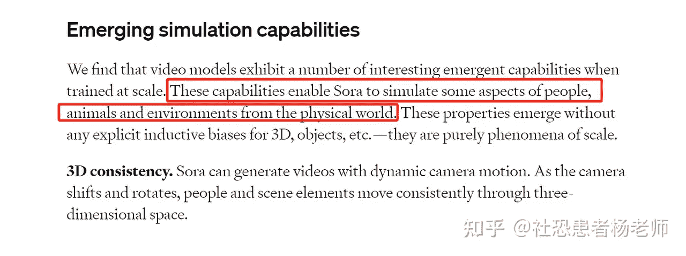

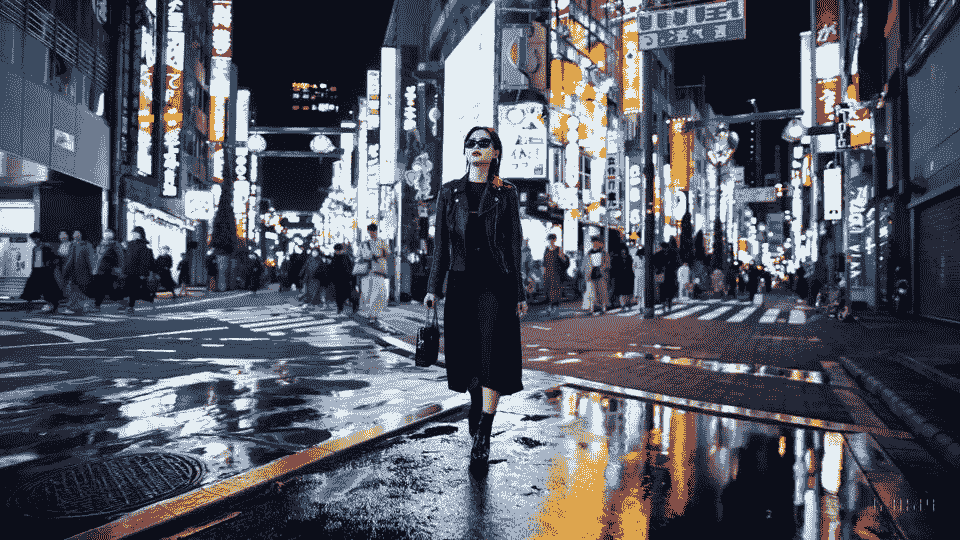

[最强文生视频模型_SORA_技术路线解读.mp4](https://internal-api-drive-stream.feishu.cn/space/api/box/stream/download/all/BIuXblWO0omGqYxbGNCcbuqAnXd)

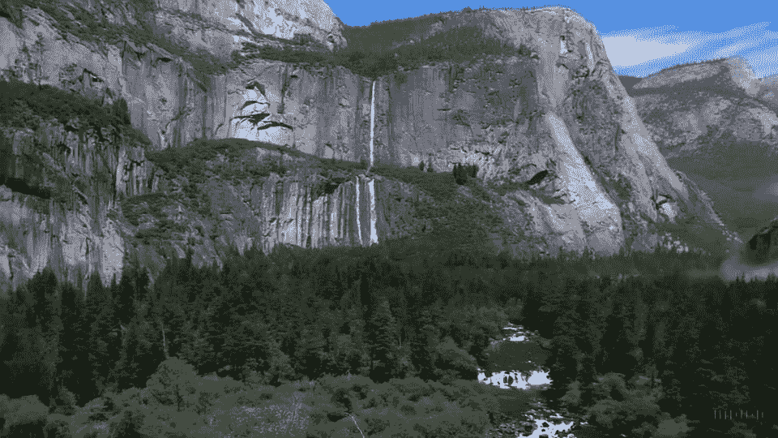

[最强文生视频模型_SORA_技术路线解读 (1).mp4](https://internal-api-drive-stream.feishu.cn/space/api/box/stream/download/all/EhZtbBMgtoClBXxypN3cgGffnvg)

Sora中非常关键的一点是来自“Emerging simulation capabilities”部分。Sora 可以生成具有动态摄像机运动的视频。随着摄像机的移动和旋转，人和其他场景元素在三维空间中一致地移动。跟大语言模型一样，在大规模训练下，视频模型展示出了一系列引人注目的涌现能力。在 Sora 之前，尚不清楚长时间视频(这里的长时间是指相对于runway或者pika生成的4s左右长度而言)中人物or场景一致性是否可以自行出现，或者是否需要复杂的主题驱动生成pipeline甚至物理模拟器。 OpenAI 已经表明，虽然现在很多场景还并不完美，但这些行为可以通过端到端训练来实现。然而，有两个要点尚未得到讨论。

1.训练数据：技术报告中完全没有谈论Sora的训练数据集信息，这是否在暗示数据可能是Sora成功的最关键因素？ 目前已经有很多关于来自例如UE5或者Unity游戏引擎的数据的推测。技术报告虽然没有明确提到Unreal Engine等game engine，但是不排除隐空间里用到了NeRf或者Gaussian Splatting等3D表征用来更高效地表达物体、环境、镜头之间的关系。大多数人猜测至少会包括电影、纪录片、电影长镜头等。质量真的很重要。非常好奇Sora从哪里得到这些高质量的训练数据。

2.长视频生成：长期关注文生视频领域的朋友可能都知道这样一个事实:保持时间上的连续性一直是个挑战。Sora 通常能够有效处理短距离和长距离的依赖关系。比如，即使人物、动物或物体被遮挡或移出画面，模型也能保持它们的连续存在。同样，它能在同一视频样本中多次展示同一角色，确保其外观贯穿始终。

[最强文生视频模型_SORA_技术路线解读 (2).mp4](https://internal-api-drive-stream.feishu.cn/space/api/box/stream/download/all/Aw8KbIVdtoJrQVxk9gIcT9bXnLe)

Sora的一个重大突破是能够生成非常长的视频。产生2秒的视频和1分钟的视频之间的技术差异是巨大的。 在Sora中，这可能是通过联合帧预测实现的，它允许自回归采样。众所周知视频生成模型有一个隐变量是时间序列，在此前同类型的任务中，最成熟的技术路线莫过于，训练模型引导图片按照时间序列进行某种基于文本的定向排序。这个排序如果说一旦可控，那么类似像Nvidia的dlss技术是基于时间序列先确定关键帧然后再插帧，最终生成视频的这样的方式。但一个主要的挑战是如何解决单帧的错误累积并保持质量/一致性随时间推移。openAI是否使用了传统的预测关键帧+插帧这样的一种方式来引导视频生成任务，还有待于未来openAI能够公布更多相关内容。

## SORA有哪些特别之处?

除了要统一训练数据格式之外，要想使用文本生成高质量符合人类需求的视频，还有一项必不可少的工作——数据标注。为了能够给出大量的视频及其对应的文字说明。openAI采用了 DALL·E 330 中引入的一种重新标注技术，并将其应用于视频。首先，训练了一个能够生成详细描述的模型，然后利用这个模型为训练集里的所有视频创建文字说明。使用描述性强的视频说明进行训练，不仅能提高文字的准确度，还能显著提升视频的整体质量。 就像 DALL·E 3 一样，openAI还使用 GPT 把用户的简短提示转化成详尽的说明，再将这些说明送给视频生成模型。这一过程使得 Sora 能够根据用户的指令，制作出高品质的视频。

openAI在技术报告里面展示了非常多的SORA演示视频，而通过这些演示视频，可以看到Sora的能力远不止是文生视频而已。在下面这个例子中Sora 在语义理解和属性匹配方面表现的非常好，这是一个非常重要的进步！

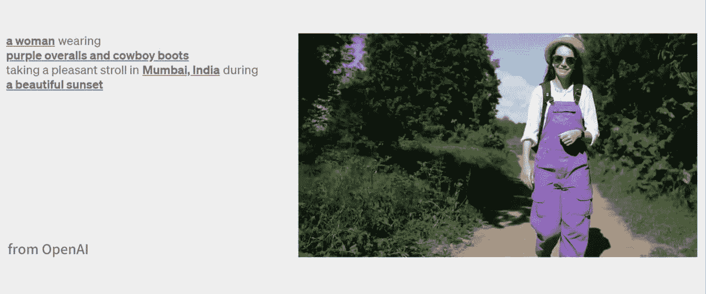

[最强文生视频模型_SORA_技术路线解读 (4).mp4](https://internal-api-drive-stream.feishu.cn/space/api/box/stream/download/all/V8BKb09pRoPGYsxPbLqcMdTIndc)

报告中这一部分也极其让人印象深刻，同一个输入视频，可以做不同的变化，生成结果惊人的稳定！

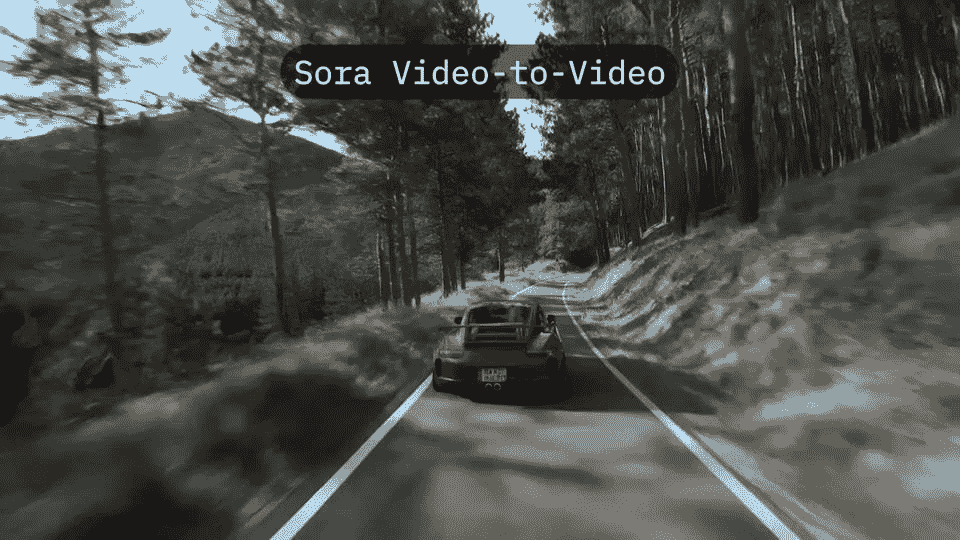

[最强文生视频模型_SORA_技术路线解读 (3).mp4](https://internal-api-drive-stream.feishu.cn/space/api/box/stream/download/all/DGeqbAmCLovLgFxV4wfc6IZUnob)

视频之间的流畅过渡，真的做到了无缝切换可以利用 Sora 把两个风格迥异的视频平滑连接起来，使它们之间能够自然过渡，仿佛融为一体。

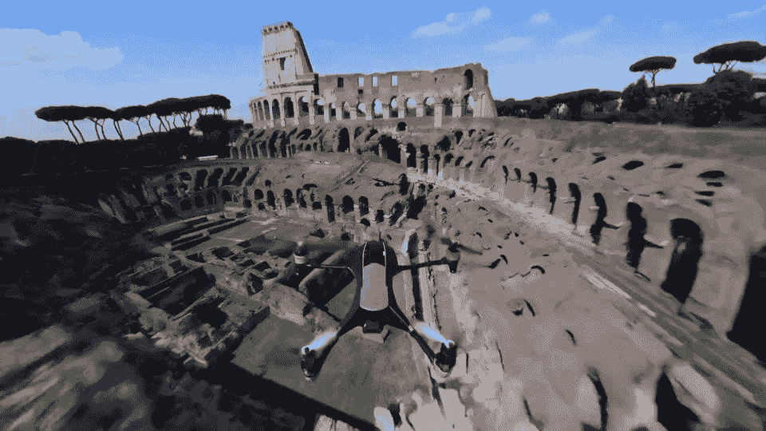

[最强文生视频模型_SORA_技术路线解读 (10).mp4](https://internal-api-drive-stream.feishu.cn/space/api/box/stream/download/all/LhfMbAHOYoWrHdxz4OBcEIlln9d)

视频时间延伸 Sora 同样能够把视频往前或往后延伸。下面是四个视频，它们都是从一个生成的视频片段开始，向后延伸。因此，尽管这四个视频的开头各不相同，但它们最终都汇聚于同一个结尾。

[最强文生视频模型_SORA_技术路线解读 (8).mp4](https://internal-api-drive-stream.feishu.cn/space/api/box/stream/download/all/HTTtbRf6to0X5IxF2WdcVKTan0d)

Sora 可以让静态图片动起来只需一张图片和一个提示，Sora 就能创造出视频。下面展示了一些基于 DALL·E 231 和 DALL·E 330 图片生成的视频示例。

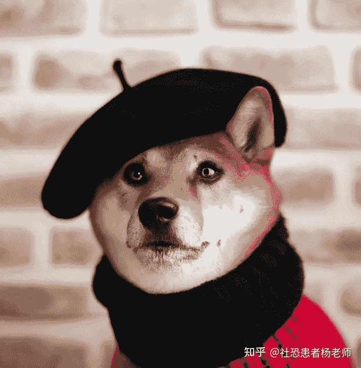

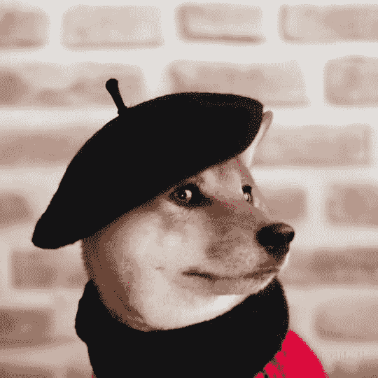

[最强文生视频模型_SORA_技术路线解读 (13).mp4](https://internal-api-drive-stream.feishu.cn/space/api/box/stream/download/all/NuScbiJQ7oBAChxe13icYkjnnOf)

## SORA还有哪些不足?

虽然Sora是一个目前为止性能最强悍的文生视频模型（很可能短期之内也难逢敌手），但Sora也有一些比较失败案例视频被人讨论。虽然Sora在视频长度、一致性、分辨率以及对世界的理解等方面表现出了许多突破，但是文生视频领域中一个非常非常重要的问题Sora目前并没有给出完美的解决方案，这就是真实世界的事件运行方式需要符合物理定律。比如从手中不慎摔落的玻璃杯掉在地板上，Sora不会把玻璃碎片生成出来。如果是让玻璃杯原地爆炸，散落到地上的碎片也不会是呈正态分布。

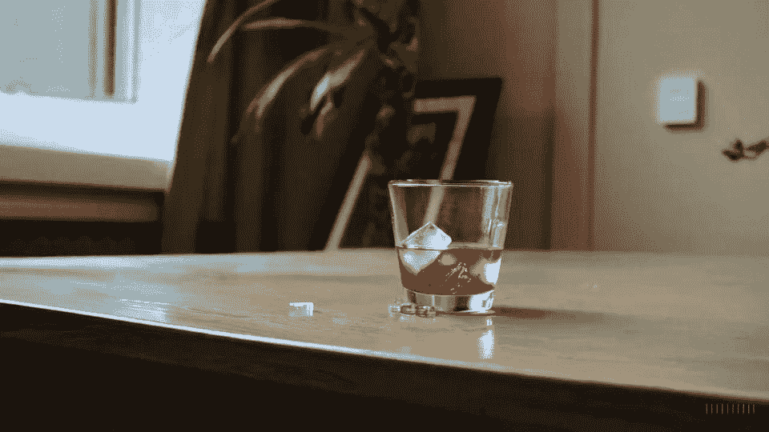

[最强文生视频模型_SORA_技术路线解读 (11).mp4](https://internal-api-drive-stream.feishu.cn/space/api/box/stream/download/all/Q9EBbg0jvo5Vl8x5EFEc7GI3nuh)

Sora 会取代游戏引擎开发者吗？绝对不会。它对物理的理解虽然是一种新的尝试，但仍然不够成熟，远远达不到完美。它经常会产生一些与我们对物理常识的理解不一致的幻觉。目前，它对物体间互动的理解尚不到位，我想从下面5个视频中的不符合物理规律的错误你就能明白这句话的意思。

1.挖出来的椅子不被认为是硬质物质。椅子的物理原理也有问题，它最终会漂浮在空中。

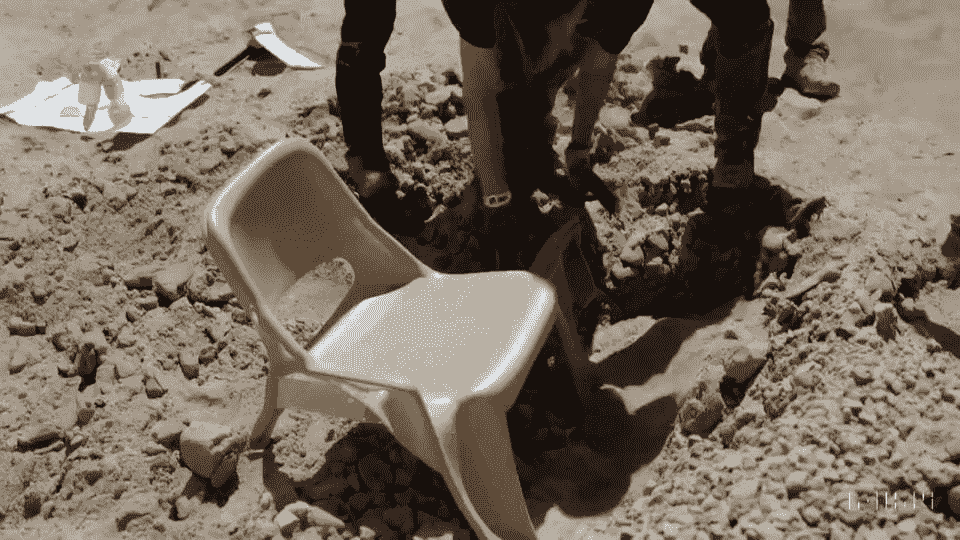

[最强文生视频模型_SORA_技术路线解读 (12).mp4](https://internal-api-drive-stream.feishu.cn/space/api/box/stream/download/all/CqDjbYr3DotAHDxmVNzchy5fneh)

2.当包含大量物体时，动物和人往往会突然出现。 提示指定“5 只灰狼”，但它们一开始有 4 只，最终增加到大约 10 只。

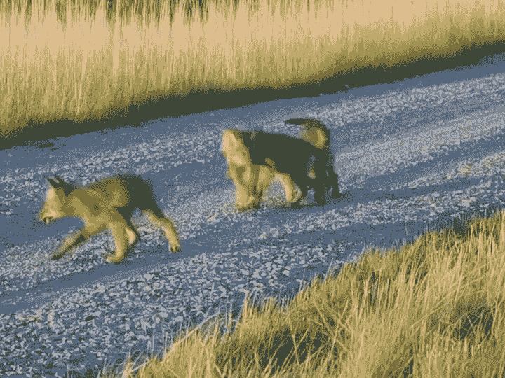

[最强文生视频模型_SORA_技术路线解读 (5).mp4](https://internal-api-drive-stream.feishu.cn/space/api/box/stream/download/all/WqpVb0zMmodTmZxevtScgotGn8c)

3.Sora似乎不擅长再现多个对象和角色之间的“复杂交互”。该视频使用了演示视频顶部的长提示，但即使它说“吹灭蜡烛以将其熄灭”和“蜡烛的光熄灭”两次，火也没有熄灭。它还没有消失

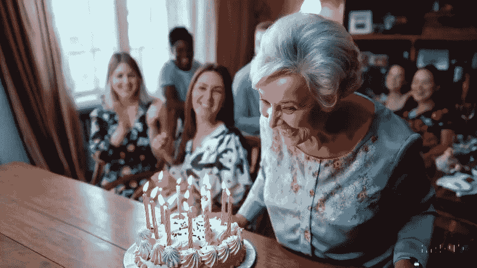

[最强文生视频模型_SORA_技术路线解读 (6).mp4](https://internal-api-drive-stream.feishu.cn/space/api/box/stream/download/all/XRzBbgYe0opHEix6apfcoMjCnUe)

4.物理建模不准确视频直到中间看起来还不错（爆炸本身是由提示指定的），但第二个球却穿过了篮筐。

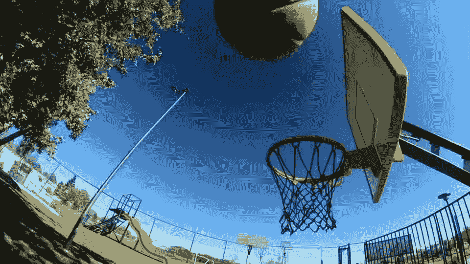

[最强文生视频模型_SORA_技术路线解读 (7).mp4](https://internal-api-drive-stream.feishu.cn/space/api/box/stream/download/all/Xikzb0qMVoHtolxbUoScZ1xgnkf)

5.对象挂起。视频大约十秒后，尽管没有具体指示，云巨人还是停了下来。 这在Runway的 Gen2 等模型中也出现过，但似乎也存在主体突然不自然地停止移动的趋势。

[最强文生视频模型_SORA_技术路线解读 (9).mp4](https://internal-api-drive-stream.feishu.cn/space/api/box/stream/download/all/VA47btp2NoSR8SxcmZCc430vn2c)

如果我们不考虑交互的话，UE5 就是一个（极其复杂的）生成视频像素的过程。同样，Sora 也是一个过程，它通过端到端的 Transformer 来生成视频像素，这两者在抽象层次上是相同的。 不同之处在于 UE5 是通过手工制作和精确设计的，而 Sora 则是通过数据学习和直观感受来实现的。换言之Sora 必须学习一些隐式的文本到 3D、3D 变换、光线追踪渲染和物理规则，才有可能精确地模拟视频像素。它必须理解游戏引擎的概念，才有可能生成工业生产级别的视频。因此Sora发布之后很多人宣称的电影特效，影视拍摄，短视频等工作岗位失业危机我认为短时间内并不会到来。

## 总结

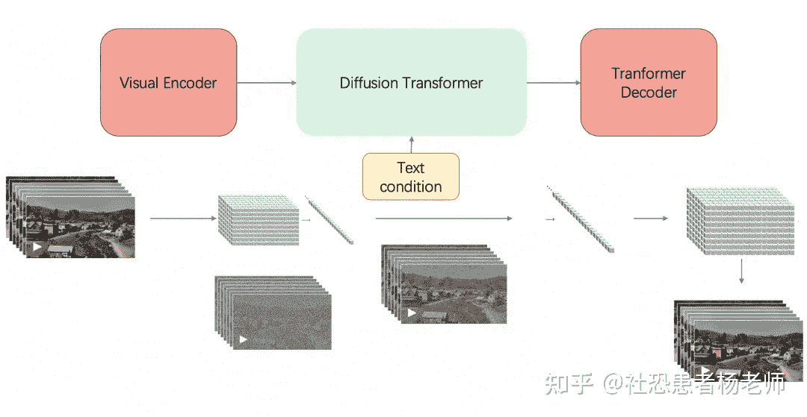

Sora完整工作流程示意图

从Sora的整个技术路线可以看出，sora成功的背后是NLP和CV领域长时间的技术积累而成的，可以说是集大成者。

OpenAI的Sora的诞生可以说让我们看到离AGI的实现更近了。如果AI可以生成与真实视频没有区别的视频，那么未来我们看到的世界是否可以被AI基本无差异的复刻呢？就在一年前文生视频领域甚至是文生图领域还有很多的问题亟待解决，然而仅仅一年的时间，就取得了如此重要的突破，这充分说明一件很朴实无华的真理。一旦从0到1突破了，那么1到100，甚至10000就只是时间问题，最后让我们用一段由使用OpenAI 的Sora 视频剪辑、David Attenborough 在 Eleven Labs 上的克隆声音以及 iMovie 上 Youtube 上的一些自然音乐样本， 在 15 分钟内制作了这个 20 多秒的电影预告片来结束本文吧！

此处为语雀视频卡片，点击链接查看：

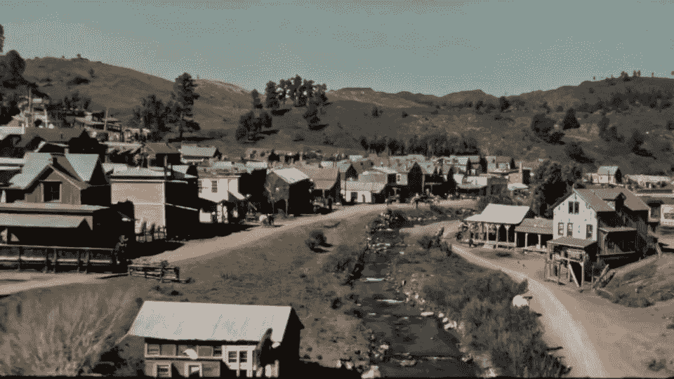

[最强文生视频模型_SORA_技术路线解读 (14).mp4](https://internal-api-drive-stream.feishu.cn/space/api/box/stream/download/all/RgtjbGUSjos8cGx4ZApcyI3vnLf)