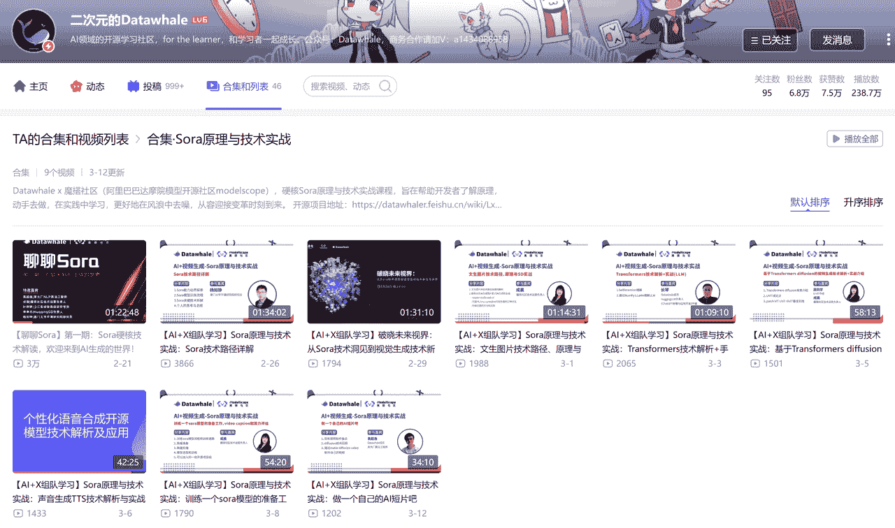
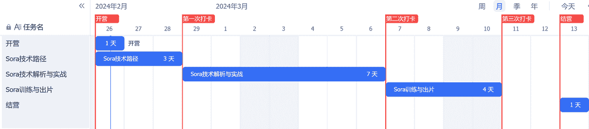

# Sora原理与技术实战

> 来源：[https://datawhaler.feishu.cn/docx/Xt1BdXPUEo5vSDxSuoHcS84unIf](https://datawhaler.feishu.cn/docx/Xt1BdXPUEo5vSDxSuoHcS84unIf)

> [**Datawhale**](http://datawhale.club)** x **[**魔搭社区**](https://modelscope.cn/)（阿里巴巴达摩院模型开源社区modelscope），硬核Sora原理与技术实战课程，旨在帮助开发者了解原理，动手去做，在实践中学习，更好地在风浪中去噪，从容迎接变革时刻到来。

# 学习简介

## 面向对象

+   有一定**Python基础**

+   能**熟练阅读和理解AI项目源代码**

+   有**足够的精力投入**，积极参与**开源**，热爱分享

## 学习亮点

+   学习内容：

+   AI圈最火热的**Sora的硬核课程**

+   Sora**技术路径详解和核心技术解析**

+   **开源模型**和**代码上手实战**

+   学习支持：

+   **原理解析**，**技术专家和学术大神**助力学习，**知其然，知其所以然**

+   **实战练习**，开源模型代码实战，**动手第一**

+   [**组队学习**](https://datawhaler.feishu.cn/wiki/UmpxwlS6limPeLkSQfyc7A8pnJg)，遇见志同道合的伙伴，**让学习不再孤独**

# 学习内容

> **图文教程与代码（觉得不错，****star****一下）：****https://github.com/datawhal**echina/sora-tutorial

> **视频课合集（你的****三连支持****很重要）：****https://space.bilibili.com/431850**986/channel/collectiondetail?sid=2277186

## 课程详情：

| **学习阶段** | **学习内容** | **建议动作** |
| --- | --- | --- |
| **Part1** |  |  |
| **Part2** | 解析各个Sora底层技术，代码实战 | +   原理解析，了解底层技术 |
| **Part3** | 尝试训练Sora模型，做一个AI短片吧 | +   完成比完美重要 |

+   开源教程：[so](https://github.com/datawhalechina/sora-tutorial/blob/main/docs/chapter2/chapter2_1/chapter2_1.md)ra-tutorial/docs/chapter2/chapter2_1/chapter2_1.md at main · datawhalechina/sora-tutorial

+   代码文件：

+   **SD推理最佳实践：**[so](https://github.com/datawhalechina/sora-tutorial/blob/main/docs/chapter2/chapter2_1/SD%E6%8E%A8%E7%90%86%E6%9C%80%E4%BD%B3%E5%AE%9E%E8%B7%B5.ipynb)ra-tutorial/docs/chapter2/chapter2_1/SD推理最佳实践.ipynb at main · datawhalechina/sora-tutorial

+   **scepter低代码体验：**https://modelscope.cn/studios/iic/scepter_studio/summary

+   **视频：**

<https://player.bilibili.com/player.html?bvid=1ZS421A7sR>

+   **Transformers解析：****https://github.com/datawhalechina/sora-tutorial/blob/main/docs**/chapter2/chapter2_2/attention-llm/attention/attention.ipynb

+   **手写LLM实战：****https://github.com/datawhalechina/sora-tutorial/bl**ob/main/docs/chapter2/chapter2_2/attention-llm/llm/llm.ipynb

+   **思考题**：https://github.com/datawhalechina/sora-tutorial/tree/main/docs/chapter2/chapter2_2/attention-llm

+   **视频：**

<https://player.bilibili.com/player.html?bvid=17Z421a71d>

+   **Tr**ansformers diffusion解析：https://github.com/datawhalechina/sora-tutorial/blob/main/docs/chapter2/chapter2_3/chapter2_3.md

+   **最佳代码实践****https://github.com/datawhalechina/sora-tut**orial/tree/main/docs/chapter2/chapter2_3

+   **视频**：

<https://player.bilibili.com/player.html?bvid=1px421y7qU>

+   **KAN - TTS最佳实践：****https://github.com/datawhalechina/sora-tut**orial/tree/main/docs/chapter2/chapter2_4

+   **视频：**

<https://player.bilibili.com/player.html?bvid=1py421i7Ha>

+   **教程：**https://github.com/datawhalechina/sora-tutorial/blob/main/docs/chapter3/chapter3_1/chapter3_1.md

+   **视频：**

+   **教程：**https://github.com/datawhalechina/sora-tutorial/blob/main/docs/chapter3/chapter3_2/AI%E8%A7%86%E9%A2%91.pptx

+   **视频：**

<https://player.bilibili.com/player.html?bvid=1Ew4m1d7X2>

+   开源地址：https://github.com/hpcaitech/Open-Sora

+   魔搭社区的技术解读与最佳实践：https://mp.weixin.qq.com/s/WMQIDgZs2MBPGtx18XSXgw

多维表格（S3wqblSbpapBe7sWMAscwyTAnLh_tblEm9yq9BflQhjG）

## 任务安排：

从**2月26日**开始，预计学习周期14天，直播 + 配套教程的形式

| **任务信息** | **分享嘉宾** | **预计直播时间** |
| --- | --- | --- |
| Task01：**Sora技术路径详解** | 杨知铮：厦门大学平潭研究院研究员 | 2/26 |
| 大咖秀-视觉生成类技术圆桌交流和分享 | 顶级大咖 | 2/28 |
| Task02：**Stable diffusion技术解析，基于d**iffusion的视频生成技术介绍+实战 | 成晨：魔搭社区技术运营负责人 | 2/29 |
| Task03：Transformers技术解析+实战(LLM) | 长琴：Datawhale成员、HuggingLLM负责人 | 3/2 |
| Task04：**基于Transformers dif**fusion的视频生成技术解析+实战介绍 | U-VIT作者：聂同学  成晨：魔搭社区技术运营负责人 | 3/4 |
| Task05：**声音生成TTS技术解析与实战** | 阿里算法专家 | 3/6 |
| Task06：训练一个sora模型的准备工作，video caption和算力评估 | 成晨：魔搭社区技术运营负责人 | 3/7 |
| Task07：**做一个自己的AI短片吧** | 超逸：某大厂算法工程师 | 3/10 |

## QA文档：

[Sora原理与技术实战 QA文档](https://datawhaler.feishu.cn/docx/IEuAd3DUJowj6AxnSgScd4Ccngc)

# 优秀笔记

> **赠人玫瑰**，手留余香，看到这里了，点个赞吧

> **拓展学习** - **大模型系统学习路线**：[课程 | AI 学习路线](https://datawhaler.feishu.cn/wiki/FFNHwwyw7ilUs7ktS97cTYKSnUg)