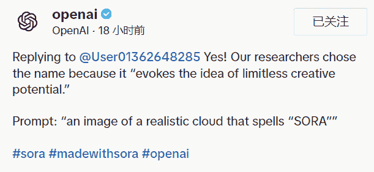
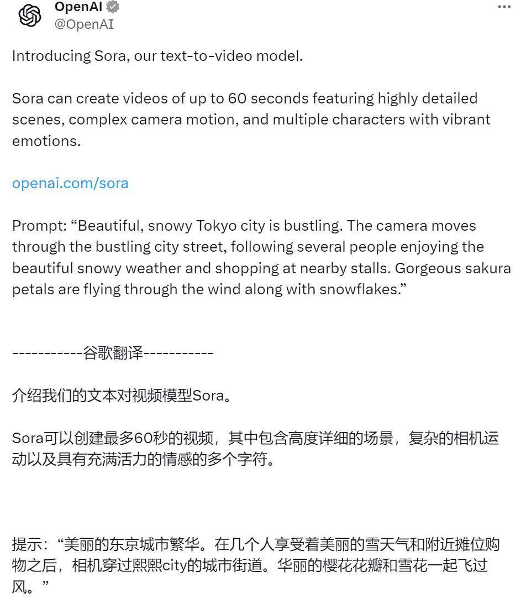
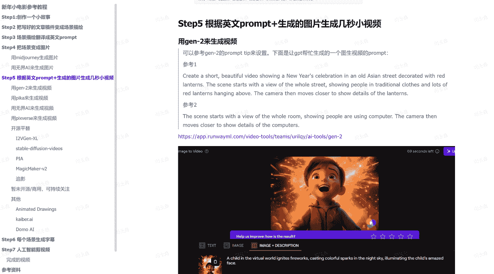
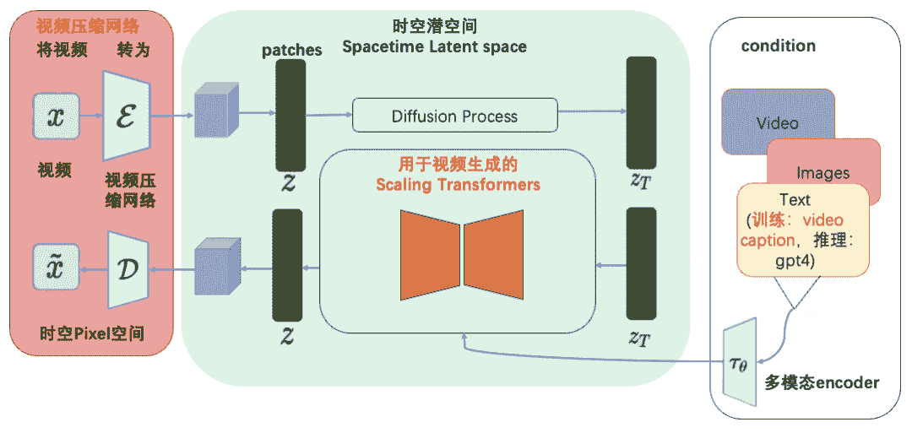
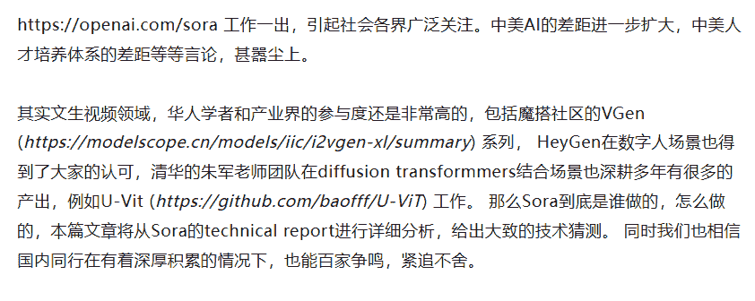
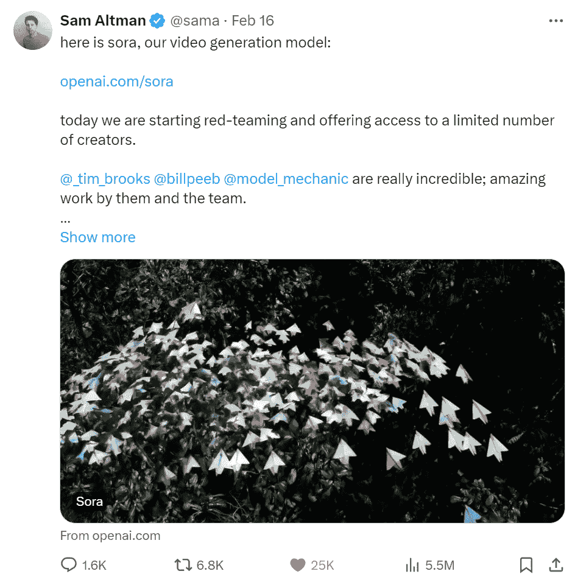
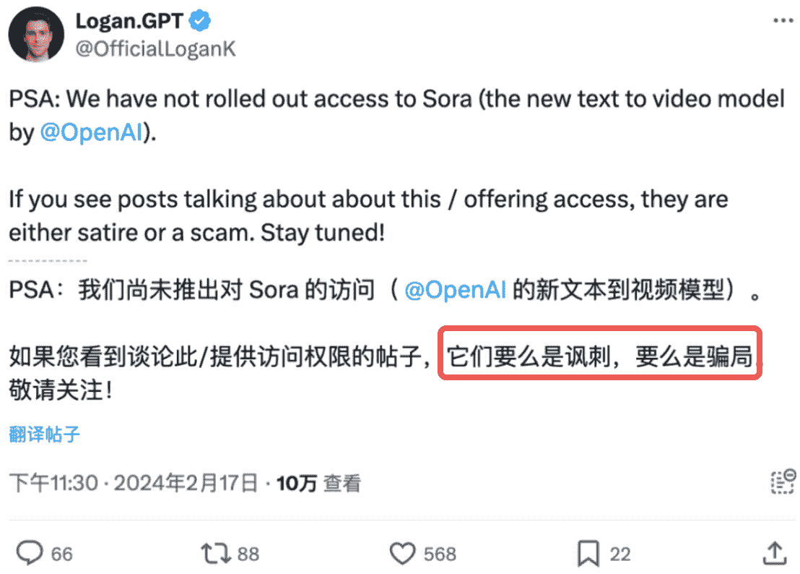
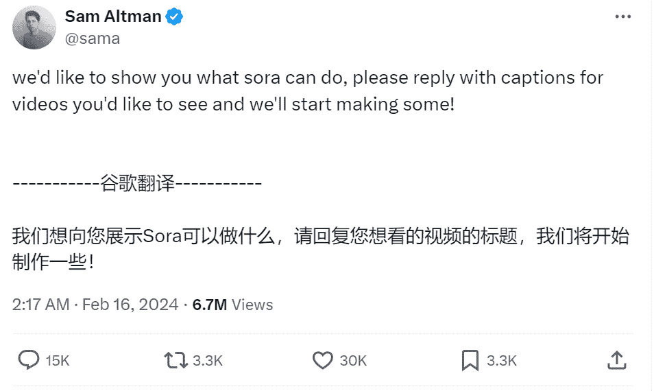
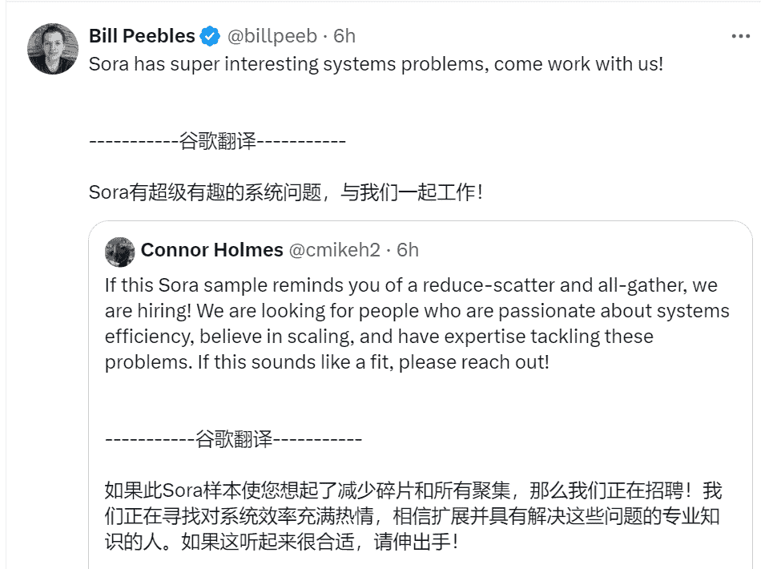

# Datawhale - AI视频生成学习

> 来源：[https://datawhaler.feishu.cn/docx/G4LkdaffWopVbwxT1oHceiv9n0c](https://datawhaler.feishu.cn/docx/G4LkdaffWopVbwxT1oHceiv9n0c)

> 写在前面：Sora很火但还**没正式开放**，风很大，心很燥，

> 希望大家独立思考，减少噪声，找信源和一手信息，了解原理，动手去做，在实践中学习

# Sora是什么？

Sora是**text-to-video**模型（可能是**世界模型****），OpenAI的研究**人员选择这个**名字，因为它“唤起了**无**限创造力潜能”**，**特点是：创建最多**60**秒的视频，高度详**细的场景，复杂的多相机视角以及富有情感的多角色。

Sora官网链接：https://openai.com/sora

[视频案例](https://datawhaler.feishu.cn/wiki/XTZ0wCYtti8fPAkvIzecpecznfh?from=from_copylink)penAI的官方Demo视频效果，更多详见：

# [Sora原理与技术实战](https://datawhaler.feishu.cn/wiki/LxSCw0EyRidru1kFkttc1jNQnnh?fromScene=spaceOverview)

[**Datawhale x**](https://datawhaler.feishu.cn/wiki/LxSCw0EyRidru1kFkttc1jNQnnh?fromScene=spaceOverview)[Sora原理与技术实战](https://datawhaler.feishu.cn/wiki/LxSCw0EyRidru1kFkttc1jNQnnh)魔搭社区(**阿里**巴巴达摩院**模型**开源社区modelscope)联合组织Sora原理与技术实战课程，以下为课程信息简介，完整课程信息见： ，课程完全开源，学习活动免费

**Sora技术路径详解**，并针对Sora原理中的**核心技术点**，包括**基**于diffusion**视频生成**技**术，diff**usion Transformers技术解析，video caption技术解析，视频的编解码压缩进行原理介绍，并结合开源模型和代码上手实战。

<https://datawhaler.feishu.cn/sync/ZrZEdw1X2s0GIUbS4Pnceuvbntb>

预计学习周期**14天**，适合以下人群：

+   有一定**Python基础**

+   能**熟练阅读和理解项目源代码**

+   有**足够的精力投入**，积极参与**开源**，热爱分享

<https://datawhaler.feishu.cn/sync/GJcYdh5IBsxypxbpMlfcBt7knNd>

多维表格（J0lobxBRKaLtHJslUylcco4InPg_tbl1jdFunqozlHoV）

# 动手学[AI视频生成](https://datawhaler.feishu.cn/wiki/CLJZwjyRXiIevRkf7AjcQHR4nce)

**虽然Sora还没开放，但AI视**频生成已**有很多A**I工具可以使用，先建立工作流，再不断优化工作流，重点是动手去做

以下教程，通过GPT等**生成剧本、分镜脚本**，MJ/SD等**生成图片**，然后PIKA/SDV等**生成视频**，剪映等做**视频后期****，搭建了**基础AI视频生成的工作流，并以新年为场景案例，希望可以启发大家动手去做，Sora开放后可再优化

**听了那么多AI新闻，不如动手去做一遍！自己动手，才知道AI的能**力与边界，AI如何提升生活的效率与效果！

[AI + 视频](https://datawhaler.feishu.cn/wiki/CLJZwjyRXiIevRkf7AjcQHR4nce)程内容来自奇想星球平台，完整内容点击

[AI新年好.mp4](https://internal-api-drive-stream.feishu.cn/space/api/box/stream/download/all/Z92rbUX23odCoUxxFT9c8F3rnsh)

**AI新年好**

[AI生成新年主题视频.mp4](https://internal-api-drive-stream.feishu.cn/space/api/box/stream/download/all/KggnbYUuPoij8kxt1ptcqvXznKd)

**雪夜奇缘 - 新年喵喵好**

# 类Sora模型

基于DiT架构 腾讯混元文生图大模型 Hunyuan-DiT 开源了，包含模型权重、推理代码、模型算法等完整信息

主页：https://dit.hunyuan.tencent.com/

代码：https://github.com/Tencent/HunyuanDiT

# 聊聊Sora

Datawhale会持续邀请学术界，产业界等各界[朋友](https://datawhaler.feishu.cn/docx/G4LkdaffWopVbwxT1oHceiv9n0c#TY2Ydav83oPJx8xwa71cV4Kcnxo)，一起来聊聊Sora，希望参与请联系玉鑫

| **聊聊Sora** | **特邀嘉宾** | **核心看点** | **视频链接** | **相关文档** |
| --- | --- | --- | --- | --- |
| 第一期：[**Sora**](https://www.bilibili.com/video/BV1KZ42127GP)[**硬核技术解读**](https://www.bilibili.com/video/BV1KZ42127GP)，欢迎来到AI生成的世界 | 袁超逸：Datahwale成员，某大厂NLP算法工程师 | 司玉鑫-AI视频生成 **Sora学习文档解读** | &lt;https://player.bilibili.com/player.html?bvid=1KZ42127GP&gt; | 1.  HuggingSD负责人李孝杰的解读：https://zhuanlan.zhihu.com/p/683004185 |

# Sora技术报告

Sora技术报告原文：https://openai.com/research/video-generation-models-as-world-simulators

核心摘要：我们探索了利用视频数据对生成模型进行大规模训练。具体来说，我们在不同持续时间、分辨率和纵横比的视频和图像上联合训练了以文本为输入条件的扩散模型。我们引入了一**种**transformer架构，该架构对视频的时空序列包和图像潜在编码进行操作。我们最顶尖的模型Sora已经能够生成最长一分钟的高保真视频，这标志着我们在视频生成领域取得了重大突破。我们的研究结果表明，通过扩大视频生成模型的规模，我们有望构建出能够模拟物理世界的通用模拟器，这无疑是一条极具前景的发展道路。

相关技术解读：

1.  推荐来自魔搭社区成晨老师的技术解读：https://mp.weixin.qq.com/s/xP46EocNg1x7IlTN_iF8kw

1.  推荐来自阿里CV高级算法专家周文猛的解读：一文看Sora技术推演：https://mp.weixin.qq.com/s/3RnrO7fSMizEl3mN3SXG5w

1.  推荐魔搭社区基于ViT的扩散模型技术的开源教程：https://mp.weixin.qq.com/s/LQGwoU6xZJftmMtsQKde_w

1.  推荐腾讯科技对Sora技术报告的解读：https://mp.weixin.qq.com/s/gSvxvOVqYtGcKw0ueDGbFA

1.  来自NLP算法工程师袁超逸的解读：https://mp.weixin.qq.com/s/O4kw6WRGMpxbMf0yYLU51Q

1.  厦大平潭研究院研究员 杨知铮老师的解读：https://zhuanlan.zhihu.com/p/682579303?utm_campaign=shareopn&utm_medium=social&utm_oi=55619453190144&utm_psn=1742473712694239232&utm_source=wechat_session&s_r=0

1.  HuggingSD负责人李孝杰的解读：https://zhuanlan.zhihu.com/p/683004185

# Sora相关论文

Sor**a技**术报告的Referenc**es中共有32篇****paper，我**们**汇总****了所有的32篇论文**（还有一些**非32篇的**有趣文章），并且列出了文章[核心](https://datawhaler.feishu.cn/docx/G4LkdaffWopVbwxT1oHceiv9n0c#TY2Ydav83oPJx8xwa71cV4Kcnxo)关键词，摘要，希望深度学习的小伙伴可以研究，知其然，知其所以然，希望大家研究地开心（希望参与深度研讨，请联系玉鑫）

更多内容请关注：[论文研究](https://datawhaler.feishu.cn/wiki/EEnnwRdlxiYUDsklpWkcw5zGnW2)

多维表格（J0lobxBRKaLtHJslUylcco4InPg_tblKuVcENO1T0cna）

# 应该关注谁？

目前Sora还没有正式开放，一切以OpenAI 团队为准，以下[为Sora团队](https://openai.com/research/video-generation-models-as-world-simulators)[的名单（来源于技术报告里的](https://mp.weixin.qq.com/s/ecfhRMJCvwG4HQTHkOZdag)Authors）与相关社媒（看作者的一手信息），Sora团队成员的背景分析（果然大佬都是六边形战士）：https://mp.weixin.qq.com/s/ecfhRMJCvwG4HQTHkOZdag

**OpenAI**（官推发正式通告，https://twitter.com/OpenAI）

**Sam Altman**（真一手消息，在线接单，at他有机会体验Sora，https://twitter.com/sama）

**Tim Brooks **(研发 Leader，https://twitter.com/_tim_brooks)

**Bill Pebbles** (研发 Leader，https://twitter.com/billpeeb)

**Connor Holmes**（Systems Lead for Sora，https://twitter.com/cmikeh2）

Will DePue（https://twitter.com/willdepue）

Yufei Guo

LiJing（https://twitter.com/jingli9111）

David Schnurr（https://twitter.com/_dschnurr）

Joe Taylor（https://twitter.com/joetaylor341）

Troy Luhman（https://twitter.com/LuhmanTroy）

Eric Luhman

Clarence Wing Yin Ng

Ricky Wang（https://twitter.com/ryw999）

Aditya Ramesh（https://twitter.com/model_mechanic）

# 如何体验到Sora？

目前Sora**尚未开放**，仅有极少量的red-teaming的内测使用者，一切非OpenAI官方提供服务皆可视为诈骗

那么如何才能有机会体验到Sora哪？

1.  申请成为red-teaming：https://openai.com/form/red-teaming-network

1.  X上在Sam Altman的推特下评论（奥特曼在线接单）

1.  申请加入OpenAI的官方论坛，https://forum.openai.com/，加入后可能有机会体验到

# 如何加入Sora？

**Systems Lead for** Sora，Connor Holmes：

如**果这个 Sora 示例****让你想起了 re**duce**-scatte**r **和 all-ga**ther，那么我们正在招聘！我们正在寻找对系统效率充满热情、相信在扩展方面有经验并且擅长解决这些问题的人才。如果这听起来符合你的背景，请联系我们！

**David Schnurr：**

我们正在招聘具有**大规模视频基础设施经验**的人才，涵盖serving, processing, ingest等方面的经验。如果你认为自己是一个合适的人选，请联系我们！

目前OpenAI的C[**areers上没有更新So**](https://twitter.com/cmikeh2)**ra的**[**岗位（及时关注 http:**](https://twitter.com/_dschnurr)**//opena**i.com/jobs），可以在发布岗位的Connor Holmes 与 David Schnurr的推特下留言

# 多方观点

[各方观点](https://datawhaler.feishu.cn/wiki/Eku4wRPUwidOd7k4l9Qc7DO7nMb)听则明，偏听则暗，独立思考，更多内容关注：

> **360创始人 周鸿祎**

1.  **AGI实现时间缩短****：由于科技**的发展，AGI的实现时间可能会从10年缩短到1年。

1.  **科技竞争与人才密度**：科技竞争最终取决于**人才密度和深度积累**。OpenAI等拥有核心技术的公司在AI领域的实力强劲，这表明创业公司不能仅依赖AI技术，还需要有创新和创意。

1.  **AI对行业的颠覆****：AI可能不会立**即颠覆所有行业，但它能激发人们的创造力。例如，Sora可能对广告业、电影预告片和短视频行业产生重大影响，但不太可能迅速击败TikTok，更可能成为其创作工具。

1.  **国内AI发展水平**：尽管国内大模型的发展水平接近GPT-3.5，但与GPT-4.0相比仍有一年半的差距。OpenAI可能还持有一些未公开的技术优势。

1.  **大语言模型的能力****：大语言模型不仅仅**是填空机，它们能够完整地理解世界知识。Sora通过结合大语言模型（LLM）和Diffusion技术，实现了对现实世界的理解和模拟，这代表了未来AI的发展方向。

1.  **AI对物理世界的理解**：Sora展示了**AI对物理世界的模拟能力**，这将对机器人具身智能和自动驾驶等领域产生重大影响，因为这些领域需要对世界有深入的理解。

1.  **视频学习的重要性**：OpenAI训练Sora时可能会阅**读大量视频，**这**将帮助AI更好地理解世界。通过**视频学习，AI对世界的理解将远超文字学习，这可能会加速AGI的实现。

> **陶芳波-心识宇宙CEO**

> 1. Dall-E会被弃用，所有**的视觉生成统一**到Sora，Sora未来成为世界模型的基础，负责图片、视频、3D。

> 2. 下一步，Sora **被统一到 LLM，构造**下一代** Found**ation Model（真正的 GPT-5？），LLM 负责抽象世界，Sora 负责现实世界，但架构统一，参数融合（配上各种特异 decoders，如 diffusion），智力的借用也更融合。

> 3. 再往后，不再有各种 AIG-X 模型，世界范围内统一一套 Foundation Model 和 Foundation Agent 的标准和参数，每几年迭代一次，成为 World Al Kernel / 世界智能内核。所有人基于该标准，来开发 Al-Native 应用。

> 结论:

> 1. OpenAI 可能是世界的福音，但是是当下 AI 创业的噩梦。

> 2. 比特的大一统，比能量（力）的大一统来的更快。

> **谢赛宁-纽约大学任助理教授**

1.  **简单性和可扩展性****：在开发Sora模**型时，Bill和我优先考虑了简单性和可扩展性。简单性带来了灵活性，使得模型在处理输入数据时更加灵活，例如在屏蔽自动编码器（MAE）中的应用。可扩展性则是DiT（Vision Transformer）论文的核心主题，它不仅提高了运行速度，而且证明了DiT缩放定律适用于视频，如同在图像处理中一样。

1.  **灵活性****：ViT（视觉变换器）**的一个优点是它在处理输入数据时的灵活性。例如，Sora能够通过在适当大小的网格中排列随机初始化的补丁来控制生成视频的大小，而UNet（一种卷积神经网络架构）并不直接提供这种灵活性。

1.  **尺寸推测**：我推测Sora可能使用了Google的Patch n'Pack（NaViT），这使得DiT能够适应可变的分辨率、持续时间和长宽比。他还提到，Sora可能使用了较大的模型尺寸，大约有3B（30亿）个参数，这可能意味着训练Sora模型并不需要像预期的那样多的GPU资源。

1.  **未来迭代速度****：由于Sora的可扩**展性和简单性，未来的迭代将会非常快。

# Sora学习交流群

本文由Datawhale成员 编写，引用需要注明作者和出处

关注Datawhale，学习AI不迷路，群里老哥说话超好听，我超爱在这里的，加群一起学习交流AI视频生成，show出你的AI视频demo

> 赠人玫瑰，手留余香，看到这里了，点个赞吧