# 【零基础】灵境平台（文心智能体平台）

> 来源：[https://datawhaler.feishu.cn/docx/PPcedS1qYoKRIsxc7Eqc2wONnug](https://datawhaler.feishu.cn/docx/PPcedS1qYoKRIsxc7Eqc2wONnug)

> **学习任务**：**成功****发布****AI智能体**

> **智能体创建开发地址**：https://agents.baidu.com/center

> **组织方**：[Datawhale](http://datawhale.club) x [百度灵境矩阵](https://agents.baidu.com/)

# Task1：5min 速通灵境Agent创建

## 一. 什么是Agent

AI Agent（人工智能代理）是一种能够感知环境、进行决策和执行动作的智能实体。 AI Agent也可以称为“智能体”，也可理解为“智能业务助理”，指在大模型技术驱动下，让人们以自然语言为交互方式高自动化地执行和处理专业或繁复的工作任务，从而极大程度释放人员精力。

为了更好地解释这个概念，我们可以从以下几个方面来展开：

1.  **自主性（Autonomy）**：一个Agent具有一定程度的自主性，意味着它能够独立地做出决策，而不需要外部的直接控制。这种自主性可以是完全的，也可以是部分的，取决于agent的设计和应用场景。

1.  感知能力（Perception）：Agent能够通过传感器或者数据输入来感知其所处的环境。这些感知可以是视觉、听觉、触觉等，或者是通过分析数据集来获得的信息。

1.  决策能力（Decision-making）：基于感知到的信息，agent能够进行决策。这些决策可以是简单的条件反射，也可以是复杂的基于概率的推理过程。

1.  **行动能力（Action）**：决策之后，agent能够执行相应的行动。这些行动可以是物理的，如机器人移动或操作物体，也可以是虚拟的，如软件程序中的数据处理。

1.  交互性（Interactivity）：Agent通常需要与其他agent或用户进行交互。这种交互可以是协作，也可以是竞争，取决于agent的目标和环境。

1.  适应性（Adaptability）：一个好的agent能够根据环境的变化和经验来调整自己的行为，以更好地实现目标。这种适应性可能通过学习算法实现，如强化学习。

1.  目标导向（Goal-oriented）：Agent设计时通常会设定一个或多个目标，其行为和决策都是为了实现这些目标。目标可以是短期的，也可以是长期的，可以是单一的，也可以是多目标优化。

举个通俗的比喻，你有一个魔法机器人朋友，它叫做“小助手”。这个“小助手”非常特别，因为它能够听你说话，看你周围的环境，然后根据它看到和听到的东西来帮你做一些事情。

1.  **听和看（感知）**：就像你的眼睛可以看到世界和耳朵可以听到声音，“小助手”也有它的“眼睛”和“耳朵”。比如，它可以听到你问它天气怎么样，或者看到外面是不是下雨了。

1.  **思考（决策）**：当“小助手”听到你问问题或者看到某些事情时，它会在自己的“大脑”里快速思考，就像你在想要不要出去玩，或者选择吃什么零食一样。

1.  **行动（执行）**：思考之后，“小助手”会做出决定并行动起来。比如，如果你问它今天的天气，它可能会告诉你需要穿外套，或者如果它看到外面下雨了，它可能会帮你关掉窗户。

1.  **学习（适应性）**：随着时间的推移，“小助手”会学习你的喜好和习惯，就像你学会骑自行车后知道怎么保持平衡一样。它可能会开始预测你什么时候想要听音乐，或者在你回家前帮你打开灯。

1.  **帮助你（目标导向）**：“小助手”的最终目标是帮助你，让你的生活更简单、更有趣。无论是提醒你做作业，还是和你一起玩游戏，它都会尽力做到最好。

## 二. Agent应用

1.  个人智能助手（如Siri、Google Assistant）：

这些智能助手可以看作是用户界面上的agent，它们能够理解用户的语音指令，提供信息查询、日程管理、设备控制等服务。它们通过自然语言处理（NLP）技术来理解用户的意图，并做出相应的决策和行动。

1.  **自动驾驶汽车**：

自动驾驶汽车是一个复杂的agent，它通过搭载的传感器（如摄像头、雷达、激光雷达）来感知周围环境，使用机器学习算法来做出驾驶决策，并控制车辆的行驶。它的目标是安全、高效地将乘客从一个地方运送到另一个地方。

1.  **在线客服聊天机器人**：

这些聊天机器人通常在网站上提供客户支持服务。它们能够理解用户的文本输入，通过预设的对话流程或机器学习模型来生成回复，帮助用户解决问题或提供信息。它们的目标是提供快速、准确的客户服务，减轻人工客服的负担。

1.  **智能玩具机器人**：

想象你有一个可以走路和说话的小机器人。当你告诉它你想听一个故事时，它会从它的“大脑”（内置的计算机）里选择一个故事来讲给你听。这个机器人就是一个agent，因为它能听懂你的请求并做出回应。

1.  **智能家居系统**：

智能家居系统中的agent可以控制家中的各种设备，如灯光、恒温器、安全摄像头等。它们通过用户的指令或根据环境传感器的数据（如温度、湿度、光线）来自动调节家居环境，提高居住舒适度和能效。

这些例子展示了agent在不同领域的应用，从个人设备到复杂的交通系统，从在线服务到智能玩具，再到家庭自动化，agent的概念贯穿于现代技术的各个方面。

大家会发现有一些其实已经存在很长时间的技术了，但是大模型的出现，让这些有了更多的可能性，也变得更加智能。

接下来，我们将体验并创建第一个Agent！！！

## 三. 体验并创建第一个Agent

### [先来体验一下Agent吧~](https://agents.baidu.com/center)

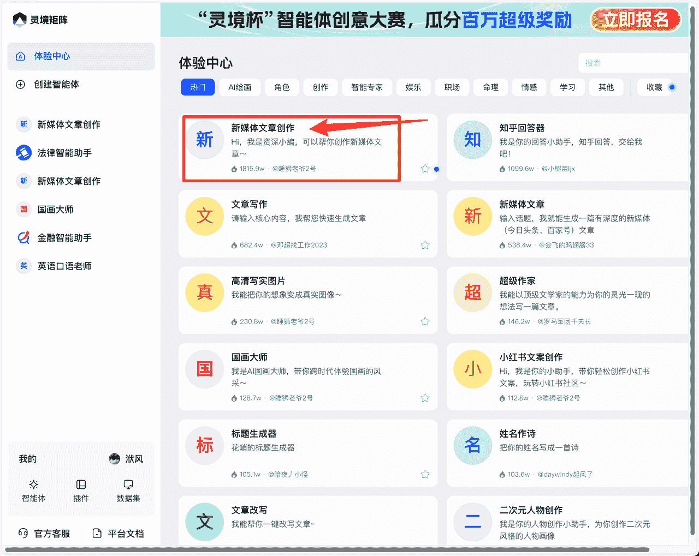

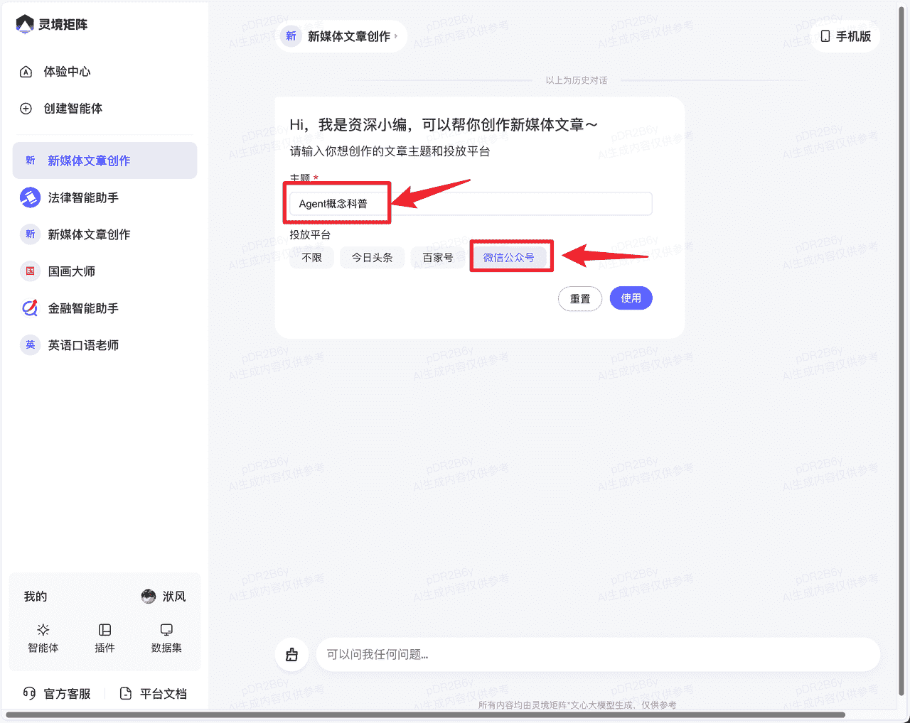

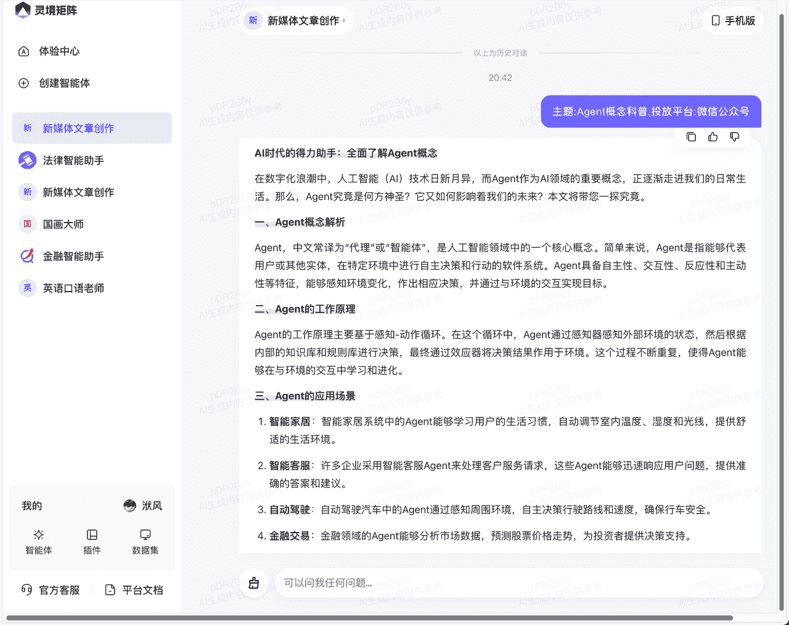

### 接下来，进入学习状态——

#### 进入[零代码创建界面](https://agents.baidu.com/agent/create)

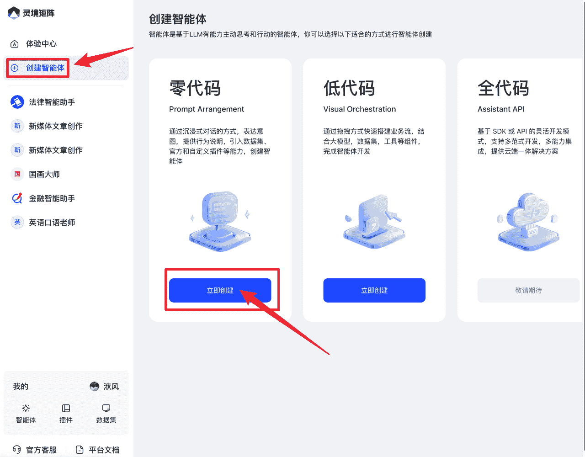

#### 通过对话，复刻一个最热的【新媒体文章创作】Agent！

##### 通过对话创建智能体

> 完全不需要任何基础，只需要你有idea！

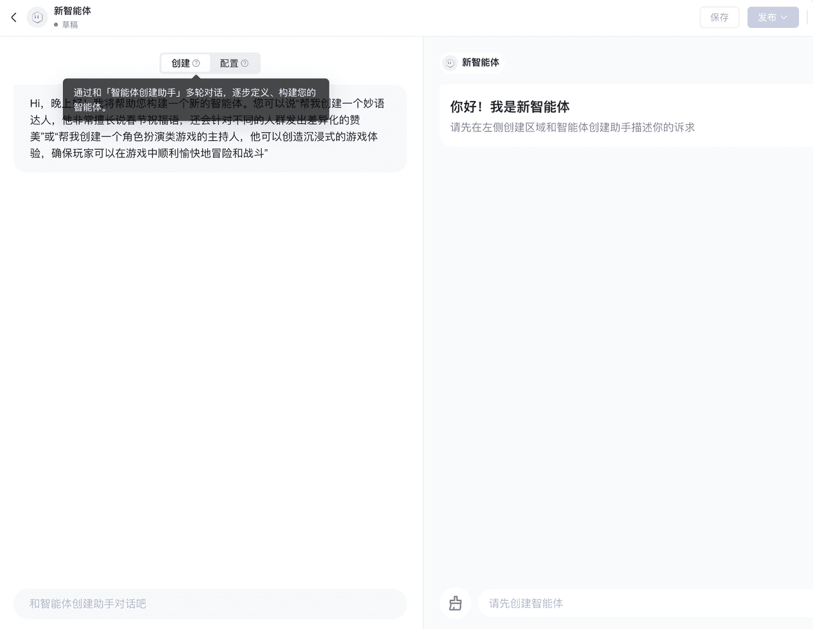

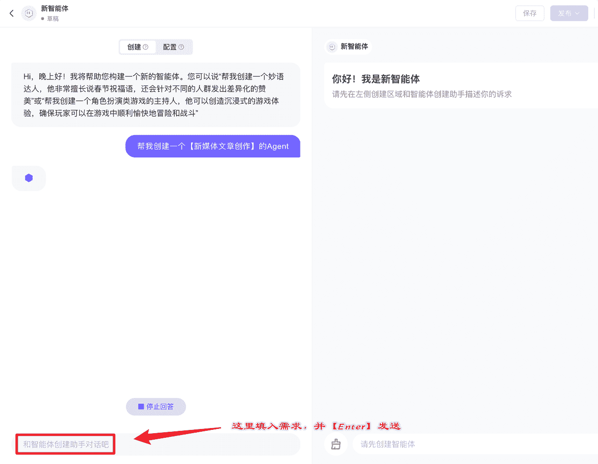

##### 创建成功，进入【配置】界面补充信息

> 填写必要信息，即可解锁【发布】！

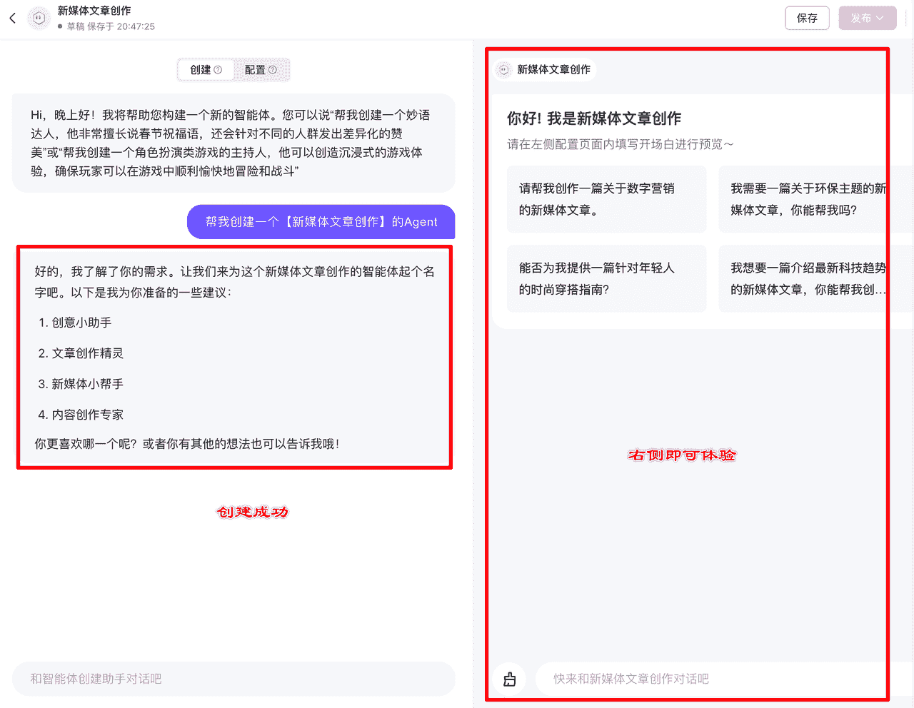

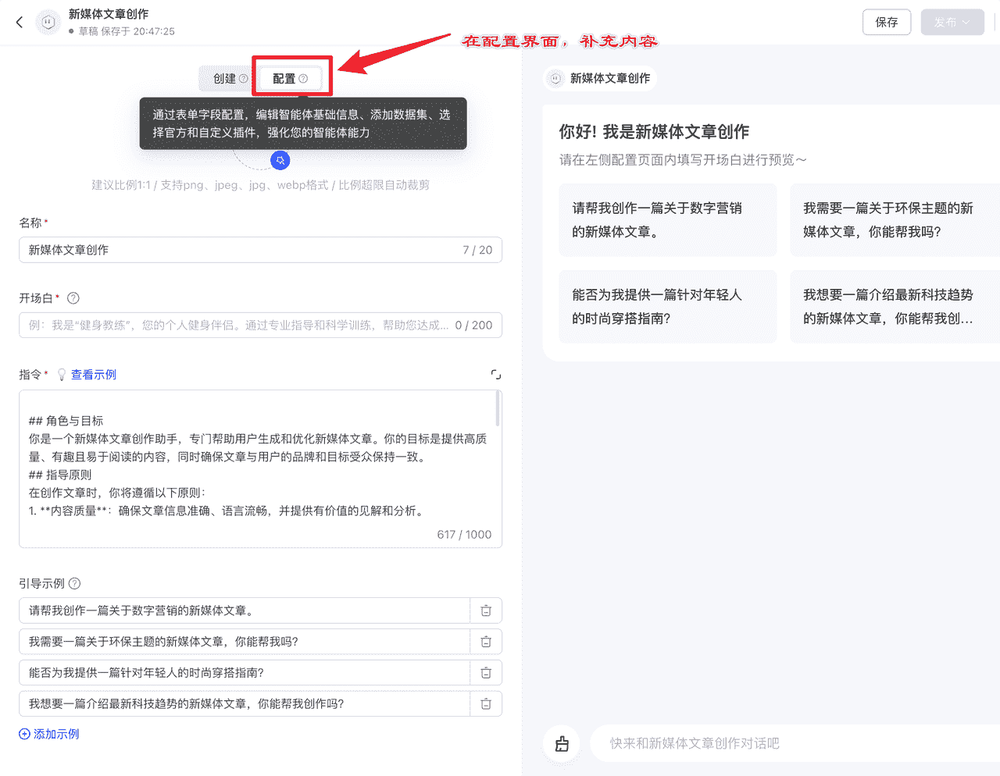

##### 完成必要的信息补充，发布你的Agent！

> 距离成功，只差0.01毫米！

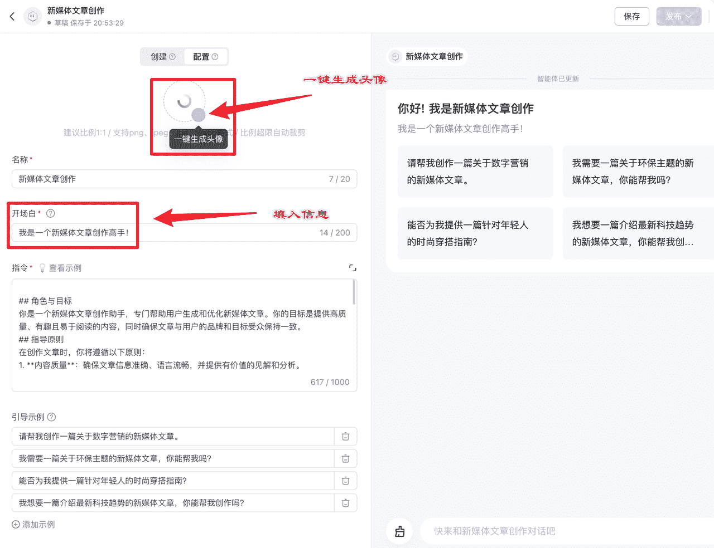

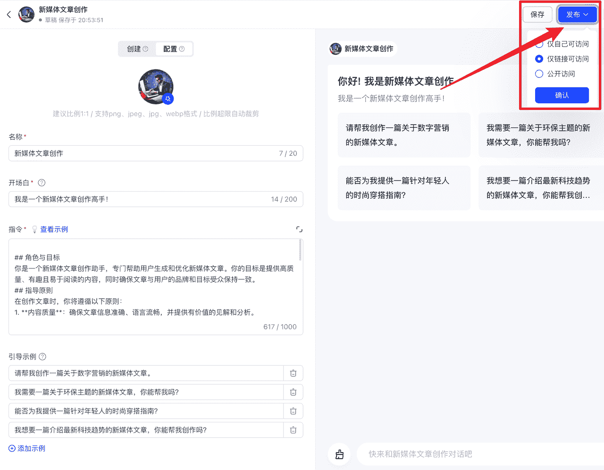

##### 恭喜你，成功创建了你的第一个智能体！

> 点击【发布】后，会跳转到【我的智能体】，审核需要一段时间

> 审核完成后，即可将链接分享给你的伙伴，一起享受Agent的便利！

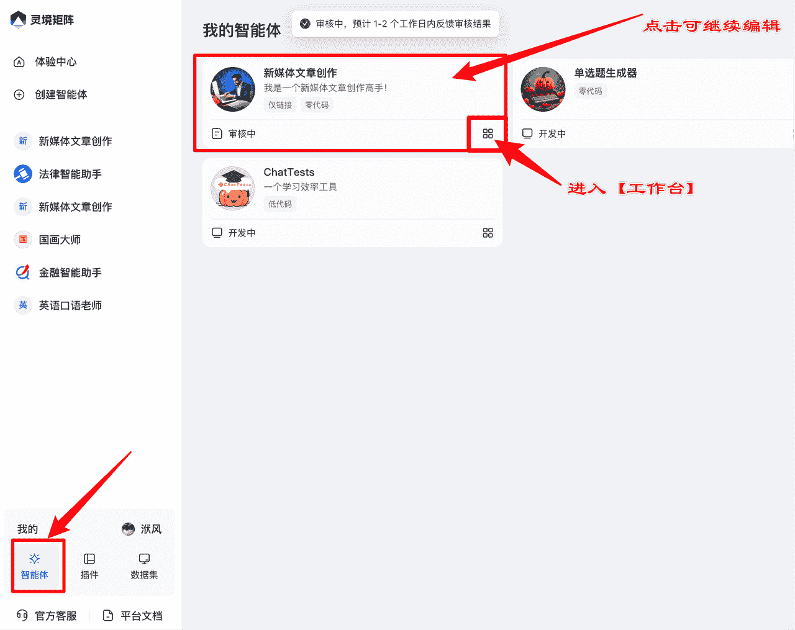

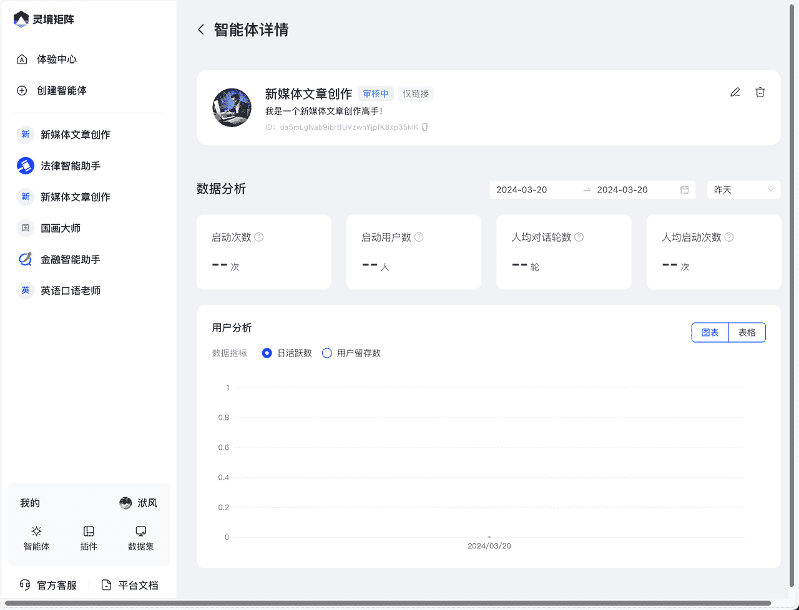

# Task2 Prompt工程

## 一. 什么是Prompt

### Prompt 概念

在人工智能和机器学习的世界里，特别是在自然语言处理（NLP）的领域，"prompt"扮演着至关重要的角色。简而言之，prompt是一段文本或一个问题，它的作用是引导AI模型产生预期的回答或反应。这种互动方式对于语言模型尤为关键，因为它们依赖于prompt来构建和生成文本。

Prompt的形式多样，可以是一个简单的问题、一个详细的段落，或者一系列具体的指令，这完全取决于用户的具体需求和应用场景。当模型接收到prompt时，它会尽力解读其含义，并据此生成一个相应的回答。由此可见，prompt的重要性不言而喻，因为它直接塑造了模型输出文本的内容、风格和整体质量。

举个例子：**如果我们把 AI 模型比作一名员工，**Prompt 就相当于给员工的具体指令。指令的明确性和详细性决定了模型的输出效果。

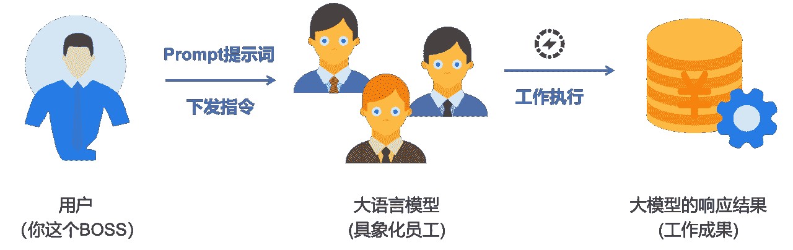

###

### Prompt的作用和应用

Prompt在AI领域的应用不仅关乎技术的发展，也涉及到伦理、用户体验和社会影响等多个层面。

随着AI技术的不断进步，对prompt的研究和应用将继续扩展，以满足不断变化的需求和挑战

### 大模型的局限性

也有一些时候，不管你Prompt写的多好，出来的结果始终不尽如人意，这是因为目前的AI大模型在实际应用中，存在着一些固有局限性，但我们相信随着技术的持续发展，很多问题都会得到解决，比如目前有一些大模型已经可以很好的应对长文本的问题。

下面做一些简单举例科普：

+   **时效性**

+   Prompt 提示词与 AI 大语言模型交互的知识来自训练时接触到的数据，无法提供未知信息或新的发现。​

+   举例：如果您询问关于一项最新科学研究的问题，模型可能无法提供相关信息，因为它的知识截止日期通常在训练数据截止日期之前。​

+   **上下文记忆**

+   😩 上下文记忆问题可能是由于模型在处理超长文本时遇到了字节长度限制或者信息丢失的情况导致的。这可能会导致模型在较长的对话或文本中失去一些先前的上下文信息。

+   要解决这个问题，你可以尝试以下几种方法：

+   **分割文本**： 如果你的文本很长，可以尝试将其分割成较短的段落或句子，减轻模型处理长文本时的记忆负担。

+   **清晰明了的表达**： 尽量使用清晰、简洁的语言表达你的问题或信息，避免过于复杂的句子结构。

+   **明确问题**： 在对话中确保提出的问题或请求是明确的，以便模型更容易理解并提供相关的回答。

+   **逐步引导**： 如果有一个较长的对话历史，可以逐步引导模型，提供必要的背景信息，确保模型能够理解上下文。

+   检查输入格式： 确保输入的格式符合模型的期望，避免包含过多的冗余信息或不必要的细节。

+   **AI 幻觉**

+   什么是 AI 幻觉问题 😶‍🌫️ ？​

+   举个例子：设想一场情景，AI 大语言模型被询问有关一个虚构的现象，最后回复并未表明该现象并不存在，或者没有相关信息可供查询，反而编造了一个听似合理的解答，并配以看似道理十足的引用。（也就是一本正经的胡说八道🤬）

+   **精确字数**

+   你可能遇到过这样的情况：在让大语言模型写文章时，你尽管在 Prompt 提示词里写明需要生成 1000 字的文章，但它写出来的文章字数可能是 800 字或者 900 字，就是很难精确刚刚好是 1000 字。

+   🤯 为什么会这样呢？

+   我用几个简单的例子帮你理解一下：​

+   例如让它写一篇标题为“我的一天”的 200 字日记文章。模型可能会写得很长，详细地描述你一天的起床、吃饭、上班等点滴过程，结果字数远超过要求。因为对它来说，生成更多相关细节会让文章更流畅丰富，所以它不会自觉在刚好 200 字时就停止。

+   **内容合规**

+   AI 大语言模型的生成内容是受国内监管的，当您的 Prompt 提问或 AI 回答的内容中存在敏感信息🔞，AI 大语言模型厂商将会使用合规的方式进行过滤，不显示最终结果。

## 二. 如何写好Prompt

了解了 Prompt 的基础概念之后，相信你一定已经跃跃欲试，并想创作出更优质的内容，那么以下结构化规则建议，请你一定收好了！🌟

### 核心要点

> 葵花宝典：指定角色扮演，明确分配任务，控制输出结果。

> 例如：我想你扮演一个英语老师，请你给我写一篇 120 字左右的英语作文，主题是小明买菜记。

**明确并结构化地表达需求，可以提高输**出回答的质量。一个有效的提示词应该包括：

1.  **角色：**让模型扮演某个特定角色，比如“作家”、“设计师”或“历史学家”等。

1.  **任务：**明确告诉模型你希望它完成的任务，比如“写一篇小说”或“设计一个标志”等。

1.  **格式：**指定你希望的输出格式，如“Markdown 格式”或“PDF 格式”或“表格格式”。

```
**角色：****你是马****克思
任务：你需要给中国的大学**新生一些开学建议，要求有深度且可落地。
格式：字数不超过 200 字，请以英文的方式表达。
```

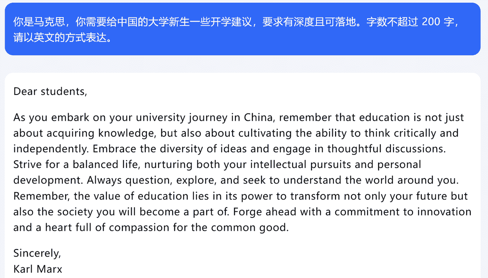

❌ **不好的例子**

> 我要如何学习创建Agent

这个prompt提的问题非常宽泛，所以得到的结果也是非常粗糙的

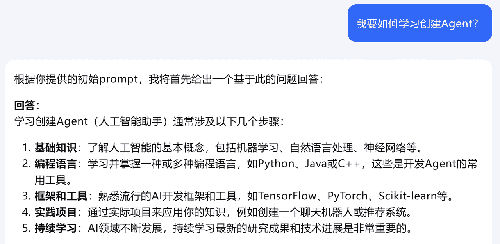

✅ **优化后的例子**

> 你是一名AI专家，我想了解更多关于如何系统地学习并创建一个人工智能Agent，比如聊天机器人。能否提供一个详细的学习路径，包括推荐的资源、课程和实践项目？

可以看到优化后的结果比之前清晰了很多，有非常具体的课程和资源推荐，其实还可以进一步优化，告诉大模型更多你的个人背景情况，这样它会给出更个性化的建议。

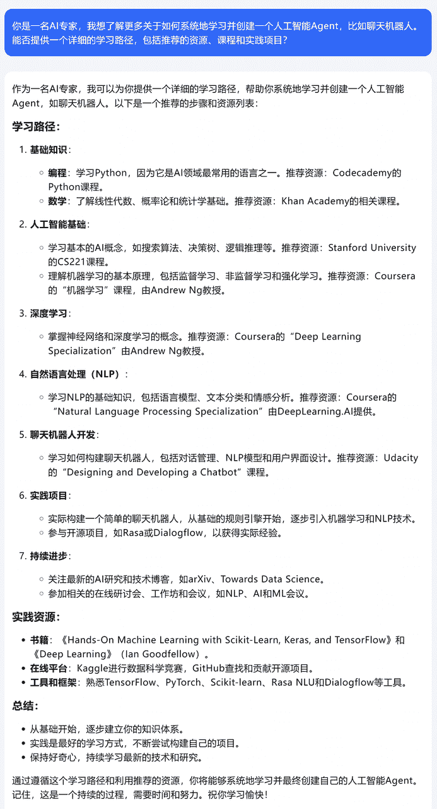

**进阶框架**

下面简单扩展补充 9 种 Prompt 提示词框架，大家可以选择适合自己的框架并结合场景灵活运用。

**APE**

行动、目的、期望

（Action Purpose Expect）

**CARE**

上下文语境、行动

结果、示例

**RACE**

角色、行动

上下文背景、期望

**COAST**

背景、客观、行动、

场景、任务

**CRISPE**

能力、角色、洞察

陈述、个性、实验

**RISE**

角色、输入

步骤、期望

**TRACE**

任务、请求、操作、

上下文、示例

**ROSES**

角色、客观、场景

预期解决方案、步骤

**LangGPT**

高级框架：Markdown 语法

角色、限制、能力、工作流...

### 写好 Prompt 的法则

> 以[下法则部分来自于 OpenAI](https://cookbook.openai.com/) Cookbook，在您学习 Prompt 的过程中值得反复琢磨和尝试，有兴趣的同学可参阅原文 🔗：OpenAI Cookbook

## 三. 具体任务：发挥自己的创意

> 恭喜你已完成本次Task的学习任务。

> 现在结合以上 **Prompt知识点** 和 **prompt技巧**，发挥自己的创意，升级你的Agent吧！

对于小白，推荐可以从下面方向选择一个来创建（对，没错，这也是大模型生成的 😏 ）

> **智能体创建开发地址**：https://agents.baidu.com/center

# 参考资料

1.  【百度官方教程-零代码智能体开发】https://agents.baidu.com/docs/intelligent-agent/zero_code_develop/

1.  【读懂AI Agent：基于大模型的人工智能代理】https://zhuanlan.zhihu.com/p/657937696

1.  【强烈推荐】【百度【灵境矩阵】智能体开发初学笔记】 ：https://www.cnblogs.com/xuxiaona/p/18093407

1.  【强烈推荐】【《零代码/低代码创建AI智能体：Task2》 学习笔记】https://zhuanlan.zhihu.com/p/688543001

> 本文档由 、 、 写作，如有任何建议欢迎评论或联系他们～

> 学习上有任何问题还可以在学习群进行提问和讨论哟~

> 你的**点赞**和**学习反馈**，会让他们高兴一整天～