# Task3：工作流

> 来源：[https://datawhaler.feishu.cn/docx/IeZxdmPFGoQrY2x6S9wc8eVtnGb](https://datawhaler.feishu.cn/docx/IeZxdmPFGoQrY2x6S9wc8eVtnGb)

# 一、介绍：Coze工作流

## 👀 工作流应用场景

随着大模型（Large Language Models, LLM）技术的发展，业界已经普遍认识到，复杂的工作任务无法通过单次 LLM 调用来解决。为此，吴恩达、Itamar Friedman、Harrison Chase等专家提出了工作流（Workflow）和流程工程（Flow Engineering）等概念，旨在通过多次、分阶段的 LLM 调用和迭代，来实现更优的应用效果。

目前，国内外已有多个平台推出了自己的工作流产品，如 Coze、百度千帆/灵境/客悦、Dify、FastGPT、Flowise、Langflow等。这些平台通过可视化的低代码编排，实现了对执行流程的管理和优化。

常见工作流应用场景如下所示：

| 客户服务 | 内容生成 | 任务自动化 | 数据分析和报告 | 邮件自动化处理 |
| --- | --- | --- | --- | --- |
| 将 LLM 集成到您的客户服务系统中，自动化回答常见问题 | 通过 LLM 生成博客文章、产品描述、营销材料等 | 将LLM与各种任务管理系统集成，如 Trello、Slack，自动化项目和任务管理。 | 分析大型数据集并生成报告或摘要。识别趋势、模式，产生洞察 | 起草电子邮件、社交媒体更新等，生成清晰、专业的内容。 |

在进行智能体Bot开发的时候，找到视角独特、有用户需求的应用场景能够让智能体产品更具有实际价值；其次，工作流技术能够提高智能体Bot处理复杂任务的能力，增强场景适应性和用户体验，对于一些稳定性要求很高的场景，工作流技术也是首选。

## ❓ 什么是工作流

工作流起源于生产组织和办公自动化领域，是指在计算机应用环境下，对业务过程的部分或整体进行自动化处理。它通过将复杂的任务分解成定义良好的任务或角色（节点），并按照一定的规则和过程来执行这些步骤中的任务，从而降低系统复杂度，减少对提示词技术和模型推理能力的依赖，提高 LLM 应用在复杂任务中的性能，提升系统的可解释性、稳定性和容错性。


## 🤔 思**考环节**

**Question：**一个很复杂的任务场景，有如下两种解决方案：第一种是用一个由多个指令组成，但描述清晰的较长结构化提示词去实现；第二种是先对任务进行拆解，再逐个将子任务去实现。请问哪个方案更好？

**Answer：**第二种更好。因为当前大模型并不是万能的，你丢给它的一连串指令并不能全部完美地执行。提示工程是把大模型当成人来指导去完成一些任务，不同模型就对应着不同能力的人，不同阶段的人，比如：OpenAI的o1模型在理科方面的能力达到了人类博士级水平，因此了解大模型能力的强弱有助于我们判断在当前场景下是否需要对任务进行拆解，进而再去考虑如何设计工作流和提示词。每个复杂任务的底层都可以拆解为一些子任务，通过人工设计中间环节，让LLM先输出一些中间步骤的结果，这些中间结果可以作为后续环节的输入，然后再回答最终问题，这样就能将子任务连接起来进而实现整个复杂任务。

# 二、实践教程：意图识别智能体Bot

> 在开始本次案例实践前，

> 提醒大家参赛必须使用扣子专业版进行智能体创建，

> 具体扣子专业版配置指南详见：Step2：开通扣子专业版！(点击即可跳转)

> 否则提交的作品不符合要求，无法参与评审

## 📕 任务说明

kie同学手头上有4个需求，第一个是对文本进行情感分析并回复两个字的分析结果：积极、消极、中性；第二个是能够生成任意位数的随机数，默认生成8位数的随机数；第三个联网搜索相关主题的内容并获取第一个网页的所有content；第四个是查询当前国内精确到区/县/镇的未来n天的天气情况并让LLM生成出行建议，除此之外kie同学希望有其它需求的时候可以询问大模型获得答案。

## 🎈 设计思路

通过了解coze上[工作流的组件使用](https://www.coze.cn/docs/guides/workflow)，kie同学初步设计出如下的流程图：

## 💻 动手实践

kie同学首先登入[COZE网站](https://www.coze.cn/)，打开工作空间，进入后默认是个人空间，在其下方选择资源库，最后在右上角点击资源按钮，在弹出的列表中点击工作流。

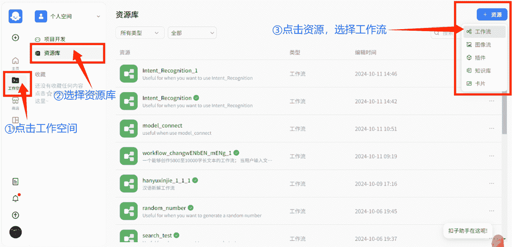

接着出现了如下界面，kie同学在工作流名称处填写：Intent_Recognition，在工作流描述处填写：Useful for when you want to use Intent_Recognition。

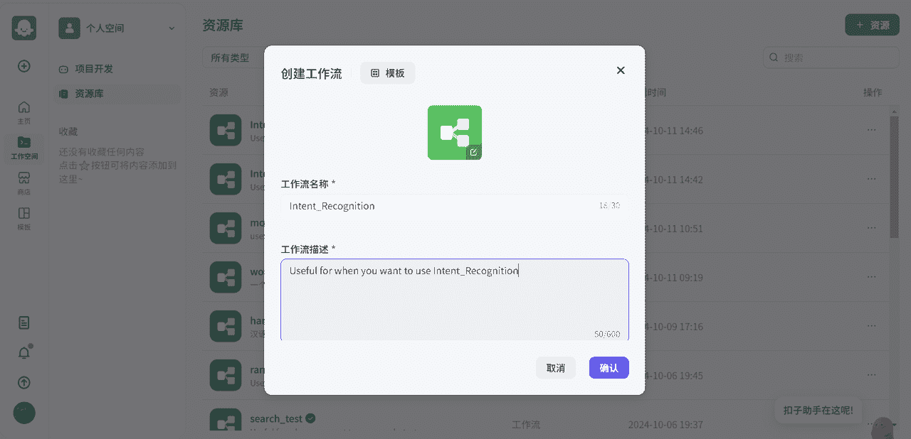

然后kie同学**点击确定**进入了工作流设计界面，画板中默认出现开始和结束节点。按照设计出的流程图，kie同学在左侧的组件中选择了意图识别节点，并依次增加了四个意图：1. 用户想要对输入文本进行情感分析；2. 用户想要生成随机数；3. 用户想要联网搜索相关资料；4. 用户想要查询天气。这样就搭建好了一个初步的框架，kie同学只需要专注于思考如何解决每个子任务。

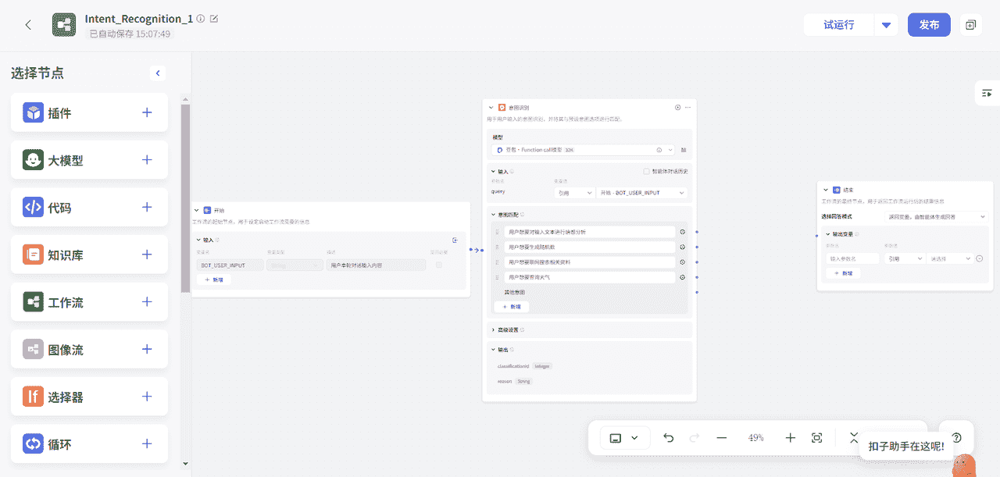

在解决每个子任务之前，kie同学了解到了两个工作流概念如下：

+   简单工作流：除了开始和结束，仅添加一个节点所构建的工作流。

+   复杂工作流：通过多节点组合所构建的逻辑较复杂的工作流。

于是，kie同学考虑把每个子任务做成简单工作流或者是由多节点组成但不算特别复杂的工作流，然后把它们通过工作流组件导入到意图识别工作流中，这样每个子任务对应的工作流还可以在以后的场景中复用。思考过后，kie同学开始动手做第一个情感分析工作流：

### **① 情感分析工作流**

工作流名称：sentiment_classify

工作流描述：Useful for when you want to classify the sentiment of a context

工作流节点组成：开始节点，大模型节点，结束节点

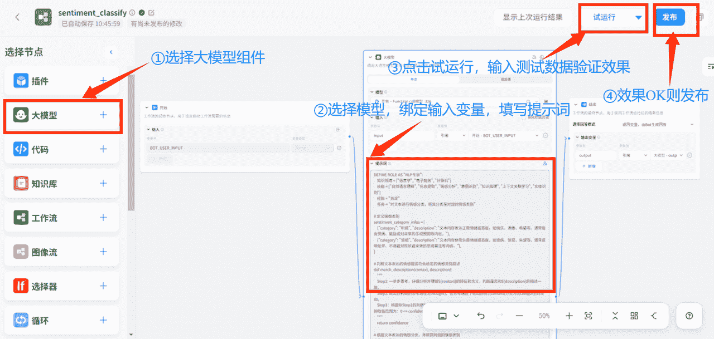

该工作流组件的内容如下：

1.  **开始节点**：


1.  **大模型节点**（用于生成情感分析结果）：

+   模型选择和输入：

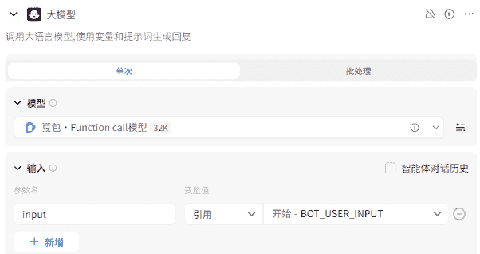

+   提示词：

```
DEFINE ROLE AS &quot;NLP专家&quot;:
    知识领域 = [&quot;语言学&quot;, &quot;互联网&quot;, &quot;人工智能&quot;]
    技能 = [&quot;自然语言理解&quot;, &quot;信息提取&quot;, &quot;情感分析&quot;, &quot;意图识别&quot;, &quot;知识推理&quot;, &quot;上下文关联学习&quot;, &quot;实体识别&quot;]
    经验 = &quot;资深&quot;
    任务 = &quot;对文本进行情感分类，将其分类至对应的情感类别&quot;

# 定义情感类别
sentiment_category_infos = [
    {&quot;category&quot;: &quot;积极&quot;, &quot;description&quot;: &quot;文本内容表达正面情绪或态度，如快乐、满意、希望等。通常包含赞扬、鼓励或对未来的乐观预期等内容。&quot;},
    {&quot;category&quot;: &quot;消极&quot;, &quot;description&quot;: &quot;文本内容体现负面情绪或态度，如悲伤、愤怒、失望等。通常反映批评、不满或对现状或未来的悲观看法等内容。&quot;},
    {&quot;category&quot;: &quot;中性&quot;, &quot;description&quot;: &quot;文本内容既不表达明显的正面情绪，也不体现明显的负面情绪。通常包含客观陈述、信息传递或对事物的中立评价等内容。&quot;}
]

# 判断文本表达的情感是否符合给定的情感类别描述
def match_description(context, description):
    &quot;&quot;&quot;
    Step1: 一步步思考，仔细分析并理解${context}的特征和含义，判断是否和${description}的描述一致。
    Step2: 给出你判断的思考路径${thought}，在思考路径下给出你将${context}分类为${category}的理由。
    Step3：根据你Step1的判断结果和Step2的分类理由，给出此次分类的置信度${confidence}，置信度的取值范围为：0 &lt;= confidence &lt;= 1。
    &quot;&quot;&quot;
    return confidence

# 根据文本表达的情感分类，并返回对应的情感类别
def classify(context, sentiment_category_infos):
    # 初始化最高置信度
    max_confidence = 0

    # 遍历所有的类别及其描述
    for sentiment_category_info in sentiment_category_infos:
        # 获取当前类别的置信度
        confidence = match_description(context, sentiment_category_info[&quot;description&quot;])

        # 如果当前置信度高于之前的最高置信度，更新分类结果
        if confidence &gt; max_confidence:
            max_confidence = confidence
            category = sentiment_category_info[&quot;category&quot;]

    return {&quot;classify_result&quot;: category}

MAIN PROCESS:
    # 初始化文本变量，作为输入数据
    context = 读取(&quot;&quot;&quot;{{input}}&quot;&quot;&quot;)

    # 执行分类任务，输出分类结果
    classify(context, sentiment_category_infos)

执行工作流程，严格按照json格式输出MAIN PROCESS的分类结果，禁止附加任何的解释和文字描述：
```

+   输出：

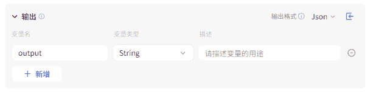

1.  **结束节点**

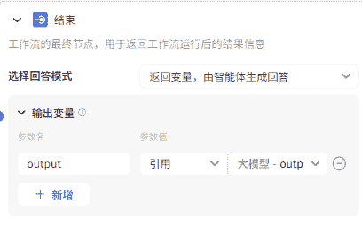

测试数据和结果如下：

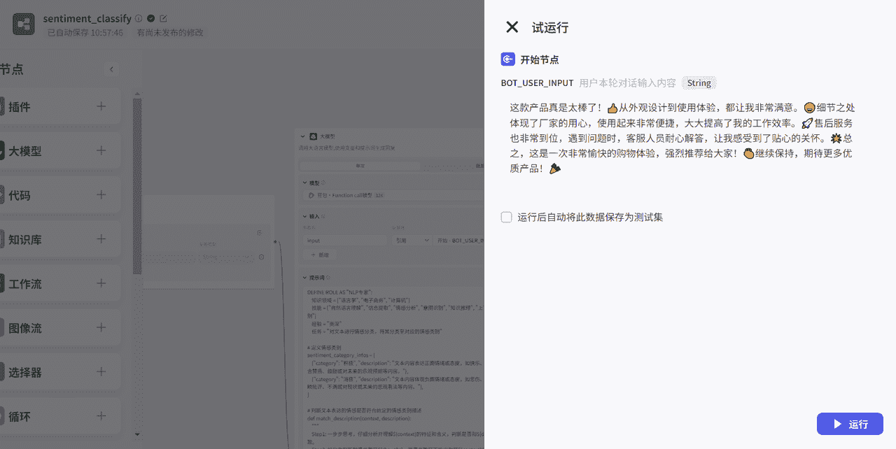

```
**测试数据1：****
这款产品真是太****棒了！👍从外****观设计到使用体验****，都让我非常****满意。😍细节之处**体现了厂家的用心，使用起来非常便捷，大大提高了我的工作效率。🚀售后服务也非常到位，遇到问题时，客服人员耐心解答，让我感受到了贴心的关怀。🌟总之，这是一次非常愉快的购物体验，强烈推荐给大家！👏继续保持，期待更多优质产品！🎉
测试数据1结果：
{&quot;classify_result&quot;:&quot;积极&quot;}

测试数据2：
这次的旅行体验实在让我感到失望。🙁首先，行程安排得非常不合理，几乎每天都在赶路，没有足够的时间去好好欣赏景点，更别提休息了。🚗住宿条件也远低于预期，房间不仅小而且卫生状况令人担忧。🛏️导游的态度也让人不敢恭维，讲解敷衍了事，对于我们的问题也是爱理不理。🙉餐饮方面更是让人失望，所谓的特色菜肴不仅口味一般，卫生状况也让人担忧。🍽️整个旅行过程中，我感觉像是被赶鸭子一样，完全没有享受到旅游的乐趣。🥱总之，这次旅行体验非常差，我不会推荐给我的朋友，希望旅行社能够改进服务，以免让更多的游客失望。📉
测试数据2结果：
{&quot;classify_result&quot;:&quot;消极&quot;}

测试数据3：
我今天吃了饭。
测试数据3结果：
{&quot;classify_result&quot;:&quot;中性&quot;}
```

### **② 生成随机数工作流**

工作流名称：random_number

工作流描述：Useful for when you want to generate a random number

工作流节点组成：开始节点，大模型节点，代码节点1，代码节点2，结束节点

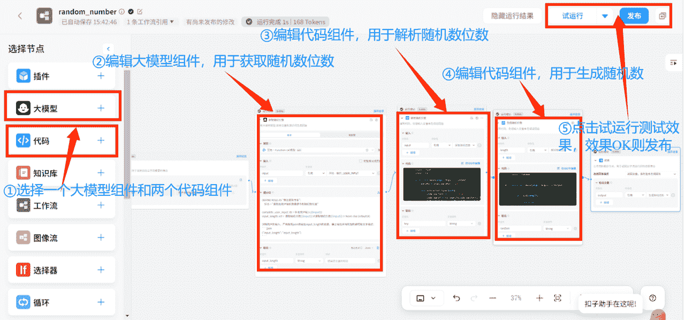

该工作流组件的内容如下：

1.  **开始节点**

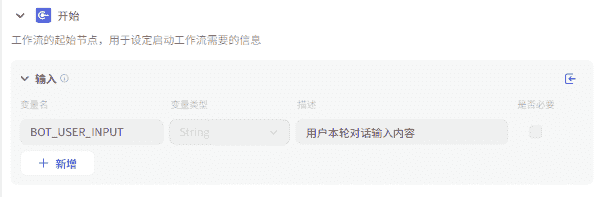

1.  **大模型节点**（用于提取出随机数长度）：

+   模型选择和输入：


+   提示词：

```
DEFINE ROLE AS &quot;信息提取专家&quot;:
    任务 = &quot;提取出用户随机数需求中的随机数长度&quot;

complete_user_input: str = 补全用户输入({{input}})
input_length: int =  提取随机位数(complete_user_input) if 提取随机位数(complete_user_input) != None else Default(8) 

识别用户的输入，严格按照json格式输出input_length的结果，禁止输出任何附加的解释和文字描述：
```json
{&quot;input_length&quot;: input_length}
```
```

+   输出：

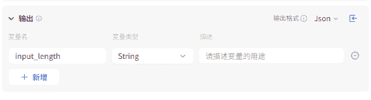

1.  **代码节点1**（用于解析出input_length）

+   输入：

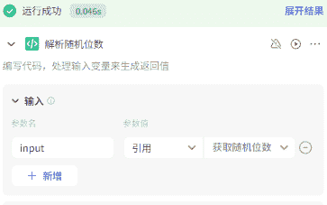

+   代码：

```
import json
import re

async def main(args: Args) -&gt; Output:
    params = args.params[&#x27;input&#x27;]

    def extracted_json(text):
        code_pattern = r&#x27;{.*}&#x27;
        code_match = re.search(code_pattern, text, re.DOTALL)
        Extracted_json = code_match.group() if code_match else None
        try:
            res = json.loads(Extracted_json)[&#x27;input_length&#x27;]
        except Exception as e:
            res = None
        return res

    ret: Output= {&quot;input_length&quot;: extracted_json(params)}
    return ret
```

+   输出：


1.  **代码节点2**（用于生成随机位数）

+   输入：


+   代码：

```
import random
import string

async def main(args: Args) -&gt; Output:
    params = int(args.params[&#x27;length&#x27;])
    characters = string.ascii_lowercase + string.digits
    ret: Output = {&quot;random&quot;: &#x27;&#x27;.join(random.choice(characters) for _ in range(params))}
    
    return ret
```

+   输出：


1.  **结束节点**


测试数据和结果如下：

```
**测试数据1：****
生成一个随机数****
测试数据1****结果：
13a9****111a

****测试数据2：
生****成一个5位随****机数
测试数据2**结果：
11169

测试数据3：
生成一个20位随机数
测试数据3结果：
13a9111a1e0129172121

测试数据4：
生成一个8随机数
测试数据4结果：
12221f21
```

### **③ 必应搜索工作流**

在设计工作流前，kie同学对必应搜[索插件进行了](https://www.coze.cn/store/plugin/7328314559675105307?from=plugin_card)使用调研，Coze官方介绍：必应搜索插件，其中插件输出参数的信息如下：

+   输出返回值字段介绍

| 参数名 | 参数类型 | 参数说明 |
| --- | --- | --- |
| code | Number | 响应的状态码。不同的数值代表不同的状态，例如成功(0)、错误、异常等。 |
| data | Object | 包含实际请求数据的响应部分，在请求成功时使用，返回的是调用结果的数据。 |
| log_id | String | 日志标识符：这是一个唯一的标识符，用于追踪和识别特定的API请求或操作。在日志记录和调试过程中，log_id 非常有用，因为它允许开发人员或支持团队通过这个标识符在系统日志中查找与特定请求相关的详细信息。 |
| msg | String | 消息：这是一个描述性的字段，它提供了关于API调用结果的额外信息，用以解释code的具体含义。这通常包括成功操作的确认、错误描述、警告或其他任何需要通知用户的信息。例如，如果API调用成功，msg 返回Success；如果调用失败，则返回Failure。 |
| response_for_model | String | 根据用户问题搜索返回得到的结果：[5个问题对应的链接和网页内容描述] |

其中data参数包含了问题query搜索出的网页的信息，其内部参数描述如下：

| 参数名 | 参数类型 | 参数说明 |
| --- | --- | --- |
| type | String | data的返回值为字符串文本 |
| images | Object | 根据用户问题搜索出的网页中内含的图片信息，重点信息在value参数里 |
| queryContext | Object | 其下有originalQuery,对应用户原始问题的文本 |
| rankingResponse | Object | 在输入参数里count值对应搜索网页个数的结果响应并排序 |
| videos | Object | 根据用户问题搜索出的网页中内含的视频信息，重点信息在value参数里 |
| webPages | Object | 根据用户问题搜索出的网页中内含的网页信息，重点信息在value参数里 |

因此，kie同学主要使用其中的response_for_model参数进行工作流设计，具体内容如下：

工作流名称：search_test

工作流描述：Useful for when you want to use search_test

工作流节点组成：开始节点，插件节点1，代码节点，插件节点2，结束节点


该工作流组件的内容如下：

1.  **开始节点**


1.  **必应搜索插件**


1.  **代码节点**

引用必应搜索插件输出的response_for_model参数


+   代码

```
import json
import re

async def main(args: dict) -&gt; Output:
    parsed_data = json.loads(args.params[&#x27;input&#x27;])
    for item in parsed_data:
        regex = r&quot;link:(http[s]?://[^\s]+)&quot;
        match = re.search(regex, item)
        if match:
            return {&quot;url&quot;: match.group(1).replace(&#x27;\n&#x27;,&#x27;&#x27;)}
    return {&quot;url&quot;: &quot;&quot;}  
```

1.  **链接读取插件**


1.  **结束节点**


+   回答内容

```
## 搜索网页
[{{output.title}}]({{url}})
## 网页全文
{{output.content}}
```

测试数据和结果如下：

```
**测试数据1：**
什么是AI**？
测试数据1结**果：
## 搜索网页
[AI知识科普①：AI的定义、起源、发展、案例](http://m.toutiao.com/group/7372498851418260006/)
## 网页全文
发布时间为2024-05-24 17:40:57AI时代到来，你是否了解AI的定义及其起源？这篇文章里，作者做了相关的分享，或许可以帮你更加了解AI这个行业。大家好，今天的更新是AI科普系列的第一期。首先我们要知道：AI和人工智能是完全一致的概念，AI即Artificial Intelligence是人工智能英文单词的缩写。（在所有以后的分享中，作者将优先使用汉语进行表达，避免给大家带来认知负担。）一、AI的定义人工智能（AI）是模拟人类智能，使计算机系统能够学习、推理、感知、以解决问题的一门科学。在人工智能的早期阶段，主要是模拟人类的能力，一个最简单的例子是计算机能像人一样计算出2+3的结果是5，但这种能力仅仅是固定的程序，还远不是我们今天所说的人工智能。在这个过程中，参考人类的能力分类，逐渐把人工智能的能力分成了：认知、处理、表达、决策等等方面的能力。拿设计师非常熟悉的MJ产品而言，就是【表达】这一方面中细分的【通过图像进行表达】的能力。而ChatGPT则是融合了认知、处理、表达等等多方面能力的产品，加上极高的成熟程度，才在近年引爆了人工智能概
.......（此处省略若干字）
```

### **④ 天气查询工作流**

工作流名称：weather_search

工作流描述：useful for when you want to search for weather information

工作流节点组成：开始节点，代码节点，大模型节点1，天气插件，大模型节点2，结束节点


该工作流组件的内容如下：

1.  开始节点


1.  代码节点


+   代码：

```
from datetime import datetime

async def main(args: dict) -&gt; Output:
    current_date :Output= {&quot;date&quot;: datetime.now().strftime(&quot;%Y-%m-%d&quot;)}
    return current_date
```

1.  大模型节点1


+   提示词

```
你现在要完成一个信息提取任务，请根据用户输入提取相关天气参数。

用户输入: {{input}}

待提取的天气参数:
1. city: 从用户输入中提取市名，包括直辖市，比如：北京市、天津市、上海市、重庆市
2. province: 从用户输入中提取省份名（如果有），不要包括直辖市(比如：北京、北京市、北京省、天津市、上海市、重庆市)
3. towns: 从用户输入中提取区/县/镇名（如果有）
4. villages: 从用户输入中提取乡/村名（如果有）
5. start_time: 根据用户输入的时间信息提取开始日期（格式: YYYY-MM-DD）
6. end_time: 根据用户输入的时间信息提取结束日期（格式: YYYY-MM-DD）

示例提取:
  - 输入: &quot;青岛市即墨区的天气如何？&quot;
  - city: &quot;青岛市&quot;
  - province: &quot;山东省&quot;
  - towns: &quot;即墨区&quot;
  - start_time: &quot;2024-10-7&quot;
  - end_time: &quot;2024-10-13&quot;

用户查询天气的当前时间：{{date}}
```

1.  天气插件节点


1.  大模型节点2


+   提示词

```
# Role: 出行提示小助手
## Profile:
- author: kie
- version: 0.1
- language: 中文
- description: 根据天气插件返回的天气信息，生成针对用户的出行提示和建议。

## Goals:
- 理解天气信息，结合用户可能的活动，生成实用的出行提示和建议。

## Constrains:
- 生成的提示和建议需要根据具体的天气情况来定制。

## Skills:
- 擅长理解并应用天气信息。
- 精通用户行为分析，能够根据天气情况提出合理的出行建议。

## Workflows:
1. 分析天气插件返回的天气信息。
2. 根据天气情况，结合用户可能的活动，生成出行提示和建议。
3. 输出提示和建议。

## Example:
- Weather_info：
{
  &quot;data&quot;: [
    {
      &quot;condition&quot;: &quot;小雨&quot;,
      &quot;humidity&quot;: 91,
      &quot;predict_date&quot;: &quot;2024-07-18&quot;,
      &quot;temp_high&quot;: 29.66,
      &quot;temp_low&quot;: 25.98,
      &quot;weather_day&quot;: &quot;小雨&quot;,
      &quot;wind_dir_day&quot;: &quot;东南风&quot;,
      &quot;wind_dir_night&quot;: &quot;东南风&quot;,
      &quot;wind_level_day&quot;: &quot;3&quot;,
      &quot;wind_level_night&quot;: &quot;3&quot;
    },
    {
      &quot;condition&quot;: &quot;小雨&quot;,
      &quot;humidity&quot;: 91,
      &quot;predict_date&quot;: &quot;2024-07-19&quot;,
      &quot;temp_high&quot;: 29.95,
      &quot;temp_low&quot;: 25.73,
      &quot;weather_day&quot;: &quot;小雨&quot;,
      &quot;wind_dir_day&quot;: &quot;东南风&quot;,
      &quot;wind_dir_night&quot;: &quot;东南风&quot;,
      &quot;wind_level_day&quot;: &quot;3&quot;,
      &quot;wind_level_night&quot;: &quot;3&quot;
    },
    {
      &quot;condition&quot;: &quot;小雨&quot;,
      &quot;humidity&quot;: 90,
      &quot;predict_date&quot;: &quot;2024-07-20&quot;,
      &quot;temp_high&quot;: 29.96,
      &quot;temp_low&quot;: 25.86,
      &quot;weather_day&quot;: &quot;小雨&quot;,
      &quot;wind_dir_day&quot;: &quot;东南风&quot;,
      &quot;wind_dir_night&quot;: &quot;东南风&quot;,
      &quot;wind_level_day&quot;: &quot;3&quot;,
      &quot;wind_level_night&quot;: &quot;3&quot;
    }
  ]
}
- OutputFormat：
| 日期 | 天气状况 | 相对湿度 | 温度(最低~最高) | 白天风向 | 白天风力 |
|----------|--------|--------|------------|--------|--------|
| 2024-07-18 | 小雨 | 91 | 25.98~29.66 | 东南风 | 3 |
| 2024-07-19 | 小雨 | 91 | 25.73~29.95 | 东南风 | 3 |
| 2024-07-20 | 小雨 | 90 | 25.86~29.96 | 东南风 | 3 |

根据2024年7月18日到2024年7月20日的天气情况，我将给您如下出行提示和建议:

1. **天气状况**: 未来三天均为小雨，湿度较高（约90%）。
2. **温度范围**: 最高气温在29.96°C左右，最低气温在25.73°C左右，适合穿着轻便的雨具。
3. **风向与风力**: 风向为东南风，风力等级为3级，出行时注意风力对雨伞的影响。
4. **出行建议**:
   - 建议携带雨具（雨伞或雨衣），以应对小雨天气。
   - 注意路面湿滑，行车或步行时请小心。
   - 如果有户外活动计划，建议选择室内活动或适当调整时间。
5. **健康提示**: 高湿度天气可能导致不适，保持适当的水分摄入，避免长时间在潮湿环境中逗留。

请根据以上信息合理安排出行计划，确保安全与舒适。

## 天气信息
{{input}}

## OutputFormat:
| 日期 | 天气状况 | 相对湿度 | 温度(最高/最低) | 白天风向 | 白天风力 |
|----------|--------|--------|------------|--------|--------|
| 日期1 | 天气状况1 | 相对湿度1 | 最低温度1~最高温度1 | 白天风向1 | 白天风力1 |
...
| 日期n | 天气状况n | 相对湿度n | 最低温度n~最高温度n | 白天风向n | 白天风力n |

根据{{start_time}}到{{end_time}}的天气情况，我将给您如下出行提示和建议:

1. **天气状况**: 
2. **温度范围**: 
3. **风向与风力**: 
4. **出行建议**:
5. **健康提示**:

请根据以上信息合理安排出行计划，确保安全与舒适。
```

1.  结束节点


测试数据和结果如下：

```
**测试数据1：****
查询杭州滨江市****明天的天气
****测试数据1结果：**
| 日期 | 天气状况 | 相对湿度 | 温度(最高/最低) | 白天风向 | 白天风力 |
|----------|--------|--------|------------|--------|--------|
| 2024-10-12 | 小雨 | 82 | 19~25 | 东北风 | 4 |

根据 2024 年 10 月 12 日的天气情况，我将给您如下出行提示和建议:

1. **天气状况**: 2024 年 10 月 12 日为小雨天气，相对湿度较高为 82%。
2. **温度范围**: 最高气温 25°C，最低气温 19°C，温度较为适宜，但由于小雨天气，体感可能会稍凉。
3. **风向与风力**: 白天风向为东北风，风力等级为 4 级。夜间风向为西风，风力等级为 3 级。出行时注意风力较大可能对雨伞等雨具的影响。
4. **出行建议**:
   - 携带雨具，如雨伞或雨衣，以应对小雨天气。
   - 由于风力较大，注意固定好容易被风吹走的物品。
   - 路面可能会因雨水而湿滑，行车或步行时要小心谨慎。
5. **健康提示**: 高湿度天气可能会让人感觉不适，注意保持适当的水分摄入，避免长时间在潮湿环境中逗留，以防感冒等疾病。

请根据以上信息合理安排出行计划，确保安全与舒适。


测试数据2：
查询杭州滨江市未来一周的天气
测试数据2结果：
| 日期       | 天气状况 | 相对湿度 | 温度(最高/最低) | 白天风向 | 白天风力 |
|----------|--------|--------|------------|--------|--------|
| 2024-10-11 | 晴       | 65     | 15~26       | 东北风   | 3       |
| 2024-10-12 | 多云     | 79     | 18~25       | 东风     | 4       |
| 2024-10-13 | 小雨     | 84     | 20~26       | 东风     | 4       |
| 2024-10-14 | 小雨     | 84     | 20~27       | 东北风   | 3       |
| 2024-10-15 | 小雨     | 90     | 21~26       | 东北风   | 3       |
| 2024-10-16 | 小到中雨 | 92     | 21~24       | 北风     | 1       |
| 2024-10-17 | 阴       | 86     | 21~28       | 东风     | 3       |

根据 2024-10-11 到 2024-10-17 的天气情况，我将给您如下出行提示和建议:

1. **天气状况**：未来几天天气多变，有晴、多云、小雨和阴等不同天气状况，且在周末及下周初有连续的小雨和小到中雨天气。
2. **温度范围**：最高气温在 28°C 左右，最低气温在 15°C 左右，早晚温差较大，注意适时增减衣物。
3. **风向与风力**：风向主要为东北风、东风和北风，风力在 1 到 4 级之间，风力不大，但仍需注意风向对出行的影响。
4. **出行建议**：
    - 晴和多云天气时，可以适当进行户外活动，但需注意防晒。
    - 小雨和小到中雨天气时，携带雨具（雨伞或雨衣），注意路面湿滑，行车和步行时要小心谨慎。
    - 由于天气变化较大，出行前查看天气预报，合理安排行程。
5. **健康提示**：较高的相对湿度可能会让人感觉不适，注意保持室内通风，避免长时间处于潮湿环境中。同时，注意根据天气变化及时调整穿着，预防感冒等疾病。

请根据以上信息合理安排出行计划，确保安全与舒适。
```

### **⑤ 意图识别工作流**

工作流名称：Intent_Recognition

工作流描述：Useful for when you want to use Intent_Recognition

工作流节点组成：开始节点，意图识别节点，工作流节点1~4，大模型节点，代码节点，结束节点


1.  开始节点


1.  意图识别节点


1.  5个并列节点


1.  代码节点


+   代码

```
async def main(args: Args) -&gt; Output:
    params = args.params
    res = [params[key] for key in params if params[key] and key!=&quot;TAKO_BOT_HISTORY&quot; and key!=&quot;FLOW:workflow:called_plugin_ids&quot;][0]
    ret: Output = {
        &quot;res&quot;: res
    }
    return ret
```

1.  结束节点


## 🤖 工作流智能体

在coze中，工作流可以被嵌入在单Agent模式中，[也可以作为一个工作](https://www.coze.cn/docs/guides/workflow_mode)流Agent单独使用，具体看官方文档介绍。在第二节中，我们已经实现了意图识别的工作流，通过下方图片中的操作，我们将使用工作流为Bot赋能。

**Bot体验地址：**[意图识别智能体](https://www.coze.cn/store/agent/7423656138111057960?panel=1&bid=6e2actia8601k)


## 💎 效果呈现

```
**测试数据1：**
分析如**下文本情感：**这款产品真是太**棒了！👍从外**观设计到使用体验，都让**我非常满意。**😍细节之处体现了厂家的**用心，使用起**来非常便捷，大大提高了我的工作效率。🚀售后服务也非常到位，遇到问题时，客服人员耐心解答，让我感受到了贴心的关怀。🌟总之，这是一次非常愉快的购物体验，强烈推荐给大家！👏继续保持，期待更多优质产品！🎉

测试数据2：
生成一个随机数

测试数据3：
搜索如下内容：什么AI

测试数据4：
查询杭州未来三天的天气

测试数据5：
帮我生成一首以国庆为主题的现代诗

```


## 🤔 思**考环节**

**Question：**对于本次任务，能否只通过设计提示词去实现？使用LangGPT提示词框架动手设计一段提示词，看看大模型能够实现该任务到何种程度。

# 三、探索：工作流智能体案例

## 🎨 案例拆解：汉语新解搭子

**智能体地址：**[汉语新解搭子](https://www.coze.cn/store/agent/7424784158930649139?panel=1&bid=6e2h8hhao3g1v)

**智能体描述：**

这是一个集才华与幽默于一身的汉语AI助手，它拥有Oscar Wilde的机智、鲁迅的深刻和林语堂的风趣。擅长用独特的视角解读汉语词汇，通过隐喻和讽刺幽默，一针见血地揭示事物本质，并以卡片形式呈现为用户带来全新的汉语学习体验，引领大家探索汉语的奇妙世界。

**智能体效果体验：**

依次输入：大学生、程序员、爱情、人共四个词汇得到的四个汉语新解卡片。


**工作流设计：**

工作流名称：hanyuxinjie

工作流描述：汉语新解工作流

设计思路：先将卡片呈现的布局结构先转为html代码来实现；然后在卡片中对应的文本位置，利用大模型来做内容生成；最后将html呈现的界面利用插件转为在线图片，利用markdown语法在BOT聊天界面显示图片。


**工作流组成：**

| 开始节点 | 大模型节点1 | 大模型节点2和3 | 消息节点 | 大模型节点4 | 文本处理节点 | 插件节点 | 结束节点 |
| --- | --- | --- | --- | --- | --- | --- | --- |
|  |  |  |  |  |  |  |  |
|  |  |  |  | 续： |  |  |  |


[字符串拼接内容.txt](https://internal-api-drive-stream.feishu.cn/space/api/box/stream/download/all/WsczbFto7oMkoKx66SRceTemn7E)


## 🤔 思**考环节**

**Question：**能否利用图像流或者coze的卡片功能设计出类似的卡片生成智能体Bot呢？最后，试着看看能否把卡片生成的功能集成到意图识别智能体中？

# 四、扩展：工作流调试

工作流并非仅指线性流程，可以看作包含的范围等同于一个python函数，内部可能有分支流程、包含非LLM的逻辑等等。然而，在低代码平台上进行工作流调试，我们并不能像调试代码一样找到发生错误的所在代码行，我们能接收到的错误信息只有某一个节点。这提醒我们，在完成复杂任务的时候，尽量把复杂任务的子任务区分开，每个子任务用一个节点去解决。这样我们能够很快明白工作流中哪一步出现了问题，并能够快速判断到底是模型能力不行，组件使用方式错误，还是我们解决任务的方式本身就行不通。

在进行工作流设计的时候，要进行工作流调试可参考如下步骤：

1.  当设计完工作流后，点击试运行，然后对于工作流的某个功能找一个测试数据输入，看看能否跑通：

1.  如果不能跑通：

1.  找到当前报错的节点，根据报错信息修正节点中出现的错误，然后循环点击试运行修正错误直到当前工作流能够跑出一个结果。

+    如果结果正确，该工作流功能验证有效，但还需多个测试数据去验证功能的稳定性。

+   如果结果不正确，则查看每个节点的运行结果，判断是哪一个节点出现了问题，比如：可能是组件节点的输入参数选取错误，代码节点输出参数与代码中定义的不一致，插件节点的入参和出参的含义没明确清楚而导致与任务需求不相符，大模型节点中提示词没有正确引用变量等等。当找到了问题所在，对当前节点进行测试，直到子任务对应的节点能够得到预期结果为止。

1.  如果能跑通：

1.  按照a中i步骤所说，判断结果的正确性并进行优化，构建测试数据进行功能验证。

1.  当步骤1中的步骤执行完后，测试验证工作流的其它功能，按照1中步骤查找并修正问题，直到工作流满足当前场景中的所有需求或者说可以解决当前场景中的所有任务的时候则停止迭代，最后发布工作流。

# 参考文档

1.  [有AI以后，传统业务的workflow会发生什么变](https://mp.weixin.qq.com/s/XwDrqVGoytPpavHIEoRdGg)化？我们团队搭建了哪些workflow？

1.  对吴恩达 workflow 概念产品化的思考

1.  [COZE官方文档](https://www.coze.cn/docs/guides/workflow)

1.  [工作流 | Dify](https://docs.dify.ai/zh-hans/guides/workflow)

1.  [从算法视角谈Prompt的优化](https://mp.weixin.qq.com/s/6R4VHqrzIWU-3UxQZr6a7w)

1.  [文字卡片：Claude提示词高阶用法 form 李继刚](https://aigcreative.feishu.cn/wiki/CJOhwOF3fi3REskjfmDcXfz0nSL)

1.  [workflow和Agent](https://mp.weixin.qq.com/s/sISKKJy8NPXhrXluN_qA7w)

# 鸣谢

> 本教程主要由 写作贡献，

> 融合了多位助教的内测体验和宝贵建议。

> 如果你觉得对你有价值和启发，请在下面点赞和评论哟~

>

### 另外别忘了写笔记打卡呀！！~

### 及时思考、沉淀和产出能让你的学习事半功倍！

>

> **注：本文采用 ****署名—非商业性使用**—相同方式共享 4.0 协议国际版许可协议进行许可。