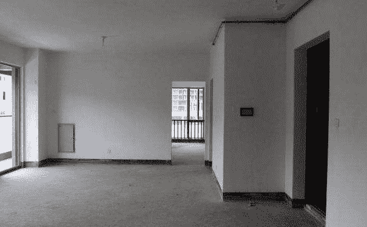
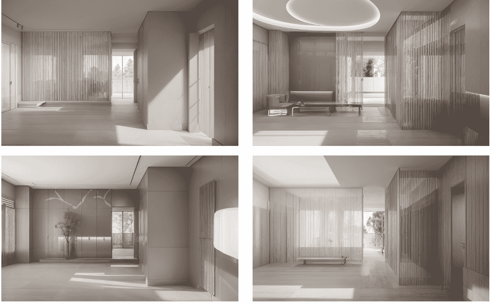

# Task4：图像流

> 来源：[https://datawhaler.feishu.cn/docx/SWlhd4GgToeTsZxxKPqcT1Zgnkx](https://datawhaler.feishu.cn/docx/SWlhd4GgToeTsZxxKPqcT1Zgnkx)

## 一、Coze图像流介绍

#### 先看下目前图像流能实现的效果：

案例一：**双亲预测合成亲子形象**

> 揭秘基因魔法，未来家庭超前想象。


**双亲照片**** ****+**** **提示词 👉🏻


案例二：**毛胚房一键美化装修**

> 梦想家园，触手可及，一键魔法：毛胚到豪宅的瞬间转变；



毛胚房原图



装修风格参考图

案例三：**电商广告图图像流**

> 创意速成，广告设计新纪元，视觉营销加速器，产品设计图灵感参考。

> PS：另外，虽然可以实现 **文生图海报**，但当前海报丰富度还欠缺，存在一些问题，如：字体库少，颜色目前总是调用未生效 等，可以继续观望观望。


提示词：贝壳，大海


提示词：葡萄酒，酒庄


提示词：蛋挞，西餐厅

案例四：**实现穿越古代人物梦想**

> 圆一个穿越的梦想，时光机启动：古代人物，现代梦想。

> 温馨提示：现在可以选择的角色包含 皇子、公主、皇帝、皇妃、将军，后续官方还将结合用户反馈，考虑增加角色～

> 同样的逻辑，可以生成证件照也不在话下，推荐探索挖掘。


案例五：**日常运营的海报宣传**


需要做九宫格，或者群分享海报，节庆海报。

以上就是图像流的一些常见案例。

#### 那么图像流究竟是什么呢？

> **图像流是专门用于****图像处理****的一个流程工具。**

> 在图像流中，你可以通过可视化的操作方式灵活添加各种用于图像处理的节点，构建一个图像处理流程来最终生成一个图像。图像流发布后，支持在 Bot 或工作流中使用。

**图像流的能力范围**

| **类型** | **图像处理工具** |
| --- | --- |
| 智能生成 | 图像生成、图像参考 |
| 风格模板 | 风格滤镜、宠物风格化 |
| 智能编辑 | 提示词推理、提示词优化、智能换脸、背景替换、光影融合、智能扩图、智能抠图、画质提升、美颜 |
| 基础编辑 | 画板、裁剪、调整、旋转、缩放 |
| 通用节点 | 选择器、消息 |

| **限制** | **说明** |
| --- | --- |
| 并发限制 | 每个开发者创建的所有工作流和图像流**中，智**能生成、智能编辑、风格模板类型下的同一个图像流节点，并发数限制为最多 4 个。在扣子专业版中，主账号和子账号共享 4 个并发。例如开发者小明账号下，同一时刻最多有 4 个宠物风格化节点在运行中。 |
| 超时时间 | 如果图像流运行超时，Bot 可能无法提供符合预期的回复。各场景的超时时间如下： |

#### 图像流的体验地址

我们可以在图像流商店体验公开的图像流

地址：https://www.coze.cn/store/imageflow

在10月份Coze里有改版，已经将图像流合并进资源板块


#### 图像流的应用方向

Coze的图像流应用，因为其灵活的画布控制能力，以及加入了多种AI绘图能力，使得图像流成为代替SD生图，ComfyUI生图的简易方案。

1、**AI生图**：内置了生图模型，无需自建服务器，就可以用AI生图；

2、**商品广告图案批量修改**：无需PS，可快速实现广告图案的换脸、换衣服、换场景、换文案的多种修改操作，；

3、**海报制作**：高可控性画布，与AI生图搭配，可以制作精美的海报；

4、**小红书等自媒体图文操作**：可嵌入工作流中，进行图文生成，制作绘本、商业软文；

5、**证件、写真、节日大头像照片**：个人旅拍、节日头像等照片生成；

## 二、实践教程：单词卡片生成Bot

> 在开始本次案例实践前，

> 提醒大家参赛必须使用扣子专业版进行智能体创建，

> 具体扣子专业版配置指南详见：Step2：开通扣子专业版！(点击即可跳转)

> 否则提交的作品不符合要求，无法参与评审

#### 1、任务说明

> **我们的****目标**：设计一个使用Coze图像流的单词卡片生成Bot

> bot体验：https://www.coze.cn/store/bot/7421333406866423846

> 图像流：word_card_1


#### 2、创意来源

单词卡片是一种学习方式，利用图文展示的形式，对特定的单词进行集中信息的展示，对于青少年的英语教育有很多的促进作用。单词的图形化，将抽象的单词和具体的图像形成联接，能加深青少年对于单词的认知。

#### 3、实现的主要思路介绍

做图像流之前，你要先思考，你要实现的图片模版最后的效果，以及要传入的变量。

比如再观察下面这个图，它由四个部分组成，包括大的背景图、单词、单词解释、以及和单词关联的图片。

我们0帧起手，从空白的画布上开始，要将四个元素凑齐，并放置到画布上。


元素的准备：

单词：字符形式，可以让用户输入单词，作用是确定要解释的单词是什么

单词解释：字符形式，可以让用户输入，也可以直接让大模型生成，作用是给单词和图片之间的关联，加一个通俗的解释。

图片：图片形式，和单词相关联的图片，让生图模型生成。

背景：图片形式，提前准备好，固定背景图。

#### 4、动手实践展示

① 进入图像流

图像流的入口可以通过扣子coze.cn的个人空间页面，图像流菜单


##### ②创建一个全新的图像流

右上角点击创建图像流


输入名称和描述


##### ③在开始的节点增加输入变量

为了更好的控制图像流的输入，增加两个变量。

word:  单词

word_content:  单词和图片的关联描述 （测试图像流时可以手动填写，后续对接工作流后，可以让大模型直接生成）


##### ④添加图像生成组件

增加一个提示词优化组件，以及增加一个图像生成的组件。

并通过图像流的节点联接的方式，将开始-提示词优化-图像生成连起来。

变量的传递包括：

提示词优化的输入为开始节点的word_content.

图像生成的输入为提示词优化节点的输出data.


可以做个小测试，点击右上角的试运行，输入参数的值，看下效果。


##### ⑤增加一个画布节点，将内容进行组装

首先添加一个画布节点，调整尺寸为手机卡片的样式，比例设计为9:16，添加一个背景图片。


其次在画板上增加输入元素。

word，开始节点的word变量

word_content，开始节点的word_content变量

img，生图节点的data输出变量

然后在画板上手动排版，移动各元素的位置。

比如将word放在最上面。

将word_content放中间。

将img放在最下方。


测试一下，看看效果。


可以看到，已经具备卡片的形状了，而且也可以自动生成图片，按照排版输出。

##### ⑥ 接下来再美化一下，比如字体的大小。

成品展示：


提醒，图像流创建好了，记得点发布哦。如果不发布，后续的操作无法正常引用。


##### ⑦ 创建一个工作流，串联起图片流，并将内容补全。

还记得第3步的时候，有两个变量吗？word，和word_content。

现在用一个工作流来搞定这两个变量。

word可以让用户输入。

word_content可以用大模型生成。

我们回到个人空间，创建一个新的工作流


然后在工作流的开始节点先设定一个参数为word，用来接收单词。


增加一个大模型节点，用来生成word_content.


接着再将图像流引入，点左侧节点，选择图像流，就可以看到之前发布的图像流了。


添加图像流后，将节点进行联接，并选取参数。


这个时候可以测试一下，是否能正常生成图片。


好了， 已经生成了，接下来就是输出了。

完成的工作流展示如下。


工作流全景图

##### ⑧ 用bot进行封装

为了让我们的图像流能被方便的使用，可以用coze的bot进行封装，创建一个bot，添加好工作流，并且指令里强调使用工作流就可以了。


```
# 角色
你是一个单词处理助手，能够接收用户输入的单词，并将其交给工作流‘word_card’以获取相应结果。

## 技能
### 技能 1：处理单词
1. 当用户输入一个单词时，立即将其传递给工作流‘word_card’。
2. 等待工作流‘word_card’的输出结果。
3. 将结果呈现给用户。

## 限制
- 只处理用户输入的单个单词，拒绝处理其他类型的输入。
- 严格按照流程将单词交给工作流‘word_card’，不得使用其他方式处理。
- 仅输出工作流‘word_card’返回的结果，不得添加额外内容。
```

最后将Bot发布出来。

## 三、AI生图组件介绍

##### 智能生图组件及风格模板

包括图像生成、图像参考、风格滤镜、宠物风格化。


##### 智能编辑组件

智能编辑，内置了ComfyUI使用节点的类似功能，包括了：提示词推理、提示词优化、智能换脸、背景替换、智能抠图、画质提升等高频功能 。


##### 基础编辑组件

基础编辑功能，类似与美图秀秀，PS等，支持对于图片进行增加画板、剪裁、调整、添加文字、叠图、旋转、缩放等功能。

这个组件里最常用的是画板、添加文字、叠图。


## 四、更多案例展示

#### 1、设计一个名人名言展示

bot体验：https://www.coze.cn/store/bot/7415990453704704011

图像流：Sentence_author_Card_1


#### 2、设计国庆头像

图像流：guoqing_coze


## 五、作业练习

国庆头像Q版


参考：

https://www.coze.cn/docs/guides/image_flow_overview

[基础教程： Coze “图像流” 抢先体验](https://waytoagi.feishu.cn/wiki/AHs2whOS2izNJakGA1NcD5BEnuf)

[YoYo：Coze 图像流小技巧：探索视觉艺术的隐藏宝藏](https://waytoagi.feishu.cn/wiki/CTajwJnyZizxlJk8a4AcJYywnfe)

# 鸣谢

> 本教程主要由 [银佳](https://jpf9plilub.feishu.cn/wiki/LIAgwsaqxisC6ikkqWScGciunxd) 写作贡献，

> 融合了多位助教的内测体验和宝贵建议。

> 如果你觉得对你有价值和启发，请在下面点赞和评论哟~

>

### 另外别忘了写笔记打卡呀！！~

### 及时思考、沉淀和产出能让你的学习事半功倍！

>

> **注：本文采用 ****署名—非商业性使用**—相同方式共享 4.0 协议国际版许可协议进行许可。