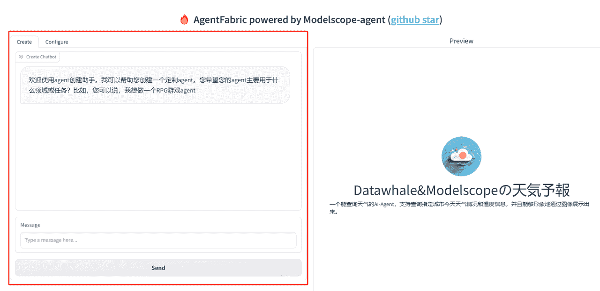
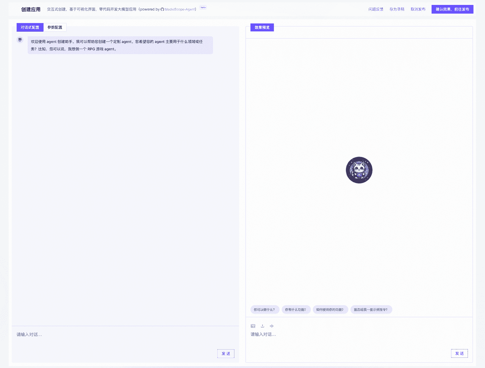

# 零代码动手创建ModelScope Agent

> 来源：[https://datawhaler.feishu.cn/docx/BLG6d50C1oPppbxhgqBceUHfnZe](https://datawhaler.feishu.cn/docx/BLG6d50C1oPppbxhgqBceUHfnZe)

> 目前Agent创建项目已有一定更新，界面可能存在差异，但整体步骤没有大变动

> 另外魔搭创空间已支持直接进行Agent应用创建，本教程可能存在一定的滞后，期待你能一起共创更新

> 有意维护可联系 （wx：aomferni）

### [创建通义千问API](https://dashscope.console.aliyun.com/overview) (新注册用户有一定的限时免费额度)

<https://datawhaler.feishu.cn/sync/FpUmdMXkAs2mg3bFmeacI69kndg>

### 使用 [魔搭Agent创建器](https://modelscope.cn/studios/modelscope/AgentFabric/summary) 快速创建Agent

打开魔搭社区的 [AgentFabric](https://modelscope.cn/studios/modelscope/AgentFabric/summary)，或者 [创空间-交互式创建应用](https://modelscope.cn/studios/agent)





左边点开【create】是一个聊天界面，只需打字就能零代码创建一个Agent，右边是即时体验界面

#### 创建天气小助手

1.  **在左侧聊天框中发送你想要的功能**

这里我给出一个 设计天气查询Agent 的example

```
我想做一个能查询天气的agent，名字就叫“Datawhale&amp;Modelscopeの天気予報”，要求能查询我指定城市今天的天气情况和温度信息，并画一幅图向我形象的展示出来。
```

可以看到，它在回复的同时，多了2行字，分别是

“✅Config Updated!

✅Logo Updated!    ”

这是在调整Agent的配置，以及logo，可以在右边查看到具体的修改。

此外它还会反问一些问题，比如城市和展示风格等。

可以通过回复来进行进一步的配置自动调整，但也可以不予理会，右边可以实时体验调整后的效果。

1.  **检查配置&提供Tool**

点进左上角的【Configure】可以查看 Agent 的配置，其中的字段均可任意修改做Prompt Enginerring

下方的【Capabilities】是这个Agent可调用的Tool，目前可用的内置Tools有限，可按需勾选

此处勾选了用于画画的“Wanx Image Generation”，和用于查天气的“高德天气”


1.  体验Agent，做Prompt Engineering

1.  右边的聊天框里随时可以体验 Agent，可自由根据实施效果进行Prompt修改，但修改后记得点击【Update Configuration】更新配置，否则效果不会有变化

1.  还可以 点开▶，查看调用详情


1.  **Agent能力体现**：将指令自动拆分成了“天气查询”和“画图”，并成功的调用了对应的工具完成任务

#### 创建宠物模拟器

> Prompt：我想做一个 宠物模拟器，让用户可以在线给自己选一只宠物，进行起名和进行喂养、玩游戏、出门遛弯等行动，并每次都能输出多张合适的图片，并在完成5次操作后，生成markdown文档记录这些行动


### 发布 属于自己的Agent

1.  创建Agent并实验效果满意后，点开【发布】，点击【构建】，构建完成后点击【发布】


1.  **跳转到创建创空**间，修改创空间信息，填入前面创建的 API-KEY，然后【复制创空间】


1.  打开相应的创空间，进入【设置】、【上线空间展示】


1.  等待发布成功即可，祝大家都能享受Agent创建之旅~ Agent is ALL YOU NEED！~


### 可选：深入代码魔改 (仅简单介绍)

1.  在github上查看 [魔搭开源Agent框架](https://github.com/modelscope/modelscope-agent)，获取更多文档

1.  将github上的 [魔搭开源Agent框架](https://github.com/modelscope/modelscope-agent) 下载下来，进行深度魔改后发布

1.  将自己发布的Agent的代码下载下来，进行深度魔改后发布

[点开相应的创空间，在设](https://modelscope.cn/studios/modelscope/AgentFabric/summary)置处，可在环境变量中可查看自己通过 AgentFabric 创建并发布的Agent的代码，AGENR_URL，可直接复制链接，粘贴到浏览器地址栏下载


1.  可以fork自己感兴趣的有源码的创空间，然后git clone到本地，进行深度魔改后发布


1.  发布前，需要有一个创空间，并git clone到本地，将修改好的文件复制到对应文件夹，并push即可


1.  更详细的本地开发步骤可参考agent-tutorial/Agent原理深入+快速搭建demo 或 modelscope Agent 新人开发教程 @Tintin

1.  更多教程还可见[魔搭Agent大本营](https://modelscope.cn/brand/view/agent)

