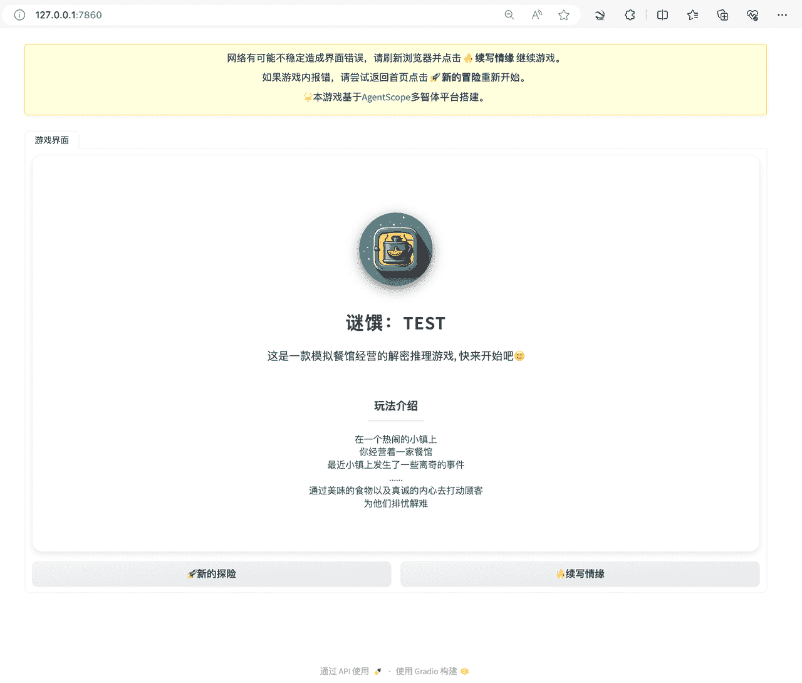
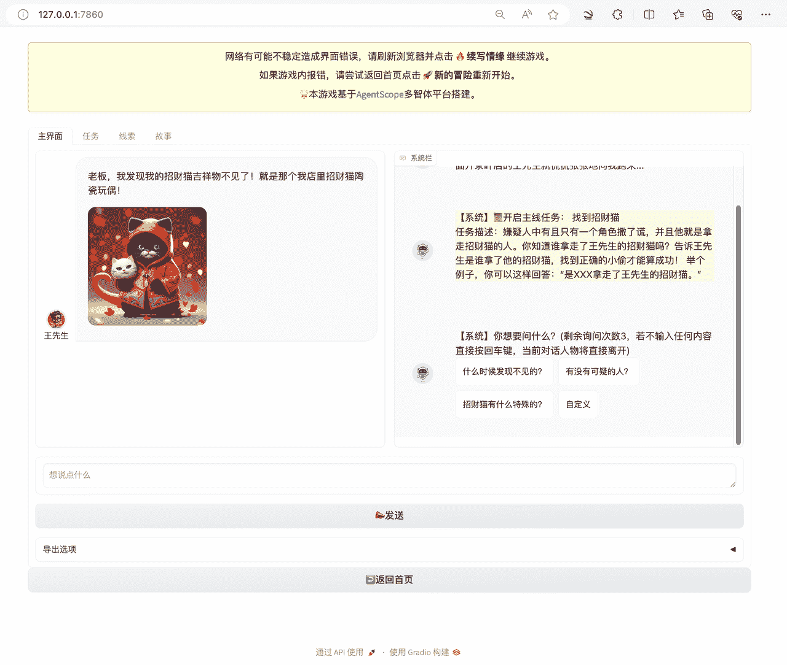

# 谜撰应用部署教程

> 来源：[https://datawhaler.feishu.cn/docx/DKPJdBvBAogOEWxMM8qcl0OAnjd](https://datawhaler.feishu.cn/docx/DKPJdBvBAogOEWxMM8qcl0OAnjd)

<https://datawhaler.feishu.cn/sync/FsXmd9Oifs2Jx4bq3CCcPXE8npg>

> 本教程旨在，带大家零基础速通 多智能**体 (Multi-A**gent) 框架 AgentScope，本地部署一个基于该框架的游戏应用~

# 学习效果预告

成功部署后，效果图大致如下所示：






# 学习进行时——

## 开通 Qwen API，领取免费额度，并创建 Key

<https://datawhaler.feishu.cn/sync/FpUmdMXkAs2mg3bFmeacI69kndg>

## 本地下载代码并配置环境

> [**必备条件：代码仓库、装有**](https://datawhaler.feishu.cn/wiki/O61pwGEXLiCxWXkmTnsc0RvynEc?fromScene=spaceOverview#XjJxdfk2loWk9AxGtlkcIhADnw3)python环境的电脑/魔搭Notebook、Qwen API-KEY

### 使用本地电脑

> 注意电脑需要能够正常使用python环境

1.  打开命令行界面，进入到合适的目录

1.  Mac电脑打开终端，cd到合适的目录


1.  Windows电脑在对应目录下，右键打开命令行

1.  下载游戏项目源码并安装环境

> 注意必须使用 python ≥ 3.10

+   Mac环境

```
#推荐使用虚拟环境
python -m venv venv_AgentScope
source venv_AgentScope/bin/activate

#克隆谜撰代码并进入该目录
git clone https://www.modelscope.cn/studios/AgentScope/game_qwen.git
cd game_qwen

#配置所需环境：安装相关包
pip install -r requirements.txt
pip install google protobuf PyYAML gradio colorist pypinyin inquirer oss2 modelscope_studio

#设置qwen KEY和游戏名字的环境变量
export GAME_NAME=test（可以任意调整）
export DASHSCOPE_API_KEY=sk-xxxxxx
```


+   Windows环境，推荐使用conda虚拟环境

```
#Windows版
##新建虚拟环境
conda create -n venv_AgentScope python=3.10

##切换环境
conda activate venv_AgentScope

#克隆谜撰代码并进入该目录
git clone https://www.modelscope.cn/studios/AgentScope/game_qwen.git
cd game_qwen

#配置所需环境：安装相关包
pip install -r requirements.txt
pip install google protobuf PyYAML gradio colorist pypinyin inquirer oss2 modelscope_studio

#设置qwen KEY和游戏名字的环境变量
setx GAME_NAME test（可以任意调整）
setx DASHSCOPE_API_KEY sk-xxxxxx（上面申请的api-key）
```


### 使用魔搭Notebook（还存在一定问题）

1.  打开[魔搭Notebook](https://modelscope.cn/my/mynotebook/preset)


1.  下载游戏项目源码，并安装环境

```
#克隆谜撰代码并进入该目录
git clone https://www.modelscope.cn/studios/AgentScope/game_qwen.git
cd game_qwen

#配置所需环境：安装相关包
pip install -r requirements.txt

#设置qwen KEY和游戏名字的环境变量
export GAME_NAME=test
export DASHSCOPE_API_KEY=sk-xxxxxx
```


1.  修改gradio运行路径

> 修改game_app.py里的demo.launch部分的代码为如下内容

```
#搜索 demo.launch()，替换为如下内容
port = 7860
name = os.environ[&#x27;JUPYTER_NAME&#x27;]
root_path =f&#x27;/{name}/proxy/{port}&#x27;
demo.launch(root_path=root_path, server_port=port, max_threads=400)
```


## 运行游戏，开玩！

在命令行敲击 python app.py 即可开玩！


# 随机掉落的知识包

## Agent是什么？

<https://datawhaler.feishu.cn/sync/QZord0va1s9dgCbc4WgcDq0tn4b>

## Multi-Agent是什么？

> 以下内容由AI辅助写作：https://metaso.cn/s/sn5zwEB

多智能体系统（Multi-Agent Systems, MAS）是由多个决策制定的智能体组成的系统，这些智能体在共享环境中相互作用，以实现共同或冲突的目标。这些系统可以由多个软件组件或“智能体”组成，这些智能体具有自主性和交互性的基本能力。多智能体系统是分布式人工智能的一个子领域，由于其灵活性和智能性，近年来经历了快速的增长。

在多智能体系统中，智能体之间的有效通信是非常关键的。例如，信息丰富的多智能体通信（IMAC）方法被开发出来，以学习高效的通信协议以及调度。此外，有效的通信协议对于促进合作和增强团队协作在多智能体强化学习（MARL）中至关重要。这表明，在多智能体系统中，智能体之间的通信不仅限于传递信息，还包括通过特定的协议来指导它们之间的对话。

多智能体系统在人工智能中的应用非常广泛，它们可以用来解决各种问题，如通过多个自主或半自主的智能体相互作用或合作来执行任务。这种计算框架的灵活性和智能性使其成为解决复杂问题的有效工具。

总的来说，多智能体系统是一个复杂的领域，涉及多个智能体在共享环境中的相互作用，旨在实现共同目标或解决特定问题。有效的通信机制是这些系统成功的关键因素之一。

## AgentScope框架是什么？

<https://datawhaler.feishu.cn/sync/Oo4nd6BMNsyxZPbDPb4cY8bSn1d>

# 一些 问题 & 解决方案

## conda下载速度慢的问题：更换国内源：by

## [c](https://blog.csdn.net/czyxiaowu/article/details/132479619)ondav[aluee](https://blog.csdn.net/czyxiaowu)rror: malformed version string ‘~‘: invalid character(s)解决方法 ：by czyxw

## Windows 运行失败，不支持gbk字符：by

> 问题原因：Windows不支持gbk编码内容，需要修改为utf-8的编码格式


1.  找到**对应的文件**修改代码

> 思路：找到报错(红线)的位置进行编码格式修改

打开pathlib.py文件，搜索‘read_text’方法，改成下面的代码并保存：


继续运行,出现如下错误:

找到上述红线的地址，打开py文件，并加上encoding=‘utf-8’，保存：


重新运行，成功：


1.  可能出现的问题，模型加载问题：


目前只能通过重新新建环境来解决