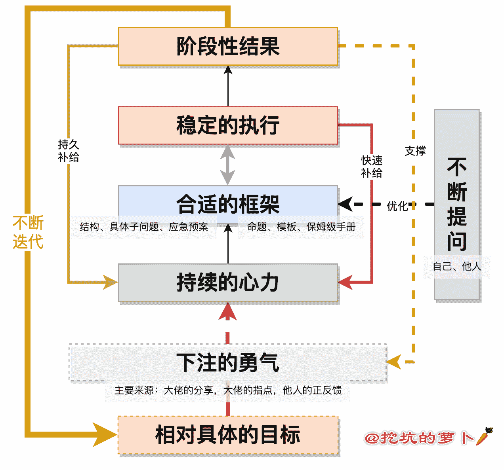
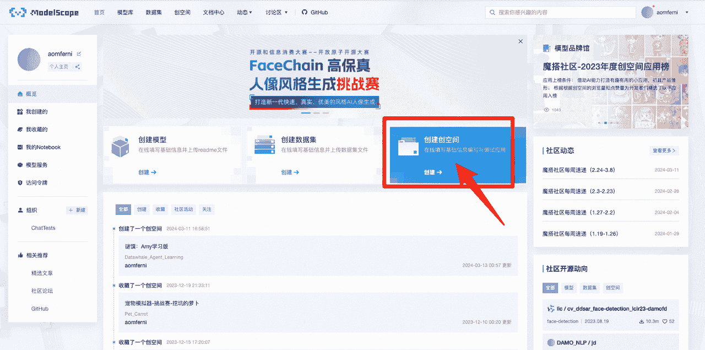
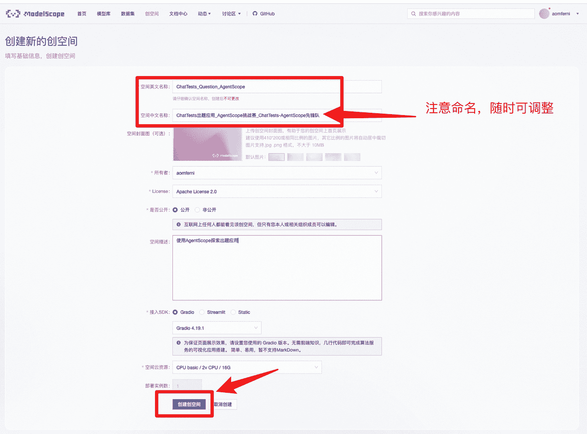
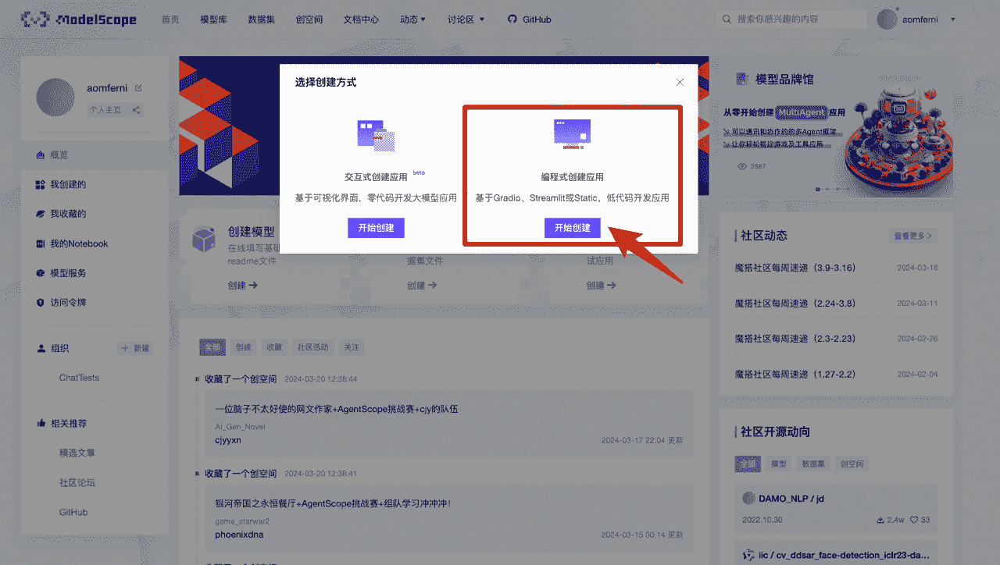
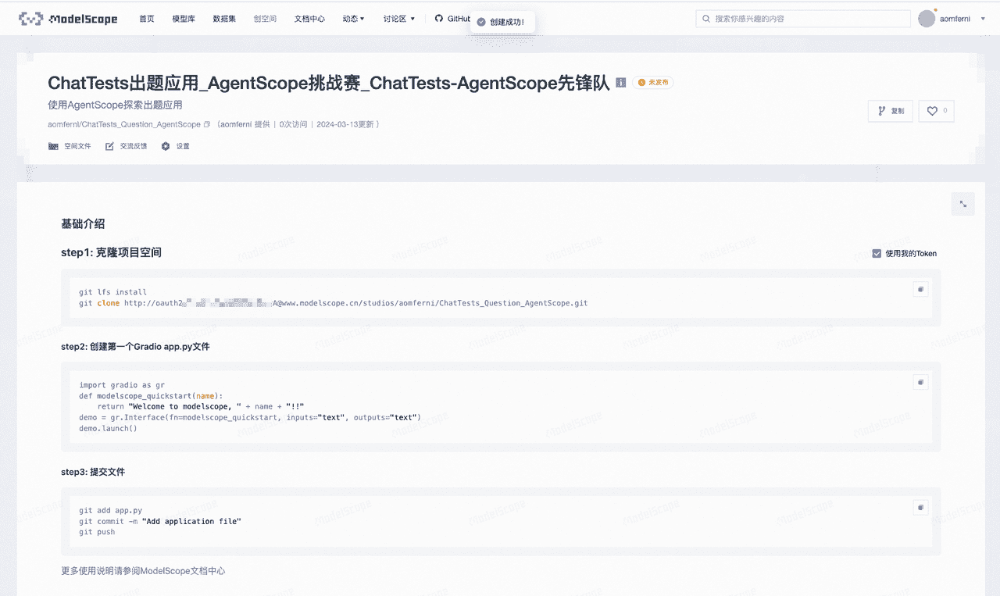
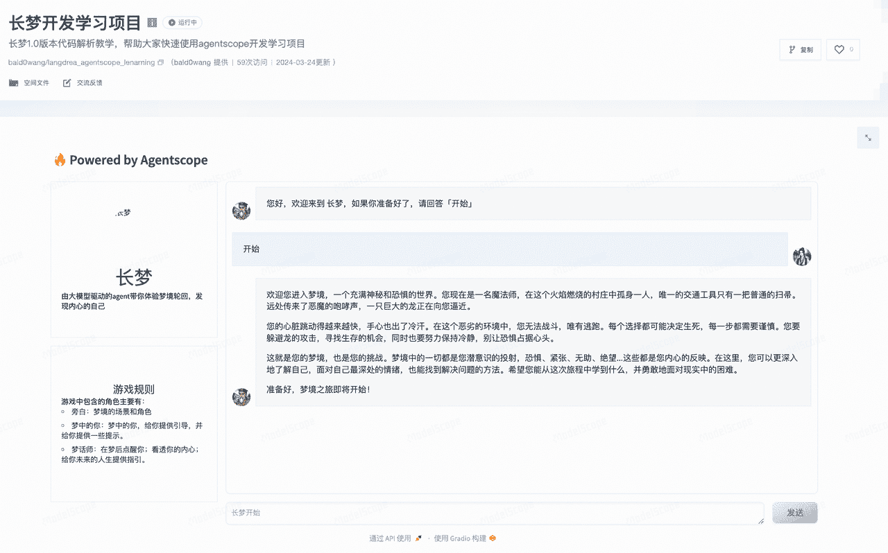
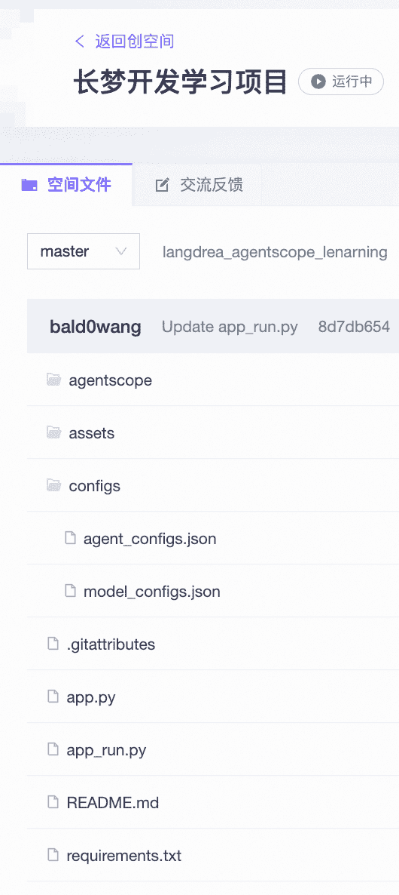

# AgentScope应用开发入门

> 来源：[https://datawhaler.feishu.cn/docx/T7CLd7mmfov99txur48cLXQCnod](https://datawhaler.feishu.cn/docx/T7CLd7mmfov99txur48cLXQCnod)
>
> 本文是在 Datawhale 《从零开始学多智能体应用开发》学习活动中写作的学习笔记，写给有一定编程基础的学习者，得以入门 源码级 开发`Agentscope`应用，并上线创空间，参加`Agentscope`的比赛。
>
> 贡献作者： 、
>
> **相关项目**：[飞花令](https://modelscope.cn/studios/Action/Paper-Genie/summary)、[长梦](https://www.modelscope.cn/studios/bald0wang/langdream/summary)、[ChatTests出题](https://modelscope.cn/studios/aomferni/ChatTests_Question_AgentScope/summary)
>
> 期待感兴趣的小伙伴一起合作共创、迭代相关项目！

<https://datawhaler.feishu.cn/sync/FsXmd9Oifs2Jx4bq3CCcPXE8npg>


# 五板斧 🪓打造AgentScope应用

## 前言：小步快跑，开发不愁！

大家可能跟我一样，经常产生很多有趣的想法，但在落地时会遇到很多一开始没有预料到的卡点，就很容易再而衰、三而竭，在这里我推荐给大家一个我常用的做事模式，能很方便地进入忘我状态：



即：小步快跑、确认可控的小目标，快速迭代和拿到反馈。翻译成`Agentscope`的应用开发可以是：

1. **确定一个应用创作方向**：问你自己想做个啥
1. **解决UI设计问题**：确定一个想模仿的UI，直接copy其UI代码
1. **拆分功能**：确定好UI各个按钮和组件分别是用来做啥的、预期效果是啥
1. **实现功能Demo**：东抄抄西抄抄，用AI帮忙写代码，把基础功能能力实现出来，跑通最小MVP、实现可运行和展示的demo
1. **迭代和优化效果**：跑通了demo之后，通过设计更好的Prompt、设计更多容错机制、不断测试和迭代效果
1. **优化项目**：通过更多的用户体验获得反馈，优化应用设计、优化UI

那么接下来，让我们正式进入应用开发步骤，带你沉浸式体验【开发`Agentscope`应用并上线创空间】五大步骤，享受专注开发应用的快乐~

> 在下文中，将以 `ChatTests`基础版、`长梦`、`飞花令` 三个项目为例，进行实操说明
>
> 主要分为五个步骤：创建一个创空间 👉🏻 梳理项目创意 👉🏻 编辑基本代码 👉🏻 调试优化效果 👉🏻 上线创空间展示

## Step1：[创建一个创空间](https://modelscope.cn/studios/create)

登录后进入[魔搭社区首页](https://modelscope.cn/my/overview)，点击[【创建创空间】](https://modelscope.cn/studios/create)，填写内容，点击【创建创空间】即可创建成功









---

1. 【交互式创建应用】使用的是零代码构建单Agent框架`ModelScope-Agent`应用，更多细节可见[ModelScope-Agent学习指南](https://datawhaler.feishu.cn/wiki/GhOLwvAPkiSWmokjUgqc1eGonDf)

1. 后续更多操作可见如何将修改后的代码上传创空间发布？

### 或者复制一个[已有的创空间](https://modelscope.cn/studios/aomferni/ChatTests_Question_AgentScope_basic/summary)

> 此处以[ChatTests](https://modelscope.cn/studios/aomferni/ChatTests_Question_AgentScope_basic/summary)的基础代码为例

<https://datawhaler.feishu.cn/sync/XHcydB5XYsxPeZbL8ayciDW8n7c>

## Step2：梳理项目创意

<https://datawhaler.feishu.cn/sync/YTSndZHvQsujNsbi0yQcC4YknIc>

## Step3：编辑基础代码

<https://datawhaler.feishu.cn/sync/PfdldfDXXs86DBbkh2ccIoQunsh>

## Step4：调试优化效果

<https://datawhaler.feishu.cn/sync/GzQqdmPaUssdQCb0nNocE0H5ncT>

## Step5：上线空间展示

> 每次完成一定量的工作，即可同步代码至创空间，并【重启空间展示】

<https://datawhaler.feishu.cn/sync/KHavdu7fOssLA8bi173cPuwqn5d>

<https://datawhaler.feishu.cn/sync/HW7ZdJsRmsAF0PbXeDociernnFd>

# 项目案例：[长梦](https://www.modelscope.cn/studios/bald0wang/langdrea_agentscope_lenarning/summary)





## 项目简介

本项目通过介绍长梦的制作流程引导大家学习`agentscope`项目开发与部署，通过学习项目，理解项目了解`agentscope`、`gradio`、魔搭的应用开发与部署。


长梦介绍：长梦游戏是假设玩家在做一个连环梦，梦的内容离奇古怪。

其中一梦：

> “欢迎来到这场心理与意志的极限挑战，这是你从未体验过的梦境世界。此刻的你，身处一片炽热的烈焰之中，四周都是毁灭和死亡的气息你不再是日常生活中的那个你，而是化身为这个村庄中最后一名幸存的魔法师。在这场浩劫中，你的家园已经被那只骑着龙的恶魔彻底摧毁，唯一的生路便是逃亡。你现在所骑的，只是一根破旧的扫把，它微不足道的力量，却是你在火焰之间穿梭的唯一依仗。每一次疾飞，都在考验着你的勇气和智慧:每次心跳，都在提醒你要活下去。这不仅仅是一场追逐，更是一次深入内心的探索。你要在这火海中找寻生存的机会，更要面对自己内心深处的恐惧和矛盾。在这个过程中，你会发现更多关于自我、关于生活的真相。别忘了，你的任务只有一个--快跑!但是，只有当你直面并战胜心中的恶魔时，你才能真正逃脱这场噩梦，找到属于自己的出路。准备好了吗?现在，让我们开始这场紧张刺激的心理冒险吧!”

你需要在梦中表达自己最真实的想法，与梦中的自己对话，话梦师先生帮你解梦，也会给你的人生做一些启发性的指导。

## 角色设计

| **角色** | **工作/功能** | **对应Agent变量名** |
| --- | --- | --- |
| **旁白** | 介绍游戏与故事背景 | `pangbai` |
| **梦中的你** | 与`user`对话，是梦中的玩家。 | `dreamNPC1` |
| **梦话师** | 1. （解梦）在梦后点醒你; | `dreamAna1` |

## Agent scope代码

### 模型配置

> 配置文件：`configs/model_configs.json`

```json
[
    {
        "model_type": "dashscope_chat",
        "config_name": "qwen",
        "model_name": "qwen-72b-chat",
        "api_key": "",
        "generate_args": {
            "temperature": 0.5
        }
    }
]
```

### agents配置

> 配置文件：`configs/agent_configs.json`

这里主要有三个`pangbai`、`dreamNPC1`、`dreamAna1`

旁白：`pangbai`

梦中的你：`dreamNPC1`

梦话师：`dreamAna1`

```python
agent_configs = [
    {
        "class": "DialogAgent",
        "args": {
            "name": "pangbai",
            "sys_prompt": "你是一个故事旁白，需要对玩家进行游戏背景介绍。这个游戏关于玩家的梦境。需要你给足玩家压力，需要通过本次测试帮玩家分析自己的内心",
            "model_config_name": "qwen",
            "use_memory": True
        }
    },
    {
        "class": "UserAgent",
        "args": {
            "name": "user"
        }
    },
    {
        "class": "DialogAgent",
        "args": {
            "name": "dreamNPC1",
            "sys_prompt": f"你是玩家梦境里的另一个自己，你需要根据旁白描述的场景与玩家对话。你需要提示玩家快跑，并根据自己想象不断描述{key1}，他们在一步步逼近你，想要杀死你。",
            "model_config_name": "qwen",
            "use_memory": True
        }
    },
    {
        "class": "DialogAgent",
        "args": {
            "name": "dreamAna1",
            "sys_prompt": "你是一个梦境分析师，你需要通过梦境的场景和玩家的对话进行分析。任务1：你需要告诉玩家为什么会做这样的梦。任务2:你需要根据玩家的对话判断玩家性格是否是外向还是内向。任务3：你需要借助一句古语告诉玩家要有勇气。",
            "model_config_name": "qwen",
            "use_memory": True
        }
    }
]
```

### 环境准备

这里面我们设计的第一幕key是“骑着龙的恶魔”，也就是我想用这个方式进行一个主题，这样把参数抽出来就能做到随机生成剧本的功能。

```python
import agentscope
from agentscope.pipelines import SequentialPipeline
from agentscope.message import Msg

key1 = "骑着龙的恶魔"

agents = agentscope.init(
    model_configs="./model_configs.json",  # 前面创建的model_configs.json文件
    agent_configs=agent_configs,
)

pangbai = agents[0]
# user = agents[1]
dreamNPC1 = agents[2]
dreamAna1 = agents[3]
```

### 梦境设计

这里我梦境也设定了一句话。这是对应“骑着龙的恶魔”的背景剧本。

如果你`llm`熟练的话你可以自动生成剧本以及内容。

如果需要设计背景，通过这样的方法就可以把背景植入到`pangbai`智能体。

`pangbai` 输出如下：

> “亲爱的玩家，
>
> 欢迎来到这个深邃而又真实的梦境世界，在这里，您不再仅仅是旁观者，而是成为故事的核心主角。此刻，您正置身于一场生死攸关的逃亡之旅，身临其境的感受那无尽的压力与恐惧。
>
> 您骑着一把看似不起眼却承载着最后希望的魔法扫帚，在熊熊烈火中穿行，背后是驾驭着凶猛巨龙的恶魔步步紧逼，他的目标只有一个——彻底终结您的存在。此刻的您，已然是遭受浩劫后村落中唯一的幸存者，一个肩负重任的魔法师，带着村民们沉甸甸的期待与悲壮的命运。
>
> 这场梦境并非简单的虚幻体验，它更像是潜意识深处的心灵映射，每一次心跳加速、每一次手心出汗，都是您内心世界的真实反馈。在这场狂风骤雨般的追逐中，您所面临的挑战和选择，都将揭示出您内在的力量与弱点，帮助我们一同深入剖析您的内心世界。
>
> 现在，请握紧手中的扫帚，鼓起勇气面对这梦中的恶魔吧！只有通过这场严酷的试炼，才能解读隐藏在您灵魂深处的秘密。勇往直前，玩家，让我们共同见证这场梦境背后的真相。”

代码如下：

```python
emeng = "你被骑着龙的恶魔追杀，而你只能骑在扫把上四处躲藏。四处像是一片火海，你是村子里最后一个活下来的魔法师。你的任务只有一个，就是快跑。"
# print("玩家将进入梦境，你需要扮演旁白告诉玩家现在的状态。{emeng}")
content = f"玩家将进入梦境，你需要扮演旁白告诉玩家现在的状态。{emeng}"
print()
x = Msg(name="pangbai", content=content)
x = pangbai(x)
print(pangbai.memory.get_memory()[-1]["content"])
```

### 循环对话

这里做了一个对话轮次，一般你可以设定一个范围比如用`random`选一个值做这个循环次数。

在这里你可以做一些对话，推动剧情发展。也可以搜集一些信息。

这里每次玩家可以进行对话，然后梦中的你`dreamNPC1`智能体与你对话，引导剧情的发展。

> 你说： 啊？龙在哪里？

> 就在你的身后，火焰在它们的喉咙中翻腾，炽热的气息在空气中弥漫，那股恶臭和死亡的气息越来越浓烈。它们的眼眸闪烁着凶光，犹如两颗燃烧的红宝石，锁定在你的身上，仿佛能穿透你的灵魂。它们骑手身披黑甲，面孔狰狞可怖，手中紧握着滴血的长矛，正策动着龙群步步向你逼近。听，那沉闷的脚步声和龙翼拍打空气的呼啸，是死神的召唤，也是你必须逃亡的警告。快跑，时间紧迫，每一步都关乎生死存亡！

> 你说： 我靠 扫把给我 快跑

> 很好，你已经意识到危险迫在眉睫。抓起身边的扫把，将其当作临时的武器或支撑物，此刻它就是你的生命线。扫把柄在你手中颤抖，映衬出你坚定的眼神和不屈的决心。现在，你要用尽全力奔跑，穿越前方的森林、跨过崎岖的山路，朝着远方的安全地带疾驰而去。背后的龙群与恶魔骑士正加速追赶，他们的嘲笑声和龙的咆哮声在风中回荡，但你不能回头，只能勇往直前，因为生的希望就在前方。加油，玩家，你可以战胜这一切！

> 你说： 飞 扫把！ 快飞！

> 尽管这只是梦境中的一个道具，但在你的强烈意志下，扫把似乎感应到了你的决心与恐惧，竟奇迹般地散发出微弱的光芒，如同魔法般开始缓缓升起。你紧紧抓住扫把柄，心跳如擂鼓，瞬间，扫把化作一股神奇的力量将你托起，载着你在夜空中疾飞。那些骑着龙的恶魔见状惊愕不已，他们无法理解眼前的景象，短暂的错愕给了你宝贵的逃脱时间。

>
> "飞吧，扫把，带我远离这无尽的黑暗与恐怖！"你心中默念，扫把带着你急速上升，向着明亮的星辰与安全的方向飞去。此刻，你离恶魔的威胁越来越远，生存的机会正在逐渐增大。保持信念，继续飞翔，直到彻底摆脱这场噩梦的追逐！


```
n = 3
while n > 0:
    n = n - 1
    test = input("你说：")
    x = Msg(name="User", content=test)
    x = dreamNPC1(x)
    print(dreamNPC1.memory.get_memory()[-1]["content"])
```

### 对话总结

当然，通过刚才的对话后你可以让梦话师对你做总结。

> '任务1：这个梦境反映了你在面临困境或压力时，内心深处对自由、逃避以及自我力量的渴望。扫把象征着你解决问题的独特方式或者潜在的创造力，它可以对抗生活中的“恶魔”，即困扰你的问题或负面情绪。而你在梦中成功驾驭扫把飞行，则说明你拥有克服困难的决心和勇气，即使面对恐惧也能找到出路，积极应对挑战。
>
> 任务2：根据提供的梦境描述，无法直接准确判断玩家的性格是外向还是内向。不过，从你在梦中展现的独立、勇敢和创新应对困境的方式来看，可能具有较强的内在力量和独立解决问题的能力，这在一定程度上可以暗示可能存在内向型性格特征，但并不能完全排除外向型性格的可能性。
>
> 任务3：古语曰，“临渊羡鱼，不如退而结网。”这句话在此情境下可鼓励你要有实际行动的勇气，面对生活的困境时，不仅要心怀希望，更要敢于付诸行动，正如你在梦中紧握扫把勇敢飞翔一样，只有真正动手去做，才能逃离困境，实现自我的突破和成长。'

到这里基本上简短的游戏内容就结束了。你可以通过上面学到的技巧进行更丰富的设计。

```
dreamAna1(x)
dreamAna1.memory.get_memory()[-1]["content"]
```

### 全量代码

```
import agentscope
from agentscope.pipelines import SequentialPipeline
from agentscope.message import Msg

key1 = "骑着龙的恶魔"

agent_configs = [
    {
        "class": "DialogAgent",
        "args": {
            "name": "pangbai",
            "sys_prompt": "你是一个故事旁白，需要对玩家进行游戏背景介绍。这个游戏关于玩家的梦境。需要你给足玩家压力，需要通过本次测试帮玩家分析自己的内心",
            "model_config_name": "qwen",
            "use_memory": True
        }
    },
    {
        "class": "UserAgent",
        "args": {
            "name": "user",
            # "sys_prompt": "你是用户助手，负责搜集用户输入信息",
            # "model_config_name": "qwen",
            # "use_memory": True
        }
    },
    {
        "class": "DialogAgent",
        "args": {
            "name": "dreamNPC1",
            "sys_prompt": f"你是玩家梦境里的另一个自己，你需要根据旁白描述的场景与玩家对话。你需要提示玩家快跑，并根据自己想象不断描述{key1}，他们在一步步逼近你，想要杀死你。",
            "model_config_name": "qwen",
            "use_memory": True
        }
    },
    {
        "class": "DialogAgent",
        "args": {
            "name": "dreamAna1",
            "sys_prompt": "你是一个梦境分析师，你需要通过梦境的场景和玩家的对话进行分析。任务1：你需要告诉玩家为什么会做这样的梦。任务2:你需要根据玩家的对话判断玩家性格是否是外向还是内向。任务3：你需要借助一句古语告诉玩家要有勇气。",
            "model_config_name": "qwen",
            "use_memory": True
        }
    }
]
# 初始化了多个大模型和多个Agent
agents = agentscope.init(
    model_configs="./model_configs.json",  # 前面创建的model_configs.json文件
    agent_configs=agent_configs,
)

pangbai = agents[0]
dreamNPC1 = agents[2]
dreamAna1 = agents[3]
emeng = "你被骑着龙的恶魔追杀，而你只能骑在扫把上四处躲藏。四处像是一片火海，你是村子里最后一个活下来的魔法师。你的任务只有一个，就是快跑。"
# print("玩家将进入梦境，你需要扮演旁白告诉玩家现在的状态。{emeng}")
content = f"玩家将进入梦境，你需要扮演旁白告诉玩家现在的状态。{emeng}"
print()
x = Msg(name="pangbai", content=content)
x = pangbai(x)
print(pangbai.memory.get_memory()[-1]["content"])
userInfo = []
n = 3
while n > 0:
    n = n - 1
    # x = user(x)
    test = input("你说：")
    x = Msg(name="User", content=test)
    # userInfo.append(x)
    x = dreamNPC1(x)
    print(dreamNPC1.memory.get_memory()[-1]["content"])
dreamAna1(x)
dreamAna1.memory.get_memory()[-1]["content"]
```

## gradio agent scope

首先请大家复制一下长梦的测试版`https://www.modelscope.cn/studios/bald0wang/langdrea_agentscope_lenarning/summary`


复制下来到你的空间。

### 进入空间下载


这样你就可以在本地学习与修改

（这里你需要在`os`加一下你的key~）

### 环境配置

有一些环境可能包没有请自行下载~

里面有一些`html`代码，你可以根据自己的需要进行修改~


当然，你的对话头像也可以在`assets`下面修改~

```
import os
import random
import shutil
import traceback
import hashlib
from PIL import Image
import gradio as gr
from gradio.components import Chatbot
import time
import threading
import agentscope
from agentscope.agents import DialogAgent
from agentscope.agents.user_agent import UserAgent
from agentscope.message import Msg


# 可以不看这个 没用到
def generate_image_from_name(name):
    hash_func = hashlib.md5()
    hash_func.update(name.encode('utf-8'))
    hash_value = hash_func.hexdigest()

    color_hex = '#' + hash_value[:6]
    color_rgb = Image.new('RGB', (1, 1), color_hex).getpixel((0, 0))

    image_filepath = f"assets/{name}_image.png"
    if os.path.exists(image_filepath):
        print(f"Image already exists at {image_filepath}")
        return image_filepath
    # generate image
    width, height = 200, 200
    image = Image.new('RGB', (width, height), color_rgb)
    # save image
    image.save(image_filepath)
    return image_filepath

# 这里你自行设计就好了 都是一些通用配置哦
def format_cover_html():
    return f"""
    <div class="bot_cover">
        <div class="bot_avatar">
            
        </div>
    <div class="bot_name">{"长梦"}</div>
    <div class="bot_desp">{"由大模型驱动的agent带你体验梦境轮回，发现内心的自己"}</div>
</div>
"""

def format_desc_html():
    return f"""
<div class="bot_cover">
    <div class="bot_rule">{"游戏规则"}</div>
    <div class="bot_desp">{"游戏中包含的角色主要有："}
        <ul>
            <li>旁白：梦境的场景和角色</li>
            <li>梦中的你：梦中的你，给你提供引导，并给你提供一些提示。</li>
            <li>梦话师：在梦后点醒你；看透你的内心；给你未来的人生提供指引。</li>
        </ul>
    </div>
</div>
"""

uid = threading.current_thread().name
host_avatar = 'assets/host_image.png'
user_avatar = 'assets/user_image.png'
```

### agents传参

设计的`agents`以字典的方式送给`gradio`

请注意： 这次我们传入的`llm` key通过“`DASHSCOPE_API_KEY`”送入，这个对外部来说是一个隐藏参数。

```
def init_user(state):
    model_configs = json.load(open('configs/model_configs.json', 'r'))
    model_configs[0]["api_key"] = os.environ.get("DASHSCOPE_API_KEY")
    agents = agentscope.init(
        model_configs=model_configs,
        agent_configs=agent_configs
    )
    host_agent = agents[0]
    # user = agents[1]
    dreamNPC1 = agents[2]
    dreamAna1 = agents[3]

    state['host_agent'] = host_agent
    state['dreamNPC1'] = dreamNPC1
    state['dreamAna1'] = dreamAna1
    return state
```

### gradio

#### 界面初始化

这里面调用了飞花令项目的模板，非常感谢大佬支持我们做本次分享~

飞花令：`https://modelscope.cn/studios/Action/Paper-Genie/summary`

这块代码配置了`gradio`的界面，引入`css`让页面更美观。你可以根据需要修改汉字部分~

注意这个：`random_number1 = random.randint(3, 5)`

这里是随机关卡对话次数，你也可以设置为固定值。


# 创建 Gradio 界面

```
customTheme = gr.themes.Default(primary_hue=gr.themes.utils.colors.blue, radius_size=gr.themes.utils.sizes.radius_none)

demo = gr.Blocks(css='assets/appBot.css', theme=customTheme)
with demo:
    gr.Markdown('# <center> \N{fire} Powered by Agentscope</center>')
    state = gr.State({'session_seed': uid})

    random_number1 = random.randint(3, 5)
    random_number2 = random.randint(3, 5)
    random_number3 = random.randint(3, 5)
    with gr.Row(elem_classes='container'):
        with gr.Column(scale=4):
            with gr.Column():
                user_chatbot = Chatbot(
                    value=[[None, '您好，欢迎来到 长梦，如果你准备好了，请回答「开始」']],
                    elem_id='user_chatbot',
                    avatar_images=[user_avatar, host_avatar],
                    height=600,
                    latex_delimiters=[],
                    show_label=False)
            with gr.Row():
                with gr.Column(scale=12):
                    preview_chat_input = gr.Textbox(
                        show_label=False,
                        container=False,
                        placeholder='长梦开始')
                with gr.Column(min_width=70, scale=1):
                    preview_send_button = gr.Button('发送', variant='primary')

        with gr.Column(scale=1):
            user_chat_bot_cover = gr.HTML(format_cover_html())
            user_chat_bot_desc = gr.HTML(format_desc_html())
```

## Gradio 对话内容设计

这是`gradio`对话设计的核心~

我通过注释给大家介绍

```
def send_message(chatbot, input, _state):
    # 还是一样，把我们的agents初始化  这里需要引入一下
    host_agent = _state['host_agent']
    dreamNPC1 = _state['dreamNPC1']
    dreamAna1 = _state['dreamAna1']
    
    # 这里是调用input，也就是用户的输入。与terminal输入方式不同，每次对话都会出发send_message
    # 也就是说 send_message已经是一个循环
    chatbot.append((input, ''))
    yield {
        user_chatbot: chatbot,
        preview_chat_input: '',
    }
    # 首先做游戏开始判断。这里你可以把游戏的启动做一个控制，也就相当做了一个初始化监听。
    # 通过函数触发的方式让机器人知道我们开始游戏了
    if '开始' in input:
        # 开始处理 这是我们的背景引入，和之前一样的
        bg = "你被骑着龙的恶魔追杀，而你只能骑在扫把上四处躲藏。四处像是一片火海，你是村子里最后一个活下来的魔法师。你的任务只有一个，就是快跑。"
        content = f"旁白：玩家将进入梦境，你需要扮演旁白告诉玩家现在的状态。{bg}"
        x = Msg(name="pangbai", content=content)
        x = host_agent(x)
        # 这里是对输出内容做了封装，调用一次chatbot然后做yield 返回 也就是只做了旁白的对话。
        chatbot[-1] = (input, f'{x.content}')
        yield {
            user_chatbot: chatbot,
        }
        x = host_agent(x)

    else:
        # 这里相当于开始做梦
        # 已经进入到第一梦
        user_ask = input
        x = Msg(name="User", content=user_ask)
        x = dreamNPC1(x)
        # 梦中的你与玩家对话
        chatbot[-1] = (input, f'梦中的你：{x.content}')
        yield {
            user_chatbot: chatbot,
        }
        # 这里就是先前的对话轮次控制，因为在gradio循环执行的函数里，不需要写循环逻辑。所以只需要你做一个控制器。
        global random_number1
        random_number1 = random_number1-1
        if random_number1==0:
            x = dreamAna1(x)
            # 当循环结束 梦话师开始做点评
            chatbot.append((None, f'梦话师：{x.content}'))
            yield {
                user_chatbot: chatbot,
            }
            # 最后输出开始语  在用户角度里看到这句话相当于重新开始了游戏。
            chatbot.append((None, f'本轮梦境结束,如您想重新游戏，请回答「开始」。后续三重梦境敬请期待'))
            yield {
                user_chatbot: chatbot,
            }
```

这里就是基本的代码结构讲解。到这里就算完全看完了这个项目。

### 全部代码


```python
import os
import random
import shutil
import traceback
import hashlib
from PIL import Image
import gradio as gr
from gradio.components import Chatbot
import time
import threading
import agentscope
from agentscope.agents import DialogAgent
from agentscope.agents.user_agent import UserAgent
from agentscope.message import Msg
import json


def generate_image_from_name(name):
    hash_func = hashlib.md5()
    hash_func.update(name.encode('utf-8'))
    hash_value = hash_func.hexdigest()

    color_hex = '#' + hash_value[:6]
    color_rgb = Image.new('RGB', (1, 1), color_hex).getpixel((0, 0))

    image_filepath = f"assets/{name}_image.png"
    if os.path.exists(image_filepath):
        print(f"Image already exists at {image_filepath}")
        return image_filepath
    # generate image
    width, height = 200, 200
    image = Image.new('RGB', (width, height), color_rgb)
    # save image
    image.save(image_filepath)
    return image_filepath


def format_cover_html():
    return f"""
      <div class="bot_cover">
        <div class="bot_avatar">
          
        </div>
        <div class="bot_name">{"长梦"}</div>
        <div class="bot_desp">{"由大模型驱动的agent带你体验梦境轮回，发现内心的自己"}</div>
      </div>
    """


def format_desc_html():
    return f"""
<div class="bot_cover">
   <div class="bot_rule">{"游戏规则"}</div>
   <div class="bot_desp">{"游戏中包含的角色主要有："}
       <ul>
           <li>旁白：梦境的场景和角色</li>
           <li>梦中的你：梦中的你，给你提供引导，并给你提供一些提示。</li>
           <li>梦话师：在梦后点醒你；看透你的内心；给你未来的人生提供指引。</li>
       </ul>
   </div>
</div>
"""


uid = threading.current_thread().name
host_avatar = 'assets/host_image.png'
user_avatar = 'assets/user_image.png'

key1 = "骑着龙的恶魔"

agent_configs = [
    {
        "class": "DialogAgent",
        "args": {
            "name": "pangbai",
            "sys_prompt": "你是一个故事旁白，需要对玩家进行游戏背景介绍。这个游戏关于玩家的梦境。需要你给足玩家压力，需要通过本次测试帮玩家分析自己的内心",
            "model_config_name": "qwen",
            "use_memory": True
        }
    },
    {
        "class": "UserAgent",
        "args": {
            "name": "user",
            # "sys_prompt": "你是用户助手，负责搜集用户输入信息",
            # "model_config_name": "qwen",
            # "use_memory": True
        }
    },
    {
        "class": "DialogAgent",
        "args": {
            "name": "dreamNPC1",
            "sys_prompt": f"你是玩家梦境里的另一个自己，你需要根据旁白描述的场景与玩家对话。你需要提示玩家快跑，并根据自己想象不断描述{key1}，他们在一步步逼近你，想要杀死你。",
            "model_config_name": "qwen",
            "use_memory": True
        }
    },
    {
        "class": "DialogAgent",
        "args": {
            "name": "dreamAna1",
            "sys_prompt": "你是一个梦境分析师，你需要通过梦境的场景和玩家的对话进行分析。任务1：你需要告诉玩家为什么会做这样的梦。任务2:你需要根据玩家的对话判断玩家性格是否是外向还是内向。任务3：你需要借助一句古语告诉玩家要有勇气。",
            "model_config_name": "qwen",
            "use_memory": True
        }
    }
]


def init_user(state):
    model_configs = json.load(open('configs/model_configs.json', 'r'))
    model_configs[0]["api_key"] = os.environ.get("DASHSCOPE_API_KEY")
    agents = agentscope.init(
        model_configs="configs/model_configs.json",
        agent_configs=agent_configs
    )
    host_agent = agents[0]
    # user  = agents[1]
    dreamNPC1 = agents[2]
    dreamAna1 = agents[3]

    # user_agent = UserAgent()
    
    # state['user_agent'] = user_agent
    state['host_agent'] = host_agent
    state['dreamNPC1'] = dreamNPC1
    state['dreamAna1'] = dreamAna1
    return state


# 创建 Gradio 界面
customTheme = gr.themes.Default(primary_hue=gr.themes.utils.colors.blue, radius_size=gr.themes.utils.sizes.radius_none)

demo = gr.Blocks(css='assets/appBot.css', theme=customTheme)
with demo:
    gr.Markdown('# <center> \N{fire} Powered by Agentscope</center>')
    state = gr.State({'session_seed': uid})

    random_number1 = random.randint(3, 5)
    random_number2 = random.randint(3, 5)
    random_number3 = random.randint(3, 5)
    with gr.Row(elem_classes='container'):
        with gr.Column(scale=4):
            with gr.Column():
                user_chatbot = Chatbot(
                    value=[[None, '您好，欢迎来到 长梦，如果你准备好了，请回答「开始」']],
                    elem_id='user_chatbot',
                    avatar_images=[user_avatar, host_avatar],
                    height=600,
                    latex_delimiters=[],
                    show_label=False)
            with gr.Row():
                with gr.Column(scale=12):
                    preview_chat_input = gr.Textbox(
                        show_label=False,
                        container=False,
                        placeholder='长梦开始')
                with gr.Column(min_width=70, scale=1):
                    preview_send_button = gr.Button('发送', variant='primary')

        with gr.Column(scale=1):
            user_chat_bot_cover = gr.HTML(format_cover_html())
            user_chat_bot_desc = gr.HTML(format_desc_html())
            
    def send_message(chatbot, input, _state):

        host_agent = _state['host_agent']
        dreamNPC1 = _state['dreamNPC1']
        dreamAna1 = _state['dreamAna1']
        
        chatbot.append((input, ''))
        yield {
            user_chatbot: chatbot,
            preview_chat_input: '',
        }
        n = 0
        if '开始' in input:
            # 开始处理
            bg = "你被骑着龙的恶魔追杀，而你只能骑在扫把上四处躲藏。四处像是一片火海，你是村子里最后一个活下来的魔法师。你的任务只有一个，就是快跑。"
            content = f"旁白：玩家将进入梦境，你需要扮演旁白告诉玩家现在的状态。{bg}"
            x = Msg(name="system", content=content)
            x = host_agent(x)
            chatbot[-1] = (input, f'{x.content}')
            yield {
                user_chatbot: chatbot,
            }
            x = host_agent(x)
            
            # global pre_host_key
            # pre_host_key = host_msg.content
        else:
            # judge_content = f'主持人的关键字是{pre_host_key}，用户的诗句是{input}'
            user_ask = input
            x = Msg(name="User", content=user_ask)
            x = dreamNPC1(x)
            chatbot[-1] = (input, f'梦中的你：{x.content}')
            yield {
                user_chatbot: chatbot,
            }
            global random_number1
            random_number1 = random_number1 - 1
            if random_number1 == 0:
                x = dreamAna1(x)
                chatbot.append((None, f'梦话师：{x.content}'))
                yield {
                    user_chatbot: chatbot,
                }
                chatbot.append((None, f'本轮梦境结束,如您想重新游戏，请回答「开始」。后续三重梦境敬请期待'))
                yield {
                    user_chatbot: chatbot,
                }
            # else:
            #     judge_msg = judge_agent(Msg(name='judge', content='本轮游戏结束，请将选手得分score重新初始化为5'))
            #     chatbot.append((None, '恭喜你完成挑战，如您想重新游戏，请回答「开始」'))
            #     yield {
            #         user_chatbot: chatbot,
            #     }

    preview_send_button.click(
        send_message,
        inputs=[user_chatbot, preview_chat_input, state],
        outputs=[user_chatbot, preview_chat_input])
    preview_chat_input.submit(send_message,
        inputs=[user_chatbot, preview_chat_input, state],
        outputs=[user_chatbot, preview_chat_input])

    demo.load(init_user, inputs=[state], outputs=[state])

demo.queue()
demo.launch(share=True)
```


# 项目案例：[飞花令](https://modelscope.cn/studios/Action/Paper-Genie/summary)

## 项目起因

+ 阿里开源了一款全新的多智能体协同的`Multi-Agent`应用框架`AgentScope`，

  早先的单智能体还只能完成对话类等一些简单的应用，通过调用外部`API`（如搜索 绘画 配音等）也只是拓展了单智能体的能力边界。如果能够调用多个智能体，并做好多个智能体之间的协同配合，就能够打造出内容和样式更加丰富的应用。

+ 可以很好地帮助到喜欢中国古典诗词的朋友降低判断门槛、玩好飞花令。

  中国古典诗词的经典游戏（如飞花令 尾字接龙 即景联诗 九宫格）等，非常考验选手的知识储备。对于裁判而言，如果没有一定阅读量，也很难立刻判断出选手的回答是否正确。这些富有文化魅力和审美体验的活动，却因为较高的门槛无法惠及更多爱好诗词的朋友。大模型的出现，刚好可以打破这一门槛！

+ 本项目以飞花令为切入点，利用`AgentsSope`开发框架，打造一款和`Agent`玩飞花令的游戏，希望能够给爱好古诗词的朋友带来一种全新的体验：摆脱场地和人员的限制，随时随地和`Agent`玩飞花令！

## 项目简介

飞花令游戏中需要多个角色协同配合，这里的角色完全由多个大模型`Agent`来扮演，底层大模型可以公用，唯一的区别在于为不同的`Agent`配备针对角色设计的提示词（`Prompt`）。

具体而言，飞花令这个游戏中至少需要以下三个`Agent`：

| `角色` | `工作/功能` | `对应Agent变量名` |
| --- | --- | --- |
| `主持人Agent` | 每轮游戏开始会从中国古典诗词常见意象的关键字中随机选择出题。 |  |
| `评审官Agent` | 根据主持人提供的关键字和用户提供的诗句，判断是否回答正确。 |  |
| `对手Agent` | 和用户对垒，确保回答来自中国古诗词且包含关键字，不能和之前重复。 |  |

> PS：游戏规则还需要进一步优化，比如我发现输入有错别字的诗句，`评审官Agent`目前还无法识别出来。

## 项目实战

> 项目代码：`https://modelscope.cn/studios/Action/Paper-Genie/files`

> 如需查看项目代码：


### Step1: 熟悉`AgentScope`开发框架

这里主要参考了官方文档和`Datawhale`社区提供的一份非常棒的入门教程：

+ `AgentScope` 文档 ‒ `AgentScope` 文档

+ [`AgentScope 初探`](https://datawhaler.feishu.cn/wiki/KoF9wN0ksiUw8okHeAWczrWFnH5)

### Step2: 跑通并测试游戏逻辑

#### 游戏配置

> 代码在：`./configs/`

针对本项目，我们首先要设计好两个配置文件，也即底层模型和`Agent`的`config`：

+ `model_config.json`: 底层模型的配置文件，这里我只用了`qwen-max`。此外，`AgentScope`也支持更多底层大模型，具体参数设置可以参考官方文档。

```json
[
    {
        "model_type": "dashscope_chat",
        "config_name": "qwen",
        "model_name": "qwen-max",
        "api_key": "",
        "generate_args": {
            "temperature": 0.5
        }
    }
]
```

+ `agent_configs_poem.json`：多个`Agent`的配置文件，本项目主要用到了三个`Agent`，这里最关键的是需要设计到针对不同角色的提示词`sys_prompt`。

```json
[
    {
        "class": "DialogAgent",
        "args": {
            "name": "host",
            "sys_prompt": "作为中国古诗词经典游戏飞花令的主持人，您会从'风 花 雪 月'四个字中随机选择一个关键字，限制：你仅需说出一个关键字，其他的话不需要说",
            "model_config_name": "qwen",
            "use_memory": true
        }
    },
    {
        "class": "DialogAgent",
        "args": {
            "name": "judge",
            "sys_prompt": "作为中国古诗词经典游戏飞花令的评审官，根据主持人提供的关键字和用户提供的诗句，您的任务是判断用户提供的诗句中是否包含主持人提供的关键字。你必须严格遵守以下三条评审规则：1.用户提供的诗句必须来自中国古诗词；2.用户提供的诗句必须包含主持人提供的关键字；3.不能和之前提供的诗句重复。假定用户的初始分score=5，如果用户回答正确，需要给出用户提供诗句的出处，给score加1分并回答'恭喜你，回答正确，加1分，当前得分是{score}'同时鼓励用户继续加油，如果用户回答错误则给score减1分并回答'很遗憾，回答错误，减1分，当前得分是{score}'，同时给出用户违反的具体是哪一条评审规则。如果用户得分达到10分，则恭喜用户取得游戏胜利，本轮游戏结束。",
            "model_config_name": "qwen",
            "use_memory": true
        }
    },
    {
        "class": "DialogAgent",
        "args": {
            "name": "participant",
            "sys_prompt": "作为的中国古诗词经典游戏飞花令的参与者，您的任务是根据主持人给出的关键字，给出包含该关键字的一句中国古诗词，比如主持人给的关键字是'花'，你可以说'烟花三月下扬州'。限制：请确保您的回答来自中国古诗词，且必须包含关键字，不能和之前的重复。",
            "model_config_name": "qwen",
            "use_memory": true
        }
    }
]
```

#### 逻辑测试

> 代码在：`poem_run.py`

这一部分主要是将多个`Agent`加载进来，并测试他们是否能够有效完成协同配合，核心逻辑主要参考`AgentScope`官方文档的`Agent`调用和通信，代码实现如下：

```python
import time
import threading
import agentscope
from agentscope.agents import DialogAgent
from agentscope.agents.user_agent import UserAgent
from agentscope.message import Msg
from agentscope.pipelines import SequentialPipeline
from agentscope.web_ui.utils import send_chat_msg, generate_image_from_name

def main():
    agents = agentscope.init(
        model_configs="./model_configs.json",
        agent_configs="./agent_configs_poem.json",
    )

    host_agent = agents[0]
    judge_agent = agents[1]
    parti_agent = agents[2]
    user_agent = UserAgent()
    thread_name = threading.current_thread().name
    uid = thread_name

    x = None
    msg = Msg(name="system", content="飞花令游戏规则：请回答一句包含特定关键字的中国古诗词。下面有请主持人出题。")
    host_msg = host_agent(msg)
    host_avatar = generate_image_from_name(host_agent.name)
    judge_avatar = generate_image_from_name(judge_agent.name)
    parti_avatar = generate_image_from_name(parti_agent.name)
    send_chat_msg(f"您好，欢迎来到 飞花令大挑战，{msg.content}",
                      role=host_agent.name,
                      flushing=True,
                      uid=uid,
                      avatar=host_avatar)
    send_chat_msg(f"本轮的关键字是：{host_msg.content}",
                      role=host_agent.name,
                      flushing=True,
                      uid=uid,
                      avatar=host_avatar)
    while x is None or x.content != "退出":
        x = user_agent()
        judge_content = f'主持人的关键字是{host_msg.content}，用户的诗句是{x.content}'
        judge_msg = judge_agent(Msg(name='judge', content=judge_content))
        send_chat_msg(f"{judge_msg.content}",
                      role=judge_agent.name,
                      flushing=True,
                      uid=uid,
                      avatar=judge_avatar)
        time.sleep(0.5)
        if '结束' in judge_msg.content:
            break
        
        parti_content = f'主持人的关键字是{host_msg.content}'
        parti_msg = parti_agent(Msg(name='parti', content=parti_content))
        send_chat_msg(f"{parti_msg.content}",
                      role=parti_agent.name,
                      flushing=True,
                      uid=uid,
                      avatar=parti_avatar)

if __name__ == "__main__":
    main()
```

测试发现，`qwen-max`完全可以胜任这个任务。通过测试，迭代修改`Agent`的提示词`sys_prompt`使得3个`Agent`能够更好地完成自己的任务。

### Step3：`Gradio`前端实现

这一部分前置需要对`Gradio`的常用组件和操作有一定了解，不过不熟悉`Gradio`也没关系，找一个你觉得还不错的项目界面，down下来依葫芦画瓢改一个，先把流程跑通，后面有时间再慢慢优化UI界面。比如我的具体实践是：

首先，[clone了之](https://modelscope.cn/studios/Action/agent_action/summary)前开发的一个ModelScope项目-睡前故事小助手的界面设计，这个项目当时还是单智能体对话类项目，集成了语音合成和图像生成`API`。利用`Chatbot`设计了如下的页面，核心代码可参考：`./app_run.py`，算是把项目跑通了。


不过这个前端设计的缺陷是：多个`Agent`之间无法区分，因为单个`Chatbot`中只能包含两个角色。

然后，[继续查看其他项目的界面设计](https://modelscope.cn/studios/AgentScope/game_qwen/summary)，发现谜馔：寻找招财猫（千问）这个项目的界面设计和逻辑非常适合“飞花令”这个游戏，主要启发是可以设计两个`Chatbot`，拿来改造一番，核心代码可参考：`./app_game.py`。这一版分别设计了两个界面：

+ 欢迎界面：介绍游戏规则；这里预留了`tab`页，用于后续添加更多古诗词游戏类型。

+ 这里的游戏`logo`设计采用了[锦书 - 创新艺术字](https://modelscope.cn/studios/WordArt/WordArt/summary)，非常优秀的一个艺术字生成项目，在此向项目团队致谢！

+ 游戏界面：分两栏，左侧`Chatbot`是答题区-对应的角色是对手`Agent`和我，右侧`Chatbot`是系统区-对应的角色是主持人`Agent`和评审官`Agent`；同样这里预留了`tab`页，用于后续添加更多古诗词游戏类型。


### Step4：`ModelScope`部署上线

本地测试成功后，就可以将项目部署到`ModelScope`了，具体可以参考本文档的第一部分【`AgentScope`应用开发步骤】。

这里需要注意的点有：

+ 添加环境变量：调用大模型的`api_key`不要暴露在代码中，可以在环境变量管理中添加：比如我的`qwen-max`需要设置`"DASHSCOPE_API_KEY"`。


+ 本地安装`AgentScope`：由于`Agentscope`目前还在迭代更新中，`pip`源安装的`Agentscope`版本是`0.0.1`，会出现依赖冲突，这里推荐源码安装：

```bash
# 在自己的项目代码中
git clone https://github.com/modelscope/agentscope.git
cd AgentScope
rm -rf .git

# 新建app.py, 写入
import os
os.system('pip install -e ./agentscope')
os.system('python app_game.py')
```

+ 启动失败：重启空间展示

+ `Gradio`报错：点击‘查看日志’，如果发现是`gradio`相关的报错，查看线下`gradio`版本和云端的是否一致

```
pip show gradio
```


## 未完待续

本项目利用`AgentsSope`框架，开发了一款和`Agent`玩飞花令的游戏，充分验证了当前大模型在中国古诗词知识储备方面的能力，未来期待在已有框架的基础上，开发更多的古诗词经典游戏：

+ 尾字接龙：根据一句古诗词的末尾的字为关键字，给出以该关键字开头的一句古诗词。

+ 即景联诗：由`Agent`根据一句古诗词画出对应的风景图，用户根据风景图猜出对应的古诗词是啥，最后由`Agent`做出评审。

+ 九宫格：将一句古诗词的文字随机打乱，再加上干扰字，组成一个九宫格，用户根据九宫格猜出其中包含的一句古诗词，最后由`Agent`做出评审。

此外，还可以尝试：

+ 利用`AgentsSope`框架中的`tools`，接入更多外部`API`，比如语音合成，提供更多的音色选项，为用户提供更多的游戏体验。

+ 增加游戏难度等级，为用户提供更多的激励机制。


期待感兴趣的小伙伴一起合作共创！
