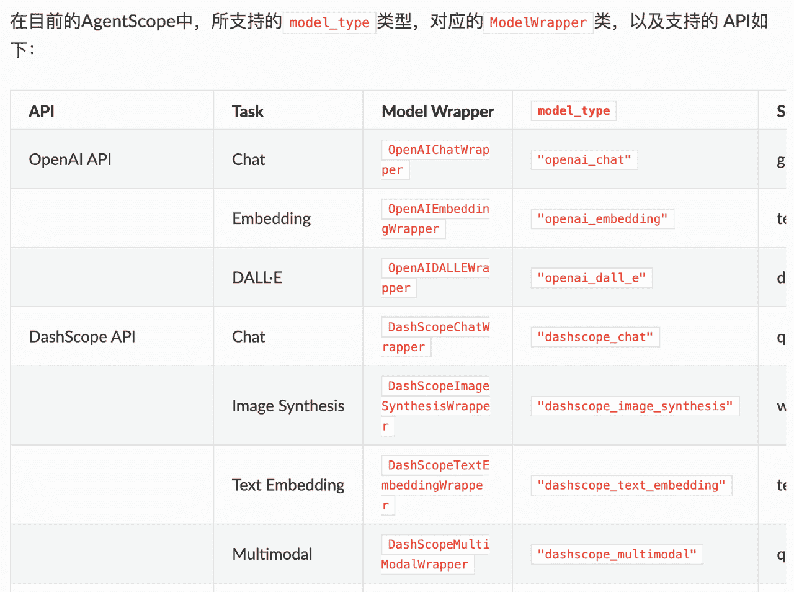
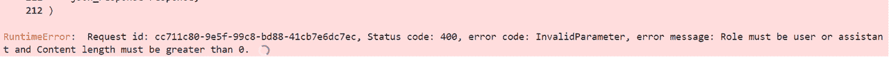
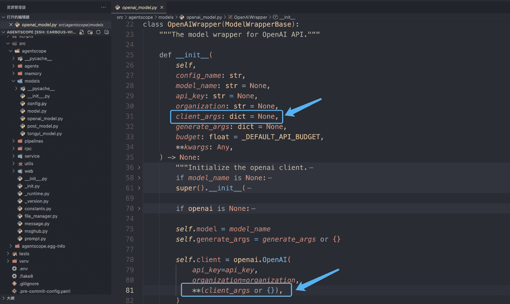

# AgentScope 初探

> 来源：[https://datawhaler.feishu.cn/docx/ONABdU7z9oORIixNm6ScFEifntg](https://datawhaler.feishu.cn/docx/ONABdU7z9oORIixNm6ScFEifntg)

<https://datawhaler.feishu.cn/sync/FsXmd9Oifs2Jx4bq3CCcPXE8npg>

<https://datawhaler.feishu.cn/sync/LWcAdh71VsldyGbpJRecSVeNnk8>

> 本文档由  、 写作，感谢优秀的学习者为我们分享经验~

# 环境配置

## 安装AgentScope

详见[官方文档](https://modelscope.github.io/agentscope/zh_CN/tutorial/102-installation.html#installation-zh)

+   源码安装

**源码安装可**以体验较新的功能（比如：适配通义api）

```
# 从GitHub上拉取AgentScope的源代码
git clone https://github.com/modelscope/agentscope.git
cd AgentScope

# 针对本地化的multi-agent应用
pip install -e .
```

+   pip安装

注意：这个方法确实会很方便，但建议用git下载源码，通过源码安装最新版agentscope

```
# 针对本地化的multi-agent应用
pip install agentscope
```

## 配置model_config

### model_config中的参数

> 使用多智能体框架AgentScope制作应用，需要配置model_config，即模型的配置，以方便后续设计Agent时使用对应模型，model_config中的参数如下：

model_type：对应ModelWrapper的类型，不同model_type需要填的model_config内容不同

+   有固定的几个type，支持的API列表可见[官方文档](https://modelscope.github.io/agentscope/zh_CN/tutorial/203-model.html#model-zh)。



+   举例：如果model_type为openai，那么它内部会找到agentscope\src\agentscope\models\openai_model.py文件里面的class。具体实现可以看源码。

config_name：相当于自己定义的一个配置的名字

+   **后面设置Agent的****model_confi****g**_name会与model进行绑定。

model_name：使用模型的名称

api_key：调用模型API服务的秘钥，需要去对应的平台申请。

### 大模型的配置

+   [**通义千问**](https://dashscope.console.aliyun.com/)

```
import agentsc**ope**

agentscope.init(
    model_configs={
        &quot;model_type&quot;: &quot;dashscope_chat&quot;,
        &quot;config_name&quot;: &quot;qwen&quot;,
        &quot;model_name&quot;: &quot;qwen-max&quot;,
        &quot;api_key&quot;: &quot;sk-&quot;,
        &quot;generate_args&quot;: {
            &quot;temperature&quot;: 0.5
        }
    }
)
```

> 03-14更新的最新版本代码中运行dashscope中的模**型**可能会出现如下问题，官方给出的回复是：这个问题是因为qwen对role的顺序要求导致的，目前我们正在尝试从prompt组织层面解决，估计近期能出一个初步的解决方案。



+   [**OpenAI**](https://platform.openai.com/)

```
import agentscope

agentscope.init(
    model_configs={
        &quot;model_type&quot;: &quot;openai&quot;,
        &quot;config_name&quot;: &quot;gpt4&quot;,
        &quot;model_name&quot;: &quot;gpt-4&quot;,
        &quot;api_key&quot;: &quot;sk-&quot;,
        &quot;generate_args&quot;: {
            &quot;temperature&quot;: 0.5
        }
    }
)
```

+   [**月之暗面**](https://platform.moonshot.cn/)



我们可以看到源码里面含有这个参数client_args，即OpenAI函数的额外参数（如：base_url等）。

因为月之暗面和deepseek是使用OpenAI类来调用的，所以我们可以通过OpenAI类调用他们的模型。


```
import agentscope

agentscope.init(
    model_configs={
        &quot;model_type&quot;: &quot;openai&quot;,
        &quot;config_name&quot;: &quot;moonshot&quot;,
        &quot;model_name&quot;: &quot;moonshot-v1-8k&quot;,
        &quot;api_key&quot;: &quot;sk-&quot;,
        &quot;generate_args&quot;: {
            &quot;temperature&quot;: 0.5
        },
        &quot;client_args&quot;: {
            &quot;base_url&quot;: &quot;https://api.moonshot.cn/v1&quot;
        }
    }
)
```

+   [**deepseek**](https://platform.deepseek.com/)

```
import agentscope

agentscope.init(
    model_configs={
        &quot;model_type&quot;: &quot;openai&quot;,
        &quot;config_name&quot;: &quot;deepseek&quot;,
        &quot;model_name&quot;: &quot;deepseek-chat&quot;,
        &quot;api_key&quot;: &quot;sk-&quot;,
        &quot;generate_args&quot;: {
            &quot;temperature&quot;: 0.5
        },
        &quot;client_args&quot;: {
            &quot;base_url&quot;: &quot;https://api.deepseek.com/v1&quot;
        }
    }
)
```

+   [官方文档](https://modelscope.github.io/agentscope/zh_CN/tutorial/203-model.html#id4)中给出了：**OpenAI API、DashScope API、Gemini API、Ollama API、**Post Request API、Post Request Chat API 六种配置示例

### 通过model_configs.json初始化agentscope

model_configs.json文件

```
[
    {
        &quot;model_type&quot;: &quot;dashscope_chat&quot;,
        &quot;config_name&quot;: &quot;qwen&quot;,
        &quot;model_name&quot;: &quot;qwen-72b-chat&quot;,
        &quot;api_key&quot;: &quot;sk-&quot;,
        &quot;generate_args&quot;: {
            &quot;temperature&quot;: 0.5
        }
    },
    {
        &quot;model_type&quot;: &quot;openai&quot;,
        &quot;config_name&quot;: &quot;deepseek&quot;,
        &quot;model_name&quot;: &quot;deepseek-chat&quot;,
        &quot;api_key&quot;: &quot;sk-&quot;,
        &quot;generate_args&quot;: {
            &quot;temperature&quot;: 0.5
        },
        &quot;client_args&quot;: {
            &quot;base_url&quot;: &quot;https://api.deepseek.com/v1&quot;
        }
    },
    {
        &quot;model_type&quot;: &quot;openai&quot;,
        &quot;config_name&quot;: &quot;gpt-3.5&quot;,
        &quot;model_name&quot;: &quot;gpt-3.5-turbo-0125&quot;,
        &quot;api_key&quot;: &quot;sk-&quot;,
        &quot;generate_args&quot;: {
            &quot;temperature&quot;: 0.5 
        }
    }
]
```

```
import agentscope

# 初始化了多个大模型
agentscope.init(
    model_configs=&quot;./model_configs.json&quot;
)
```

+   零一万物

+   Yi Model API 与 OpenAI API 完全兼容，你只需修改少量代码，可以平滑迁移。

+   注册和api-token使用地址： https://platform.lingyiwanwu.com/

+   参见openai的调用模式--待联调

## 配置agent_config

### 直接定义一个对话agent（DialogAgent）

```
from agentscope.agents import DialogAgent
import agentscope

# 初始化了多个大模型
agentscope.init(
    model_configs=&quot;./model_configs.json&quot;
)

# 使用qwen大模型初始化一个对话agent
dialog_agent_qwen = DialogAgent(
    name=&quot;Assistant_qwen&quot;,
    sys_prompt=&quot;You&#x27;re a helpful assistant.&quot;,  # sys_prompt可以自行定义，不能为空
    model_config_name=&quot;qwen&quot;,  # 这里的qwen和前面的model_config.json文件中的config_name要一一对应，否则Agent找不到大模型会报错
)

# 使用deepseek大模型初始化一个对话agent
dialog_agent_deepseek = DialogAgent(
    name=&quot;Assistant_deepseek&quot;,
    sys_prompt=&quot;You&#x27;re a helpful assistant.&quot;,
    model_config_name=&quot;deepseek&quot;,
)

# 使用gpt-3.5大模型初始化一个对话agent
dialog_agent_gpt = DialogAgent(
    name=&quot;Assistant_deepseek&quot;,
    sys_prompt=&quot;You&#x27;re a helpful assistant.&quot;,
    model_config_name=&quot;gpt-3.5&quot;,
)

# 简单实用 可以当作一个api
from agentscope.message import Msg

msg = Msg(name = &quot;贾维斯&quot;,content = &quot;你好&quot;)

dialog_agent_deepseek (msg)
dialog_agent_gpt(msg)
```

### 通过配置文件创建多个Agent

agent_configs.json

**参数**

+   **class：**用来设置你要创建一个什么类型的Agent

+   **args：**class的参数

```
[
    {
        &quot;class&quot;: &quot;DialogAgent&quot;,
        &quot;args&quot;: {
            &quot;name&quot;: &quot;Assistant_qwen&quot;,
            &quot;sys_prompt&quot;: &quot;You&#x27;re a helpful assistant.&quot;,
            &quot;model_config_name&quot;: &quot;qwen&quot;,
            &quot;use_memory&quot;: true
        }
    },
    {
        &quot;class&quot;: &quot;DialogAgent&quot;,
        &quot;args&quot;: {
            &quot;name&quot;: &quot;Assistant_deepseek&quot;,
            &quot;sys_prompt&quot;: &quot;You&#x27;re a helpful assistant.&quot;,
            &quot;model_config_name&quot;: &quot;deepseek&quot;,
            &quot;use_memory&quot;: true
        }
    },
    {
        &quot;class&quot;: &quot;DialogAgent&quot;,
        &quot;args&quot;: {
            &quot;name&quot;: &quot;Assistant_gpt&quot;,
            &quot;sys_prompt&quot;: &quot;You&#x27;re a helpful assistant.&quot;,
            &quot;model_config_name&quot;: &quot;gpt-3.5&quot;,
            &quot;use_memory&quot;: true
        }
    }
]
```

```
import agentscope

# 初始化了多个大模型和多个Agent
agents = agentscope.init(
    model_configs=&quot;./model_configs.json&quot;,  # 前面创建的model_configs.json文件
    agent_configs=&quot;./agent_configs.json&quot;,
)


# 对应配置文件agent_configs.json中的顺序
dialog_agent_qwen = agents[0]
dialog_agent_deepseek = agents[1]
dialog_agent_gpt = agents[2]
```

## Agent之间相互对话

### Pipeline 方式（按顺序一个接着一个讨论）

下面我们来举一个成语接龙的简单例子。

```
[
    {
        &quot;class&quot;: &quot;DialogAgent&quot;,
        &quot;args&quot;: {
            &quot;name&quot;: &quot;player_qwen&quot;,
            &quot;sys_prompt&quot;: &quot;作为成语接龙的参与者，您的任务是根据前一个玩家提供的成语的最后一个字来提出一个新的成语。限制：你仅需说出一个四字中文成语，其他的话不需要说；请确保您的成语是四字成语。&quot;,
            &quot;model_config_name&quot;: &quot;qwen&quot;,
            &quot;use_memory&quot;: true
        }
    },
    {
        &quot;class&quot;: &quot;DialogAgent&quot;,
        &quot;args&quot;: {
            &quot;name&quot;: &quot;player_deepseek&quot;,
            &quot;sys_prompt&quot;: &quot;作为成语接龙的参与者，您的任务是根据前一个玩家提供的成语的最后一个字来提出一个新的成语。限制：你仅需说出一个四字中文成语，其他的话不需要说；请确保您的成语是四字成语。&quot;,
            &quot;model_config_name&quot;: &quot;deepseek&quot;,
            &quot;use_memory&quot;: true
        }
    },
    {
        &quot;class&quot;: &quot;DialogAgent&quot;,
        &quot;args&quot;: {
            &quot;name&quot;: &quot;player_gpt&quot;,
            &quot;sys_prompt&quot;: &quot;作为成语接龙的参与者，您的任务是根据前一个玩家提供的成语的最后一个字来提出一个新的成语。限制：你仅需说出一个四字中文成语，其他的话不需要说；请确保您的成语是四字成语。&quot;,
            &quot;model_config_name&quot;: &quot;gpt-3.5&quot;,
            &quot;use_memory&quot;: true
        }
    }
]
```

```
import agentscope
from agentscope.pipelines import SequentialPipeline
from agentscope.message import Msg

# 初始化了多个大模型和多个Agent
agents = agentscope.init(
    model_configs=&quot;./model_configs.json&quot;,  # 前面创建的model_configs.json文件
    agent_configs=&quot;./agent_configs.json&quot;,
)

# 对应配置文件agent_configs.json中的顺序
player_agent_qwen = agents[0]
player_agent_deepseek = agents[1]
player_agent_gpt = agents[2]

# 创建一个SequentialPipeline
pipe = SequentialPipeline([player_agent_qwen, 
                           player_agent_deepseek, 
                           player_agent_gpt])

msg = Msg(&quot;Moderator&quot;, &quot;游戏规则：请回答一个四字中文成语，不要添加其他文字。请按规则接龙。本轮成语接龙起始词为「水落石出」&quot;)

# 启动Pipeline
pipe(msg)
```


### MsgHub 方式（群聊讨论）

初始化四个agent

```
import a**g**entsc**o**pe**
**from agents**c**ope.pipe**l**ines** **import Seque**n**tial**P**ip**e**line
f**r**om agentscop**e**.message i**m**po**r****t** Msg


agent**_****c**on**f**igs **=** [
    {
   ** **    &quot;class**&quot;**: &quot;Dialo**g**Agent**&quot;**,
** **       &quot;arg**s**&quot;: {
   ** **    ** **   &quot;name&quot;: &quot;**a**gent**1**&quot;,**
**      ** **     &quot;sys_pr**o**mpt&quot;: &quot;你是一**个**得力**帮**手,**你**是agent1。&quot;,
 ** **** **  ** **    ** ** &quot;model_conf**i**g_name&quot;: &quot;**q**wen&quot;,
  ** **     ** **  ** **&quot;use_memory**&quot;**: True
 ** **    ** ** }
    },
  ** ** {
 ** **  ** **   &quot;cl**a**ss&quot;: &quot;Dialog**A**gent&quot;,
   ** **  ** ** &quot;**a**rgs&quot;: {
    ** **** **  ** **   &quot;**n**ame&quot;: &quot;agent**2**&quot;,
       ** **    &quot;sys**_**promp**t**&quot;:** **&quot;你是一个得力帮手,你**是**agent2。&quot;**,**
   ** **        &quot;mod**e**l_co**n**fi**g**_name&quot;**:** &quot;qwen&quot;,
   ** **        &quot;u**s**e_**m****e**mory&quot;: True
** **** **  ** **   }**
**    },
    {**
**        &quot;c**l**ass&quot;: &quot;D**i**alogA**g**en**t**&quot;,
        **&quot;**args&quot;: {**
**    ** **       &quot;name**&quot;**: &quot;a**g**en**t**3&quot;,
     ** **      &quot;sys_p**r**ompt&quot;: &quot;你是**一**个得**力****帮**手,你是agent3。&quot;**,****
**  ** **    ** **    &quot;model_c**o**nfig_name&quot;**:** &quot;qwen&quot;,
            &quot;use_memory&quot;: True
        }
    },
    {
        &quot;class&quot;: &quot;DialogAgent&quot;,
        &quot;args&quot;: {
            &quot;name&quot;: &quot;agent4&quot;,
            &quot;sys_prompt&quot;: &quot;你是一个得力帮手，你是agent4。&quot;,
            &quot;model_config_name&quot;: &quot;qwen&quot;,
            &quot;use_memory&quot;: True
        }
    },
    {
        &quot;class&quot;: &quot;DialogAgent&quot;,
        &quot;args&quot;: {
            &quot;name&quot;: &quot;HostAgent&quot;,
            &quot;sys_prompt&quot;: &quot;你是一个主持agent，需要做一个决策。除了决策外不要输出任何东西。&quot;,
            &quot;model_config_name&quot;: &quot;qwen&quot;,
            &quot;use_memory&quot;: True
        }
    }
]
# 初始化了多个大模型和多个Agent
agents = agentscope.init(
    model_configs=&quot;./model_configs.json&quot;,  # 前面创建的model_configs.json文件
    agent_configs=agent_configs,
)

agent1  = agents[0]
agent2  = agents[1]
agent3  = agents[2]
agent4  = agents[3]
```

四类通讯方式：

```
**from age**ntscope.me**s**sage i**m**p**o**rt Msg**
**
msg = Msg(**n**ame = **&quot;**贾**维**斯&quot;,c**o**ntent = &quot;请带**上**自己**的****名字进行传话，****传**话内容“你好**”**&quot;**)**
# 顺序执行
msg = agen**t**1(m**s**g)
pri**n**t(msg)
msg = ag**e**nt2(ms**g**)**
****p**rint(msg)
ms**g** =** **agen**t**3(**m****sg)
pr****i**nt(msg**)**
**m**sg = agent4(msg)**
**print(msg)

##{**…**…&#x27;name**&#x27;**:** **&#x27;agent1&#x27;,&#x27;conte**n**t&#x27;: &#x27;我是**来**自阿里云的超**大**规模语言模型，我的名字是通义千问。现在帮您传话：“你好”&#x27;}
##{……&#x27;name&#x27;: &#x27;agent2&#x27;,&#x27;content&#x27;: &#x27;您好！我是通义千问，来自阿里云的超大规模语言模型，很高兴为您服务，并向您问候：“你好”。&#x27;}
##{……&#x27;name&#x27;: &#x27;agent3&#x27;,&#x27;content&#x27;: &#x27;您好！作为阿里云的超大规模语言模型通义千问，我非常荣幸能与您交流并提供服务。同样向您致以亲切的问候：“你好”！&#x27;}
##{…… &#x27;name&#x27;: &#x27;agent4&#x27;, &#x27;content&#x27;: &#x27;您好！非常高兴能与您交流互动。作为阿里云的超大规模语言模型通义千问，我的确具备强大的自然语言处理能力，可以为您提供广泛的知识问答、技术咨询、场景应用等各类服务。请随时告诉我您需要了解的内容或遇到的问题，我会全力以赴为您提供帮助！&#x27;}


# loop情况
msg = Msg(&quot;system&quot;,&quot;选择是否退出&quot;)
msg1 = Msg(&quot;system&quot;,&quot;none&quot;)
def ifBreak(msg):
    return &quot;退出&quot; not in msg.content
while ifBreak(msg1):
    msg1 = hostAgent(msg)
    print(msg1.content)
    msg = agent1(msg)
    print(msg.content)
    msg = agent2(msg)
    print(msg.content)


# 选择情况 
msg = hostAgent(Msg(&quot;system&quot;,&quot;agent1 和 agent2 应该选择谁退出？我建议 agent1 退出。&quot;))
print(msg)
if &quot;agent1&quot; in msg.content :
    msg = agent1(msg)
else:
    msg = agent2(msg)
print(msg)
    

msg_send = Msg(&quot;system&quot;,&quot;重新选择退出或继续运行，你只需要回答肯定的指令&quot;)

def ifBreak(msg):
    return (&quot;退出&quot; or &quot;结束&quot;) not in msg.content
# 复杂形势
msg = hostAgent(msg_send)
print(msg)
while ifBreak(msg):
    msg1 = hostAgent(Msg(&quot;system&quot;,&quot;agent1 和 agent2 应该选择谁发言？，你只需要回答是谁的名字&quot;))
    msg2 = Msg(&quot;system&quot;,&quot;请发言，发言后请告诉主持人退出&quot;)

    if &quot;agent1&quot; in msg1.content :
        msg2 = agent1(msg2)
    else:
        msg2 = agent2(msg2)
    print(msg2)
    msg = hostAgent(msg_send)
    print(msg)
```

## tool配置

第二课中web_search模拟配置

```
def web_search(query: str,engine: str,api_key: str,num_results: int = 10):
    &#x27;&#x27;&#x27;
    The web search function
    Args:
        query(&#x27;str`):
            The search query string.
        engine(&#x27;str&#x27;):
            The search engine to use(&quot;bing&quot; or &quot;google&quot;).
        api key(`str):
            API key for web searching.
        num results(int`):
            The number of searching results.
    &#x27;&#x27;&#x27;
    print(f&quot;Calling web_sarch function with query  \&quot;{query}\&quot;&quot;)
```

```
from agentscope.service.service_factory import ServiceFactory
# ServiceFactory 写法有改变
!pip install docstring_parser
# 如果报错可能没有这个库  请执行上面这句

# 初始化ServiceFactory
func,func_json = ServiceFactory.get(web_search,engine = &quot;bing&quot;, api_key = &quot;123123&quot;,num_results= 3)


import json
print(json.dumps(func_json,indent=4))

# 打印一下func_json 看看效果吧
{
    &quot;type&quot;: &quot;function&quot;,
    &quot;function&quot;: {
        &quot;name&quot;: &quot;web_search&quot;,
        &quot;description&quot;: &quot;The web search function&quot;,
        &quot;parameters&quot;: {
            &quot;type&quot;: &quot;object&quot;,
            &quot;properties&quot;: {
                &quot;query&quot;: {
                    &quot;type&quot;: &quot;string&quot;,
                    &quot;description&quot;: &quot;The search query string.&quot;
                }
            },
            &quot;required&quot;: [
                &quot;query&quot;
            ]
        }
    }
}
```

采用上述配置方法可以灵活创建属于你的tool，注意注释内容必须按照规范格式书写。

## 分布式通信

## 项目初探（狼人杀）

> werewolf中文版


[werewolf_zh.zip](https://internal-api-drive-stream.feishu.cn/space/api/box/stream/download/all/SFsebzc1Vo99cRxWvmMcvrFonkf)