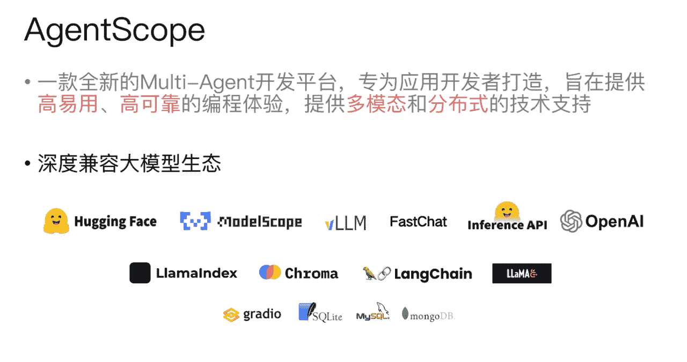

# 组队学习记忆

> 来源：[https://datawhaler.feishu.cn/docx/A2QqdrQlRowJ2HxPhf9cSvsLnAb](https://datawhaler.feishu.cn/docx/A2QqdrQlRowJ2HxPhf9cSvsLnAb)
<https://datawhaler.feishu.cn/sync/FsXmd9Oifs2Jx4bq3CCcPXE8npg>

> 欢迎来到《从零开始学多智能体应用开发》课程 共创笔记板块！
> 在这个文档中，我们将共同整理和总结学习过程中的重点内容、问题和解答。
> 欢迎随时分享你的笔记和心得，我们一起完善这份笔记！
> 通过共同创作，我们将建立起一份全面、实用的实战笔记，
> 帮助到更多的学习者进行相关学习和实践，以及迭代优化开源项目！
> 欢迎大家共同编写此文档，你的任何一小段的尝试和思考都有其参考价值和独特的意义！
> 此文档的内容完全开源，可基于此文档进行二创
>
> 感谢答疑的讲师—— @李子韬、@邝炜瑞、@高大伟、@潘叙辰
> 感谢积极学习答疑的优秀助教/学习者—— @无缺

<https://datawhaler.feishu.cn/sync/WfPJdTkREs3I0XbeTSrcOM3CnPh>

### 分享 & 讨论 可参考如下话题：

1. ⚙ 技术概念解析
1. 🎥 直播笔记
1. 📒 优秀笔记
1. 💓 学习感悟
1. ❓ 学习过程中的QA

## [组队学习攻略](https://datawhaler.feishu.cn/wiki/YWN9wvCkriEZZFkhFcccwCMMnEd)

<https://datawhaler.feishu.cn/sync/FoMhdsTAzsnHyPbfoMlckpltnmb>

## 贡献者清单

| 角色 | 姓名 |
| --- | --- |
| 课程设计者 | 通义实验室算法团队：李子韬、高大伟、潘叙辰、邝炜瑞 讲师天团 |
| 运营助教 | 杨飞凡、Amy、水琼 |
| 专业助教 | 高立业、刘伟鸿、王泽宇、赵文恺、魏宇昕、许亚军 |
| 优秀学习者 | 王熠明、黄定华、刘威、 |

## 推荐阅读已有教程/经验文档

## AgentScope简介

<https://datawhaler.feishu.cn/sync/Oo4nd6BMNsyxZPbDPb4cY8bSn1d>

## ❓ QA板块

> 此处收集直播以及学习群交流的相关问题的解答，鼓励大家共创QA板块，并基于QA板块输出自己的学习笔记等，`Ctrl + F` 一下，会发现很多惊喜哟~

### AgentScope框架功能

1. `Multi-Agent`如何实现`agent`之间的交流？能否通过特征向量交流？

> 在`AgentScope`中，`Message`是`Agent`之间的桥梁，它是一个`python`字典（`dict`），包含两个必要字段`name`和`content`，以及一个可选字段`url`用于本地文件（图片、视频或音频）或网络链接。
>
> 换言之，`agent`间特征向量你可以放在`content`或者`url`中，只要通信的`Agent`能理解，应该就是可以的。

1. `AgentScope`框架支持哪些模型？

+ 框架是独立于模型的。
+ 只要有一个模型，跑在一些能够接收`POST API`的一个端口上面，通过`POST API`发送消息，然后让端口后面的模型来进行处理。
+ 现在除了`OpenAI`之外，也会兼容像`通义`和阿里的这边的`DashScope`。

1. `AgentScope`如何使用`通义千问`模型？如何使用其它国内外的大语言模型的`API`？



> `AgentScope`支持 `openai` 和 `post request api` 两种模式，只要写好对应的配置文件，就可以加载使用，详见 `README`，支持的 `API` 列表在文档中也有提到。
>
> 更多使用详情，可见由  写作的经验文章：[《AgentScope初探》](https://datawhaler.feishu.cn/wiki/KoF9wN0ksiUw8okHeAWczrWFnH5#YHv5dAO9qonR0TxuGhdc98gFnqb)

1. 目前源码编译版本已经支持千问的`API`版本


> 可以直接使用千问`API`版本，但要使用源码编译，`pip`下载的发布版本还没有这个功能。
>
> 更多详见：https://modelscope.github.io/agentscope/zh_CN/tutorial_zh/102-installation.html

```
# model_name可以根据https://dashscope.console.aliyun.com/billing选择免费的模型
# api_key需要申请

agent_scope.init(
    model_configs=[
        {
            "model_type": "tongyi_chat",
            "config_name": "qwen",
            "model_name": "qwen-72b-chat", 
            "api_key": "xxx",
            "generate_args": {
                "temperature": 0.5,
            }
        }
    ]
)
```

1. 另外其他大模型`API`均可使用`post request API`的模式进行调用

1. `AgentScope`目前支持哪些工具？和单`Agent`框架支持的工具有什么区别呢？

> `Agent Scope`目前支持的工具有：数据库查询处理、网络搜索、一般性质的文件操作、`retrieval`和`summarizing`，详见 https://modelscope.github.io/agentscope/zh_CN/agentscope.service.html，或直接在源码的`src\services`目录查看最新支持情况。
>
> + `function`调用还是在规划当中。通过大模型来实现暂时还没有特别好的支持。但是已经在短期规划之中。
> + 短期有一个规划，就是会把一个叫做`react`的一个`Multi-Agent`的一个框架来接入进来。`react`：让每个`agent`可以先根据他的`observation`（观察或输入）来进行一个思考。然后根据他的思考，再产生一个输出，然后再根据他的输出去观察到新的一个环境的变化，然后再进行思考输出。
>
> 大部分单`Agent`框架（`ModelScope-Agent`）支持的工具都已支持，工具数量会持续增加，用户也可以自己开发`service function`，嵌入到`Agent Scope`中使用。


1. 使用模型`API`有每分钟`token`数限制（`TPM`），如何修改配置使得`agent`在运行时调用`api` `token`速率控制在我想要的范围内？

> 可以修改`constant.py`的`_DEFAULT_RETRY_INTERVAL`参数，这个参数是用于控制`openai`限速报错的重试间隔秒数（`interval * failed_time`）的。

1. `multi-agent`提示词应该如何去设计呢？

> 不同的模型其实有不同的提示词的策略。
>
> 自己在实验的时候也可以看到，
>
> + 并不是所有的模型其实都是针对`muti-agent`这样一个场景设计的，
> + 尤其是有一些模型可能还需要我们自己去组织`prompt`的形式，
> + 有些模型可能只支持`user`跟`agent`的对话，并不支持让`agent`或者是让`user` 去扮演不同的一个角色，多角色进行对话。
>
> 在这种情况下，我们要对模型的 `prompt`做一些特殊的处理。
>
> 在`agentscope`里有两个方面的支持：
>
> + 一方面我们尝试引进一个关于`prompt engineering`的功能，帮助用户把不同的`message`、字符串，还有`system prompt`等信息，组合在一起。
>
> 但坦白来说， 因为模型非常多，模型适配的`prompt`的格式非常多，要求也不完全一样，所以这方面的话我们更多是把自由度留给`agentscope`的用户。
>
> 也就是说用户可以完全自己设计、掌控`Prompt`处理这一块儿。
>
> + 同时我们也支持开发者引入第三方的库，比如`langchain`以及别的一些工具的库来完成自己的`prompt engineering`。

1. 在`msghub`中，其实是按照我们要求的顺序让那些`agent`进行发言，后续有些什么样的方式能够让他们更主动、自由地发言?

> `agentscope`现在呈现在`example`这个目录下的非常简单的本地化的 `conversation`只是开源的案例的一部分，开发团队 也将在后续加入其他的例子:
>
> + 比如说现在已经在在`PR` 中审阅的一个例子，可以理解成`agent`是主动发言的，或者说是带有一定的"`@`"功能，
>
> 就像我们在🛰️的聊天群组或者钉钉的聊天群组里面，
>
> 我们往往每个人的回话都是自己去決定我要不要在这个时刻进行回话，
>
> 以及还可以"@"某些人，让他们来回答我的这个回话。
>
> **开发团队**也在尝试，利用`agentscope`分布式的功能去主动实现`Agent`的发言决策。
>
> 其实最自然的形式还是每一个`agent`都作为一个独立的个体去思考。
>
> 此时此刻基于现在的这样一个环境情况，应不应该发言，应该进行怎样的一个对话。
>
> **开发团队**正在做这样的一个`example`，也希望很快就把它能够上线到`github` 上。

### AgentScope框架对比

1. `Multi-Agent`与`Agent`相比的具体优势是什么？

1. `Mutli-Agent`和`transformer`的`agent`在实现上的主要区别是什么？

> `Mutli-Agent`更多讲究是`agent`之间的互动。像 `AgentScope` 框架，更多的会关注`agent`之间的互动编排，以及比如说非常天然的适合分布式的场景。这是我们框架一个比较大的亮点。

1. 多领域`agents`很像混合专家，有什么不同吗？

+ 混合专家模型的话，像传统的机器学习里面有多个模型来进行一个综合预测。
+ `Agent`层面来说的话，在增强模型可靠性有一点混合专家的意思。但是它可以是一个多轮的，不停的多个`Agent`之间互相去辩论，更加拟人。
+ 比混合专家模型是更高一层次的一个互动。
+ 着眼点也是不太一样。

1. `Agent Scope`和`Long Graph`有什么区别？

+ `Long Graph`是基于`long ten`的可视化编排界面，类似于可视化编程。
+ `Agent Scope`更侧重于`Martin agent`交流的角度。

1. `AgentScope`框架有哪些优势？

+ 框架易用性主要体现在引入一些语法糖。会帮助开发者能以更简洁的代码更快速地去编排整个`Multi-Agent`的应用。
+ 框架的编程风格是`procedure oriented`（程序导向）的编排风格。可以在主逻辑里面看出不同`agent`之间的执行逻辑。应用的可读性和代码的维护性上会比较有优势。
+ 有一些原生的关于多模态和鲁棒性方面的内容。
+ 一个大亮点就是分布式的支持。使得开发者可以非常简单的从一个中心化的应用，拓展到一个分布式的应用，来进行不同场景的一个优化。

### 容错处理

1. 容错机制设计方面的一些经验分享

+ 关于容错，还有⼀些尝试并不适合融⼊到整个框架中。
+ 比如说我们尝试过一个简单例子，在`agent scope`的`agent`的那个`reply`方式里，在一个`agent`在它产生最后的返回信息之前进行逐步的检查。

这个逐步的检查其实包含了很多层面。

+ 第一层检查是最基础的不应该包含一些攻击性的话语。
+ 第二层的话就是一些语义的必须符合你规定返回的东西：符合现在的一个对话历史以及上下文。
+ 第三层是去检查一些关键字，你的一些特殊要求：
+ 比如说要求返回的是一个`Json`的格式或者是某种格式。
+ 或是一些策略情形的。比如狼人杀的样例，在里面试过，返回每个信息前检查一次这个`agent`到底有没有暴露自己的身份信息。

但是后来我们发现虽然可以通过加这些东西避免一些错误，但是整个`agent`的调用成本上升了，还有就是它的返回速度会非常慢。因为原本可能在一个简单的对话`agent`里面只需要调用你一次模型。但是这样加入大模型进行容错检查的话，模型的调用成本会升的非常高。

1. 容错处理的能力边界在哪里？

> 容错处理的能力依赖于底层使用的模型。
>
> 对于模型能力较强的模型，很多问题可以在中间过程中解决。
>
> 开发过程中遇到的问题包括使用大模型判断语义时结果随机性，以及并发处理多个错误时的效率问题。
>
> 能解决与不能解决，很大程度上依赖于底层的模型。在于使用使用大模型去判断语义的时候，结果可能会随机一点，多个处理时，往往还是会漏到若干个。一部分原因可能由于上下文太长了。

1. 容错机制的耗时情况一般如何？

> 基于规则的容错执行速度快，但基于大模型的容错耗时较长。
>
> 大模型在纠错时耗时增加，`token`消耗也增加。
>
> 期待小模型能完成单一的纠错任务，但目前尚未有专门为此设计的大模型。

### 应用设计

1. 什么才算是多模态应用？

> `Agent Scope`提供了一些多模态的样例，如通过文字生成图片，通过图片和文字配合生成视频。
>
> [谜撰](https://modelscope.cn/studios/AgentScope/find_the_taste/summary)中，有在游戏中输出图片，是多模态应用的一个案例，
>
> 通过上传图片和语音使图片动起来的应用
>
> 创空间里面其实提供了一些多模态的样例，在已`build`好的这个案例里面，其实是包含比如说通过文字生成图片，以及通过文字再去生成，通过图片和文字配合一起配合去产生对应的视频这样的一个多模态的功能。比如：谜传的游戏，它其实就可以输出到图片，其实应该也算是多模态的一种展现形式。

1. 目前`multi agent`的应用是在哪里？是用在游戏里吗？

> 复杂工程、社会模拟等，更多的等你探索！

1. 可以制作🐧机器人吗？

+ 用我们这个框架的话，可以通过三十行代码，就可以非常简单的去搭一个比较简单的聊天机器人。
+ 但如果牵扯到对个人信息做一个归纳总结，安排行程等，要等到`RAG`功能上线之后，才会更简单的去支持这样的应用。

### 参赛相关

1. 参赛一个人可以加入多个组吗？可以提交多个`agent`参赛吗？

> 可以，赛事较为开放，只要参赛者有时间精力即可
>
> 大家可以多多报名，报名链接：

1. 参赛有免费的`token`吗？

<https://datawhaler.feishu.cn/sync/KBlMdwfKEszVjnb🐧YycsinunVe>

### 开发环境

1. 魔搭的`notebook`被拉黑怎么解决？


> 去魔塔钉钉售后群，@技术人员 你的用户名 解除就可以了

1. 笔记本3070可以跑吗？

> 大模型推理直接使用大模型厂商的 `API` 即可，不要求去本地跑任何的大模型，我们可以通过`POST API`的端口去调用。比如说像`DashScope`，它的大模型其实是跑在阿里云的服务器上面的。
>
> 如果想自己本地跑开源模型的话，可以自己尝试去检索哪些可以跑在3070上。

1. [`Mac` 卸载`python`](https://www.sysgeek.cn/macos-uninstall-python/)

### 大模型基座相关

1. 阿里云的灵积平台和百炼平台是什么关系？

> 两款不同的阿里云产品，各有侧重，灵积更侧重模型，百炼更侧重工具链

1. 通义模型的中文能力如何？英文会更好用吗？现在最强的文本的开源模型是什么？

> 通义千问中文英文的能力都还不错。特别推荐最近`DashScope`的一个免费开放的通义`max`接口。
>
> 大家可以自己多去使用，或者看目前比较主流的榜单或者博主的测评；
>
> 只有亲身体验才更有发言权，了解各种大模型的优势和是否合适你的使用场景
>
> 不仅限于开源模型的话，目前`claude3-opus`的最新智力测试达到了`101`分，属于中等智商水平，其余大模型分数大多在其之下；

### AgentScope未来开发计划

1. 讲的功能在代码里都实现了，还是未来的规划？

+ 刚刚在代码里面讲的功能是都已经实现的。
+ 最近会支持除了通过`POST API`端口，直接在本地去调用一些本地跑的大模型。只要大模型有一个本地的接口就可以。
+ 近期内会去推出像是最近比较火的一个`RAG`（`Retrieve Augmented Generation`）的一些功能，去更多的丰富我们这个框架，也争取给开发者带来更多的便利。

1. `Agent Scope`后续的更新有什么规划？

+ `Agent Scope`最近的更新速度较快，例如快速支持了千问的`API`。


`Agent Scope`支持long chain的编排，允许用户引入第三方库。

`Agent Scope`在`GitHub`的`PR`中提供了与long chain结合的样例。

## 其他

1. 不会代码可以开发`agent`吗？有低代码开发途径吗？

> [AgentScope框架有剧本](https://datawhaler.feishu.cn/wiki/N2IowK6YkigGoJkydS8cNWBZnGc#Xg36d1RIqolMkdx9iWGcmJjrnAf)工具的开发者版本，可以 🎮 零代码制作自己的游戏应用

> 另外可以参考[《动手学Agent应用开发》学习手册](https://datawhaler.feishu.cn/wiki/GhOLwvAPkiSWmokjUgqc1eGonDf)，单`Agent`开发框架`AgentFabric`可无[代码构建Ag](https://datawhaler.feishu.cn/wiki/GhOLwvAPkiSWmokjUgqc1eGonDf#CO9odIm9VoNKfCxQsvScOTOvnEZ)ent，具体操作可见其中的 核心必知必会

+ 零代码的话，通过游戏框架去提供比较好玩的剧情，去设计一些这个角色，然后生剧剧情线索和任务，也可以生成一个好玩的小游戏。比如说前段时间比较流行的哄哄女友，包括是糟糕被美女包围。

+ 有代码基础的话，可以基于这个`agent`框架去魔改代码，然后去做其他的，比如说工具的一些应用。

# 待整理

1. 这个分布式设计和`ray`有什么区别？

1. `python`适合做分布式嘛

1. 那在创空间上能用到分布式能力吗

1. `placeholder`那个部分属于异步编程嘛？--

1. 消息会持久化存储嘛，`agent`挂了会有重新拉起的机制嘛

1. 请问`mutiaent`代码及函数和说明书哪里有

1. 那在创空间上能用到分布式能力吗

1. 怎么证明只是跑了一个核

## 【容错机制与构建多模态应用】

1. 内置工具调用会和单`agent`一样多吗?

1. 容错处理机制的能力和边界在哪里？

1. 多模态能力在前端如何展示呢

1. 关于容错的更多经验分享

1. `agentscope`支持`langchain`的`chain`吗？支持编排吗？

1. 现在`agent`的编排逻辑都需要代码的定义，`agent scope`有自动编排的功能吗？类似`autogt`的[Shocked]

1. `Agent` 如何支持多租户的应用？

1. `AgentScope`和`langgraph`有什么区别？

1. 多模态输入可以训练本地大模型吗

1. `agentscope`要求模型支持`function calling`吗？

多模态的能力在前端如何展示？它可能有哪些类型，你有制作过一些多模态的应用的一些经验吗？

1. 目前这种容错机制大致会跟没有容错机制比起来，它的耗时差距大概是多少？

+ 因为首先第一点是基于规则的。一般情况下基于规则的这样一个容错其实并不是耗时很长的。代码执行层面的速度还比较快。

+ 主要的耗费还是在于基于大模型的容错上。耗时会增加，消耗的`tokens`数也是成倍的在增长。尤其是如果是基于大模型再去纠错。如果有小的模型能够完成这种单一的纠错任务更好，但目前还没有合适的模块。

1. `agent scope`支持`langchain`支持编排吗？

+ 是的，是这样`agent scope`跟其他的库结合其实是可以分多种方式的。`agent scope`里面的`agent`，它内部的实现逻辑可以完全用别的库。比如说`reply function`里面，关于记忆管理，关于`prompt`的处理，关于最后`message`的生成。其实整个过程不一定完全要用`agent scope`里面的东西。允许用户去引进第三方库。正在构建一个`langchain`跟`agentscope`结合的一个样例。

1. 现在`agent`的编排逻辑都需要代码的定义。有自动编排的功能吗？

+ 是的。比如角色的自动编排。有一个`agent builder`的例子。在这个例子里面，其实每一个`agent`扮演的角色以及他的职责，其实都是由另一个`agent`来指定的。比如说我们叫中心化的`agent`叫`host agent`。其他`agent`的角色，还有他们的目标，其实都由其他`host agent`来决定。

+ 第二种就是刚才说的编排的这个问题。其实我理解这里的编排一个是执行计划的`plan`，另一个就是交流的顺序。关于交流的顺序，其实我们现在正在审核一个`PR`，这个`PR`里面包含了一个样例。这个样例就是说我们在一个多人对话的情况下，每一个`agent`都是由自己来决定要不要进行发言。这里的`agent`就是具备两个功能。一个功能是它会自己去检查自己当前时刻是否应该进行发言。第二个在🛰️或者在钉钉里面聊天的`at`的功能。也就是说谁艾特另一个人，可能另一个人才会出来回话，就同时支持了这两个`feature`。

目前`agentcope`框架要求使用的模型支持`function call`吗？

+ 是这样，比如说像`openAI`、`google`提供的原生`API`里面就本身有`tools`接口。我们只要把符合它规定格式的一个方式，输入的时候还是一个`Json schema`格式的一个函数说明。主要把这个函数说明放到`tools`这样的关键字下面。对`OpenAI`这样的一个接口来说，他们那边的大模型就可以调用这个函数。对，这个是首先是原生的`API`的一个支持角度。

+ `agent scope`，提供了`switch factory`这样的一个功能，自动的把函数转换成`json schema`的格式。

+ 对于自己的大模型，可能并没有原生的这样的接口支持。就需要`prompt engineering`。比如说我们给他一个工具的描述，然后让他再约定一下。比如说你如果要调用工具的话，应该怎么样调用，返回的格式应该是什么样子？对这部分工作可能就需要开发者自己去负责这部分对。

1. `agent scope`和`longgraph`有什么区别？

+ `Longgraph`是一个可视化编排的界面。

+ `agent scope`这边更侧重于`multi-agent`交流。

1. 这个分布式设计和`ray`有什么区别？

+ `ray`是机器学习中一个常用的分布式框架。主要是面向模型训练，或者是涉及数据处理相关的工作。并没有先天向这个场景提供支持。

+ `agent scope`主要是面向的`agents`级别的交互和编排。提供一种尽可能简单的方式，把分布式做的跟单机模式一样。虽然号称是分布式，但是编码上实际上是完全可以用单机的思路来写。

1. 在设计上会有一些什么样的差异呢？

+ 分布式正常情况下，首先是需要考虑通信，任务的调度，以及中间可能涉及到竞争，冲突这些问题。这些问题`agent scope`都尽可能封装掉了。尽可能把分布式这部分对用户来透明化。让用户不需要去了解分布式的细节，也可以做到分布式。

+ 当然分布式的优点其尽可能提升速度，比如说单机跑，`python`是问题比较严重的。`Python`因为有一个叫全局锁的东西，严格来说只能利用单核的资源，导致只能跑满一个`CPU`。

+ 我们这个分布式点严格来说叫多进程，能尽可能利用更多的计算资源，甚至单机分布式的情况，单机的核就全跑满了。觉得单机的核还不够用，可以多机继续跑。

1. 要学习分布式的开发的话，究竟有多麻烦。

+ 多进程应该是计算机专业的一个是所谓的并发编程，这是一门基础课。它有各种冲突，什么顺序？两个操作稍微倒一下顺序就会出现错误。涉及到数据库里面就会有事务，再往上还会有一些分布式的共识协议，比较常见的像`zookeeper ECD`。又有很深的这些各种协议。

+ 但是对于我们`agent scope`来说的话，尽可能想给提供一套，用户完全不需要了解这些，假设只写过`python`，正常的有`C`语言的入门基础就能拿到，就能写`agent scope`，并且把它扩展到分布式的场景上。

`python`只能跑在只能用一个核。这个的话有什么实验是可以去可视化的看到这种效果的吗？

+ 严格来说不适合，`Python`本身的一个全局锁，限制了非常多的功能。导致单独起的一个`python`进程，完全不去调用其它库的话，严格来说只能跑满一个`CPU`。虽然能起很多线程，但实际上它也只能跑在一个`CPU`上。

+ 像`python`的异步编程，严格来说也是基于多线程的，所以也只能跑满一个核。这也是导致现在的大部分的`agent`的框架，不管是用单一`agent`的还是多`agent`，他们虽然用了异步，但是他们本身的代码是只能跑在一个`CPU`上的。比如说现在大部分用户`CPU`可能都十六核，也只能跑到一个核。

1. `agent scope`这个框架的话可以做到分布式么？

+ 是的。那个多进程的`search`。同时开了很多的去爬网页，但是如果相当于起一个进程去跑的话，虽然可以通过异步的方式来避免爬取网页的延迟。但是对网页的清洗，提取桌面信息这部分还是需要用`CPU`去计算的。所以这个不能加速，还是可以通过多进程合并的情况下拿到。

1. 在创空间上面可以用到分布式的能力吗？

+ 可以的，创空间上可以使用单机多多进程的模式，例如例子中`search`的模式，但辩论会那个模式不可以，因为辩论会需要单独去在不同的机子上起这个`server`，创空间只有一个端口。但是单机多进程的加速还是可以达到加速效果。

+ 因为现在的分布式版本主要提供了对`reply`和`observe`这两个关键方法来提供支持。其他方法需要自己编写，后续会支持。

1. `placeholder`那个部分属于异步编程吗？

+ 对，严格来说`placeholder`后边那部分的实现，实际上就是异步的一种实现方式。虽然没有用异步编程，但是实际上是用`python`写了一套类似于异步编程的效果。

1. 异步效果是怎么样去定义的？为什么它能够达到这个效果呢？

+ 异步编程就是，你提出了一个任务，然后你去做别的事儿了。然后你相当于过一段时间来看这个任务完成了没有，不会阻塞掉了。而`placeholder`其中其实就是提供了这么一层抽象。

1. 消息会持久化存储吗？`Agent`挂了之后会有重新拉起的机制吗？

+ 这部分目前还没有实现。目前主要的场景还是单机多进程这种，快速起一堆`agent`的同时去处理一批任务这种场景。后续会引入数据库的持久化。

1. 请问`multi agent`代码及函数和说明书哪里有？

+ 可以看一下仓库的`example`，`example`部分的`distributed`文件夹下提供了两个例子，

+ 一个是分布式的对话，一对一的对话。`user`和`assistant`可以运行在两台不同的机器上。

+ 第二个例子其实就是分布式的辩论会的例子。这个辩论会有三个参与方，然后正方和反方都可以选择，是以用户本身去参与，或者是让一个大模型来参与。

`python`只能跑在只能用一个核。这个的话有什么实验是可以去可视化的看到这种效果的吗？

+ `python`的`GIL`。是`python`广受诟病的一个功能，但是它也带来了很多好处，之所以`python`现在能这么简单，写起来这么简单，也是因为它这是个双刃剑。当然`python`也可以通过调一些库的方式。比如说`python`的本身是只能跑满一个核的，可以调一个`C++`库，把整个`CPU`的资源全部吃完，那我也可以做到很好的速度。这个其实是现在的各种训练框架，虽然它顶层是`python`，但底层调用的肯定也不是`python`。

1. `agent scope`这个框架，跟其他的多智能体框架比起来有什么样的优势呢？

+ 易用性。

+ 从使用方式上，是一个类似`python`的面向过程的编程方式。

+ 不同模块组合的灵活性上。市面上别的一种框架，可能要写很多代码，在这边拿出我们的一个`example`，稍微魔改一下，或者是简单的换一下模型，或者是换一些`prompt`，它也可以运行起来，然后达到目标。

1. 开源框架`debug`的经验。

+ `agent scope`是一个处于不断开发过程当中的这么一个框架。

+ 推荐大家游戏赛道不要使用开发版来进行。这一个比较确定的一个逻辑。开发版可能有一些导致一些接口上的不兼容。推荐使用预发版本，不会再改变的版本。

+ 创空间上的一些谜钻这种游戏就是一个比较固定的，大家可能只会改一些类似`confifg`的操作。这样大家还是使用我们的发版，就是一个比较固定比较稳定的一个版本。

1. 配置生成较慢

+ 有可能是因为用的人太多了，导致那个线路有些拥堵。可能定时去重重启这个应用，然后可能对就是晚上可能用的人少一些。或者本地运行。

1. `agent scope`如何实现数据的持久化？

+ 只要把`agent`的`memory`设置成一个数据库，就比如说是一个`SQL lite`或者是其他数据库。`memory`是不断的往里做添加的。

+ `in memory`，是很快会有的一个新功能。就是一个`teacher`的`agent`，也就是一个不断学习的`agent`。就是相当于你每次启动这个`agent`，它都会去不断的去去记住你在和他的交流过程中的一些事情。然后在这个`passage`结束后，他会自动的去对整个过程中学到的一些知识，或者是你教给他的一些有用的东西，做一次`summary`，然后再存成一个文件。如果下次再去开启这个`python`进程来启用它，他就会从这个文件中读取这个`memory`，进他的那个内存当中，然后再次调用。

1. 如何实现这个日程安排助手或者是爬虫程序。

+ `Agent`可能就是大家更想要和现实之间联系起来。那么一个程序是如何和现实联系起来的？就像大家可能家中也有一些智能小家电，都是通过一些`API`。只要把现实生活当中的这些`API`接口，放在那个`service tool`里，`agent`就知道如何去调用它的。

1. 前端形态是只能用`Gradio`吗？

+ 创空间也支持`streamlit`和 `HTML`。

+ 建议游戏赛道复用`gradio`，只要写一个配置，就能够轻代码量的去实现这个功能，可以用一套已经预制好的`gradio`，这个是创空间支持的。也可以去用`HTML`或者是`streamlit`来做。

+ 工具赛道比较自由。我们也提供了这个`gradio`界面，可以发挥自己的想象力去搭一些别的前端，

1. 会期待什么样的游戏来产出出来呢？

+ 更期待的是一种悬疑类，就能够吊足胃口，然后最后中间很多的转折来发生的。

1. `agentscope`这边有商用计划吗？

+ 暂时定位为一个开源框架。如果想商用的话，比如游戏赛道来说，用`Apache`协议，只要遵守了这个协议，就不用为付费。

1. 通义千问的智能体有没有用上`agent scope`呢

+ 通义千问的智能体更专注于单个`agent`的使用，

+ `agent scope`更偏向于一个多智能体协作，是从他们怎么样更好的交互，更方便的交互以及分布式的一些运行这方面去考虑的。

1. 能不能把通义千问的智能体用在`agent scope`框架当中？

+ 可以的。`agent scope`中的`agent`实际上是调用了一个`reply function`来进行接收消息以及回复消息的。可以在 `reply` 函数下去自定义一些函数。把`model scope`的`agent`融进来，让它来调用单个`agent`干的事。然后通过`agent`协作，或者说通过`pipe line`去达到一个能够做出三个臭皮匠顶一个诸葛亮的一个效果。

1. `ModelScope` `agent`那边所支持的工具之后，我们这边也会支持到吗，比如代码解释器？

+ 是的，比如代码解释器`agents scope`是有的。可以用`service`的那个`factory`来调用`execution python`函数，来做`python`代码解释器。

1. `agent scope`后续有没有说兼容一些`langchain`，或者是别的工具这么一个计划对吧？

+ 会的，包括`GPT4`，谷歌的`gemini`, `lang chain`等的兼容，会根据大家反馈不断迭代。

1. 本地大模型能否支持`agent scope`的使用？

+ 可以把本地大模型设置成一个`flask`服务，或者是通过`fast chat`这些框架来，只要把它搭建成一个`HTTP`的服务，然后就能够通过`agent scope`来做调用的。

1. 人类和`agent`可以协同吗？

+ 可以的，比如狼人杀。且库里有人类`agent`的代理模块，叫`user agent`。用户也可以参与到整个协同过程当中，和其他的智能体一起来完成一些事情。

1. 目前的大模型它的推理能力好像也没有我们想象中的那么强，去做`agent`它有些什么样的局限性？

+ `agent scope`框架它能够兼容各种不同的模型，它其实是有一些局限性的。就比如说咱们写的狼人杀的例子，如果你可用一个`lamma7B`你可能是运行不了的对。

1. 用一些推理能力不强的模型，如何来支撑写一个应用程序？

+ 未来的一个发展计划是增加一个`SFT`微调的过程。把使用`agent scope`当中的一些历史记录，或者是一些`agent`的一些运行习惯。比如说一些`bad case`保存下来，然后做一个模型的微调。能够让本来不能运行的模型，能够让它运行起来，就做一个比较微量的微调。

1. 老师对工具赛道有什么期待或者建议吗？

+ 多模态的利用，就像`OpenAI`最近的`sara`，它能够生成一段很好的视频，整个画面也很协调能不能够利用`model scope`，就是咱们魔搭这个社区当中的一些模型，能够去达到和他类似的能力？能不能通过魔塔开源社区中比较弱的模型，去搭建出一个很强大的这么一个多模态的一个能力。建议希望大家去多多使用魔塔社区，以及多在`github`或者是开发者群里交流讨论。

1. 如何调用工具？比如模拟审计团队成员`Agent1`、`Agent2`、`Agent3`，最终输出表格形式的成果报告

1. `agent`的数据集是怎么构建的？

1. 有哪些容错方案的经验？

1. 那之前老师说让`agent`在🛰️群里自动判断如何发言是怎么实现的呢？

1. 调用工具是怎么做到的？比如调用`Excel`，将成果几个`Agent`的成果以表格呈现

1. 请问一下实例中，提示词比较少，问什么他们已经开始自我介绍了？

1. `agentscope`和类似`metagpt`等框架的关系是啥

1. 请问`llm agent`和`rl agent`的比较优势在哪里，适用场景有哪些不同呢

1. 开源模型部署成`api`形式就可以使用吗？数据集需要怎么构建呀？

1. 模型调用使用`post_api`如果返回格式需要自己处理，是否需要新建一个`类`，配置一个自己的`model_type`?

1. 仅靠角色扮演，真的就可以定义不同的`agent`吗？


1. 想问一下调用工具使用的是`toolformer`的方式还是`function call`的方式？哪个会更方便一些

1. `Multi agent` 实际业务上已经有什么应用案例了嘛？

1. 实现`Multi-Agent`具体的难点是什么？

1. `multi-agent`中多`agent`在开发过程中如何调试，优化，将内部处理流程可视化?

1. `AgentScope`框架的具体优势？

1. 开源框架`debug`的经验

1. `agentscope`如何实现数据持久化？

1. 如果要实现日程安排助手/爬虫程序，数据应该如何存储？

1. `agent`具身智能，比如打开一个开关或者执行一个动作，有没有已有的案例？

1. 有一些细节没看到，前端形态是只能用`gradio`吗

1. 通义千问的智能体有没有用上`agentscope`？

1. 可以和`modelscope`的单智能体框架结合吗

1. 目前大模型支持多智能体群协同吗? 人类和`agent`协同?

1. `Agent` 关键是`planning`.需要强大的推理能力，目前大模型的局限性是怎么样的？

1. 老师对工具赛道有什么期待或者建议?

# 使用案例

## 调用阿里云的`API`使用`AgentScope`框架

> 排坑记录人：


> 这是由于`Mac`已经使用 `Homebrew` 进行了安装包管理，无法使用`pip`；
> 但`brew`似乎无法使用类似`pip install -e .`、`pip install -e .[distribute]`的命令，
> 因此需要使用虚拟环境

```
# 如果在克隆的 agentscope 目录下，可以在其外面创建一个虚拟空间目录，Datawhale_env 可以随便写
python3 -m venv ../Datawhale_env
source ../Datawhale_env/bin/activate
# 如果不想使用虚拟环境，还可以取消 brew 管理权限
brew unlink python
brew unlink python3
# 即可直接使用 pip 进行安装

# 然后就可以愉快地进行 pip 了

git clone https://github.com/modelscope/agentscope.git
cd agentscope

pip install --upgrade pip

pip install -e .

pip install -e '.[distribute]'
```


## 在`Mac`上本地运行谜撰

> 找到一个命令行，敲击以下代码

```
# 创建并进入虚拟环境
python3 -m venv Datawhale_env
source Datawhale_env/bin/activate

# 克隆谜撰代码并进入该目录
git clone https://www.modelscope.cn/studios/AgentScope/game_qwen.git
cd game_qwen

# 配置所需环境：安装相关包
pip install -r requirements.txt
pip install google protobuf PyYAML gradio colorist pypinyin inquirer oss2 modelscope_studio

# 设置环境变量
export GAME_NAME=test
export DASHSCOPE_API_KEY=sk-xxxxxx

# 运行谜撰应用
python app.py

=======使用魔搭Notebook需修改game.py里的demo.launch======
    port = 7860
    name = os.environ['JUPYTER_NAME']
    root_path =f'/{name}/proxy/{port}'
    demo.launch(root_path=root_path, server_port=port, max_threads=400)
```

## 在本地跑`Agentscope`的 `werewolf` 案例

1. 安装 `agentscope` 开发版

```
# 通过源方式安装 agentscope
git clone https://github.com/modelscope/agentscope.git
cd agentscope
pip install -e .
pip install -e '.[distribute]'
```

1. 修改 `werewolf` 案例中的配置信息

> `./example/werewolf/configs` 文件夹下的内容

```
# agent_configs.json
# 将所有 "model_config_name": "gpt-4" 修改成 "model_config_name": "qwen",

# model_configs.json 改写为
[
    {
        "model_type": "openai",
        "config_name": "gpt-4",
        "model_name": "gpt-4",
        "api_key": "xxx",
        "organization": "xxx",
        "generate_args": {
            "temperature": 0.5
        }
    },
    # 添加这段内容
    {
        "model_type": "tongyi_chat",
        "config_name": "qwen",
        "model_name": "qwen-72b-chat",
        "api_key": "sk-7ee446af66b44f3bbd4d5cd3a0ecfc35",
        "generate_args": {
            "temperature": 0.5
        }
    },
    {
        "model_type": "post_api_chat",
        "config_name": "my_post_api",
        "api_url": "https://xxx",
        "headers": {},
        "json_args": {}
    }
]
```

1. 注意：可能存在一些报错是由于库`import`失败，需要单独下载那些库

+ 报错信息

`ImportError`: Could not find module spec for `werewolf` at `/Users/mac/Documents/Working/1_Datawhale/1_学习内容设计/4学习手册写作/魔搭MultiAgent/Learn/agentscope/examples/werewolf/werewolf`

+ 解决方案：

```
pip install gradio modelscope_studio
```

1. 运行 `werewolf` 案例

执行命令 `as_studio werewolf.py`（可以看见`gradio`前端）或 `python werewolf.py`（只能在命令行查看）

执行效果大致为：


+ 注意事项：大模型回复可能出现错误的情况，容错机制会使其重试最多三次


1. 修改为中文版本，可查看[`AgentScope` 初探](https://datawhaler.feishu.cn/wiki/KoF9wN0ksiUw8okHeAWczrWFnH5#M9xudjmDDoYdtbxTnOscbPoGnjd)中的压缩包

## 📚 推荐资料

## 🎗 继续往前冲吧！~

### 欢迎随时共建~或是基于本文档的内容二创文章，更加欢迎投稿~

> 在`Datawhale`开源学习社区，我们都是学习者，我们一起成长！
> 虽然只是一次短期学习的结束，但更是我们更多结伴学习、成长旅程的开端！
> `Datawhale` 陪你一路前行，在`AI`学习的路上，我们并不孤单！相互鼓励，走好每一步！
> 冲鸭！心怀梦想的学习者们！！！成为战士，勇敢无畏地披荆斩棘、乘风破浪！战胜一个个学习的难关！
> 就继续勇敢往前冲吧！！！学习群随时还可以进行沟通交流~ 我们这次连接并不是终点~
