# 千帆杯参赛速通手册

> 来源：[https://datawhaler.feishu.cn/docx/BSXYdAza9oV4OUxqiS9czORYnqc](https://datawhaler.feishu.cn/docx/BSXYdAza9oV4OUxqiS9czORYnqc)

> 千帆杯速通交流会&24点游戏讨论会

> (6月13日，点击可查看腾讯会议回放，访问密码：DATV)

+   **00:00** -报名赛事

+   **02:20** -速通Appbuilder创建流程

+   **09:52** -优化应用效果，发布智能体

+   **16:55** -AI辅助编写**智能体介绍材料**

+   **25:46** -AI辅助制作**PPT**，提交作品，进入交流群等待抽奖！


快来扫码速通千帆杯！

# 第一步：报名[**千帆杯教育生态行业赛**](https://cloud.baidu.com/qianfandev/aimatch?track=8f79b1d113f3dcf0592630d12fb213b7b95a5f2d46eb4229)

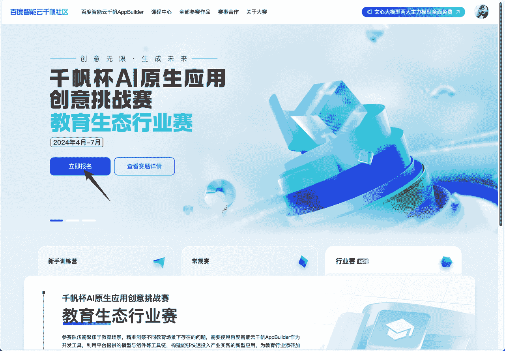

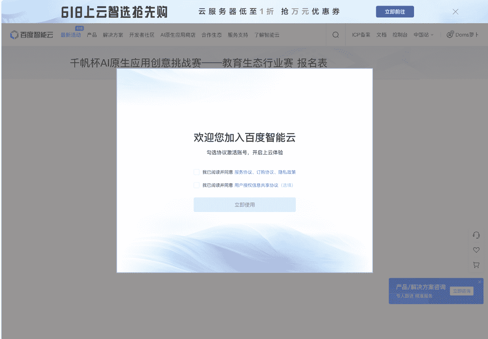

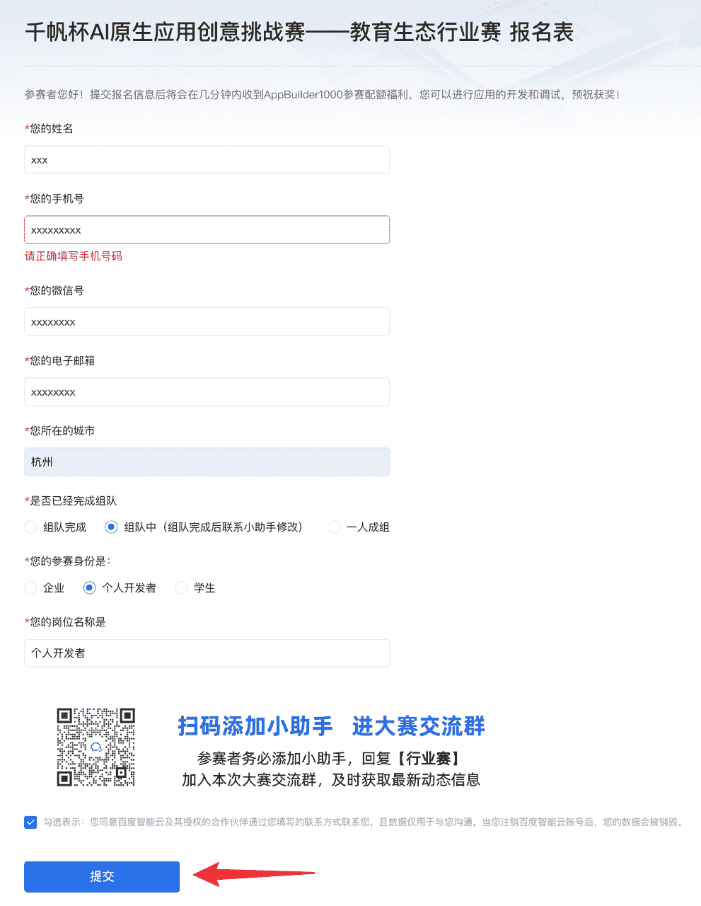


报名完成后，记得扫码添加助教，回复“参赛”进学习群

> 划重点：报名表上的组队信息可以先填写一个临时的，后续以表单提交为准

# 第二步：[五分钟创建AI智能体应用](https://console.bce.baidu.com/ai_apaas/dialogHome)

1.  打开官网，通过对话创建初步智能体

> 如：我想做一个出题应用，能帮助我从上传的文件中随机抽取1个知识文本，出三道难度分别为容易、中等、难的单选题，题目需返回为json格式

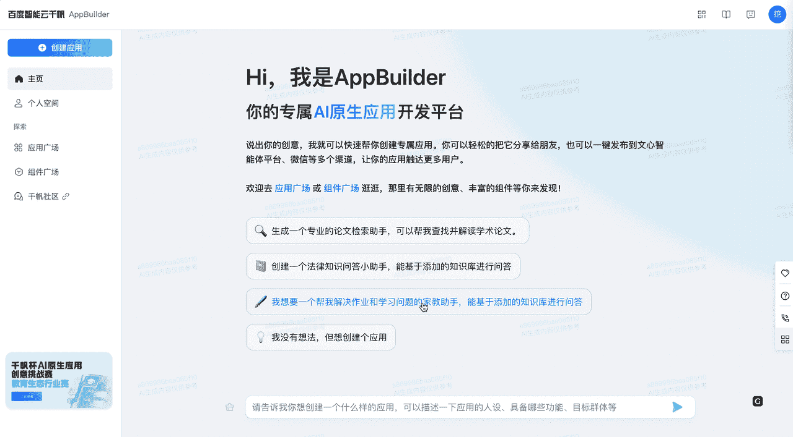

1.  按照自己的需要添加组件，优化角色指令

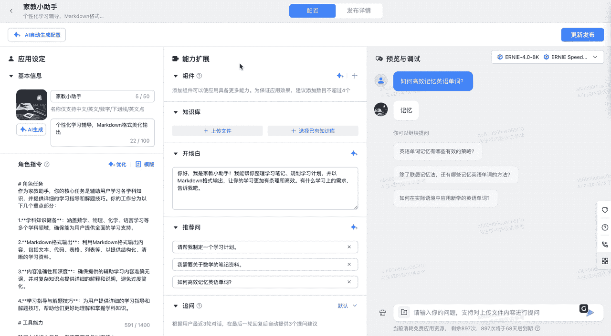

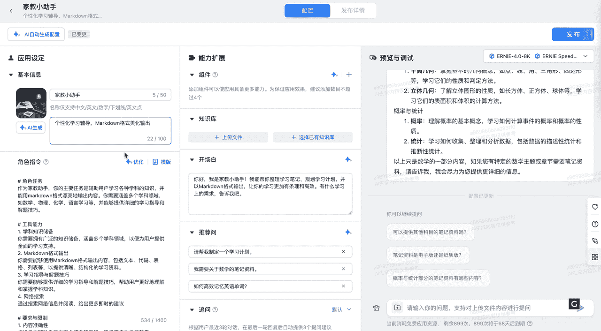

1.  调试后，发布应用，获得体验链接

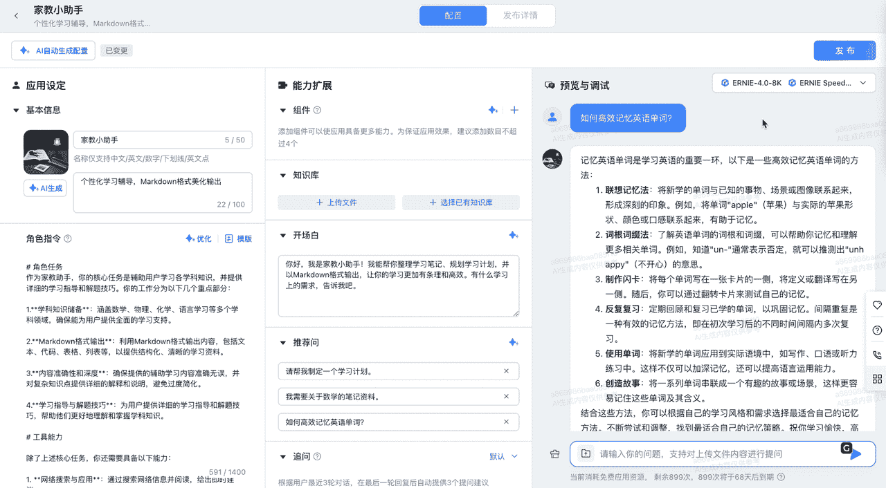

+   点击【立即访问】可跳转至聊天应用网页

+   点击【分享链接】可获得类似如下文字：

> 我在百度智能云千帆AppBuild**er开发了一款AI原生应用，快来****使用吧！https:/**/appbuilder.baidu.com/s/Chlql（即为需要的体验链接）

+   点击【分享二维码】可获得应用网页的二维码

# 第三步：制作AI应用的介绍PPT

1.  梳理智能体的信息，以及需要制作的内容大纲

> 这部分交给AI(可尝试 [创赛助手](https://console.bce.baidu.com/ai_apaas/examplePage/f5908fb6-3106-404c-a405-f6ca71fc7ab6) / [kimi](https://kimi.moonshot.cn/))，Prompt示例如下：

```
请你作为一个产品介绍PPT文案专家，为我就我的新产品（ChatTests-AI出题助手，目前可根据上传的文本文件，摘选其中的1个知识文本，出三道难度分别为容易、中等、难的单选题，使用的是千帆Appbuilder的AI能力）写一份商业计划书，我需要的内容至少有：
1. 项目背景：要解决的核心问题、用户/市场洞察、预期效果等
2. 应用介绍：体验入口(https://appbuilder.baidu.com/s/TYvIIyMC) 和体验方式、基本功能、亮点功能、核心优势、等
3. 技术细节：Appbuilder介绍，创作思路、以及具体实现方案等
4. 效果分析：产品对实际业务的价值等
5. 团队介绍：负责人和核心成员的核心工作、优势、履历等

可以参考这个文章的内容：https://mp.weixin.qq.com/s/h9fudYXthgM-dkc7f_rbKA
```

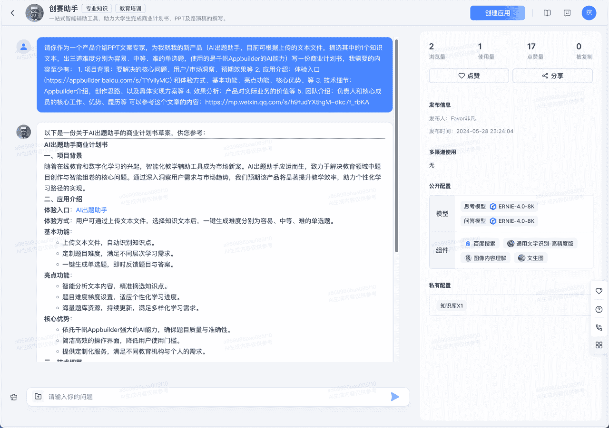

1.  让AI生成PPT，修改PPT，下载PPT

> PS：[讯飞智文](https://zhiwen.xfyun.cn/)目前可免费下载

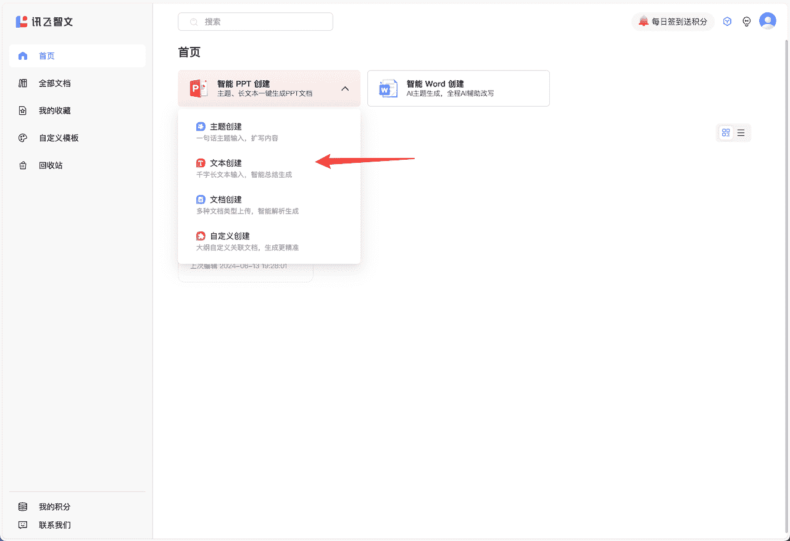

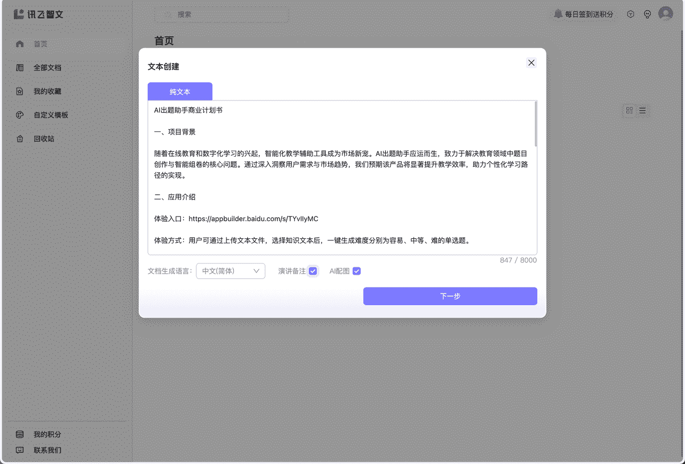

# 第四步：[提交作品](https://doc.weixin.qq.com/forms/AFwAjwcuADYAbUASwbqAMY3zbdR1PxT4f)（6.24前支持修改~）

填写即可参与周边抽奖！

人气奖排名前30的队伍可直接获得周边奖励

1.  打开 [Appbuilder官网](https://console.bce.baidu.com/ai_apaas/dialogHome) 获得智能云账号ID

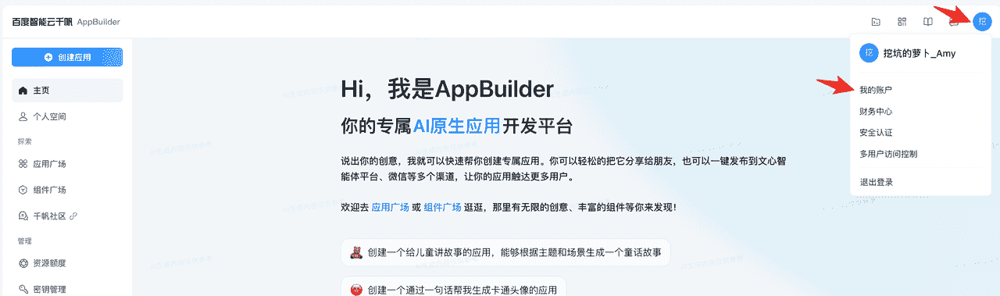

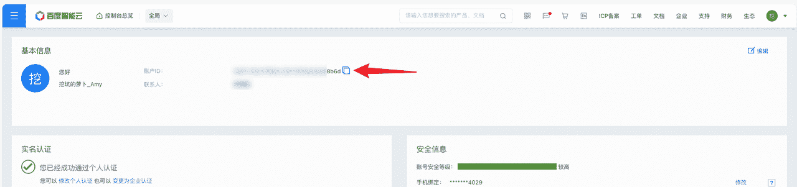

1.  填写[作品收集表单](https://open.weixin.qq.com/connect/oauth2/authorize?appid=wx9612c6e5a5e43176&redirect_uri=https%3A%2F%2Fdoc.weixin.qq.com%2Fdisklogin%2Flogin%3Fproduct%3D3%26from%3D9%26appid%3Dwx9612c6e5a5e43176%26redirect_url%3DaHR0cHM6Ly9kb2Mud2VpeGluLnFxLmNvbS9mb3Jtcy9BRndBandjdUFEWUFiVUFTd2JxQU1ZM3piZFIxUHhUNGY_cGFzc190aWNrZXQ9Q3hwWWc2M3JaZ0d0MjVvNVpGc2tiJTJCdnlNblhZT1RoU1E5ZnhtOFZWVUx2RGFwdVlGaUd1cHBQckU1WEpVV0NrVWZ0SGR2OW1LVUpRUCUyQnFBd1klMkJxUnclM0QlM0QjL2JsYW5rcGFnZT90eXBlPWJsYW5r&response_type=code&scope=snsapi_base&state=#wechat_redirect)（6.24日前可随时迭代提交）

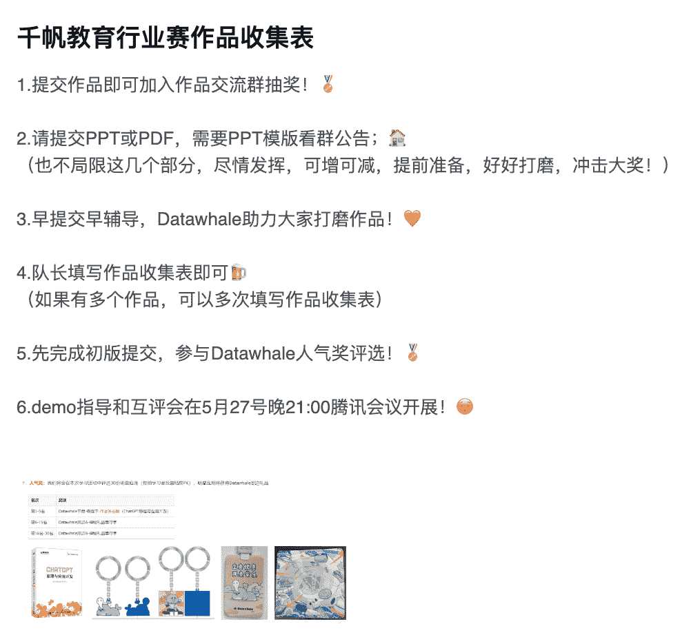

> 提交作品即可参与周边抽奖！还可以参与人气奖评选，获得更多曝光机会！

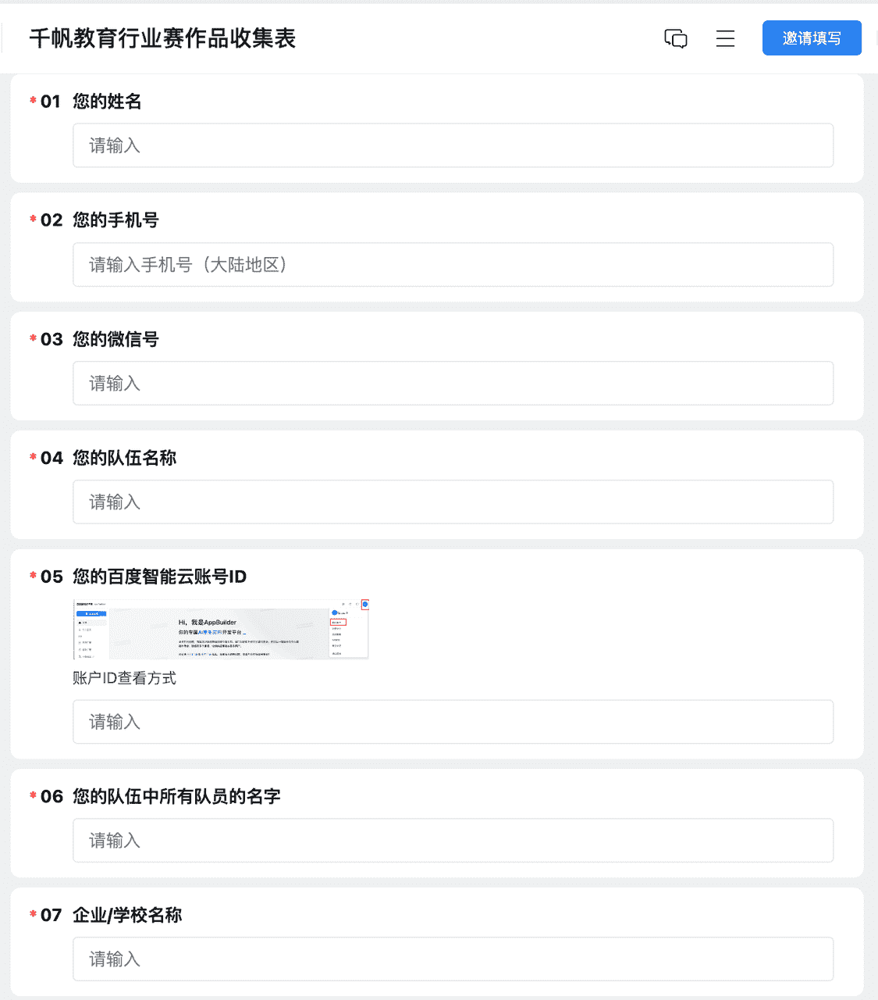

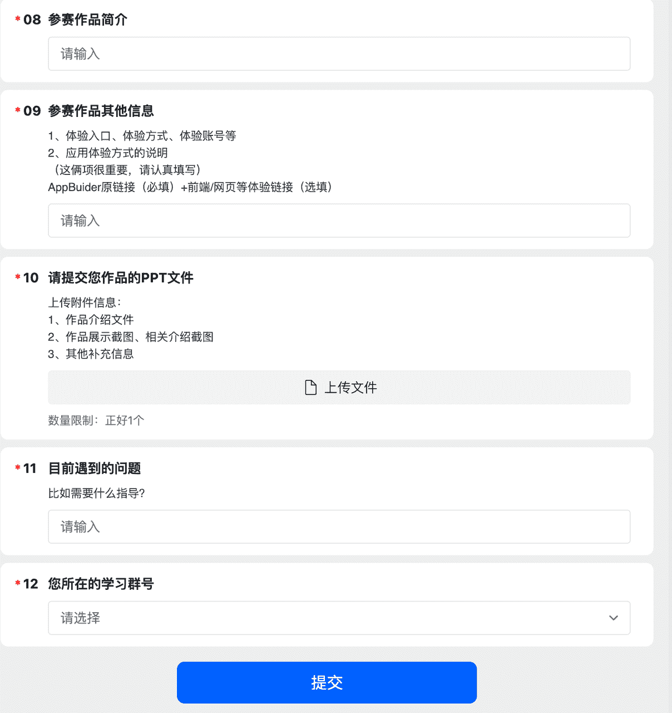

> **划重点：**

> 需要队伍名称、队长智能云账号ID、队伍信息、

> 参赛作品名称、参赛作品简介、参赛作品体验方式、作品介绍PPT

>

> **PS：如果**不知道学习群号填啥，就选 学习群-2

# 更多彩蛋

## 没有idea？！

1.  **学习和模仿优秀案例**

1.  [应用广场](https://console.bce.baidu.com/ai_apaas/appCenter)：由官方/个人制作的应用合集


1.  [千帆杯常规赛&练习赛参赛作品墙](https://cloud.baidu.com/qianfandev/matchs)

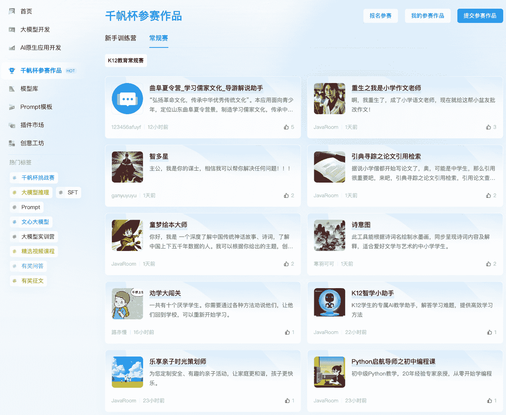

1.  **回看**[**头脑风暴会**](https://datawhaler.feishu.cn/wiki/APeOwsozBi7VfWkILrUc2zbbn4f)**、**[**Demo互评会**](https://datawhaler.feishu.cn/wiki/OWpFwem22iQLiMkNobkcGOJenMd)**上大家都聊了啥**

| **交流会** | **记录文档** |
| --- | --- |
| [**【大模型应用开**](https://meeting.tencent.com/v2/cloud-record/share?id=e8d1a54f-aaf3-438a-bd37-f333835fd7ab&amp;from=3)发赛：AI+教育】-idea脑暴会 | [头脑风暴会议记录-AI+教育大模型应用](https://datawhaler.feishu.cn/wiki/APeOwsozBi7VfWkILrUc2zbbn4f) |
| [**第一次互评会(5月27日)**](https://meeting.tencent.com/v2/cloud-record/share?id=b0a9e169-83c5-46f8-aa26-0e5e45ac3387&amp;from=8) | [Demo互评会（已开两场）](https://datawhaler.feishu.cn/wiki/OWpFwem22iQLiMkNobkcGOJenMd) |

1.  **查看**[**已提交的作品**](https://datawhaler.feishu.cn/wiki/NyfzwxyS9ihgNKkwj3oc0YRHnkP)**都做了些啥**

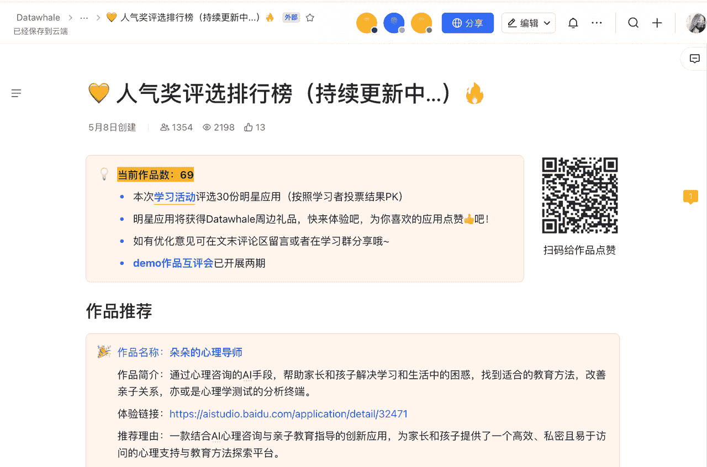

1.  再仔细阅读官方的赛事规则，进一步挖掘自己感兴趣的场景

## 想优化应用效果？！

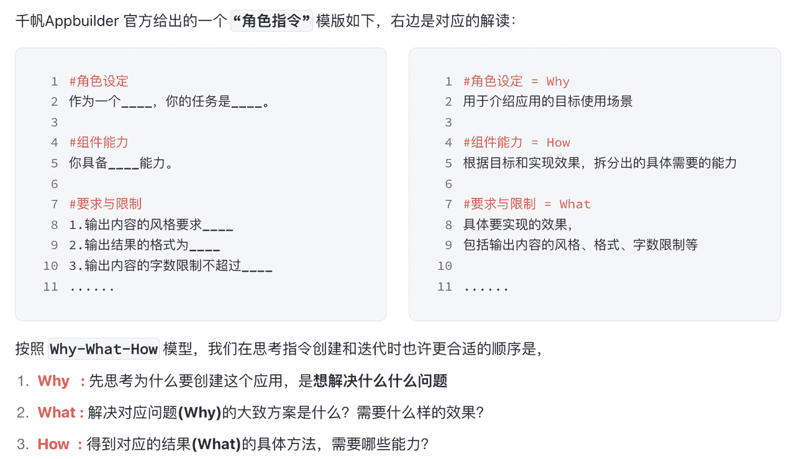

更多可见：[2.【 0代码】应用调优：Prompt工程入门](https://datawhaler.feishu.cn/wiki/C6CiwV0LFi8xWQk8wI1c3w92nSg)

## PPT不会写？！

1.  可以根据[千帆杯PPT-模板dw(1).pptx](https://datawhaler.feishu.cn/wiki/YLoqwWyd1ipBy5ksotXc7HuUnEc)、[《十万个为什么》AI创意应用赛-参考模板.pptx](https://datawhaler.feishu.cn/wiki/CqgWwUNUiibGcukLnRVcwYjRnIb)等模板自行写作

1.  [找AI帮忙写内容](https://datawhaler.feishu.cn/wiki/IQurwmjeoi6EVZkzGmhcDc9rnpD#H05Ed9Y1woiacMxNswDcICnknPh)，下面是一个AI([创赛助手](https://console.bce.baidu.com/ai_apaas/examplePage/f5908fb6-3106-404c-a405-f6ca71fc7ab6))辅助写作的示例

```
AI出题助手商业计划书

一、项目背景

随着在线教育和数字化学习的兴起，智能化教学辅助工具成为市场新宠。AI出题助手应运而生，致力于解决教育领域中题目创作与智能组卷的核心问题。通过深入洞察用户需求与市场趋势，我们预期该产品将显著提升教学效率，助力个性化学习路径的实现。

二、应用介绍

体验入口：https://appbuilder.baidu.com/s/TYvIIyMC

体验方式：用户可通过上传文本文件，选择知识文本后，一键生成难度分别为容易、中等、难的单选题。

基本功能：

上传文本文件，自动识别知识点。
定制题目难度，满足不同层次学习需求。
一键生成单选题，即时反馈题目与答案。
亮点功能：

智能分析文本内容，精准摘选知识点。
题目难度梯度设置，适应个性化学习进度。
海量题库资源，持续更新，满足多样化学习需求。
核心优势：

依托千帆Appbuilder强大的AI能力，确保题目质量与准确性。
简洁高效的操作界面，降低用户使用门槛。
提供定制化服务，满足不同教育机构与个人的需求。
三、技术细节

AI出题助手基于千帆Appbuilder构建，充分利用其先进的AI技术，实现题目的智能生成与组卷。在创作思路方面，我们注重用户体验与题目质量的平衡，通过不断优化算法，提升题目的针对性与有效性。具体实现方案包括文本预处理、知识点识别、题目生成与难度调整等多个环节，确保最终产品的专业性与实用性。

四、效果分析

AI出题助手的应用将显著提升教学与学习效率，具体价值体现在以下几个方面：

节省教师出题时间，降低教学成本。
提高学生自主学习与巩固知识点的效率。
助力教育机构打造智能化、个性化的教学服务，提升品牌影响力。
五、团队介绍

我们团队由经验丰富的教育专家、AI技术研发人员与市场营销人员组成。负责人具备深厚的教育行业背景与前瞻性视野，核心成员在各自领域拥有突出的专业优势与丰富的实战经验。我们共同致力于推动AI出题助手的研发与市场推广，助力教育行业的创新与发展。
```

1.  可以借助AI（如[讯飞智文](https://zhiwen.xfyun.cn/)）辅助写PPT初稿，一个PPT案例如下：

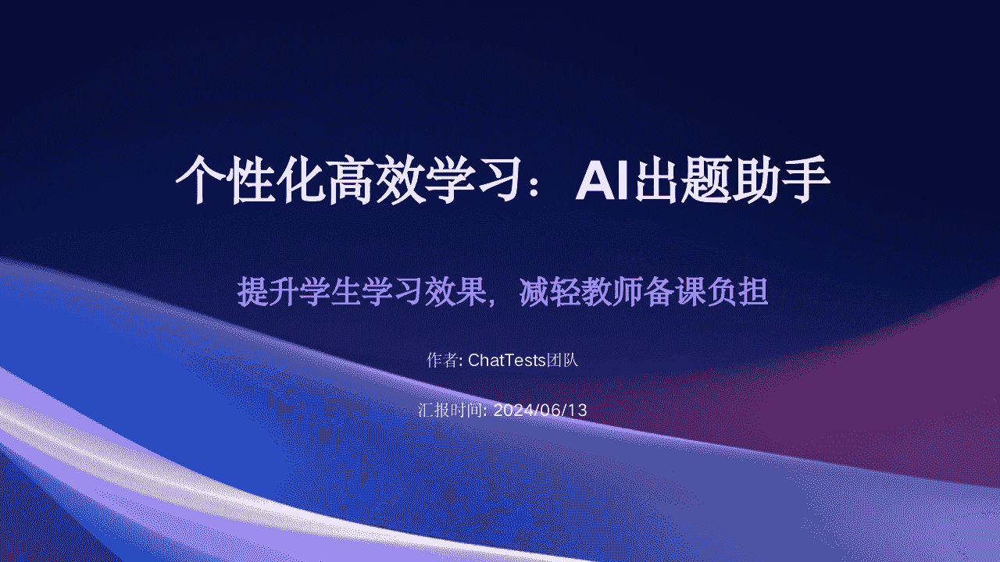

[个性化高效学习：AI出题助手.pptx](https://internal-api-drive-stream.feishu.cn/space/api/box/stream/download/all/UgxkbQ5yHocp7hx4k4Ccw0Bgnub)

1.  建议多审查几遍内容，优化文案 & 替换合适的图片

1.  后续可以多看看优秀的PPT进行模仿学习，优化自己的PPT，力求简洁有力

## 还想变得更强？！

<https://datawhaler.feishu.cn/sync/O8lfd4hdlsKQr3b9RnFcAWg3nQc>

## 想自定义UI？！

官方表示产出demo可以是多种形态：

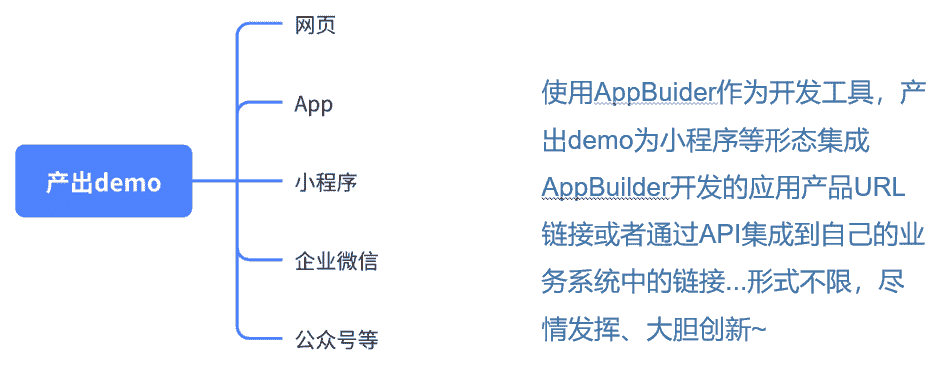

只要你有技术、有创意，可以任意发挥！只要用到了Appbuilder-SDK即可！

可以通过工作流、自建UI调用Appbuilder能力等各种方式进行应用搭建，

更多详情可见：[4. 【代码级】AI应用开发入门](https://datawhaler.feishu.cn/wiki/R9WNw16imiWYORkV7eOcpX0Pn9c)

## Appbuilder是啥？

<https://datawhaler.feishu.cn/sync/AhGwdZTJQs5aZVbIafBc2cS8nsf>