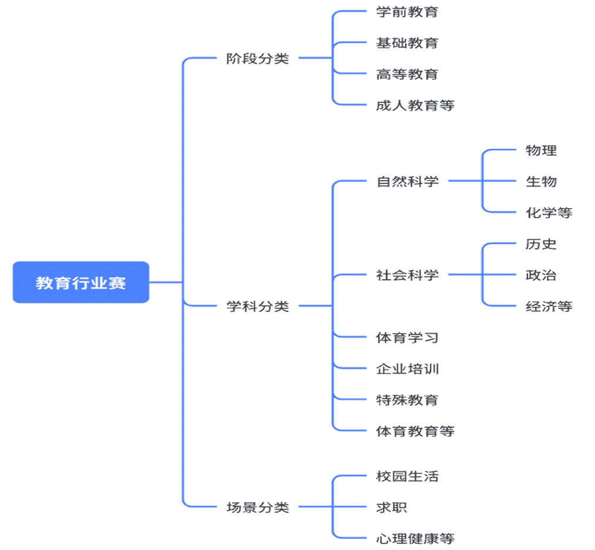
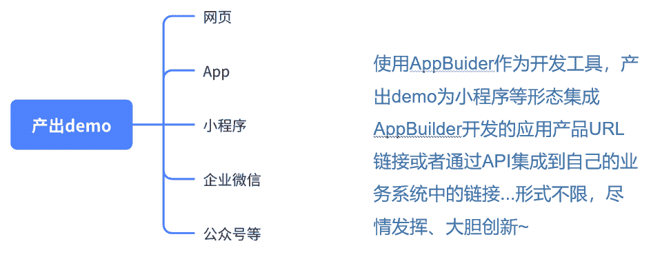
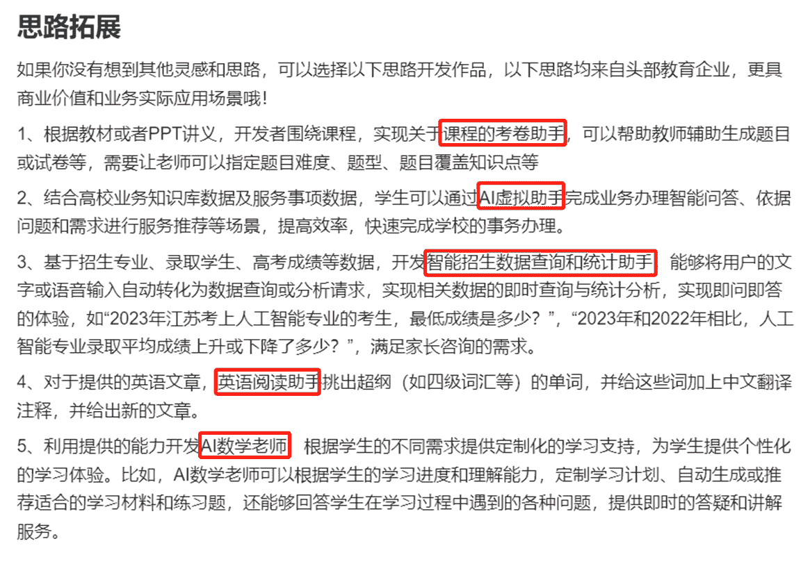

# 0. 【 0基础】赛事必知必会

> 来源：[https://datawhaler.feishu.cn/docx/Kl8mdCnMNoSHygx7DQ8cOo🐧n8d](https://datawhaler.feishu.cn/docx/Kl8mdCnMNoSHygx7DQ8cOo🐧n8d)

<https://datawhaler.feishu.cn/sync/DThjdz4ucsio9sbVLnKc0Gc2nHh>

# 🔍 赛题解读

+   **【赛题主题】**：[**千帆杯教育行业赛**](https://cloud.baidu.com/qianfandev/aimatch?track=8f79b1d113f3dcf0592630d12fb213b7b95a5f2d46eb4229)

+   **【开发者任务】**

+   使用**百度智能云千帆**[**AppBuilder**](https://appbuilder.cloud.baidu.com/)作为开发工具：

+   有1000次免费调用额度，用完可申请。

+   推荐使用平台提供的模型、组件等工具链等。

+   推荐使用[**AppBuilderSDK**](https://github.com/baidubce/app-builder?tab=readme-ov-file)进行更高自由度的AI原生应用开发

+   **构建**能够快速投入产业实践的新型**AI应用**

+   **提交完整应用及作品介绍**：包括创意展示、技术实现细节、AppBuilder对业务带来的增强效果等。

***⚠️需注意：**仅使用prompt 0代码创建应用，不符合本次参赛要求。

**如拟提交AppBuil**der应用作为参赛作品，需要有效利用到工作流、组件、知识库等其他功能（并在PPT和邮件中予以说明）。

+   【**参考方向**】

+   精准洞察不同教育场景下存在的问题。

+   探索教育行业的技术掣肘、低效场景。

+   创建教育行业大模型新场景。

> 如：

1.  **个性化学习平台**：根据学生的学习习惯、进度和兴趣提供个性化学习资源和路径

1.  **智能辅导系统**：根据学生的作业和问题提供实时反馈和解答

1.  **虚拟教师助手**：协助教师进行课堂管理、学生互动和教学内容的个性化

1.  **学习行为分析工具**：分析学生的学习行为，优化教学方法和课程设计

1.  **编程教育游戏**：通过游戏化的方式教授基础的编程概念和逻辑思维

1.  **心理健康辅导机器人**：识别学生的情绪状态并提供心理健康辅导

**···**

+   **【限制】**

+   参赛者必须基于百度智能云千帆AppBuilder开发应用。

+   参赛者不得有违法违规行为，包括但不限于作弊、抄袭、剽窃他人作品、提供虚假信息等。

+   参赛作品的版权归参赛者所有，主办方有权在比赛相关的宣传中使用参赛作品。

+   **【评审方案】**

+   **线上初赛**：由行业专家组成的专业评审团对提交的作品方案进行综合打分，选出决赛入选队伍。

+   **决赛**：决赛将以现场答辩会的形式进行，具体要求和安排另行通知。

+   **评审维度**：

1.  **业务完整性**：考察端到端的应用系统搭建完整度。

1.  **应用效果**：用户体验好，应用准确率符合真实用户需求。

1.  **商业价值**：高度契合真实业务使用场景，具备多方商业收益。

1.  **创新性**：技术与应用创新解决行业实际问题。

# 📮 提交规范（待定）

<https://datawhaler.feishu.cn/sync/QBqFda86AsRIycbddQucAZJwnUe>

# 🏆 赛事奖励

<https://datawhaler.feishu.cn/sync/UIw2dIBzlsYBXqbqpVTc79hjnUc>

# 📢赛事详情

<https://datawhaler.feishu.cn/sync/RCDmddByzs8W5xbGHjqcDhOnnzg>

# 👌赛题解读

Q1：教育场景有哪些？

Q2：产出demo可以是哪些？

Q3：场景参考

# 🕹️接下来，开始学习千帆Appbuilder使用入门吧~

> 更多教程详情可见：

<https://datawhaler.feishu.cn/sync/O8lfd4hdlsKQr3b9RnFcAWg3nQc>

# ❓ QA

<https://datawhaler.feishu.cn/sync/G7ZTdwcz9s0WjgbGxhnc7VSWnuo>

# 🐳 Datawhale简介 & 致谢

<https://datawhaler.feishu.cn/sync/LeXFdL7YjsXOuabuutsc2lTGnxE>

> 本篇内容贡献者为：  ，非常期待大家的点赞和评论呀~